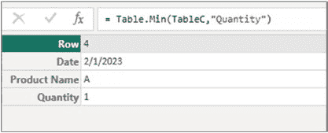
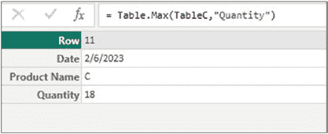
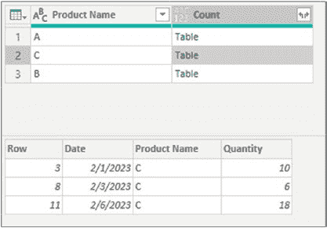
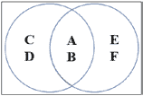
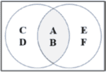
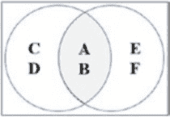
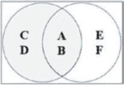
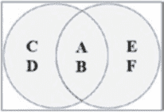
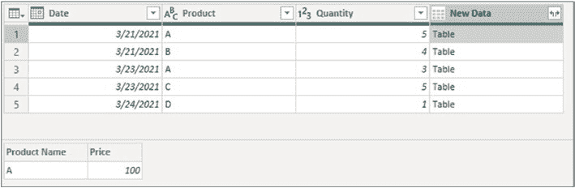
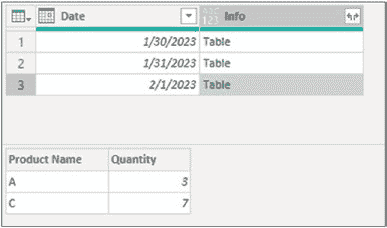

# 第 8 章：表

在数据探索与分析的广阔领域中，表是结构与连贯性的基石。它们将混乱的数据组织起来，提供上下文，并通过以逻辑且易于理解的格式呈现数据来促进洞察。欢迎来到本章，我们将深入探讨 Power Query 中的表函数世界，引导你掌握将原始信息转化为有序、可操作知识的艺术。

表是数据故事展开的画布。想象一下，客户订单被整齐分类、项目任务被细致追踪，或是调查回复被整理以待分析。在一个数据点分散的世界中，表是将信息凝聚在一起的粘合剂，促进无缝的探索与理解。

你对本章的探索始于对表的基本理解：它们的结构、列和行数据。你将了解 Power Query 如何将表视为能够容纳多种数据类型和关系的动态结构。掌握了这些知识后，你将踏上手动创建和通过计算表达式创建表的旅程。

然而，表并非静态实体；它们是通往转换与启发的路径。探索 Power Query 提供的众多表函数，这些函数使你能够精确地筛选、排序、重塑和聚合数据。从删除列到筛选行，这些函数使你能够创建符合分析目标的表。

© Omid Motamedisedeh 2024
O. Motamedisedeh，《Power Query 函数终极指南》，
[`doi.org/10.1007/978-1-4842-9754-4_8`](https://doi.org/10.1007/978-1-4842-9754-4_8#DOI)

## 创建表

在 Power Query 中，有各种方法可以从不同数据源创建或调用表。本节将介绍使用以下函数从记录、列表、行或列创建表。

### Table.FromColumns

正如该函数名称所示，`Table.FromColumns` 用于从一组列创建表，如下所示：

```
Table.FromColumns(
  lists as list,
  optional columns as any
) as table
```

该函数接收两个输入：

1. 该函数的第一个输入表示所需表中各列的内容，其中每列的值以列表形式输入，所有列表则在一个引用列表中输入。换句话说，在此输入中输入 `{{1,2},{3,4}}` 意味着所需的表有两列，第一列包含值 1 和 2，第二列包含值 3 和 4。

2. 该函数的第二个输入为可选参数，用于指定列的标题。在此输入中，列标题以列表形式输入。如果此输入未输入任何值，则输出的表名称将使用“列 1”、“列 2”等。

基于函数说明，要创建一个包含三列的表格，其第一个输入是一个包含三个子列表的列表。每个子列表包含与该表格某列相关的值。该表格的第二个输入也包含一个列表，该列表具有三个文本值作为列标题。因此，以下公式的结果等同于一个具有三列两行的表格，如下所示，也如表 8-1 所示：

```
= Table.FromColumns(
    {
      {"Omid","Ali"},
      {"Motamedi","Amjad"},
      {31,35}
    },
    {"Name","Family","Age"})
```

**表 8-1.** 使用 `Table.FromColumns` 创建表格

| 名称 | 姓氏 | 年龄 |
| :--- | :--- | :--- |
| Omid | Motamedi | 31 |
| Ali | Amjad | 35 |

类似地，以下公式的结果等同于表 8-2：

```
= Table.FromColumns(
    {
      {"Omid"},
      {null,"Amjad"},
      {"",35}
    },
    {"Name","Family","Age"})
```

**表 8-2.** 使用 `Table.FromColumns` 创建表格

| 名称 | 姓氏 | 年龄 |
| :--- | :--- | :--- |
| Omid | null | null |
| null | Amjad | 35 |

如果未输入与第二个输入相关的信息，如下列公式所示，则列将被命名为“列 1”、“列 2”和“列 3”，结果如表 8-3 所示：

```
= Table.FromColumns({{"Omid","Ali"},{"Motamedi","Amjad"},{31,35}})
```

**表 8-3.** 使用 `Table.FromColumns` 创建表格

| 列 1 | 列 2 | 列 3 |
| :--- | :--- | :--- |
| Omid | Motamedi | 31 |
| Ali | Amjad | 35 |

### Table.FromRows

`Table.FromRows` 函数与 `Table.FromColumns` 函数类似。

区别在于，在此函数的第一个输入中，不是定义表的列值，而是定义与行对应的值，如下所示：

```
Table.FromRows(
  rows as list,
  optional columns as any
) as table
```

此函数接收以下两个输入：

1. 第一个输入是一个包含若干子列表的列表，每个子列表包含一行的值。换句话说，如果在此输入中输入值 `{{1,2},{3,4}}`，则表示所需表格有两行，并且第一行输入值 1 和 2，第二行输入值 3 和 4。
2. 表的标题在此输入的列表中定义。此输入是可选的，如果未输入，列标题将显示为“列 1”、“列 2”，依此类推。

基于函数说明，以下公式的结果是一个具有三列两行的表格，如表 8-4 所示：

```
= Table.FromRows(
    {
      {"Omid","Motamedi",31},
      {"Ali","Amjad",35}
    },
    {"Name","Family","age"}
  )
```

**表 8-4.** 使用 `Table.FromRows` 创建表格

| 名称 | 姓氏 | 年龄 |
| :--- | :--- | :--- |
| Omid | Motamedi | 31 |
| Ali | Amjad | 35 |

如果未输入第二个输入，结果将如表 8-5 所示。

```
= Table.FromRows(
    {
      {"Omid","Motamedi",31},
      {"Ali","Amjad",35}
    })
```

**表 8-5.** 使用 `Table.FromRows` 创建表格

| 列 1 | 列 2 | 列 3 |
| :--- | :--- | :--- |
| Omid | Motamedi | 31 |
| Ali | Amjad | 35 |

在类似情况下，如果某些值不可用，可以用 `null` 表达式替换它们或将其留空，如下所示以及表 8-6 所示：

```
= Table.FromRows({{"Omid","",""},{null,"Amjad",35}},{"Name","Family","age"})
```

**表 8-6.** 使用 `Table.FromRows` 创建表格

| 名称 | 姓氏 | 年龄 |
| :--- | :--- | :--- |
| Omid | null | null |
| null | Amjad | 35 |

### Table.FromRecords

`Table.FromRecords` 用于根据一组记录创建表。在此函数中，每条记录代表表的一行，并且必须将这些记录作为此函数的第一个输入输入到一个列表中。记录的字段可以相同或不同，但在此函数的第二个输入中，你需要指定哪些字段应显示在输出中。在此函数的第三个输入中，你指定如果未输入任何值，如何计算某个字段的值。此函数的定义如下：

```
Table.FromRecords(
  records as list,
  optional columns as any,
  optional defaultRecordField as nullable record
) as table
```

# Power Query 表函数

`optional missingField as nullable number`

`) as table`

此函数接收以下三个输入：

1. 在此输入中，定义表行的值。每行的值以记录形式输入，所有记录在一个列表中定义，作为第一个输入。
2. 此输入为可选参数，用于在最终表中仅显示第一个输入中记录的特定字段。这些字段的名称可在一个列表中输入至此参数中。否则，若不为此输入提供值，则输出将显示所有记录的全部字段。
3. 此函数的第三个输入也是可选的，它指定了如何处理这样一种情况：第二个输入中定义了某个字段，但第一个输入中的任何记录都不包含该字段。在此输入中，可以使用以下三种状态之一：`MissingField.Error`（或值 0）、`MissingField.Ignore`（或值 1）和 `MissingField.UseNull`（或值 2）。

根据函数说明，以下公式的结果如表 8-7 所示：

```
= Table.FromRecords(
    {[Name="Omid",Family="Motamedi",Age=31],
     [Name="Ali",Family="Amjad",Age=35]}
)
```

表 8-7. 通过 `Table.FromRecords` 创建表
| Name | Family | Age |
| :--- | :--- | :--- |
| Omid | Motamedi | 31 |
| Ali | Amjad | 35 |

如果在第二个输入中指定某些列名，如 `Name` 和 `Age`，结果将发生变化，如表 8-8 所示。

```
= Table.FromRecords(
    {[Name="Omid",Family="Motamedi",Age=31],
     [Name="Ali",Family="Amjad",Age=35]},
    {"Name","Age"})
```

表 8-8. 通过 `Table.FromRecords` 创建表
| Name | Age |
| :--- | :--- |
| Omid | 31 |
| Ali | 35 |

如果第二条记录不包含 `Name` 字段，以下公式的结果将如表 8-9 所示：

```
= Table.FromRecords(
    {[Name="Omid",Family="Motamedi",Age=31],
     [Family="Amjad",Age=35]},
    {"Name","Age"})
```

表 8-9. 通过 `Table.FromRecords` 创建表
| Name | Age |
| :--- | :--- |
| Omid | 31 |
| error | error |

在这种情况下，通过在函数的第三个输入中输入数字 `2`，结果将如表 8-10 所示。

表 8-10. 通过 `Table.FromRecords` 创建表
| Name | Age |
| :--- | :--- |
| Omid | 31 |
| null | null |

## `Table.FromValue`

使用 `Table.FromValue`，可以将不同格式的值转换为表格，如下所示：

```
Table.FromValue(
    value as any,
    optional options as nullable record
) as table
```

如您所见，此函数接收以下两个输入：
1. 在此函数的第一个输入中，输入您想转换为表格的值。这些值可以是数字、列表、记录或其他格式。
2. 此函数的第二个输入是可选的，包含与函数相关的设置。例如，使用 `DefaultColumnName` 可以更改表的列名。

如果在第一个输入中使用列表，如 `= Table.FromValue({"A",2,3})`，生成的表格如表 8-11 所示。

表 8-11. 通过 `Table.FromValue` 创建表
| Value |
| :--- |
| A |
| 2 |
| 3 |

如果使用记录，如 `= Table.FromValue([a=1,b=2,c=3])`，生成的表格如表 8-12 所示。

表 8-12. 通过 `Table.FromValue` 创建表
| Name | Value |
| :--- | :--- |
| a | 1 |
| b | 2 |
| c | 3 |

如果输入的是数值或文本值，则表格如表 8-13 所示。

```
= Table.FromValue(2)
```

表 8-13. 通过 `Table.FromValue` 创建表
| Value |
| :--- |
| 2 |

## 表转换

使用 Power Query 函数，可以将表转换为列表、记录、列或行。本节将探讨这些类型的函数。

为简单起见，将表 8-14 视为表 A，并在多个示例中使用。

表 8-14. 表 A 的定义
| Product | Price | Material |
| :--- | :--- | :--- |
| W11 | 100 | Metal |
| S06 | 50 | Wood |
| R08 | 200 | Glass |

并将表 8-15 视为表 B。

表 8-15. 表 B 的定义
| Name | Family | Age |
| :--- | :--- | :--- |
| Omid | Motamedi | 31 |
| Ali | Amjad | 35 |

### `Table.ToRecords`

使用 `Table.ToRecords` 并配合以下语法，可以将表转换为一组记录：

```
Table.ToRecords(table as table) as list
```

此函数接收一个 `table` 类型的输入，其输出是一个列表（`list`），其中每个值代表与原始表的行相对应的一条记录（`record`）。

基于这些解释，公式 `Table.ToRecords(TableB)` 的结果等于以下列表：

```
{[Name="Omid",Family="Motamedi",Age=31],
 [Name="Ali",Family="Amjad",Age=35]}
```

公式 `Table.ToRecords(TableA)` 的结果等于以下列表：

```
{[Product="W11",Price=100,Material="Metal"],
 [Product="S06",Price=75,Material="Wood"],
 [Product="R08",Price=125,Material="Glass"]}
```

### `Table.ToColumns`

`Table.ToColumns` 函数可以使用以下语法将表的列值转换为列表：

```
Table.ToColumns(table as table) as list
```

使用此函数，表的每一列都被转换为一个列表，并且所有列表都作为输出中的其他列表的值显示。换句话说，此函数接收一个 `table` 类型的输入，其输出是一个列表（`list`），该列表为引用表的每一列包含一个列表。因此，公式 `Table.ToColumns(TableB)` 的结果等于以下列表：

```
{{ "Omid","Ali"},
 { "Motamedi","Amjad"},
 {31, 35}}
```

公式 `Table.ToColumns(TableA)` 的结果等于以下列表：

```
{{ "W11", "S06", "R08"},
 {100, 75, 125},
 {"Metal", "Wood", "Glass"}}
```

### `Table.ToRows`

使用 `Table.ToRows` 可以将表转换为一组行，其中每一行都显示在一个列表内。换句话说，此函数接收一个 `table` 格式的输入，其输出等于一个列表（`list`），其中每个值代表一个列表（`list`），该列表与原始表的一行相对应。

此函数的语法如下：

```
Table.ToRows(table as table) as list
```

因此，公式 `Table.ToRows(TableB)` 的结果等于以下列表：

```
{{ "Omid","Motamedi", 31},
 { "Ali","Amjad", 35}}
```

公式 `Table.ToRows(TableA)` 的结果等于以下列表：

```
{{ "W11", 100, "Metal"},
 { "S06", 75, "Wood"},
 { "R08", 125, "Glass"}}
```

### `Table.ToList`

`Table.ToList` 用于将表转换为列表，如下所示：

```
Table.ToList(
    table as table,
    optional combiner as nullable function
) as list
```

# 第 8 章 表

## `Table.ToList`

此函数接收两个输入：

1. 第一个输入是引用表。
2. 此函数的第二个输入是可选的，通过输入以下值之一来指定合并不同列的值的方式：
    - `Combiner.CombineTextByDelimiter`
    - `Combiner.CombineTextByEachDelimiter`
    - `Combiner.CombineTextByLengths`
    - `Combiner.CombineTextByPositions`
    - `Combiner.CombineTextByRanges`

关于此函数的一个重要点是，在使用它之前，必须将引用表的所有列格式更改为文本（`text`）。

考虑如表 8-13 所示的`TableA`，并假设`Price`列的列格式定义为文本，则公式`= Table.ToList(TableA)`的结果等于列表`{"W11,100,Metal", "S06,75,Wood", "R08,125,Glass"}`。

此外，以下公式表示`TableA`的第一、第二和第三列应分别取每列的前 1、2 和 2 个字符进行合并。因此，结果是`{"W10Me", "S75Wo", "R12Gl"}`：

```
= Table.ToList(TableA, Combiner.CombineTextByLengths({1,2,2}))
```

在以下示例中，短划线是分隔符：

```
= Table.ToList(TableA, Combiner.CombineTextByDelimiter("-"))
```

因此，上述公式的结果等于`{"W11-100-Metal", "S06-75-Wood", "R08-125-Glass"}`。

通过如下使用`Combiner.CombineTextByEachDelimiter`，可以为合并列定义不同的分隔符：

```
= Table.ToList(TableA, Combiner.CombineTextByEachDelimiter({".","_"}))
```

因此，结果是`{"W11.100-Metal", "S06.75-Wood", "R08.125-Glass"}`。

## `Table.Column`

使用`Table.Column`的以下语法，可以将列的值提取为列表：

```powerquery
Table.Column(
    table as table,
    column as text
) as list
```

该函数接收两个输入：
1. 第一个输入指定引用表。
2. 第二个输入是目标列的名称（文本形式）。

该函数的结果是一个列表，其中包含第二个输入中指定列的值。因此，`Table.Column(TableC, "Quantity")`的结果等于以下列表：

```
{17, 18, 10, 1, 6, 9, 6, 6, 10, 3, 18}
```

除了`Table.Column`，要从表中提取列的值，也可以将列名写在表名后的`[]`中。因此，`TableC[Quantity]`的结果也等于`Quantity`列的值，就像`Table.Column(TableC, "Quantity")`一样。

## `Table.TransformRows`

使用`Table.TransformRows`函数，可以将表中的行值转换为列表，如下所示：

```powerquery
Table.TransformRows(
    table as table,
    transform as function
) as list
```

根据函数语法，它接收两个输入：
1. 第一个输入是引用表。
2. 第二个输入定义转换函数，将值转换为列表。

通过该函数，表中的值根据第二个输入中定义的转换函数转换为列表。例如，以下公式的结果等于列表`{100, 75, 125}`：

```
= Table.TransformRows(TableA, each [Price])
```

而以下公式的结果等于列表`{"W11, Metal", "S06, Wood", "R08, Glass"}`：

```
= Table.TransformRows(TableA, each [Product] & ", " & [Material])
```

在以下示例中，产品名称的第一个字符和产品材料的最后一个字符应在输出列表中相邻显示。结果为`{"Wl", "Sd", "Rs"}`：

```
= Table.TransformRows(TableA, each Text.Start([Product], 1) & Text.End([Material], 1))
```

## `Table.Split`

`Table.Split`用于将一个表拆分为多个表。例如，使用该函数可以将一个包含 100 行的表拆分为 50 个包含 2 行的表。

```powerquery
Table.Split(
    table as table,
    pageSize as number
) as list
```

该函数接收两个参数：
1. 第一个参数是引用表。
2. 第二个参数确定拆分后每个表的行数。例如，要将一个包含 100 行的表拆分为 50 个包含 2 行的表，则在此输入 2。

该函数的输出是一个列表，其中的每个值都是原始表的一个子表。

根据以上说明，将`X`视为包含 11 行的表，则公式`Table.Split(X, 2)`的结果是一个包含 6 个值的列表。该列表的前 5 个值是包含 2 行的表，第 6 个值是包含 1 行的表。

## `Table.SplitAt`

`Table.SplitAt`用于根据条件将一个表分为两个子表。

```powerquery
Table.SplitAt(
    table as table,
    count as number
) as list
```

该函数接收两个输入：
1. 第一个输入是引用表。
2. 在此输入中，确定表的分割位置。换句话说，在此输入数字 3 意味着引用表被分为两个子集：前四行将显示在第一个表中，其余行将显示在第二个表中。

因此，将`X`视为包含 11 行的表，则公式`Table.SplitAt(X, 3)`的结果是一个包含两个值的列表。第一个值是包含引用表前四行的表，第二个值是包含引用表其余行的表。

## 信息

Power Query 中有几个函数用于提供信息，例如表中的列数和行数。这些函数接收表形式的输入，并在输出中提供关于该表的信息。表 8-16 列出了这些函数及其应用。

### 表 8-16. 表信息函数

| 函数 | 说明 |
| :--- | :--- |
| `Table.Approximate` | 此函数的结果等于大型表中的近似行数（如果相关数据库支持此功能）。 |
| `Table.ColumnCount` | 此函数的输出等于输入表中的列数。 |
| `Table.IsEmpty` | 如果此函数输入中定义的表没有行，则此函数的结果为 `true`；否则，函数的结果为 `False`。 |
| `Table.Profile` | 此函数的结果等于一个提供统计信息的表，包括输入表不同列的最小值、最大值、平均值、标准差、记录数、唯一记录数和空值数。 |
| `Table.RowCount` | 此函数的结果等于引用表中的行数。 |
| `Table.Schema` | 此函数的结果是一个提供引用表列附加信息的表。 |

考虑名为 `TableA` 的表 8-14 和名为 `TableB` 的表 8-15，表 8-17 显示了使用各种公式的结果。

### 表 8-17. 表信息函数示例

| 公式 | 结果 |
| :--- | :--- |
| `=Table.ColumnCount(TableB)` | |
| `=Table.IsEmpty(TableB)` | `False` |
| `=Table.RowCount(TableB)` | |
| `=Table.ColumnCount(TableA)` | |
| `=Table.IsEmpty(TableA)` | `False` |
| `=Table.RowCount(TableA)` | |

并且函数 `Table.Profile(TableB)` 的结果等于表 8-18。

### 表 8-18.

| 列 | DistinctCount | NullCount | 计数 | StandardDeviation | 平均值 | 配置文件 | 表 | 最大值 | 结果 | 最小值 | 年龄 | 姓氏 | 名字 |
| :--- | :--- | :--- | :--- | :--- | :--- | :--- | :--- | :--- | :--- | :--- | :--- | :--- | :--- |
| | | | | `2.828427125` | `null` | `null` | | `35` | Motamedi Omid | | `31` | amjad ali | | |

## 选择表行

在 Power Query 中，使用各种函数可以从表中提取所需数量的行。本节将介绍这些函数。为了检查本节中的函数，将表 8-19 视为 `TableC`。

```
= Table.FromColumns(
  {{1,2,3,4,5,6,7,8,9,10,11},
```

# 第 8 章 表

## TableC 的定义

```powerquery
{
   {#date(2023,1,30),#date(2023,1,31),#date(2023,2,1),
    #date(2023,2,1),#date(2023,2,1),#date(2023,2,2),#date
    (2023,2,2),#date(2023,2,3),#date(2023,2,4),#date
    (2023,2,4),#date(2023,2,6)},
   {"A","A","C","A","B","B","A","C","B","A","C"},
   {17,18,10,1,6,9,6,6,10,3,18}},
  {"行","日期","产品名称","数量"}
}
```

| 行 | 日期 | 产品名称 | 数量 |
| :--- | :--- | :--- | :--- |
| 1 | 1/30/2023 | a | 17 |
| 2 | 1/31/2023 | a | 18 |
| 3 | 2/1/2023 | C | 10 |
| 4 | 2/1/2023 | a | 1 |
| 5 | 2/1/2023 | b | 6 |
| 6 | 2/2/2023 | b | 9 |
| 7 | 2/2/2023 | a | 6 |
| 8 | 2/3/2023 | C | 6 |
| 9 | 2/4/2023 | b | 10 |
| 10 | 2/4/2023 | a | 3 |
| 11 | 2/6/2023 | C | 18 |

## Table.FirstValue

`Table.FirstValue` 的结果始终等于表中第一行第一列输入的值。`Table.FirstValue` 在 Power Query 中定义如下：

```powerquery
Table.FirstValue(
  table as table,
  optional default as any
) as any
```

根据函数语法，它接收两个输入：
1. 此函数的第一个输入指定引用表。
2. 此函数的第二个输入是可选的。此输入代表此函数的默认值，如果函数的结果是错误（第一个输入中输入的表为空），则会显示此值。

## Table.First 和 Table.Last

`Table.First` 和 `Table.Last` 用于提取表的第一行或最后一行，如下所示：

```powerquery
Table.First(
  table as table,
  optional default as any
) as any

Table.Last(
  table as table,
  optional default as any
) as any
```

这些函数接收两个参数，如下所示：
1. 第一个参数是引用表。
2. 此函数的第二个参数是可选的，可用于确定如果函数的第一个输入为空（引用表没有行），在输出中应显示什么值。

这些函数的结果始终是一个记录，显示引用表第一行或最后一行的值。因此，公式 `Table.First(TableC)` 的结果如下：

`[Row=1,Date="1/30/2023",Product Name=A,Quantity=17]`

类似地，函数 `Table.Last(TableC)` 的结果如下：

`[Row=11,Date="2/6/2023",Product Name=C,Quantity=18]`

## Table.FirstN 和 Table.LastN

`Table.FirstN` 和 `Table.LastN` 用于从表格的开头或结尾提取若干行，语法如下：

```powerquery
Table.FirstN(
   table as table,
   countOrCondition as any
) as table
```

```powerquery
Table.LastN(
   table as table,
   countOrCondition as any
) as table
```

根据语法，这两个函数接受两个输入：
1. 第一个输入是引用表。
2. 在该函数的第二个输入中，输入数字 `n`，以确定应从表格开头或结尾提取多少行。在此输入中，也可以定义一个条件；在这种情况下，只有满足该条件的表格开头（或结尾）的行链才会显示在输出表格中。

根据以上说明，公式 `Table.FirstN(TableC,5)` 的结果如 表 8-20 所示。

**表 8-20.** `Table.FirstN` 示例

| 行 | 日期 | 产品名称 | 数量 |
| :--- | :--- | :--- | :--- |
| 1 | 1/30/2023 | a | 17 |
| 2 | 1/31/2023 | a | 18 |
| 3 | 2/1/2023 | C | 10 |
| 4 | 2/1/2023 | a | 1 |
| 5 | 2/1/2023 | b | 6 |

公式 `= Table.FirstN(TableC, each [Quantity]>9)` 的结果等于 表 8-21。

**表 8-21.** `Table.FirstN` 示例

| 行 | 日期 | 产品名称 | 数量 |
| :--- | :--- | :--- | :--- |
| 1 | 1/30/2023 | a | 17 |
| 2 | 1/31/2023 | a | 18 |
| 3 | 2/1/2023 | C | 10 |

类似地，公式 `Table.LastN(TableC,5)` 的结果如 表 8-22 所示。

**表 8-22.** `Table.LastN` 示例

| 行 | 日期 | 产品名称 | 数量 |
| :--- | :--- | :--- | :--- |
| 7 | 2/2/2023 | a | 6 |
| 8 | 2/3/2023 | C | 6 |
| 9 | 2/4/2023 | b | 10 |
| 10 | 2/4/2023 | a | 3 |
| 11 | 2/6/2023 | C | 18 |

而公式 `= Table.LastN(TableC, each [Quantity]>9)` 的结果等于 表 8-23。

**表 8-23.** `Table.LastN` 示例

| 行 | 日期 | 产品名称 | 数量 |
| :--- | :--- | :--- | :--- |
| 11 | 2/6/2023 | C | 18 |

## Table.Max 和 Table.Min

`Table.Max` 和 `Table.Min` 用于从表格中提取包含指定列最大值或最小值的行。

```powerquery
Table.Max(
   table as table,
   comparisonCriteria as any,
   optional default as any
) as any
```



```powerquery
Table.Min(
   table as table,
   comparisonCriteria as any,
   optional default as any
) as any
```

函数 `Table.Max` 和 `Table.Min` 各接收三个输入：
1. 这些函数的第一个输入是引用表。
2. 在此输入中，指定比较条件。通常，你要在其中查找最大值或最小值的列的名称直接以文本格式输入到此输入中。
3. 第三个输入是可选的，用于指定函数的默认值；适用于函数结果为错误的情况。

根据上述说明，要提取 `TableC` 中对应于最小销售额的行，可以使用以下公式：

`= Table.Min(TableC, "Quantity")`

在这种情况下，结果显示在 图 8-1 中。

**图 8-1.** 对应于最小销售额的行



要提取对应于最大销售额的行，可以使用以下公式：

`= Table.Max(TableC, "Quantity")`

结果显示在 图 8-2.（虽然存在销售额为 18 的行，但此函数的结果仅为其其中一行。）

**图 8-2.** 对应于最大销售额的行

## Table.MaxN 和 Table.MinN

`Table.MaxN` 和 `Table.MinN` 用于提取表中某列对应最大或最小值的 N 行，语法如下：

```powerquery
Table.MaxN(
   table as table,
   comparisonCriteria as any,
   countOrCondition as any
) as table
```

```powerquery
Table.MinN(
   table as table,
   comparisonCriteria as any,
   countOrCondition as any
) as table
```

这些函数接收三个输入，如下所示：

1.  第一个输入是引用表。
2.  在第二个输入中，输入你要在其中查找 n 个最大（最小）值的所需列标题。
3.  在第三个输入参数中，指定要提取的行数。

根据函数说明，公式 `= Table.MaxN(TableC,"Quantity",3)` 的结果是表中销售额最高的三行数据。请参见表 8-24。

**表 8-24.** `Table.MaxN(TableC,"Quantity",3)` 的结果

| 行号 | 日期 | 产品名称 | 数量 |
|-----|------|--------------|----------|
| 1 | 2/6/2023 | C | |
| 2 | 1/31/2023 | a | |
| 3 | 1/30/2023 | a | |

类似地，公式 `= Table.MinN(TableC,"Quantity",3)` 的结果是表中“数量”列数值最低的三行数据。请参见表 8-25。

**表 8-25.** `Table.MinN(TableC,"Quantity",3)` 的结果

| 行号 | 日期 | 产品名称 | 数量 |
|-----|------|--------------|----------|
| 1 | 2/1/2023 | a | |
| 2 | 2/4/2023 | a | |
| 3 | 2/3/2023 | C | |

## Table.Range

要从表格的中间行中提取 `n` 行数据，可以使用 `Table.Range`，语法如下：

```
Table.Range(
   table as table,
   offset as number,
   optional count as nullable number
) as table
```

此函数包含三个参数：

1.  第一个参数输入引用表。
2.  第二个参数通过输入数字来确定提取行的起始点。例如，输入数字 3 表示将从表格的第四行开始提取。
3.  此函数的第三个参数通过输入数字来确定需要提取的行数。

因此，输入 `Table.Range(TableC,3,5)` 意味着将提取 `TableC` 中的第 4 到第 8 行。结果如表 8-26 所示。

**表 8-26.** `Table.Range(TableC,3,5)` 的结果

| 行号 | 日期 | 产品名称 | 数量 |
|-----|------|--------------|----------|
| 1 | 2/1/2023 | a | |
| 2 | 2/1/2023 | b | |
| 3 | 2/2/2023 | b | |
| 4 | 2/2/2023 | a | |
| 5 | 2/3/2023 | C | |

## Table.SelectRows

`Table.SelectRows` 具有以下语法，允许您根据条件筛选表格的某些行：

```
Table.SelectRows(
   table as table,
   condition as function
) as table
```

`Table.SelectRows` 接收两个输入，其结果始终是一个包含从引用表中筛选出的行的表格。

1.  此函数的第一个输入是引用表。
2.  第二个输入以函数的格式定义选择行的条件。最简单的方式是输入单词“each”，后跟选择条件。例如，要仅筛选 `Product Name` 列中值为“A”的行，此函数的第二个输入可以输入为 `each [Product Name] = "A"`。

要仅显示“数量”列中值大于 10 的行，此输入定义为 `each [Quantity] > 10`。

根据函数说明并考虑 `TableC`，此函数在不同条件下的结果如下（另请参见表 8-27 和表 8-28）：

```
= Table.SelectRows(TableC, each [Product Name] = "A")
```

**表 8-27.** `Table.SelectRows` 示例

| 行号 | 日期 | 产品名称 | 数量 |
|-----|------|--------------|----------|
| 1 | 1/30/2023 | a | |
| 2 | 1/31/2023 | a | |
| 3 | 2/1/2023 | a | |
| 4 | 2/2/2023 | a | |
| 5 | 2/4/2023 | a | |

```
= Table.SelectRows(TableC, each [Quantity] > 10)
```

**表 8-28.** `Table.SelectRows` 示例

| 行号 | 日期 | 产品名称 | 数量 |
|-----|------|--------------|----------|
| 1 | 1/30/2023 | a | |
| 2 | 1/31/2023 | a | |
| 3 | 2/6/2023 | C | |

要同时执行多个条件，可以在条件之间使用“and”或“or”进行连接，如下所示：

```
= Table.SelectRows(TableC, each [Product Name] = "A" and [Quantity] > 10)
```

这意味着输出结果中将仅显示与产品 A 销售相关且数量列数值大于 10 的行。（两个条件必须同时满足。）请参见表 8-29。

**表 8-29.** `Table.SelectRows` 示例

| 行号 | 日期 | 产品名称 | 数量 |
|-----|------|--------------|----------|
| 1 | 1/30/2023 | a | |
| 2 | 1/31/2023 | a | |

在另一个示例中，将“and”替换为“or”意味着应显示所有销售了产品 A 的行以及所有销售数量超过 10 个单位的行（至少满足一个条件）。请参见表 8-30。

```
= Table.SelectRows(TableC, each [Product Name] = "A" or [Quantity] > 10)
```

### 8.30 示例：`Table.SelectRows`

| 行 | 日期       | 产品名称 | 数量 |
|-----|------------|----------|------|
| 1   | 2023/1/30  | a        |      |
| 2   | 2023/1/31  | a        |      |
| 3   | 2023/2/1   | a        |      |
| 4   | 2023/2/2   | a        |      |
| 5   | 2023/2/4   | a        |      |
| 6   | 2023/2/6   | C        |      |

---

## Table.SelectRowsWithErrors

`Table.SelectRowsWithErrors` 用于查找表中至少有一个列包含错误值的行。该函数在 Power Query 中的定义如下：

```
Table.SelectRowsWithErrors(
    table as table,
    optional columns as list
) as table
```

根据函数语法，它接受两个输入：

1.  第一个输入是引用表。
2.  第二个输入是列名列表（可选）。如果指定了列名列表，则输出将包含在这些指定列中出现错误值的行。如果未指定此输入，则考虑所有列以提取包含错误值的行。

例如，考虑表 8-31 作为 `TableD`。

### 表 8.31 `TableD` 的定义

| 行 | 日期       | 产品名称 | 数量 |
|-----|------------|----------|------|
| 1   | 2023/1/30  | a        |      |
| 2   | 2023/1/31  | a        |      |
| 3   | 2023/2/1   | C        | 错误 |
| 4   | 2023/2/1   | a        |      |
| 5   | 2023/2/1   | b        |      |
| 6   | 2023/2/2   | b        |      |
| 7   | 2023/2/2   | a        |      |
| 8   | 2023/2/3   | C        | 错误 |
| 9   | 2023/2/4   | 错误     |      |
| 10  | 2023/2/4   | a        |      |
| 11  | 2023/2/6   | C        | 错误 |

公式 `Table.SelectRowsWithErrors(TableD)` 的结果显示在表 8-32 中。

### 表 8.32 `Table.SelectRowsWithErrors` 示例

| 行 | 日期       | 产品名称 | 数量 |
|-----|------------|----------|------|
| 1   | 2023/2/1   | C        | 错误 |
| 2   | 2023/2/3   | C        | 错误 |
| 3   | 2023/2/4   | 错误     |      |
| 4   | 2023/2/6   | C        | 错误 |

公式 `= Table.SelectRowsWithErrors(TableD, {"Product Name"})` 的结果显示在表 8-33 中。

### 表 8.33 `Table.SelectRowsWithErrors` 示例

| 行 | 日期       | 产品名称 | 数量 |
|-----|------------|----------|------|
| 1   | 2023/2/4   | 错误     |      |

---

## 删除表格行

要删除表格中的一行或多行，可以使用以下函数。

### `Table.RemoveFirstN` 和 `Table.RemoveLastN`

`Table.RemoveFirstN` 和 `Table.RemoveLastN` 这两个函数用于从表格的开头或结尾删除指定数量的行，具体如下：

```
Table.RemoveFirstN(
    table as table,
    optional countOrCondition as any
) as table

Table.RemoveLastN(
    table as table,
    optional countOrCondition as any
) as table
```

这些函数接受两个输入：

1.  第一个输入是引用表。
2.  第二个输入是要从引用表开头或结尾删除的行数，以数字或条件的形式输入。

公式 `Table.RemoveFirstN(TableC, 5)` 的结果显示在表 8-34 中。

### 表 8.34 `Table.RemoveFirstN` 的结果

| 行 | 日期       | 产品名称 | 数量 |
|-----|------------|----------|------|
| 1   | 2023/2/2   | b        |      |
| 2   | 2023/2/2   | a        |      |
| 3   | 2023/2/3   | C        |      |
| 4   | 2023/2/4   | b        |      |
| 5   | 2023/2/4   | a        |      |
| 6   | 2023/2/6   | C        |      |

类似地，公式 `Table.RemoveFirstN(TableC, each [Quantity] > 9)` 的结果显示在表 8-35 中。

### 表 8.35 `Table.RemoveFirstN` 的结果

| 行 | 日期       | 产品名称 | 数量 |
|-----|------------|----------|------|
| 1   | 2023/2/1   | a        |      |
| 2   | 2023/2/1   | b        |      |
| 3   | 2023/2/2   | b        |      |
| 4   | 2023/2/2   | a        |      |
| 5   | 2023/2/3   | C        |      |
| 6   | 2023/2/4   | b        |      |
| 7   | 2023/2/4   | a        |      |
| 8   | 2023/2/6   | C        |      |

公式 `Table.RemoveLastN(TableC, 5)` 的结果显示在表 8-36 中。

### 表 8.36 `Table.RemoveLastN` 的结果

| 行 | 日期       | 产品名称 | 数量 |
|-----|------------|----------|------|
| 1   | 2023/1/30  | a        |      |
| 2   | 2023/1/31  | a        |      |
| 3   | 2023/2/1   | C        |      |
| 4   | 2023/2/1   | a        |      |
| 5   | 2023/2/1   | b        |      |
| 6   | 2023/2/2   | b        |      |

类似地，公式 `= Table.RemoveLastN(TableC, each [Quantity] > 9)` 的结果显示在表 8-37 中。

### 表 8.37 `Table.RemoveLastN` 的结果

| 行 | 日期       | 产品名称 | 数量 |
|-----|------------|----------|------|
| 1   | 2023/1/30  | a        |      |
| 2   | 2023/1/31  | a        |      |
| 3   | 2023/2/1   | C        |      |
| 4   | 2023/2/1   | a        |      |
| 5   | 2023/2/1   | b        |      |
| 6   | 2023/2/2   | b        |      |
| 7   | 2023/2/2   | a        |      |
| 8   | 2023/2/3   | C        |      |
| 9   | 2023/2/4   | b        |      |
| 10  | 2023/2/4   | a        |      |

---

### `Table.Distinct`

要删除表中的重复行，可以使用 `Table.Distinct`，如下所示：

```
Table.Distinct(
    table as table,
    optional equationCriteria as any
) as table
```

此函数接收两个输入。如果基于第二个输入中定义的条件存在重复行，则除第一行外的所有重复行都将从引用表中删除。

1.  第一个输入是引用表。
2.  此输入为可选参数，允许用户指定用于比较值的自定义条件。例如，如果您输入的是列名列表，则重复行的搜索可以仅限于指定的列，而不是整个表。

以 `TableC` 为例，以下公式表明应根据 `Product Name` 列删除重复行（产品名称相同的行被识别为重复行）：

```
= Table.Distinct(TableC, "Product Name")
```

因此，无论其他列中输入了什么值，输出结果中只会显示每个产品的第一行，其余行将被删除。上述公式的结果如表 8-38 所示。

# 第 8 章 表格

**表 8-38.** `Table.Distinct` 的结果

| 行号 | 日期 | 产品名称 | 数量 |
|-----|------|--------------|----------|
|     | 2023/1/30 | a |          |
|     | 2023/2/1  | C |          |
|     | 2023/2/1  | b |          |

在类似情况下，若要考虑`Date`列中的值来评估重复行，可以使用以下公式：

```
= Table.Distinct(TableC,"Date")
```

此公式的结果如表 8-39 所示。

**表 8-39.** `Table.Distinct` 的结果

| 行号 | 日期 | 产品名称 | 数量 |
|-----|------|--------------|----------|
|     | 2023/1/30 | a |          |
|     | 2023/1/31 | a |          |
|     | 2023/2/1  | C |          |
|     | 2023/2/2  | b |          |
|     | 2023/2/3  | C |          |
|     | 2023/2/4  | b |          |
|     | 2023/2/6  | C |          |

而要确定重复行时考虑所有列，则可以使用以下公式。其结果是`TableC`本身（因为参考表中没有重复数据）。请参见表 8-40。

```
= Table.Distinct(TableC)
```

**表 8-40.** `Table.Distinct` 的结果

| 行号 | 日期 | 产品名称 | 数量 |
|-----|------|--------------|----------|
|     | 2023/1/30 | a |          |
|     | 2023/1/31 | a |          |
|     | 2023/2/1  | C |          |
|     | 2023/2/1  | a |          |
|     | 2023/2/1  | b |          |
|     | 2023/2/2  | b |          |
|     | 2023/2/2  | a |          |
|     | 2023/2/3  | C |          |
|     | 2023/2/4  | b |          |
|     | 2023/2/4  | a |          |
|     | 2023/2/6  | C |          |

---

## `Table.Skip`

`Table.Skip`与`Table.RemoveFirstN`非常相似，用于从表格开头移除一定数量的行，用法如下：

```
Table.Skip(
   table as table,
   optional countOrCondition as any
) as table
```

此函数接收两个输入参数：

1.  该函数的第一个输入是参考表。
2.  第二个输入用于指定要从表格开头移除的行数，或移除初始行的条件。这是一个可选参数；如果未输入，则仅移除参考表的第一行。如果输入数字，例如 4，则移除前四行。如果定义了一个条件，则会移除满足该条件的表格初始行。

因此，公式`Table.Skip(TableC,3)`的结果如表 8-41 所示。

**表 8-41.** `Table.Skip` 的结果

| 行号 | 日期 | 产品名称 | 数量 |
|-----|------|--------------|----------|
|     | 2023/2/1  | a |          |
|     | 2023/2/1  | b |          |
|     | 2023/2/2  | b |          |
|     | 2023/2/2  | a |          |
|     | 2023/2/3  | C |          |
|     | 2023/2/4  | b |          |
|     | 2023/2/4  | a |          |
|     | 2023/2/6  | C |          |

类似地，公式`Table.Skip(TableC, each [Quantity]>10)`的结果如表 8-42 所示。

**表 8-42.** `Table.Skip` 的结果

| 行号 | 日期 | 产品名称 | 数量 |
|-----|------|--------------|----------|
|     | 2023/2/1  | C |          |
|     | 2023/2/1  | a |          |
|     | 2023/2/1  | b |          |
|     | 2023/2/2  | b |          |
|     | 2023/2/2  | a |          |
|     | 2023/2/3  | C |          |
|     | 2023/2/4  | b |          |
|     | 2023/2/4  | a |          |
|     | 2023/2/6  | C |          |

---

## `Table.RemoveRows`

要从表格中间删除 n 行，可以使用`Table.RemoveRows`，用法如下：

```
Table.RemoveRows(
   table as table,
   offset as number,
   optional count as nullable number
) as table
```

此函数需要三个输入参数。

1.  第一个输入参数是参考表。
2.  第二个输入参数确定删除行的起始点。例如，在此输入参数中输入数字 3，表示从第四行开始删除。
3.  此输入参数指定要删除的行数。

因此，`Table.RemoveRows(TableC,3,5)`的结果是`TableC`的修改版本，其中第四行到第八行（含）已被删除。请参见表 8-43。

**表 8-43.** `Table.RemoveRows` 的结果

| 行号 | 日期 | 产品名称 | 数量 |
|-----|------|--------------|----------|
|     | 2023/1/30 | a |          |
|     | 2023/1/31 | a |          |
|     | 2023/2/1  | C |          |
|     | 2023/2/4  | b |          |
|     | 2023/2/4  | a |          |
|     | 2023/2/6  | C |          |

---

## `Table.AlternateRows`

使用`Table.AlternateRows`函数可以根据特定模式从表中移除一定数量的行，其语法如下：

```
Table.AlternateRows(
    table as table,
    offset as number,
    skip as number,
    take as number
) as table
```

# 第 8 章 表格

该函数的返回值始终是一个包含引用表中若干行的表。此函数接收四个输入。

1. 第一个输入是引用的表。
2. 第二个输入是一个数字，表示开始删除行的起始点。换句话说，在此输入`3`表示将忽略表的前三行，并从第四行开始删除。
3. 第三个输入是一个数字，表示每次迭代中要删除的行数。
4. 第四个输入是一个数字，其值表示每次迭代中（在删除了第三个输入所指定的行数之后）要保留的行数，随后再次执行删除操作。

根据此说明，公式`Table.AlternateRows(TableC, 3, 2, 1)`的计算结果如下：在`TableC`中，忽略前三行，从第四行开始删除。每次迭代删除两行，并保留下一行（一行）。结果如表 8-44 所示。

**表 8-44.** `Table.AlternateRows` 的结果

| **行** | **日期** | **产品名称 数量** |
| :--- | :--- | :--- |
|     | 1/30/2023 | a |
|     | 1/31/2023 | a |
|     | 2/1/2023 | C |
|     | 2/2/2023 | b |
|     | 2/4/2023 | b |

在一个类似示例中，公式`Table.AlternateRows(TableC, 3, 2, 2)`忽略前三行，从第四行开始删除。每一步删除两行，然后保留两行。此公式的结果显示在表 8-45 中。

**表 8-45.** `Table.AlternateRows` 的结果

| **行** | **日期** | **产品名称** | **数量** |
| :--- | :--- | :--- | :--- |
|     | 1/30/2023 | a |     |
|     | 1/31/2023 | a |     |
|     | 2/1/2023 | C |     |
|     | 2/2/2023 | b |     |
|     | 2/2/2023 | a |     |
|     | 2/4/2023 | a |     |
|     | 2/6/2023 | C |     |

### `Table.RemoveRowsWithErrors`

`Table.RemoveRowsWithErrors`用于删除在任意列中包含错误值的行，其语法如下：

```
Table.RemoveRowsWithErrors(
    table as table,
    optional columns as nullable list
) as table
```

此函数接收两个输入。

1. 第一个输入是引用的表。
2. 第二个输入是列标题的列表。此输入是可选的；如果未输入任何值，则评估时将考虑表中的所有列。

如果在任意列中出现错误值，则相应的行将被删除。但是，如果在此输入中指定了列标题列表，则仅删除在输入的列中包含错误值的行。

### `Table.RemoveMatchingRows`

要删除表中符合特定条件的行，可以使用`Table.RemoveMatchingRows`，其语法如下：

```
Table.RemoveMatchingRows(
    table as table,
    rows as list,
    optional equationCriteria as any
) as table
```

此函数接收三个输入。

1. 第一个输入定义引用的表。
2. 第二个输入定义为一个列表，包含若干记录，每条记录定义删除行的条件。例如，输入`{[a=1]}`表示应删除列`a`中值为`1`的行；而输入`{[a=1],[a=2,b=1]}`表示应删除列`a`中值为`1`的行，但如果列`a`中输入了值`2`，则仅当该行列`b`的值等于`2`时，该行才会被删除。
3. 第三个输入是可选的，允许用户指定用于比较值的自定义条件。

结合函数说明和`TableC`，该函数针对不同公式的结果显示在表 8-46 至表 8-48 中。

```
= Table.RemoveMatchingRows(TableC, {[Product Name="A"]}, "Product Name")
```

**表 8-46.** `Table.RemoveMatchingRows` 的结果

| **行** | **日期** | **产品名称** | **数量** |
| :--- | :--- | :--- | :--- |
|     | 2/1/2023 | C |     |
|     | 2/1/2023 | b |     |
|     | 2/2/2023 | b |     |
|     | 2/3/2023 | C |     |
|     | 2/4/2023 | b |     |
|     | 2/6/2023 | C |     |

```
= Table.RemoveMatchingRows(
    TableC,
    {[Product Name="A"],[Product Name="B"]},
    "Product Name")
```

**表 8-47.** `Table.RemoveMatchingRows` 的结果

| **行** | **日期** | **产品名称** | **数量** |
| :--- | :--- | :--- | :--- |
|     | 2/1/2023 | C |     |
|     | 2/3/2023 | C |     |
|     | 2/6/2023 | C |     |

```
= Table.RemoveMatchingRows(
    TableC,
    {[Product Name="A",Quantity=3]},
    {"Product Name","Quantity"})
```

**表 8-48.** `Table.RemoveMatchingRows` 的结果

| **行** | **日期** | **产品名称** | **数量** |
| :--- | :--- | :--- | :--- |
|     | 2023/1/30 | a |     |
|     | 2023/1/31 | a |     |
|     | 2023/2/1 | C |     |
|     | 2023/2/1 | a |     |
|     | 2023/2/1 | b |     |
|     | 2023/2/2 | b |     |
|     | 2023/2/2 | a |     |
|     | 2023/2/3 | C |     |
|     | 2023/2/4 | b |     |
|     | 2023/2/6 | C |     |

### 插入和替换表格行

要向表格中插入新行，可使用以下函数：

#### `Table.InsertRows`

`Table.InsertRows` 用于在表格的行之间插入新行：

```
Table.InsertRows(
    table as table,
    offset as number,
    rows as list
) as table
```

此函数接收三个输入：

1.  第一个输入中，输入引用表格。
2.  在此输入中，通过输入特定数字来确定添加新行的位置。例如，在此输入中输入 `3`，表示新行将添加在引用表格的第四行之后。
3.  在此函数的第三个输入中，新行定义为记录，并插入到一个列表中。

根据函数说明，以下公式的结果是在引用表格的第三行之后添加两行新行：

```
= Table.InsertRows(TableC, 3,
    {
        [Row=12, Date="", Product Name="M", Quantity=7],
        [Row=13, Date="", Product Name="M", Quantity=12]
    }
)
```

结果如表 8-49 所示。

**表 8-49.** `Table.InsertRows` 的结果

| **行** | **日期** | **产品名称** | **数量** |
| :--- | :--- | :--- | :--- |
| 2023/1/30 | a |     |     |
| 2023/1/31 | a |     |     |
| 2023/2/1 | C |     |     |
| 2023/2/1 | M |     | 7 |
| 2023/2/1 | M |     | 12 |
| 2023/2/1 | a |     |     |
| 2023/2/1 | b |     |     |
| 2023/2/2 | b |     |     |
| 2023/2/2 | a |     |     |
| 2023/2/3 | C |     |     |
| 2023/2/4 | b |     |     |
| 2023/2/4 | a |     |     |
| 2023/2/6 | C |     |     |

#### `Table.ReplaceRows`

`Table.ReplaceRows` 用于将表格的某些行替换为新行，具体如下：

```
Table.ReplaceRows(
    table as table,
    offset as number,
    count as number,
    rows as list
) as table
```

此函数接收四个输入：

1.  第一个输入中，输入引用表格。
2.  在此函数的第二个输入中，通过输入一个数字来确定删除表格行的起始点。例如，在此输入中输入数字 `3`，表示删除操作从引用表格的第四行开始。
3.  此函数的第三个输入确定应删除引用表格的多少行。
4.  在此输入中，输入您想要替换被删除行的新行。新行以记录的形式定义，并输入到一个列表中。

根据函数说明，以下代码：

### Table.ReplaceRows

`Table.ReplaceRows(TableC, 3, 5, {[Row=12, Date="", Product Name="M", Quantity=7], [Row=13, Date="", Product Name="M", Quantity=12]})` 的结果如表 8-50 所示。

**表 8-50.** `Table.InsertRows`的结果

| 行 | 日期 | 产品名称 | 数量 |
|------|------|--------------|----------|
| 2023/1/30 | a | | |
| 2023/1/31 | a | | |
| 2023/2/1 | C | | |
| M | M | | |
| 2023/2/4 | b | | |
| 2023/2/4 | a | | |
| 2023/2/6 | C | | |

### Table.ReplaceMatchingRows

使用 `Table.ReplaceMatchingRows`，可以将特定行中输入的值替换为新值。此函数在 Power Query 中定义如下：

```
Table.ReplaceMatchingRows(
    table as table,
    replacements as list,
    optional equationCriteria as any
) as table
```

根据函数语法，它接收三个输入：

1.  第一个输入定义引用表格。
2.  第二个输入是一个包含值对的列表。第一个值以记录形式指定表格中的旧值，第二个值以记录形式指定替换值。例如，此输入可以按如下方式输入，其含义是：如果列 `a` 的值为 `1` 且列 `b` 的值为 `2`，则列 `a` 的值将更改为 `-1`，列 `b` 的值将更改为 `-2`。而如果列 `a` 的值为 `-1` 且列 `b` 的值为 `2`，则列 `a` 的值将更改为 `-1`。

    ```
    {{[a=1, b=2], [a=-1, b=-2]},
     {[a=-1, b=2], [a=1, b=2]}}
    ```
3.  第三个输入是可选的，允许用户指定用于比较值的自定义条件。

### Table.Repeat

在 Power Query 中使用此函数，可以将表的行重复多次，重复次数由函数的第二个输入决定。`Table.Repeat` 在 Power Query 中的定义如下：

```
Table.Repeat(
   table as table,
   count as number
) as table
```

根据该函数的定义，它接收两个输入：
1.  第一个输入是引用表。
2.  第二个输入指定表的行应重复的次数。在此输入中输入数字 `2`，表示表的所有行应重复两次。

因此，公式 `Table.Repeat(TableC, 2)` 的结果意味着 `TableC` 的所有行应重复两次。结果如表 8-51 所示。

**表 8-51.** `Table.Repeat` 的结果

| 行 | 日期 | 产品名称 | 数量 |
|------|------|--------------|----------|
| 2023/1/30 | a | | |
| 2023/1/31 | a | | |
| 2023/2/1 | C | | |
| 2023/2/1 | a | | |
| 2023/2/1 | b | | |
| 2023/2/2 | b | | |
| 2023/2/2 | a | | |
| 2023/2/3 | C | | |
| 2023/2/4 | b | | |
| 2023/2/4 | a | | |
| 2023/2/6 | C | | |
| 2023/1/30 | a | | |
| 2023/1/31 | a | | |
| 2023/2/1 | C | | |
| 2023/2/1 | a | | |
| 2023/2/1 | b | | |
| 2023/2/2 | b | | |
| 2023/2/2 | a | | |
| 2023/2/3 | C | | |
| 2023/2/4 | b | | |
| 2023/2/4 | a | | |
| 2023/2/6 | C | | |

### 行的顺序

可以使用函数来改变表中行的顺序。

#### Table.ReverseRows

使用 `Table.ReverseRows`，可以反转表的行。此函数在 Power Query 中的定义如下：

```
Table.ReverseRows(
   table as table
) as table
```

`Table.ReverseRows` 接收一个表类型的输入，并在输出中显示该表的反转版本。`Table.ReverseRows(TableC)` 的结果如表 8-52 所示。

**表 8-52.** `Table.ReverseRows` 的结果

| 行 | 日期 | 产品名称 | 数量 |
|------|------|--------------|----------|
| 2023/2/6 | C | | |
| 2023/2/4 | a | | |
| 2023/2/4 | b | | |
| 2023/2/3 | C | | |
| 2023/2/2 | a | | |
| 2023/2/2 | b | | |
| 2023/2/1 | b | | |
| 2023/2/1 | a | | |
| 2023/2/1 | C | | |
| 2023/1/31 | a | | |
| 2023/1/30 | a | | |

#### Table.Sort

要按特定逻辑（例如升序和降序）对表的行进行排序，请按如下方式使用 `Table.Sort`：

```
Table.Sort(
   table as table,
   comparisonCriteria as any
) as table
```

基于函数语法，它接收两个输入：
1.  在第一个输入中，输入引用表。
2.  在第二个输入中，输入列名和排序逻辑。要基于单列进行排序，可以直接在双引号内输入列名（例如 `"Quantity"`）。需要注意的是，值的默认排序模式是升序，但要更改排序逻辑，不要在此输入中仅输入双引号内的列名，而应将列名和排序逻辑输入到一个列表中，例如 `{"Quantity", Order.Descending}`。此外，要按多列排序，例如（`"Quantity"`, `"Product Name"`），应将列名和排序逻辑输入到单独的列表中，例如 `{{"Quantity", Order.Descending},{"Product Name", Order.Descending}}`。

根据函数说明，以下公式的结果等同于基于 `Quantity` 列排序的表，结果如表 8-53 所示。

```
= Table.Sort(TableC,"Quantity")
```

**表 8-53.** `Table.Sort` 的结果

| 行 | 日期 | 产品名称 | 数量 |
|------|------|--------------|----------|
| 2023/2/1 | a | | |
| 2023/2/4 | a | | |
| 2023/2/2 | a | | |
| 2023/2/1 | b | | |
| 2023/2/3 | C | | |
| 2023/2/2 | b | | |
| 2023/2/1 | C | | |
| 2023/2/4 | b | | |
| 2023/1/30 | a | | |
| 2023/2/6 | C | | |
| 2023/1/31 | a | | |

在以下公式中，除了 `Quantity` 列之外，还考虑了 `ProductName` 列用于排序。参见表 8-54。

```
= Table.Sort(TableC,{"Quantity","Product Name"})
```

**表 8-54.** `Table.Sort` 的结果

| 行 | 日期 | 产品名称 | 数量 |
|------|------|--------------|----------|
| 2023/2/1 | a | | |
| 2023/2/4 | a | | |
| 2023/2/2 | a | | |
| 2023/2/1 | b | | |
| 2023/2/3 | C | | |
| 2023/2/2 | b | | |
| 2023/2/4 | b | | |
| 2023/2/1 | C | | |
| 2023/1/30 | a | | |
| 2023/1/31 | a | | |
| 2023/2/6 | C | | |

在以下公式中，`Quantity` 列的排序依据是从大到小，并且在 `Quantity` 相等的情况下，依据是 `Product Name`。参见表 8-55。

# 第 8 章 表格

`= Table.Sort(TableC,{{"Quantity",Order.Descending},"Product Name"})`

**表 8-55.** `Table.Sort` 的结果

| 行 | 日期 | 产品名称 | 数量 |
|------|------|--------------|----------|
| 2023/1/31 | a | | |
| 2023/2/6 | C | | |

2023 年 1 月 30 日 a
2023 年 2 月 4 日 b
2023 年 2 月 1 日 C
2023 年 2 月 2 日 b
2023 年 2 月 2 日 a
2023 年 2 月 1 日 b
2023 年 2 月 3 日 C
2023 年 2 月 4 日 a
2023 年 2 月 1 日 a

## 检查所有行中的条件

Power Query 中有几个函数用于评估表格列中的条件。

### `Table.IsDistinct`

若要检查表中是否存在重复行，可按如下方式使用 `Table.IsDistinct`：

```
Table.IsDistinct(
   table as table,
   optional comparisonCriteria as any
) as logical
```

该函数接受两个输入。如果根据第二个输入中指定的列，在引用表中存在重复行，则结果为 false；否则结果为 true。

1. 第一个输入中输入引用表。
2. 此输入为可选，用于定义比较值的条件。例如，在列表中输入列名，表示在指定列上搜索重复行。

以 `TableC` 为例，该函数在不同公式下的结果如下。

以下公式的结果为 True，因为 `TableC` 中没有任何两行在其所有列中具有相同的数据：

`= Table.IsDistinct(TableC)`

但是，如果按如下方式定义此函数，则结果为 False，因为 `Product Name` 列包含重复的名称：

`= Table.IsDistinct(TableC,"Product Name")`

但如果在以下公式的比较中也考虑日期，则公式的结果为 True：

`= Table.IsDistinct(TableC,{"Date","Product Name"})`

### `Table.MatchesAllRows`

使用 `Table.MatchesAllRows`，可以对表中的所有行检查某个条件。如果定义的条件对所有行都为真，则函数结果为 true；如果定义的条件至少对一行不为真，则结果为 false。

该函数在 Power Query 中定义如下：

```
Table.MatchesAllRows(
   table as table,
   condition as function
) as logical
```

根据函数语法，它接受两个输入：

1. 第一个输入是引用表。
2. 第二个输入指定所需的条件。

因此，以下公式的结果为 true，因为 `Quantity` 列中的所有数据均为正数：

`= Table.MatchesAllRows(TableC,each [Quantity]>0)`

类似地，以下公式的结果为 true，因为 `Product Name` 列中存在“A”、“B”或“C”这三种状态之一：

```
= Table.MatchesAllRows(
   TableC,
   each [Product Name]="A" or [Product Name]="B" or [Product Name]="C")
```

并且，由于所有产品名称都不等于 X，因此以下公式的结果也为 true：

`= Table.MatchesAllRows(TableC,each [Product Name]<>"X")`

然而，以下公式的结果均为 false：

`= Table.MatchesAllRows(TableC,each [Product Name]="A")`

`= Table.MatchesAllRows(TableC,each [Quantity]>10)`

`= Table.MatchesAllRows(TableC,each Number.Mod([Quantity],2)=0)`

### `Table.MatchesAnyRows`

`Table.MatchesAnyRows` 与 `Table.MatchesAllRows` 函数类似，不同之处在于，此函数的结果仅当表中至少有一行满足定义的条件时才为 true。`Table.MatchesAnyRows` 的语法如下：

```
Table.MatchesAnyRows(
   table as table,
   condition as function
) as logical
```

该函数接受两个输入：

1. 第一个输入中输入引用表。
2. 在第二个输入中定义所需的条件。

根据函数说明，以下公式的结果为 True，因为在 `TableC` 中至少有一行的产品名称记录为 A。

```
= Table.MatchesAnyRows(
   TableC,
   each [Product Name]="A")
```

类似地，以下公式的结果为 True，因为在表中至少有一行的 `Quantity` 列中输入的值等于 10：

```
= Table.MatchesAnyRows(
   TableC,
   each [Quantity]=10)
```

以下公式的结果为 True，因为在表的一行中，产品 A 的销量为 6：

```
= Table.MatchesAnyRows(
   TableC,
   each [Product Name]="A" and [Quantity]=6)
```

但以下公式的结果为 `false`，因为在表的任何一行中，产品 A 的销量均未达到 10 个单位：

```
= Table.MatchesAnyRows(TableC, each [Product Name]="A" and [Quantity]=10)
```

并且，由于产品名称列不包含值 `x`，以下公式的结果为 `false`：

```
= Table.MatchesAnyRows(TableC, each [Product Name]="X")
```

## `Table.Contains`

要检查表中是否存在某个值，可以使用 `Table.Contains`，其用法如下：

```
Table.Contains(table as table, row as record, optional equationCriteria as any) as logical
```

该函数接收三个输入：

1.  第一个输入是引用表。
2.  第二个输入中，要搜索的值以及用于搜索的列名以记录（record）的形式指定。
3.  第三个输入是可选的，允许用户指定用于比较值的自定义条件。

结合上述说明，以下公式的结果为 `True`，因为在 `TableC` 的至少一行中，`Quantity` 列输入了值 `18`：

```
= Table.Contains(TableC, [Quantity=18])
```

以下公式的结果为 `False`，因为表中不存在这样一行：在产品名称列为 `B` 且 `Quantity` 值为 `18`：

```
= Table.Contains(TableC, [Product Name="B", Quantity=18])
```

但是，如果在第三个输入中注册了值 `"Quantity"`，意味着只有 `Quantity` 列被纳入比较基准，那么以下公式的结果为 `True`：

```
= Table.Contains(TableC, [Product Name="B", Quantity=18], "Quantity")
```

## `Table.ContainsAll` 和 `Table.ContainsAny`

这两个函数与 `Table.Contains` 类似，区别在于 `Table.ContainsAll` 和 `Table.ContainsAny` 函数可以同时检查一列中是否存在两个或更多值。这些函数在 Power Query 中的定义如下：仅当第二个输入中指定的所有值都存在于引用表中时，`Table.ContainsAll` 函数的结果才为 `True`；但在 `Table.ContainsAny` 函数中，只要其中一个值存在于引用表中，函数的结果即为 `True`。

```
Table.ContainsAll(table as table, rows as list, optional equationCriteria as any) as logical
```

```
Table.ContainsAny(table as table, rows as list, optional equationCriteria as any) as logical
```

这两个函数均接收三个输入：

1.  第一个输入定义了引用表。
2.  第二个输入中，输入一个值列表，用于检查这些值在列中是否存在。这些值应以列表内的不同记录（record）形式输入。
3.  第三个输入是可选的，允许你指定用于比较值的自定义条件。

考虑 `TableC`，以下公式的结果为 `True`，因为数字 `18` 和 `10` 都存在于引用表的 `Quantity` 列中：

```
= Table.ContainsAll(TableC, {[Quantity=18],[Quantity=10]})
```

但由于引用表的 `Quantity` 列不包含 `12`，以下公式的结果为 `False`：

```
= Table.ContainsAll(TableC, {[Quantity=18],[Quantity=10],[Quantity=12]})
```

在上面公式中使用 `Table.ContainsAny` 替代 `Table.ContainsAll`，由于值 `18`、`10` 或 `12` 中至少有一个在引用表的 `Quantity` 列中注册过，因此结果为 `True`。因此，以下公式的结果为 `True`：

```
= Table.ContainsAny(TableC, {[Quantity=18],[Quantity=10],[Quantity=12]})
```

## `Table.SingleRow`

`Table.SingleRow` 接收一个表格式的输入。如果该表只有一行，此函数会在输出中将该行的结果显示为一条记录；否则，该函数的结果是一个错误。此函数在 Power Query 中的定义如下：

```
Table.SingleRow(table as table) as record
```

### 列名

要提取列名列表并进行更改，有以下不同的函数，将在本节中讨论。为简化示例，不同公式中将使用 `TableC`。

### `Table.ColumnNames`

通过以下语法使用此函数，可以提取表的列名：

```
Table.ColumnNames(table as table) as list
```

此函数接收一个表作为输入，并在输出中将其列标题显示为一个列表。因此，公式 `Table.ColumnNames(TableC)` 的结果等于以下列表：

```
{"Row","Date","Product Name","Quantity"}
```

### `Table.DemoteHeaders`

如果表的第一行被错误地识别为列标题，可以使用 `Table.DemoteHeaders` 将列标题返回到表的第一行。此函数接收一个表作为输入，然后将表的列标题添加为第一行，并将表的列命名为 `Column1`、`Column2` 等。

```
Table.DemoteHeaders(table as table) as table
```

因此，公式 `Table.DemoteHeaders(TableC)` 的结果如表 8-56 所示。

**表 8-56.** `Table.DemoteHeaders(TableC)` 的结果

| **Column1** | **Column2** | **Column3** | **Column4** |
| --- | --- | --- | --- |
| row | Date | product Name | Quantity |
| 1/30/2023 | a | | |
| 1/31/2023 | a | | |
| 2/1/2023 | C | | |
| 2/1/2023 | a | | |
| 2/1/2023 | b | | |
| 2/2/2023 | b | | |
| 2/2/2023 | a | | |
| 2/3/2023 | C | | |
| 2/4/2023 | b | | |
| 2/4/2023 | a | | |
| 2/6/2023 | C | | |

### `Table.PromoteHeaders`

使用 `Table.PromoteHeaders`，可以将输入表的第一行值提升为标题。此函数在 Power Query 中定义如下：

```
Table.PromoteHeaders(
    table as table,
    optional options as nullable record
) as table
```

此函数接收两个输入：

1. 第一个输入是引用表。
2. 第二个输入用于将日期或时间格式的值添加为标题。在默认模式下，只有文本和数字格式的值可以用作列标题；日期或时间格式的值不能用作列标题。为解决此问题，在此输入中输入`[PromoteAllScalars = true, Culture = "en-US"]`，即可将日期也注册到标题列。

因此，`= Table.PromoteHeaders(TableC)`的结果如表 8-57 所示。

**表 8-57.** `Table.PromoteHeaders(TableC)`的结果

| Column2 |
| --- |
| a |
| 1/31/2023 |
| a |
| 2/1/2023 |
| C |
| 2/1/2023 |
| a |
| 2/1/2023 |
| b |
| 2/2/2023 |
| b |
| 2/2/2023 |
| a |
| 2/3/2023 |
| C |
| 2/4/2023 |
| b |
| 2/4/2023 |
| a |
| 2/6/2023 |
| C |

以下公式的结果如表 8-58 所示：

`= Table.PromoteHeaders(TableC, [PromoteAllScalars = true, Culture = "en-US"])`

**表 8-58.** `Table.PromoteHeaders`的结果

| 1/30/2023 |
| --- |
| a |
| 1/31/2023 |
| a |
| 2/1/2023 |
| C |
| 2/1/2023 |
| a |
| 2/1/2023 |
| b |
| 2/2/2023 |
| b |
| 2/2/2023 |
| a |
| 2/3/2023 |
| C |
| 2/4/2023 |
| b |
| 2/4/2023 |
| a |
| 2/6/2023 |
| C |

## `Table.HasColumns`

要评估表中是否存在一个或多个列（基于列标题），可以按如下方式使用`Table.HasColumns`：

`Table.HasColumns(table as table, columns as any) as logical`

此函数接收两个输入：

1. 在第一个输入中，输入引用表。
2. 在第二个输入中，以文本或列表形式插入要在引用表中搜索的列名。

此函数的应用如表 8-59 所示。

**表 8-59.** `Table.HasColumns`的结果

| **公式** | **结果** |
| --- | --- |
| `= Table.HasColumns(TableC,"Product Name")` | `true` |
| `= Table.HasColumns(TableC,"Tax")` | `False` |
| `= Table.HasColumns(TableC,{"Product Name","Quantity"})` | `true` |

## `Table.ColumnsOfType`

要提取具有特定值格式的列名，可以按如下方式使用`Table.ColumnsOfType`：

`Table.ColumnsOfType(table as table, listOfTypes as list) as list`

根据函数语法，它接收两个输入：

1. 第一个输入定义引用表。
2. 第二个输入以列表形式定义所需的值格式。

此函数的输出是一个列表，包含搜索格式的表的列标题。因此，根据上述说明，以下公式的结果等于所有值格式为“any”的列名，即等于`{"Row", "Date", "Product Name", "Quantity"}`：

`= Table.ColumnsOfType(TableC,{type any})`

## `Table.PrefixColumns`

此函数在 Power Query 中用于在所有列名称前添加前缀，如下所示：

```
Table.PrefixColumns(
   table as table,
   prefix as text
) as table
```

`Table.PrefixColumns` 接受两个参数。

1. 第一个参数是引用表。
2. 第二个参数以文本格式输入前缀。

此函数的输出是一个类似于引用表的表，不同之处在于所有列的标题前都已添加了前缀。

例如，公式 `= Table.PrefixColumns(TableC, "New")` 的结果如表 8-60 所示。

**表 8-60.** `Table.PrefixColumns` 的结果

| **New.Row** | **New.Date** | **New.Product Name** | **New.Quantity** |
| :--- | :--- | :--- | :--- |
| 1/30/2023 | a | | |
| 1/31/2023 | a | | |
| 2/1/2023 | C | | |
| 2/1/2023 | a | | |
| 2/1/2023 | b | | |
| 2/2/2023 | b | | |
| 2/2/2023 | a | | |
| 2/3/2023 | C | | |
| 2/4/2023 | b | | |
| 2/4/2023 | a | | |
| 2/6/2023 | C | | |

## `Table.RenameColumns`

顾名思义，`Table.RenameColumns` 用于重命名表中的列标题，如下所示：

```
Table.RenameColumns(
   table as table,
   renames as list,
   optional missingField as nullable number
) as table
```

`Table.RenameColumns` 接受三个输入。

1. 第一个输入是引用表。
2. 此函数的第二个输入包含一个新旧名称列表。要重命名一列，可以向此输入中输入一个类似 `{"新名称", "旧名称"}` 的列表；但要重命名多列，则必须将相应的列表定义为 `{{"新名称 2", "旧名称 2"}, {"新名称 1", "旧名称 1"}}`。
3. 此输入为可选参数。如果引用表不包含第二个输入中提到的某个名称的列，则可通过输入 `MissingField.Error`（或数字 `0`）、`MissingField.Ignore`（或数字 `1`）和 `MissingField.UseNull`（或数字 `2`）来应用此参数。

请考虑以下公式及其结果（表 8-61 和 8-62）：

`= Table.RenameColumns(TableC, {"Product Name", "P_Name"})`

**表 8-61.** `Table.RenameColumns` 的结果

| **Row** | **Date** | **P_Name** | **Quantity** |
| :--- | :--- | :--- | :--- |
| 1/30/2023 | a | | |
| 1/31/2023 | a | | |
| 2/1/2023 | C | | |
| 2/1/2023 | a | | |
| 2/1/2023 | b | | |
| 2/2/2023 | b | | |
| 2/2/2023 | a | | |
| 2/3/2023 | C | | |
| 2/4/2023 | b | | |
| 2/4/2023 | a | | |
| 2/6/2023 | C | | |

`= Table.RenameColumns(TableC, {{"Product Name", "P_Name"}, {"Quantity", "Amount"}})`

**表 8-62.** `Table.RenameColumns` 的结果

| **Row** | **Date** | **P_Name** | **Amount** |
| :--- | :--- | :--- | :--- |
| 1/30/2023 | a | | |
| 1/31/2023 | a | | |
| 2/1/2023 | C | | |
| 2/1/2023 | a | | |
| 2/1/2023 | b | | |
| 2/2/2023 | b | | |
| 2/2/2023 | a | | |
| 2/3/2023 | C | | |
| 2/4/2023 | b | | |
| 2/4/2023 | a | | |
| 2/6/2023 | C | | |

### 修改列

Power Query 中有几个用于修改列的函数，包括添加、删除或重新排序列，本节将对此进行描述。为简化示例，本部分示例中均使用 `TableC`。

### `Table.RemoveColumns`

使用 `Table.RemoveColumns` 可以删除表中的多余列，如下所示：

```
Table.RemoveColumns(
   table as table,
```

# 第 8 章 表格

## `Table.RemoveColumns`

此函数接收三个输入。

1.  第一个输入指定引用表。
2.  此输入决定了应删除的列的名称。要删除一列，可以将该列名称直接作为文本插入此输入中；但要删除多列，则可以将它们的名称输入到一个列表中。
3.  此输入为可选参数，适用于引用表不包含第二个输入中提到的名称的列的情况。此输入可使用 `MissingField.Error`（或数字 `0`）、`MissingField.Ignore`（或数字 `1`）和 `MissingField.UseNull`（或数字 `2`）这三个不同的值。

基于此说明，`= Table.RemoveColumns(TableC, "Row")` 的结果等同于表 8-63。

**表 8-63.** `Table.RemoveColumns` 的结果

| **Date** | **Product Name** | **Quantity** |
| :--- | :--- | :--- |
| 1/30/2023 | a | |
| 1/31/2023 | a | |
| 2/1/2023 | C | |
| 2/1/2023 | a | |
| 2/1/2023 | b | |
| 2/2/2023 | b | |
| 2/2/2023 | a | |
| 2/3/2023 | C | |
| 2/4/2023 | b | |
| 2/4/2023 | a | |
| 2/6/2023 | C | |

以下公式的结果等同于表 8-64。

```powerquery
= Table.RemoveColumns(TableC, {"Row", "Quantity"})
```

**表 8-64.** `Table.RemoveColumns` 的结果

| **Date** | **Product Name** |
| :--- | :--- |
| 1/30/2023 | a |
| 1/31/2023 | a |
| 2/1/2023 | C |
| 2/1/2023 | a |
| 2/1/2023 | b |
| 2/2/2023 | b |
| 2/2/2023 | a |
| 2/3/2023 | C |
| 2/4/2023 | b |
| 2/4/2023 | a |
| 2/6/2023 | C |

在另一种情况下，如果第二个输入中错误地输入了列名（例如，输入的是 `"Quantity2"` 而不是 `"Quantity"`），则公式结果会出错：

```powerquery
=Table.RemoveColumns(TableC,{"Row","Quantity2"})
```

此时，可以使用该函数的第三个输入，如下所示：

```powerquery
=Table.RemoveColumns(
   TableC,
   {"Row","Quantity2"},
   MissingField.UseNull
)
```

结果如表 8-65 所示。

**表 8-65.** `Table.RemoveColumns` 的结果

| 日期 | 产品名称 | 数量 |
|------|---------|------|
| 2023 年 1 月 30 日 | a | |
| 2023 年 1 月 31 日 | a | |
| 2023 年 2 月 1 日 | C | |
| 2023 年 2 月 1 日 | a | |
| 2023 年 2 月 1 日 | b | |
| 2023 年 2 月 2 日 | b | |
| 2023 年 2 月 2 日 | a | |
| 2023 年 2 月 3 日 | C | |
| 2023 年 2 月 4 日 | b | |
| 2023 年 2 月 4 日 | a | |
| 2023 年 2 月 6 日 | C | |

## `Table.SelectColumns`

为了移除表中大部分列，可以不使用 `Table.RemoveColumns` 逐一指定要删除的列名，而是使用语法如下的 `Table.SelectColumns`。在这种情况下，应在第二个输入中指定希望在输出中显示的列名。

```powerquery
Table.SelectColumns(
   table as table,
   columns as any,
   optional missingField as nullable number
) as table
```

该函数接收三个输入。

1.  第一个输入中输入引用表。
2.  第二个输入中输入要选择的列名。若要查找某一列，可在此输入中直接输入列名；但若要查找多列，则需要以列表形式输入列名。
3.  此输入为可选，用于设置当第二个输入中输入的列名在引用表的列标题中不存在时的处理方式。此输入为可选，包含三种状态：`MissingField.Error`（或数字 `0`）、`MissingField.Ignore`（或数字 `1`）和 `MissingField.UseNull`（或数字 `2`）。

根据函数说明，该函数不同状态下的结果如表 8-66 所示：

```powerquery
= Table.SelectColumns(TableC,"Date")
```

**表 8-66.** `Table.SelectColumns` 的结果

| 日期 |
|------|
| 2023 年 1 月 30 日 |
| 2023 年 1 月 31 日 |
| 2023 年 2 月 1 日 |
| 2023 年 2 月 1 日 |
| 2023 年 2 月 1 日 |
| 2023 年 2 月 2 日 |
| 2023 年 2 月 2 日 |
| 2023 年 2 月 3 日 |
| 2023 年 2 月 4 日 |
| 2023 年 2 月 4 日 |
| 2023 年 2 月 6 日 |

此公式的结果如表 8-67 所示：

```powerquery
= Table.SelectColumns(
   TableC,
   {"Product Name","Row","Quantity"}
)
```

**表 8-67.** `Table.SelectColumns` 的结果

| 产品名称 | 行号 | 数量 |
|---------|-----|------|
| a | | |
| a | | |
| C | | |
| a | | |
| b | | |
| b | | |
| a | | |
| C | | |
| b | | |
| a | | |
| C | | |

在另一种情况下，由于基础表中不存在名为 `Quantity2` 的列，以下公式的结果会出错：

```powerquery
= Table.SelectColumns(
   TableC,
   {"Date","Quantity2"}
)
```

此时，使用该函数的第三个输入如下所示，函数的结果将不是错误，而是如表 8-68 所示：

```powerquery
= Table.SelectColumns(
   TableC,
   {"Date","Quantity2"},
   MissingField.Ignore
)
```

**表 8-68.** `Table.SelectColumns` 的结果

| 日期 |
|------|
| 2023 年 1 月 30 日 |
| 2023 年 1 月 31 日 |
| 2023 年 2 月 1 日 |
| 2023 年 2 月 1 日 |
| 2023 年 2 月 1 日 |
| 2023 年 2 月 2 日 |
| 2023 年 2 月 2 日 |
| 2023 年 2 月 3 日 |
| 2023 年 2 月 4 日 |
| 2023 年 2 月 4 日 |
| 2023 年 2 月 6 日 |

## `Table.DuplicateColumn`

通过此函数，可以创建表中列的副本。该函数在 Power Query 中的语法如下：

```powerquery
Table.DuplicateColumn(
   table as table,
   columnName as text,
   newColumnName as text,
```

# 第 8 章 表格

该函数接收四个输入。

1.  第一个输入中输入引用表。
2.  第二个输入中，通过输入列名（文本值）来确定应复制哪一列。
3.  在此输入中确定新列的名称。
4.  第四个输入中，通过在关键词 `type` 后输入格式类型（如 `type text`）来指定新列中值的格式。

根据对函数的说明，使用以下函数，已将 `Product Name` 列的副本添加到表中，并在新表中将其名称定义为“Product Name 2”，如表 8-69 所示。

```
= Table.DuplicateColumn(
    TableC,
    "Product Name",
    "Product Name 2")
```

## 表 8-69. `Table.DuplicateColumns` 的结果

| `行号` | `日期` | `产品名称` | `数量` | `产品名称 2` |
| :--- | :--- | :--- | :--- | :--- |
| 1 | 1/30/2023 | a |  | a |
| 2 | 1/31/2023 | a |  | a |
| 3 | 2/1/2023 | C |  | C |
| 4 | 2/1/2023 | a |  | a |
| 5 | 2/1/2023 | b |  | b |
| 6 | 2/2/2023 | b |  | b |
| 7 | 2/2/2023 | a |  | a |
| 8 | 2/3/2023 | C |  | C |
| 9 | 2/4/2023 | b |  | b |
| 10 | 2/4/2023 | a |  | a |
| 11 | 2/6/2023 | C |  | C |

## `Table.TransformColumnTypes`

要更改表中各列值的格式，可使用以下函数：

```
Table.TransformColumnTypes(
    table as table,
    typeTransformations as list,
    optional culture as nullable text
) as table
```

根据函数语法，它需要三个输入：

1.  第一个输入中，输入引用表。
2.  第二个输入中，使用包含两个值的列表输入列名及其所需格式，所有列表均输入到一个列表中。例如，`{"A", type text}` 表示列 A 中的值格式应改为文本格式。
3.  此输入为可选，指定更改格式的模式。

以 `TableC` 为例，可使用以下公式更改列格式：

```
= Table.TransformColumnTypes(
    TableC,
    {{"Row", Percentage.Type},
     {"Date", type datetime}})
```

此函数的结果与 `TableC` 相同，其中 `Row` 列中值的格式已更改为百分比，`Date` 列已更改为日期和时间。请参见表 8-70。

### 表 8-70. `Table.TransformColumnTypes` 的结果

| `行号` | `日期` | `产品名称` | `数量` |
| :--- | :--- | :--- | :--- |
| 100.00% | 1/30/2023 12:00:00 AM | a |  |
| 200.00% | 1/31/2023 12:00:00 AM | a |  |
| 300.00% | 2/1/2023 12:00:00 AM | C |  |
| 400.00% | 2/1/2023 12:00:00 AM | a |  |
| 500.00% | 2/1/2023 12:00:00 AM | b |  |
| 600.00% | 2/2/2023 12:00:00 AM | b |  |
| 700.00% | 2/2/2023 12:00:00 AM | a |  |
| 800.00% | 2/3/2023 12:00:00 AM | C |  |
| 900.00% | 2/4/2023 12:00:00 AM | b |  |
| 1000.00% | 2/4/2023 12:00:00 AM | a |  |
| 1100.00% | 2/6/2023 12:00:00 AM | C |  |

## `Table.TransformColumns`

要对表中的列应用修改（例如，将列值乘以或加上特定数字、清理文本值或删除多余空格），可使用以下函数：

```
Table.TransformColumns(
    table as table,
    transformOperations as list,
    optional defaultTransformation as nullable function,
    optional missingField as nullable number
) as table
```

根据函数语法，它需要四个输入：

1.  第一个输入中，输入引用表。
2.  第二个输入中，使用列表输入列名和修改函数。例如，`{{"A",Text.From},{"B",Number.From}}` 表示列 A 中的值应改为文本格式，列 B 中的值应改为数值格式。
3.  此函数的第三个输入为可选。
4.  此函数的第四个输入为可选，用于指定当引用表不包含第二个输入中输入的列名时的函数结果。此输入可使用 `MissingField.Error`、`MissingField.Ignore` 和 `MissingField.UseNull` 三个选项，分别表示显示错误、忽略不匹配的字段或将该字段的结果显示为 Null。

根据函数说明，以 `TableC` 为例，解释此函数在不同场景下的结果。

在以下公式中，将值 2 加到 `TableC` 中 `Quantity` 列的值上：

```
= Table.TransformColumns(
    TableC,
    {"Quantity", each _+2})
```

此公式的结果如表 8-71 所示。

### 表 8-71. `Table.TransformColumns` 的结果

| `行号` | `日期` | `产品名称` | `数量` |
| :--- | :--- | :--- | :--- |
| 1 | 1/30/2023 | a |  |
| 2 | 1/31/2023 | a |  |
| 3 | 2/1/2023 | C |  |
| 4 | 2/1/2023 | a |  |
| 5 | 2/1/2023 | b |  |
| 6 | 2/2/2023 | b |  |
| 7 | 2/2/2023 | a |  |
| 8 | 2/3/2023 | C |  |
| 9 | 2/4/2023 | b |  |
| 10 | 2/4/2023 | a |  |
| 11 | 2/6/2023 | C |  |

在另一个示例中，以下公式说明 `Date` 列中的信息应显示为日数，产品名称前应添加单词"Product"，且 `Quantity` 列中的值应乘以 3：

```
= Table.TransformColumns(
    TableC,
    {{"Date", each Date.Day(_)},
     {"Product Name", each "Product: " & _},
     {"Quantity", each _+2}})
```

结果如表 8-72 所示。

### 表 8-72. `Table.TransformColumns` 的结果

| `行号` | `日期` | `产品` | `数量` |
| --- | --- | --- | --- |
| 1 | 1/30/2023 | product: a | 3 |
| 2 | 1/31/2023 | product: a | 4 |
| 3 | 2/1/2023 | product: C | 5 |
| 4 | 2/1/2023 | product: a | 6 |
| 5 | 2/1/2023 | product: b | 7 |
| 6 | 2/2/2023 | product: b | 8 |
| 7 | 2/2/2023 | product: a | 9 |
| 8 | 2/3/2023 | product: C | 10 |
| 9 | 2/4/2023 | product: b | 11 |
| 10 | 2/4/2023 | product: a | 12 |
| 11 | 2/6/2023 | product: C | 13 |

在另一个示例中，输出内容并未显示 `Quantity` 列上的销售量，而是使用以下公式呈现其在总销售额中所占的份额：

```
= Table.TransformColumns(
    TableC,
    {"Quantity", each _/List.Sum(TableC[Quantity]) })
```

# 第 8 章 表格

如果使用此公式，结果将以表 8-73 的形式呈现。

**表 8-73.** `Table.TransformColumns` 的结果

| 行号 | 日期 | 产品名称 | 数量 |
| --- | --- | --- | --- |
| 1 | 1/30/2023 | a | 0.163461538 |
| 2 | 1/31/2023 | a | 0.173076923 |
| 3 | 2/1/2023 | C | 0.096153846 |
| 4 | 2/1/2023 | a | 0.009615385 |
| 5 | 2/1/2023 | b | 0.057692308 |
| 6 | 2/2/2023 | b | 0.086538462 |
| 7 | 2/2/2023 | a | 0.057692308 |
| 8 | 2/3/2023 | C | 0.057692308 |
| 9 | 2/4/2023 | b | 0.096153846 |
| 10 | 2/4/2023 | a | 0.028846154 |
| 11 | 2/6/2023 | C | 0.173076923 |

## `Table.AddIndexColumn`

`Table.AddIndexColumn` 的使用方式如下，用于向表中添加一个新的索引列：

```
Table.AddIndexColumn(
    table as table,
    newColumnName as text,
    optional initialValue as nullable number,
    optional increment as nullable number,
    optional columnType as nullable type
) as table
```

根据函数语法，它需要五个输入参数。

1. 第一个输入指定引用的表。
2. 第二个输入中以文本形式输入新列的名称。
3. 此输入是可选的（默认值为 0），并为新列的编号指定起始数字。
4. 此输入是可选的（默认值为 1），并指定新列中的值与上一行相比的增量或减量。
5. 此输入是可选的，用于指定新列中值的格式。

基于以上说明，以下公式的结果如表 8-74 所示：

```
= Table.AddIndexColumn(TableC,"Index Column")
```

**表 8-74.** `Table.AddIndexColumn` 的结果

| 行号 | 日期 | 产品名称 | 数量 | 索引列 |
| --- | --- | --- | --- | --- |
| 1 | 1/30/2023 | a | 17 | 0 |
| 2 | 1/31/2023 | a | 18 | 1 |
| 3 | 2/1/2023 | C | 10 | 2 |
| 4 | 2/1/2023 | a | 1 | 3 |
| 5 | 2/1/2023 | b | 6 | 4 |
| 6 | 2/2/2023 | b | 9 | 5 |
| 7 | 2/2/2023 | a | 6 | 6 |
| 8 | 2/3/2023 | C | 6 | 7 |
| 9 | 2/4/2023 | b | 10 | 8 |
| 10 | 2/4/2023 | a | 3 | 9 |
| 11 | 2/6/2023 | C | 18 | 10 |

在一个类似的示例中，以下公式的结果等同于一个从 4 开始、每行递减 2 的新列。请参阅表 8-75。

```
= Table.AddIndexColumn(
    TableC,
    "Index Column",
    4,
    -2)
```

**表 8-75.** `Table.AddIndexColumn` 的结果

| 行号 | 日期 | 产品名称 | 数量 | 索引列 |
| --- | --- | --- | --- | --- |
| 1 | 1/30/2023 | a | 17 | 4 |
| 2 | 1/31/2023 | a | 18 | 2 |
| 3 | 2/1/2023 | C | 10 | 0 |
| 4 | 2/1/2023 | a | 1 | -2 |
| 5 | 2/1/2023 | b | 6 | -4 |
| 6 | 2/2/2023 | b | 9 | -6 |
| 7 | 2/2/2023 | a | 6 | -8 |
| 8 | 2/3/2023 | C | 6 | -10 |
| 9 | 2/4/2023 | b | 10 | -12 |
| 10 | 2/4/2023 | a | 3 | -14 |
| 11 | 2/6/2023 | C | 18 | -16 |

## `Table.AddColumn`

`Table.AddColumn` 函数是 Power Query 中最重要的函数之一，用于向表中添加一个新列，其使用方式如下：

```
Table.AddColumn(
    table as table,
    newColumnName as text,
    columnGenerator as function,
    optional columnType as nullable type
) as table
```

根据函数语法，它需要四个输入参数。

1. 第一个输入是引用的表。
2. 第二个输入中，新列的标题以文本值的形式指定。
3. 第三个输入中，确定用于计算新列值的公式。在此输入中，可以通过在`[ ]`之间提及列名称来引用其他列。
4. 第四个输入是可选的，可用于指定新列中值的格式。

例如，在此公式中，向`TableC`添加了一个新列，该列用于指定每一行的年份。请参阅表 8-76。

```
= Table.AddColumn(TableC,"Year",each Date.Year([Date]))
```

**表 8-76.** `Table.AddColumn` 的结果

| 行 | 日期 | 产品名称 | 数量 | 年份 |
| --- | --- | --- | --- | --- |
| 1 | 1/30/2023 | a |  |  |
| 2 | 1/31/2023 | a |  |  |
| 3 | 2/1/2023 | C |  |  |
| 4 | 2/1/2023 | a |  |  |
| 5 | 2/1/2023 | b |  |  |
| 6 | 2/2/2023 | b |  |  |
| 7 | 2/2/2023 | a |  |  |
| 8 | 2/3/2023 | C |  |  |
| 9 | 2/4/2023 | b |  |  |
| 10 | 2/4/2023 | a |  |  |
| 11 | 2/6/2023 | C |  |  |

在以下示例中，为表格添加了每一行的月份名称。请参见表 8-77。

```
= Table.AddColumn(
    TableC,
    "Month",
    each Date.MonthName([Date]))
```

# 第 8 章 表格

## `Table.AddColumn` 的结果

**表 8-77.** `Table.AddColumn` 的结果

| 行 | 日期 | 产品名称 数量 | 月份 |
| --- | --- | --- | --- |
| 1 | 1/30/2023 | a | January |
| 2 | 1/31/2023 | a | January |
| 3 | 2/1/2023 | C | February |
| 4 | 2/1/2023 | a | February |
| 5 | 2/1/2023 | b | February |
| 6 | 2/2/2023 | b | February |
| 7 | 2/2/2023 | a | February |
| 8 | 2/3/2023 | C | February |
| 9 | 2/4/2023 | b | February |
| 10 | 2/4/2023 | a | February |
| 11 | 2/6/2023 | C | February |

在以下示例中，通过检查 `Quantity` 列的值，确定了表格中哪些行的数字大于 10。该公式向 `TableC` 添加了一个名为 `“Greater than 10”` 的新列，并使用 `each [Quantity]>10` 函数来检查每行中的数量值是否大于 10（表 8-78）。

**表 8-78.** `Table.AddColumn` 的结果

| 行 | 日期 | 产品名称 | 数量 | 大于 10 |
| --- | --- | --- | --- | --- |
| 1 | 1/30/2023 | a |  | trUe |
| 2 | 1/31/2023 | a |  | trUe |
| 3 | 2/1/2023 | C |  | False |
| 4 | 2/1/2023 | a |  | False |
| 5 | 2/1/2023 | b |  | False |
| 6 | 2/2/2023 | b |  | False |
| 7 | 2/2/2023 | a |  | False |
| 8 | 2/3/2023 | C |  | False |
| 9 | 2/4/2023 | b |  | False |
| 10 | 2/4/2023 | a |  | False |
| 11 | 2/6/2023 | C |  | trUe |

## `Table.AddRankColumn`

使用 `Table.AddRankColumn`，可以根据行的值对表格的行进行排名，如下所示：

```
Table.AddRankColumn(
    table as table,
    newColumnName as text,
    comparisonCriteria as any,
    optional options as nullable record
) as table
```

根据函数语法，它需要四个输入。

1. 在第一个输入中，输入引用表格。
2. 在第二个输入中，确定新列的标题。
3. 在此输入中指定行的比较标准。在最简单的情况下，可以在此输入中以文本形式输入列标题作为排名标准。
4. 该函数的第四个输入表示与排名相关的设置。此输入是可选的，你可以使用以下选项：`RankKind.Competition`（相当于数字 0）、`RankKind.Dense`（相当于数字 1）和 `RankKind.Ordinal`（相当于数字 2）。`RankKind.Competition` 是默认值，它确定具有相同值的行获得相同排名，并且它们的排名与下一个值的排名之间会产生间隙（例如，有两个排名为 1 的行，下一行排名为 3，没有排名为 2 的行）。在 `RankKind.Dense` 中，具有相同值的行获得相同的排名，并且它们的排名与下一个值的排名之间没有间隙（例如，创建了两个排名为 1 的行，下一行的排名为 2）。在 `RankKind.Ordinal` 状态下，所有行（即使是具有相同值的行）都会获得一个唯一的排名。

根据函数说明，以下公式的结果等于表 8-79：

```
= Table.AddRankColumn(
    TableC,
    "rank",
    "Quantity")
```

**表 8-79.** `Table.AddRankColumn` 的结果

| 行 | 日期 | 产品名称 数量 | 排名 |
| --- | --- | --- | --- |
| 1 | 2/1/2023 | a |  |
| 2 | 2/4/2023 | a |  |
| 3 | 2/1/2023 | b |  |
| 4 | 2/2/2023 | a |  |
| 5 | 2/3/2023 | C |  |
| 6 | 2/2/2023 | b |  |
| 7 | 2/1/2023 | C |  |
| 8 | 2/4/2023 | b |  |
| 9 | 1/30/2023 | a |  |
| 10 | 1/31/2023 | a |  |
| 11 | 2/6/2023 | C |  |

在另一种情况下，以下公式的结果是一个排名后的表格，不同之处在于基于更高的销售额，行获得更高的排名，如表 8-80 所示。

```
= Table.AddRankColumn(
    TableC,
    "rank",
    {"Quantity", Order.Descending})
```

**表 8-80.** `Table.AddRankColumn` 的结果

| 行 | 日期 | 产品名称 | 数量 | 排名 |
| --- | --- | --- | --- | --- |
| 1 | 1/31/2023 | a |  |  |
| 2 | 2/6/2023 | C |  |  |
| 3 | 1/30/2023 | a |  |  |
| 4 | 2/1/2023 | C |  |  |
| 5 | 2/4/2023 | b |  |  |
| 6 | 2/2/2023 | b |  |  |
| 7 | 2/1/2023 | b |  |  |
| 8 | 2/2/2023 | a |  |  |
| 9 | 2/3/2023 | C |  |  |
| 10 | 2/4/2023 | a |  |  |
| 11 | 2/1/2023 | a |  |  |

在另一种情况下，如果你想更改排名的逻辑，可以使用以下公式：

```
= Table.AddRankColumn(
    TableC,
    "rank",
    {"Quantity", Order.Descending},
    [RankKind = RankKind.Dense])
```

## `Table.AddRank` 的结果

| 行 | 日期 | 产品 | 数量 | 排名 | 名称 |
| --- | --- | --- | --- | --- | --- |
| 1 | 1/31/2023 | a |  |  |  |
| 2 | 2/6/2023 | C |  |  |  |
| 3 | 1/30/2023 | a |  |  |  |
| 4 | 2/1/2023 | C |  |  |  |
| 5 | 2/4/2023 | b |  |  |  |
| 6 | 2/2/2023 | b |  |  |  |
| 7 | 2/1/2023 | b |  |  |  |
| 8 | 2/2/2023 | a |  |  |  |
| 9 | 2/3/2023 | C |  |  |  |
| 10 | 2/4/2023 | a |  |  |  |
| 11 | 2/1/2023 | a |  |  |  |

在此情况下，结果以表 8-81 的形式呈现。

## `Table.SplitColumn`

`Table.SplitColumn` 可用于根据特定标准将表某一列的值分割到多个列中。该函数在 Power Query 中的定义如下：

```
Table.SplitColumn(
    table as table,
    sourceColumn as text,
    splitter as function,
    optional columnNamesOrNumber as any,
    optional default as any,
    optional extraColumns as any
) as table
```

# `Table.SplitColumn`

根据函数语法，它接收六个输入参数：

1.  第一个输入是引用表。
2.  第二个输入是要分割成多个列的列名。
3.  第三个输入是分割函数。在此输入中，可以使用以下函数之一：
    -   `Splitter.SplitByNothing`
    -   `Splitter.SplitTextByCharacterTransition`
    -   `Splitter.SplitTextByAnyDelimiter`
    -   `Splitter.SplitTextByDelimiter`
    -   `Splitter.SplitTextByEachDelimiter`
    -   `Splitter.SplitTextByLengths`
    -   `Splitter.SplitTextByPositions`
    -   `Splitter.SplitTextByRanges`
    -   `Splitter.SplitTextByRepeatedLengths`
    -   `Splitter.SplitTextByWhitespace`
4.  该函数的第四个输入指定了新列的名称或数量。
5.  函数的第五个输入是可选的，用于确定函数的默认值。通常情况下，函数的默认值是 `null`。分割后，在没有值的列中会显示 `null`。使用此输入时，可以用另一个词来代替 `null` 一词。
6.  函数的第六个输入也是可选的。

基于以上说明，考虑 `TableC` 并假设日期列中的信息为文本格式，以下公式表示日期列中的信息应根据 `/` 分割到多个列中，并显示在名为 `Date.1`、`Date.2` 和 `Date.3` 的三个列中：

```
= Table.SplitColumn(
    TableC,
    "Date",
    Splitter.SplitTextByDelimiter("/"),
    {"Date.1", "Date.2", "Date.3"})
```

因此，此公式的结果等同于表 8-82。

## `Table.SplitColumn` 的结果（三列）

**行** | **Date.1** | **Date.2** | **Date.3** | **产品名称** | **数量**
--- | --- | --- | --- | --- | ---
a | | | | |
a | | | | |
C | | | | |
a | | | | |
b | | | | |
b | | | | |
a | | | | |
C | | | | |
b | | | | |
a | | | | |
C | | | | |

可以使用以下公式更改列名，并使用两个相似的列代替三个列：

```
= Table.SplitColumn(
    TableC,
    "Date",
    Splitter.SplitTextByDelimiter("/"),
    {"Day", "Month"})
```

此函数的结果如表 8-83 所示。

## `Table.SplitColumn` 的结果（两列）

**行** | **日** | **月** | **产品名称** | **数量**
--- | --- | --- | --- | ---
a | | | | |
a | | | | |
C | | | | |
a | | | | |
b | | | | |
b | | | | |
a | | | | |
C | | | | |
b | | | | |
a | | | | |
C | | | | |

以下公式指定将此列中的信息分割为三个独立的列，每列由三个字符组成：

```
= Table.SplitColumn(
    TableC,
    "Date",
    Splitter.SplitTextByRepeatedLengths(3),
    {"Date.1", "Date.2", "Date.3"})
```

此函数的结果如表 8-84 所示。

## `Table.SplitColumn` 的结果（按长度分割）

**行** | **Date.1** | **Date.2** | **Date.3** | **产品名称** | **数量**
--- | --- | --- | --- | --- | ---
1/3 | | | | |
0/2 | | | | |
a | | | | |
1/3 | | | | |
1/2 | | | | |
a | | | | |
2/1 | | | | |
/20 | | | | |
C | | | | |
2/1 | | | | |
/20 | | | | |
a | | | | |
2/1 | | | | |
/20 | | | | |
b | | | | |
2/2 | | | | |
/20 | | | | |
b | | | | |
2/2 | | | | |
/20 | | | | |
a | | | | |
2/3 | | | | |
/20 | | | | |
C | | | | |
2/4 | | | | |
/20 | | | | |
b | | | | |
2/4 | | | | |
/20 | | | | |
a | | | | |
2/6 | | | | |
/20 | | | | |
C | | | | |

# `Table.CombineColumns`

使用 `Table.CombineColumns` 可以将两个或多个列的值合并到一个新列中。该函数在 Power Query 中的定义如下：

```
Table.CombineColumns(
    table as table,
    sourceColumns as list,
    combiner as function,
    column as text
) as table
```

此函数接收四个输入参数：

1.  此输入中输入引用表的名称。
2.  此输入中输入要合并在一起的列名列表。
3.  此输入中，通过输入以下值之一来确定列合并函数：
    -   `Combiner.CombineTextByDelimiter`
    -   `Combiner.CombineTextByEachDelimiter`
    -   `Combiner.CombineTextByLengths`
    -   `Combiner.CombineTextByPositions`
    -   `Combiner.CombineTextByRanges`
4.  在此函数的最后一个输入中，新列的名称以文本值形式输入。

要测试此函数，请考虑名为 `TableG` 的表 8‑85。

**表 8‑85. `TableG` 的定义**

| **名称** | **姓氏** | **年龄** |
| --- | --- | --- |
| sara | sani | |
| Omid | Motamedi | |
| Mohamad | abed | |

在此案例中，公式

```
= Table.CombineColumns(
    TableG,
    {"Name", "Family"},
    Combiner.CombineTextByDelimiter(","),
    "New Column")
```

的结果等同于表 8‑86，其中姓名和姓氏相邻放置，并用逗号分隔。

**表 8‑86. `Table.CombineColumns` 的结果**

| **新列** | **年龄** |
| --- | --- |
| sara, sani | |
| Omid, Motamedi | |
| Mohamad, abed | |

如果使用以下公式，则姓名的前三个字符和姓氏的前两个字符将相邻放置：

```
= Table.CombineColumns(
    TableG,
    {"Name", "Family"},
    Combiner.CombineTextByLengths({3,2}),
    "New Column")
```

此公式的结果如表 8‑87 所示。

**表 8‑87. `Table.CombineColumns` 的结果**

| **新列** | **年龄** |
| --- | --- |
| sarsa | |
| OmiMo | |
| Mohab | |

# `Table.CombineColumnsToRecord`

`Table.CombineColumnsToRecord` 用于将两列或多列的值合并成一个记录，并在 Power Query 中将这些记录显示在一列中，如下所示：

```
Table.CombineColumnsToRecord(
    table as table,
    newColumnName as text,
    sourceColumns as list,
    optional options as nullable record
) as table
```

此函数接收四个输入。

1.  第一个输入的是引用表。
2.  函数的第二个输入以文本值形式指定新列的名称。
3.  第三个输入定义要合并的列名称列表。
4.  此输入为可选，包含与合并相关的设置。

## 第 8 章 表格

要评估此函数的结果，请考虑如表 8‑88 所示的 `TableK`。

表 8‑88. `TableK` 的定义

| **新列** | **年龄** |
| --- | --- |
| sara, sani | |
| Omid, Motamedi | |
| Mohamad, abed | |

## 公式

```
= Table.CombineColumnsToRecord(
    TableK,
    "New Column",
    {"Name", "Family"})
```

的结果如表 8‑89 所示。

表 8‑89. `Table.CombineColumnsToRecord` 的结果

| **新列** | **年龄** |
| --- | --- |
| `[record]` | |
| `[record]` | |
| `[record]` | |

在此输出中，`新列`中的每个值都是一个包含姓名和姓氏的记录。

## 第 8 章 表格

# `Table.ReorderColumns`

要更改表中列的顺序，可使用 `Table.ReorderColumns`，如下所示：

```
Table.ReorderColumns(
    table as table,
    columnOrder as list,
    optional missingField as nullable number
) as table
```

此函数的输出与输入表相同，只是输出表中列的顺序发生了改变。此函数接收三个输入：

1.  第一个输入指定引用表。
2.  第二个输入是一个列表，包含按所需顺序排列的列名。
3.  此输入为可选，当引用表中不包含与第二个输入名称相同的列时，决定计算逻辑。此输入中可使用 `MissingField.Error`（或数值 0）、`MissingField.Ignore`（或数值 1）和 `MissingField.UseNull`（或数值 2）。

基于函数说明，以下公式的结果如表 8‑90 所示：

```
= Table.ReorderColumns(TableC,{"Product Name","Row","Quantity","Date"})
```

## 第 8 章 表格

表 8‑90. `Table.ReorderColumns` 的结果

| **产品名称** | **行** | **数量** | **日期** |
| --- | --- | --- | --- |
| a | | | 1/30/2023 |
| a | | | 1/31/2023 |
| C | | | 2/1/2023 |
| a | | | 2/1/2023 |
| b | | | 2/1/2023 |
| b | | | 2/2/2023 |
| a | | | 2/2/2023 |
| C | | | 2/3/2023 |
| b | | | 2/4/2023 |
| a | | | 2/4/2023 |
| C | | | 2/6/2023 |

# `Table.Pivot`

通过使用 `Table.Pivot`，可以将表中某一列中的值显示为更宽表格中的单独列。此函数在 Power Query 中定义如下：

```
Table.Pivot(
    table as table,
    pivotValues as list,
    attributeColumn as text,
    valueColumn as text,
    optional aggregationFunction as nullable function
) as table
```

## 第 8 章 表格

例如，在使用此函数时，不必像在 `TableC` 中那样将产品名称写在一列中，而是可以将不同的产品名称输入到不同的列中，并在其下方显示相应的销售数据，如表 8-91 所示。

表 8-91. `Table.Pivot` 示例

| **日期** | **A** | **C** | **B** |
|----------|-------|-------|-------|
| 2023/1/30 | null | Null | |
| 2023/1/31 | null | Null | |
| 2023/2/1 | | | |
| 2023/2/2 | null | | |
| 2023/2/3 | null | Null | |
| 2023/2/4 | null | | |
| 2023/2/6 | null | null | |

此函数接收五个输入。

1.  在第一个输入中，指定引用表。
2.  在此输入中，以列表形式输入新列的名称，例如 `{"A", "B", "C"}`。
3.  此输入为文本格式，并以文本格式输入包含新列值（在第二个输入中输入）的列名称。
4.  在此输入中以文本形式输入列名称，其值应在新表的新列下方进行汇总。
5.  此输入为可选参数，它通过使用 `List.Sum` 或 `List.Average` 等函数来确定如何汇总这些值。

根据函数说明并考虑 `TableE`（`TableE` 等同于 `TableC` 移除 `Row` 列后的结果），以下公式的结果等于表 8-92：

```
= Table.Pivot(TableE, {"A", "B", "C"}, "Product Name", "Quantity", List.Sum)
```

表 8-92. `TableE` 定义

| **日期** | **A** | **B** | **C** |
|----------|-------|-------|-------|
| 2023/1/30 | null | null | |
| 2023/1/31 | null | null | |
| 2023/2/1 | | | |
| 2023/2/2 | null | | |
| 2023/2/3 | null | null | |
| 2023/2/4 | null | | |
| 2023/2/6 | null | null | |

此公式的问题是，如果产品列表中添加了一个新产品名称（例如 D），它将不会自动添加到结果表中。因此，此函数的第二个输入修改如下：

```
= List.Distinct(TableE[Product Name])
```

该函数的输出等于所有产品名称的列表，因此通过以下公式，如果新产品添加到 `TableE` 中，它们会被自动考虑：

```
= Table.Pivot(
    TableE,
    List.Distinct(TableE[Product Name]),
    "Product Name",
    "Quantity",
    List.Sum
)
```

## `Table.Unpivot`

此函数具有以下语法，用于逆透视列，这意味着将某些列标题转换为一个列，并将其值转换为它们前面的另一个列（将两列或多列中输入的值显示在两列中，上下排列）：

```
Table.Unpivot(
    table as table,
    pivotColumns as list,
    attributeColumn as text,
    valueColumn as text
) as table
```

根据函数语法，它需要四个输入：

1.  第一个输入定义引用表。
2.  在第二个输入中，以列表形式输入要将其值放置在两列下的列标题。
3.  在此函数的第三个输入中，输入第一个新列（包含先前列的标题）的名称。
4.  在此函数的第四个输入中，输入第二个新列（包含先前列的值）的名称。

例如，如果与不同产品销售相关的值存储在 `TableF` 中，如表 8-93 所示，为了将它们的值上下显示，而不是将每种产品的销售显示在单独的列中，可以如下使用此函数：

表 8-93. `TableF` 定义

| **日期** | **A** | **C** | **B** |
|----------|-------|-------|-------|
| 2023/1/30 | null | null | |
| 2023/1/31 | null | null | |
| 2023/2/1 | | | |
| 2023/2/2 | null | | |
| 2023/2/3 | null | null | |
| 2023/2/4 | null | | |
| 2023/2/6 | null | null | |

```
= Table.Unpivot(
    TableF,
    {"A","B","C"},
    "Product Name",
    "Quantity"
)
```

结果如表 8-94 所示。

表 8-94. `Table.Unpivot` 的结果

# 第 8 章 表

### `Table.Group`

`Table.Group` 是 Power Query 中最重要的函数之一，可用于汇总表中的值。例如，通过此函数可以轻松地从大量历史销售数据库中提取出每年每种产品的销售额。Power Query 中的 `Table.Group` 函数定义如下：

```
Table.Group(
   table as table,
   key as any,
   aggregatedColumns as list,
   optional groupKind as nullable number,
   optional comparer as nullable function
) as table
```

此函数有五个参数。

1. 第一个参数中输入参考表。
2. 在此参数中输入您希望基于其创建报表的列名。要提供每年的销售额，在此参数中输入包含年份值的列名；要提供每种产品每年的销售额，则在此参数中以列表形式输入包含年份值和产品名称的列名。
3. 在第三个参数中，以列表形式输入要应用计算的列名以及计算函数。
4. 此函数的第四个参数为可选参数，可将分组方法定义为 `GroupKind.Local`（仅对相邻值进行分组）或 `GroupKind.Global`（对整个表中的所有值进行分组）。
5. 此函数的第五个参数为可选参数，可以是 `Comparers.Equals`、`Comparer.FromCulture`、`Comparer.Ordinal` 和 `Comparer.OrdinalIgnoreCase` 中的任意一个。

基于函数说明并参考 `TableC`，此函数的结果如下所示。

以下公式的结果为按产品划分的销售额：

```
= Table.Group(
TableC,
"Product Name",
{"Total",each List.Sum([Quantity])})
```

此公式的结果见 表 8-95。

**表 8-95.** `Table.Group` 的结果

| **产品名称** | **总计** |
|--------------|----------|
| a            |          |
| C            |          |
| b            |          |

在上述公式中，由于未为此函数的第四个参数输入任何值，因此分组类型被视为 `GroupKind.Global`。

但是，如果您在函数的第四个参数中输入分组类型为 `GroupKind.Local`，则会根据相邻的产品名称进行分组。结果如 表 8-96 所示。

```
= Table.Group(
TableC,
"Product Name",
{"Total",each List.Sum([Quantity])},
GroupKind.Local)
```

**表 8-96.** `Table.Group` 的结果

| **产品名称** | **总计** |
|--------------|----------|
| a            |          |
| C            |          |
| a            |          |
| b            |          |
| a            |          |
| C            |          |
| b            |          |
| a            |          |
| C            |          |

在另一个示例中，使用以下公式，除了计算每种产品的总销售额外，还会计算其平均值：

```
= Table.Group(
TableC,
"Product Name",
{
   {"Total",each List.Sum([Quantity])},
   {"AVG", each List.Average([Quantity])}
})
```

此公式的结果如 表 8-97 所示。

**表 8-97.** `Table.Group` 的结果

| **产品名称** | **总计** | **平均值** |
|--------------|----------|------------|
| a            |          | C          |
|              |          | 11.33333333|
| b            |          | 8.333333333|

在此函数中，要将与每个产品相关的值以表格形式显示在该产品旁边，可以按如下方式使用此函数：

```
=Table.Group(
TableC,
{"Product Name"},
{"Count", each _})
```

使用此公式，可将列 `A`、`B` 和 `C` 归集到名为 `Product Name` 的列下，其销量显示在名为 `Quantity` 的列中。同样，`Table.UnpivotOtherColumns` 函数可用于逆透视数据，但在此函数的第二个参数中，无需输入要逆透视的列标题列表，而是输入要保持不变的列名列表。因此，上述函数可修改如下：

```
= Table.UnpivotOtherColumns(
TableF,
{"Date"},
"Attribute",
"Value")
```

| **日期** | **产品名称** | **数量** |
|----------|------------------|--------------|
| 2023/1/30 | a | |
| 2023/1/31 | a | |
| 2023/2/1 | a | |
| 2023/2/1 | C | |
| 2023/2/1 | b | |
| 2023/2/2 | a | |
| 2023/2/2 | b | |
| 2023/2/3 | C | |
| 2023/2/4 | a | |
| 2023/2/4 | b | |
| 2023/2/6 | C | |

在这种情况下，结果如表 8-98 所示。

**表 8-98.** `Table.Group` 的结果

| **产品名称** | **计数** |
|--------------|----------|
| a            | [table]  |
| C            | [table]  |
| b            | [table]  |



对于每个产品，都会列出与其销售相关的所有行。例如，与产品 `C` 相关的表格是可见的。请参见图 8-3。

**图 8-3.** 产品 `C` 信息

### `Table.Transpose`

该函数用于转置表格（交换表格的行与列），具体语法如下：

```
Table.Transpose(
    table as table,
    optional columns as any
) as table
```

根据函数语法，它需要两个输入参数。

1.  第一个输入参数中，输入引用表格。
2.  该函数的第二个输入参数是可选的，用于确定输出表格中列的名称。

**第 8 章 表格**

例如，将表格 8-99 视为 `TableS`。

**表 8-99.** `TableS` 的定义

| **列** | **人员 1** | **人员 2** | **人员 3** |
| --- | --- | --- | --- |
| 名字 | 莎拉 | 奥米德 | 穆罕默德 |
| 姓氏 | 萨尼 | 莫塔梅迪 | 阿贝德 |
| 年龄 | | | |

`Table.Transpose(TableS)` 的结果如表 8-100 所示。

**表 8-100.** `Table.Transpose(TableS)` 的结果

| **Column1** | **Column2** | **Column3** |
| --- | --- | --- |
| 名字 | 姓氏 | 年龄 |
| 莎拉 | 萨尼 | |
| 奥米德 | 莫塔梅迪 | |
| 穆罕默德 | 阿贝德 | |

`= Table.Transpose(TableS,{"Name","Family","Age"})` 的结果如表 8-101 所示。

**表 8-101.** `Table.Transpose` 的结果

| **Name** | **Family** | **Age** |
| --- | --- | --- |
| 名字 | 姓氏 | 年龄 |
| 莎拉 | 萨尼 | |
| 奥米德 | 莫塔梅迪 | |
| 穆罕默德 | 阿贝德 | |

**第 8 章 表格**

### 合并表格

合并表格有两种方法。第一种方法称为追加，即将两个表格的值上下堆叠放置。

例如，表一是 2019 年的销售额值，表二是 2020 年的销售额值。通过追加这两个表，会创建一个包含 2019 年和 2020 年两年销售额值的新表。

然而，有时需要将表 A 某一列的值提取出来，并显示在表 B 的新列中。例如，如果产品价格的值在表 A 中，而表 B 包含历史销量，为了计算以美元计的总销售额，就需要从表 A 中调取价格并显示在表 B 中。这种合并表格的方法（最终会在引用表中添加新列）称为合并。

本节将讨论与这两种表格合并方法相关的函数。

#### `Table.Combine`

`Table.Combine` 用于在 Power Query 中追加两个或多个表，语法如下：

```
Table.Combine(
    tables as list,
    optional columns as any
) as table
```

**第 8 章 表格**

该函数接收两个输入。

1.  第一个输入中，将你想要追加的表作为列表的各个值提及。
2.  在该函数的第二个输入中，定义了你希望在输出表中显示的列名列表。此输入是可选的；如果未输入任何值，表中所有列（共有列和非共有列）都会在输出中显示。

在本例中，考虑 `TableH`、`TableI` 和 `TableJ`（分别如表 8-102、8-103 和 8-104 所示）。

**表 8-102.** `TableH` 的定义

| **行** | **日期** | **产品名称** | **数量** |
| --- | --- | --- | --- |
| 1 | 1/30/2023 | a | |
| 2 | 1/31/2023 | a | |
| 3 | 2/1/2023 | C | |
| 4 | 2/1/2023 | a | |

**表 8-103.** `TableI` 的定义

| **行** | **日期** | **产品名称** | **数量** |
| --- | --- | --- | --- |
| 1 | 2/1/2023 | b | |
| 2 | 2/2/2023 | b | |
| 3 | 2/2/2023 | a | |
| 4 | 2/3/2023 | C | |

**第 8 章 表格**

**表 8-104.** 表 J 的定义

| **行** | **日期** | **产品名称** | **数量** |
| --- | --- | --- | --- |
| 1 | 2/4/2023 | b | |
| 2 | 2/4/2023 | a | |
| 3 | 2/6/2023 | C | |

在这种情况下，`= Table.Combine({TableH,TableI,TableJ})` 的结果如表 8-105 所示。

**表 8-105.** `Table.Combine` 的结果

| **行** | **日期** | **产品名称** | **数量** |
| --- | --- | --- | --- |
| 1 | 1/30/2023 | a | |
| 2 | 1/31/2023 | a | |
| 3 | 2/1/2023 | C | |
| 4 | 2/1/2023 | a | |
| 5 | 2/1/2023 | b | |
| 6 | 2/2/2023 | b | |
| 7 | 2/2/2023 | a | |
| 8 | 2/3/2023 | C | |
| 9 | 2/4/2023 | b | |
| 10 | 2/4/2023 | a | |
| 11 | 2/6/2023 | C | |

`= Table.Combine({TableH,TableI,TableJ},{"Date","Quantity"})` 的结果如表 8-106 所示。

**第 8 章 表格**

**表 8-106.** `Table.Combine` 的结果

| **日期** | **数量** |
| --- | --- |
| 1/30/2023 | |
| 1/31/2023 | |
| 2/1/2023 | |
| 2/1/2023 | |
| 2/1/2023 | |
| 2/2/2023 | |
| 2/2/2023 | |
| 2/3/2023 | |
| 2/4/2023 | |
| 2/4/2023 | |
| 2/6/2023 | |

在一个类似的例子中，如果将表 J 中的列名 `Product Name` 改为 `Products`，则公式 `= Table.Combine({TableH, TableI,TableJ})` 的结果将等于表 8-107。

**第 8 章 表格**

**表 8-107.** `Table.Combine` 的结果

| **行** | **日期** | **产品名称** | **数量** | **产品** |
| --- | --- | --- | --- | --- |
| 1 | 2023/1/30 | a | null | |
| 2 | 2023/1/31 | a | null | |
| 3 | 2023/2/1 | C | null | |
| 4 | 2023/2/1 | a | null | |
| 5 | 2023/2/1 | | null | b |
| 6 | 2023/2/2 | | null | b |
| 7 | 2023/2/2 | | null | a |
| 8 | 2023/2/3 | | null | C |
| 9 | 2023/2/4 | Null | | b |
| 10 | 2023/2/4 | Null | | a |
| 11 | 2023/2/6 | Null | | C |

合并表格的另一种方法，不是使用 `Table.Combine`，而是使用 `&` 运算符，如下所示：

```
= TableH & TableI & TableJ
```

此公式的结果与以下公式相同：

```
= Table.Combine ({TableH, TableI, TableJ})
```

## 第八章 表格

#### `Table.Join`

要合并表格（将一个表格的列作为新列添加到另一个表格），可以使用 `Table.Join`。为了匹配表格中的行，两个表格都应包含一个格式相同且值共有的公共列（例如产品 ID 或客户 ID）。此函数的用法如下：

```
Table.Join(
    table1 as table,
    key1 as any,
    table2 as table,
    key2 as any,
    optional joinKind as nullable number,
    optional joinAlgorithm as nullable number,
```

# 第 8 章 表

## `Table.Join` 函数

根据函数语法，它接受以下输入：

1.  第一个输入指定将要添加新列的参照表（表 A）。
2.  第二个输入以文本值形式输入参照表中公共列的名称。
3.  第三个输入输入第二个表（表 B）的名称，将从该表中提取值。
4.  第四个输入输入第二个表中公共列的名称。
5.  第五个输入，即 `joinKind`，通过输入以下值之一来确定合并模式：
    - `JoinKind.Inner`
    - `JoinKind.LeftOuter`
    - `JoinKind.RightOuter`
    - `JoinKind.FullOuter`
    - `JoinKind.LeftAnti`
    - `JoinKind.RightAnti`
6.  第六个输入是可选的，用于确定计算算法，可以是表 8-108 中的值之一。

**表 8-108.** 连接算法类型

| 算法 | 值 |
| --- | --- |
| `JoinAlgorithm.Dynamic` | |
| `JoinAlgorithm.PairwiseHash` | |
| `JoinAlgorithm.SortMerge` | |
| `JoinAlgorithm.LeftHash` | |
| `JoinAlgorithm.RightHash` | |
| `JoinAlgorithm.LeftIndex` | |
| `JoinAlgorithm.RightIndex` | |

7.  该函数的第七个输入也是可选的，通过输入以下值之一来确定比较标准：
    - `Comparer.Equals`
    - `Comparer.FromCulture`
    - `Comparer.Ordinal`
    - `Comparer.OrdinalIgnoreCase`

例如，将 `TableP` 视为表 8-109 中所示。

**表 8-109.** `TableP` 的定义

| 日期 | 产品 | 数量 |
| --- | --- | --- |
| 2021/3/21 | a | |
| 2021/3/21 | b | |
| 2021/3/23 | a | |
| 2021/3/23 | C | |
| 2021/3/24 | D | |

`TableQ` 如表 8-110 所示。

**表 8-110.** `TableQ` 的定义

| 产品名称 | 价格 |
| --- | --- |
| a | |
| b | |
| e | |
| F | |

如果产品 A 和 B 同时出现在两个表中，并且产品 A 在第一个表中重复了两次，则以下公式的结果如表 8-111 所示：

```
= Table.Join(TableP,"Product",TableQ,"Product Name")
```

**表 8-111.** `Table.Join` 的结果

| 日期 | 产品 | 数量 | 产品名称 | 价格 |
| --- | --- | --- | --- | --- |
| 2021/3/21 | a | | a | |
| 2021/3/23 | a | | a | |
| 2021/3/21 | b | | b | |

上述公式中未指定合并类型，在这种情况下，将应用默认的合并方法（即内连接），这将为两个表中都存在的产品名称所对应的行生成一个结果表。

为了解释内连接，请参考图 8-4。左侧圆圈代表第一个表中列出的产品名称，右侧圆圈代表第二个表中列出的产品名称。在本示例中，两个产品 A 和 B 都出现在两个表中（显示在两个圆圈的交集区域中）。




**图 8-4.** 表的成员

因此，上述公式的结果等于两个表的交集区域，该区域在图 8-5 中高亮显示。

**图 8-5.** 交集区域







通过更改合并方式（第五个输入），会得到不同的结果，如表 8-112 所示。

**表 8-112.** 不同类型的连接

- `JoinKind.Inner`
- `JoinKind.LeftOuter`
- `JoinKind.RightOuter`
- `JoinKind.FullOuter`
- `JoinKind.LeftAnti`
- `JoinKind.RightAnti`

此函数在不同场景下的结果如下列示例所示（参见表 8-113 至 8-117）。

```
= Table.Join(
    TableP,
    "Product",
    TableQ,
    "Product Name",
    JoinKind.LeftOuter
)
```

**表 8-113.** 左外连接下 `Table.Join` 的结果

| **Date** | **Product** | **Quantity** | **Product Name** | **Price** |
|----------|-------------|--------------|------------------|-----------|
| 3/21/2021 | a | | a | |
| 3/23/2021 | a | | a | |
| 3/21/2021 | b | | b | |
| 3/23/2021 | C | | null | null |
| 3/24/2021 | D | | null | null |

```
= Table.Join(
    TableP,
    "Product",
    TableQ,
    "Product Name",
    JoinKind.RightOuter
)
```

**表 8-114.** 右外连接下 `Table.Join` 的结果

| **Date** | **Product** | **Quantity** | **Product Name** | **Price** |
|----------|-------------|--------------|------------------|-----------|
| 3/21/2021 | a | | a | |
| 3/23/2021 | a | | a | |
| 3/21/2021 | b | | b | |
| Null | null | null | e | |
| Null | null | null | F | |

```
= Table.Join(
    TableP,
    "Product",
    TableQ,
    "Product Name",
    JoinKind.FullOuter
)
```

**表 8-115.** 完全外连接下 `Table.Join` 的结果

| **Date** | **Product** | **Quantity** | **Product Name** | **Price** |
|----------|-------------|--------------|------------------|-----------|
| 3/21/2021 | a | | a | |
| 3/23/2021 | a | | a | |
| 3/21/2021 | b | | b | |
| 3/23/2021 | C | | null | null |
| 3/24/2021 | D | | null | null |
| Null | null | null | e | |
| Null | null | null | F | |

```
= Table.Join(
    TableP,
    "Product",
    TableQ,
    "Product Name",
    JoinKind.LeftAnti
)
```

**表 8-116.** 左反连接下 `Table.Join` 的结果

| **Date** | **Product** | **Quantity** | **Product Name** | **Price** |
|----------|-------------|--------------|------------------|-----------|
| 3/23/2021 | C | | null | null |
| 3/24/2021 | D | | null | null |

```
= Table.Join(
    TableP,
    "Product",
    TableQ,
```

## `Table.NestedJoin`

`Table.NestedJoin` 类似于 `Table.Join` 函数；区别在于，在此函数的输出中，第二个表中的相关行会以表格式的值形式，添加到第一个表的一个新列中。由于新列的名称由用户指定，因此即使表中有同名列，此函数的输出也不会出错。

该函数在查询中的定义如下：

```
Table.NestedJoin(
    table1 as table,
    key1 as any,
    table2 as any,
    key2 as any,
    newColumnName as text,
    optional joinKind as nullable number,
    optional keyEqualityComparers as nullable list
) as table
```

根据函数语法，它接受以下输入：
1.  第一个输入指定了参考表（表 A），即你想要添加新列的表。
2.  第二个输入以文本值的形式输入参考表中公共列的名称。
3.  第三个输入输入第二个表（表 B）的名称，值将从该表中提取。
4.  第四个输入输入第二个表中公共列的名称。
5.  第五个输入以文本形式确定新列的名称。
6.  第六个输入称为 `joinKind`，它通过输入以下值之一来确定合并模型：
    - `JoinKind.Inner`
    - `JoinKind.LeftOuter`
    - `JoinKind.RightOuter`
    - `JoinKind.FullOuter`
    - `JoinKind.LeftAnti`
    - `JoinKind.RightAnti`
7.  此函数的第七个输入是可选的，它通过输入以下值之一来确定比较标准：
    - `Comparer.Equals`
    - `Comparer.FromCulture`
    - `Comparer.Ordinal`
    - `Comparer.OrdinalIgnoreCase`

根据函数说明，以下公式的结果等于第一个表，其中添加了一个名为 `New Data` 的新列（参见表 8-118）：

```
= Table.NestedJoin(
    TableP,
    "Product",
    TableQ,
    "Product Name",
    "New Data"
)
```



***表 8-118.** `Table.NestedJoin` 的结果*

| **Date** | **Product** | **Quantity** | **New Data** |
|----------|-------------|--------------|--------------|
| 3/21/2021 | a | | [table] |
| 3/21/2021 | b | | [table] |
| 3/23/2021 | a | | [table] |
| 3/23/2021 | C | | [table] |
| 3/24/2021 | D | | |

如图所示，`New Data` 列仅包含表表达式。点击该列的第一个值，将显示数据摘要，如图 8-6 所示。

***图 8-6.** 显示表数据值*

### 展开列

当某列中的值采用列表、记录或表的格式时，可使用本节中的函数来展开这些值。

#### `Table.ExpandListColumn`

如果表中的某一列包含列表类型的信息，可以通过以下方式使用此函数将值展开为新行：

```
Table.ExpandListColumn(
   table as table,
   column as text
) as table
```

该函数非常简单，接收两个输入。
1. 第一个输入指定引用表。
2. 第二个输入中以文本形式输入列名称，该列包含要展开的列表格式的值。

例如，使用 `TableM`（如表 8-119 所示）。

***表 8-119.** `TableM` 的定义*

| 日期       | 产品名称   |
|-----------|------------|
| 2023/1/30 | [列表]     |
| 2023/1/31 | [列表]     |
| 2023/2/1  | [列表]     |
| 2023/2/2  | [列表]     |
| 2023/2/3  | [列表]     |
| 2023/2/4  | [列表]     |
| 2023/2/6  | [列表]     |

在 `产品名称` 列中，列出了该日期售出的产品名称。例如，图 8-7 显示了日期 2023/2/1 售出的产品列表。

***图 8-7.** 以列表格式显示数据成员*

要将这些值显示为新行，可以使用以下公式：

```
= Table.ExpandListColumn(TableM,"产品名称")
```

结果如表 8-120 所示。

***表 8-120.** `Table.ExpandListColumn` 的结果*

| 日期       | 产品名称   |
|-----------|------------|
| 2023/1/30 | a          |
| 2023/1/30 | b          |
| 2023/1/31 | a          |
| 2023/2/1  | C          |
| 2023/2/1  | a          |
| 2023/2/1  | b          |
| 2023/2/2  | b          |
| 2023/2/2  | a          |
| 2023/2/3  | C          |
| 2023/2/4  | b          |
| 2023/2/4  | a          |
| 2023/2/6  | C          |

#### `Table.ExpandRecordColumn`

要展开表中以记录格式输入的值，可以如下方式使用 `Table.ExpandRecordColumn`：

```
Table.ExpandRecordColumn(
   table as table,
   column as text,
   fieldNames as list,
   optional newColumnNames as nullable list
) as table
```

该函数接收四个输入。
1. 第一个输入是引用表。
2. 第二个输入中以文本形式输入包含记录值的列名称。
3. 第三个输入中以列表形式输入要从记录中提取的字段名称。
4. 此输入为可选，用于为提取的列定义新名称。

例如，`TableN` 中的值如表 8-121 所示。

***表 8-121.** `TableN` 的定义*

| 日期       | 信息     |
|-----------|----------|
| 2023/1/30 | [记录]   |
| 2023/1/31 | [记录]   |
| 2023/2/1  | [记录]   |
| 2023/2/2  | [记录]   |
| 2023/2/3  | [记录]   |
| 2023/2/4  | [记录]   |
| 2023/2/6  | [记录]   |

此处，与销售相关的值（包括产品名称和数量）以记录形式输入到 `信息` 列中。图 8-8 显示了日期 2023/2/2 在 `信息` 列中输入的记录详情。

***图 8-8.** 记录数据的显示*

要提取该列的值，可以使用以下公式：

```
= Table.ExpandRecordColumn(TableN,"信息",{"数量"})
```

该公式的结果如表 8-122 所示。

### 表 8-122. `Table.ExpandRecordColumn` 的结果

| 日期       | 数量   |
|-----------|--------|
| 2023/1/30 |        |
| 2023/1/31 |        |
| 2023/2/1  |        |
| 2023/2/2  |        |
| 2023/2/3  |        |
| 2023/2/4  |        |
| 2023/2/6  |        |

类似地，以下公式：

```
= Table.ExpandRecordColumn(TableN,
   "信息",
   {"产品名称","数量"})
```

的结果如表 8-123 所示。

### 表 8-123. `Table.ExpandRecordColumn` 的结果

| 日期       | 产品名称   | 数量   |
|-----------|------------|--------|
| 2023/1/30 | a          |        |
| 2023/1/31 | b          |        |
| 2023/2/1  | a          |        |
| 2023/2/2  | C          |        |
| 2023/2/3  | C          |        |
| 2023/2/4  | a          |        |
| 2023/2/6  | b          |        |

同样，要更改新列的名称，可以使用以下公式：

```
= Table.ExpandRecordColumn(
   TableN,
   "信息",
   {"产品名称","数量"},
   {"X1","X2"})
```

此时，结果如表 8-124 所示。

### 表 8-124. `Table.ExpandRecordColumn` 的结果

| 日期 | X1 | X2 |
|------|----|----|
| 2023/1/30 | a | |
| 2023/1/31 | b | |
| 2023/2/1 | a | |
| 2023/2/2 | C | |
| 2023/2/3 | C | |
| 2023/2/4 | a | |
| 2023/2/6 | b | |

## `Table.ExpandTableColumn`

若要展开以表格格式输入到列中的值，可以按如下方式使用此函数：

```
Table.ExpandTableColumn(
    table as table,
    column as text,
    columnNames as list,
    optional newColumnNames as nullable list
) as table
```

此函数接收四个输入。

1. 第一个输入中传入参考表。
2. 在此输入中传入要展开其值的列的名称（格式为`table`）。
3. 在此输入中，确定应提取第二个输入所指定表中的哪些列。
4. 此输入为可选，用于更改所提取列的名称。

例如，请考虑 `TableO`（如表 8-125 所示）。

### 表 8-125. `TableO` 的定义

| 日期 | 信息 |
|------|------|
| 2023/1/30 | [table] |
| 2023/1/31 | [table] |
| 2023/2/1 | [table] |

每个日期的产品名称和销售数量都以表格格式呈现于各表前方。图 8-9 显示了最后日期的输入值。



### 图 8-9. 表格数据显示

要从 `Info` 列提取值，可以按如下方式使用此函数：

```
= Table.ExpandTableColumn(
    TableO,
    "Info",
    {"Product Name", "Quantity"}
)
```

结果如表 8-126 所示。

### 表 8-126. 左外连接中 `Table.ExpandTableColumn` 的结果

| 日期 | 产品名称 | 数量 |
|------|--------------|----------|
| 2023/1/30 | a | |
| 2023/1/30 | b | |
| 2023/1/30 | C | |
| 2023/1/31 | b | |
| 2023/1/31 | C | |
| 2023/2/1 | a | |
| 2023/2/1 | C | |

## `Table.AggregateTableColumn`

不必从 `Info` 列中的表提取值，可以通过使用 `Table.AggregateTableColumn` 提取值的汇总。可以按如下方式使用此函数：

```
Table.AggregateTableColumn(
    table as table,
    column as text,
    aggregations as list
) as table
```

根据函数语法，它需要三个输入。

1. 在第一个输入中，指定参考表。
2. 在此输入中传入包含表格格式值的列的名称。
3. 在此输入中，您列出三个值：要汇总的列的名称、汇总值的操作以及结果表中新列的名称。因此 `{{"A", List.Sum, "X"}}` 表示通过使用 `List.Sum` 函数，从列 `A` 中提取值，并将它们的求和结果放入一个名为 `X` 的新列中。

若要检查此函数的性能，请使用 `TableO`。在此情况下，此函数在不同公式下的结果如表 8-127 和 8-128 所示。

```
= Table.AggregateTableColumn(
    TableO,
    "Info",
    {{"Quantity", List.Sum, "Sum of Quantity"}}
)
```

### 表 8-127. `Table.AggregateTableColumn` 的结果

| 日期 | 数量总和 |
|------|-----------------|
| 2023/1/30 | |
| 2023/1/31 | |
| 2023/2/1 | |

```
= Table.AggregateTableColumn(
    TableO,
    "Info",
    {{"Quantity", List.Sum, "Sum of Quantity"},
     {"Quantity", List.Average, "Average of Quantity"},
     {"Product", List.Count, "Count of Product"}}
)
```

### 表 8-128. `Table.AggregateTableColumn` 的结果

| 日期 | 数量总和 | 数量平均值 | 产品计数 |
|------|-----------------|---------------------|------------------|
| 2023/1/30 | | 6.666666667 | |
| 2023/1/31 | | 8.5 | |
| 2023/2/1 | | | |

## 替换列值

在本节中，介绍与将表列中的值替换为新值相关的函数。

### `Table.FillDown` 和 `Table.FillUp`

函数 `Table.FillDown` 和 `Table.FillUp` 用于用上方或下方单元格的值填充空单元格，用法如下：

```
Table.FillDown(
    table as table,
    columns as list
) as table
```

```
Table.FillUp(
    table as table,
    columns as list
) as table
```

# 第 8 章 表格

这两个函数接收两个输入。

1. 在第一个输入中，指定参考表。
2. 在此输入中以列表格式传入您要应用该函数的一个或多个列的名称。

## 基于函数说明并考虑`TableL`（如表[8-129]所示）

***表 8-129.** `TableL`的定义*

| **行** | **日期** | **产品名称** | **数量** |
| --- | --- | --- | --- |
| 1/30/2023 | a | null |
| a | 2/1/2023 | C | null |
| a | null | b |
| 2/2/2023 | b | null |
| a | 2/3/2023 | C |
| 2/4/2023 | b | null |
| a | 2/6/2023 | C |

`= Table.FillDown(TableL,{"Date"})`的结果如表[8-130]所示。

***表 8-130.** `Table.FillDown`的结果*

| **行** | **日期** | **产品名称** | **数量** |
| --- | --- | --- | --- |
| 1/30/2023 | a | 1/30/2023 |
| a | 2/1/2023 | C | 2/1/2023 |
| a | 2/1/2023 | b |

（续）

***表 8-130.*** （续）

| **行** | **日期** | **产品名称** | **数量** |
| --- | --- | --- | --- |
| 2/2/2023 | b | 2/2/2023 |
| a | 2/3/2023 | C |
| 2/4/2023 | b | 2/4/2023 |
| a | 2/6/2023 | C |

以下公式的结果如表[8-131]所示：

```
= Table.FillUp(TableL,{"Date"})
```

***表 8-131.** `Table.FillUp`的结果*

| **行** | **日期** | **产品名称** | **数量** |
| --- | --- | --- | --- |
| 1/30/2023 | a | 2/1/2023 |
| a | 2/1/2023 | C | 2/2/2023 |
| a | 2/2/2023 | b | 2/2/2023 |
| b | 2/3/2023 | a | 2/3/2023 |
| C | 2/4/2023 | b | 2/6/2023 |
| a | 2/6/2023 | C |

## `Table.ReplaceErrorValues`

此函数用于将表中一个或多个列中的错误值替换为新值，如下所示：

```
Table.ReplaceErrorValues(
table as table,
errorReplacement as list
) as table
```

该函数接收两个输入。

1.  第一个输入是引用表。
2.  在第二个输入中，列的名称以及应替换每列中错误值的值以包含两个值的列表形式输入。例如，要将 A 列中的错误值替换为值`New Value1`，此输入应输入为`{"A","New Value1"}`；要同时将 B 列中的错误值替换为`New Value2`，此输入可定义如下：
    `={{"A","New Value1"},{"B","New Value2"}}`

要检查此函数的应用，请考虑将表[8-132]作为`TableR`。

***表 8-132.** `TableR`的定义*

| **行** | **日期** | **产品名称** | **数量** | **排名** |
| --- | --- | --- | --- | --- |
| 1/31/2023 | a | 2/6/2023 | error |
| 1/30/2023 | a | 2/1/2023 | C | 2/4/2023 |
| b | 2/2/2023 | error | 2/1/2023 |
| b | error | 2/2/2023 | a | 2/3/2023 |
| C | 2/4/2023 | a | error | 2/1/2023 |
| a | error |

因此，以下公式会得出不同的结果。请参阅表[8-133]和[8-134]。

```
Table.ReplaceErrorValues(
TableR,
{"Product Name","New Value1"})
```

***表 8-133.** `Table.ReplaceErrorValues`的结果*

| **行** | **日期** | **产品名称** | **数量** | **排名** |
| --- | --- | --- | --- | --- |
| 1/31/2023 | a | 2/6/2023 | New Value1 |
| 1/30/2023 | a | 2/1/2023 | C | 2/4/2023 |
| b | 2/2/2023 | New Value1 | 2/1/2023 |
| b | error | 2/2/2023 | a | 2/3/2023 |
| C | 2/4/2023 | a | error | 2/1/2023 |
| a | error |

```
Table.ReplaceErrorValues(
TableR,
{
{"Product Name","New Value1"},
{"Quantity","New Value2"},
{"rank","New Value3"}
})
```

***表 8-134.** `Table.ReplaceErrorValues`的结果*

| **行** | **日期** | **产品名称** | **数量** | **rank** |
| --- | --- | --- | --- | --- |
| 1/31/2023 | a | 2/6/2023 | New Value1 |
| 1/30/2023 | a | 2/1/2023 | C | 2/4/2023 |
| b | 2/2/2023 | New Value1 | 2/1/2023 |
| b | New Value2 | 2/2/2023 | a | 2/3/2023 |
| C | 2/4/2023 | a | New Value2 | 2/1/2023 |
| a | New Value3 |

## `Table.ReplaceValue`

要将表中列中记录的值替换为新值，可以按如下方式使用`Table.ReplaceValue`。

```
Table.ReplaceValue(
table as table,
oldValue as any,
newValue as any,
replacer as function,
columnsToSearch as list
) as table
```

该函数接收五个输入：

1.  在此函数的第一个输入中，定义引用表。
2.  在第二个输入中，输入要替换为新值的值。
3.  在此函数的第三个输入中，输入新值。
4.  在此输入中确定替换函数的类型。要将一个文本替换为另一个文本，请输入`Replacer.ReplaceText`；要将数字替换为数字，请输入`Replacer.ReplaceValue`。
5.  在此输入中，应将执行替换的列名称以列表形式输入。

基于函数说明，要将`TableC`中的产品名称 A 替换为`Mobile`，可以使用以下公式。请参阅表[8-135]。

```
= Table.ReplaceValue(
TableC,
"A",
"Mobile",
Replacer.ReplaceText,
{"Product Name"})
```

***表 8-135.** `Table.ReplaceValue` 的结果*

| **行** | **日期** | **产品名称** | **数量** |
|---------|----------|------------------|--------------|
| 2023/1/30 | | 移动设备 | |
| 2023/1/31 | | 移动设备 | |
| 2023/2/1 | | C | |
| 2023/2/1 | | 移动设备 | |
| 2023/2/1 | | b | |
| 2023/2/2 | | b | |
| 2023/2/2 | | 移动设备 | |
| 2023/2/3 | | C | |
| 2023/2/4 | | b | |
| 2023/2/4 | | 移动设备 | |
| 2023/2/6 | | C | |

或者，在类似情况下，要将`数量`和`行`列中的数字`1`替换为数字`100`，可以使用以下公式。

参见表 8-136。

```
= Table.ReplaceValue(
  TableC,
  1,
  100,
```

# 第 8 章 表格

**表 8-136.** `Table.ReplaceValue` 的结果

| **行** | **日期** | **产品名称** | **数量** |
|---------|----------|------------------|--------------|
| 2023/1/30 | | a | |
| 2023/1/31 | | a | |
| 2023/2/1 | | C | |
| 2023/2/1 | | a | |
| 2023/2/1 | | b | |
| 2023/2/2 | | b | |
| 2023/2/2 | | a | |
| 2023/2/3 | | C | |
| 2023/2/4 | | b | |
| 2023/2/4 | | a | |
| 2023/2/6 | | C | |

## 在表格中查找值

本节介绍与确定表格中值的位置相关的函数。

### `Table.FindText`

此函数用于从表格中提取包含特定文本的行。该函数在 Power Query 中的定义如下：

```
Table.FindText(
  table as table,
  text as text
) as table
```

`Table.FindText` 接收两个输入。

1.  该函数的第一个输入是引用表格。
2.  第二个输入中输入你要搜索的文本。

函数的输出是引用表格中包含搜索文本的行。因此，公式 `= Table.FindText(TableC, "A")` 的结果等于表 8-137。

**表 8-137.** `Table.FindText` 的结果

| **行** | **日期** | **产品名称** | **数量** |
|---------|----------|------------------|--------------|
| 2023/1/30 | | a | |
| 2023/1/31 | | a | |
| 2023/2/1 | | a | |
| 2023/2/2 | | a | |
| 2023/2/4 | | a | |

### `Table.PositionOf`

`Table.PositionOf` 用于提取包含特定值的行号，如下所示：

```
Table.PositionOf(
  table as table,
  row as record,
  optional occurrence as any,
  optional equationCriteria as any
) as any
```

此函数接收四个输入，如下所示：

1.  该函数的第一个输入是引用表格。
2.  第二个输入定义为一个记录，并指定你要搜索的行。例如，如果你要搜索名为 `a` 的列中值为 `1` 的行数，则输入 `[a=1]`。
3.  此输入是可选的，通过 `Occurrence.First`、`Occurrence.Last`、`Occurrence.All`、`Occurrence.Optional`、`Occurrence.Required` 或 `Occurrence.Repeating` 指定应将哪个出现项显示为输出。
4.  此输入是可选的，允许你指定用于比较值的自定义条件。

此函数的结果始终是一个数字，表示满足所需条件的行号。如果未找到所需行，则此函数的输出为 `-1`。

考虑 `TableT`（如表 8-138 所示）。

**表 8-138.** `TableT` 的定义

| **产品名称** | **数量** |
|------------------|--------------|
| a | |
| b | |
| a | |
| b | |
| a | |
| C | |
| a | |
| C | |
| b | |

在以下公式中，此函数的结果等于数字 `6`，这意味着产品名称等于 `C` 且数量为 `1` 的行位于表格的第七行：

```
= Table.PositionOf(TableT,[Product Name="C",Quantity=1])
```

类似地，以下公式的结果等于 `2`。产品名称 `A` 确实注册在第三行，其`数量`列为 `2`，但由于未在第三个输入中指定需要哪个出现项，因此输出中显示第一个出现项。

```
= Table.PositionOf(
  TableT,
  [Product Name="A",Quantity=2])
```

如果你希望在输出中显示所有出现项，请使用以下公式：

```
= Table.PositionOf(
  TableT,
  [Product Name="A",Quantity=2]
  ,Occurrence.All)
```

### `Table.PositionOfAny`

`Table.PositionOfAny` 与 `Table.PositionOf` 函数类似，区别在于此函数的第二个输入中可以定义多个条件，例如 `{[Product Name="A",Quantity=2], [Product Name="C",Quantity=1]}`。

此函数在 Power Query 中的定义如下：

```
Table.PositionOfAny(
  table as table,
  rows as list,
  optional occurrence as nullable number,
  optional equationCriteria as any
) as any
```

根据函数说明，以下公式的结果等于形式为 `{2,4,5,6}` 的列表：

```
= Table.PositionOfAny(
    TableT,
    {
        [Product Name="A",Quantity=2],
        [Product Name="C",Quantity=1]
    },
    Occurrence.All)
```

## 总结

本章深入探讨了 Power Query 中表格函数的复杂领域，全面理解了表格如何作为结构化数据分析和操作的基础。

本章首先对表格作为动态数据容器进行了基础性探索。您掌握了列和行的本质，理解了 Power Query 如何将表格视为能够容纳多种数据类型和关系的多功能结构。通过这部分内容，您学会了手动创建表格以及通过计算表达式生成表格。

随着深入学习，您发现了表格函数的变革性力量。这些函数使您能够精确地过滤、排序、重塑和聚合表格中的数据。根据分析目标构建表格的艺术已变得得心应手，从而增强了您的数据处理能力。

本章还带领您进入了表格关系的领域，数据之间的联系得以展现。您探索了联接、合并和关联表格的技术，将来自不同来源的数据整合在一起，编织出连贯的叙述。这项技能使您能够发现跨越多个数据集的见解。

此外，您还深入研究了数据丰富和汇总的世界。当您发现如何将复杂数据集提炼成简洁而有洞察力的摘要时，这些函数的潜力便显现出来。这项技能使您能够识别隐藏在数据中的趋势、模式和异常。

本章贯穿始终地融入了实际示例，以说明表格函数在真实世界中的应用。在结束本章时，您已经具备了将原始数据转化为有组织的知识叙述的能力。您新掌握的表格操作技巧可以重新定义您处理数据分析的方式，让您更深入地理解关系、趋势和机遇。

在下一章中，将介绍从不同数据源提取值和表格的函数。您将学习如何将 Power Query 连接到不同的数据源，并从这些数据源中提取所需的信息。
