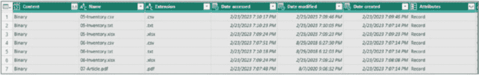
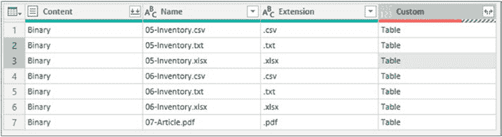
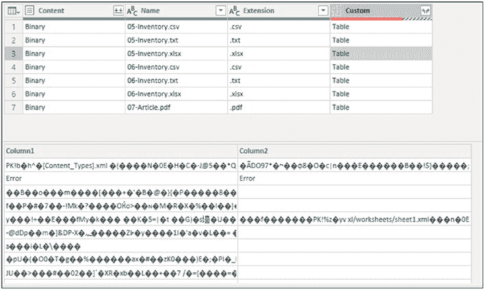
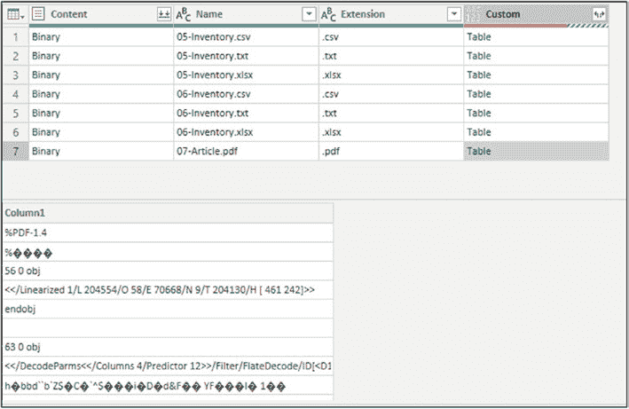
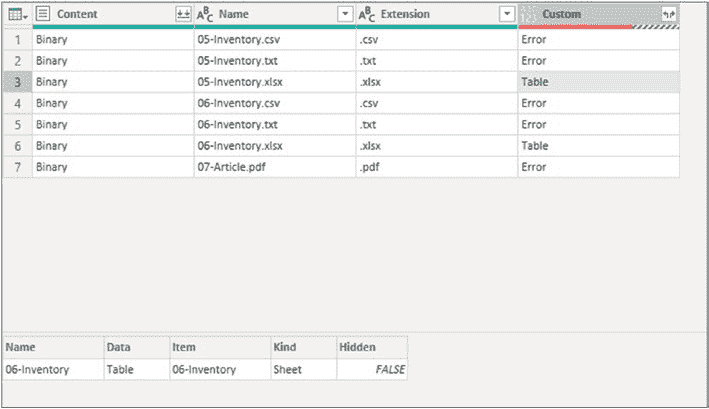

# 第 9 章 从数据源提取

在数据驱动决策的动态环境中，信息存在于数字世界的各个角落。无论是隐藏在电子表格中、驻留在数据库中，还是从 API 流式传输，从这些源中提取、统一和分析数据的能力至关重要。欢迎来到致力于掌握 Power Query 数据源函数的章节，这些函数是您无缝访问和利用来自各种来源的信息的通行证，将其转化为驱动明智决策的燃料。

数据以其多种形式，为现代商业和研究引擎提供动力。但数据通常分散在多个平台上，每个平台都有自己的结构、语言和规则。Power Query 的数据源函数应运而生，成为连接这些信息孤岛的桥梁，为统一分析铺平了道路。

您在本章的旅程从对数据源函数的基础性探索开始：这些工具使 Power Query 能够与不同的数据源进行通信。您将深入研究连接器的世界，每个连接器都旨在解释特定数据源的语言。

© Omid Motamedisedeh 2024

O. Motamedisedeh, *The Ultimate Guide to Functions in Power Query*,
[`doi.org/10.1007/978-1-4842-9754-4_9`](https://doi.org/10.1007/978-1-4842-9754-4_9#DOI)

### `Folder.Contents`

使用`Folder.Contents`，可以存储各种格式文件中的值（例如

# `Folder.Contents`

文件夹中的 `.xlsx`、`.accdb`、`.txt` 和 `.csv` 文件可通过如下方式调用：`Folder.Contents(path as text, optional options as nullable record) as table`。根据上述说明，该函数接收两个输入：

1.  该函数的第一个输入为文件夹路径。
2.  第二个输入为可选参数，以记录（`record`）形式用于设置。

基于上述说明，如果各种文件存储在特定路径（例如 `C:\Users\omid_\OneDrive\Desktop\Data`）中，如图 9-1 所示，则以下公式的结果将等同于图 9-2：

```
= Folder.Contents("C:\Users\omid_\OneDrive\Desktop\Data")
```

**图 9-1.** 文件夹内容



**图 9-2.** 从特定地址调用的数据

在该函数的输出中，`Content` 列最为重要。它包含所输入地址中相关文件中存储的值。通过使用本章后续讲解的函数，可以提取这些值。

## `Csv.Document`

使用 `Folder.Contents` 从特定路径加载文本或 CSV 文件中的值时，信息将以二进制格式显示在名为“content”的列中。要提取此类值，可如下使用 `CSV.Document`：

`Csv.Document(source as any, optional columns as any, optional delimiter as any, optional extraValues as nullable number, optional encoding as nullable number) as table`

该函数接收五个输入：

1.  第一个输入为二进制值，包含 CSV 或文本文件中的值。
2.  第二个输入为可选参数，可在此输入列名。
3.  第三个输入为可选参数，用于指定值分隔符。
4.  此输入指定 CSV 文件中使用的文本编码。
5.  最后一个输入允许用户通过输入 0、1 或 2 来指定 Power Query 如何处理 CSV 文件中包含多于或少于已定义列的行。

根据函数说明，并参照之前的示例——在删除除 `Content`、`Name` 和 `Extension` 之外的所有列，并将其结果命名为 `#"Removed Other Columns"` 之后，按如下方式使用 `CSV.Document`：

```
= Table.AddColumn(#"Removed Other Columns", "Custom", each CSV.Document([Content]))
```

得出的信息如图 9-3 所示。

**图 9-3.** `CSV.Document` 函数结果



可以看到，所有行的新列中都显示了单词 Table。通过选择 CSV 或文本文件（第 1、2、4、5 行）对应行中该列的值，该文件内部的值将正确显示，如图 9-4 所示。

**图 9-4.** 针对 CSV 表的函数结果



但是，通过选择数据格式为 XLSX（Excel 文件）的行中该列的值，结果将显示为乱序，如图 9-5 所示。

**图 9-5.** 针对 Excel 表的函数结果



对于 PDF 文件的行，选择该列的 Table 会显示相同的结果。参见图 9-6。

**图 9-6.** 针对 PDF 文件的函数结果

## `Excel.Workbook`

承接前面的示例，在通过 `Folder.Content` 将存储在特定路径的 Excel 文件作为二进制值调用后，为从二进制值中提取 Excel 文件中的表格，可如下使用 `Excel.Workbook`：

`Excel.Workbook(workbook as binary, optional useHeaders as any, optional delayTypes as nullable logical) as table`



基于此函数的语法，它接受三个参数：
1.  第一个参数中，输入二进制文件的名称或地址。
2.  第二个参数是可选的，可以设置为 `True` 或 `False`，用于设置标题。
3.  此函数的第三个参数也是可选的，用于确定列中值的格式，输入 `True` 或 `False`。

在上一个示例中，输入以下公式代替 `Csv.Document` 将得到如图 9-7 所示的结果：

```
= Table.AddColumn(#"Removed Other Columns",
    "Custom",
    each Excel.Workbook([Content]))
```

**图 9-7.** `Excel.Workbook` 的结果

如您所见，对于扩展名为 XLSX 的二进制文件，此函数的结果是一个包含该文件值的新表；对于其他文件格式，此函数的结果是一个错误。

## `Pdf.Tables`

在上一个示例中，通过如下方式使用 `Pdf.Tables` 代替 `Excel.Workbook`，可以提取 PDF 文件中的值：

```
Pdf.Tables(
    pdf as binary,
    optional options as nullable record
) as table
```

基于此函数的语法，它接受两个输入：
1.  第一个输入中，输入 PDF 二进制文件的名称或地址。
2.  此函数的第二个输入是可选的，用于输入与提取值相关的设置。

根据函数说明，在上一个示例中，使用以下公式代替 `Excel.Workbook`，可以提取 PDF 文件中的值：

```
= Table.AddColumn(#"Removed Other Columns",
    "Custom", each Pdf.Tables([Content]))
```

结果如图 9-8 所示。对于扩展名为 `.pdf` 的二进制文件，此函数的结果等于一个包含 PDF 文件中存储值的新表。对于其他文件类型，此函数的结果是一个错误。

**图 9-8.** 从 PDF 文件中提取数据

## `Sql.Database`

`Sql.Database` 在 Power Query 中定义，用于从 SQL 数据库调用表，如下所示：

```
Sql.Database(
    server as text,
    database as text,
    optional options as nullable record
) as table
```

基于此函数的语法，它接受三个输入：
1.  第一个输入中，以文本值形式输入服务器的名称。
2.  第二个输入中，以文本值形式输入数据库的名称。
3.  此函数的第三个输入是可选的，可以输入 `CreateNavigationProperties`、`NavigationPropertyNameGenerator`、`MaxDegreeOfParallelism`、`CommandTimeout`、`ConnectionTimeout`、`HierarchicalNavigation`、`MultiSubnetFailover`、`UnsafeTypeConversions`、`OmitSRID` 和 `ssDatabaseFolding`。

## `Excel.CurrentWorkbook`

`Excel.CurrentWorkbook` 可以在 Excel 中用于将当前工作簿中的所有表调用到 Power Query 中，如下所示：

```
Excel.CurrentWorkbook() as table
```
