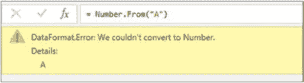
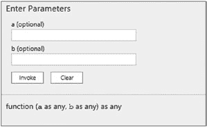
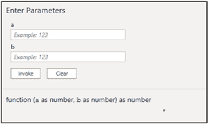
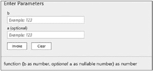
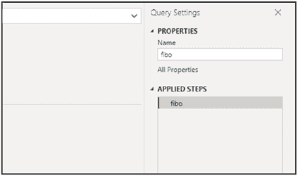

# 第十章 其他函数

`Excel.CurrentWorkbook`函数仅在 Excel 的 Power Query 中使用。`Excel.CurrentWorkbook()`不接受任何输入，并且始终返回 Power Query 所在同个 Excel 文件的不同工作表中存储的表。

## 总结

在本章中，您踏上了使用 Power Query 数据源函数进行数据提取的全面旅程。本章强调了从不同来源访问和统一数据以支持明智决策的重要性。

本章从探索数据源函数的基本概念开始。您了解了这些函数如何使 Power Query 与一系列数据源（从电子表格和数据库到结构化文件）进行通信。这一基础理解为进一步深入研究数据提取技术奠定了基础。

在下一章（即最后一章）中，将介绍一些用于处理错误、条件以及组合函数的其他函数。

尽管 Power Query 的基础函数能够帮助你导航、重塑和聚合数据，但在某些情况下，你的数据转换需要更高层次的复杂性。这时，高级函数便应运而生。它们能够帮助你做出细微的决策、优雅地处理异常，并编写满足特定需求的自定义表达式。

在本章的学习中，你将从探索条件逻辑开始，这是一门向数据提问的艺术。

像 `IF` 这样的函数为你的数据转换引入了决策能力。无论是基于特定条件筛选数据，还是根据输入动态更改计算，这些函数都能让你构建出自定义的、上下文感知的数据流。

但数据并非总是完美的，错误可能会意外出现。

此时，像 `TRY`、`OTHERWISE` 和 `ERROR` 这样的函数就派上了用场。

你将深入错误处理的世界，学习如何优雅地管理异常、替换缺失值，并确保你的数据转换即使在面对不可预见的挑战时也能继续进行。

随着本章学习的深入，你将揭示 `LET` 函数的潜力。这个函数看似简单，却掌握着简化复杂表达式的关键。了解 `LET` 函数如何通过将复杂的数据转换分解成更易于理解的部分，从而提高代码的可读性和可维护性。

© Omid Motamedisedeh 2024

O. Motamedisedeh, *The Ultimate Guide to Functions in Power Query*,

[`doi.org/10.1007/978-1-4842-9754-4_10`](https://doi.org/10.1007/978-1-4842-9754-4_10#DOI)

在整个探索过程中，实际示例将说明这些高级函数的应用，从而弥合理论与现实世界数据场景之间的差距。当你深入掌握 Power Query 中高级函数的复杂性后，你将能够以超越表面的精度来雕琢你的数据操作。你对条件逻辑、错误处理和自定义表达式的新掌握，将重新定义你处理数据转换的方式，使你能够创建出优雅地适应数据环境细微差别的解决方案。

## `if`

Power Query 中的 `if` 语句非常简单，通常用在 `Table.AddColumn` 函数内部。这个函数通常定义如下：

```
if (条件) then (条件为真时的结果)
else (条件为假时的结果)
```

例如，

```
= if a>2 then "大于" else "小于"
```

在上述公式中，将 `a` 的值与数字 2 进行比较。如果 `a` 的值大于 2，则函数的结果为“大于”；如果数字 `a` 等于或小于 2，则此公式的结果为“小于”。

考虑表 `TableC`，如表 10-1 所示。

**表 10-1.** `TableC`

| **行** | **日期** | **产品名称** | **数量** |
| --- | --- | --- | --- |
| 1 | 2023/1/30 | a |  |
| 2 | 2023/1/31 | a |  |
| 3 | 2023/2/1 | C |  |
| 4 | 2023/2/1 | a |  |
| 5 | 2023/2/1 | B |  |
| 6 | 2023/2/2 | B |  |
| 7 | 2023/2/2 | a |  |
| 8 | 2023/2/3 | C |  |
| 9 | 2023/2/4 | B |  |
| 10 | 2023/2/4 | a |  |
| 11 | 2023/2/6 | C |  |

以下公式的结果等于 11（行数），因为 `TableC` 不包含重复行：

```
= if Table.IsDistinct(TableC) then List.Count(TableC[Row]) else
"表格不唯一"
```

然而，如果该表（`TableC`）包含重复行，此公式的结果将是文本“表格不唯一”。

在另一个示例中，如果产品 A、B 和 C 的价格分别为 10、13 和 7 美元，为了在 `TableC` 中添加一个销售额列作为新列，可以在 `Table.AddColumn` 内部像下面这样使用 `if` 函数：

```
= Table.AddColumn(
    TableC,
    "销售额",
    each
    (if [产品名称]="A" then 10 else if [产品名称]="B" then 13 else 7)*[数量])
```

结果如表 10-2 所示。

**表 10-2.** `if` 函数的结果

| **行** | **日期** | **产品名称** | **数量** | **销售额** |
| --- | --- | --- | --- | --- |
| 1 | 2023/1/30 | a |  |  |
| 2 | 2023/1/31 | a |  |  |
| 3 | 2023/2/1 | C |  |  |
| 4 | 2023/2/1 | a |  |  |
| 5 | 2023/2/1 | B |  |  |
| 6 | 2023/2/2 | B |  |  |
| 7 | 2023/2/2 | a |  |  |
| 8 | 2023/2/3 | C |  |  |
| 9 | 2023/2/4 | B |  |  |
| 10 | 2023/2/4 | a |  |  |

## 组合条件

为了同时评估两个或多个条件，可以使用 `and` 和 `or`。例如，要找出产品 A 数量大于 10 的行，可以定义如下两个条件：

`"产品名称" = "A"` 且 `"数量" > 10`

当在两个条件之间使用 `and` 这个词时，对于在产品名称列中输入了 "A" 且在数量列中注册的数字大于 10 的行，其结果将为 `true`。

因此，以下代码的结果

```
= Table.AddColumn(
    TableC,
    "A 且大于 10",
    each [产品名称]="A" and [数量]>10)
```

等于表 10-3。

**表 10-3.** 通过 `and` 组合条件

| 行 | 日期 | 产品名称 | 数量 | A 且大于 10 |
| --- | --- | --- | --- | --- |
| 1/30/2023 | a |  | true |  |
| 1/31/2023 | a |  | true |  |
| 2/1/2023 | C |  | false |  |
| 2/1/2023 | a |  | false |  |
| 2/1/2023 | B |  | false |  |
| 2/2/2023 | B |  | false |  |
| 2/2/2023 | a |  | false |  |
| 2/3/2023 | C |  | false |  |
| 2/4/2023 | B |  | false |  |
| 2/4/2023 | a |  | false |  |
| 2/6/2023 | C |  | false |  |

然而，在两个条件之间使用 `or` 这个词时，对于满足两个条件中至少一个（或两个条件都满足）的行，其结果将为 `true`。换句话说，对于产品名称列中记录了值 "A" 或数量列中输入的数字大于 10 的行，公式结果将为 `true`。

因此，以下代码的结果

```
= Table.AddColumn(
    TableC,
    "A 或大于 10",
    each [产品名称]="A" or [数量]>10)
```

显示在表 10-4 中。

**表 10-4.** 通过 `or` 组合条件

| 行 | 日期 | 产品名称 | 数量 | A 或大于 10 |
| --- | --- | --- | --- | --- |
| 1/30/2023 | a |  | true |  |
| 1/31/2023 | a |  | true |  |
| 2/1/2023 | C |  | false |  |
| 2/1/2023 | a |  | true |  |
| 2/1/2023 | B |  | false |  |
| 2/2/2023 | B |  | false |  |
| 2/2/2023 | a |  | true |  |
| 2/3/2023 | C |  | false |  |
| 2/4/2023 | B |  | false |  |
| 2/4/2023 | a |  | true |  |
| 2/6/2023 | C |  | true |  |

需要注意的是，除了 `and` 和 `or` 函数之外，还有一个名为 `not` 的函数，用于反转条件的结果。该函数始终放在条件之前，如果条件结果为 `true`，则转换为 `false`，反之亦然。因此，在最后一个示例（如下所示）中使用 `not` 时，只要 "A 或大于 10" 列中的公式值等于 `true`，它就会被更改为 `false`；只要函数值等于 `false`，它就会被更改为 `true`。参见表 10-5。

```
= Table.AddColumn(
    TableC,
    "A 且大于 10",
    each not ([产品名称]="A" or [数量]>10))
)
```

**表 10-5.** `not` 在条件中的应用

| 行 | 日期 | 产品名称 | 数量 | A 且大于 10 |
| --- | --- | --- | --- | --- |
| 1/30/2023 | a |  | false |  |
| 1/31/2023 | a |  | false |  |
| 2/1/2023 | C |  | true |  |
| 2/1/2023 | a |  | false |  |
| 2/1/2023 | B |  | true |  |
| 2/2/2023 | B |  | true |  |
| 2/2/2023 | a |  | false |  |
| 2/3/2023 | C |  | true |  |
| 2/4/2023 | B |  | true |  |
| 2/4/2023 | a |  | false |  |
| 2/6/2023 | C |  | false |  |



## `try` 函数

`try` 函数用于处理 Power Query 中的错误，并可用于防止显示错误。例如，如果在 Power Query 中输入以下公式，结果将等于数字 2。（数据格式从文本转换为数字。）

```
=Number.From("2")
```

但是，对文本 "A" 使用 `Number.From` 如下所示，将导致错误：

```
=Number.From("A")
```

在这种情况下，计算因错误而停止，并获得如图 10-1 所示的结果。

**图 10-1.** 错误结果

因此，为了处理这些情况，使用了 `try` 函数。该函数的结果等于一个包含两个字段的记录，形式为 `[HasError=False, Value=2]`。

```
=try Number.From("2")
```

在函数结果为错误的情况下使用此函数（如以下示例），函数结果将包含一个指定错误原因的记录：

```
=try Number.From("A")
```

对于上述函数，结果等于以下记录：`[HasError=True, Error=[Reason="DataFormat.Error", Message="我们无法转换为数字。", Detail="A"]]`

`Message.Format= "We couldn't convert to Number."`, `Message.Parameters= null]]`

如您所见，输出的第一个字段指定公式结果为错误，第二个字段（`Error`）则提供了关于错误原因以及向用户显示的消息的附加信息。

在更完整的 `try` 函数形式中，它可以与 `otherwise` 运算符结合使用，如下所示：

```
= try Number.From("2") otherwise " Wrong Input "
```

在此情况下，该函数尝试计算 `Number.From("2")` 并在输出中显示其结果。如果公式 `Number.From("2")` 的结果是错误，则输出中将显示表达式 `" Wrong Input "`。在其他情况下，输出中将显示公式的结果。

因此，以下公式的结果等于数字 `2`：

```
= try Number.From("2") otherwise " Wrong Input "
```

而以下公式的结果等于表达式 `"Wrong Input"`：

```
= try Number.From("A") otherwise "Wrong Input"
```

## 第 10 章 其他函数

### `let-in` 命令

在 Power Query 中，清理和转换操作（例如合并表、删除列和添加新列）通常比在单个步骤中陈述一个函数更复杂。

为了简化过程，此函数用于通过定义新变量将整个命令分成几行。例如，在以下公式中，此函数用于定义变量 `A` 和 `B`，其值分别为 `2` 和 `3`，最后定义变量 `C`；其值等于 `A*B`，其值（`6`）将作为所有步骤的结果显示。

```
let
    A=2,
    B=3,
    C=A*B
in
    C
```

如您所见，命令以 `let` 表达式开头，后跟变量名称及其等号后的值。变量名可以包含空格（例如，`A A`），这应在 `#` 符号后用双引号定义，如 `#"A A"`。每个命令以逗号结束（`in` 表达式前的最后一个命令除外），然后跟随下一个变量定义。在每个命令中，用户可以引用其他命令（前一个或后一个）中定义的变量。此函数以关键字 `in` 结束，随后提及您希望作为函数输出显示的变量名称。

以下是 Power Query 中 `let-in` 函数的一个示例：

```
let
    Table = Table.FromColumns(
        {{1,2,3,4,5,6,7,8,9,10,11},
         {44956,44957,44958,44958,44958,44959,44959,44960,
          44961,44961,44963},
         {"A","A","C","A","B","B","A","C","B","A","C"},
         {17,18,10,1,6,9,6,6,10,3,18}},
        {"Row","Date","Product Name","Quantity"}),
    Changed_Type_ColumnDate = Table.TransformColumnTypes(
        Table,{{"Date", type date}}),
    Removed_Column_Row = Table.RemoveColumns(
        Changed_Type_ColumnDate,{"Row"}),
    Added_Column_Sales = Table.AddColumn(Removed_Column_Row,
        "Sale", each [Quantity]*10)
in
    Added_Column_Sales
```

# 第 10 章 其他函数

在此命令中，首先定义名为`table`的变量，其结果如表 10-6 所示。

***表 10-6.** 第一步：定义表*

| **行号** | **日期** | **产品名称** | **数量** |
| --- | --- | --- | --- |
| a | a | C | a |
| B | B | a | C |
| B | a | C | |

在下一步中（名为`Changed_Type_ColumnDate`），通过使用`Table.TransformColumnTypes`将`Date`列的格式更改为日期。此步骤的结果如表 10-7 所示。

***表 10-7.** 第二步：更改数据类型*

| **行号** | **日期** | **产品名称** | **数量** |
| --- | --- | --- | --- |
| 1/30/2023 | a | 1/31/2023 | a |
| 2/1/2023 | C | 2/1/2023 | a |
| 2/1/2023 | B | 2/2/2023 | B |
| 2/2/2023 | a | 2/3/2023 | C |
| 2/4/2023 | B | 2/4/2023 | a |
| 2/6/2023 | C | | |

在下一步中（标题为`Removed_Column_Row`），使用`Table.RemoveColumns`函数从上一个表中删除名为`Row`的列。结果如表 10-8 所示。

***表 10-8.** 第三步：删除行号列*

| **日期** | **产品名称** | **数量** |
| --- | --- | --- |
| 1/30/2023 | a | 1/31/2023 |
| a | 2/1/2023 | C |
| 2/1/2023 | a | 2/1/2023 |
| B | 2/2/2023 | B |
| 2/2/2023 | a | 2/3/2023 |
| C | 2/4/2023 | B |
| 2/4/2023 | a | 2/6/2023 |
| C | | |

最后一步名为`Added_Column_Sales`，在这一步中，向之前的表添加了一个名为`Sales`的新列。请参见表 10-9。

**表 10-9.** 第四步：添加新列

| **日期** | **产品名称** | **数量** | **销售额** |
| --- | --- | --- | --- |
| 2023/1/30 | a | | |
| 2023/1/31 | a | | |
| 2023/2/1 | C | | |
| 2023/2/1 | a | | |
| 2023/2/1 | B | | |
| 2023/2/2 | B | | |
| 2023/2/2 | a | | |
| 2023/2/3 | C | | |
| 2023/2/4 | B | | |
| 2023/2/4 | a | | |
| 2023/2/6 | C | | |

因此，通过使用`let-in`，可以在不同步骤中对一张表执行多项操作。

需要注意的是，除了`let-in`命令，记录也可以用来将计算分为多个步骤。例如，可以使用`[A=2, B=3, C=A*B][C]`分三步计算`C`。

在使用 Power Query 命令时，应考虑以下几点：

1.  **大小写敏感**：与函数名一样，变量名也是大小写敏感的。
2.  **变量寻址**：在`let-in`命令中，变量的定义顺序并不重要，你可以在每个变量的公式中引用之前或之后的变量（前提是不会造成循环）。
3.  **变量名唯一**：在`let-in`命令中，变量名必须唯一。
4.  **注释**：要在命令末尾添加注释，可以在`//`符号后输入。要输入多行注释，应将注释内容放在`/*`和`*/`符号之间。注释仅在 Power Query 编辑器中可见，不会显示在公式栏中。
5.  **多行编写代码**：在 M 语言中，每个命令行应以分号结尾。因此，长命令可以轻松地分成多行，以变量名开头，以分号结束。
6.  **值格式的敏感性**：如前所述，变量类型在 M 语言中非常重要，每个函数只能应用于特定类型的值。

## 定义新函数

除了本书中介绍的函数外，还可以在 Power Query 中定义新函数。要在 Power Query 中创建函数，首先将变量名列在括号中，后面跟着符号`=>`，作为函数符号。然后输入所需的公式。以下是一个简单函数的示例，它可以将数值加 1：`(X) => X+1`

在上述公式中，参数`x`是所定义函数的输入，其输出等于`X+1`。

在另一个示例中，以下函数接收两个参数`X`和`Y`作为输入，并在输出中显示它们的乘积：`(X,Y)=> X*Y`

由于实际示例中所需的函数通常比前面的例子更复杂，并且需要编写多行，因此通常可以使用`let`命令将函数计算部分分成几行，如下列公式所示：

```
(x)=>

let

a=x+1,

b=a*x,

c= if b > 10 then b*2 else b-2

in

c
```

在此函数中，变量`x`是输入，输出分三个阶段计算。在第一阶段，将`x`的值加上数字 1。在第二阶段，将数字`x`乘以前一阶段（`a`）得到的值。最后，根据前一阶段获得的值，如果结果大于 10，则将其乘以 2 并在输出中显示；如果结果小于 10，则将得到的数字减去 2 并在输出中显示。

基于对函数的解释，我们来讨论几个在 Excel 中创建新函数的例子。参见图 10-2。

**图 10-2.** 税额评估

• 税额计算函数：

在此示例中，我们要在 Power Query 中创建一个新函数，该函数接受一个数字作为输入，并根据其值计算税额。如果数字小于 100，税率为 0%；如果数字大于 100，税率为 10%。

因此，新函数可以定义如下：

```
(x) => if x<100 then 0 else 0.1*x
```

# 第 10 章 其他函数

• 计算 `a` 和 `b` 之间的数字之和：

假设你想定义一个接受两个参数的新函数 `numbers`、`a` 和 `b` 作为输入，并在输出中显示介于 `a` 和 `b` 之间的整数之和。

要解决此问题，您需要创建介于 `a` 和 `b` 之间的所有整数，然后将它们相加。为此，您可以使用以下公式创建新函数：



```
(a,b) => List.Sum({a..b})
```

在这种情况下，如果输入数字 `1` 和 `5` 代替 `a` 和 `b`，函数的结果是 `15`。但是，如果在参数 `a` 中输入数字 `1.1` 代替 `1`，则结果会出错。让我们将上述公式更改为以下公式：

```
(a,b) => List.Sum({Number.RoundUp(a)..Number.RoundDown(b)})
```

在这种情况下，参数 `a` 和参数 `b` 都会先转换为整数，然后再用于计算。

在上述定义中，函数的输入和输出格式没有指定，因此用户可以输入任何值。如果输入文本值，公式结果将出错。参见图 10-3。

***图 10-3.** 函数输入*

但是，如果您想要定义函数输入和输出的格式，可以按如下方式指定它们：



```
(an as number,b as number) as number => List.Sum({Number.RoundUp(a)..Number.RoundDown(b)})
```

如图 10-4 所示，这里指定了函数输入和输出的类型。

***图 10-4.** 具有特定格式的函数输入*

• **b 与 a 之间数字的和（带可选输入）：**

与前面的示例类似，这里您想要定义一个函数，该函数接收两个输入 `b` 和 `a`（其中 `b` 大于 `a`），并在输出中显示介于 `a` 和 `b` 之间的所有数字之和。不同之处在于，此函数中参数 `a` 是可选的，如果未输入任何值代替此参数，则默认使用数字 `1`。

为此，您可以在新函数中将可选输入定义为 `optional x`，因此新函数定义如下：

```
(b as number, optional a as number) as number => List.Sum({Number.RoundUp(if a=null then 1 else a)..Number.RoundDown(b)})
```



在这种情况下，由于参数 `a` 被定义为可选参数，因此参数 `b` 将是必填项，用户在输入数据时会看到图 10-5 中的表单。

***图 10-5.** 可选输入的定义*

• **斐波那契数列中的第 n 个数：**

在此示例中，您想要编写一个函数，该函数接受一个整数（`n`）作为输入，并在输出中显示斐波那契数列中的第 `n` 个数。（斐波那契数列是 `{1,1,2,3,5,8,13,...}`，每个数都是前两个数之和。）要解决此问题，您需要熟悉递归函数。递归函数是根据条件在公式中再次使用函数名称的函数。

在解决此问题之前，假设您将斐波那契数列中的第五个数命名为 `a5` 并想要计算它。为此，根据斐波那契函数的一般公式，`a5` 的值计算如下：

```
a5 = a4 + a3
```

因此，要计算斐波那契数列中 `a5` 的值，您需要再次使用斐波那契数列的定义，并计算 `a4` 和 `a3` 的值，它们等于以下值：

```
a4 = a3 + a2
a3 = a2 + a1
```

要计算上述每个值，您需要再次使用斐波那契数列的定义并计算更小的值，此过程一直持续到达到 `a1` 和 `a0` 这两个值。因此，斐波那契计算公式需要递归定义。

为此，首先将查询名称更改为 `fibo`，并使用以下方法获取斐波那契数列中的第 `n` 个值：

```
(n) => if n<=1 then 1 else fibo(n-1)+fibo(n-2)
```

### 在其他查询中使用定义的函数

在 Power Query 中创建新函数后，可以从查询设置（右侧窗口）更改查询名称。为函数定义所需名称后，与其他函数一样，该新函数可用于同一 Power Query 文件中其他查询的高级计算。参见图 10-6。



***图 10-6.** 更改函数名称*
