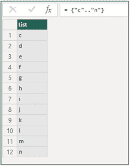
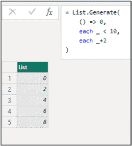

# 第 6 章 列表函数

`= {"c".."n"}`



**图 6-4.** 定义包含从 c 到 n 之间所有字符的列表

一些公式见表 6-1。

**表 6-1.** 定义列表

| **公式** | **结果** |
|-------------|------------|
| `= {3..9}` | `{3,4,5,6,7,8,9}` |
| `= {"w","z"}` | `{“w”,“z”}` |
| `= {"w".."z"}` | `{“w”,“x”,“y”,“z”}` |
| `= {"W".."Z"}` | `{“W”,“X”,“Y”,“Z”}` |
| `= {"#".."&"}` | `{“#”,“^”,“%”,“&”}` |

除了直接定义列表外，还可以从表格的列中提取值来创建列表。实际上，表格的每一列都代表一个值列表（数字、文本等）。要将表格的某一列提取为列表，只需在方括号 `[]` 中输入表名和列名即可。例如，考虑 `TableA`（见表 6-2）。

**表 6-2.** `TableA`

| **产品** | **价格** | **材料** |
|-------------|-----------|--------------|
| W11 | 100 | 金属 |
| s06 | 75 | 木材 |
| r08 | 12 | 玻璃 |

公式 `TableA[Price]` 的结果等于一个列表，包含 `{100,75,12}`；而公式 `TableA[Product]` 的结果等于产品名称列表，形式为 `{“W11”,“S06”,“R08”}`。

此外，要创建列表，也可以使用 `List.Numbers`、`List.Generate` 以及其他函数，如下所示。

## 函数

### List.Numbers

`List.Numbers` 的使用方法如下，用于生成包含特定间隔数字序列的列表：

```
List.Numbers(
  start as number,
  count as number,
  optional increment as nullable number
) as list
```

如上所示，该函数接收三个数值参数，并始终返回一个数字列表。

1. 第一个输入表示列表的起始数字。
2. 列表的长度在第二个输入中确定。
3. 第三个输入表示列表中数字之间的间隔。如果未输入，则此输入默认为数字 1。

根据函数说明，该函数的结果见表 6-3。

**表 6-3.** `List.Numbers` 示例

| **公式** | **结果** |
|-------------|------------|
| `= List.Numbers(3,4)` | `{3,4,5,6}` |
| `= List.Numbers(3,4,-1)` | `{3,2,1,0}` |
| `= List.Numbers(3,4,6)` | `{3,9,15,21}` |

### List.Generate

`List.Generate` 的使用方法如下，用于创建列表（包含数字、文本、记录或表格）：

```
List.Generate(
  initial as function,
  condition as function,
  next as function,
  optional selector as nullable function
) as list
```

`List.Generate` 接收四个参数。它们都是函数，最后一个参数是可选的。

1. 第一个参数表示列表的起始数字（函数类型）。
2. 列表中生成值的停止条件在第二个参数中定义（函数类型）。



3. 在此参数中，确定生成列表中新值的公式（函数类型）。
4. 此输入是可选的，称为选择器。利用此输入，可以修改函数的结果。

让我们从一个简单的示例开始，该示例表示一个小于 10 的偶数列表。该函数可以定义如下：

`= List.Generate(()=>0, (x)=>x<10, (x)=>x+2)`

在第一个输入中，第一个值是 `0`。根据第二个输入，列表中的所有值都应小于 `10`（列表中的值生成将持续到达到大于或等于 `10` 的值为止）。在第三个输入中，每次迭代时，列表的新值都是基于前一个值加上 `2` 生成的。此输入是一个函数，它接收 `x` 作为输入，并将 `x+2` 作为输出，其中 `=>` 是函数符号。

基于上述示例，所需列表从数字 `0` 开始，每一步都将前一个数字加上 `2`，此过程一直持续到达到大于或等于 `10` 的数字为止。

因此，此公式的结果是 `{0,2,4,6,8}`。见图 6-5。

**图 6-5.** 使用 `List.Generate` 创建偶数

在前一个示例中，变量`x`可以被`_`替换，因此公式将变为如下形式：

`= List.Generate(()=>0, (_)=>_< 10, (_)=>_+2)`

在这种情况下，`(_)=>`可以被替换为每个表达式，如下所示：

`= List.Generate(() =>0, each _ < 10, each _+2)`

此函数的输入本身也是函数类型，其说明如表 6-4。

**表 6-4.** `List.Generate`的参数*

`() =>0`，

在该输入中，指定列表从数字 0 开始。

`each < 10`，还指定列表中的数字必须小于 10。

`each _+2`

此外，指定列表中的每个数字等于前一个数字加 2。

在另一个示例中，可以使用以下公式创建一个列表，其中包含 1 到 5 的阶乘值：

`= List.Generate(()=> 1, each _<6, each _+1, each Number.Factorial(_))`

此函数的输入如表 6-5 所示。

**表 6-5.** `List.Generate`的参数*

`()=> 1`，

所需的变量从 1 开始。

`each _<6`，

列表会持续生成，直到变量小于 6。

`each _+1`，

每一步中变量的值等于其前一步的值加 1。

`each Number.Factorial(_))`，

每个变量的阶乘值应显示在输出中。

根据函数说明，此公式的值等于`{1,2,6,24,120}`，其中第一个值等于 1 的阶乘，第三个值等于 3 的阶乘。

在另一个示例中，以下公式的结果为`{2,4,8,16,32,64,128,256,512}`：

`= List.Generate(()=> 2, each _<1000, each _*2)`

此公式的输入如表 6-6。

**表 6-6.** `List.Generate`的参数*

`()=> 2`，

变量从 2 开始。

`each _<1000`，

此过程会重复执行，直到变量小于 1000。

`each _*2`

在每一步中，变量的值等于其前一个值乘以 2。

根据上述说明，此公式的值等于一个数字序列，其中每一步的数字都是由前一个数字乘以 2 得到的，并且此过程重复执行，直到数字小于 1000。因此，结果等于`{2,4,8,16,32,64,128,256,512}`。

另一个使用`List.Generate`的示例由以下公式给出。此公式用于通过两个变量`x`和`y`创建小于 10 的斐波那契数列。（斐波那契数列是`{0, 1, 1, 2, 3, 5, 8, 13, ...}`，该数列中的每个数字都是前两个数字之和。）

`= List.Generate(() => [x = 0, y = 1], each [x] < 10, each [x = [y], y = [x]+[y]], each [x])`

此函数的不同输入如表 6-7。

**表 6-7.** `List.Generate`的参数*

`() => [x = 0, y = 1]`，最初，变量`x`和`y`的值分别为 0 和 1。

`each [x] < 10`，

列表数字的创建过程会持续进行，直到变量`x`达到一个大于或等于 10 的数字。

`each [x = [y], y = [x]+[y]]`，

在每个阶段，`x`的值等于前一阶段`y`的值，而`y`的值等于前一阶段`x`和`y`值的和。

`each [x]`

最后，`x`变量的值显示在输出中。

根据函数说明，公式的结果等于`{0,1,1,2,3,5,8}`。

在前一个示例中，在第四个参数中使用`each [y]`代替`each [x]`意味着在输出中显示变量`y`的值，结果变为`{1,1,2,3,5,8,13}`；将第四个参数替换为`each [x]+[y]`意味着将在输出中显示变量`x`和`y`的和，因此结果将是`{1,2,3,5,8,13,21}`。

### List.Times

`List.Times`的使用方式如下，用于创建一个由时间格式值组成的列表：

```
List.Times(
    start as time,
    count as number,
```