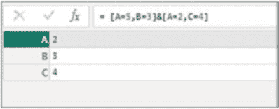

# 记录操作

在此情况下，如果两个记录具有相同字段，则最后一条记录中该字段的值将作为该字段的结果显示，而不同的字段将在输出中并排显示。因此，以下公式的结果为`[A=2, B=3, C=4]`。参见图 7-4。

```
= [A=5,B=3]&[A=2,C=4]
```



**图 7-4.** 记录的合并

除了合并记录外，Power Query 中还有其他修改记录的函数，本节未全部介绍。

### 记录属性

要提取记录中的字段数量及其名称和值，可使用以下函数。

### `Record.FieldCount`

要计算记录中的字段数量，使用`Record.FieldCount`如下：

```
Record.FieldCount(record as record) as number
```

该函数的结果始终是一个数字，显示输入记录中的字段数量。因此，以下公式的结果等于 1：

```
= Record.FieldCount([A=5])
```

以下公式的结果等于 2：

```
= Record.FieldCount([A=5,b=2])
```

以下公式的结果等于 4：

```
= Record.FieldCount([A=5,B={1..3},C=[A=1,B=3],D={2}])
```

### `Record.FieldNames`

`Record.FieldNames`用于提取记录中的字段标题，如下所示：

```
Record.FieldNames(record as record) as list
```

此函数接收一个记录作为输入，并返回其字段名称列表作为输出。因此，以下公式的结果为`{"A", "B"}`：

```
= Record.FieldNames([A=5,B=2])
```

以下公式的结果为`{"Name", "Family"}`：

```
= Record.FieldNames([Name="Omid",Family="Motamedi"])
```

### `Record.FieldValues`

`Record.FieldValues`类似于`Record.FieldNames`，但它返回的是引用记录中的值，而非标题。其定义如下：

```
Record.FieldValues(record as record) as list
```

此函数接收一个记录作为输入，其结果等于一个值列表。因此，以下公式的结果等于`{5,2}`：

```
= Record.FieldValues([A=5,B=2])
```

以下公式的结果等于`{"Omid", "Motamedi"}`：

```
= Record.FieldValues([Name="Omid",Family="Motamedi"])
```

### `Record.ToList`

`Record.ToList`用于将记录转换为列表，如下所示。此函数接收一个记录类型的输入，并输出其字段值作为列表。

```
Record.ToList(record as record) as list
```

使用此函数的不同示例如表 7-2 所示。

**表 7-2.** `Record.ToList` 示例

| 公式 | 结果 |
|------|------|
| `= Record.ToList([A=5,B=2,C=10])` | `{5,2,10}` |
| `= Record.ToList([A=5,B={1..3},C=10])` | `{5,{1,2,3},10}` |

### `Record.Field`

`Record.Field`用于提取记录中某个字段的值，如下所示：

```
Record.Field(
    record as record,
    field as text
) as any
```

此函数接收两个输入：

1. 第一个输入是引用记录。
2. 第二个输入以文本形式指定所需字段的名称。

根据函数说明，以下公式的结果等于 5：

```
= Record.Field([A=5,B=2],"A")
```

以下公式的结果等于 Omid：

```
= Record.Field([Name="Omid",Family="Motamedi"],"Name")
```

但由于以下公式中定义的记录不包含字段 C，其结果会报错，如图 7-5 所示：

```
= Record.Field([A=5,B=2],"C")
```

**图 7-5.** 计算错误

### `Record.FieldOrDefault`

此函数在 Power Query 中的定义如下：

```
Record.FieldOrDefault(
    record as nullable record,
    field as text,
    optional defaultValue as any
)
```

此函数类似于`Record.Field`。区别在于，使用此函数时，用户可以在第三个输入中定义一个值，如果引用记录不包含第二个输入中定义的字段，则显示该值而不是错误。


因此，在以下示例中，由于定义的记录不包含字段 C，以下公式的结果将是一个错误：

```
= Record.Field([A=5,B=2],"C")
```

而以下公式的结果等于 null：

```
= Record.FieldOrDefault([A=5,B=2],"C")
```

并且以下公式的输出值等于 -1：

```
= Record.FieldOrDefault([A=5,B=2],"C",-1)
```

## `Record.HasFields`

要检查记录是否包含特定字段，可以按如下方式使用 `Record.HasFields`：

```
Record.HasFields(
  record as record,
  fields as any
) as logical
```

此函数接收两个输入，如果引用记录包含第二个输入中定义的所有字段，则其输出始终为 `true`；如果定义的记录不包含第二个输入中输入的至少一个字段名，则其输出为 `false`。

1. 第一个输入是引用记录。
2. 第二个输入中输入字段名称列表。要搜索单个字段，其名称可以直接以文本格式输入，但要搜索多个字段，则应以列表形式输入其名称。

表 7-3 展示了此函数的不同应用。

***表 7-3.** Record.HasFields 示例*

| 公式 | 结果 |
| --- | --- |
| `= Record.HasFields([A=5,B=2,C={1..4}],"C")` | `true` |
| `= Record.HasFields([A=5,B=2,C={1..4}],"D")` | `false` |
| `= Record.HasFields([A=5,B=2,C={1..4}],{"A","C"})` | `true` |
| `= Record.HasFields([A=5,B=2,C={1..4}],{"A","D"})` | `false` |

### 记录修正

本节将介绍用于修改记录的函数。

### `Record.AddField`

要向引用记录添加字段，可以使用具有以下语法的 `Record.AddField`：

```
Record.AddField(
  record as record,
  fieldName as text,
  value as any,
  optional delayed as nullable logical
) as record
```

此函数接收以下四个输入：

1. 第一个输入中输入引用记录。
2. 第二个输入中以文本格式输入新字段的名称。
3. 第三个输入中输入新字段的值。
4. 此函数的第四个输入是可选的，以 `true` 或 `false` 形式输入。

根据函数说明，要向包含名为 A 和 B 的两个字段的记录中添加一个名为 C 且值为 10 的新字段，可以使用以下公式：

```
= Record.AddField([A=5,B=2],"C",10)
```

在这种情况下，结果是一个包含所有字段（A、B 和 C）的记录，即 `[A=5,B=2,C=10]`。

### `Record.Combine`

要同时向一个记录添加多个字段，或者将多个记录合并在一起，可以按如下方式使用 `Record.Combine`：

```
Record.Combine(records as list) as record
```

要合并多个记录，应将这些记录全部放入一个列表中，作为此函数的第一个输入。在这种情况下，结果等于合并所有记录后得到的记录。

例如，要合并两个记录，可以使用以下公式，结果得到 `[A=5,B=2,C=10]`：

```
= Record.Combine({[A=5,B=2],[C=10]})
```

类似地，以下公式的结果等于 `[A=5,B=2,C=10,D=2*C,E=1]`：

```
= Record.Combine({[A=5,B=2],[C=10,D=2*C,E=1]})
```

### `Record.SelectFields`

`Record.SelectFields` 用于提取引用记录的子集，用法如下：

```
Record.SelectFields(
  record as record,
  fields as any,
  optional missingField as nullable number
) as record
```

此函数接收以下三个输入：

1. 第一个输入定义了引用记录。
2. 第二个输入是您正在查找其值的字段列表。
3. 此输入是可选的，当引用列表不包含第二个输入中提到的至少一个字段名时使用。在此输入中输入数字 `0` 将导致错误。输入数字 `1` 将得到一个记录，其中缺失的字段已被移除。输入数字 `2` 时，不匹配的字段会显示在输出中，但其值为 `null`。

根据以上解释，以下公式的结果等于 `[A=5,C=10]`：

```
= Record.SelectFields([A=5,B=2,C=10], {"A","C"})
```


