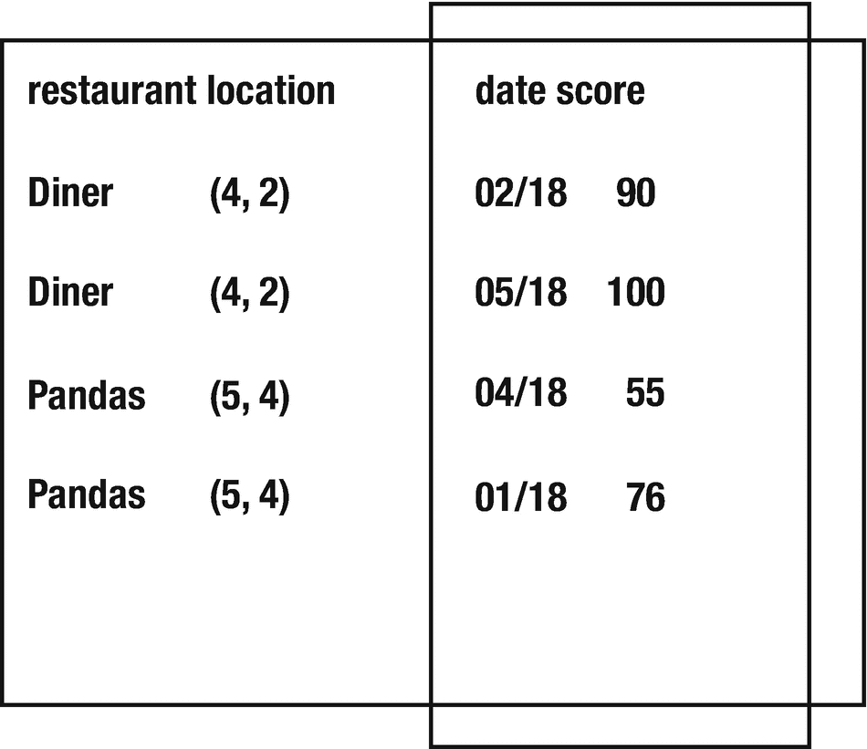

# 1. 引言

我们生活在一个充满数据的世界。事实上，数据量之大几乎无法完全理解。我们比以往任何时候都更依赖计算机来帮助我们理解海量信息。无论是通过搜索引擎进行数据发现、通过图形用户界面进行展示，还是通过算法进行聚合，我们都使用软件以有意义的方式处理、提取和呈现数据。`pandas`已成为处理大数据集日益流行的软件包。无论是分析大量数据、呈现数据，还是对其进行规范化并重新存储，`pandas`都拥有支持大数据需求的广泛功能。虽然`pandas`不是性能最高的选择，但它用`Python`编写，因此易于初学者学习、编写快速，并拥有丰富的 API。

## 关于 pandas

`pandas`是`Python`中用于处理大数据集的首选软件包。它通常用于处理大小约在 1GB 或以下的数据集，但实际上这个限制取决于运行设备的可用内存。一个好的经验法则是设备内存至少是数据集的五到十倍。一旦数据集开始超过个位数 GB 范围，通常建议使用其他库，例如`Vaex`。

`pandas`这个名称来源于术语“面板数据”（`panel data`），指的是表格数据。其思想是，你可以从更大的数据面板中制作子面板，如图 1-1 所示。

图 1-1 面板数据

当`pandas`首次实现时，它与`NumPy`紧密耦合。`NumPy`是一个流行的`Python`科学计算软件包，提供用于执行高效矩阵数学运算的 n 维数组对象。今天使用`pandas`的现代实现，你仍然可以在非数字（`NaN`）类型的暴露以及其 API（如`dtype`参数）中看到这种紧密耦合的痕迹。

`pandas`从一开始就是一个真正的开源项目。原作者 Wes McKinney 在`Python Podcast.__init__`中承认，为了培养开源社区并鼓励贡献，`pandas`可能与`NumPy`包耦合得过于紧密，但回顾过去，他不会做出不同的选择。`NumPy`过去是，现在仍然是一个非常流行且强大的`Python`库，用于高效的数学运算。在`pandas`诞生之时，`NumPy`是科学界主要的数据计算包，为了快速简单地实现`pandas`，并以一种让现有用户和贡献者熟悉的方式进行，`NumPy`包成为了`pandas` DataFrame 的底层数据结构。`NumPy`构建在`C`扩展之上，虽然它提供了`Python` API，但主要的计算几乎完全在`C`中完成，这就是它如此高效的原因。`C`语言比`Python`快得多，因为它是低级语言，因此不会消耗`Python`为提供所有高级特性（如内存管理）而消耗的内存和 CPU 开销。即使在今天，开发者仍然严重依赖`NumPy`，并经常在其`pandas`程序中执行纯`NumPy`操作。

`Python`和`C`之间的性能差异对于普通开发者来说通常并不显著。在大多数情况下，`Python`通常足够快，而`Python`高级语言特性（如内置内存管理和伪代码式语法）带来的便利性，通常超过了必须自己管理内存的麻烦。然而，当在拥有数千行的大数据集上操作时，这些微小的性能差异会累积成更显著的差异。对于普通开发者来说，这似乎绝对令人难以置信，但对于科学研究界来说，花费数天等待大数据计算运行完成并不罕见。有时计算确实需要这么长时间；然而，其他时候程序只是以低效的方式编写的。在`pandas`中，有多种不同的方法可以完成同一件事，这使其既灵活又强大，但也意味着它可能引导开发者走上效率较低的实现路径，从而导致非常缓慢的数据处理。

作为开发者，我们生活在一个计算资源被视为廉价的年代。如果某个程序对 CPU 的消耗很高，我们更倾向于简单地将 AWS 实例升级到更大的机器，每月多付几美元，而不愿投入时间去根因分析并解决 CPU 过载的问题。虽然拥有如此随手可得的计算资源是件好事，但它也让我们变得懒惰。我们常常忘记，50 年前，计算机占据整间屋子，光是两个数字相加就需要几秒钟。许多程序即便没有以最优方式编写，也足够快，仍然能满足性能要求。与简单的网络服务相比，大数据处理所消耗的计算资源要庞大得多；它们需要大量的内存和 CPU，通常需要大型机器在数小时内满负荷运行。这些程序对硬件要求严苛，可能导致硬件加速老化，并且无论是冷却机器还是维持计算运行，都需要消耗大量能源。作为开发者，我们有责任编写高效的代码，这不仅因为这样能更快、成本更低，还因为能减少计算资源的使用，这意味着更少的电力、更少的硬件，总体上也更具可持续性。

本书后续章节的目标就是帮助开发者实现高性能的`pandas`程序，并培养他们选择高效数据处理技术的直觉。在深入探讨`pandas`所依赖的基础数据结构之前，让我们先来看看一些现有且影响深远的项目是如何使用`pandas`的。

## `pandas` 如何帮助构建黑洞图像

`pandas`被用于将几个大型望远镜收集的所有数据进行标准化，以构建第一张黑洞图像。由于黑洞距离我们非常遥远，直接为其成像需要一台地球大小的望远镜，因此，科学家们想出了一个办法，利用我们现有最大的望远镜来拼接出图像。在这个国际合作项目中，地球上的最大望远镜被用作一个更大的理论望远镜的多个镜面。由于地球的自转，每个望远镜可以扮演多个镜面的角色，从而填补了理论大望远镜图像的很大一部分。图 1-2 展示了这一技术。这些理论大图像的碎片随后被送入多个不同的、经过训练的能够识别不同类型图像的图像预测算法。其理念是，如果所有这些不同的图像重构技术都输出相同的图像，那么他们就可以确信这张黑洞图像是真实的（或相当接近真实）。

图 1-2 利用地球上的望远镜代表一个更大理论望远镜的碎片

该库是开源的，并发布在 GitHub 上。^(¹) 来自射电望远镜的图像被捕获到硬盘上，然后空运到麻省理工学院的一个实验室，在那里被加载到`pandas`中。接着，数据被标准化处理，同步来自各望远镜在时间上的捕获，去除诸如地球大气层干扰等因素，并计算单个望远镜随时间变化的绝对相位等参数。随后，这些数据被送入不同的图像预测算法，最终，第一张黑洞图像诞生了。^(²)

## `pandas` 如何帮助金融机构对未来市场做出更明智的预测

金融顾问总是在寻找竞争优势。许多金融机构使用`pandas`和机器学习库来判断新的数据点是否有助于金融顾问做出更好的投资决策。新的数据集通常被加载到`pandas`中，进行标准化，然后与历史市场数据进行评估，以查看数据是否与市场趋势相关。如果存在关联，这些数据就会被传递给顾问，用于制定金融投资决策。它也可能会传递给客户，以便他们也能做出更明智的决策。

金融机构也使用`pandas`来监控他们的系统。他们查找可能影响交易性能的服务器宕机或缓慢情况。

## `pandas` 如何帮助提升内容的可发现性

公司每天都在收集海量的用户数据。对于广播公司的收视率而言，数据尤其重要，既用于展示相关广告，也用于将有价值的内容推送给感兴趣的用户。通常，收集到的用户数据会被加载到`pandas`中，并分析观看内容的收视模式。他们寻找的模式包括：何时观看特定内容、观看什么内容、何时看完特定内容并寻找新内容。然后，根据这些模式推荐新内容或相关的产品广告。最近，人们也做了大量工作来改进商业模式，以避免用户陷入信息茧房（例如，推荐的内容不仅仅是他们之前看过的同类型内容或呈现相同观点）。通常，这通过避免业务层面的内容孤岛来实现。

现在我们已经了解了`pandas`的一些有趣用例，在第 2 章中，我们将探讨如何使用`pandas`来访问和合并数据。

脚注 1   2
