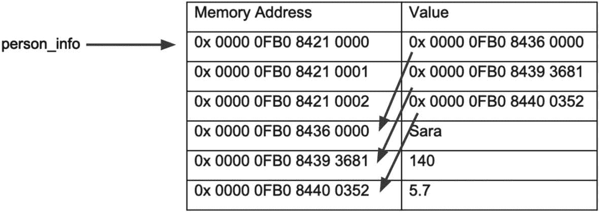
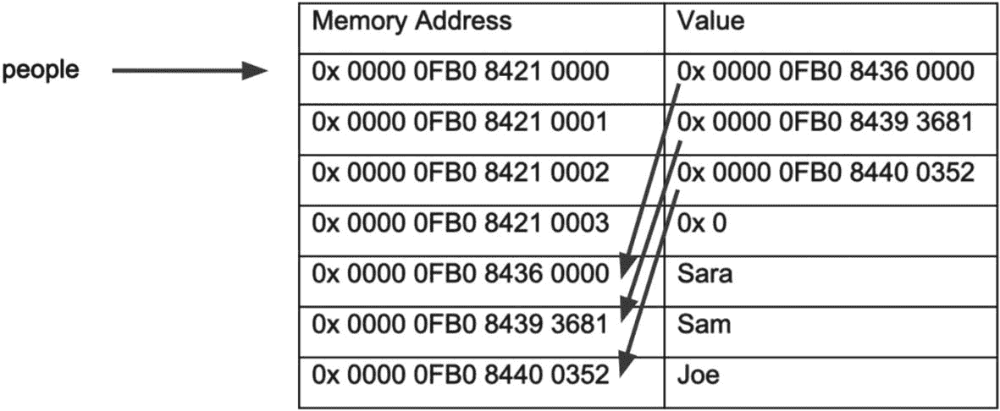
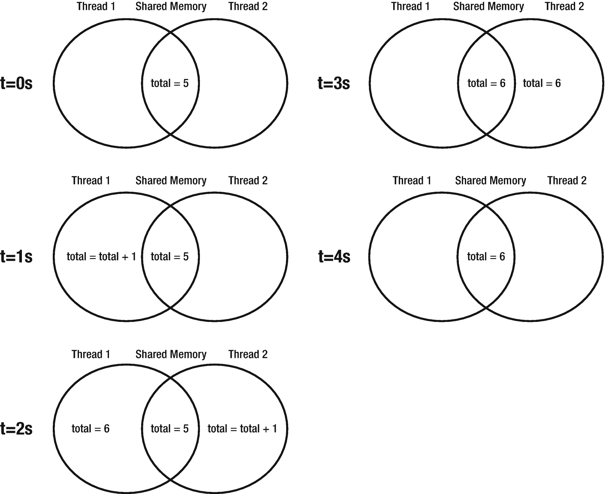
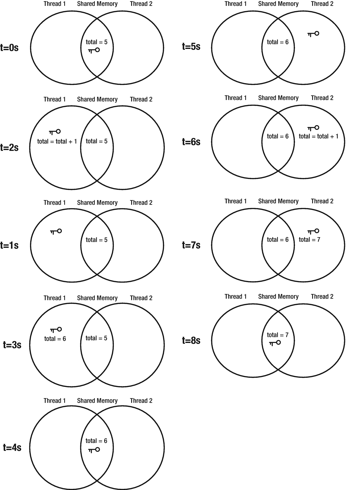
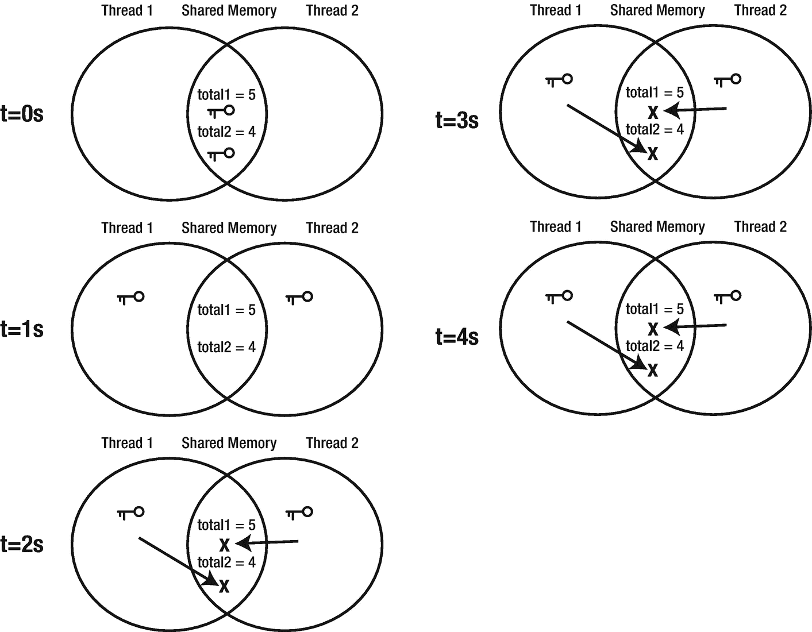

# 3. `pandas` 的工作原理

与任何编程语言一样，了解底层运行机制非常重要，因为它能帮助你编写更清晰、更简单、性能更高且更正确的代码。语言的基本构建块（其数据结构和 API）如果使用得当，可以化繁为简；如果使用不当，则可能使操作变得异常复杂甚至无法实现。Python 包也不例外。

编程语言本质上是人类易于读写、且能翻译成机器理解的 CPU 指令的文本。随着编程语言变得越来越高级（与计算机理解的机器码越来越遥远），开发者理解这种翻译过程的必要性已逐渐降低。然而，这带来的一个副作用是：软件可能以低性能或非典型的方式编写，而开发者却无需解决底层问题。在现代计算平台上，低性能的解决方案通常只有在扩展到处理大量数据时才变得明显可见。大数据软件通常在数据规模较大的情况下运行，性能影响因此显而易见——它需要处理海量数据集，往往将某个快速的小操作重复执行成千上万次，从而使其性能变得至关重要。在这种规模下工作，理解你所能使用的数据结构和性能优化手段，以便以最小的代价充分利用机器性能，就显得尤为重要。这一切都要从理解你所使用语言的数据结构性能开始。

## Python 数据结构

Python 的数据结构是其构建模块。为你要解决的问题选择正确的数据结构，对于编写正确且高性能的代码至关重要。

首先，我们来看元组。它们在很多方面与 C 语言数组相似，实际上底层就是一个数组。它们是可迭代的，意味着你可以遍历它们并查看每个值，但它们是不可变的，即一旦创建元组，其值就无法更改。它们非常适合存储静态的相关信息块，例如元数据。当程序不再引用一个小元组，并且其内存可以被释放时，Python 会将其保留并添加到元组空闲列表中，以便可以再次使用。这节省了解释器的时间，因为它不必为新的元组重新分配内存。在底层，元组被转换为固定大小的数组，即一个大小无法改变的指针数组。清单 3-1 展示了一个元组的代码示例，图 3-1 展示了它在内存中的表示。在清单 3-1 中，每个索引都表示为一个内存地址，从 `0x0000 0FB0 8421 0000` 到 `0002`。每个索引处的值是一个内存地址或指向内存中实际值的指针。这就是 Python 能够将不同类型的数据存储到同一个底层数组对象中的原因。元组的每个地址或索引都包含一个指针，并且只需要为指针腾出空间，而不是为实际值腾出空间。



**图 3-1**

清单 3-1 在内存中的表示

```
person_info = ("Sara", 140, 5.7)
清单 3-1
示例元组
```

简单来说，列表就是可变的元组。列表底层是一个固定大小的数组，但当元素数量超过 Python 最初分配的大小时，它会创建一个新的、有更多元素空间的固定大小数组，并将旧数组中的元素复制到新数组中。分配的大小以 2 为基数，所以如果你用一个包含五个值的列表初始化，Python 底层会分配一个能够容纳八个引用的固定大小数组。如果你接着追加四个值，在第四次追加时，这个固定大小数组将会被重新分配为原来大小的两倍（16），并且之前的值的引用会被复制到新数组中，包括那个在之前大小为 8 的数组中无法容纳的第四个新值的引用。与元组不同，列表没有针对重用已释放内存的任何幕后性能优化。这是因为列表是可变的——意味着它们的值在创建后可以更改，并且它们不是固定大小的。清单 3-2 展示了一个列表的示例，图 3-2 展示了它在内存中的表示。与元组一样，列表包含指向值的引用，而不是值本身。注意，由于这个列表是用三个值初始化的，底层的固定大小数组长度为 4，所以在索引 3（元素 4）处，有一个值为 `0x0` 的空占位符。



**图 3-2**

清单 3-2 在内存中的表示

```
people = ["Sara", "Sam", "Joe"]
清单 3-2
示例列表
```

字典是一个哈希表。键被哈希到数组中的一个内存地址或特定索引。根据字典中键的数量，会使用哈希值的特定比特位来确定索引。清单 3-3 展示了一个示例字典及其在内存中的表示。在清单 3-3 的示例中，由于只有两个元素，所以使用了 2 个比特位。哈希数组中的值是第二个数组的索引，第二个数组包含完整的哈希值、键以及字典中该键对应的值。请注意，哈希索引数组中的每个元素只占用 64 字节（一个指针的大小），而数据数组占用的空间远大于此，因为它包含了哈希值、键和值。通过维护一个指向数据数组的单独索引数组，字典实现能够使用更小的哈希索引数组来作为未使用键的占位符，而不是更大的数据数组，从而节省内存空间。它还可以根据需要增长哈希索引数组，类似于随着插入更多元素列表的增长方式，而不是为不存在的哈希索引分配一大块内存。请注意，当哈希比特位数增加时，哈希索引数组可以完全重新初始化，而独立于数据数组。同样值得注意的是，由于这种实现方式，字典的键现在会按照插入时间在数据数组中进行排序，自 Python 3.7 起，字典键保证按照插入顺序排列。

```
word_alphabet = {"a": "apple", "b": "banana"}
哈希索引            数据
None                  hash("a"), "a", "apple"
0                     hash("b"), "b", " banana"

None
清单 3-3
示例字典及其在内存中的表示
```

集合基本上与字典的实现相同，但缺少了值。它是一种用于跟踪成员关系的数据结构，并执行数学集合论中的几乎所有操作，例如并集和交集。清单 3-4 展示了一个示例集合及其在内存中的表示方式。

```
alphabet = {"a", "b"}
哈希索引           数据
None                hash("a"), "a"
0                   hash("b"), "b"

None
清单 3-4
示例集合及其在内存中的表示
```

还有许多其他的数据结构，包括整数、浮点数、布尔值和字符串。这些在底层几乎直接对应到它们的 C 类型等价物，在此不值得赘述。然而，值得一提的是，其中一些在 Python 中具有特殊的内置缓存机制。

Python 拥有字符串和整数缓存。以清单 3-5 中的 `str1` 和 `str2` 为例。它们都被设置为值 `“foo”`，但在底层它们指向同一个内存位置。这意味着，与其创建一个新的、与 `str1` 完全相同的字符串副本并复制内存，不如让新字符串直接指向现有的字符串值。这通过使用 `is` 属性比较两个字符串的引用或指针是否相等的断言行来证明。

```
str1 = "foo"
str2 = "foo"
assert(str1 is str2)
清单 3-5
str1 和 str2 指向同一个内存位置
```

然而，字符串缓存仅适用于包含字母、数字和下划线的字符串。在处理可能包含其他字符的大型数据集时，了解这一点非常有利。你可以通过从数据集中的字符串值中消除阻止字符串缓存的字符来节省大量内存。参见清单 3-6。

```
str1 = "foo bar"
str2 = "foo bar"
assert(str1 is not str2)
清单 3-6
str1 和 str2 不指向同一个内存位置
```

整数缓存的工作方式类似；它只缓存介于 -5 和 256（含）之间的整数。参见清单 3-7。

```
int1 = 22
int2 = 22
int3 = 257
int4 = 257
assert(int1 is int2)
assert(int3 is not int4)
清单 3-7
int1 和 int2 指向同一个内存位置，但 int3 和 int4 不指向同一个内存位置
```

再说一次，知道这一点可能是有利的，例如，将一列大数字拆分成两列来表示科学计数法中的数字，可能会节省内存。

## CPython 解释器、Python 和 NumPy 的性能

大多数开发者通常安装的 Python 解释器称为 `CPython`。它是推荐与 `pandas` 一起使用的解释器，因为 `pandas` 高度依赖 C 语言进行性能优化。`CPython` 用 C 语言实现，并将 Python 代码转换为所谓的字节码（`bytecode`），这是一种在 Python 虚拟机上运行的中间低层格式。有许多不同的 Python 解释器，包括 `Jython`、`IronPython` 和 `PyPy`，它们分别用 Java、C# 和 `RPython`（`RPython` 是 Python 的一个受限子集）实现。`PyPy` 是一种即时编译器（Just-In-Time，`JIT`），这意味着它在运行时将 Python 代码编译为机器码。这与 `CPython` 相反，`CPython` 在 Python 虚拟机上运行字节码并调用预编译的 C 扩展。`PyPy` 通常比 `CPython` 更快，因为它运行低层优化的机器码，而不是在 Python 虚拟机上解析字节码。不幸的是，`PyPy` 目前并不完全支持 `pandas`。

Python 是一种高级语言，这意味着它易于阅读且实现速度快。这也意味着它比某些低层语言慢，原因是这些自我管理的便利特性。这些便利特性包括垃圾回收器、全局解释器锁和动态类型，但它们并非没有代价。垃圾回收器负责释放不再使用的内存，以便可以再次使用。全局解释器锁（即 `GIL`）保护对象不被多个线程同时访问。动态类型允许同一变量持有不同类型的值。由于 `CPython` 是用 C 语言实现的，它与 C 兼容，因此允许 Python 调用用 C 编写的性能更高的扩展。但是为什么 C 语言比 Python 高效得多呢？Python 相对 C 较慢有几个原因：它是解释型而非编译型，它有一个全局解释器锁，它允许动态类型，并且它具有内置的垃圾回收器。

将 Python 解释为字节码类似于将 C 编译为目标文件，只不过字节码在 Python 虚拟机上运行，而机器码在 CPU 上运行。在运行时解释 Python 代码增加了额外的开销，使得 Python 通常比 C 运行得慢。解释过程分为几个阶段：词法分析器将 Python 代码转换为标记流；语法分析器进行语法分析；字节码生成器优化并将 Python 代码转换为字节码（`.pyc` 文件）；字节码解释器解释字节码流并维护字节码解释器的状态。

如果你曾经编辑过一个 Python 文件并重新运行程序，却发现程序没有使用你刚刚所做的更改，你就会理解 Python 解释器会将字节码缓存在 `.pyc` 文件中。在重新运行之前删除 `.pyc` 文件会强制解释器将 Python 代码重新解释为字节码——本质上，就是强制 Python 解释器清除其字节码缓存。字节码缓存通过不重新将 Python 代码解释为字节码（除非代码已更改），减少了运行时解释的开销。然而，在早于 3.3 的 Python 版本中，用于获取 `.py` 文件时间戳的方法与 Windows 操作系统的时间戳不匹配，导致生成的时间戳比 `.pyc` 文件更年轻。这意味着解释器不会将 `.py` 文件重新解释为字节码。类似地，如果你删除了一个 `.py` 文件，但仍然在代码中导入它，导入操作可能会继续工作，因为 `.pyc` 文件仍然存在于你的系统上。虽然这两个问题可能让你不想使用字节码缓存，但缓存在提高解释性能方面起着重要作用，并且通常会在后台运行，开发人员甚至察觉不到。字节码缓存对于第三方库尤其有利，这些库的代码已安装且预期不会更改，或者库所有者不希望暴露 Python 源代码。

Python 有一个全局解释器锁，大多数人称之为 `GIL`。为了理解 `GIL` 为何存在，你必须回到过去，探究 `GIL` 被发明时计算机科学领域正在发生什么。这一切始于线程的发明。预见到计算的未来，软件在多核 CPU 出现之前就引入了多线程的概念。线程使程序能够并行运行操作同一内存空间的进程。这是提高 CPU 密集型计算性能的绝佳方法。

例如，假设我们要计算名字“Tiffany”在列表中出现了多少次。你可以自己数出列表中“Tiffany”出现的次数，也可以将列表分成子列表，每个子列表交给一个朋友去数，每当有人看到“Tiffany”这个词时，就在白板上的运行总数上加一。在这个例子中，你和你的朋友们就是线程，白板上的计数就是共享内存。通常情况下，将问题分解成更小的块并使用线程来并行计算，比单线程计算整个任务要快。你可能会遇到的一个问题是，当你的一位朋友已经擦除了白板上的总数并正在更新时，你也想更新它。幸运的是，你很聪明，能意识到这一点，并在朋友完成更新总数后再尝试更新。然而，计算机需要被告知如何处理这种情况，或者说需要达到所谓线程安全的程度。如果软件遇到相同的情况，它只会简单地覆盖该值。这就是所谓的竞态条件。

在图 3-3 中，时间在 y 轴上表示为 `t`，有两个线程几乎同时想要增加总数。本例中的总数位于共享内存中，这意味着两个线程都可以访问该值。在这里，你可以看到线程 1 首先增加了计数器，然后是线程 2。然而，线程 2 实际上并没有增加计数器，因为当它获取总数准备增加时，线程 1 的增量尚未生效。这导致最终结果比应有的总数少 1（结果是 6，而不是 7）。



图 3-3

# 线程 1 与线程 2 之间`total`递增的竞态条件演示

与此运行总计示例类似，CPython 解释器使用一种引用垃圾收集技术，跟踪引用某个对象的位置数量。垃圾收集器负责跟踪已分配的内存，并在其不再使用时释放内存。它通过维护程序中引用每个对象的所有位置的运行总计来实现这一点。当不再有引用时，即引用计数为零，则内存被释放，这意味着它被释放并可用于存储其他内容。在清单 3-8 中，字符串`foo`的引用计数将为 2，因为有两个变量引用它。

```
ref1 = "foo"
ref2 = "foo"
```

清单 3-8 创建对字符串`foo`的两个引用的示例

回想一下，字符串缓存在此处起作用，正因为如此，`ref1`和`ref2`在底层指向同一个值。

当我们删除`ref2`时，字符串`foo`的引用计数为 1；当我们删除`ref1`时，字符串`foo`的引用计数为 0，并且内存可以被释放。这在清单 3-9 中演示。

```
delete(ref2)       # 执行此行后 reference count = 1
delete(ref1)       # 执行此行后 reference count = 0
```

清单 3-9 删除在清单 3-8 中创建的`foo`引用的示例

并非所有对象在其引用计数达到 0 时都会被释放，因为有些对象的引用计数永远不会达到 0。例如，清单 3-10 中呈现的场景，这在使用 Python 的类和对象时经常发生。在此场景中，`exc_info`是一个元组，第三个索引处的值是回溯对象（`traceback object`）。回溯对象包含对帧（`frame`）的引用，但帧也包含对`exc_info`变量的引用。这就是所谓的循环引用，由于无法在不破坏另一个的情况下删除其中一个，因此这两个对象必须被垃圾收集。垃圾收集器会定期运行，识别并删除像这样的循环引用对象。

```
import sys
try:
    raise Exception("Something went wrong.")
except Exception as e:
    exc_info = sys.exc_info()
    frame = exc_info[2].tb_frame   # 创建第三个引用
    assert(sys.getrefcount(frame) == 3)
    del(exc_info)
    assert(sys.getrefcount(frame) == 3)
```

清单 3-10 创建循环引用的示例

跟踪这些引用并非没有代价。每个对象都有一个关联的引用计数器，它占用空间，并且代码中每次引用都需要 CPU 周期来计算对象引用计数的适当增减。这就是为什么，如果你比较 Python 中对象的大小和 C 中对象的大小，Python 中的大小要大得多，也是为什么 Python 执行速度比 C 慢的部分原因。那些额外的字节和额外的 CPU 周期部分源于引用计数跟踪。虽然垃圾收集器确实对性能有影响，但它也使 Python 成为一种易于编程的语言。作为开发者，您不必担心跟踪内存分配和释放；Python 垃圾收集器会为您处理这些。

在多线程应用程序中，引用计数与图 3-3 中的`total`存在相同的问题。一个线程可能在与另一个线程同时向共享内存空间中的对象创建新引用，从而发生竞态条件，导致引用计数最终只增加一次而不是两次。发生这种情况时，最终可能导致对象过早地从内存中释放（因为竞态条件导致对象的引用计数增加了一次而不是两次）。在其他情况下，当引用计数器的递减出现竞态条件时，这可能导致内存泄漏，因为引用计数比应有的值大 1，所以内存永远不会被销毁。因此，正如您在此处所见，运行多线程应用程序不仅会影响程序正在操作的数据，还会影响 Python 解释器本身。

传统上，竞态条件通过锁来解决。这实际上就是您下意识做的事情——也就是说，在您自己更新总计之前，等待您的朋友完成更新总计。在软件中，这是通过共享内存锁实现的。当一个线程需要更新总计时，它获取锁，更新总计，然后释放锁。与此同时，另一个线程等待锁空闲，获取锁，然后也更新总计。这种交互在图 3-4 中演示。



图 3-4 线程 1 与线程 2 之间共享`total`上的锁的演示

太好了！我们已经解决了问题！或者我们解决了吗？考虑图 3-5 中的场景，其中有两个锁和两个总计。



图 3-5 线程 1 与线程 2 之间死锁的演示

图 3-5 就是所谓的死锁。当两个线程需要多段数据才能执行，但它们以不同的顺序请求这些数据时，就会发生死锁。为了完全避免此类问题，Python 的作者在线程级别实现了一个锁，该锁只允许在任何给定时间运行一个线程。这是解决这个问题的一种简单而优雅的方式。当时，由于多核 CPU 相当罕见，这实际上并没有影响性能，因为在 CPU 中，这些线程的指令无论如何都是串行执行的。然而，随着计算机变得越来越先进，计算变得越来越密集，多核 CPU 已成为几乎所有现代计算平台的标准。当涉及大数据，需要进行大型 CPU 密集型计算时，不利用多核 CPU 意味着在某些情况下根本无法运行计算（至少无法在合理的时间内运行）。那么，我们如何才能打破 GIL（全局解释器锁），真正运行多核大数据计算呢？

C 扩展是用 C 语言编写的，而不是 Python，因此不受 GIL 的限制。`pandas`构建在`NumPy`之上，而`NumPy`是一个 Python 包装器，它包装了完成所有繁重计算任务的 C 扩展。这意味着使用`pandas`时，所有密集型计算都是在 C 中完成的，由于该语言的特性，计算通常更快。这也意味着`pandas`能够打破 GIL，真正在多个核心上同时运行多核计算。

由于 NumPy 在 C 语言中执行计算，它必须将所有 Python 对象转换为与 C 兼容的类型。根据 NumPy 文档，只要数组的类型能够转换为 C 类型，就会在计算前释放 GIL。这意味着，在使用 NumPy 时，操作那些可转换为 C 类型的类型非常重要。如果你操作的是 NumPy 无法转换为 C 的 Python 对象，那么就无法在 C 中完成计算，而必须停留在 Python 环境中，直到计算完成才能释放 GIL。

附录中详细列出了 Python 类型与 NumPy 在其 C 扩展中使用的类型（称为标量）之间的映射关系。在 NumPy API 中，所有 NumPy 类型都被称为 `dtypes`，并作为 `NumPy` 库的属性提供。

NumPy 的主要数据结构是 N 维数组或 `ndarray`。它是一种特殊的数组结构，专门处理 Python 与 C 之间的边界问题。需要注意的是，NumPy 中的 `ndarray` 是同质的，即所有元素都具有相同类型。这同样与 Python 和 C 的差异有关。C 是一种低级语言，开发人员必须自行管理内存的分配和释放，并且不支持动态类型。对于 C 中的数组而言，所有元素的大小或类型必须一致且已知，以便在 C 中为输入数据数组和输出数据数组分配适当的内存。清单 3-11 展示了如何在 C 中创建一个浮点数数组。请注意，必须使用 `malloc` 显式分配内存，并且数组大小固定为 100——仅能容纳 100 个浮点数。

```
float* array = (float*) malloc(100 * sizeof(float));
```

清单 3-11 在 C 中为包含 100 个浮点数的数组分配内存

NumPy 使用如清单 3-12 所示的 `ndarray` 来构建固定大小的数组，其中 `dtype` 用于指定数组中每个元素的类型，即每个元素在数组中所占用的内存大小。回顾上一节可知，Python 的 `list` 实现本质上是一个动态数组。与 `ndarray` 不同，Python 的 `list` 类型通过为指向数据的指针分配空间（而非为数据本身分配空间）来处理任意大小的元素。这导致 Python 的 `list` 比 `ndarray` 占用更多内存，因为列表持有的是指向数据的指针，而非数据本身，从而增加了一层间接性。总之，`ndarray` 具有固定长度，且每个元素类型相同；而 Python 的 `list` 类型具有动态长度，元素可以是多种不同类型。这是一个重要区别，也是 `pandas` 中每一列都被分配一个特定 `dtype` 的原因。这同样说明了为什么确保 `pandas` 为特定列分配正确类型、以及为什么对数据进行归一化以避免使用包罗万象的 `object` 类型是如此重要。图 3-6 展示了清单 3-12 中创建的 `ndarray` 在内存中的表示方式。
