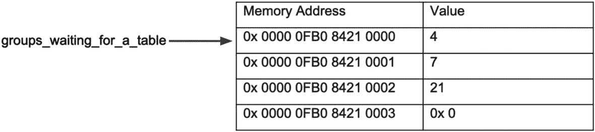

# NumPy 与 pandas 性能基础

清单 3-12 展示了包含三个无符号 8 位整数的 `ndarray`。

```python
import numpy as np
groups_waiting_for_a_table = np.ndarray(
    (3,),
    buffer=np.array([4, 7, 21], dtype=np.uint8),
    dtype=np.uint8,
)
```



图 3-6 清单 3-12 在内存中的表示。请与图 3-2 进行比较。

CPython 解释器提供了一个 C-API，该 API 提供了获取和释放 GIL 的能力。NumPy 使用宏 `NPY_BEGIN_THREADS` 和 `NPY_END_THREADS` 来标识何时可以在不持有 GIL 的情况下运行 C 代码。NumPy 的数学运算是通用函数（即 `ufunc`）的实例，这些函数在 C 中实现，并且都会调用这些宏。常见 `ufunc` 列表请参见附录。

回想一下，在没有 GIL 的情况下运行意味着程序现在可以同时在多个内核上执行指令。这意味着，当使用 NumPy 进行密集的数学运算时，能够在 C 层面通过多线程来分解计算任务，例如统计 Tiffany 在列表中出现的次数。虽然 NumPy 本身通常不实现多线程计算（仅将计算运行在 C 层面本身就能带来显著的性能提升），但结合 NumPy 使用其他库时，这些库会实现多线程。

当 NumPy 编译时使用了基础线性代数子程序库（BLAS）或线性代数包（LAPACK），它会根据内存缓存大小和系统可用核心数来执行运算。通过根据机器资源优化计算，NumPy 能够以远高于常规的速度运行计算。BLAS/LAPACK 有多种不同的实现，包括 OpenBLAS、ATLAS 和 Intel MKL。我们将在后续章节中更详细地探讨这些库如何提升性能；但目前，只需要知道它们的存在，并且对于大规模计算而言，它们能带来巨大的性能差异。

## pandas 性能简介

`pandas` 是 `NumPy` 的包装，而 `NumPy` 又是 C 语言的包装；因此，`pandas` 的性能优势源于其在 C 语言环境而非 Python 环境中运行。这一概念是你在 `pandas` 中所有操作的基础。当你身处 C 语言环境时，速度飞快；而当你置身 Python 环境时，速度则变得缓慢。^(⁴)

处理 pandas `DataFrames` 同样需要遵循处理 NumPy 数组时的要求——即 Python 代码必须能够翻译成 C 代码；这包括承载数据的数据类型以及对其执行的操作。表 3-1 列出了 pandas 类型到 NumPy 类型的映射关系。请注意，`datetime` 和 `timedelta` 并不会翻译成 NumPy 类型。这是因为 C 语言没有 `datetime` 数据结构，因此在对 `datetime` 数据执行操作时，更高效的做法是将其转换为自纪元以来的整数秒数。

**表 3-1** pandas 到 NumPy 类型映射

| pandas 类型 | NumPy 类型 |
| --- | --- |
| `object` | `string_`, `unicode_` |
| `int64` | `int_`, `int8`, `int16`, `int32`, `int64`, `uint8`, `uint16`, `uint32`, `uint64` |
| `float64` | `float_`, `float16`, `float32`, `float64` |
| `bool` | `bool_` |
| `datetime64` | `datetime64[ns]` |
| `timedelta[ns]` | 不适用 |
| `category` | 不适用 |

请注意，`category` 类型同样无法翻译成 C 语言。`category` 类似于元组，旨在包含一组分类变量，即具有固定唯一值集合的元数据。由于它无法翻译成 C 语言，因此绝不应将其用于保存需要分析的数据。它的主要优势在于能够高效且简便地实现自定义排序顺序。其底层结构类似于一个数据索引数组，这些索引指向一个类别数组中唯一的元素值。文档声称，在使用字符串类别时，它可以节省大量内存。当然，从上一节我们知道，Python 已经内置了一个字符串缓存，可以自动为某些字符串完成此操作，因此，只有当字符串包含字母数字和下划线以外的字符时，此功能才会真正发挥作用。代码清单 3-13 展示了一个 `category` 示例及其在内存中的表示。请注意，它使用整数来表示值，并且这些整数映射到 `category` 数组中的索引。这是 pandas 中节省内存的常用方法。稍后我们在讨论多层索引时还会再次遇到它。

```python
import pandas as pd
produce = pd.Series(
    ["apple", "banana", "carrot", "apple"], dtype="category"
)
# Data       Categories
# 0          apple
# 1          banana
# 2          carrot
```

代码清单 3-13 pandas 类别示例及其在内存中的表示

为了利用 NumPy 的性能优化，操作也必须能够翻译成 C 代码。这意味着自定义函数（如代码清单 3-14 所示）性能不会很高，因为它们将在 Python 中而非 C 语言中运行。我们将在第 6 章中更深入地探讨此示例以及 `apply` 函数。

```python
import pandas as pd
def grade(values):
    if 70 <= values["score"] < 80:
        values["score"] = "C"
    elif 80 <= values["score"] < 90:
        values["score"] = "B"
    elif 90 <= values["score"]:
        values["score"] = "A"
    else:
        values["score"] = "F"
    return values
scores = pd.DataFrame({"score": [89, 70, 71, 65, 30, 93, 100, 75]})
scores.apply(grade, axis=1)
```

代码清单 3-14 无法翻译成 C 语言的自定义 pandas Python 操作

由于 pandas 构建于 NumPy 之上，它使用 NumPy 数组作为 pandas `DataFrame` 的构建块，而这些数组在底层计算中最终会转换为 `ndarray`。

```python
import pandas as pd
restaurant_inspections = pd.DataFrame({
    "restaurant": ["Diner","Diner","Pandas","Pandas"],
    "location": [(4,2),(4,2),(5,4),(5,4)],
    "date": ["02/18","05/18","04/18","01/18"],
    "score": [90,100,55,60]})
# >> restaurant_inspections
#   restaurant  location   date      score
# 0  Diner       (4, 2)     02/18     90
# 1  Diner       (4, 2)     05/18     100
# 2  Pandas      (5, 4)     04/18     55
# 3  Pandas      (5, 4)     01/18     76
# Index           Blocks
# restaurant      Diner      Diner     Pandas    Pandas
# location        (4, 2)     (4, 2)    (5, 4)    (5, 4)
# date            02/18      05/18     04/18     01/18
# score           90         100       55        76
```

代码清单 3-15 pandas 单索引 DataFrame 及其在内存中的表示

代码清单 3-15 是 pandas `DataFrame` 最简单形式的示例。数据是餐厅卫生检查数据。它有四列：`restaurant`、`location`、`date` 和 `score`。每列有四行数据。请注意，有些数据是重复的，因为同一家餐厅可能在不同时间有多次检查记录。在底层，此 `DataFrame` 被表示为一个名为 `Index` 的 NumPy 数组（包含列名）和一个名为 `Blocks` 的二维 NumPy 数组（包含数据）。

同样的数据可以使用多层索引`DataFrame`以更具表现力的方式表示，其中每个索引代表一家唯一的餐厅。这分两步完成。首先，我们创建索引，然后将该索引附加到数据上，如代码清单 3-16 所示。数据的表示方式与上一个示例相同，但请注意，现在只有两列数据，而不是四列。

```python
import pandas as pd
restaurants = pd.MultiIndex.from_tuples(
(
("Diner", (4,2)),
("Diner", (4,2)),
("Pandas", (5,4)),
("Pandas", (5,4)),
),
names = ["restaurant", "location"]
)
restaurant_inspections = pd.DataFrame(
{
"date": ["02/18", "05/18", "04/18", "01/18"],
"score": [90, 100, 55, 76],
},
index=restaurants,
)
>> restaurant_inspections
date    score
restaurant      location
Diner           (4, 2)    02/18   90
05/18   100
Pandas          (5, 4)    04/18   55
01/18   76
Levels      Names                 Labels
restaurant  Diner   Pandas        0    0
location    (4, 2)  (5, 4)        0    0
1    1
1    1
Index       Blocks
date        02/18     05/18    04/18    01/18
score       90        100      55       76
代码清单 3-16
pandas 多层索引 DataFrame 及其在内存中的表示
```

当我们创建多层索引时，会发生一些特殊的事情。底层索引看起来与单索引示例中的不同。仍然有一个名为`Levels`的`NumPy`数组来保存索引名称；然而，数据不再是简单的二维`NumPy`数组，而是经历了一种压缩形式。`Names`是一个二维`NumPy`数组，用于跟踪索引中的唯一值，而`Labels`是一个二维整数`NumPy`数组，其值是`Names` `NumPy`数组中唯一索引值的索引。这与 pandas `category` 数据类型使用的内存节省技术相同，事实上，由于`category`出现得更晚，它们很可能复制了 pandas 多层索引的这种技术。

# DataFrame 排版优化

列表 3-16 中的 `DataFrame` 最终大小约为列表 3-15 中单索引 `DataFrame` 的三分之二，这是因为使用多索引带来了数据压缩。`pandas` 能够通过使用整数类型（而非其他更大的类型）来跟踪和表示索引数据，从而节省内存。当然，当索引中存在大量重复数据时，这会很有优势；而当索引中几乎没有或完全没有重复数据时，优势则不那么明显。这也正是数据规范化如此重要的原因。例如，如果同一餐厅名称存在多种表示形式（如 `DINER`、`Diner`、`diner`），那么我们就无法像这里一样充分利用数据压缩。同时，我们也无法充分利用 Python 的字符串缓存。

与多级索引类似，`pandas` 也支持多级列。多级列的实现方式与多级索引相同，都采用了相同的数据压缩技术。列表 3-17 展示了一个如何创建多索引多级列 `DataFrame` 的示例。

```python
import pandas as pd
restaurants = pd.MultiIndex.from_tuples(
(
("Diner", (4,2)),
("Pandas", (5,4)),
),
names = ["restaurant", "location"]
)
inspections = pd.MultiIndex.from_tuples(
(
(0, "score"),
(0, "date"),
(1, "score"),
(1, "date"),
),
names=["inspection", None],
)
restaurant_inspections = pd.DataFrame(
[[90, "02/18", 100, "05/18"], [55, "04/18", 76, "01/18"]],
index=restaurants,
columns=inspections,
)
>> restaurant_inspections
inspection             0             1
score date    score date
restaurant location
Diner      (4, 2)      90    02/18   100   05/18
Pandas     (5, 4)      55    04/18   76    01/18
列表 3-17
pandas 多索引多级列 DataFrame
```

## 选择合适的 DataFrame

选择 `pandas` `DataFrame` 的排布方式是一个需要深思熟虑和精心规划的决定。需要考虑的因素包括：

*   你将使用这些数据进行哪种类型的数据处理？
*   你是否需要对数据进行聚合计算或分组？
*   所有数据类型是否都能转换为 C 类型？如果能，需要怎么做？
*   你能将数据与元数据分离吗？
*   是否存在某种特定的 `DataFrame` 排布方式，可以使处理更简单且性能更优？

以健康检查数据为例。每家餐厅可以有多次检查记录，作为数据处理的一部分，我们需要统计每家餐厅接受检查的次数。

`pandas` `DataFrame` 最简单的形式如列表 3-18 中的 `DataFrame` 所示。为了计算检查次数，数据必须首先按餐厅进行唯一聚合，然后统计每家餐厅的检查次数。这个 `DataFrame` 底层大约占用 1,120 比特。

```python
import pandas as pd
restaurant_inspections = pd.DataFrame({
    "restaurant": ["Diner","Diner","Pandas","Pandas"],
    "location": [(4,2),(4,2),(5,4),(5,4)],
    "date": ["02/18","05/18","02/18","05/18"],
    "score": [90,100,55,60]})
>> restaurant_inspections
restaurant  location     date      score
Diner       (4, 2)       02/18     90
Diner       (4, 2)       05/18     100
Pandas      (5, 4)       02/18     55
Pandas      (5, 4)       05/18     76
>> total_inspections = restaurant_inspections.groupby(
    ["restaurant", "location"], as_index=False,
)["score"].count()
>> total_inspections.rename(
    columns={"score": "total"}, inplace=True
)
>> total_inspections
restaurant  location    total
Diner       (4, 2)      2
Diner       (4, 2)      2
>> restaurant_inspections = pd.merge(
    restaurant_inspections,
    total_inspections,
    how="outer",
)
>> restaurant_inspections
restaurant  location    date    score    total
Diner       (4, 2)      02/18   90       2
Diner       (4, 2)      05/18   100      2
Pandas      (5, 4)      02/18   55       2
Pandas      (5, 4)      05/18   76       2
列表 3-18
在单索引 DataFrame 中存储和操作餐厅卫生检查数据
```

使用单索引 `DataFrame` 进行此类计算并不理想，原因有几点。首先，我们需要进行聚合计算，因此必须按唯一餐厅对数据进行分组。如果分组数量很多，这种分组操作可能会非常耗时。对每个分组进行计算后，你会发现生成的 `total_inspections` 与原始 `restaurant_inspections` `DataFrame` 的维度不匹配。维度不匹配导致我们需要费些周折才能将新数据放回原始 `DataFrame`。我们最终通过一次合并来实现，但这会构建一个全新的 `DataFrame`。这意味着在合并过程中内存占用会增加一倍。如果原始 `DataFrame` 非常大，并且我们的内存使用已接近上限，这可能会导致处理速度变慢，甚至因内存耗尽而崩溃。

如果我们将数据表示为多索引 `DataFrame`（如清单 3-19 所示），数据已经按餐厅唯一分组。这意味着 `groupby` 操作会更快，因为数据已在索引中分组。同时，`DataFrame` 占用的内存更少，因为正如前一节所述，索引中的数据是压缩的。最重要的是，我们无需像使用单索引 `DataFrame` 时那样进行繁琐的操作。我们能够执行计算并将结果放回原始 `DataFrame`，而无需创建副本，这大大节省了时间和内存。你会注意到代码也更简单、更易于理解。这个 `DataFrame` 底层大约占用 880 比特。回忆一下，当我们创建多索引时，索引数据会被压缩，这就是为什么这个多索引 `DataFrame` 比其单索引版本更小。

### 在多索引 DataFrame 中存储和操作餐厅卫生检查数据

```python
import pandas as pd
restaurants = pd.MultiIndex.from_tuples(
(
("Diner", (4,2)),
("Diner", (4,2)),
("Pandas", (5,4)),
("Pandas", (5,4)),
),
names = ["restaurant", "location"],
)
restaurant_inspections = pd.DataFrame(
{
"date": ["02/18", "05/18", "02/18", "05/18"],
"score": [90, 100, 55, 76],
},
index=restaurants,
)
```

```
>> restaurant_inspections
date         score
restaurant  location
Diner       (4, 2)      02/18        90
05/18        100
Pandas      (5, 4)      02/18        55
05/18        76
```

```python
>> restaurant_inspections["total"] = \
restaurant_inspections["score"].groupby(
["restaurant","location"],
).count()
>> restaurant_inspections.set_index(
["total"],
append=True,
inplace=True,
)
```

```
date        score
restaurant  location    total
Diner       (4, 2)      2        02/18       90
05/18       100
Pandas      (5, 4)      2        02/18       55
05/18       76
```

### 在多索引日期列 DataFrame 中存储和操作餐厅卫生检查数据

如果我们更进一步呢？如果把日期作为列名，那么所有分数将在同一行上，计算将变得非常简单。这里，唯一的餐厅是索引，唯一的检查日期是列。注意，分数现在是唯一的数据。这使得每一行对应一个唯一的餐厅，因此计数可以简单地对每一行执行。参见清单 3-20。

```python
import pandas as pd
restaurants = pd.MultiIndex.from_tuples(
(
("Diner", (4,2)),
("Pandas", (5,4)),
),
names = ["restaurant", "location"],
)
restaurant_inspections = pd.DataFrame(
{
"02/18": [90, 55],
"05/18": [100, 76],
},
index=restaurants,
)
```

```
>> restaurant_inspections
date                    02/18    05/18
restaurant  location
Diner       (4, 2)      90       100
Pandas      (5, 4)      55       76
```

```python
>> restaurant_inspections["total"] = \
restaurant_inspections.count(axis=1)
>> restaurant_inspections.set_index(
["total"],
append=True,
inplace=True,
)
```

```
date                                 02/18    05/18
restaurant  location    total
Diner       (4, 2)      2            90       100
Pandas      (5, 4)      2            55       76
```

这个`DataFrame`底层大约占用 660 比特。请注意，它占用的内存更少，因为我们不再跟踪日期和分数列名，且日期值不再重复。对于这些数据，这几乎是我们能实现的最大压缩程度，并且它允许我们对每个唯一餐厅执行非常高效的聚合计算。让我们看看在使用这种格式处理更大数据集时，是否会发现任何缺陷。

目前，每一行对应一个唯一的餐厅，但如果存在多个同名的餐厅位于不同位置呢？这仍然意味着每一行对应一个唯一的餐厅，因此没有问题。

如果餐厅不是在相同的日期被检查呢？在一个大城市里，检查员几乎不可能在同一天检查所有餐厅。这意味着数据中会出现空缺，如清单 3-21 所示。

```
date                         02/18    05/18    06/18    07/18
restaurant  location  total
Diner       (4, 2)    2      90       100      NaN      NaN
Pandas      (5, 4)    2      NaN      NaN      55       76
```

这些空缺可能是一个大问题。回忆一下，分数数据原本表示为无符号 8 位整数，但现在因为数据中存在`NaN`，数据类型必须容纳`NaN`类型的大小，这迫使数据类型变为 32 位浮点数。这意味着每个分数占用四倍的内存。不仅如此，数据中还存在大量空白，浪费了空间，最终也浪费了内存。餐厅之间共有的日期越少，这个问题就越严重。多级列索引来拯救！参见清单 3-22。

```python
import pandas as pd
restaurants = pd.MultiIndex.from_tuples(
(
("Diner", (4,2)),
("Pandas", (5,4)),
),
names = ["restaurant", "location"]
)
inspections = pd.MultiIndex.from_tuples(
(
(0, "score"),
(0, "date"),
(1, "score"),
(1, "date"),
),
names=["inspection", "data"],
)
restaurant_inspections = pd.DataFrame(
[[90, "02/18", 100 "05/18",], [55, "04/18", 76 "01/18",]],
index=restaurants,
columns=inspections,
)
```

```
>> restaurant_inspections
inspection                  0                1
score date       score date
restaurant  location
Diner       (4, 2)          90  02/18        100  05/18
Pandas      (5, 4)          55  04/18        76   01/18
```

```python
>> total = \
restaurant_inspections.iloc[
:,
restaurant_inspections.columns.get_level_values("data") \
== "score"
].count()
>> new_index = pd.DataFrame(
total.values,
columns=["total"],
index=restaurant_inspections.index,
)
>> new_index.set_index("total", append=True, inplace=True)
>> restaurant_inspections.index = new_index.index
>> restaurant_inspections
```

```
inspection                     0               1
score date      score date
restaurant  location  total
Diner       (4, 2)    2        90  02/18       100  05/18
Pandas      (5, 4)    2        55  04/18       76   01/18
```

对于这个特定用例，这可能是我们使用这种`DataFrame`格式能得到的最优方案。我们充分利用了多级索引和多级列，最大程度地压缩了数据，并以实现最快计算的方式组织了`DataFrame`。请注意，这种特定格式的主要缺点是，要将总数放回索引需要一些繁琐的操作，因此这种解决方案的可读性较差。如果这是你打算采用的解决方案，你可能会考虑创建两个自定义函数：一个用于将数据放入索引，另一个用于将数据放入列。这些函数通过隐藏向`DataFrame`追加层级数据的细节来提高代码的可读性。

一旦你确定了一种合理的`DataFrame`格式，你可能需要将原始数据加载到`pandas`中，进行规范化，并将其转换为该特定的`DataFrame`格式。在第 4 章中，我们将深入探讨一些常见的`pandas`数据加载方法，并更详细地讨论它们提供的规范化选项。

脚注 1

## 加载与标准化数据

原始数据形式多样：CSV、JSON、SQL、HTML 等等。`pandas` 提供了数据输入输出函数，用于将数据加载到 `pandas` DataFrame 中，以及将 `pandas` DataFrame 中的数据输出为各种常见格式。在本章中，我们将深入探讨其中一些输入函数，并探索它们提供的多种加载与标准化选项。

用于将数据加载到 `pandas` 中的函数提供了广泛的标准化和优化功能，这些功能可以提升程序性能，甚至决定了能否成功将数据加载到 `pandas` 中，还是因内存耗尽而失败。然而，每个输入函数都有所不同，因此这完全取决于你正在处理的输入/输出格式，并且查阅你所使用的特定函数的文档总是值得的。表 4-1 列出了 `pandas` 支持的各种输入和输出函数。

`表 4-1`。IO `pandas` 数据函数

| 输入 | 输出 |
| --- | --- |
| `read_csv` | `to_csv` |
| `read_excel` | `to_excel` |
| `read_hdf` | `to_hdf` |
| `read_sql` | `to_sql` |
| `read_json` | `to_json` |
| `read_html` | `to_html` |
| `read_stata` | `to_stata` |
| `read_clipboard` | `to_clipboard` |
| `read_pickle` | `to_pickle` |

第 3 章提到了几个进行数据标准化的充分理由：它可以节省内存并优化数据分析。标准化数据可以让你利用 Python 的字符串缓存，或者通过选择与 C 兼容的数据类型，在 C 语言环境中而非 Python 环境中运行计算，从而获益。上述许多输入函数都提供了在加载过程中对数据进行标准化处理的各种选项。许多输入函数允许你在加载时移除列或指定列的类型，而不是先用大的内存占用加载数据，然后在加载后再移除不必要的列或将列转换为更小的数据类型以减少内存占用。这意味着你可以加载更多数据而不会耗尽内存，并且数据加载和标准化过程更快，因为你是同时进行这两项操作，而不是先顺序加载再标准化。

导致数据创建和删除的操作代价可能很高，因为它们需要分配和释放大块内存。将数据从一种类型转换为另一种类型（通常称为类型转换）同样代价高昂，因为它需要分配和释放大块内存。处理大块内存通常意味着缓存未命中，并且大量时间会花费在 IO 上，即把数据从离 CPU 较远的内存移动到离 CPU 较近的内存（例如，从主内存移动到一级缓存）。因此，尽管你可能认为内存与处理速度无关，但它实际上会对运行时间产生巨大影响。

在这些输入函数中，`pandas` 通常会在加载数据时推断数据类型。虽然一开始这看起来很不错，似乎是一个你总是应该利用的绝佳功能，但它也会对性能产生巨大且通常是负面的影响。通常，正在加载的数据尚未标准化，例如，数字列可能包含非数字值，这迫使推断出的数据类型成为对象类型，即它能容纳的最大数据类型。许多数据加载函数允许你指定列的类型，并将占位值转换为 `NaN`，这可以防止 `pandas` 推断出错误的数据类型。

### `pd.read_csv`

`pandas` 的 CSV 加载器 `pd.read_csv` 是使用最广泛的加载器，并且在数据标准化选项方面也是迄今为止最完备的。由于 Python 标准库内置了一个 CSV 加载器，并且 `pandas` 加载器有一些相当花哨的 Python 式选项，因此它有两个不同的解析引擎：C 引擎和 Python 引擎。正如你现在可能猜到的，C 引擎的性能优于 Python 引擎，但根据你指定的选项，你可能别无选择，只能使用 Python 引擎进行解析。因此，建议谨慎使用哪些选项以及向这些选项提供哪些值，以确保你使用的是 C 解析引擎，并获得最佳的加载性能。CSV 加载器有一个明确的 `engine` 参数，允许你强制将解析引擎设置为 Python 或 C。在加载时始终显式指定此参数是保证 CSV 加载器使用 C 引擎进行解析的一种简单方法。如果你在 `engine` 明确设置为 `'c'` 的同时指定了另一个 Python 解析器特有的选项，CSV 加载器将抛出一个异常，告知你该特定设置与 C 解析引擎不兼容，如代码清单 4-1 所示。

```
>> data = io.StringIO(
"""
id,age,height,weight
129237,32,5.4,126
123083,20,6.1,145
"""
)
>> df = pd.read_csv(data, sep=None, engine="c")
ValueError: the 'c' engine does not support sep=None
with delim_whitespace=False
```

`代码清单 4-1`。当 `engine` 设置为 `'c'` 且其他设置不兼容时，`read_csv` 会引发 `ValueError` 异常

使用 C 解析引擎的另一个原因是它通过 `float_precision` 参数支持更高精度的浮点数。通常，Python 引擎使用双浮点精度，而 C 引擎使用其自己的底层字符串到十进制数的解析器，该解析器与 Python 引擎相当。两者都可能导致浮点数舍入错误，例如 `-15.361` 和 `-15.3610` 不相等的情况。然而，C 解析引擎还支持额外的 `high` 精度和 `round_trip` 精度选项。如果你希望浮点数尽可能精确，请使用 `round_trip` 精度选项。这是浮点数常见的问题，因此，在处理财务数据时经常使用的一种替代方法是将浮点数拆分为两个整数：一个整数表示小数点前的数字，另一个整数表示小数点后的数字。

`read_csv` 函数的第一个参数是 `filepath_or_buffer`。通常，这里会传入 CSV 文件的路径，但请注意，出于单元测试的目的以及本章其余部分的示例目的，可以传入一个 `StringIO` 对象来代替。如果 CSV 文件由第三方应用程序托管，它还接受一个 URL 路径。文档的官方描述如下：

> *所谓类文件对象，我们指的是具有 `read()` 方法的对象，例如文件句柄（例如，通过内置的 `open` 函数获取）或 `StringIO`。*

这种类文件对象是另一种 Python 特性，通常被称为鸭子类型。这个术语源于一句习语：“如果它走路像鸭子，叫声像鸭子，那么它就是鸭子。”在这种情况下，如果它有一个 `read` 方法，那么它就是一个类文件对象。这就是为什么 `StringIO` 也可以替代文件句柄，因为它也有一个 `read` 方法。`StringIO` 在单元测试中是一个很好的替代品，因为它允许你假装它是一个文件，而无需实际包含一个 `test.csv` 来验证你的加载器是否按预期工作。

### `read_csv` 参数详解

`read_csv` 提供了 `sep` 参数，用于指定分隔数据的字符。默认值为逗号。请注意，`sep` 将长度超过一个字符的值（`\s+` 除外）视为正则表达式。在此使用复杂分隔符可能会强制使用 Python 解析引擎而非 C 引擎，因此建议尽可能使用单字符分隔符，不要指定复杂的正则表达式。参数 `delim_whitespace` 也可以设置为 `True`，作为设置 `sep="\s+"` 的替代方案，专门用于表示空格分隔的文件。`sep` 参数也可以设置为 `None`，此时将使用 Python 解析引擎，并自动检测分隔符。`skipinitialspace` 参数可用于忽略分隔符周围的空格。默认情况下此项是禁用的，因此如果文件中分隔符之间存在空格，则需要将此参数设置为 `True`。列表 4-2 演示了如何结合使用 `sep` 和 `skipinitialspace` 来配置加载非逗号分隔的数据。

# pandas `read_csv` 函数参数详解

## 加载非逗号分隔的数据

```python
>> data = io.StringIO(
"""
id| age| height| weight
129237| 32| 5.4| 126
123083| 20| 6.1| 145
"""
)
>> pd.read_csv(data, sep="|", skipinitialspace=True)
idageheightweight
0129237325.4126
1123083206.1145
```
列表 4-2 加载非逗号分隔的数据

## 使用 `usecols` 参数

`usecols` 参数用于缩小要加载的列的范围。CSV 文件中可能存在您不关心的列，因此这是一种在加载时高效删除它们的方法，而不是加载所有数据后再移除。请注意，`usecols` 也可以是一个函数，该函数以列名作为输入，输出一个布尔值，指示在加载时是包含该列还是丢弃它。然而，使用函数不太理想，因为它需要在 C 解析引擎和自定义函数之间进行调用，这会降低加载速度。列表 4-3 展示了使用 `usecols` 在加载时删除 `id` 和 `age` 列的示例。

```python
>> data = io.StringIO(
"""
id,age,height,weight
129237,32,5.4,126
123083,20,6.1,145
"""
)
>> pd.read_csv(data, usecols=["height", "age"])
heightweight
05.4126
16.1145
```
列表 4-3 加载时删除列

## 使用 `skiprows` 参数

`skiprows` 参数允许您跳过文件中的某些行。在最简单的形式中，它可以用来跳过文件中的前 `n` 行；然而，它也可以通过指定要跳过的索引列表来跳过特定的行。它也可以是一个函数，该函数接受行索引，如果该行应被跳过则返回 `True`。请注意，如果在此处传递了一个函数，将会导致 C 解析引擎和 `skiprows` Python 函数之间的频繁切换，这可能会在解析大数据集时导致显著的性能下降。因此，建议将 `skiprows` 保持为简单的整数或列表值。

## 使用 `skipfooter` 参数

`skipfooter` 参数允许您指定要跳过的文件末尾行数。文档指出，C 解析引擎不支持此参数。由于 Python 引擎使用 Python CSV 解析器，解析器运行后，文件的最后几行会被丢弃。如果您深入思考这个问题，就会发现这是有道理的：解析器如何在不事先知道文件有多少行的情况下知道要跳过哪些行（这需要先解析文件）？这种行为对某些用户来说可能有些意外，例如，当他们试图主动避免文件中的某些行（因为这些行会破坏解析器）时，却发现解析器仍在尝试解析他们配置为跳过的那些行。如果您在自己的程序中遇到这种情况，`nrows` 是一个不错的替代方案。列表 4-4 演示了一个即使加载器配置了跳过某行，仍然遇到解析错误的示例。

```python
import pandas as pd
data = io.StringIO(
"""
student_id, grade
1045,"a"
2391,"b"
8723,"c"
1092,"a"
"""
)
try:
grades = pd.read_csv(
data,
skipfooter=1,
)
except pd.errors.ParserError as e:
pass
```
列表 4-4 使用 `skipfooter` 时遇到解析错误

## 使用 `comment` 参数

`comment` 参数用于指定表示注释的字符，该字符之后的行内容将被忽略。这是在解析之前手动过滤掉某些行的好策略。如果您注释掉某行，则该行不会包含在数据集中。您也可以考虑将 `error_bad_lines` 设置为 `False`。请注意，默认情况下，pandas 仍会对每个错误行发出警告，因此如果您也希望禁用警告，可以将 `warn_bad_lines` 设置为 `False`。

## 使用 `header` 和 `index_col` 参数

默认情况下，`read_csv` 会推断表头或列名，并且数据的第一行被视为表头。使用 `header` 参数，您可以指定哪些行号应被视为列（如果数据包含多级列）。类似地，使用 `index_col`，您可以通过列索引指定哪些列应被视为多层索引的一部分。在列表 4-5 中，一个多层索引、多级列的 `DataFrame` 使用 pandas 的 `to_csv` 函数被转储为 CSV 文件。数据包含关于茄科植物（nightshades）科和种的信息。索引包含科和种的 ID，而列包含实际名称。在这里，前两行包含多级列数据，因此 `header` 设置为 `[0,1]`；前两列是多层索引，因此 `index_col` 设置为 `[0,1]`。

```python
>> data = io.StringIO(
"""
family,,nightshade,nightshade,nightshade
species,,tomatoe,deadly-nightshade,potato
family_id,species_id,,,
61248,129237,1,0,0
61248,123083,0,1,0
61248,123729,0,0,1
"""
)
>> df = pd.read_csv(data, header=[0,1], index_col=[0,1])
family                nightshade
species               tomatoes    deadly-nightshade potato
family_id  species_id
61248      12937      1           0                 0
61248      123083     0           1                 0
61248      123729     0           0                 1
```
列表 4-5 加载多索引、多级列 `DataFrame` 的示例

## 使用 `squeeze` 参数

如果启用了 `squeeze` 参数，当 CSV 文件中只有一列时，`read_csv` 将返回一个 `Series` 而不是 `DataFrame`。当您需要从多个来源加载数据并将其合并到一个 `DataFrame` 中时，这非常有用。如果数据被加载到一个 series 中，您可以简单地将其作为新列添加到现有的 `DataFrame` 中，如列表 4-6 所示。

```python
import pandas as pd
site_data = pd.read_csv('site1.csv')
site_data['site2'] = pd.read_csv('site2.csv', squeeze=True)
```
列表 4-6 使用 `squeeze` 的示例

## 使用 `dtype` 参数

`dtype` 参数允许您为数据中的每一列指定类型。如果未指定此参数，`read_csv` 将尝试推断数据类型，这通常会导致推断的类型为 `object`，这是数据类型中占用空间最大的类型。在加载时指定 `dtype` 可以带来巨大的性能提升，但这意味着您需要在加载时对数据集中的列有一定了解。如果您不确定数据具体是什么样，直到查看数据为止，您可以考虑先加载数据的表头或使用 `nrows` 加载前几行，确定列类型，然后再使用指定的适当类型加载整个数据文件。

```python
>> data = io.StringIO(
"""
id,age,height,weight
129237,32,5.4,126
123083,20,6.1,145
"""
)
>> df = pd.read_csv(data, index_col=[0])
age    height    weight
id
129237         32     5.398438  126
123083         20     6.101562  145
>> df.memory_usage(deep=True)
Index     16
age       16
height    16
weight    16
>> df.dtypes
age          int64
height       float64
weight       int64
>> df.index.dtype
dtype('int64')
```
列表 4-7 加载时未指定列类型的示例

列表 4-7 展示了一个不指定每列类型就加载数据的示例。请注意，此处所有字段类型都占用 8 字节，并默认使用了最大的 `int` 和 `float` 类型；而在列表 4-8 中，它们的内存占用则要小得多。这份数据只有两行数据，但仅凭指定列的类型，就在这两行数据中，我们将 `DataFrame` 的内存占用减少了一半以上。

### 列表 4-8 加载时指定列类型的示例

```python
>> data = io.StringIO(
"""
id,age,height,weight
129237,32,5.4,126
123083,20,6.1,145
"""
)
>> df = pd.read_csv(
data,
dtype={
'id': np.int32,
'age': np.int8,
'height': np.float16,
'weight': np.int16},
index_col=[0],
)
age    height    weight
id
129237         32     5.398438  126
123083         20     6.101562  145
>> df.memory_usage(deep=True)
Index     16
age       2
height    4
weight    4
>> df.dtypes
age       int8
height    float16
weight    int16
>> df.index.dtype
dtype('int64')
```

`converters` 参数允许你指定一个函数来转换特定列中的值，如列表 4-9 所示。这是一个很实用的标准化功能，例如，当一列中有多个值代表同一含义，而你希望将其规范化为一个单一值时。然而，这是有代价的。由于这些函数是用 Python 编写的，C 引擎必须在 C 和 Python 之间进行调用以转换每个值，这在处理大型数据集时可能会非常耗时。因此，虽然数据在加载时被标准化了，但其加载速度也会变慢，因为对于每个要转换的列中的每个值，它都会在 C 和 Python 之间跳转。在这种情况下，使用 Apply-Cython 实现来转换列值会更高效，这样转换可以完全在 C 环境中快速完成，避免了这种来回跳转。有关如何在 Cython 中实现 `apply`，请参见第 6 章。

### 列表 4-9 在加载时使用转换器标准化值

```python
import pandas as pd
MEDICATIONS_MAPPER = {"atg": "atg", "aftg": "atg", "bta": "bta"}
def medication_converter(value):
    return MEDICATIONS_MAPPER[value.lower()]
data = io.StringIO(
"""
id,age,height,weight,med
129237,32,5.4,126,bta
123083,20,6.1,145,aftg
"""
)
>> treatments = pd.read_csv(
data,
converters={'med': medication_converter},
)
id        age  height   weight   med
129237    32   5.4      126      bta
123083    20   6.1      145      atg
```

`nrows` 参数允许你指定要从文件中读取的行数。这里可能不太直观的一点是，当使用 Python 解析引擎时，`nrows` 实际上并不会跳过这些行的读取。这是因为 Python 解析引擎会先读取整个文件。这意味着，如果在你想从文件中读取的行数之后还有内容，并且这些内容会导致解析错误，那么在使用 Python 解析引擎时，你无法通过使用 `nrows` 来避免这些错误。由于 Python 解析引擎会先读取整个文件，它仍会在那些行上抛出解析错误，即使你告诉 CSV 加载器不要读取那些行。因此，这是避免使用 Python 解析引擎的另一个原因，尤其是在使用此设置时。请注意，另一方面，即使在 C 解析引擎中，`skipfooter` 实际上也会读取页脚行。这仅仅是因为为了将其标识为文件的页脚，它必须读取它并到达文件末尾才能将其识别为页脚。列表 4-10 展示了如何使用 `nrows` 和 C 解析引擎来避免那些会导致解析错误的行的示例。

### 列表 4-10 通过使用 nrows 避免解析错误

```python
import pandas as pd
data = io.StringIO(
"""
student_id, grade
1045,"a"
2391,"b"
8723,"c"
1092,"a"
"""
)
grades = pd.read_csv(
data,
nrows=3,
)
```

`nrows` 参数与 `skiprows` 和 `header` 结合使用，还可以用于分块将文件读入内存、处理，然后读取下一个数据块。这对于那些由于内存限制而无法一次性读取的庞大数据集特别有用。列表 4-11 展示了这方面的示例。请注意，`process` 是一个封装了 `read_csv` 函数的函数。它接收从 `read_csv` 加载的数据，并对其进行一些处理以减少内存占用和/或进行标准化（这些处理超出了 `read_csv` 的能力范围），然后返回处理后的数据以与其余数据进行拼接。在列表 4-11 中，我们加载前 1000 行，处理它们，并使用这前 1000 行来初始化 `data`。然后我们继续逐块读取行，每次处理 1000 行，直到读取的行数少于 1000 行。一旦我们读取的行数少于 1000 行，我们就知道已经读完了整个文件，并退出循环。

### 列表 4-11 分块读取文件并处理以减少内存开销

```python
import pandas as pd
ROWS_PER_CHUNK = 1000
data = process(pd.read_csv(
'data.csv',
nrows=ROWS_PER_CHUNK,
))
read_rows = len(data)
chunk = 1
while chunk * ROWS_PER_CHUNK == read_rows:
    chunk_data = process(pd.read_csv(
        'data.csv',
        skiprows=chunk * ROWS_PER_CHUNK,
        nrows=ROWS_PER_CHUNK,
        header=None,
        names=data.columns,
    ))
    read_rows += len(chunk_data)
    data = data.append(process(chunk_data), ignore_index=True)
```

参数 `iterator` 与 `chunksize` 结合使用，也能让你像列表 4-11 那样分块读取数据。同样，出于性能原因，这可能是必要的。也许你正在读取的数据无法通过 `read_csv` 以更小的内存占用读入，并且必须在加载后进行一些标准化处理以减少内存占用，这意味着你无法使用 `read_csv` 一次性将所有数据读入内存，因为生成的 `DataFrame` 会太大，但你可以一次读取一个数据块，并减少每个数据块的内存占用，使得最终生成的 `DataFrame` 能够放入内存。请注意，如果你需要逐块读取整个文件，那么使用 `iterator` 和 `chunksize` 是比使用 `nrows` 和 `skiprows` 更好的选择，因为它会将文件保持在正确的位置，而不是不断地重新打开文件并滚动到下一个位置。列表 4-12 展示了这方面的示例。

### 列表 4-12 分块读取文件以减少内存开销

```python
import pandas as pd
ROWS_PER_CHUNK = 1000
data = pd.DataFrame({})
reader = pd.read_csv(
'data.csv',
chunksize=ROWS_PER_CHUNK,
iterator=True
)
for data_chunk in reader:
    processed_data_chunk = process(data_chunk)
    data = data.append(processed_data_chunk)
```

参数 `low_memory` 默认为 `True`，它在使用 C 解析引擎时实际上已经对文件进行了分块处理，以节省内存。然而，它能够对每个数据块执行的处理受限于 `read_csv` 的选项，因此在某些场景下，自定义处理以及手动迭代数据块可能会更好。

# pandas `read_csv` 函数参数详解

`pandas`的`read_csv`函数还提供了一个名为`memory_map`的参数。当该参数设置为`True`，并且指定了文件路径时，它会将文件直接映射到虚拟内存中，并直接从那里访问数据。使用此选项可以提升性能，因为无需等待加载下一个文件块到内存而带来的 I/O 开销。通常，访问内存映射文件速度更快，因为内存在程序本地，且映射的内存已在页面缓存中，因此无需即时加载。在实践中，对于从头到尾串行加载文件的典型用例，内存映射文件通常不会带来太大的性能优势。如果你遇到大量缓存未命中的情况，即通常应被加载到缓存（更接近 CPU 的内存）中的文件数据不存在，必须从主内存加载，那么使用此方法可能会带来性能提升。如果其他程序同时运行，将内存添加到缓存中，从而将你的文件数据挤出缓存，则可能会发生缓存未命中。有关内存层次结构和缓存未命中的更详细说明，请参见第 8 章。如果你的程序需要多次读取同一个文件，或者程序定期运行，而不想每次运行时都重新将同一文件加载到内存中，那么此方法也可能具有性能优势。因此，虽然这个功能听起来可以带来显著的加速，但除非你的工作流程超出了标准的从头到尾读取文件，否则它不太可能做到这一点。

## `na_values` 参数

`na_values`参数允许你指定要解释为“非数字”（即 NaN）的值。这种类型来自 NumPy，如果你还记得第 2 章的内容，`pandas`依赖于它。它在 NumPy 中通常用作计算无效（例如除以 0）所得结果的占位符。请注意，默认情况下，`pandas`会自动将任何字符串`Nan`或`nan`解释为 NaN 类型。如果你处理的数据中，`Nan`或`nan`实际上可能是有效名称（例如），那么这种自动转换可能会出现问题。这时`keep_default_na`参数就派上用场了。将`keep_default_na`参数设置为`False`会关闭`pandas`自动将特定值解释为 NaN 的功能。有关`pandas`自动转换为 NaN 类型的值的完整列表，请参见附录。

## `na_filter` 参数

`na_filter`参数设置为`False`时会完全禁用对 NaN 的检查，并且文档指出，当你确定数据中没有任何 NaN 时，这可以带来性能提升。另一方面，`na_values`参数允许你指定除默认值之外的其他要转换为 NaN 的值。

## `verbose` 参数

`verbose`参数会在使用 Python 解析引擎时输出每列中包含 NaN 的 NaN 值数量，在使用 C 解析引擎时则输出解析性能指标。`pandas`文档指出，它会明确为非数值列输出 NaN 值。然而，这可能会产生误导，因为非数值的判定是在解析引擎运行时做出的，而不是基于结果 DataFrame 中列的最终类型。解析时任何包含 NaN 的列都被视为非数值列，即使该列最终的类型是数值类型（如下例中的`float64`）。Python 解析器必须先解析列中的所有值，并适当地将它们转换为 NaN，然后才能分配最终类型。这意味着 NaN 值的计数是在解析过程中、最终列类型分配之前进行的。清单 4-13 演示了此行为。

```python
>> import pandas as pd

>> data = io.StringIO(
    """
    student_id,grade
    1045,"a"
    2391,"b"
    ,"c"
    1092,"a"
    """
)

>> grades = pd.read_csv(
    data,
    verbose=True,
    index_col="student_id",
    engine='python',
)
Filled 1 NA values in column student_id

>> grades
           grade
student_id
1045           a
2391           b
NaN            c
1092           a

>> grades.index.dtype
dtype('float64')
```

*清单 4-13*
*在数值列中意外计数 NaN*

## 处理 NaN 的局限性

`pandas`的`read_csv`处理占位符类型的一个局限性在于，你无法指定一个转换器来将 NaN 转换为 0（例如），同时又将一个列转换为特定的`dtype`。清单 4-14 演示了一个你可能希望这样做的情况。数据集中的`weight`列并非总是有值，并且非值的输入方式也不一致。有时它保留为空，有时它是`"unknown"`。如果我们不为此列指定类型，而让`pandas`推断类型，`pandas`会将列值存储为对象，这意味着其中一些是整数，一些是 NaN，还有一些是字符串。请注意，在此示例中，一个对象每个元素占用 32 字节并带有一些额外开销。这远大于我们期望的`int16`类型（每个元素占用 2 字节）。结果 DataFrame 不仅占用更多内存，而且其状态无法用于运行计算。例如，由于一些值是对象，对列中所有`weight`求和可能会导致字符串相加，而不是整数相加。因此，在这种情况下让`pandas`推断数据类型并不理想。

```python
>> data = io.StringIO(
    """
    id,age,height,weight
    129237,32,5.4,126
    123083,20,6.1,
    123087,25,4.5,unknown
    """
)

>> df = pd.read_csv(
    data,
    dtype={
        'id': np.int32,
        'age': np.int8,
        'height': np.float16},
    index_col=[0],
)
           age    height     weight
id
129237      32     5.398438   126
123083      20     6.101562   NaN
123083      20     6.101562   unknown

>> df.memory_usage(deep=True)
Index      24
age         3
height      6
weight    155
dtype: int64

>> df.dtypes
age          int8
height       float16
weight       object
dtype: object

>> df.index.dtype
dtype('int64')
```

*清单 4-14*
*pandas 默认处理数据中 NaN 的示例*

与其让`pandas`推断数据类型，不如使用`na_values`将所有占位符值转换为 NaN。虽然理想情况下我们希望它们是`int16`，但`float16`占用相同的内存，并且`pandas`支持将 NaN 存储为浮点数，而在加载期间不支持将 NaN 存储为整数，因此我们将`weight`列的`dtype`设置为`float16`。请注意，如果我们不指定`dtype`，它将是`float64`。如果我们确实需要它们是整数，可以使用`fillna`将 NaN 替换为零，并在加载后使用`astype`进行转换，如清单 4-15 所示。

```python
>> data = io.StringIO(
    """
    id,age,height,weight
    129237,32,5.4,126
    123083,20,6.1,
    123087,25,4.5,unknown
    """
)

>> df = pd.read_csv(
    data,
    dtype={
        'id': np.int32,
        'age': np.int8,
        'height': np.float16,
        'weight': np.float16},
    na_values={"unknown"},
    index_col=[0],
)
           age    height     weight
id
129237      32     5.398438   126
123083      20     6.101562   NaN
123083      20     6.101562   NaN

>> df.memory_usage(deep=True)
Index      16
age         3
height      6
weight      6
dtype: int64

>> df.dtypes
age        int8
height    float16
weight    float16
dtype: object

>> df.index.dtype
dtype('int64')

>> df["weight"].fillna(0, inplace=True)
>> df["weight"] = df["weight"].astype(np.int16)

>> df
           age    height  weight
id
129237      32  5.398438     126
123083      20  6.101562       0
123083      20  6.101562       0

>> df.memory_usage(deep=True)
Index      16
age         3
height      6
weight      6
dtype: int64

>> df.dtypes
age        int8
height    float16
weight     int16
dtype: object
```

height    float16

weight    int16

```
*清单 4-15*
*使用`na_values`和`dtype`在加载期间将占位符值转换为`float16`的 NaN 的示例*
```

使用 C 解析引擎时，在详细模式下输出的解析性能指标有助于确定解析引擎的时间消耗位置。清单 4-16 显示了一个示例输出。`Tokenization`是解析器将数据分解为单个值的过程，`Type conversion`是将每列转换为特定类型（无论是 pandas 推断的还是显式指定的）的过程，`Parser memory cleanup`是数据读取后释放所有不再需要的内存所花费的时间。根据这些值，它们可能指出需要改进的领域。例如，如果`Tokenization`耗时很长，则可以通过指定附加选项（如如何解释引号、空格、错误行等）来提高性能。如果在类型转换上花费了大量时间，这可能表明您有一些自定义转换器拖慢了速度，或者您可能需要指定`dtypes`而不是让 pandas 推断它们。如果发现大量时间花在内存清理上，则可能不需要一次解析整个文件，或者您可能对数据进行了过多转换，导致大量内存重复，从而产生大量内存清理工作。

```
>> grades = pd.read_csv(verbose=True, engine="c")
Tokenization took: 0.01 ms
Type conversion took: 0.45 ms
Parser memory cleanup took: 0.01 ms
Listing 4-16
Example output when running in verbose mode with C parsing engine
```

如果将`parse_dates`参数设置为`True`，它将尝试自动检测并将包含日期格式字符串的列转换为`datetime`对象。然而，与其仅将其设置为`True`，更好的做法是显式列出哪些列应转换为`datetime`对象。此参数允许您以列表形式显式指定要转换的列，甚至可以指定列列表的列表，将多个列组合成一个`datetime`对象。清单 4-17 显示了一个显式指定要转换的列的示例。请注意，每个`datetime`对象占用 8 个字节，但这仍比完全不转换所占用的内存少得多。

```
>> data = io.StringIO(
"""
id,birth,height,weight
129237,04/10/1999,5.4,126
123083,07/03/2000,6.1,150
123087,11/23/1989,4.5,111
"""
)
>> df = pd.read_csv(
data,
dtype={
'id': np.int32,
'height': np.float16,
'weight': np.int16},
parse_dates = ["birth"],
index_col=[0],
)
birth        height     weight
id
129237         1999-04-10   5.398438   26
123083         2000-07-03   6.101562   150
123083         1989-11-23   6.101562   111
>> df.memory_usage(deep=True)
Index      24
birth      24
height     6
weight     6
>> df.dtypes
age       int8
height    float16
weight    datetime64[ns]
>> df.index.dtype
dtype('int64')
Listing 4-17
Explicitly converting certain columns to datetime objects
```

请注意，清单 4-17 假定该列中没有`NaN`或占位符值。如果存在（如清单 4-18 所示），则必须指定`na_values`将所有占位符值转换为`NaN`；否则，该列将是对象类型而非`datetime`类型，因为占位符值将保留为字符串。

```
>> data = io.StringIO(
"""
id,birth,height,weight
129237,04/10/1999,5.4,126
123083,unknown,6.1,150
123087,11/23/1989,4.5,111
"""
)
>> df = pd.read_csv(
data,
dtype={
'id': np.int32,
'height': np.float16,
'weight': np.int16},
parse_dates=["birth"],
na_values=["unknown"],
index_col=[0],
)
birth          height      weight
id
129237       1999-04-10     5.398438    26
123083       NaT            6.101562    150
123083       1989-11-23     6.101562    111
>> df.memory_usage(deep=True)
Index      24
birth      24
height     6
weight     6
>> df.dtypes
age             int8
height          float16
weight          datetime64[ns]
>> df.index.dtype
dtype('int64')
Listing 4-18
Explicitly converting certain columns to datetime objects and handling NaNs
```

通常，`parse_dates`虽然方便，但从性能角度来看适得其反。转换日期需要时间，一旦转换完成，数据类型就无法转换为 C 语言。因此，建议尽可能将日期时间转换为自纪元以来的时间或一些简单的、可转换为 C 的数值。如果您需要处理特定的日、月、年，甚至可以将这些信息存储在单独的列中。

`read_csv`中包含许多其他与日期相关的参数。`infer_datetime_format`参数默认启用，因此只要可能，pandas 会尝试自动推断任何日期时间值的格式。文档指出，在某些情况下，当它能够检测并使用特定的日期解析格式时，这可以将解析速度提高五到十倍^(⁶)。当设置为`True`时，`keep_date_col`参数会在`parse_dates`指定将多个日期列组合在一起时，同时保留组合后的列和原始的单独日期列。`date_parser`参数允许您指定一个日期解析函数。文档指出，此函数可能以多种不同方式被调用，范围从每行调用一次到一次传入所有行和列。由于此函数在 C 和 Python 之间切换，因此尽可能少地调用它是有利的。这意味着最好实现此函数以操作所有日期时间行和列，并输出一个`datetime`实例数组。此函数可以是现有的解析器（默认是`dateutil.parser.parser`），也可以是自定义函数。如果您需要处理特殊的时区，或者数据以特殊的日期时间格式存储，这可能会很有用。并非所有国家都先指定日期再指定月份，因此 pandas 提供了`dayfirst`参数，以便您可以在解析的日期中指定日是否排在前面。`cache_dates`参数默认启用，它会保存已转换日期的缓存查找表，这样如果同一个日期在数据集中多次出现，就不必再次运行转换，而可以直接使用缓存值。

`escapechar`参数允许您转义某些字符。例如，在大多数编程语言中，常用的转义字符是反斜杠（`\`），因此可能希望转义引号内的某些引号字符（`\"`）或元素分隔符（`\,`）。清单 4-19 说明了这个用例。如果温度记录是由一个使用逗号作为小数点分隔符且同时使用逗号作为 CSV 元素分隔符的国家记录的，那么`read_csv`将无法使用其默认配置解析此文件，并会引发解析错误："`pandas.errors.ParserError: Error tokenizing data. C error: Expected 2 fields in line 5, saw 3`"。相反，如果使用反斜杠字符转义所有分隔小数位的逗号（`\,`），那么可以配置`read_csv`以正确解析数据。

### `pd.read_json`

`read_json` 解析器完全在 C 语言中解析，这与 `read_csv` 不同，后者在某些条件下可能使用 Python 解析器。

参数 `orient` 定义了 JSON 格式将如何转换为 pandas DataFrame。共有六个不同的选项：`split`、`records`、`index`、`columns`、`values` 和 `table`。如果 JSON 的格式是已经将列、数据和索引定义为键，如清单 4-20 所示，则应使用 `split` 选项。还值得注意的是，JSON 解析器对空格（包括空白）特别挑剔。

```
>> data = io.StringIO(
"""
{
"columns": ["temp"],
"index": ["234unf923", "340inf351", "234abe045"],
"data": [[35.2],[32.5],[33.1]],
}
"""
)
>> temperatures = pd.read_json(
data,
orient="split",
)
temp
234unf923   35.200000
340inf351   32.500000
234abe045   33.100000
Listing 4-20
使用 split 取向
```

如果 JSON 的格式是每个值都是数据中的一行，列名作为键，如清单 4-21 所示，则应使用 `records` 选项。

```
>> data = io.StringIO(
"""
[
{"location": "234unf923", "temp": 35.2},
{"location": "340inf351", "temp": 32.5},
{"location": "234abe045", "temp": 33.1},
]
"""
)
>> temperatures = pd.read_json(
data,
orient="records",
)
location     temp
234unf923    35.200000
340inf351    32.500000
234abe045    33.100000
Listing 4-21
使用 records 取向
```

如果 JSON 的格式是每个键是索引值，每个键的值是一个包含该行列和值的字典，如清单 4-22 所示，则应使用 `index` 选项。

```
>> data = io.StringIO(
"""
{
"234unf923": {"temp": 35.2},
"340inf351": {"temp": 32.5},
"234abe045": {"temp": 33.1},
}
"""
)
>> temperatures = pd.read_json(
data,
orient="index",
)
temp
234unf923   35.200000
340inf351   32.500000
234abe045   33.100000
Listing 4-22
使用 index 取向
```

如果 JSON 的格式是每个键是列名，每个值是一个字典，其中键是索引，值是列值，如清单 4-23 所示，则应使用 `columns` 选项。

```
>> data = io.StringIO(
"""
{
"temp": {
"234unf923": 35.2,
"340inf351": 32.5,
"234abe045": 33.1,
},
}
"""
)
>> temperatures = pd.read_json(
data,
orient="columns",
)
temp
234unf923   35.200000
340inf351   32.500000
234abe045   33.100000
Listing 4-23
使用 columns 取向
```

如果 JSON 的格式是每一行简单地表示为一个值列表，如清单 4-24 所示，则应使用 `values` 选项。

```
>> data = io.StringIO(
"""
[
["234unf923", 35.2],
["340inf351", 32.5],
["234abe045", 33.1],
]
"""
)
>> temperatures = pd.read_json(
data,
orient="values",
)
0           1
0       234unf923   35.200000
1       340inf351   32.500000
2       234abe045   33.100000
Listing 4-24
使用 values 取向
```

如果 JSON 的格式提供了详细的数据模式，如清单 4-25 所示，则应使用 `table` 选项。

```
>> data = io.StringIO(
"""
{
"schema": {
"fields": [
{"name": "location", "type": "string"},
{"name": "temp", "type": "string"},
],
"primaryKey": "location",
},
"data": [
{"location": "234unf923", "temp": 35.2},
{"location": "340inf351", "temp": 32.5},
{"location": "234abe045", "temp": 33.1},
]
}
"""
)
>> temperatures = pd.read_json(
data,
orient="table",
)
temp
location
234unf923    35.200000
340inf351    32.500000
234abe045    33.100000
Listing 4-25
使用 table 取向
```

与 `read_csv` 类似，`read_json` 有一个 `chunksize` 参数，允许您分块读取文件。但是，只有在 `lines` 选项也设置为 `True` 时才允许这样做，这意味着 JSON 格式是面向 `records` 的，但没有列表括号。清单 4-26 演示了这一点。

```
>> data = io.StringIO(
"""
{"location": "234unf923", "temp": 35.2}
{"location": "340inf351", "temp": 32.5}
{"location": "234abe045", "temp": 33.1}
"""
)
>> temperatures = pd.DataFrame({})
>> reader = pd.read_json(
data,
lines=True,
chunksize=2,
)
>> for chunk in reader:
temperatures = temperatures.append(process(chunk))
>> temperatures
location       temp
234unf923      35.200000
340inf351      32.500000
234abe045      33.100000
Listing 4-26
分块加载文件
```

默认情况下，JSON 加载器根据列名（而不是像其他读取器那样查看值）来确定某些列是否类似日期。它接受一个 `convert_dates` 参数，该参数可以是一个列名列表或一个布尔值。如果设置为 `True`，它会将以 `_at` 或 `_time` 结尾、以 `timestamp` 开头、或者名为 `modified` 或 `date` 的列转换为日期时间。要禁用自动检测日期列，可以将 `keep_default_dates` 设置为 `False`。

默认情况下，JSON 加载器会尝试推断每个列和轴的类型，除非 `orient` 设置为 `table`，在这种情况下，类型作为 JSON 模式的一部分提供。就像读取 CSV 文件一样，如果 JSON 文件中没有指定类型，那么提供类型可以节省大量内存。清单 4-27 展示了加载未指定类型的 JSON 文件时可能的内存占用，而清单 4-28 展示了指定了类型的同一 JSON 文件的内存占用。请注意，在清单 4-28 中，明确指定了类型，结果 `DataFrame` 的内存减少了约 40%。

```
>> data = io.StringIO(
"""
{
"birth": {
"129237": "04/10/1999",
"123083": "05/18/1989",
},
"height": {
"129237": 5.4,
"123083": 6.1,
},
"weight": {
"129237": 126,
"123083": 130,
},
}
"""
)
>> patient_info = pd.read_json(
data,
orient="columns",
convert_dates=["birth"],
dtype={"height": np.float16, "weight": np.int16},
)
birth          height  weight
129237     1999-04-10     5.4     126
123083     1989-05-18     6.1     130
>> df.dtypes
birth          datetime64[ns]
height         float16
weight         int16
>> df.index.dtype
dtype('int64')
>> df.memory_usage()
Index          16
birth          16
height         4
weight         4
Listing 4-28
加载 JSON 时显式指定类型
```

```
>> data = io.StringIO(
"""
{
"birth": {
"129237": "04/10/1999",
"123083": "05/18/1989",
},
"height": {
"129237": 5.4,
"123083": 6.1,
},
"weight": {
"129237": 126,
"123083": 130,
},
}
"""
)
>> patient_info = pd.read_json(
data,
orient="columns",
)
birth          height  weight
129237     04/10/1999     5.4     126
123083     05/18/1989     6.1     130
>> df.dtypes
birth          object
height         float64
weight         int64
>> df.index.dtype
dtype('int64')
>> df.memory_usage()
Index          16
birth          16
height         16
weight         16
Listing 4-27
使用 pandas 类型推断加载 JSON
```

### `pd.read_sql`、`pd.read_sql_table` 和 `pd.read_sql_query`

`pd.read_sql` 加载器是 `read_sql_table` 和 `read_sql_query` 的一个封装。根据传入的参数，它会在底层调用这两个函数之一。它还内置了对 `SQLAlchemy` 的支持。

`SQLAlchemy` 是一个非常流行的对象关系映射器（ORM）库。pandas 的 SQL 读取器也支持直接与 `DBAPI` 通信，后者是一个更低级的数据库库，`SQLAlchemy` 依赖于它。虽然在 pandas 中 `DBAPI` 被限制用于 `SQLite3`，但 `SQLAlchemy` 可以与各种关系数据库通信，因此在切换数据库时无需重写所有 SQL 查询。ORM 在应用开发领域非常流行，因为它们允许你将数据库表映射到 Python 中的对象或类。这很好，因为你可以在代码库中跟踪数据库表的定义。你可以将数据库表定义为类，然后通过一个简单的命令将它们添加到数据库中。你还可以通过迁移脚本（例如使用 Alembic 等迁移库）修改现有的数据库表，这些脚本允许你向前和向后回滚数据库更改，而生产数据库发生不可恢复故障的风险很小。在构建表定义时，你还可以指定 Python 与数据库之间的列类型转换等内容。`SQLAlchemy` 的另一个优点是，它将 SQL 查询抽象为更易读的查询语言，并带有易于参数化的表达式，如清单 4-29 所示。

```
cur.execute(
"""
SELECT * FROM temperature_readings
WHERE temperature_readings.temp > 45
"""
)
session.query(TemperatureReadings).filter(
temp > 45
)
Listing 4-29
使用原始 SQL 字符串查询与使用 SQLAlchemy ORM 生成查询的对比
```

清单 4-30 展示了如何构建一个数据库并向其中插入数据的示例。在这个例子中，我们创建了一个包含 `id` 和 `name` 两个列的用户表，并向该表插入了一个 `id` 为 0、名字为 Eric 的新用户。请注意，代码中定义了两个不同的 URL，正在使用的那个连接到 `sqlite`，另一个连接到本地的 Postgres 数据库实例。

```
from sqlalchemy import create_engine
from sqlalchemy.orm import sessionmaker
from sqlalchemy import Column, Integer, String
from sqlalchemy.ext.declarative import declarative_base
Base = declarative_base()
SQLITE_URL = "sqlite://"
POSTGRES_URL = "postgresql://postgres@localhost:5432"
class User(Base):
    __tablename__ = 'user'
    id = Column(Integer, primary_key=True)
    name =  Column(String(50))
engine = create_engine(SQLITE_URL)
Session = sessionmaker(bind=engine)
def create_tables():
    Base.metadata.create_all(engine)
def add_user():
    session = Session()
    user = User(id=0, name="Eric")
    session.add(user)
    session.commit()
    session.close()
>> create_tables()
>> add_user()
Listing 4-30
在 Postgres 数据库中创建表并使用 SQLAlchemy 添加数据
```

清单 4-31 提供了一个简单的 `docker-compose.yml` 文件，该文件将使用清单 4-32 中的命令在你的机器上启动一个本地 Postgres 数据库。请注意，此数据库被配置为将数据写入磁盘，因此你可以随时停止 Docker 容器，数据将持久保存在 `postgres-data` 目录中，并会在下次启动 Docker 容器时存在。

```
>> docker-compose up -d
Listing 4-32
启动 Postgres 数据库
```

```
version: '3'
services:
  postgres:
    image: postgres:9.4-alpine
    ports:
      - '127.0.0.1:5432:5432'
    volumes:
      - ./postgres-data:/var/lib/postgresql/data
Listing 4-31
用于创建本地 Postgres 数据库的 docker-compose.yml 文件内容
```

SQL 加载器通常可以加载整个表，也可以基于查询加载表的部分内容。尽管 SQL 加载器接受 `SQLAlchemy` 引擎，但它们只接受 select 语句，而不是查询对象。这意味着，虽然你可以使用 `SQLAlchemy` 的查询 API，但必须将其转换为可选择对象（selectable）才能传递给加载器，如清单 4-34 所示。可选择对象本质上就是原始的 SQL 查询字符串。清单 4-33 展示了如何将数据库中的所有用户数据加载到 DataFrame 中，而清单 4-34 展示了如何将 `id=0` 的用户加载到 DataFrame 中。

```python
>> select_user0 = session.query(Patient).filter_by(id=0).selectable
>> pd.read_sql(
    sql=select_user0,
    con=engine,
    columns=["id", "name"],
)
   id   name
0   0    Eric
```
*Listing 4-34 使用 `read_sql` 将 `id=0` 的用户加载到 DataFrame 中*

```python
>> pd.read_sql(
    sql=User.__tablename__,
    con=engine,
    columns=["id", "name"],
)
   id   name
0   0    Eric
```
*Listing 4-33 使用 `read_sql` 将所有用户加载到 DataFrame 中*

SQL 加载器与我们之前看过的其他加载器具有相似的选项，例如，分块加载数据或日期时间转换。但是，它们也存在差异。与我们之前看过的一些加载器不同，SQL 加载器没有用于指定数据类型的选项。这对于使用数据库的 pandas 用户来说常常是一个问题，因为他们可能在数据库中存储了数据的标准化版本，然后希望将其加载回来，却发现数据类型不一致。如果遇到这种情况，`SQLAlchemy` 和一些自定义加载代码可以提供帮助。`SQLAlchemy` 提供了一个自定义类型选项，允许你在数据库类型和 Python 类型之间进行转换。正如我们在其他加载器中看到的，当类型未明确指定时，pandas 会将 `id` 列存储为 `int64` 类型。清单 4-35 展示了一个示例，说明如何为整数 `id` 列指定 Python 类型为 `int32`，而不是更通用且更大的整数类型。使用此表定义后，当我们添加用户时，`id` 将在数据库中存储为整数，但当我们读取它时，它将是 NumPy 的 `int32` 类型。

```python
from sqlalchemy import Column, String
from sqlalchemy.ext.declarative import declarative_base
import sqlalchemy.types as types
import numpy as np
Base = declarative_base()
class Int32(types.TypeDecorator):
    impl = types.Integer
    def process_bind_param(self, value, dialect):
        return value
    def process_result_value(self, value, dialect):
        return np.int32(value)
class User(Base):
    __tablename__ = 'user'
    id = Column(Int32, primary_key=True)
    name =  Column(String(50))
```
*Listing 4-35 使用 `SQLAlchemy` `TypeDecorator` 为 pandas 指定数据类型*

清单 4-36 展示了 `read_sql` 内部实现的一段代码片段，其中 `self.pd_sql` 是 `SQLAlchemy` 引擎对象，`sql_select` 是作为 `sql` 参数传入的可选择对象，而 `self.frame` 是返回的结果 DataFrame。在这里，你可以准确看到 pandas 是如何从数据库加载数据并将其转换为 DataFrame 的。`fetchall` 函数将数据作为元组列表返回，例如 `[(0, 'Eric')]`。此实现与我们接下来要让 pandas 使用在清单 4-35 中定义的适当数据类型的步骤相关。

```python
result = self.pd_sql.execute(sql_select)
column_names = result.keys()
data = result.fetchall()
self.frame = DataFrame.from_records(
    data, columns=column_names, coerce_float=coerce_float
)
```
*Listing 4-36 pandas 中 `read_sql` 的部分实现*

## 自定义 SQL 加载代码

我们不会依赖 pandas 的 `read_sql` 实现，而是编写自己的自定义 SQL 加载代码，以便在创建 DataFrame 时保持我们在 SQLAlchemy 用户表中定义的数据类型。自定义 SQL 加载代码如列表 4-37 所示，它比在加载后使用 `astype` 转换类型更快，且消耗更少的内存。

```python
>> sql = session.query(User).selectable
>> results = engine.execute(sql).fetchall()
>> data = {
columns[col]: np.array(
[row[col] for row in results],
dtype=type(results[0][col]))
for col, v in enumerate(results[0])}
>> df = pd.DataFrame(data)
>> df.dtypes
0    int32
1    object
```

*列表 4-37 自定义 SQL 加载器代码，该代码保持列表 4-35 中 SQLAlchemy 表上定义的数据类型*

## 本章小结

在本章中，我们介绍了几种最流行的加载器及其选项，但还有更多加载器可供选择。请务必阅读你所使用的特定加载器的文档，了解在加载过程中有哪些可用的规范化功能。如果没有，你可能需要自行编写一些自定义代码。请记住，性能提升可以通过减少内存开销以及减少加载和规范化过程中的步骤来实现。pandas 提供了许多方法来提高规范化和加载性能，具体取决于你在特定情况下的瓶颈。在章节 5 中，我们将探讨在数据加载和规范化之后，如何将数据重塑为所需的 DataFrame 格式。

脚注 1 2
