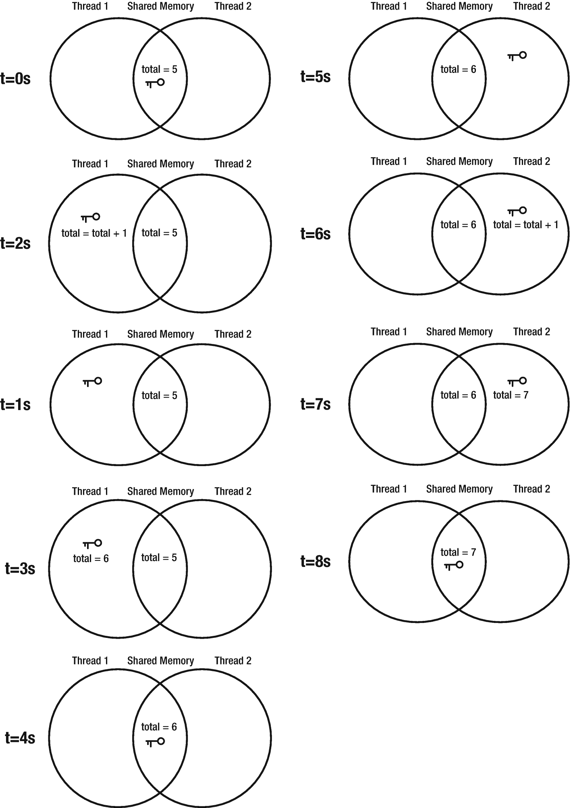
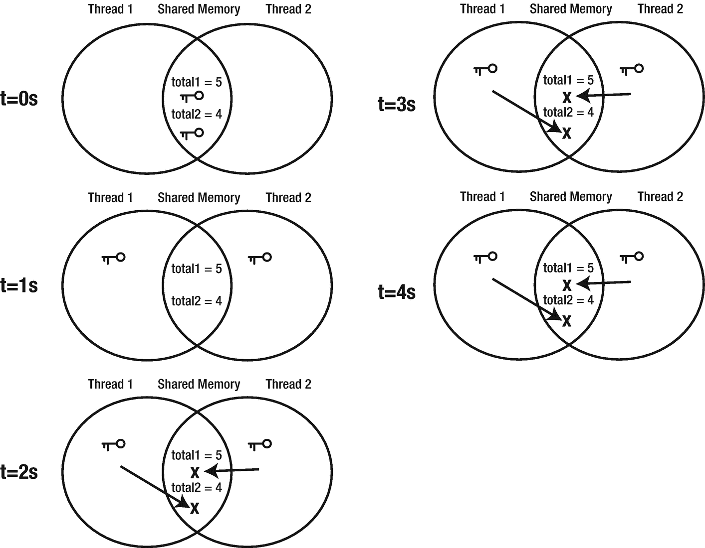
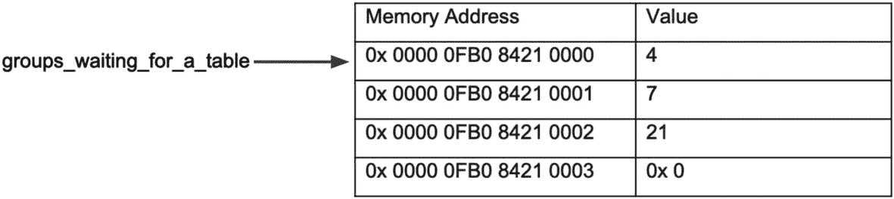

# 线程 1 与线程 2 之间`total`递增的竞态条件演示

与此运行总计示例类似，CPython 解释器使用一种引用垃圾收集技术，跟踪引用某个对象的位置数量。垃圾收集器负责跟踪已分配的内存，并在其不再使用时释放内存。它通过维护程序中引用每个对象的所有位置的运行总计来实现这一点。当不再有引用时，即引用计数为零，则内存被释放，这意味着它被释放并可用于存储其他内容。在清单 3-8 中，字符串`foo`的引用计数将为 2，因为有两个变量引用它。

```
ref1 = "foo"
ref2 = "foo"
```

**清单 3-8** 创建对字符串`foo`的两个引用的示例

回想一下，字符串缓存在此处起作用，正因为如此，`ref1`和`ref2`在底层指向同一个值。

当我们删除`ref2`时，字符串`foo`的引用计数为 1；当我们删除`ref1`时，字符串`foo`的引用计数为 0，并且内存可以被释放。这在清单 3-9 中演示。

```
delete(ref2)       # 执行此行后 reference count = 1
delete(ref1)       # 执行此行后 reference count = 0
```

**清单 3-9** 删除在清单 3-8 中创建的`foo`引用的示例

并非所有对象在其引用计数达到 0 时都会被释放，因为有些对象的引用计数永远不会达到 0。例如，清单 3-10 中呈现的场景，这在使用 Python 的类和对象时经常发生。在此场景中，`exc_info`是一个元组，第三个索引处的值是回溯对象（`traceback object`）。回溯对象包含对帧（`frame`）的引用，但帧也包含对`exc_info`变量的引用。这就是所谓的循环引用，由于无法在不破坏另一个的情况下删除其中一个，因此这两个对象必须被垃圾收集。垃圾收集器会定期运行，识别并删除像这样的循环引用对象。

```
import sys
try:
    raise Exception("Something went wrong.")
except Exception as e:
    exc_info = sys.exc_info()
    frame = exc_info[2].tb_frame   # 创建第三个引用
    assert(sys.getrefcount(frame) == 3)
    del(exc_info)
    assert(sys.getrefcount(frame) == 3)
```

**清单 3-10** 创建循环引用的示例

跟踪这些引用并非没有代价。每个对象都有一个关联的引用计数器，它占用空间，并且代码中每次引用都需要 CPU 周期来计算对象引用计数的适当增减。这就是为什么，如果你比较 Python 中对象的大小和 C 中对象的大小，Python 中的大小要大得多，也是为什么 Python 执行速度比 C 慢的部分原因。那些额外的字节和额外的 CPU 周期部分源于引用计数跟踪。虽然垃圾收集器确实对性能有影响，但它也使 Python 成为一种易于编程的语言。作为开发者，您不必担心跟踪内存分配和释放；Python 垃圾收集器会为您处理这些。

在多线程应用程序中，引用计数与图 3-3 中的`total`存在相同的问题。一个线程可能在与另一个线程同时向共享内存空间中的对象创建新引用，从而发生竞态条件，导致引用计数最终只增加一次而不是两次。发生这种情况时，最终可能导致对象过早地从内存中释放（因为竞态条件导致对象的引用计数增加了一次而不是两次）。在其他情况下，当引用计数器的递减出现竞态条件时，这可能导致内存泄漏，因为引用计数比应有的值大 1，所以内存永远不会被销毁。因此，正如您在此处所见，运行多线程应用程序不仅会影响程序正在操作的数据，还会影响 Python 解释器本身。

传统上，竞态条件通过锁来解决。这实际上就是您下意识做的事情——也就是说，在您自己更新总计之前，等待您的朋友完成更新总计。在软件中，这是通过共享内存锁实现的。当一个线程需要更新总计时，它获取锁，更新总计，然后释放锁。与此同时，另一个线程等待锁空闲，获取锁，然后也更新总计。这种交互在图 3-4 中演示。



**图 3-4** 线程 1 与线程 2 之间共享`total`上的锁的演示

太好了！我们已经解决了问题！或者我们解决了吗？考虑图 3-5 中的场景，其中有两个锁和两个总计。



**图 3-5** 线程 1 与线程 2 之间死锁的演示

图 3-5 就是所谓的死锁。当两个线程需要多段数据才能执行，但它们以不同的顺序请求这些数据时，就会发生死锁。为了完全避免此类问题，Python 的作者在线程级别实现了一个锁，该锁只允许在任何给定时间运行一个线程。这是解决这个问题的一种简单而优雅的方式。当时，由于多核 CPU 相当罕见，这实际上并没有影响性能，因为在 CPU 中，这些线程的指令无论如何都是串行执行的。然而，随着计算机变得越来越先进，计算变得越来越密集，多核 CPU 已成为几乎所有现代计算平台的标准。当涉及大数据，需要进行大型 CPU 密集型计算时，不利用多核 CPU 意味着在某些情况下根本无法运行计算（至少无法在合理的时间内运行）。那么，我们如何才能打破 GIL（全局解释器锁），真正运行多核大数据计算呢？

C 扩展是用 C 语言编写的，而不是 Python，因此不受 GIL 的限制。`pandas`构建在`NumPy`之上，而`NumPy`是一个 Python 包装器，它包装了完成所有繁重计算任务的 C 扩展。这意味着使用`pandas`时，所有密集型计算都是在 C 中完成的，由于该语言的特性，计算通常更快。这也意味着`pandas`能够打破 GIL，真正在多个核心上同时运行多核计算。


由于 NumPy 在 C 语言中执行计算，它必须将所有 Python 对象转换为与 C 兼容的类型。根据 NumPy 文档，只要数组的类型能够转换为 C 类型，就会在计算前释放 GIL。这意味着，在使用 NumPy 时，操作那些可转换为 C 类型的类型非常重要。如果你操作的是 NumPy 无法转换为 C 的 Python 对象，那么就无法在 C 中完成计算，而必须停留在 Python 环境中，直到计算完成才能释放 GIL。

附录中详细列出了 Python 类型与 NumPy 在其 C 扩展中使用的类型（称为标量）之间的映射关系。在 NumPy API 中，所有 NumPy 类型都被称为 `dtypes`，并作为 `NumPy` 库的属性提供。

NumPy 的主要数据结构是 N 维数组或 `ndarray`。它是一种特殊的数组结构，专门处理 Python 与 C 之间的边界问题。需要注意的是，NumPy 中的 `ndarray` 是同质的，即所有元素都具有相同类型。这同样与 Python 和 C 的差异有关。C 是一种低级语言，开发人员必须自行管理内存的分配和释放，并且不支持动态类型。对于 C 中的数组而言，所有元素的大小或类型必须一致且已知，以便在 C 中为输入数据数组和输出数据数组分配适当的内存。清单 3-11 展示了如何在 C 中创建一个浮点数数组。请注意，必须使用 `malloc` 显式分配内存，并且数组大小固定为 100——仅能容纳 100 个浮点数。

```
float* array = (float*) malloc(100 * sizeof(float));
清单 3-11
在 C 中为包含 100 个浮点数的数组分配内存
```

NumPy 使用如清单 3-12 所示的 `ndarray` 来构建固定大小的数组，其中 `dtype` 用于指定数组中每个元素的类型，即每个元素在数组中所占用的内存大小。回顾上一节可知，Python 的 `list` 实现本质上是一个动态数组。与 `ndarray` 不同，Python 的 `list` 类型通过为指向数据的指针分配空间（而非为数据本身分配空间）来处理任意大小的元素。这导致 Python 的 `list` 比 `ndarray` 占用更多内存，因为列表持有的是指向数据的指针，而非数据本身，从而增加了一层间接性。总之，`ndarray` 具有固定长度，且每个元素类型相同；而 Python 的 `list` 类型具有动态长度，元素可以是多种不同类型。这是一个重要区别，也是 `pandas` 中每一列都被分配一个特定 `dtype` 的原因。这同样说明了为什么确保 `pandas` 为特定列分配正确类型、以及为什么对数据进行归一化以避免使用包罗万象的 `object` 类型是如此重要。图 3-6 展示了清单 3-12 中创建的 `ndarray` 在内存中的表示方式。

```
import numpy as np
groups_waiting_for_a_table = np.ndarray(
(3,),
buffer=np.array([4, 7, 21], dtype=np.uint8),
dtype=np.uint8,
)
清单 3-12
包含三个无符号 8 位整数的 ndarray
```



图 3-6

清单 3-12 在内存中的表示。请与图 3-2 进行比较。

CPython 解释器提供了一个 C-API，该 API 提供了获取和释放 GIL 的能力。NumPy 使用宏 `NPY_BEGIN_THREADS` 和 `NPY_END_THREADS` 来标识何时可以在不持有 GIL 的情况下运行 C 代码。NumPy 的数学运算是通用函数（即 `ufunc`）的实例，这些函数在 C 中实现，并且都会调用这些宏。常见 `ufunc` 列表请参见附录。

回想一下，在没有 GIL 的情况下运行意味着程序现在可以同时在多个内核上执行指令。这意味着，当使用 NumPy 进行密集的数学运算时，能够在 C 层面通过多线程来分解计算任务，例如统计 Tiffany 在列表中出现的次数。虽然 NumPy 本身通常不实现多线程计算（仅将计算运行在 C 层面本身就能带来显著的性能提升），但结合 NumPy 使用其他库时，这些库会实现多线程。

当 NumPy 编译时使用了基础线性代数子程序库（BLAS）或线性代数包（LAPACK），它会根据内存缓存大小和系统可用核心数来执行运算。通过根据机器资源优化计算，NumPy 能够以远高于常规的速度运行计算。BLAS/LAPACK 有多种不同的实现，包括 OpenBLAS、ATLAS 和 Intel MKL。我们将在后续章节中更详细地探讨这些库如何提升性能；但目前，只需要知道它们的存在，并且对于大规模计算而言，它们能带来巨大的性能差异。


## pandas 性能简介

`pandas` 是 `NumPy` 的包装，而 `NumPy` 又是 C 语言的包装；因此，`pandas` 的性能优势源于其在 C 语言环境而非 Python 环境中运行。这一概念是你在 `pandas` 中所有操作的基础。当你身处 C 语言环境时，速度飞快；而当你置身 Python 环境时，速度则变得缓慢。^(⁴)

处理 pandas `DataFrames` 同样需要遵循处理 NumPy 数组时的要求——即 Python 代码必须能够翻译成 C 代码；这包括承载数据的数据类型以及对其执行的操作。表 3-1 列出了 pandas 类型到 NumPy 类型的映射关系。请注意，datetime 和 timedelta 并不会翻译成 NumPy 类型。这是因为 C 语言没有 datetime 数据结构，因此在对 datetime 数据执行操作时，更高效的做法是将其转换为自纪元以来的整数秒数。

**表 3-1** pandas 到 NumPy 类型映射

| pandas 类型 | NumPy 类型 |
| --- | --- |
| `object` | `string_`, `unicode_` |
| `int64` | `int_`, `int8`, `int16`, `int32`, `int64`, `uint8`, `uint16`, `uint32`, `uint64` |
| `float64` | `float_`, `float16`, `float32`, `float64` |
| `bool` | `bool_` |
| `datetime64` | `datetime64[ns]` |
| `timedelta[ns]` | 不适用 |
| `category` | 不适用 |

请注意，`category` 类型同样无法翻译成 C 语言。`category` 类似于元组，旨在包含一组分类变量，即具有固定唯一值集合的元数据。由于它无法翻译成 C 语言，因此绝不应将其用于保存需要分析的数据。它的主要优势在于能够高效且简便地实现自定义排序顺序。其底层结构类似于一个数据索引数组，这些索引指向一个类别数组中唯一的元素值。文档声称，在使用字符串类别时，它可以节省大量内存。当然，从上一节我们知道，Python 已经内置了一个字符串缓存，可以自动为某些字符串完成此操作，因此，只有当字符串包含字母数字和下划线以外的字符时，此功能才会真正发挥作用。代码清单 3-13 展示了一个 `category` 示例及其在内存中的表示。请注意，它使用整数来表示值，并且这些整数映射到 `category` 数组中的索引。这是 pandas 中节省内存的常用方法。稍后我们在讨论多层索引时还会再次遇到它。

```
import pandas as pd
produce = pd.Series(
["apple", "banana", "carrot", "apple"], dtype="category"
)
Data       Categories
0          apple
1          banana
2          carrot

代码清单 3-13
pandas 类别示例及其在内存中的表示
```

为了利用 NumPy 的性能优化，操作也必须能够翻译成 C 代码。这意味着自定义函数（如代码清单 3-14 所示）性能不会很高，因为它们将在 Python 中而非 C 语言中运行。我们将在第 6 章中更深入地探讨此示例以及 `apply` 函数。

```
import pandas as pd
def grade(values):
if 70 <= values["score"] < 80:
values["score"] = "C"
elif 80 <= values["score"] < 90:
values["score"] = "B"
elif 90 <= values["score"]:
values["score"] = "A"
else:
values["score"] = "F"
return values
scores = pd.DataFrame({"score": [89, 70, 71, 65, 30, 93, 100, 75]}
)
scores.apply(grade, axis=1)
代码清单 3-14
无法翻译成 C 语言的自定义 pandas Python 操作
```

由于 pandas 构建于 NumPy 之上，它使用 NumPy 数组作为 pandas `DataFrame` 的构建块，而这些数组在底层计算中最终会转换为 `ndarray`。

```
import pandas as pd
restaurant_inspections = pd.DataFrame({
"restaurant": ["Diner","Diner","Pandas","Pandas"],
"location": [(4,2),(4,2),(5,4),(5,4)],
"date": ["02/18","05/18","04/18","01/18"],
"score": [90,100,55,60]})
>> restaurant_inspections
restaurant  location   date      score
Diner       (4, 2)     02/18     90
Diner       (4, 2)     05/18     100
Pandas      (5, 4)     04/18     55
Pandas      (5, 4)     01/18     76
Index           Blocks
restaurant      Diner      Diner     Pandas    Pandas
location        (4, 2)     (4, 2)    (5, 4)    (5, 4)
date            02/18      05/18     04/18     01/18
score           90         100       55        76
代码清单 3-15
pandas 单索引 DataFrame 及其在内存中的表示
```

代码清单 3-15 是 pandas `DataFrame` 最简单形式的示例。数据是餐厅卫生检查数据。它有四列：`restaurant`、`location`、`date` 和 `score`。每列有四行数据。请注意，有些数据是重复的，因为同一家餐厅可能在不同时间有多次检查记录。在底层，此 `DataFrame` 被表示为一个名为 `Index` 的 NumPy 数组（包含列名）和一个名为 `Blocks` 的二维 NumPy 数组（包含数据）。

同样的数据可以使用多层索引 `DataFrame` 以更具表现力的方式表示，其中每个索引代表一家唯一的餐厅。这分两步完成。首先，我们创建索引，然后将该索引附加到数据上，如代码清单 3-16 所示。数据的表示方式与上一个示例相同，但请注意，现在只有两列数据，而不是四列。

```
import pandas as pd
restaurants = pd.MultiIndex.from_tuples(
(
("Diner", (4,2)),
("Diner", (4,2)),
("Pandas", (5,4)),
("Pandas", (5,4)),
),
names = ["restaurant", "location"]
)
restaurant_inspections = pd.DataFrame(
{
"date": ["02/18", "05/18", "04/18", "01/18"],
"score": [90, 100, 55, 76],
},
index=restaurants,
)
>> restaurant_inspections
date    score
restaurant      location
Diner           (4, 2)    02/18   90
05/18   100
Pandas          (5, 4)    04/18   55
01/18   76
Levels      Names                 Labels
restaurant  Diner   Pandas        0    0
location    (4, 2)  (5, 4)        0    0
1    1
1    1
Index       Blocks
date        02/18     05/18    04/18    01/18
score       90        100      55       76
代码清单 3-16
pandas 多层索引 DataFrame 及其在内存中的表示
```

当我们创建多层索引时，会发生一些特殊的事情。底层索引看起来与单索引示例中的不同。仍然有一个名为 `Levels` 的 NumPy 数组来保存索引名称；然而，数据不再是简单的二维 NumPy 数组，而是经历了一种压缩形式。`Names` 是一个二维 NumPy 数组，用于跟踪索引中的唯一值，而 `Labels` 是一个二维整数 NumPy 数组，其值是 `Names` NumPy 数组中唯一索引值的索引。这与 pandas `category` 数据类型使用的内存节省技术相同，事实上，由于 `category` 出现得更晚，它们很可能复制了 pandas 多层索引的这种技术。


