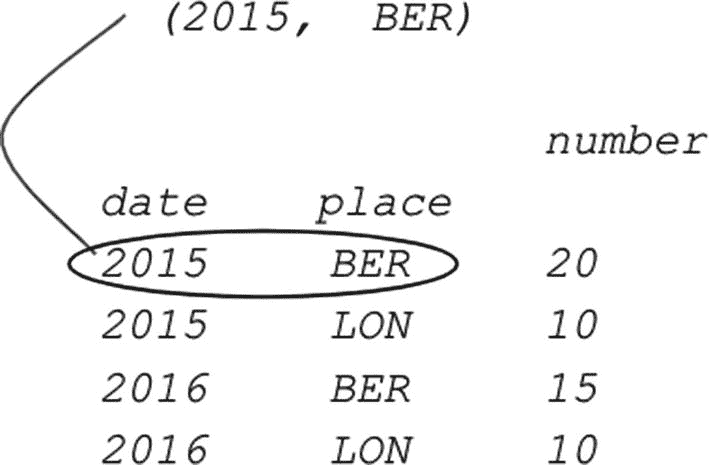
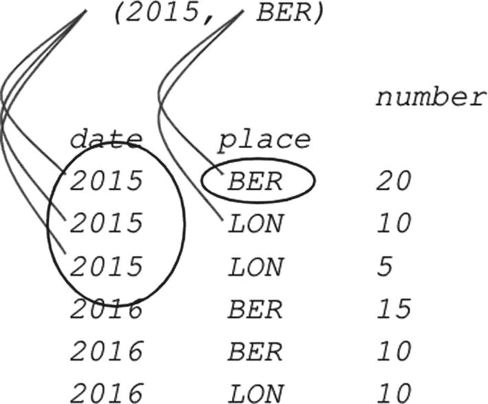
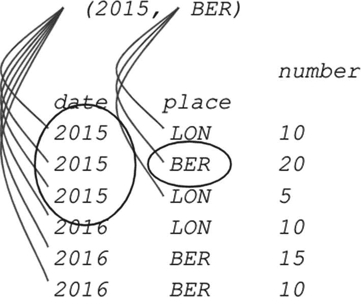

# 索引

当索引中存在许多不同的值时，使用已排序的索引可以显著提升速度。你可能会遇到警告 `PerformanceWarning: indexing past lexsort depth may impact performance.` 这指的是索引中按词典或字母顺序排序的层级数量。

在访问未排序的索引时，pandas 的性能为 `O(n)`，因为它必须搜索整个索引来找到索引值，如图 7-1 所示。在访问已排序的索引时，pandas 的性能为 `O(log(n))`，因为它使用二分查找来定位索引值，如图 7-2 所示。当索引唯一时，它使用哈希查找，性能为 `O(1)`，如图 7-3 所示。当索引中的值的数量 `n` 非常大时，这会产生巨大差异，这也解释了为什么唯一索引能带来最快的性能。值得注意的是，正如代码清单 7-2 的情况，唯一索引并非总能实现，因此在那些场景中，我们能获得的最佳性能是使用已排序的多级索引。



图 7-3

唯一索引访问 `O(1)`



图 7-2

已排序索引访问 `O(log(n))`



图 7-1

未排序索引访问 `O(n)`

## 避免使用 groupby

到目前为止，我们已经探讨了如何在进行 `groupby` 操作时获得最佳性能。然而，有时最高性能的选择是完全不使用 `groupby`。如果你发现自己需要对 `DataFrame` 执行大量 `groupby` 操作，可以考虑重新调整 `DataFrame` 的方向，从而避免使用 `groupby`。由于 `groupby` 会对数据进行分组，然后对每组数据运行聚合函数，它本质上是在对分组数量进行循环。即使在最佳性能情况下，分组已预先计算、索引可快速访问、循环在 C 层面运行，所有这些仍然需要时间。在 pandas 中，运行简单的逐行或逐列操作要高效得多。

让我们看看如何重新格式化代码清单 7-3 中的 `DataFrame`，以便避免使用 `groupby`。如果我们保持索引列不变，但将每个索引的多个值跨行展开，我们可以通过两种方式来优化这个按分组求和的操作。第一，这消除了 `groupby` 求和操作，将其转变为简单的跨列求和。第二，这使得索引变得唯一。请注意，这样做会带来一些额外的内存开销，因为数据中的空白会被零填充。然而，即使在非常大的 `DataFrame` 中，整数占用的空间也很小，因此性能的整体提升值得额外的内存使用。

```
>> arrivals_by_destination
number          0      1
date    place
2015    BER    20      0
2015    LON    10      5
2016    BER    15      10
2016    LON    10      0
>> arrivals_by_destination["total"] = \
arrivals_by_destination.sum()
代码清单 7-3
不使用 groupby 计算抵达每个目的地的总人数
```

代码清单 7-2 比代码清单 7-3 大约慢 8 倍，而代码清单 7-1 则慢 25 倍。这就是精心选择最适合预期操作的 `DataFrame` 格式如此重要的原因。这可以实实在在地为你节省数分钟的执行时间。

我们已经探讨了如何最高效地使用 `groupby`，包括预索引以及直接使用 `groupby` 对象的聚合函数而非循环。我们还介绍了如何重新格式化 `DataFrame`，从而无需使用 `groupby`，转而使用更高性能的行或列操作。不幸的是，不存在一种万能的 `DataFrame` 格式或 `groupby` 方法适用于所有用例。但你现在应该已经掌握了一些方法和技巧，能够帮助你以最高效、最简单的方式解决特定的 `groupby` 问题。


