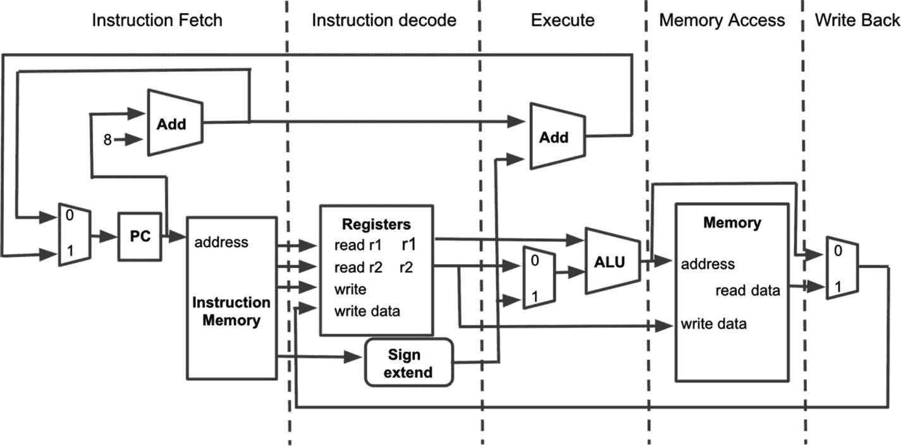
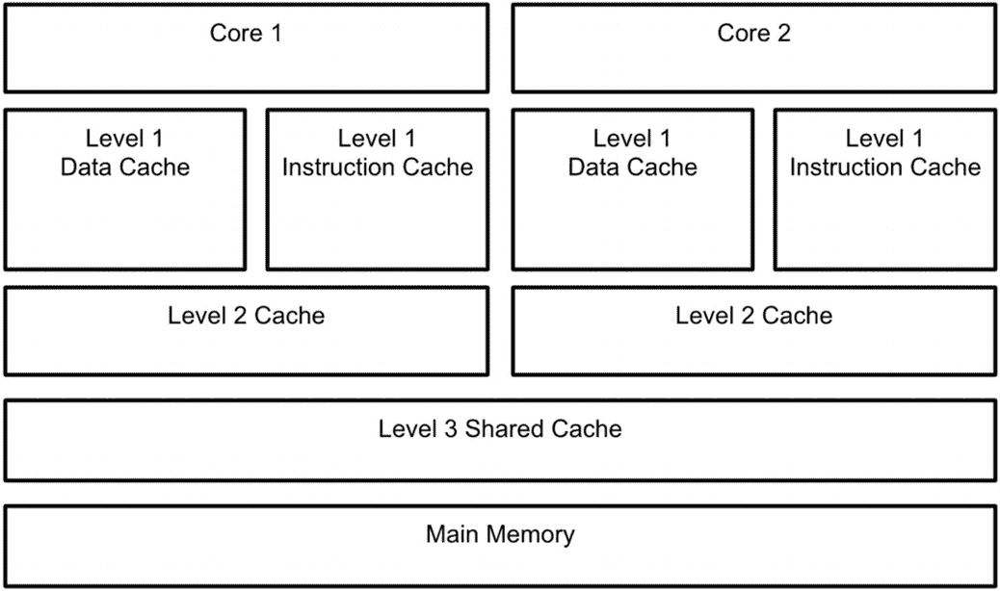
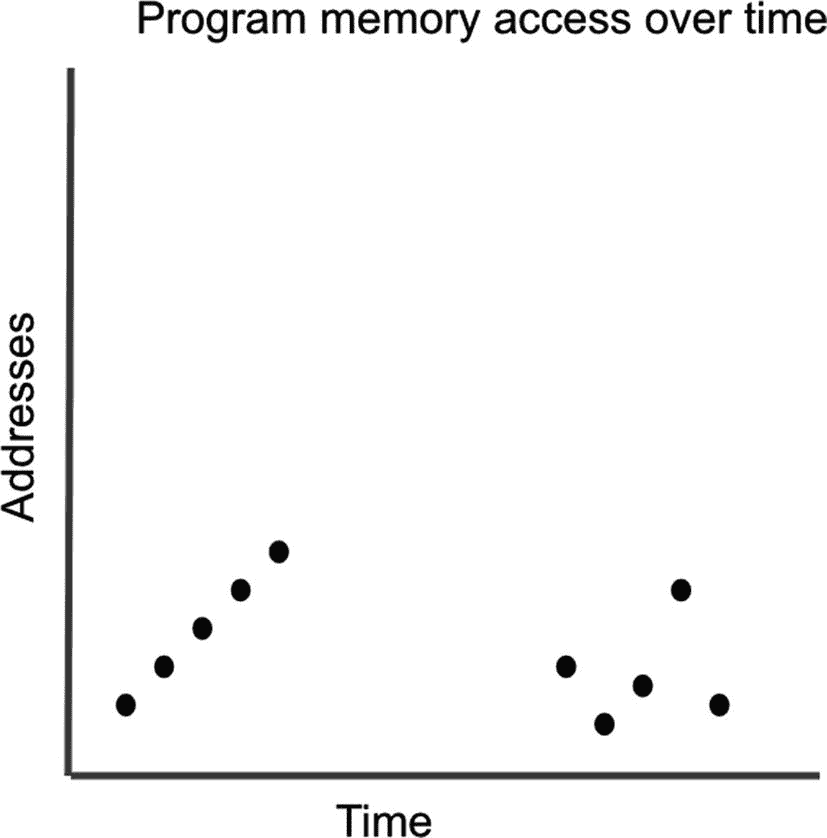
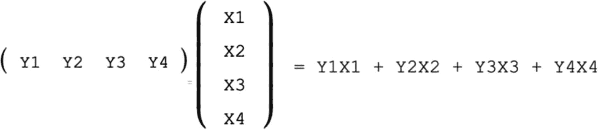

# 超越 pandas 的性能提升

你可能听说过其他 pandas 用户提到使用 `eval` 和 `query` 来加速 pandas 中表达式的求值。虽然使用这些函数可以加快表达式的求值速度，但如果没有一个非常重要的库——`NumExpr` 的帮助，这无法实现。如果在未安装 `NumExpr` 的情况下使用这些函数，实际上反而可能导致性能下降。然而，要理解 `NumExpr` 如何能够加速计算，我们需要深入探讨计算机的架构。

## 计算机架构

CPU 被划分为多个核心，每个核心都有专用的缓存。每个核心每次执行一条指令。与你在 Python 程序中可能看到的相比，这些指令非常基础。一行 Python 代码通常会被分解成许多 CPU 指令。一些例子包括：加载数据（例如在循环时将数组值存储到临时变量中）、跳转到新的指令位置（例如调用函数时），以及求值表达式（例如将两个值相加）。



图 8-1 五阶段流水线架构

在现代核心中，求值过程被分为多个阶段。这些多个阶段被称为**流水线**，其中每条指令的求值都会依次通过一系列阶段，直到求值完成。现代英特尔 CPU 通常被划分为大约 15 个流水线阶段。图 8-1 展示了一个简单的五阶段流水线处理器的例子。首先，指令通常从专用的指令缓存中**取指**，如果不存在，则必须从更远的缓存或主存中获取。然后指令被**译码**。在译码阶段，每条指令都有一个特定的数值代码，该代码被解码为特定类型的指令并产生特定行为，因此译码阶段负责解码指令并从寄存器（你可以将其视作一个非常小的专用内存缓存）中收集数据，以传递给执行阶段。在**执行**阶段，指令被实际运行；这可能意味着将两个值相加，或者如果是加载指令，则只是将一个内存地址传递给下一阶段。由于指令可能跳转到不同的内存位置而非顺序位置，因此求值阶段的一部分工作也是确定要送入流水线的下一条指令。在**访存**阶段，任何需要从内存加载到寄存器以供即将执行的指令使用的数据都会被获取，然后在**写回**阶段加载到寄存器中。这意味着，如果你想将两个值相加，必须先通过加载指令将这两个值加载到两个不同的寄存器中，然后才能运行加法指令。因此，清单 8-1 中的那行 Python 代码在 CPU 内部由三条指令组成。

```
a = b + c        load b
load c
add a, b, c
```

清单 8-1 将一行 Python 代码转换为伪代码形式的 CPU 指令

虽然清单 8-1 中的 CPU 指令看起来可能与 Python 字节码相似，但重要的是要注意它们并不相同。请记住，字节码在 Python 虚拟机上运行，而 CPU 指令在 CPU 上运行。虽然你可以使用 `dis` 模块（dis 代表反汇编）来输出字节码，这可能会让你对机器码的样子有所了解，但它**不是**机器码。Python 虚拟机包含一个巨大的 switch 语句，它将一条字节码指令转换为一个函数调用，然后该函数再执行 CPU 指令。因此，尽管我们可能认为 Python 是一种在软件虚拟机中运行字节码指令的解释型语言，但事实上，在这个过程中的某个时刻，那条加法指令最终会到达 CPU。最终，那个加法操作会变成清单 8-1 所示的一系列 CPU 指令。

指令流水线的访存阶段比其他所有流水线阶段耗时更长，这是非常常见的。与其让所有其他流水线阶段变得和访存阶段一样慢，或者插入 NOP（通常称为空操作），不如用其他不依赖于正在加载的数据的指令来填补这段时间。这使得处理器能够继续评估指令，即使指令的某个阶段可能需要数百个周期才能完成。编译器也通过在长时间指令加载期间重排序指令来保持处理器忙碌，确保不依赖于内存加载的指令出现在内存加载指令和依赖该内存已加载的下一条指令之间。在现代英特尔处理器中，CPU 内部也可以进行重排序。当然，有时没有指令可以填补间隙，因此 NOP 被用作最后的手段。这确保了核心的指令吞吐量尽可能接近每个时钟周期（阶段）一条指令，这样你就不必为了等待内存加载完成而等待数百个周期。

这里的关键点是：为了高效利用你的 CPU 并获得尽可能高的指令吞吐量，你必须确保数据在使用之前已被加载，并且在你处理的数据和你需要的下一个数据之间提供足够的计算任务。

到目前为止，我们已经介绍了 CPU 如何在底层运行以评估指令，以及它如何努力实现最佳性能；现在让我们更深入地了解访存阶段，以及它为何常常成为瓶颈。图 8-2 展示了现代英特尔 CPU 的典型缓存架构。每个核心都有一个专用的 L1 数据缓存、L1 指令缓存和 L2 缓存。所有核心共享 L3 缓存和主存。这些缓存中的每一个在物理电路板上距离核心越来越远。虽然核心速度与晶体管尺寸和速度密切相关，但内存速度则与它们在电路板上距离核心的物理距离有关。



图 8-2 缓存架构

当处理大型数据集时（这是 pandas 的预期用例），所有这些数据无法全部存储在缓存中。访问 L1 缓存通常需要大约三个时钟周期或指令阶段，并且每增加一个缓存级别，延迟呈指数级增长。访问 L3 缓存需要大约 21 个时钟周期，而如果我们想要加载的数据不在任何缓存中，并且必须一直访问主存才能加载它，则需要 150 到 400 个时钟周期。在大约 21 个时钟周期时，访问 L3 缓存所带来的性能损失很可能超过我们核心中的流水线数量。如果我们在不进行重排序以填充延迟的情况下，必须延迟流水线中的指令直到数据被检索到，这可能会导致整个程序停顿 21 个时钟周期。在一个 4 GHz 的处理器上，21 个时钟周期的延迟大约是 5.25 纳秒。这看起来微不足道，如果我们的程序中只发生几次这种延迟，确实如此。但是，请记住，我们在 pandas 中通常操作的是兆字节级别的数据，由于所有这些数据无法完全放入缓存，我们很可能会遇到许多这样的性能损失。事实上，如果对整个数据集运行操作，我们甚至更有可能遭遇直达主存的那种更大的性能损失。


缓存通常针对平均情况下的最佳性能进行设计。在软件中，这意味着像循环遍历数组（一种顺序数据结构）这样的操作。正因如此，当缓存需要加载数据时，它会一次性加载称为“缓存行”（cache lines）的顺序内存块。这有助于抵消加载数据到缓存所带来的性能损失。其核心理念是，程序通常操作顺序内存，因此通过加载紧随当前核心所需内存之后的内存，可以避免之后再次加载该内存。

为了最有效地利用缓存，在内存中顺序存放或位置接近的数据应在短时间跨度内被反复引用。顺序数据会减少缓存加载的次数。在短时间内反复引用相同的数据可以防止新数据将旧数据挤出缓存，从而避免发生缓存未命中（cache miss）——这种情况需要将相同的数据再次加载到缓存中。正如我们在第 3 章所学，数组是顺序数据类型，这意味着第一个元素位于地址`A`，最后一个元素位于地址`A`加上数组长度。当你在内存中创建一系列包含众多指向其他对象的属性的对象，并引用这些属性时，每个对象都有一个非顺序的地址。因此，你将无法有效利用缓存，因为你会从大量不同的内存位置加载不同的缓存行。图 8-3 展示了这两种内存访问方式。



图 8-3  
顺序内存访问与随时间推移的对象属性访问对比

## `NumExpr`如何提升性能

`NumExpr`通过在大小与缓存一致的`pandas` DataFrame 子集上运行计算，来提升`pandas`的性能。以表达式`(A + B) * 3`为例，其中`A`和`B`是`pandas` DataFrame。没有`NumExpr`时，`A + B`的每一行会被逐个相加，存储到临时结构中，然后再乘以 3。使用`NumExpr`时，会先对能放入缓存的前`n`行数据进行相加并乘以 3，然后再处理接下来的`n`行。通过这种方式，`NumExpr`能减少内存加载和存储的次数，正如我们在“计算机体系结构”一节中学到的，这两者是 CPU 和计算机程序的瓶颈。清单 8-2 演示了这一点。

注意清单 8-2 中的缓存包含三个缓存行（足以容纳`A`、`B`和`C`数据的 64 行）。虽然这远小于真实世界的一级缓存（通常能容纳约 128 个缓存行），但它简化了示例。这意味着，在计算完`A + B`的前 64 行结果后，必须将结果存回内存，以便为接下来的 64 行`A`和`B`及其结果腾出空间。注意，通过使用`NumExpr`在缓存大小的块上执行计算的方法，我们减少了加载和存储的次数。同样要注意，清单 8-2 中的示例是以顺序的伪代码 CPU 指令形式编写的（即，这些并非在核心内实际执行的指令；在现实世界中，它们很可能为了抵消“计算机体系结构”一节中讨论的内存加载延迟而被重新排序）。

```python
# NumExpr is not installed.        # NumExpr is installed.
C = ( A + B ) * 3                  C = pd.eval("( A + B ) * 3")
load A[0:64]                       load A[0:64]
load B[0:64]                       load B[0:64]
add C[0], A[0], B[0]               add C[0], A[0], B[0]
mult C[0], C[0], 3
add C[1], A[1], B[1]               add C[1], A[1], B[1]
mult C[1], C[1], 3
.
.
add C[63], A[63], B[63]           add C[63], A[63], B[63]
mult C[63], C[63], 3
store C[0:64]                     store C[0:64]
load A[64:128]                    load A[64:128]
load B[64:128]                    load B[64:128]
add C[64], A[64], B[64]           add C[64], A[64], B[64]
mult C[64], C[64], 3
add C[65], A[65], B[65]           add C[65], A[65], B[65]
mult C[65], C[65], 3
.
.
add C[127], A[127], B[127]        add C[127], A[127], B[127]
mult C[127], C[127], 3
store C[64:128]                   store C[64:128]
load C[0:64]
mult C[0], C[0], 3
mult C[1], C[1], 3
.
.
mult C[3], C[63], 3
store C[0:64]
load C[64:128]
mult C[64], C[64], 3
.
.
mult [127], C[127], 3
store C[64:128]
```
清单 8-2  
有和没有`NumExpr`时，评估`pandas`表达式的 CPU 伪代码指令

注意，要一次性在`pandas` DataFrames 的块上运行这样的评估，我们必须事先将整个表达式传达给`NumExpr`。`(A + B) * 3`必须以某种方式指定，以便`NumExpr`知道它可以将这些操作合并在一起。这正是`query`和`eval`发挥作用的地方。`eval`允许你将一个复杂的表达式作为字符串指定，以通知`NumExpr`它可以一次处理 DataFrame(s)的一个块。`query`实际上是`eval`的另一种形式，因为它在底层调用了`eval`。

根据具体的计算、数据的形状和大小、操作系统以及你使用的硬件，你可能会发现使用`NumExpr`和`eval`实际上会导致显著的性能下降。在盲目地将计算合并到`eval`或`query`之前，最好先进行性能比较。`NumExpr`实际上只对超过三级缓存大小的计算表现良好。通常，这意味着数组元素数量大于 256,000。正如我们所见，与其他`pandas`函数一样，它也要求数据类型的计算能够轻松地转化为 C 语言。因此，例如，日期时间（datetimes）不会带来性能提升，因为它们无法在`NumExpr`中求值。同样值得注意的是，直接使用`NumExpr`通常比在`pandas`中使用`eval`或`query`性能更好。清单 8-3 演示了这样一个例子。

```python
import pandas as pd
import numpy as np
import numexpr as ne
nrows, ncols = 1000000, 1
df1, df2, df3, df4 = [pd.DataFrame(
np.random.randn(nrows, ncols)) for _ in range(4)]
#### Calculate the sum using normal syntax.
df_sum1 = df1 + df2 + df3 + df4
#### Calculate the sum using eval so that NumExpr optimizes it.
df_sum2 = pd.eval("df1 + df2 + df3 + df4")
#### Calculate the sum using NumExpr directly.
a1, a2, a3, a4 = (
df1.to_numpy(), df2.to_numpy(), df3.to_numpy(), df4.to_numpy()
)
df_sum3 = ne.evaluate("a1 + a2 + a3 + a4")
```
清单 8-3  
一个示例，其中`eval`比典型的`pandas`语法配合`NumExpr`更慢

`df_sum1`的计算速度是`df_sum2`的两倍。这通常与我们的预期相反，因为`df_sum2`是使用`NumExpr`计算的。然而，如果我们直接使用`NumExpr`而不是通过`pandas`的`eval`，我们会发现`df_sum3`的速度大约是`df_sum1`的四倍。这是由于`pandas`的`eval`函数本身带来的开销造成的。在`eval`内部，它将环境包装成一个局部变量和全局变量的字典，并使它们对`NumExpr`可访问。这包括将 DataFrames 转换为 NumPy 数组。所有这些都需要相当多的开销，以至于最终比不使用`eval`和`NumExpr`还要慢。很多情况下，正如这里所示，显式地将 DataFrames 转换为 NumPy 数组，并直接在这些转换后的 DataFrames 上调用`NumExpr`，速度要快得多。

现在我们已经了解了`NumExpr`如何在硬件层面提升组合计算的`pandas`性能，接下来让我们看看`NumPy`和`NumExpr`的另一个依赖——BLAS——是如何利用硬件来优化其计算的。


## BLAS 和 LAPACK

`NumPy` 在底层使用基本线性代数子程序（BLAS）来实现非常高效的线性代数运算，例如矩阵乘法和向量加法。这些子程序通常用汇编语言编写——这是一种非常底层且性能卓越的语言，与 CPU 指令高度相似。线性代数包（LAPACK）提供用于求解线性方程的例程。它通常用 Fortran 编写，并且与 NumPy 一样，在底层调用 BLAS。有很多 BLAS 和 LAPACK 的实现可用，例如 Netlib BLAS 和 LAPACK、OpenBLAS、Intel MKL、Atlas、BLIS 等，每种都有各自的优缺点。不过，让我们更深入地探讨 BLAS 如何提高 pandas 操作的性能。

BLAS 通过使用单指令多数据流（SIMD）指令来优化矩阵操作，这些指令利用了硬件中的向量寄存器。所有 CPU 都有寄存器，用于保存 CPU 指令需要操作的数据。向量寄存器只是这些寄存器的一种特殊类型。它们允许在单个寄存器中存储多个数据片段，当对数据执行操作时，该操作会同时对寄存器中的每个数据片段执行。SIMD 指令的优势在于，您可以一次性将一堆数据加载到寄存器中，并对它们并发执行相同的操作，而不必对每个元素依次执行相同的操作。通过使用 SIMD 指令，我们减少了完成计算所需的 CPU 时钟周期数。例如，如果一个向量寄存器能够容纳四个数据元素，那么我们就把时钟周期数从四个减少到了一个。这意味着如果您有一个如列表 8-4 所示的 `y` 和 `x` 的点积，那么您可以将其指定为一系列如列表 8-5 所示的 SIMD 指令。请注意，`y` 和 `x` 的数据首先被加载到向量寄存器 `r1` 和 `r2` 中，然后计算点积并将结果存储在寄存器 `r1` 中。



```
product
列表 8-4
点积
```

```
load vr2, Y1, Y2, Y3, Y4
load vr1, X1, X2, X3, X4
dot r1, vr2, vr1
列表 8-5
作为 SIMD 伪指令的点积
```

我们在这里遗漏了一个重要细节，即通常情况下，数据只有在内存中是连续的时候才能被加载到向量寄存器中。这对于大多数复杂的向量操作（通常发生在一个矩阵的行与另一个矩阵的列之间，反之亦然）来说会带来一个小问题。`BLAS` 与 Python 相反，它的数组是列优先存储，而不是行优先存储。`BLAS` 也没有二维数组——它们被存储为一维数组。列表 8-6 展示了一个 Python 数组的示例，以及它在 BLAS 中是如何存储的。

```
Python                   BLAS
y = [[1, 2], [3, 4]]     y = [1, 3, 2, 4]
y[row][col]              y[col * num_cols + row]
列表 8-6
Python 与 BLAS 中矩阵表示的对比
```

所以，回到列表 8-5 中的点积示例，因为这两个数组都表示为一维数组，尽管一个是行集合，另一个是列集合，但它们都具有连续的内存地址，因此都可以加载到向量寄存器中。这个连续内存地址的问题只会在处理更复杂的矩阵和更复杂的操作时才会出现，因此让我们看一个更复杂的例子。

执行矩阵乘法有多种方法。其中一种使用点积的方法如图 8-4 所示。取第一个矩阵的行与第二个矩阵的列的点积，将得到矩阵乘法结果中单个元素的值。


图 8-4

使用点积的矩阵乘法

在图 8-4 中，我们现在遇到了一个情况，即无法将第一个矩阵的行加载到向量寄存器中，因为其内存不是连续的。但是请注意，如果我们对矩阵进行转置，使行变成列，那么内存就变成连续的了，我们就可以将第一个矩阵的行加载到向量寄存器中。

但是，如果矩阵非常大呢？如果我们将一个 1000 x 1000 的矩阵进行转置，它无法全部放入缓存中，并且在需要到主内存读写数据时会导致巨大的延迟。`BLAS` 通过将矩阵数据分解成块来对此进行优化，就像 NumExpr 一样。图 8-5 显示了一个示例。通过这样做，`BLAS` 能够将转置后的矩阵全部保留在缓存中，并且还能在每个块上重用那个占位符转置缓冲区。这样做的优势不仅在于将转置后的缓冲区保留在缓存中，还在于不必为每个块重新分配新的缓冲区。它只需用当前块的新转置数据覆盖上一个块的缓冲区即可。


图 8-5

将大矩阵分解成块

通过将问题分解成块，`BLAS` 还能够利用多核。它可以在不同的核心上运行每个块，这也节省了时间。

`BLAS` 用于加速计算的另一种技术是循环展开。这是将一个循环转换为一串重复指令的过程。循环展开消除了预测分支的需要，以及因错误预测分支而可能产生的分支预测惩罚。回想一下，在数据流水线中，指令的加载和处理可能发生在条件指令检查的结果之前。因此，硬件会在确切知道结果之前，尽力正确地预测该条件的结果以及将要执行哪个分支。循环展开还避免了将指令指针跳转到指令内存中的新位置，这有可能避免缓存未命中以及需要到主内存加载不在指令缓存中的指令。它还避免了每次迭代开始时的条件指令检查，从而节省了 CPU 周期。通过展开循环，您可能还能够重新排序计算，使得使用相同内存的计算被放置在相近的位置，从而减少寄存器加载指令。

总之，`BLAS` 使用了许多技术来提高线性代数运算的性能：`SIMD` 指令、分块、循环展开、多线程等等。还有许多可用的 `BLAS` 实现，为某些类型的 pandas 程序选择性能更优的选项可能会产生巨大影响。

如果您发现自己使用 pandas 进行了大量的线性代数运算，您可以考虑切换到性能更优的 `BLAS` 实现。`np.config_show()` 将显示 `NumPy` 当前使用的 `BLAS` 实现。`Netlib BLAS` 实现不完全支持多核，并且往往比替代方案性能差得多。其他实现（如 `OpenBLAS`）完全支持多核，并且是开源且免费的。从 Anaconda 2.5 或更高版本开始，`Intel MKL` 是默认的 `BLAS` 库，尽管是专有的且体积较大，但它经过高度优化，并且可以免费使用。


### 确保 NumPy 使用优化依赖

通过确保 NumPy 使用经过优化的依赖项`NumExpr`和`BLAS`，可以显著提升某些`pandas`操作的性能。这些库会根据你运行的具体硬件优化操作，以确保你获得尽可能最佳的性能。但需要注意它们何时能提升性能、何时不能。在最后一章中，我们将探讨`pandas 1.0`及未来的发展。

