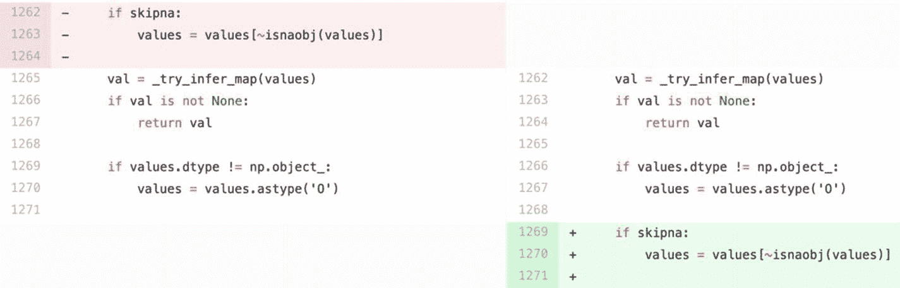
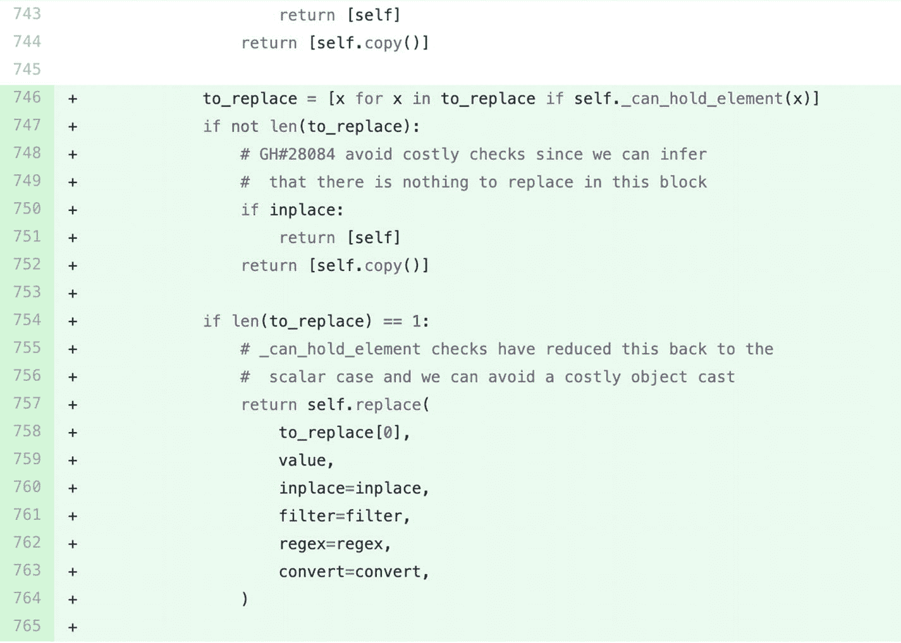
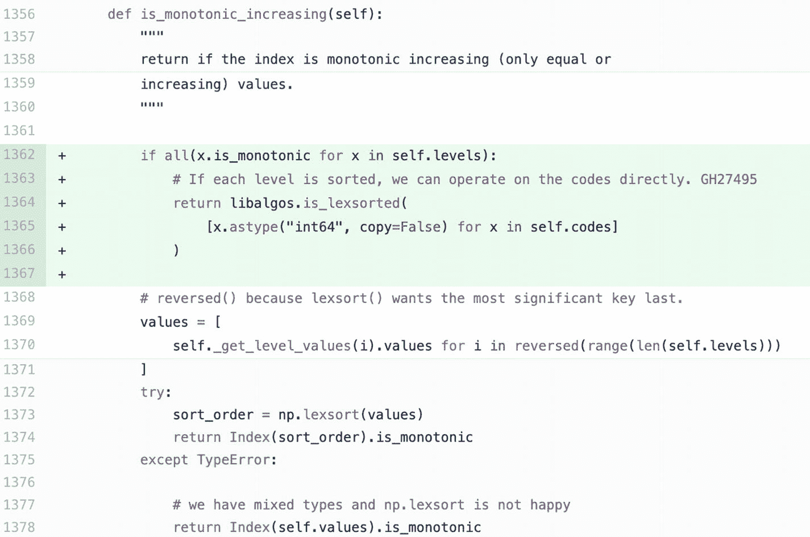

# 9. pandas 的未来

目前有越来越多的包构建在`pandas`之上或与之兼容。其中一些包（如`sklearn-pandas`）与`scikit-learn`等其他包集成，以便利用`DataFrame`进行机器学习。另一些包（如`Plotly`）则提供交互式绘图功能和在线协作。近年来，`pandas`还积极向其他语言扩展。现在已有`pandas.js`包和一个`Ruby`包装器，使`Ruby`用户能够调用`Python`的`pandas` API。此外，还有一个名为`Weld`的新兴`LLVM`项目，旨在更大规模地优化数据分析。它采用与`NumExpr`类似的方法，但规模更大。其思想是将所有数据分析操作懒散地组合在一起，仅在需要实际结果时才执行。这使得操作能够在更宏大的规模上针对并行计算和内存加载进行优化。

## `pandas 1.0`

`pandas`社区一直在为`pandas 1.0`（自`pandas`初始版本以来的首次重大升级）而努力工作。它解决了之前版本中的许多不足。

`pandas 1.0`新增了一种`pandas`专用的`NA`类型。这种新类型将使所有列类型的空值保持一致。你可能还记得第 4 章中的内容，在`pandas 0.25`中，`NaN`必须存储为浮点数；它们不能是布尔值、整数或字符串。以前，无法加载包含`NaN`的列并将其作为整数类型——你必须在加载后将其转换为整数。现在，使用`pandas 1.0`，可以加载包含`NaN`的列并将其作为整数类型。列表 9-1 是之前文本中列表 4-15 的相同示例；只是现在它利用了`pandas 1.0`中新增的可空整数类型。请注意，这种新类型的内存使用量比数据类型指示的多一个字节。因此，当类型设置为`Int16Dtype`时，每个元素实际上占用三个字节而不是两个。额外的字节对应于`IntegerArray`实现中的一个布尔掩码，用于标记哪些值是`NA`。

```python
>> data = io.StringIO(
"""
id,age,height,weight
129237,32,5.4,126
123083,20,6.1,
123087,25,4.5,unknown
"""
)
>> df = pd.read_csv(
data.
dtype={
'id': np.int32,
'age': np.int8,
'height': np.float16,
'weight': pd.Int16Dtype()},
na_values=["unknown"],
index_col=[0],
)
age    height  weight
id
129237   32     5.4     126
123083   20     6.1     
123087   25     4.5     
>> df.memory_usage(deep=True)
Index     24
age        3
height     6
weight     9
>> df.dtypes
age       int8
height    float16
weight    Int16
>> df.index.dtype
dtype('int64')
```

列表 9-1：`pandas 1.0` 处理数据中 `NaN` 的示例。

随着`pd.NA`的引入，以及可空布尔数组和专用字符串数据类型的增加，所有数据类型的空值都可以使用相同的类型一致表示。这一看似简单的更改还修复了因空值类型不一致而导致的 API 中微妙的差异。例如，在列表 9-2 中，`Categorical.min()`现在返回期望的最小值，而不是`NaN`。

```python
>> pd.Categorical([1, 3, 5, np.nan], ordered=True).min()
NaN
>> pd.Categorical([1, 3, 5, pd.NA], ordered=True).min() # 1.0
```

列表 9-2：计算 `Categorical` 最小值时 `pandas 1.0` 的行为变化。

专用字符串数据类型（`StringDtype`）的引入本身也是巨大的进步。在`pandas 0.25`中，字符串存储为对象，这不仅占用大量空间，而且由于对象可以容纳任何类型，无法保证数据一致性。使用新的显式`StringDtype`后，它将占用更少的空间，保证列内的一致性，并且会被识别为文本类型，而不是将文本值与所有属于通用对象容器类型的值混为一谈。列表 9-3 展示了新的`pandas`字符串类型节省了多少内存。使用新的字符串类型时，每个值仅占用 8 字节，与之前每个对象值占用约 60 字节的版本相比，内存占用大幅减少。

```python
>> data = io.StringIO(
"""
id,name
129237,Mary
123083,Lacey
123087,Bob
"""
)
>> # 使用 pandas 0.25.3 加载数据。
>> df = pd.read_csv(
data,
dtype={'id': np.int32},
index_col=[0],
)
name
id
129237   Mary
123083   Lacy
123083   Bob
>> df.memory_usage(deep=True)
Index     24
name      197
>> df.dtypes
name         object
>> # 使用 pandas 1.0 加载数据。
>> df = pd.read_csv(
data,
dtype={
'id': np.int32,
'name': pd.StringDtype()},
index_col=[0],
)
name
id
129237   Mary
123083   Lacy
123083   Bob
>> df.memory_usage(deep=True)
Index     24
name      24
>> df.dtypes
name      string
```

可空布尔类型（Nullable Booleans）对 pandas 用户来说也是一项巨大的改进。在此之前，布尔列不能有空值状态；只允许`True`和`False`。这意味着用户必须使用整数表示或对象来表示具有第三种`NaN`状态的布尔值，但现在他们可以使用 pandas 的`BooleanArray`类型。

pandas 中引入的新类型，即可空布尔类型、pandas `NA`类型和专用字符串类型，使得 pandas 1.0 中的类型转换能力有了显著提升。现在，即使整数、布尔值和字符串包含空值，它们也会被识别并以更小的数据类型进行存储。这对于性能和在加载时节省内存来说是一项巨大的改进。请注意，虽然这些新类型在创建 pandas 数组时已经存在并会被推断，但在创建`DataFrame`时它们不会被推断。在使用 pandas 创建`DataFrame`时，你必须明确指定类型，pandas 才能使用它们。这就是为什么在代码清单 9-1 到 9-3 中，在通过`read_csv`加载数据时，我们明确指定了新的 pandas 类型。如果没有明确指定类型，它们会被推断为与之前版本的 pandas 相同的类型。

滚动应用（Rolling apply）方法现在也支持一个`engine`参数，该参数提供了使用 Numba 代替 Cython 的选项。Numba 会将自定义的应用函数转换成类似 Cython 的优化编译机器码，但对于包含数百万行数据以及对 NumPy ndarray 进行操作的自定义函数的数据集，pandas 团队发现 Numba 能生成比 Cython 更优化的代码。当然，只有当你反复多次运行计算时，使用 Numba 才是有意义的，因为 Numba 在首次使用时会有编译开销。

pandas 1.0 中对`Categorical`数据类型进行了大量的清理工作。你可能还记得在第 2 章中，`Categorical`数据类型用于保存具有唯一值集合的元数据。API 中已弃用的功能已被移除，之前对此数据类型进行操作时不会返回`Categorical`类型，现在则会返回，并且对空值的处理也得到了改进。性能也得到了提升，例如，现在所有传递给`searchsorted`的值在运行比较之前都会被转换为相同的数据类型。代码清单 9-4 展示了在`Categorical`上使用`searchsorted`的示例。在 pandas 1.0 中，此操作比之前版本快了大约 24 倍。

```python
import pandas as pd
metadata = pd.Categorical(
['Mary'] * 100000 + ['Boby'] * 100000 + ['Joe'] * 100000
)
metadata.searchsorted(['Mary', 'Joe'])
```

此外，`groupby`也进行了大量的重构和 bug 修复。它曾经是一段看起来相当复杂、bug 也不少的代码，但在 pandas 1.0 中已经得到了很多改进，包括改进的空值处理、在轴为一的情况下支持按列名进行选择、允许对同一列应用多个自定义聚合函数以匹配系列的`groupby`行为，等等。

pandas 中用于读取 CSV 数据的加载和转储（load and dump）选项的支持远远超过其他加载器。虽然支持如此多的选项会导致开发人员编写复杂的代码，但对用户来说是非常友好的。一些加载器在选项上取得了良好的平衡，但有些在加载和转储能力上则有所欠缺，而这些能力本可以为用户带来性能提升。正如我们在第 3 章中看到的，`read_sql`缺少在加载时指定数据类型的功能，这对性能来说可能相当关键。另一方面，CSV 加载器有非常多的选项，如果使用不当，有些选项反而会导致性能下降。为了解决这个问题并标准化输入和输出数据方法的选项，在 pandas 1.0 中做了大量工作。例如，`read_json`和`read_csv`现在都能够按照预期解析和解释`Infinity`、`-Infinity`、`+Infinity`和`NaN`。在之前的版本中，`read_json`无法处理`NaN`或`Infinity`字符串，而`read_csv`也不会将`Infinity`字符串转换为浮点数。`read_excel`中的`usecols`参数也已经标准化，其行为更像`read_csv`的`usecols`参数。之前，`usecols`可以是一个整数，而现在它是一个整数列表，就像`read_csv`一样。

pandas 1.0 还有许多其它细微的性能改进。我们在这里仅看几个例子，以便让你对用于提高性能的方法有一些了解。

pandas 1.0 修复了`infer_type`方法的性能回归问题。在实现中，一个`if`语句被移到了后面，以避免在过早运行`isnaobj`比较时将数据类型转换为对象而导致的性能下降，如图 9-1 所示。



另一个性能修复是针对`replace`方法进行的，该方法用于将一个值替换为另一个不同的值。这次的修复方法是在原始代码之前插入一些额外的代码，以利用一些提前退出的条件。如果要替换的值列表为空，则直接返回原始值；如果`inplace`为`False`，则返回原始值的副本。如果只有一个有效值，则将该单个值替换为新值。这些值也被转换成了一个有效值列表，而不是保持原样成为一个可能对给定列不合法值列表。请注意，虽然在图 9-2 中没有明确显示，但这个新的`to_replace`列表也在最终的`replace`调用中使用了。通过这样做，减少了所需替换的次数，并提高了处理包含多个不包含任何待替换值的列的大型数据集时的整体性能。



比较索引是否相等的性能也得到了改善。这是通过添加图 9-3 中所示的提前退出条件来实现的另一个性能改进。如果维度不相等，则判定索引不相等，并且`MultiIndex`的相等性检查会提前退出。


对`is_monotonic`检查的索引进行了改进。此前，该检查的结果依赖于生成缓存值，但当索引的层级已经单独排序时，可以使用代码的`is_lexsorted`来确定单调性。回忆第 3 章，`levels`是索引中唯一值的列表，而`codes`存储了这些值在索引中的位置。`codes`将每个值表示为一个整数，该整数是值在值列表中的索引位置。综合来看，`is_lexsorted`是一个运行在表示值的整数上的`O(n)`算法，而之前的实现总是直接在索引值上进行`O(nlog(n))`的检查，即先使用`NumPy`的`lexsort`排序，然后根据排序结果判断是否有值不按单调顺序排列。通过使用已排序的整数值表示，我们能够更快地确定单调性。图 9-4 展示了这一变化（以粗体显示）。



**图 9-4：** 为提升`is_monotonic`检查性能而插入的附加代码

pandas 团队正讨论从所有 pandas 方法中移除`inplace`选项，因此他们普遍建议不要使用它。`inplace`选项，与其名称所示相反，并不总是在不复制内存的情况下原地操作。这通常是由于 pandas 的类型推断导致的，即操作结果导致数据类型变化，因此必须用新类型重建数据。代码清单 9-5 说明了这个例子。当`NaN`值被替换为`0.0`时，类型仍然是`float`，可以直接在`NumPy`数组中替换该值，而无需创建新数组并复制内存。当`0.0`被替换为字符串`"null"`时，`float64`类型无法容纳字符串，因此必须重建`NumPy`数组，并将内存复制到一个类型为`object`的新数组中。这两个操作都指定了`inplace=True`，但后者导致了内存复制，因为底层数据结构的数据类型必须改变。

```
>> data = pd.DataFrame({"size":[np.nan,1.0,3.5]})
>> data.dtypes
size     float64
>> id(data._data.blocks[0].values)

>> data.fillna(0.0, inplace=True)
>> data.dtypes
size     float64
>> id(data._data.blocks[0].values)

>> data.replace(0.0, "null", inplace=True)
>> data.dtypes
size     object
>> id(data._data.blocks[0].values)

**代码清单 9-5：** `inplace=True`导致复制而非修改数据的例子
```

虽然尝试不复制数据在性能上通常优于总是复制数据，但为了尽可能减少用户的痛苦，将其引导至一个没有`inplace`的世界，pandas 团队已建议不要使用`inplace=True`。

在过去的几年里，pandas 的原创者 Wes McKinney 开始了一个名为 `Apache Arrow`^(⁷)的新项目，他希望该项目有朝一日能成为 pandas 的后端。该项目的目标是修复 pandas 的许多核心问题，包括减少内存开销和实现惰性求值。

### 结论

由于 pandas 的用户群体多样化，它支持许多不同的选项和许多不同的方法来完成同一件事。pandas 的 API 拥有庞大且不断扩展的功能和选项集，这可能会令人不知所措，并常常导致用户以次优的方式实现功能。这是一个艰难的决定：是限制功能和选项的数量使用户无法做错事，还是提供一套功能使用户能找到方法做任何他们想做的事。pandas 无疑选择了后者，这使其成为一个非常强大的工具，适用于许多不同类型的大数据问题。对于那些不关心程序运行一分钟还是一小时的用户来说，使用次优实现并不是问题。然而，对于在意这一点的用户来说，这可能难以推理和理解。希望本书能让你更好地理解 pandas 底层的工作原理，并对在特定场景下使用哪种方法有一种直觉。

总的来说，我们在本书中涵盖了几条基本的编码规则，你在实施未来的 pandas 项目时应牢记在心：

*   如果可能，在加载数据的同时进行数据标准化

*   显式指定数据类型

*   避免在 Python 中循环

*   谨慎选择能优化分析的 DataFrame 方向

*   避免复制数据的操作

*   根据需要利用 Cython 或更快的自定义实现

遵循这些基本的编码规则，并凭借你对给定 pandas 操作底层性能的直觉，你应该能够为下一个 pandas 项目选择最优的实现方案。

## 脚注