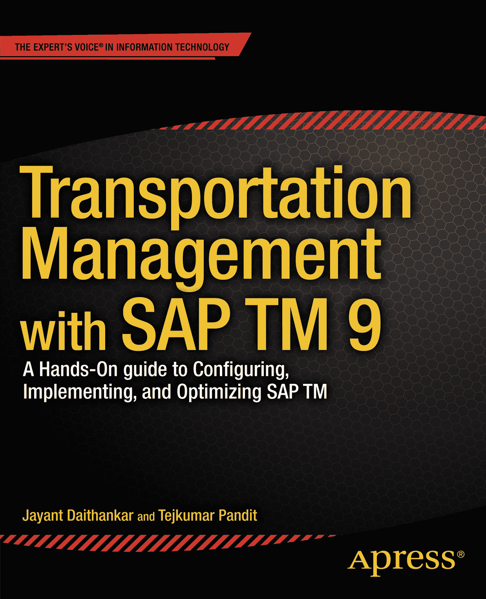

作者：Jayant Daithankar 与 Tejkumar Pandit

# 使用 SAP TM 9.0 进行运输管理

配置、实施和优化 SAP TM 的实战指南

ISBN 978-1-4302-6025-7   e-ISBN 978-1-4302-6026-4   DOI 10.1007/978-1-4302-6026-4

© Apress 2014

## 使用 SAP TM 9.0 进行运输管理

出版人：Heinz Weinheimer
首席编辑：Saswata Mishra
技术审校：Shreekant Shiralkar
编辑委员会：Steve Anglin, Ewan Buckingham, Gary Cornell, Louise Corrigan, James DeWolf, Jonathan Gennick, Jonathan Hassell, Robert Hutchinson, Michelle Lowman, James Markham, Matthew Moodie, Jeff Olson, Jeffrey Pepper, Douglas Pundick, Ben Renow-Clarke, Dominic Shakeshaft, Gwenan Spearing, Matt Wade, Steve Weiss
协调编辑：Mark Powers
开发编辑：Gary Schwartz
文字编辑：Lisa Vecchione
排版：SPi Global
索引编制：SPi Global
美术：SPi Global
封面设计：Anna Ishchenko

本书通过 Springer Science+Business Media New York 在全球图书贸易中发行，地址：233 Spring Street, 6th Floor, New York, NY 10013。电话：1-800-SPRINGER，传真：(201) 348-4505，电子邮件：`orders-ny@springer-sbm.com`，或访问 [`www.springeronline.com`](http://www.springeronline.com/)。Apress Media, LLC 是一家加利福尼亚有限责任公司，其唯一成员（所有者）是 Springer Science+Business Media Finance Inc (SSBM Finance Inc)。SSBM Finance Inc 是一家特拉华州公司。

有关翻译信息，请发送电子邮件至 `rights@apress.com`，或访问 [`www.apress.com`](http://www.apress.com/)。Apress 及 friends of ED 的书籍可以批量购买，用于学术、企业或促销用途。大多数图书也提供电子书版本和许可。如需更多信息，请参考我们的批量销售与电子书授权网页 [`www.apress.com/bulk-sales`](http://www.apress.com/bulk-sales)。

作者在本文中引用的任何源代码或其他补充材料均可供读者在 [`www.apress.com/9781430260257`](http://www.apress.com/9781430260257) 获取。有关如何查找本书源代码的详细信息，请访问 [`www.apress.com/source-code/`](http://www.apress.com/source-code/)。

本作品受版权保护。出版人保留所有权利，无论是全部还是部分材料，特别是翻译、重印、复用插图、朗诵、广播、微缩胶片复制或任何其他物理方式的复制权，以及电子信息存储与检索、电子改编、计算机软件或现在已知或以后开发的类似或不同方法的传输权。与评论或学术分析相关的简短摘录，或专门为进入计算机系统并由购买者独家使用而提供的材料，不受此法律保留的限制。仅在出版人所在地现行版权法的规定下，才允许复制本出版物或其部分内容，并且必须始终获得 Springer 的许可。可通过 RightsLink 在 Copyright Clearance Center 获取使用许可。违反者将根据相应的版权法受到起诉。

本书中可能出现商标名称、标识和图像。我们并未在每个商标名称、标识或图像出现时使用商标符号，而仅以编辑方式使用这些名称、标识和图像，以维护商标所有者的利益，无意侵犯商标。本出版物中使用的商号、商标、服务标志和类似术语，即使未被标识为此类，也不应被视为对其是否受所有权保护的表达。

尽管本书中的建议和信息在出版时被认为是真实和准确的，但作者、编辑和出版人均不对可能存在的任何错误或遗漏承担法律责任。出版人对本书包含的内容不作任何明示或暗示的保证。

本书无献辞。

# 关于作者

**杰扬特·达坦卡尔**拥有 24 年的行业和 `SAP` 经验。他曾为全球客户提供多项咨询工作。他在财务领域拥有深厚的领域知识，并持有多种专业资质，包括 `SAP` 财务与控制认证顾问、`SAP` 运输单元交付主管，以及 `SAP` 运输管理物流实践及其他业务部门的推动者。杰扬特还曾担任高级职务，负责大型企业资源规划项目中的业务流程再造交付、系统分析，以及针对客户特定需求进行 `SAP` 流程的应用设计。从 `SAP` 运输管理产品的 6.0 版本到其最新版本，他一直与其紧密合作。杰扬特目前在全球 `IT` 组织中担任卓越中心负责人。

**泰杰库马尔·潘迪特**在供应链管理、客户关系管理、运输、零售、仓储及相关软件技术等领域拥有超过 20 年的工作经验。他在物流行业拥有多年多样化的一线实践经验，曾担任货运主管、运营经理等关键职位。此外，在过去 11 年中，他在构建运输管理、配送管理以及追踪追溯等技术解决方案方面发挥了关键作用。作为物流与运输实践负责人，他在与客户的 `C` 级高管沟通、了解其组织的需求与挑战方面扮演着关键角色。泰杰库马尔目前是一名顾问，负责设计有助于公司实现增长目标的运营流程及相关技术架构。

## 关于技术审校者

**什里坎特·希拉卡尔**是一名资深管理专业人士，拥有领导和管理业务职能以及为大型企业提供技术咨询的经验。他目前正在为一家提供 `IT` 服务、咨询和业务解决方案的领先科技公司整合分析实践。他曾为财富 500 强企业在印度及全球范围内建立、扩展和多元化业务。他还撰写了多本畅销书，并发表了关于技术领域的白皮书。他拥有多项由其本人开发的创新专利。

## 引言

全球化在供应链跨越国家和大陆、演变为日新月异的全球网络这一进程中发挥了关键作用。制造商出于生产高性价比、高质量产品的渴望，不断延伸其供需链条，从而给这些网络带来了新的挑战。这一巨大转变导致内部物流功能的逐步淘汰，并向第三方物流提供商（`3PL`）转移，使制造商能够专注于其核心业务领域。`3PL` 每天都要面对苛刻的客户、不断变化的法规、合规标准，以及自身信息技术（`IT`）成熟度与客户期望之间的差距。因此，`3PL` 已开始简化、现代化和标准化其 `IT` 系统。其目标是构建一个能够满足所有需求的系统架构，同时用一个强大的平台取代大多数现有的复杂且零散的系统。特别是那些处理关键功能领域的应用，如订单管理、运输计划、执行、仓储、财务、计费以及定价和成本核算，亟需关注。因此，运输管理系统（`TMS`）即使不是最关键，也已成为了关键领域之一。

`TMS` 的实施至关重要。如果执行得当，一个优秀的 `TMS` 可以在优化、提高效率、减少错误和增加收入方面为组织带来诸多好处。然而，许多项目因一系列原因未能实现这些目标，这些原因包括产品选择错误、系统过度定制、缺乏标准化流程以及管理层支持不足。为了从 `TMS` 中获得最大收益，产品选择流程和实施方法论发挥着重要作用。

本书旨在提供见解，使 `SAP` 运输管理（`SAP TM`）之旅更具相关性和成效性。凭借经过验证的评估框架和可靠的建议，本书对高管、售前团队以及实施和推广团队都很有用。此外，它还可以帮助决策者，如首席信息官（`CIO`）和首席体验官（`CXO`），完成选择产品、创建业务案例以供管理层审批，以及为组织设计未来路线图等重要任务。本书结合了研究与分析的结果，以及与行业领导者合作所积累的经验知识，有助于加深对 `SAP TM` 的理解，并可作为一份分步实施和推广指南。

本书结构如下：

*   运输行业概述：`3PL` 视角
*   `TMS` 的需求：挑战与 `IT` 架构
*   `TMS` 产品格局：供应商、产品概述、计划与比较
*   `SAP TM`：概述、架构与路线图
*   `TMS` 选择框架
*   `SAP TM` 实施、推广和维护的行业最佳实践
*   实施 `TM` 所需的团队组成与技能矩阵，以及如何培养 `TM` 能力
*   `SAP TM` 实施的转型影响
*   新产品维度：`HANA`、移动性与分析——它们对运输管理的影响
*   端到端货运生命周期场景的流程映射
*   配置和实施 `SAP TM 9.0` 的分步指南

## 致谢

我们要感谢普尼特·奇达在本书撰写过程中提供的帮助。他在物流行业，尤其是 `SAP` 运输管理方面的知识和经验，是无价之宝。

# 目录

## 第 1 章：运输行业概览：第三方物流视角 1

### 本章小结 5

## 第 2 章：TMS 的需求：挑战与 IT 格局 7

### 本章小结 12

## 第 3 章：TMS 产品格局：供应商、产品概述、规划与比较 13

### 影响第三方物流的 TMS 市场主要趋势 15

### TMS 产品供应商 17

### 本章小结 17

## 第 4 章：SAP TM：概述、架构、路线图 19

### SAP TM 7.0 20

### SAP TM 8.0 21

### SAP TM 8.1 22

### SAP TM 9.0 24

### SAP TM 路线图 28

### 本章小结 29

## 第 5 章：TMS 选择框架 31

### 业务功能 33

### TMS 产品选择框架 33

### 本章小结 36

## 第 6 章：SAP TM 实施、推广和维护的行业最佳实践 37

### 准备阶段 39

- 获得高管承诺（与成功直接成正比） 39
- 构建积极的投资回报案例 39
- 设定目标，目标管理 40
- 构建愿景——让人员参与你的梦想 40
- 建立工作组——你的变革大使 41
- 培训选拔委员会 41
- 确保资源投入——世上没有免费的午餐 41
- 管理变革管理 42
- 不要期望一切都会改变——设定预期 42
- 尽早管理风险 42
- 建立全球流程库——包含本地需求 42
- 明确接口需求 43
- 识别事件 44
- 识别工作流 44
- 使用报表、关键绩效指标、仪表盘 44
- 清理主数据 44
- 基于角色的访问控制（RBAC）——创建者不能审批 44
- 根据架构指导原则验证解决方案 45
- 确定实施策略——分阶段、可管理 45
- 选择产品（如果尚未选定） 45
- 从以往经验中学习 46
- 清点待替换系统 46
- 确定系统集成商合作伙伴 46
- 选择实施团队 46
- 建立项目团队 46

### 实施 47

- 发现与规划 47
- 设计与配置 48
- 开发 48
- 测试 49
- 部署 49

### 功能版本发布与持续支持 50

### 推广 50

### 版本管理 56

### 项目组织与地点 58

### 本章小结 58

## 第 7 章：运输管理项目所需的团队组成与技能矩阵：如何构建运输管理能力 59

### 实施团队组成 60

- 企业级角色 60
- 项目级角色 61

### 推广与版本管理团队组成 63

- 推广团队 63
- 版本管理团队 64

### 支持团队组成 64

### 本章小结 67

## 第 8 章：SAP TM 实施的转型影响 69

### SAP TM 的转型影响 70

- 流程 70
- 人员 70
- 系统 71

### 本章小结 72

## 第 9 章：新维度产品：HANA、移动性与分析——对运输管理的影响 73

### SAP HANA 解决方案 74

- 车队运营商（地面运输） 74
- 铁路运营商 74
- 航空公司（航空运输） 75

### 移动性 75

### 社交媒体集成 76

### 分析 76

### 本章小结 77

## 第 10 章：端到端货运生命周期场景的流程映射 79

### 设置客户账户 79

### 接收货运预订 79

### 发送客户订单通知 80

### 规划货运运输路线 80

### 预订承运商 80

### 向客户确认订单 81

### 安排货运提货 81

### 提取货物并送达始发站 81

### 准备运输的货物 81

### 办理出口报关（如要求） 81

### 准备合并与文件 82

### 将合并货物交接给干线承运商 82

### 将货物运往门户 82

### 将货物送达门户 82

### 规划出港合并 82

### 将运输批次分配给出港门户合并点 83

### 准备合并 83

### 为主运输段创建文件 83

### 创建短途运输文件并派发给主承运商 83

### 将货物运往目的港或分支机构 83

### 办理进口报关 84

### 安排从承运商处提货 84

### 安排货物交付 84

### 将货物送达客户 84

### 计算运输批次费用 85

### 服务开票 85

### 核对发票并执行运费结算 85

### 本章小结 92

## 附录 A：SAP TM 9.0 配置与实施分步指南 93

### 系统要求 93

### 假设 93

### 场景 94

### 组织 94

- 定义组织网络 98
- 创建组织 98
- 分配组织 99

### 定义业务伙伴 101

### 定义地点 105

### 定义运输方式 109

### 定义资源 111

### 定义运输通道 113

### 定义 IATA 航空器类型代码 116

### 定义 IATA 航空公司代码 117

### 定义航空货物安全状态 118

### 定义计算已知托运人状态的偏移量 118

### 定义运单号库存类型 119

### 定义包装类型代码 120

### 定义项目类型 121

### 定义运输组 122

### 定义产品 123

### 定义设备组和设备类型 126

### 定义运输服务级别代码 128

### 定义运输段类型 129

### 定义运输移动类型 130

### 定义移动类型的运输段类型序列 130

### 定义运输段配置文件 131

### 定义运输方式类型 133

### 定义地理选择属性 134

### 定义时间相关选择属性 135

### 定义附加选择属性 137

### 定义选择配置文件 139

### 定义容量选择设置 140

### 定义优化器设置 142

### 定义承运商选择设置 144

### 定义货运代理结算单据编号范围区间 146

### 定义货运代理结算单据类型 147

### 定义运费结算单据编号范围区间 148

### 定义运费结算单据类型 149

### 定义货运订单管理编号范围区间 150

### 定义货运订单类型 151

### 定义货运预订类型 156

### 定义合同基础 160

### 定义货运单元类型 160

### 创建货运单元构建规则 163

### 定义规划配置文件 166

### 定义货运代理订单管理编号范围区间 169

### 定义货运代理订单类型 170

### 将项目类型分配给货运代理订单类型 174

### 定义阶段的默认货运单据类型 175

### 定义计划表编号范围区间 176

### 定义班次编号范围区间 177

### 定义计划表类型 178

### 创建计划表 179

- 前程运输与续程运输计划表 179
- 航班时刻表 183
- 主航班时刻表 186

### 定义费用类别 194

### 定义费用子类别 195

### 定义费用类型 196

### 定义费率表 197

### 定义费率表 200

### 定义计算表 213

### 定义协议编号范围区间 223

### 定义货运代理协议项目类型 224

### 定义货运代理协议类型 224

### 定义货运协议类型 225

### 定义内部协议类型 226

### 定义货运代理协议 227

### 定义货运协议 230

### 定义内部协议 235

### 定义成本分配配置文件 238

### 定义计算配置文件 239

### 定义结算配置文件 240

### 定义常规设置 241

### 定义阶段的默认协议方角色 242

### 用于开票和结算（结算单据）的 SAP ERP 定制设置 243

- 定义类别代码 243
- 定义子类别代码 244
- 定义费用类型 245
- 分配条件类型 246
- 分配销售与分销的组织单位 247
- 分配服务主记录和科目分配类别 248
- 分配采购的组织单位 250

### 运力采购：货运预订 251

### 订单管理：货运代理订单 257

### 规划与分包 264

- 将货运代理订单分配给货运预订（运力分配） 265
- 提货规划 267
- 前程运输规划 270

### 货运执行与监控 275

- 提货执行 275
- 前程运输执行 278
- 主运输段执行 279

### 处理货运代理订单（进口）和货运预订（进口） 287

### 规划与分包（进口） 288

- 续程运输规划 288
- 交付规划 289

### 货运执行与监控（进口） 290

### 客户开票与运费结算 294

- 计算开票费用 294
- 计算结算费用 295
- 开票（货运代理结算） 296
- 结算（运费结算） 298

## 索引 301

## 内容一览

- 第 1 章：运输行业概览：第三方物流视角 1
- 第 2 章：TMS 的需求：挑战与 IT 格局 7
- 第 3 章：TMS 产品格局：供应商、产品概述、规划与比较 13
- 第 4 章：SAP TM：概述、架构、路线图 19
- 第 5 章：TMS 选择框架 31
- 第 6 章：SAP TM 实施、推广和维护的行业最佳实践 37
- 第 7 章：运输管理项目所需的团队组成与技能矩阵：如何构建运输管理能力 59
- 第 8 章：SAP TM 实施的转型影响 69
- 第 9 章：新维度产品：HANA、移动性与分析——对运输管理的影响 73
- 第 10 章：端到端货运生命周期场景的流程映射 79
- 附录 A：SAP TM 9.0 配置与实施分步指南 93
- 索引 301
