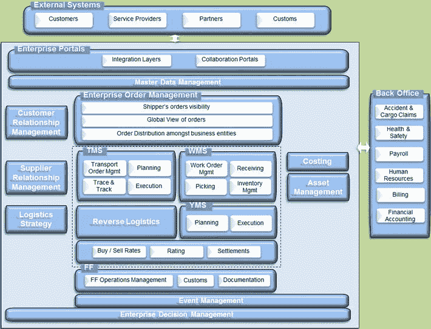

## 2. 为何需要运输管理系统：挑战与信息技术格局

在本章中，我们将涵盖以下内容：
- 对运输管理系统（`TMS`）的需求
- 为何第三方物流提供商（`3PLs`）应投入精力进行`TMS`产品选型
- 软件即服务（`SaaS`）模式的优势
- `TMS`能提供什么
- 软件系统集成商（`SIs`）的角色

`3PL`行业的增长有赖于整体贸易的绩效。每当贸易行业表现更佳时，`3PL`行业就会随之增长。当前的经济形势为该行业带来了增长和盈利方面的挑战。

当被问及计划如何拓展未来业务时，他们的回答通常包含以下一项或多项策略：
- **全球扩张**：亚洲市场的表现优于其他大洲。亚洲消费的增长、以合理价格获取熟练资源的便利性以及高性价比的生产，是这些市场增长的主要原因。过去，欧洲的`3PLs`将目光投向北美以寻求增长，反之亦然。如今，所有`3PLs`都将目光锁定在亚洲。大多数领先的`3PLs`已建立起更广泛的网络，提供欧洲和北美地区客户所享受的各种物流服务和增值服务。
- **引入新的服务线**：在过去十年中，大多数`3PLs`已开始提供一系列服务作为其增长战略的一部分。这一变化是行业整合和客户需求共同作用的结果。如今，你会看到拥有运输服务的仓储组织；提供报关经纪服务的货运代理；以及提供增值服务、仓储以及空运、海运和铁路货运的公路运输公司。
- **瞄准新的行业细分市场**：最初服务于特定行业的`3PLs`，在一段时间内积累了满足该行业需求的专业能力。现在，`3PLs`正寻求利用这些能力，在客户需求相似的其它行业中实现增长。
- **渗透中小型市场**：与`3PLs`合作的绝大多数公司是一级企业（年收入超过十亿美元）。然而，这一市场细分领域几乎饱和，因此`3PLs`已开始向中小企业提供物流服务，以维持增长。几年前，当大型客户提供大量为期多年、价值数百万美元的合同时，`3PLs`没有太多理由专注于这个细分市场。但如今，此类大规模机会相对稀缺；收到的服务提案请求（`RFPs`）在规模范围上比以前更小。为了维持本已微薄的利润空间，服务提供商必须通过更低的运营成本来抵消这些较小的收入机会。
- **并购**：过去十年间，`3PL`行业发生了许多并购事件。这使得`3PLs`能够持续拓展新的区域和行业细分市场，并获取其它领域的服务专长。

实现并购目标的关键制约因素之一是现有的互联网技术（`IT`）格局。然而，许多公司已开始简化、现代化和标准化其`IT`系统，因为他们认识到现有格局正成为其增长的阻碍。

2001 年，我们曾是一个团队的成员，为印度领先的物流公司开发了一套`TMS`。模块包括注册业务实体（客户、供应商、合作伙伴）、合同管理、订单管理、执行、计费和报告。此外，我们还将这些模块与`SAP`、`FICO`、`SD`以及车辆跟踪系统进行了集成。工作持续了一年多，期间我们虔诚地遵循了软件开发生命周期。团队规模在高峰期接近七十人。在转做其它项目并随后更换公司后，我们仍与一些负责支持我们所开发`TMS`的前同事保持联系。有一天，我们听说管理层决定投资一个同类最佳的`TMS`产品。他们邀请了若干产品供应商进行演示。其中一家供应商开始为他们进行概念验证。没有一款产品能满足该组织的需求。然而，该供应商同意在联合评估期间弥补其产品中发现的差距。并制定了一个路线图。接着，我们了解到第二次尝试未能实现，该公司又去探索了另一种方案。

得知我们耗费数月构建的系统未被使用，我们感到难过。利益相关者和项目团队为打造一个能够长期使用的系统——我们基本上将其构想为印度公路运输业务的企业资源规划（`ERP`）系统——投入了大量资金和时间，付出了真诚的努力。那么，问题出在哪里？谁应该为此负责？为什么机会白白流失了？还有更多未解之谜困扰了我们数月之久，之后我们参加了一个关于`TMS`的研讨会。当我们向国际物流从业者咨询时，我们的疑问得到了解答。当我们才开始为印度公司开发`TMS`时，其它公司已经走过了类似的道路；我们的经历与他们并无不同。对许多人来说，目标是构建一个能够满足公司所有需求并取代大部分现有格局的系统。实际上，许多计划因预算限制而搁置；有些则不断错过截止日期；还有些项目最终以范围缩减至原规模的一半以下而告终。相比之下，少数开发者采取了狭隘的视角，仅为自己的业务单元、地点和职能领域创建系统。其它人则尝试了产品路线。部分可用的功能、不明确且有时不置可否的产品路线图，迫使`3PL`公司只能接受他们所得。他们要么围绕这些产品继续构建系统，要么继续以手动或低效的方式处理许多事务。

第三方物流企业（3PL）在日益激烈的竞争中承受着巨大的生存压力。它们面临着苛刻的客户、不断变化的法规和合规标准、缺乏熟练/有经验的劳动力资源，以及自身 `IT` 成熟度与客户需求/期望之间的差距等挑战。在许多情况下，其现有技术格局是 `IT` 战略不完善、系统接入（对收购组织）、系统保留以及分散的开发职责共同导致的结果。因此，当前的技术格局存在以下特征：技术不足、多个应用提供相似功能、技术平台老旧、一对一集成、功能覆盖范围差、维护成本高、缺乏支持、系统不可用以及不可扩展的交易捕获系统。此外，许多产品供应商并未投资升级其产品，有些甚至停止了对它们的支持。并购加剧了这一问题，合并后的实体保留了各自的系统。企业 `IT` 战略的缺失也使情况进一步恶化：业务和 `IT` 经理为满足自身需求而构建系统，导致 3PL 企业拥有成百上千个系统目录。维护成本高昂，投资回报率极低。在这样的格局下，企业无法实现以下目标：
- 能够以整体方式管理运输物流网络，以降低运营成本，确保资产的高利用率，并实现更好的多式联运规划
- 理解成本结构
- 超越客户服务水平
- 遵守所有法规和政策
- 改善货运整合
- 高效预约管理
- 增强合作伙伴协作
- 提高整个货运生命周期内的可视性
- 更明智的决策
- 对整个运输管理业务（从报价、规划、执行、监控到结算）实现更严格的控制

正如第 1 章所述，3PL 行业在很大程度上推迟了其合理化进程。该行业需要将合理化其应用格局作为优先事项。处理关键功能领域的应用程序，例如订单管理、运输规划、执行、仓储、财务、计费、定价与成本核算等，尤其需要关注。因此，运输管理系统（`TMS`）成为关键。如果没有集成的、技术稳健、功能丰富、架构设计良好、用户友好的应用程序（最好在单一平台上）来处理这些关键功能，3PL 企业将难以竞争。

在过去五年中，我们看到中大型 3PL 企业采取了一些重大举措。各组织一直在积极准备，将`TMS`部署为其运输业务单元的核心系统。作为现成产品提供的`TMS`仍存在许多功能差距。然而，这些 3PL 企业与`TMS`产品公司共同绘制的路线图看起来现实且可以达成。如果这些举措得以实现，许多 3PL 企业可以将其系统目录减少数十到数百个，具体取决于其当前状态。

领先的`TMS`产品在功能上已经进化，并将继续在广度和深度上演进。从多个供应商处购买零散的`TMS`功能模块的日子已经一去不复返了。现在，你可以从一个单一来源为你的需求采购解决方案。许多供应商已开始提供用于规划和执行的工具。这些工具曾被运输业内部用于控制和管控原材料及成品的运输成本。多年来，这些解决方案在运输服务提供商中找到了一定的适用性，当前版本的解决方案正被 3PL 企业用于订单分配、货物整合、路线规划、运输方式选择、承运商选择、招标、运费审计、追踪与追溯，以及支付与结算。较新的附加功能包括：可视性、货物装载，以及事件、承运商和绩效管理。

`TMS`是一类软件，负责处理供应链中货物实体移动的规划和执行。`TMS`被制造商/托运人、多式联运运营商、拥有资产和非资产的 3PL 及 4PL 企业使用。`TMS`应支持所有运输方式，包括公路、铁路、多式联运、航空和海运。制造商/托运人使用`TMS`管理货运采购、规划、执行和结算。3PL 企业则将其用于规划和执行。此处的规划包括货物整合、路线规划、方式选择和承运商选择；执行则涉及向承运商招标、货运跟踪与追溯，以及运费审计与支付。

获取降低货运成本的工具，仍然是制造商/托运人和 3PL 企业投资`TMS`的主要原因。这一点，连同提升整个货运生命周期整体效率的愿望，迫使`TMS`供应商扩展其`TMS`套件（与其它必需系统集成的`TMS`）；现在的产品包含战略规划、承运商选择、执行、可视性、绩效管理、运费支付服务和审计能力。

全面的多式联运`TMS`解决方案由多个子组件构成，涵盖采购、规划、优化、执行、审计与结算、跟踪与追溯/可视性，以及绩效管理。以下是其中一些提供的功能：
- 战略性网络设计与规划
- 战术规划
- 多式联运、多段运输规划与优化
- 运输执行
- 运费定价与合同管理
- 资产与货运路线规划、调度与派发
- 运费审计、支付与结算
- 可视性与事件管理/业务活动监控
- 分析、绩效管理、记分卡与管理仪表盘
- 全球贸易管理
- 优良的架构、适应性、灵活性、可用性与部署选项
- 易于使用
- 启用的工作流

为了加速`TMS`解决方案的实施，如今的`TMS`供应商已与领先的`ERP`系统建立了集成。实施后，这些集成意味着更少的手动工作和更高的数据质量保证。一些常见的集成如下：

# TMS系统集成与部署

*   与 ERP 集成：在`TMS`中执行 ERP 订单和交货的运输计划与执行，并在 ERP 中进行`TMS`结算单据的开票和发票校验。数据通过企业服务进行传输。同时还将`TMS`与 ERP 的发货处理相集成。

*   与跟踪追溯应用集成：帮助监控运输的执行状态。

*   与全球贸易管理（`GTM`）集成：对`TMS`业务单据（例如，为货运订单或货运预订请求出口报关）执行海关处理。数据通过企业服务进行传输。

*   与环境、健康和安全（`EHS`）集成：确保危险品运输符合法律法规，实现安全运输。

*   与商业智能（`BI`）集成：利用集成式查询和分析工具，对业务数据进行评估、分析和解读。

*   与地理信息系统（`GIS`）集成：获取基于位置服务视角所需的数据。

大多数实施`TMS`的客户也建立了`TMS`与其门户网站之间的集成。`TMS`向门户用户提供货运状态，从门户收到的订单则在`TMS`中进行计划和执行。两个系统之间还管理着进一步的通知和审批。

最近，我们向第三方物流公司提问：哪种交付和实施方法最适合您的组织？这个问题在五年前是闻所未闻的。不断增长的维护成本和缩水的利润率迫使第三方物流公司将目光投向纯粹的传统的所有权模式之外。第三方物流公司希望专注于其核心业务，将系统责任交给系统专家。许多系统集成商和产品供应商提供这些下一代服务，例如本地部署服务、托管服务、按需服务/SaaS，以及`TMS`托管服务。

这些模式提供：

*   成本优势

*   最小化风险

*   无需维护基础设施

*   便捷获取软件升级

*   经过验证的解决方案

*   获取最佳实践

系统集成商在`TMS`的实施、推广、与生态系统的集成以及维护和增强中扮演着重要角色。我们建议您使用系统集成商，因为他们为所有这些服务带来了最佳实践、加速器和工具。此外，一些系统集成商还针对这些服务创建了业务流程外包解决方案。服务提供商根据客户数量，在成本效益高的国家设立一个或多个业务流程外包（`BPO`）中心。这些中心配备`TMS`套件，接收/访问客户订单、合并订单、路由订单、向承运商订舱、准备文档、报告货运状态、处理索赔请求、审计运费、准备发票、处理来自承运商/供应商的账单、测量服务水平并生成报告。这让第三方物流公司有更多时间专注于其核心活动，同时在劳动力和系统所有权方面节省成本。

制造商/托运人对供应链优化和可见性的更大渴望，以及`TMS`产品供应商的持续创新，共同推动了`TMS`市场的增长。`C. H. Robinson Worldwide`，作为全球最大的第三方物流公司之一，拥有全球业务，为其自身的运输业务开发了强大的技术，这已演变为其托管`TMS`解决方案，由`TMC`（`C. H. Robinson`的一个部门）部署。其他领先的`TMS`供应商包括 SAP、Oracle、JDA Software Group、MercuryGate International、Manhattan Associates、IBM Sterling Commerce、TMW Systems、LeanLogistics、Transplace 和 Interlogistics。有关这些产品供应商的更多详细信息，请参见第 3 章。

初步看来，市场上有很多选择，但找到哪一个能满足特定第三方物流公司的确切需求则需要分析。每家公司都有其独特的销售主张（`USP`），这有助于其增长和留住客户。其流程也相应地与之对齐。因此，第三方物流公司在决定投资`TMS`产品之前，必须进行仔细评估。关于如何做出理性选择，请参见第 5 章了解更多信息。

`TMS`是第三方物流公司 IT 架构的核心组件。大多数业务活动都围绕着这个核心组件展开。图 2-1 展示了`TMS`如何与 IT 架构的其他组件相互关联。

图 2-1. 第三方物流公司的集成 IT 架构

如您所见，`TMS`与企业的订单管理、仓库管理系统（`WMS`）、客户关系管理（`CRM`）、供应商关系管理（`SRM`）、物流战略、成本核算、资产管理、事件管理等集成在一起。由于`TMS`在管理第三方物流公司运营中扮演如此重要的角色，一个功能和技术上成熟的`TMS`能帮助第三方物流公司获得竞争优势。

## 总结

在本章中，我们讨论了集成式`TMS`对第三方物流公司的重要性，以及在决定投资`TMS`产品前进行准确评估的必要性。我们还指出，第三方物流公司应探索可用的部署选项以及与`TMS`相关的业务流程的外包，以提高效率。最后，我们探讨了系统集成商在推动转型中的作用。