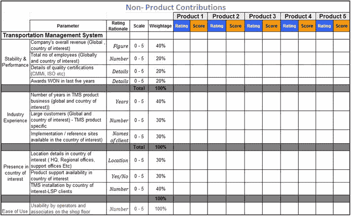
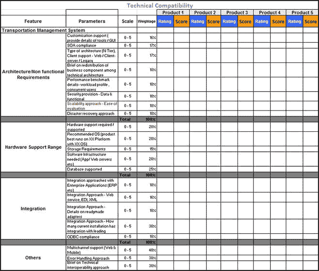
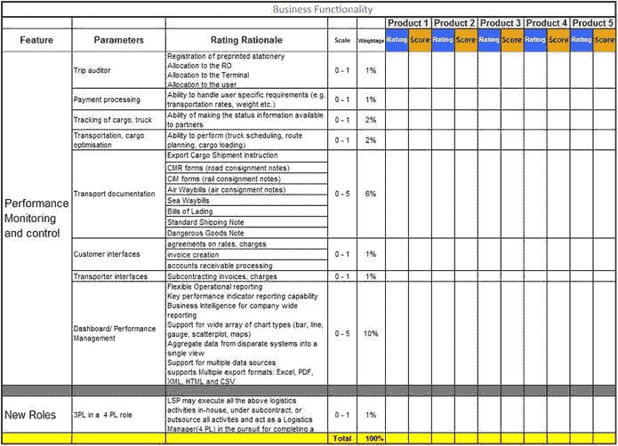
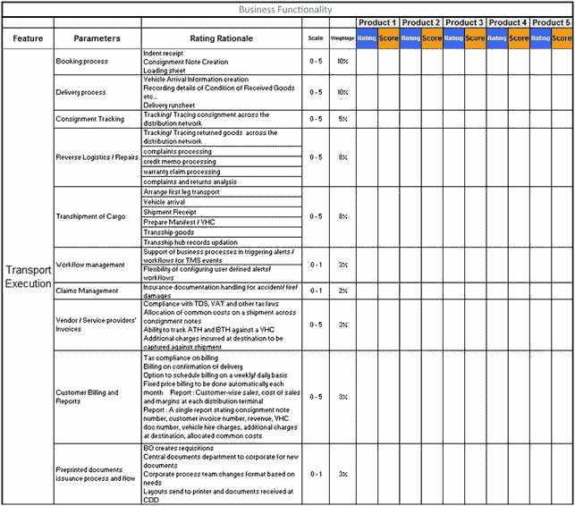
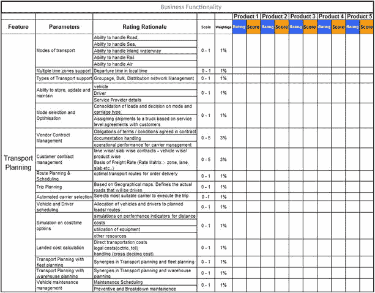

# 5. TMS 选型框架

本章将涉及以下内容：
- 采用结构化、科学化选型流程的必要性
- 产品选型框架的价值
- 产品选型框架的特征
- 采用行业最佳实践的重要性
- 启动产品选型前的准备工作

运输管理系统（`TMS`）产品市场竞争激烈，既有领先的商业现成（`COTS`）产品公司、精品店、利基市场参与者、细分领域专家，也有像 `SAP` 和 `Oracle` 这样的企业资源规划（`ERP`）巨头。这些产品中，绝大多数能够提供用户期望的全部功能中达到 50% 或更优水平的部分。大多数产品旨在满足制造商/货主的需求。少数公司也投资于那些能比其他公司更好地解决特定细分市场/垂直行业挑战的解决方案。然而，许多产品仍依赖老旧技术，在集成性和可扩展性方面存在挑战，并且数十年未得到升级。一些公司在建立实施与推广合作伙伴网络方面仍持保守态度。因此，由这类公司进行的实施与推广既昂贵又耗时。其结果是，许多采购方失去了耐心，要么中止了尚未完成的流程，要么遭受了不成倍的成本超支而显得投资不划算，或者两种情况兼而有之。

多年来，第三方物流（`3PL`）行业并未引起其中许多公司的关注。`3PL` 公司持续投资于自建系统，各个区域和利润中心都构建自己的系统。并购行为进一步加剧了这些复杂性。通常，合并仍局限于高层业务层面，而本地系统则得以保留。由于缺乏关于平台、技术和集成的企业级指南/方向，导致这些 `3PL` 公司持续运行着成百上千套系统。许多行业领导者和二级挑战者要么已经制定了其 `IT` 架构战略，要么正处于高级阶段。少数公司正在与 `TMS` 产品公司进行洽谈。

使用 `TMS` 产品的潜在好处包括：提高可靠性和稳定性，缩短开发时间，以及降低成本。鉴于 `TMS` 市场的动态特性，当 `3PL` 公司评估新的 `TMS` 产品和供应商时，应分析多个参数。产品的成功在很大程度上取决于选择正确的产品。仔细分析产品的能力和局限性是必须的。

选型应通过逐步淘汰的方式进行。淘汰那些不符合你组织要求的产品。

将我们的 `TMS` 产品选型框架纳入本书的目标，是提供一个全面、易用、经过行业验证的指南，帮助您的 `3PL` 公司选择最合适的 `TMS` 产品，该产品能够提供更高的投资回报率和长期解决方案。

该框架包含以下核心部分：
- 业务功能
- 技术兼容性
- 非产品贡献
- 成本

该框架按产品和核心部分提供摘要。每个核心部分的权重基于作者在物流领域的经验以及领先 `3PL` 公司高管层的证实。

作者建议采用基于演示的选型方法。在此方法中，`3PL` 公司自行或在第三方专家或咨询公司的帮助下，准备一份能概括其当前和未来流程的概况文件。该概况文件必须包含所有异常和偏差、业务规则以及真实数据。将此概况文件分享给产品供应商，并要求他们根据该概况文件进行产品演示。演示在评估业务功能和技术兼容性的大部分方面都起着重要作用。强烈建议在联系供应商之前，就待映射的业务流程达成内部共识。

产品提供最佳实践流程。产品代表了在不同客户多年的实施中积累的丰富经验。采购方应尝试从这些经验中尽可能多地获益。这些最佳实践帮助采购方实现运营效率、降低成本、改善协作和提升客户满意度。过去，许多采购方完全或部分忽视了这一事实，理由是调整自身流程以适应最佳实践流程需要付出高昂代价。因此，这些采购方并未充分利用大多数产品功能。结果导致了采购方的投资回报率低下。采购方应详细了解这些流程；在所选产品推荐采用的行业最佳实践与其自身当前流程之间进行差距分析；对这些实践进行优先级排序；并制定一个计划，在所选产品进行定制、配置、实施和推广的同时，将这些实践落地。实施和推广应跟随流程变更，而不是相反。

框架中包含的业务功能涵盖了从订单到付款的整个货运生命周期。在您的分析中，应包含此处未列出但对您的业务至关重要或构成您独特卖点（`USP`）的功能。这些功能可以获得更高的权重，因为它们对您的业务至关重要。如果是这样，您需要相应调整其余功能的权重，以保持总权重为 100%。必须重点关注您的关键和独特功能需求，同时聚焦于利用交易数据进行捕获的能力。在规划、排程、报告、可视化、事件管理、工作流和通知方面的能力，必须使用您自己的数据进行分析。

与现有或计划中的技术架构的技术兼容性在任何产品选型中都起着至关重要的作用。您描述得越具体（在集成和技术方面），您的未来就会越顺畅。忽视技术兼容性的任何方面，都可能导致维护成本大幅增加，以及为设计变通方案而耗费时间。

非产品贡献的每个方面对于实施及后续工作都至关重要。

作者建议在邀请产品供应商参与产品选型流程之前，执行以下步骤：
- 发起人确定一个核心团队。
- 核心团队与发起人一起，需对正在变化的业务模式以及构成公司愿景一部分的重大变革有清晰的看法。
- 核心团队成员包括技术 `SPOC`（单点联系人）和功能 `SPOC`，以及其他利益相关者。
- 核心团队从运输规划、执行、客户服务、财务、销售和技术部门各确定一位功能 `SPOC`。
- 功能 `SPOC` 团队详细阐述流程，包括各种场景、偏差、异常和业务规则；然后将此信息分享给产品供应商，以便他们有时间将其纳入产品演示。技术 `SPOC` 描绘对新产品的平台、环境和集成相关的期望。
- 列出不超过十个产品进行短名单评估。

作为选型流程的一部分，推荐执行以下步骤：
- 邀请入围的供应商演示其产品如何满足您的需求。
- 利用 `TMS` 产品选型框架的参数进行评估（参见本章后面“`TMS` 产品选型框架”部分的表格）。
- 各 `SPOC` 分别评估每个产品。
- 准备评估摘要。
- 选择得分较高的产品。

## 业务功能

对业务功能的评估对于产品选择过程的成功至关重要。产品公司往往倾向于夸大其产品的功能。切勿轻信公司的宣传材料，要亲自核实。最好的方法是邀请公司演示其产品，并清晰地展示它们如何与您的业务相关。有些产品可能包含您的组织并不需要的功能。请确保不要仅仅因为您尚未准备好或预计不需要就否定这些产品。您的组织可能会因面临的挑战或自身的愿景和目标而发生改变和演进，如果您的核心团队对此没有准备或不了解公司的使命，就可能无法对产品演示给予足够的重视。结果，您的公司可能会错失未来发展的机会。

## TMS 产品选择框架

以下的产品选择框架包含了与业务和技术功能相关的参数，产品可据此进行评估。该框架还包含用于评估产品公司的参数。这些参数将帮助您选择一款满足您组织需求的产品（见图 5-1 至 5-5）。

**图 5-5.** 产品选择框架：非产品贡献

**图 5-4.** 产品选择框架：技术兼容性

**图 5-3.** 产品选择框架：业务功能（第 3 部分）

**图 5-2.** 产品选择框架：业务功能（第 2 部分）

**图 5-1.** 产品选择框架：业务功能（第 1 部分）

## 总结

选择最适合您组织的运输管理（`TM`）产品是优先事项，也是使您的技术架构更可靠、更稳定，并能实现更高投资回报率的一个重要里程碑。然而，在启动项目之前，您需要清楚了解组织的愿景、目标和业务案例。您旅程的第一步是准备阶段，在此阶段，您需要确定核心团队和单点联系人（`SPOCS`），以记录您的业务流程并建立实施和推广策略。在选择产品时（以及之后），请记住，产品提供了最佳实践流程。不要忽视它们，否则您的公司可能会面临失去竞争优势的风险。通过使用我们的产品选择框架，您可以确保选择合适的 `TM` 产品。始终建议将您业务特有的功能添加到我们框架中包含的标准功能中。

既然您已经选择了产品，我们将为您提供一些关于如何实施它的技巧。下一章将作为实施 `TM`（特别是 `SAP TM`）的指南。
