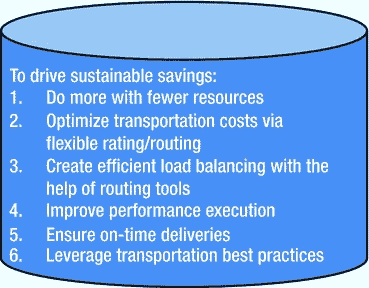

# SAP TM：概述、架构、路线图

本章将涵盖以下内容：

*   `SAP 运输管理`（`SAP TM`）的发展历程
*   每个版本的功能重点
*   适用于第三方物流的 `SAP TM`
*   新技术的使用，例如 `Floor Plan Manager`（`FPM`）、`Business Rule Framework plus`（`BRFPlus`）和 `Business Object Processing Framework`（`BOPF`）
*   对航空货运代理场景的支持

`SAP TM` 平台历史悠久。`SAP TM` 始于货运执行功能，最初作为 `SAP R/2` 中 `物流执行-运输`（`LE-TRA`）的一部分，主要为制造/运输领域服务，用于捕获与货运执行相关的交易数据。随后，`SAP TM` 发展成为一个以企业为中心的运输解决方案，供制造商/托运人用于运费成本和结算、开票、运费审计、直达店铺配送，以及简单的规划和报告。接着出现了 `运输规划/车辆调度`（`TP/VS`），提供了货运规划和优化能力。车辆调度和路线指引等功能，以及增强的承运商选择和连续运动优化，获得了行业认可。随后，`SAP 事件管理`（`SAP EM`）和 `SAP 全球贸易服务`（`SAP GTS`）分别进一步增强了供应链全程和跨境领域的事件管理能力。

`SCM 5.0` 作为 `TM` 的一个附加组件，在容量规划方面得到了增强。业务伙伴协作至关重要，尤其是在预订远洋船舶舱位方面。随后的一个试点解决方案——`战略货运管理`（`SFM`），专注于战略协作和基于网络的协作，并具备允许共享海运和陆运费率询价单（`RFQ`）的功能。

`SAP TM 6.0` 具有许多改进的功能：集中式/分散式 `TM`、自适应规划、执行、重新规划、承运商分配、单站和多站规划、排程、路线安排及优化、作业成本法、货运计费、支付和利润分配。该解决方案还为基于第三方物流的活动提供了更高的可视性，例如货运报价以及买卖双方的可视性。

使用户能够最佳利用现有资源，选择最佳的承运商和运输方式，在给定约束条件下确定最高效的运输计划，并根据实际进展调整计划——这些都是 `SAP TM 6.0` 改进的部分能力。图 4-1 展示了进一步投资 `SAP TM` 的关键驱动力。

图 4-1. 投资 `SAP TM` 的关键驱动力

在许多方面，`SAP TM 6.0` 是对 `企业资源计划物流执行系统`（`ERP LES`）、`TP/VS` 和 `SAP 高级计划与优化`（`SAP APO`）整合体的重大改进。

主要改进包括：

*   一个集运输规划、执行和运输费用计算于一体的单一系统
*   支持来自多个 `ERP` 系统的货运运输规划与执行
*   支持点对点广播并对所有投标方式开放
*   支持入库和出库运输的执行
*   运输方案/路线指南支持与规划相同的约束条件（例如，隔舱、卡车、拖车）
*   支持标准路线、集装箱和驾驶员的主数据
*   即使在运输活动开始执行后也能进行自适应规划（例如，为现有货运规划新的运输需求）
*   对货运生命周期中使用的转运点或枢纽数量没有限制

## SAP TM 7.0

SAP TM 7.0 在功能上相对于 SAP TM 6.0 有若干增强。以下是这些变化的摘要：

- 运输请求（`SRQ`）审批：基于条件的工作流；如果`SRQ`超过特定容量，则必须先审批才能进一步处理。负责审批的人员会在其 SAP TM 业务工作场所收件箱中收到一条消息。他或她可以接受或拒绝该审批消息。
- 特定于模式的用户界面（`UI`）：针对不同类型的运输请求（多式联运、空运、海运、陆运）增加了额外的`SRQ`录入屏幕。
- 将现有`SRQ`添加到货运请求（`FRQ`）：增加了将现有`SRQ`分配到`FRQ`中的功能。
- 包裹规划/运价规划：承运商费率与外部系统集成，以及与外部计价引擎（`SMC3`、零担运输 [`LTL`]）集成；在 SAP TM 中进行运价成本计算，或从外部系统采购运价成本。
- 单独规划运输请求（`SRQ`）中的货运单元（`FU`）：可以创建建议（规划模板）以列出所有可能的路线。用户可以为`SRQ`内的不同`FU`选择不同的路线。
- GTS 集成：触发出口报关。在运输执行期间可考虑自定义状态。
- 公司间和公司内部成本与收入分配：销售组织负责处理`SRQ`并向客户收费（客户货运发票请求 [`CFIR`]）。采购组织负责将运输分包给承运商（供应商货运发票请求 [`SFIR`]）。销售组织和采购组织之间的内部收费可用于利润分享和成本附加费。
- 多资源调度：使用运输方式（`MTR`）定义资源，可以计算可用资源（例如，十辆容量为 20 吨的卡车）。
- 图形化文档展示：所有业务相关文档都以图形格式显示在“文档流”选项卡下。
- 客户概况表：包含一个单一屏幕，用于显示重要客户数据和来自商业智能（`BI`）的相关分析内容。
- 运输请求（`SRQ`）、业务对象（`BO`）、销售订单（`SO`）中的自由字段：在上述对象中增加自定义字段。

除这些关键特性外，SAP TM 7.0 在以下方面也有所增强：招标模板（将招标信息创建为主数据）、无资源计划创建、在手动规划期间添加一次性手动停靠点，以及个人对象工作清单（`POWL`）动态选择标准。

## SAP TM 8.0

SAP TM 8.0 于 2010 年 11 月进入市场并开始试运行，于 2011 年 6 月达到全面上市。新版本提供了以下增强功能：

- 改进的运输规划
- 降低的运输成本
- 改进的货运整合
- 改进的资产利用率
- 高效的服务水平履行
- 改进的合作伙伴协作
- 提高整个货运生命周期的可见性
- 改进的决策能力

在 SAP TM 8.0 中，实现了以下产品集成：

- SAP ERP 与 SAP TM 集成：为 ERP 订单、交货执行运输规划和执行（在 SAP TM 中），并在 ERP 中对 TM 结算单据进行开票和发票校验。数据通过企业服务传输。同时集成 SAP TM 与 ERP 运输处理。在此情况下，数据通过企业服务和中间文档（`IDocs`）传输。
- SAP TM 与 SAP EM 集成：帮助跟踪事件以监控运输的执行状态。
- 与 GTS 集成：在连接的 GTS 系统中对 SAP TM 业务文档执行报关处理（例如，为货运订单或货运预订请求出口报关单）。数据通过企业服务传输。
- 与环境、健康和安全（`EHS`）集成：确保危险品运输符合法律法规要求。
- 与 BI 集成：使用集成的查询和分析工具来评估、分析和解释业务数据。
- 与地理信息系统（`GIS`）集成：用于从基于位置服务的角度所需的数据。

随着 SAP TM 与 SAP ERP 的集成，制造/运输领域终于获得了一个集成的运输管理解决方案。集成订单管理的引入使运输规划人员的工作更加轻松，使他们能够覆盖与预订和运输货物相关的订单到现金（`OTC`）和采购到付款（`PTP`）流程，尽管重点仍然放在海运上。运输规划人员现在可以单一视图查看待发运的货物。此外，手动和自动规划与发运都成为可能。先进且动态的运输优化结合了入站和出站规划功能，帮助制造商/发货方优化其运输资源。此版本提供了一些额外的决策支持报告和视图，帮助制造商/发货方以更低的成本提高服务水平。通过此版本，管理也得到了改进。集成的全球跨境管理和危险品获取吸引了制造商/发货方的注意。在调度员工作区方面，增加了新功能，并增强了 SAP TM 7.0 的一些功能；新功能包括：为现有分配搜索替换资源、编辑需求拆分、自动调度多天分配、复制时间分配、资源名称的保密性（仅授权用户可查看）、连接到外部`GIS`系统（增强）、按用户保存调度程序中的集装箱位置、直接在规划板上重新排序资源列表，以及用于工作清单的独立对话框。规划板现在包含一个按钮，允许用户对齐分配。

基于 Web 的规划板引入了资源规划，使得在团队层面以及多天规划、优化和预约预订方面进行优化成为可能。规划板中还增加了部件可用性检查，以及批量更改和分配功能。

SAP TM 8.0 的开发重点在于客户协同创新、深度流程集成（`OTC`、`PTP`、海关与合规管理、`DGR`）、一流的功能、协作、决策能力、灵活性、简洁性和性能。

## SAP TM 8.1

SAP TM 8.1 的主要关注点是扩展解决方案以支持第三方物流（3PL）。SAP TM 8.1 于 2011 年 8 月进入 ramp-up 阶段。SAP TM 8.1 扩展了 SAP TM 8.0 涵盖的核心运输流程，以支持增强的：

*   海运管理
*   运输网络规划
*   报价和货运订单管理
*   货运预订和服务订单管理
*   货物管理

此外，还包含了一个新场景：为第三方物流提供的拼箱货（LCL）。SAP TM 8.1 还为制造商/托运人和第三方物流提供了通用增强功能，包括：

*   高级运输规划
*   高级费用管理和结算
*   增强的分析功能

碎片化的系统环境、用于运输执行的点对点遗留系统（通常每种运输方式都不同）且缺乏适当的集成、需要替换的旧技术、缺乏遗留技术方面经验丰富的开发人员、在运输执行领域没有占据两位数市场份额的软件供应商、业务仅限于本地或区域层面、创新极少以及开发和支持能力有限，这些都是供应链融合参与者面临的一些挑战。在第三方物流中，由于现有技术环境与客户期望之间的差距日益扩大，挑战更为严峻。对网络规划和货物优化的需求日益增长，以提高利润率和合规性，同时主动监控执行状态的可见性和协作，这些都加剧了这些问题。

由于 SAP 客户负责全球每天生产的 86% 的运动鞋、70% 的巧克力、50% 的品牌牛仔裤、72% 的啤酒和 77,000 辆汽车，SAP 完全理解行业领导者与其第三方物流合作伙伴之间不断扩大的期望差距。

SAP 持续投资于其成为供应链执行市场领导者的目标，并通过创建同类最佳解决方案（功能完备且全面）、集成和互联的流程（企业内和企业间解决方案、端到端流程集成、开箱即用的连接性）以及垂直化产品（行业特定功能，同时也提供跨行业产品），寻求在供应链融合方面的领导地位。在推进为货运代理和第三方物流行业构建解决方案的历程中，我们认为 SAP 确实试图回答第三方物流行业领导力的一些关键问题，例如：

*   我如何才能以对客户和我的盈利能力都有利的方式来整体管理我的物流网络？
*   我如何才能在不牺牲底线的情况下为客户提供卓越的运营？
*   作为第三方物流，我如何利用我的运输网络，并就最佳地使用从承运商/合作伙伴处购买的服务做出明智的决定？
*   我如何确保高水平的客户服务以及应对意外供应链事件的响应能力？
*   我如何确保遵守所有法规？
*   我如何在需要时在全球和本地范围内快速实施互联网技术（IT）解决方案？

业界一直在寻找这样一个系统：它既能提供强大的功能来满足多样化的需求，又能简化业务战略的执行，为增长提供平台，并降低业务连续性的风险——一个能够成为催化剂而非阻碍因素的系统，并通过消除许多遗留系统和多次集成来降低长期总拥有成本（TCO），从而在每个业务单元/职能领域实现更高的投资回报率（ROI）。SAP 继续投资于面向第三方物流行业的 `TM`。SAP TM 9.0 正是这一举措的成果。

## SAP TM 9.0

借助 SAP TM 9.0，SAP 发布了一个备受期待的解决方案，许多制造商/托运人和第三方物流行业成员认为它将超越市场上任何同类最佳产品。SAP TM 9.0 是一个完整的运输管理解决方案。它不仅为托运人和制造业增强了所有运输方式（包括海运、空运、公路和铁路）的支持，还为制造商/托运人与第三方物流之间提供了原生协作场景。SAP TM 9.0 支持国内和国际货运代理所需的流程，并符合国际贸易管理和危险品法规。此外，SAP TM 9.0 还提供交互式运输和装运规划，以及协作招标、集成履行、执行、货运生命周期可见性、完整的货运成本管理以及集成的货运和货运代理结算。

通过 SAP TM 9.0 的实施，实现了从零担货物到集装箱货物的端到端多式联运空运和海运场景的支持。货运的端到端生命周期如下开始：

*   从制造商/托运人处取货
*   通过卡车运输至始发站/枢纽/中心进行处理/整合和后续规划
*   预订主运输
*   通过公路转运至集装箱货运站（CFS）/机场枢纽进行主程运输（如适用）
*   在原产地和目的地口岸进行清关
*   从目的港运输至目的地码头/枢纽/中心进行处理/拆箱和后续公路运输规划
*   通过公路交付给收货人

同时支持：

*   所需文档
*   数据交换
*   报告与决策支持
*   事件跟踪与监控
*   运输驾驶舱

主要的增强和新功能包括：

*   与承运商时间表集成
*   承运商分配
*   海空时间表整合；将时间表转换为预订
*   与承运商的确认
*   使用路径引擎进行手动和自动规划与调度
*   空运和海运的安全要求
*   特殊处理要求的兼容性检查；在网关处进行预预订
*   差异处理
*   特定运输方式的文档和电子数据交换（EDI）消息
*   按运输方式自动计算运输费用
*   货运协议的审计和重新计算
*   支持行业标准，例如空运货物运价规则（TACT）和货物结算系统（CASS）

这一点，加上增强的决策支持和事件跟踪（特别是从空运角度来看），帮助 SAP 在运输管理领域表现出色。SAP 被视为有远见、有承诺且专注于行业的公司。

借助 SAP TM 9.0，SAP 扩展了与整个供应链生态系统的通信和连接——融合了各个元素和参与者，实现了它们之间的有效协作。这些即用型集成帮助 SAP 在竞争中获得了优势。向承运商发送请求报价、货运订单或货运预订的电子邮件和短消息服务（SMS）通知；在移动设备和其他模式上的事件共享；以及用于运费率、时间表和特定模式交易消息的数据交换，使得用户工作更简单，并最大程度地减少了数据错误，同时实现了信息共享并改善了客户和合作伙伴的体验。

SAP TM 使用以下新技术集：

*   SAP NetWeaver 流程集成（PI）
*   SAP NetWeaver 企业客户端（NWBC）
*   `FPM`
*   `BRFPlus`
*   `BOPF`

以下是对这些技术的描述。

`PI`

*   以前称为 SAP 交换基础架构（SAP XI）
*   用于 SAP 到 SAP 以及 SAP 到非 SAP 环境的主要集成工具
*   在需要将额外数据元素从 SAP 企业资源规划中央组件（SAP ECC）传输到 SAP TM 时使用

`NWBC`

## SAP TM 核心组件与功能概览

- `SAP TM` 的基于角色的单一入口点，适用于 SAP 业务应用，例如图形用户界面（`GUI`）应用和基于 `Web Dynpro` 的新应用。
- 提供桌面版和零占用（`zero footprint`）版本，允许所有用户群灵活访问。
- 允许用户创建自己的查询、过滤器和工作列表。
- 同时显示经典 `SAP GUI` 事务，实现一站式访问。

### `FPM`（`Floor Plan Manager`）

- 用于创建和配置 `Web Dynpro ABAP` 应用程序的框架。
- 无需修改代码即可采用标准 `SAP TM` 屏幕。
- 为最终用户提供配置自己屏幕的能力。
- 通过预定义元素确保应用程序间的一致性。

### `BRFplus`（`Business Rule Framework Plus`）

- `SAP NetWeaver ABAP` 中可用的业务规则系统。
- 一个全面的框架，帮助业务和 IT 最终用户建模用于各类业务案例自动决策支持的规则。
- 使客户能够利用现有实践，而不必依赖标准功能。
- 规则维护由最终用户完成。

### `BOPF`（`Business Object Processing Framework`）

- 新 `SAP` 解决方案采用的架构概念。
- 允许 `SAP TM` 在面向对象的环境中建模重要的事务性文档和主数据元素。
- 通过标准访问机制使这些对象可寻址。
- 允许更好的增强选项。

## 空运作为新场景

到目前为止，第三方物流（`3PL`）认为 `TM` 仅适用于海运业务。行业曾对空运支持不确定。然而，`SAP` 与客户合作，构建了并行支持空运和海运的集成解决方案。从面向制造商/发货人的运输管理，到内部运输需求，再到整箱海运、拼箱（`LCL`）业务，直至空运业务，这一历程仅证明了 `SAP` 的愿景和承诺。此处提供有关空运的其他详细信息以供参考。`SAP TM 9.0` 支持与空运相关的活动，范围从接单到最终开票和结算，涵盖始发站和目的站及其各自的中转站。

`TM 9.0` 中的空运场景涵盖：
- 中转站拼箱/拆箱（进出口），自动生成进口文件。
- 业务单元拼箱（本地），自动生成进口文件。
- 国际航空运输协会（`IATA`）直达运输。
- 背对背（`back-to-back`）转运和跨境运输。
- 面向物流服务提供商（`LSP`）的成本分配和作业成本核算。
- 费用管理。
- 目的地通知提货。
- 部分货物处理。
- 拼货处理。

整个空运场景均支持单据处理以及事件和状态管理。

让我们更详细地了解 `SAP TM` 的功能。

### 容量规划（`Plan Capacity`）

- 通过基于时刻表的分配进行容量规划。
- 从主飞行时刻表自动生成运营飞行时刻表。
- 自动化的基于消息的航司预订和确认。
- 相关主数据。
- 主空运单（`MAWB`）库存管理。
- 基于 `XML` 消息的连接。

### 预订（`Booking`）

- 一份转运订单（`FWO`）引用一个转运协议项目，包括一个服务产品。
- 从服务产品自动填充字段。
- 自动化的业务伙伴/文本确定、合规检查、空运货物安全。
- 分运单（`HAWB`）库存管理。
- 商品代码、危险品处理、出口海关数据。

### 路径规划（`Routing`）

- 基于优化器的端到端路径建议，依据网络、时刻表和容量（可选）。
- 手动定义或修改路径。
- 用于创建或选择货运预订的快捷功能；与出口中转站交互。
- 预预订流程；依据中转站容量进行预预订、状态处理、自动确认。
- 基于事件跟踪和预警的指令工作列表。
- 执行状态。

### 容量管理器（`Capacity Manager`）

- `Transportation Cockpit` 提供灵活强大的功能，用于观察容量使用情况、优化重量体积比，以及确认/拒绝/重新分配预预订。
- 管理并传达容量的增加或减少。
- 准备装载计划、接收装载报告、完成文书工作及打印。
- 用于喂给运输（`feeding`）和短驳运输（`drayage`）的卡车时刻表。
- 混合集装设备（`ULD`）；基于场景的验证。
- 差异处理和异常报告；执行状态处理。
- 进出口组织处理。

### 进口/恢复（`Import/Recovery`）

- 准备进口货运预订和进口转运订单，以便在确认到货后能够快速从航司恢复进口和办理进口清关。
- 拆箱（实际、状态）处理。
- 管理本地短驳/续程运输/出库喂给（`de-feeding`）分包卡车货运订单。
- 用于出库喂给和短驳运输的卡车时刻表。

### 最终交付（`Final Delivery`）

- 完成进口转运订单。
- 为最终交付创建货运订单并发送给分包卡车司机。
- 记录交付证明。
- 卡车时刻表/行程构建。

### 客户开票（`Customer Billing`）

- 根据国际贸易术语解释通则（`Incoterms`）、模板和协议自动计算费用。
- 通过使用 `ECC`（`SAP ERP Central Component`）的集成，转发结算单据进行费用结算（包括公司间结算）。
- 手动调整，可在所有层级进行修订；贷项凭证处理。
- 内部协议、模板、运输费用计算表（`TCCS`）和费率表用户界面（`UI`）的可用性。
- 灵活的费率计算；数量/`ULD`/柜台/附加费。
- 费率查询工具。

### 成本结算（`Cost Settlement`）

- 根据协议，为货运订单和货运预订自动计算费用。
- 通过与 `ECC` 集成的货运结算单据进行费用结算。
- 公司内部成本通过直接与 `ECC` 集成，在内部订单或成本中心上结算。
- 用于内部成本与来自货运订单/预订/结算单据的成本分配的内部协议。
- 内部协议中基于服务的成本。
- 转运订单的盈利视图。
- `TACT` 费率（`The Air Cargo Tariff`）：普通货物费率（`GCR`）/指定商品费率（`SCR`）/`ULD`；`CASS` 集成（`Cargo Accounts Settlement Systems`）。
- 费率查询工具。

## `SAP TM` 路线图

如果您仔细查看 `SAP` 运输与物流路线图，可以清晰地看到运输与物流共同构成了 `SAP` 的一个主要投资领域。为了构建一个以行业为重点、同类最佳的 `TM` 解决方案，`SAP` 正与供应链融合领域的行业领导者紧密合作，将其作为整个开发生命周期中的最高优先级。除了在功能上丰富当前解决方案外，`SAP` 还在投资下一代技术，例如 `SAP HANA`（`SAP High-Performance Analytic Appliance`），并致力于增强移动性，构建一个用于供应链执行的无缝集成套件。

## 总结

`SAP TM` 已从一个捕捉交易数据的系统集合，演变为一个为整个供应链融合要素和参与者的生态系统提供扩展通信和连接性的单一系统，从而实现了它们之间的有效协作。这简化了用户的工作，最大限度地减少了数据错误，同时允许信息共享，并改善了客户和合作伙伴的体验。`SAP` 已承诺进一步投资该产品，以覆盖剩余的模式和参与者，引入新技术，并提高集成的便捷性。市场上有很多 `TM` 产品；然而，我们相信 `SAP` 提供了良好的价值。为了做出您的 `TM` 选择，我们建议您使用我们的产品选择框架，详见第 5 章。

