# SAP TM 实施、推广和维护的行业最佳实践

在本章中，我们将讨论以下内容：

- 快速有效实施 SAP TM 的方法
- 组织准备工作的价值
- 强大的高管支持的必要性
- 记录在案的流程、业务案例和培训的重要性
- 关键成功因素
- 与 SAP TM 共存

那些计划用最先进的集成解决方案（如 SAP TM）替换无法满足不断增长的业务需求的遗留系统的组织，一直在寻求解决与该解决方案相关的各种问题，例如其必要性、功能，更重要的是，它如何满足公司的需求。快速有效实施的最佳实践和有效方法是其他需要考虑的因素（见图 6-1）。

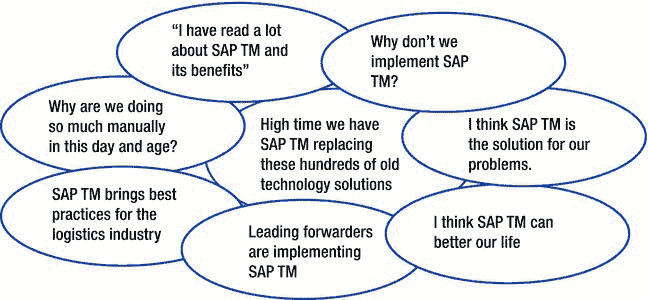

**图 6-1.** 关于选择 SAP TM 的讨论

目睹了一些 SAP TM 的实施和推广，我们相信这个过程是一段旅程。这段旅程的成功取决于您公司的方法。有些组织将其视为组织转型的举措。其他组织则仅仅将其视为又一个信息技术（IT）项目。我们认为这是一项重要的转型举措，而非任何一个部门或个人的责任。这种变革涉及的远不止安装一个软件产品。SAP TM 作为一个供应链执行平台，是第三方物流（3PLs）的核心系统。如此大规模的计划所需的准备工作可能需要提前两到三年开始。在实施此系统之前，组织必须对诸如以下基本问题有清晰的答案：

- 为什么需要这样的转型？这次转型是否符合我们未来十年的愿景？
- 关键成功因素是什么？
- 我们的竞争格局如何？
- 我们是否有强大的高管支持？
- 我们是否为这样的转型规划了充足的预算？
- 我们是否满足了此次实施在各职能领域的所有关键要求？
- 与我们独特卖点（USP）相关的所有流程是否都已记录在案？
- 我们是否已准备好应对组织各个层面如此巨大的变革？
- 我们是否需要专家指导这段旅程？如果需要，我们能否找到这样的专家？
- 我们是否已经确定了每个领域的关键资源，并且能够为这个过程调配他们？
- 我们是否有能力管理培训需求？
- 我们是否有明确的 IT 策略？

根据这些问题的答案，您可以判断您的组织是否已准备好进行如此规模的转型，或者是否需要做更多准备。在任何转型的准备阶段开始之前，还必须思考组织在转型后将如何继续前进。

管理不善的转型往往会收到如图 6-2 所示的反馈。

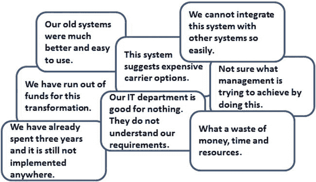

**图 6-2.** 对管理不善的转型的反馈

我们的目标是帮助您避免陷入可能招致此类评论的境地。我们希望本章中的建议能确保您组织的转型之旅一帆风顺。

实施是达成目标的行为。首先，您必须知道公司的目标是什么，以及您试图实现的目标有多实际。

您的组织想走向何方？它准备踏上这段旅程的程度如何？使其能够到达目的地的实际步骤是什么？如何创建一个全组织范围内持续变革的文化，以便长期保持领先地位？

在替换组织系统方法时，您需要一个集成的、功能丰富的、支持增长的业务管理解决方案，该解决方案能够为组织生态系统带来更高的生产力和有效的沟通。通往最终目的地的第一步是准备阶段。

## 准备阶段

您的组织何时开始实施？如果答案是“今天”，那么您很可能不会成功。如此大规模的实施需要大量的准备工作。让我们来看一些关键任务。

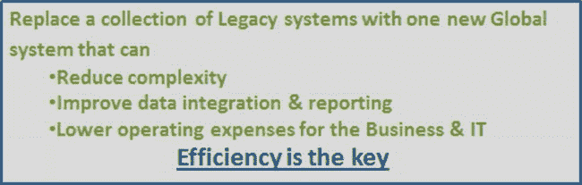

图 6-3. 投资新全球系统的关键驱动因素

### 获得高管承诺（与成功直接相关）

高管承诺对这一举措重要吗？答案显然是肯定的，因为没有它任何事都无法推进。高管承诺对于在预算内按时交付预期成果至关重要。了解您的项目发起人及其管理风格，这一点很关键。

许多项目发起人没有在项目上投入足够的时间。然而，作为首席信息官，您不能承受与一个脱离项目的执行发起人共事的代价。请确保从项目启动到结束全程吸引发起人参与——这可能是成功与失败的分水岭。与您的发起人进行清晰沟通；最优秀的项目发起人会让自己保持可联系状态。您的发起人必须理解，他的角色是授权项目，而您的角色是执行项目。因此，发起人必须让项目经理管理项目，而不要亲自介入日常细节。

最至关重要的一点是，您要在项目开始前就获得所有人的全力承诺，因为项目一旦启动，再这样做会加倍困难。通常，高管们会说他们支持任何具有良好投资回报的举措，但当需要分配使举措成功所必需的资金和资源时，他们却无法兑现承诺。例如，争取高管的时间来解决问题可能很困难。我们见过许多因高管支持不力而变得士气低落、缺乏动力的项目团队。您常常会开始怀疑执行发起人是否改变了主意。我们建议，除非这种行为有合理的理由，否则您应该专注于项目的目标。同时，定期就项目的成就和待完成事项进行简短的演示，以此提醒发起人项目开始时做出的承诺，这也是个好主意。

一个良好的做法是让项目发起人启动项目启动会议，首先清晰阐述该举措的商业案例，并辅以目标、目的、收益和愿景，这样每个人都知道自己的职责和期望的贡献。让项目发起人参与制定项目计划，将确保计划完整且详尽。

### 构建具有正投资回报的商业案例

构建商业案例背后的逻辑，是明确申请支持特定业务需求所需的资金和资源。业务需求可能包括：提升系统性能；实现更高的客户满意度；或增加利润、降低成本、减少处理时间。收益可以是可量化的，也可以是不可量化的。请确保您拥有一个可靠的商业案例，详细说明项目背景、预期收益、可用方案、选定特定目标的原因、预期成本、风险和资源需求。商业案例不仅是数据的集合，也是来自相关利益相关者的正面和负面意见与观点的集合。

为什么我们需要构建商业案例？因为用科学的方法定义问题总是有帮助的。一个新的 SAP TM 系统为您的组织提供了使用和完善新业务流程的崭新机会；商业案例构建工作是您首次引入这些新领域的契机。讨论现有流程、业务驱动因素、困难领域、改进方向、竞争对手、变革的预期影响以及受影响的群体。分析历史数据，以查明错失的机会和错误的假设，并建议未来的蓝图。评估实现理想范围所需的成本、资源和时间。

如前所述，作为首席信息官，您应该帮助项目发起人构建可靠的商业案例。全面的数据收集和分析共同构成了规划此类大规模举措的第一步。您的团队可以帮助教育组织内的业务专业人员，了解能够解决他们问题的下一代技术。如有必要，组织解决方案/产品供应商的演示。

作为转型领导者，您需要与您的发起人合作，打造一个能够呈现完整图景的演示文稿（见图 6-3）。这应包括项目范围、潜在节省、改进领域、可能的风险和挑战（包括在时间、金钱和资源方面所需的支持）。演示文稿应着重于改善利润，以及该举措如何帮助组织实现其业务目标，并使收益清晰可见。将收益与利润、现金流等挂钩。理想情况下，您应该展示一个投资回报的场景。回应高管的关切，例如：您能否在合理的时间内实现目标？目标是否甚至可以实现？作为商业案例的拥有者和投资者利益的守护者，项目发起人必须确保获得每一位利益相关者的支持。

### 设定目标，按目标进行管理

在项目开始之前，为生命周期的每个后续阶段设定目标至关重要：

- 设计
- 构建
- 测试
- 部署

### 构建蓝图——让他人参与您的梦想

讲故事是分享信息的好方法。您的项目发起人可以使用这一行之有效的工具来分享他/她的愿景，并传达您作为团队计划做什么、如何完成、该计划对他人意味着什么、您需要什么帮助、谁在帮助您、这将如何短期和长期地影响他人等等。项目发起人应举办研讨会，概述所涉及的关键人物，并邀请担任不同角色的人发言。您的项目发起人的目标应该是传播意识，并从业务的每一个角落获得组织支持，以最大限度地减少内部挑战。

#### 组建专项团队——你的变革大使

考虑从不同团队中抽调最优秀的人才，组建一个致力于实现共同目标的专项团队。合理的人才组合能让你快速起步，并在整个过程中及之后持续取得成功。吸纳不同层级的资源，确保包含资深且有经验的成员。不过，切勿只坚持选择经验最丰富的团队成员。年轻人可能带来活力和乐观精神；老将则能提供从经验中获得的洞见。通常，老将存在与组织基层动态脱节的风险。你同样需要那些拥有更广阔视野的人提供意见。

从这个专项团队中，创建以下四个小组：

- **指导委员会**（两到三名成员）：负责促进、监督和指导其他团队。
- **变更控制委员会**（三到四名成员）：负责审查和批准范围变更。
- **遴选委员会**（四到五名成员）：负责选择合适的解决方案。
- **项目团队与领导层**：为每个项目团队选择一名项目经理和项目负责人。总公司办公室的项目团队以及区域项目团队，应为每个流程/职能领域配备一名主题专家（`SME`）。

我们建议（至少最初）将前三个小组合并办公，以从他们身上获得最大效率。定期免除项目团队和遴选委员会的常规职责，为他们组织一些游戏和非正式研讨会，以建立为共同事业而努力的团队归属感。由外部讲师举办的研讨会是激励团队并获得最大贡献的好方法。金钱激励并非必需，但其他类型的奖励和认可可能会产生积极影响。

#### 培训遴选委员会

遴选委员会是否需要接受培训？答案是肯定的，因为如果没有系统性的培训，该委员会更容易做出错误的选择。许多组织低估了这一重要需求。通常，选择以运输管理为核心的系统是一个耗资数百万美元、影响整个组织的多年期决策。这无疑要求对团队建设、决策制定、评估和软技能进行广泛的培训。建议遴选委员会接受关于如何协同工作、做出集体决策以及分析中央和地方层面需求的培训。

## 确保资源承诺——天下没有免费的午餐

通常，当一项公司级计划启动时，分公司、终端和支持部门的人员往往认为实施系统是公司技术团队的责任，并认为该团队会从总部派人来实施。请记住，只有当最终组织成员被恰当地吸纳进来时，任何计划的成功才能得以实现。除了专项团队中那些做出长期承诺的核心成员，你在项目启动前还必须获得分公司、区域办公室、终端以及支持功能团队的承诺。为了获得这种承诺，你可以举办区域级别的研讨会，并邀请规模最小的站点和支持部门参与。

## 管理变革管理

你的转型计划可能会影响你与客户和供应商打交道的方式。因新模式、系统、流程或战略而做出的变更，必须在适当的时间清晰地传达，并说明客户/供应商在变革后的场景中将受到怎样的影响。受影响最大的群体是你的员工。确保每一位员工，无论其职位、角色、地点、资历和技能组合如何，都知晓这些变更。要提前向员工传达这些信息，并就转型计划举办研讨会。人们必须理解为何需要战略或文化上的变革，以及变革将如何影响他们，特别是其角色、职责、地点和团队的变化。任何变革都可能被视为带有政治色彩，而员工对于执行公司计划至关重要，因此建议在适当的时间和间隔与他们进行清晰的沟通。人们通常在一开始会对变革持负面看法。此时，除了负责管理变革的核心团队外，各自的经理也必须为此做出积极贡献。要从如此重大的投资中获益，整合的技术、流程以及对人员需求的关注都至关重要。

## 不要期望一切都会改变——设定预期

你已经在这个行业里经营了一段时间。自创业以来，你一直在做出改变，以遵守法规、适应不断变化的业务需求或创造差异化。所有这些要么被记录在某个系统中，要么是团队正在执行的手工工作的一部分。这些变革的性质可能是在全球、区域或分支机构层面进行的。也许一些多年来演变的变革已有文档记录，而另一些则没有。一个记录了这些变革、决策及其描述的基准版本，应该是你的起点。你可能还有其他一些有用的功能，比如用户关于适应新环境的建议。作为一条不成文的规定，不要期望一切都在一个轮次中改变——尤其不是我们正在讨论的这种规模。没有任何一个解决方案能给你一切，并且可能需要进行定制化（主要或次要）。因此，在内部，你需要清楚地设定预期，明确哪些是可实现的，哪些项目被暂时或无限期搁置。如果用户了解转型能带来什么，他们的接受度可能会更高。

## 尽早管理风险

你能承受将这样一个项目置于风险之中的代价吗？显然不能。但是，没有任何项目是没有风险的，即使是一个小风险也可能失控，成为项目最优交付的主要障碍。因此，在早期阶段识别潜在风险、对其进行彻底分析，并启动适当的预防措施以避免风险，显得非常重要。偏差、供应短缺、闲置时间、沟通不足、准备不足以及超支，是你能轻易识别出的一些风险。

## 构建全球流程存储库——包含本地需求

业务流程为您的业务奠定基础。那些在整个组织内推行流程标准化的组织，比不这样做的同行更为成功。对于一家跨国物流公司来说，由于以下原因，流程复杂性可能会增加：

-   该组织在某些国家拥有自己的运营机构；在其他国家则有代理（有些是专属代理，有些则不是），或由代理和合作伙伴共同代表其运营；而在网络涵盖的其余国家和地点还有合作伙伴。
-   不同地点的系统环境不尽相同。
-   流程各不相同。
-   自动化水平不同。
-   不同地区的监管要求存在差异。
-   许多流程没有文档记录，或者即使有文档记录，也不完整或已过时。
-   没有指定中央团队来控制版本或审批变更。

因此，每个地点对流程的理解可能有所不同。但是，就转型计划而言，该公司需要做到以下几点：

-   拥有全球标准化的流程，并在允许本地化（仅在法定或合规要求的情况下）时，以文档形式记录，并由中央流程管理员，即首席流程官（`CPO`）团队，在中央位置进行控制。
-   确保对其流程进行修改，以适应其期望实现的目标。
-   在其知识门户上创建一个站点或链接，使每个人都能轻松查阅流程文档（仅提供只读权限）；更新权限应由中央流程管理员保留。
-   让 `CPO` 团队负责保留版本控制，任何变更都需要该团队的批准。
-   将这些流程捕获到内容/文档管理工具中，如果可能，也捕获到业务流程映射工具中。
-   使用最新版本的 `SAP TM` 来映射流程。
-   与变更控制委员会分享对流程的任何变更；委员会有权决定是在正在进行的实施中包含该变更，还是将其推迟到下一个版本。
-   聘请第三方来研究、分析和构建全球流程。
-   从规划、执行、订单管理、调度、枢纽、终端、分支机构以及所有支持职能部门中找出流程负责人（如果他们还不是 `CPO` 团队的成员）；尽早让这些负责人参与进来。
-   确定哪些流程会受到新解决方案实施的影响，并花费额外的时间对其进行标准化。

从运营和面向客户的角度来看，记录执行/完成流程所花费的时间也可能是可取的——如果不是全部流程，至少是关键流程。

## 明确接口需求

既然您已经知道哪些流程会受到新解决方案实施的影响，我们建议您确定这些流程的每一个接口需求，包括数据交换、频率、用途、大小、容量以及当前机制。这将有助于您在整个旅程中的每一步，无论是选择（如果尚未做出）、构建会议室试点，还是测试推广。收集在接口过程中遇到的挑战信息也很有帮助。

## 识别事件

事件通知被认为是主要服务的一部分，而您的组织共享事件的能力是评判其的关键标准之一。您的许多竞争对手可能在捕获重要事件方面存在困难，因此无法共享它们。这是一个为您的组织理顺事务的绝佳机会。我们建议您为客户服务、业务发展、运营、现场、资产管理和应收账款等部门举办一场研讨会，以就需要捕获和通知相关方的事件达成一致。通常，任何需要某人采取行动、关闭一个循环或是对某人进行提示的信息都需要被跟踪。确保将此信息记录在流程文档的适当位置。

## 识别工作流

工作流在通知相关方需要采取行动方面扮演着重要角色。您应该为时间敏感的任务建立工作流，以改善服务级别、降低沟通成本并及时解决问题。列出所有时间敏感的任务，确定需要通知的人员以及预期的行动。您可能还希望将此与您的流程文档联系起来。

## 使用报告、关键绩效指标、仪表盘

您可能当前正在使用某个工具来生成报告。新系统可以提供其中的大部分功能，甚至更多。您需要维护一个关于组织流程报告的清单，以及商定的分发列表。此外，您可以利用这个机会审视这些报告，看看是否有任何报告可以被合并或完全删除。您还需要按流程确定关键绩效指标，为仪表盘创建一个按角色划分的任务或活动矩阵。

## 清理主数据

您能保证在任何给定时间点都拥有干净的主数据吗？您可能想回答“是”，但您知道真实的答案。组织正在花费大量时间和金钱来获取单一版本的主数据。需要采用一种有纪律的方法来维护这些数据的纯洁性。作为 `CIO`，确保在实施过程中提供关于人员、地点、事物和概念的高质量主数据是您的责任。重复的记录、对主数据是什么以及如何鉴定主数据的混淆，以及缺乏负责创建和维护主数据的中央团队，都会增加挑战的难度。然而，随着 `SAP TM` 供应链执行（`SCE`）平台的实施，主数据将成为关键资产。首先，它们几乎总是参与事务和分析操作。其次，在开始实施之旅之前，贵组织执行不同流程的用户应清理主数据，将这些数据与已确定由新的以 `SAP TM` 为中心的解决方案替换的应用程序、相应的业务流程以及报告需求进行增强和同步。

## 基于角色的访问控制（`RBAC`）——创建者不能审批

确定所有角色和职责。基于某个流程或流程某部分的角色和职责，授予用户访问新解决方案相关菜单的权限。同时，明确识别创建、查看和修改的权限。在数据收集期间，您可能会遇到当前系统允许用户既创建记录又审批记录的情况。为了避免新解决方案中出现这种情况，您必须清晰地记录职责分离（文档化-`RBAC` + `SOD`）。

## 根据架构指导原则验证解决方案

您的组织可能已采纳了关于其架构和设计方面的指导原则。新解决方案必须根据这些指导原则进行验证。任何偏差都必须被理解，其影响需要被审查并达成一致。您应该与解决方案提供商公开讨论这一点，让他或她了解任何偏差，并在继续推进新解决方案之前找到变通方法。

## 确定实施策略——分阶段、可管理

您对自己的组织非常了解，包括其项目执行力、面临的挑战、实施全新全球解决方案时的潜在内部风险，以及所能获得的支持。基于这些情况，您需要与项目发起人、工作组或指导委员会共同预先确定实施策略。有了明确的策略，整个团队以及参与该计划的其他人员都会更加有信心。更重要的是，您可以确定优先级、提前规划、更有效地沟通，并尽早赢得业务部门的信任。以下是两种策略：

-   创建一个全球模板，一次性实现所有目标（“大爆炸”式采用）。
-   构建一个全球模板，分阶段进行，并与以下某个变量保持一致。例如，使用流程变量，在第一阶段，您可能需要处理整箱海运或国际空运出口业务场景中的订单到现金流程。
    -   流程
    -   功能
    -   运输方式
    -   处理的货物
    -   区域或集群
    -   遗留系统的稳定性
    -   业务线
    -   业务量

# SAP TM 实施指南

有关“大爆炸”式采用的更多详细信息，请参阅“实施”一节。

## 选择产品（如果尚未选定）

您的评选委员会在最终确定产品解决方案时面临着艰巨的任务。我们的产品选择框架旨在让委员会的工作稍微轻松一些。委员会在产品选择时需要考虑所有因素，包括一项数百万美元、为期数年的计划；一个至少使用十年的解决方案；不断发展的技术；要求日益严苛的客户；技术环境维护成本的上升；用户对现有系统的依赖；以及激烈的竞争。委员会还必须分析新产品解决方案对剩余技术架构的影响，并确保新产品能提供旧系统中所有优秀之处，无论是功能性、易用性还是小型实用程序。

我们建议您的评选团队在这方面投入足够的时间。选择错误的解决方案会引发后续所有问题。评选委员会应参考各种研究报告，参加产品研讨会和行业活动，以收集市场上可选方案的数据。委员会需要与解决方案提供商密切合作，以确定其愿景、路线图、对创新的关注、架构、领域理解、承诺以及财务状况。进行会议试点是评估解决方案的好方法。

## 汲取以往经验

您的组织是否有机制来捕获从以往项目或计划中获得的知识——哪些地方出错了，原因是什么；您如何克服的；是否防止了问题再次发生？如果已经捕获了这些信息，是否可供参考？利用这些信息有助于降低新计划的风险。组织一次研讨会来讨论这些知识，确保过去的错误不再重演，并在正确的行动基础上再接再厉。如果这些知识没有记录在案——也就是说，如果您没有相应的捕获机制——那么您的任务将很艰巨；您必须为这项新计划建立一种机制。

## 盘点将被替换的系统

新的解决方案将替换当前众多应用程序中的一个或多个。这些应用程序已经为您服务了多年。它们具有一些您可能希望在新解决方案中保留的良好特性。最有价值的是您的数据。在您启动新计划之前，必须制定清晰的退役策略，明确系统将在何时以及如何退役。应确定需要在新解决方案中保留的特性映射以及数据迁移决策。同时，应记录内部系统及与外部世界的接口，并在新解决方案中同样提供这些接口。在开始实施新解决方案之前，请确保您已盘点每一个系统、应用程序、接口和数据库，并注明当前由谁在何处进行管理。

## 确定系统集成合作伙伴

您的组织可能缺乏实施新解决方案所需的资源和技能。由于资源有限，实施过程将耗时更长。因此，您需要聘请系统集成合作伙伴来编制蓝图；创建全球模板并进行推广；并支持发布管理。您可能决定聘请多个系统集成供应商。一些组织选择一家供应商负责全球模板和初始推广，保留另一家专门负责推广，可能再找第三家负责发布管理（这是在创建全球模板所需的，产品供应商支持之外的额外支持）。开始识别那些在设计、实施和推广大型解决方案方面经验丰富的系统集成商。重点关注运输行业和 `SAP TM` 能力建设。您应优先考虑有 `SAP TM 9.0` 实施经验的系统集成商，但可供选择的不多。您还可以选择聘请 `SAP AG` 运输业务部门和咨询团队来构建全球模板。

## 选择实施团队

参与构建和实施全球模板的团队必须拥有经验丰富、知识渊博的顾问。由于 `SAP TM` 顾问短缺，实施团队可能由内部顾问、`SAP AG`、系统集成合作伙伴或分包商组成。

## 建立项目团队

指导委员会确定项目团队，团队成员来自销售、客户服务、运营、评级、规划、承运商和供应商关系、采购、开票、定价、成本核算、会计和技术等部门。项目团队成员必须对其主题领域的流程、程序、偏差、例外情况、报告要求和数据交换要求有透彻的理解，并且是活跃的系统用户，具备实际操作经验，并了解当前系统的能力和局限性。指导委员会成员和项目发起人将项目的目标和目的传达给项目团队。

## 实施

您的组织现已准备好实施 `SAP TM` 解决方案。您已经完成了所讨论的大部分准备工作。您遵循科学框架选择了 `SAP TM` 解决方案。请记住，实施 `SAP TM` 解决方案并不像实施一个模块那么简单——它相当于替换您的大部分系统架构。因此，您必须在整个过程中始终专注于组织的目标和宗旨。哪怕最细微的偏离都可能对成本、进度和收益产生不利影响，并给项目带来新的风险和挑战。

近年来，`SAP TM` 解决方案的实施主要针对单一流程、功能或运输模式。但是，随着集成的 `SAP 9.0`（`SAP`、`SAP` 事件管理 [`SAP EM`]、`SAP` 扩展仓库管理 [`SAP EWM`] 和 `SAP` 全球贸易服务 [`SAP GTS`]）的出现，以及与商业智能（`BI`）的轻松集成和 `FICO` 的即时可用性，我们现在建议您采用全面铺开式（大爆炸式）采纳。首先，从您的业务网络中选取几个具有代表性的国家，实施一个全球模板。在该模板于这些试点国家成功实施后，再将其推广至您网络中的其余国家。选定最多两个国家（按世界区域划分）来实施全球模板。我们建议将全球模板实施的试点国家上限设为五个，这些国家应具备以下特征：

- 业务量大
- 业务复杂度高
- 现有系统使用率最高
- 包含运行业务所需功能的超集
- 试点的目标是：
  - 验证解决方案是否满足项目启动时所设定的业务需求、目标和宗旨
  - 生成关于是否在其他国家推广该解决方案的“是或否”决策

您已决定继续实施。无论您的策略如何，实施都包含以下几个阶段：

- 发现与规划
- 设计与配置
- 开发
- 测试
- 部署
- 功能发布与持续支持

下面我们来详细讨论每个阶段。

### 发现与规划

发现与规划活动始于销售讨论阶段，直接与 `SAP` 股份公司（`SAP AG`）或系统集成（`SI`）合作伙伴进行。项目经理应让所有利益相关者（指导委员会、项目领导层、供应商代表、解决方案提供商的架构和产品团队）参与进来，听取他们的意见，并记录构建详细实施项目计划的约束条件和限制因素。项目发起人应启动该项目。在启动会议上，发起人应说明，作为项目团队的一部分，已确定了来自每个主题领域的最佳资源，以确定实施解决方案的最佳方式。一个切实可行且可执行的项目计划将在整个实施过程中充当指导方针。

根据范围的不同，每个试点国家（我们建议并行进行）此阶段可能持续六到十周。在此期间，实施团队应与项目团队和项目发起人/指导委员会进行讨论，以加深对项目以下方面的理解：

- 业务领域、模型和逻辑；待实现的流程，包括偏差和异常；标准操作程序和事件；实体；参与者；角色与职责；报告要求；接口需求；现有系统的难点领域等
- 流程、事件、接口、工作流和报告、关键绩效指标以及仪表盘文档的存储库
- 愿景、期望、目标、客户需求和系统能力，以及任何其他并行举措

基于讨论和获得的知识，实施团队应：

- 与项目团队协商一致，构建项目计划
- 记录流程理解
- 制定潜在的解决方案（`SAP TM` 的开箱即用功能、定制、适配 `SAP TM` 最佳实践）
- 强调新系统与项目范围之间的差距，或需要变通解决的领域
- 识别可能推迟实施日期的风险，以及缓解这些风险的步骤

### 设计与配置

在此阶段，项目团队和实施团队将需求转化为 `SAP TM` 中的潜在配置选项。实施团队应与项目团队紧密合作，确立将在项目开发阶段使用的配置和实施策略。此阶段涉及以下步骤：

- 审查主数据。
- 培训项目团队。
- 演示（并讲解）一个可能的端到端业务场景或流程。
- 建立解决方案配置，并创建原型。
- 进行验证（文档-基于角色的访问控制 [`Doc-RBAC`]，职责分离 [`SOD`]）。
- 通过记录 `SAP TM` 解决方案每个功能要遵循的程序来为用户构建帮助。拥有随手可得的指南有助于减少猜测。大多数大规模实施都面临初始项目团队成员流失的挑战；因此，您必须坚持要求实施团队和项目团队提供全面的文档化程序。

### 开发

在开发阶段，您通过执行以下活动来准备系统上线：

- 记录在发现阶段确定的需要开发的项目。
- 规划开发，包括环境和测试。
- 迁移数据，并根据需求进行验证。
- 制定用户培训手册。
- 针对已识别的差距进行定制，以构建、部署和测试功能，包括新流程、界面、报表和接口。
- 配置系统以准备上线，并加载主数据和各种设置。
- 运行会议室试点。实施团队应运行一个完整的待实现流程周期，以验证和确认系统的设计及行为，并确认其是否满足业务需求。
- 允许项目团队试用新系统。项目团队应使用其自身的数据来研究系统和接受培训。团队还应测试场景，以验证系统配置是否符合项目目标。
- 让实施团队和项目团队认证上线测试。
- 为最终用户开发培训材料。

### 测试

此阶段的目标是确认新解决方案在功能上与全球模板要求保持一致，帮助实施团队微调配置，并赢得最终用户对系统的信心。此阶段要执行的一些关键活动如下：

- 确定进行用户验收测试（`UAT`）的用户。
- 准备用户验收测试计划。
- 开发测试场景。
- 加载主数据和动态数据。
- 运行系统测试。
- 通过测试，调整测试环境以及直播系统中的配置。
- 建立切换策略。
- 运行最终的会议室试点。
- 交付最终用户培训材料。

### 部署

基于测试阶段的结果，项目团队和实施团队做出最终的上线/不上线决策。在上线之前，您需要执行以下任务：

- 培训最终用户并评估其熟练程度。
- 对系统进行最终评估（由项目团队和实施团队进行）。
- 迁移至新系统。
- 加载数据，并与旧系统进行验证。
- 确认接口功能正常。
- 从特定日期开始使用新系统。
- 关闭旧系统中的未完成交易；不要将其带入新系统。
- 优化新系统。

### 功能性版本发布与持续支持

在此阶段，您需为已实施的全球模板提供支持。如果计划发布任何新的功能版本，并且已完成了全球模板构建的前两个阶段，那么剩余阶段（新功能的开发、测试、部署）将由实施团队（如有）管理，或由推广团队负责跟进。如果实施周期延长，且实施团队和推广团队都已退出项目，则最好由版本管理团队或持续支持团队来处理支持工作。

## 推广

在少数试点国家成功实施了全球模板后，这些国家通常是您的网络中业务最复杂、交易量最大的成熟市场。此时，您应该对您选择的解决方案和实施方法，以及为如此大规模转型所做的组织准备工作感到满意。现在，您希望通过在其他国家推广此解决方案来进一步提高满意度。

推广包含以下高层级阶段：

- 国家准备
- 本地化适配
- 实现
- 最终准备
- 上线
- 关键支持期

当您在试点国家接近全球模板的上线阶段时，就需要开始规划下一批已确定推广的国家的推广工作。第一步是基于您在试点中的经验，创建一份推广手册。建议您与所有国家分享这些指南，以便他们有充足的时间进行准备。手册应包含：

- 推广期间所需活动的详细信息
- 一份指导性项目计划、切换计划以及关键支持期计划
- 项目组织架构，包括推广合作伙伴及其角色与职责
- 各个国家整体就绪度评估清单

基于您在全球模板实施中获得的认知，您可能需要重新审视您的推广策略。在制定策略时，可考虑以下步骤：

根据所有权类型对您网络中的国家进行分类。您可能在部分国家拥有自有业务，在其他国家拥有合资业务，并在另外一些国家指定了代理商。您可能拥有专属代理商或非专属于您组织的代理商。对于非独家代理商，您无需部署全球模板，因为他们没有义务完全遵循您的流程或会计程序。进一步根据业务量（低、中、高）对国家进行分类（参见图 6-4）。

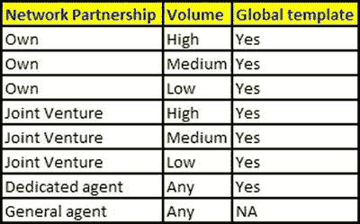

图 6-4. 基于所有权类型和业务量的全球模板推广国家分类

分析在每个地区开展业务的复杂性。现在，您得到了一份按地区、所有权类型、业务量和复杂性分类的国家列表（参见图 6-5 和 6-6）。

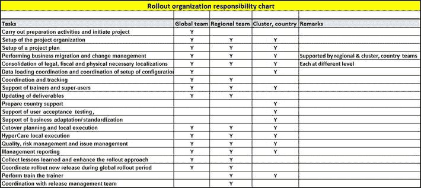

图 6-10. 组织级职责分配表

- 每一层级都应对推广的成功负责，并要求有一致的贡献。我们观察到一些中小型国家渴望得到全球或区域团队的关注和参与。您可以使用图 6-10 所示的职责分配表来进行规划并明确职责。

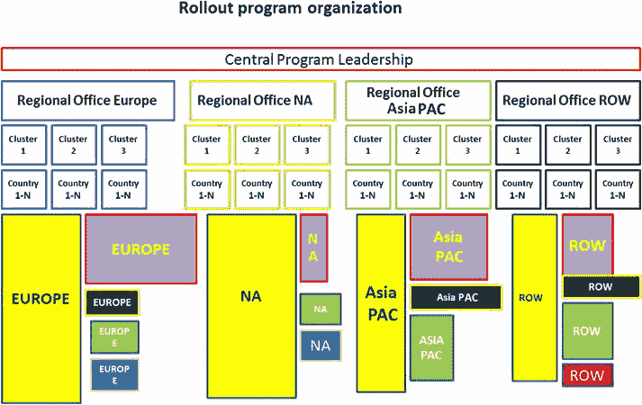

图 6-9. 三级项目组织架构

- 创建一个项目组织来执行推广。我们建议在中央领导团队下建立三级结构，由中央领导团队（或全球团队）、区域团队与集群、以及国家团队组成（参见图 6-9）。

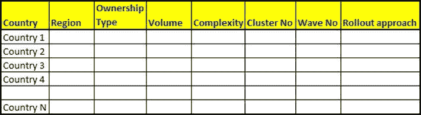

图 6-8. 推广计划

- 集群形成后，在其内部划分批次。
- 集群 1 和集群 2 可分别包含三到四个批次。
- 规划工作应在每个集群层面进行管理。
- 批次应根据各国的准备情况和地理位置来划分，以便推广团队和项目团队花费最少的差旅时间。这将导致多个上线日期，每个批次都有各自的上线日期。
- 决定推广团队是亲赴现场实施，还是从中央地点远程开展推广工作。对于后者，业务量较小的国家和专属代理商的代表将前往中央地点接受培训，之后他们将获得来自该地点的远程协助。以下是四种推广方式：
  - 整个团队前往该国实施。
  - 部分团队成员前往该国实施（团队成员拥有多种技能）。
  - 项目团队成员聚集在一个中央地点，接受培训，随后在其所在国进行推广，并从一个区域地点获得支持。
  - 从区域/中央地点远程进行推广。
- 最终，您将得到一份按地区、业务量、复杂性、所有权类型、集群、批次和推广方式分类的国家列表（参见图 6-8）。

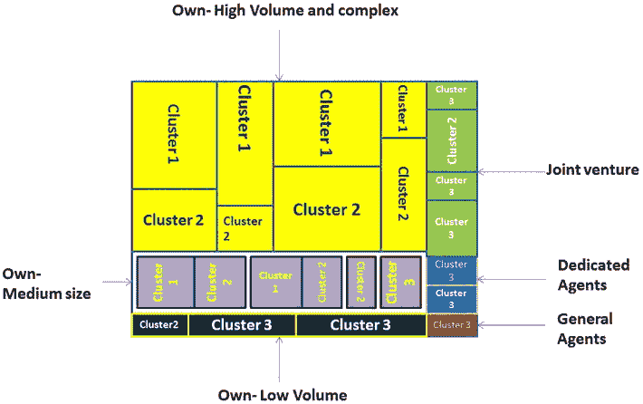

图 6-7. 集群构成

- 根据您业务所覆盖的国家数量来构成集群（参见图 6-7）。
- 目标是在大约 18 个月内完成所有推广；不要建立超过三个集群。
- 您的第一个集群应包含所有地区中业务量高且复杂性高的国家。
- 您也可以考虑在集群 1 中包含一些业务量中等但复杂性高的国家。
- 您的集群 2 应包含业务量和复杂性均为中等的国家。
- 您也可以考虑在集群 2 中包含一些业务量低但复杂性中等的国家。
- 所有其他国家应归入集群 3。

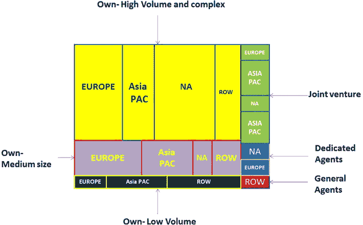

图 6-6. 基于所有权类型、业务量和复杂性的按地区全球模板推广分类

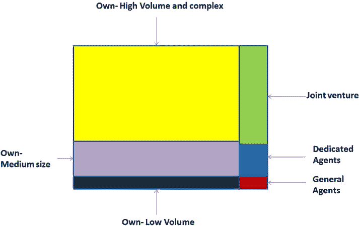

图 6-5. 基于所有权类型、业务量和复杂性的全球模板推广分类

- 与您的推广合作伙伴协商，就每个国家推广所需的时间表和资源达成一致。

关键角色的职责如图 6-11 所示。

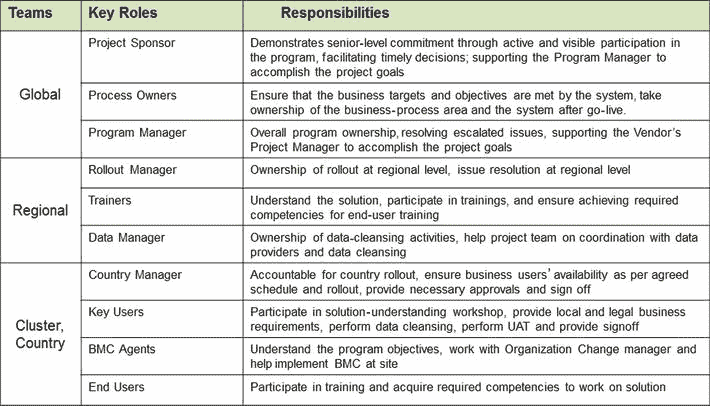

图 6-11. 关键角色职责表

以下是一些其他考虑因素：

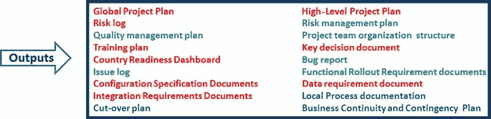

图 6-12. 推广团队的交付物

### 推广策略

* **本地化**：您的推广团队在每个国家都会遇到许多本地需求。以下是一些建议：
  * 在推广现场汇聚并整合本地需求。
  * 将本地需求与集群、区域及全球团队共享。
  * 获得变更管理委员会的批准。
  * 实施法律、财务和物理层面所必需的本地化。
  * 本地化功能构建完成后进行验证。
* **回溯推广**：在全球模板推广的第一阶段之后，您可能还计划发布功能更新。在这种情况下，需要在那些国家/地区执行回溯推广。在一些大规模实施项目中，你可能在两到三年内需要进行三到四次回溯。
* **工业化方法**：推广持续数年的时代已经过去。在当今世界，如果你的业务覆盖 180 到 200 个国家，建议在试点成功实施后完成推广的时间表不超过一年半。如何应对这一限制？答案是建立一种工业化方法。这需要推广伙伴具备必要的工具、资产、框架、方法论、资源和经验。
* **语言策略**：语言在全球推广中扮演着重要角色。你需要清晰了解每个推广地点的语言需求，并将这些信息传达给你的推广伙伴，以便他们能够聘用具备所需语言技能的顾问。推广团队应至少有一名负责语言策略的关键顾问，这对于培训以及各类文档（业务、法律等）是必需的。
* **电子学习**：即使有课堂培训和在职培训，充分利用电子学习平台进行能力建设也非常重要。电子学习提供了灵活性，其材料易于更新、易于交付且成本效益高。我们建议你设立一个专门团队，负责制定电子学习策略，以构建和交付电子内容。

## 版本发布管理

我们希望你能有可以按需快速扩大规模的合作伙伴。在此阶段，你负责规划、调度和控制版本的构建、测试和部署，包括业务所需的新功能，同时保护全球模板的完整性。请与你的合作伙伴讨论此事，并就时间表、交付物和期望达成一致。

图 6-13 展示了版本发布管理策略的总结，其中版本包被构建、安装、测试和部署。

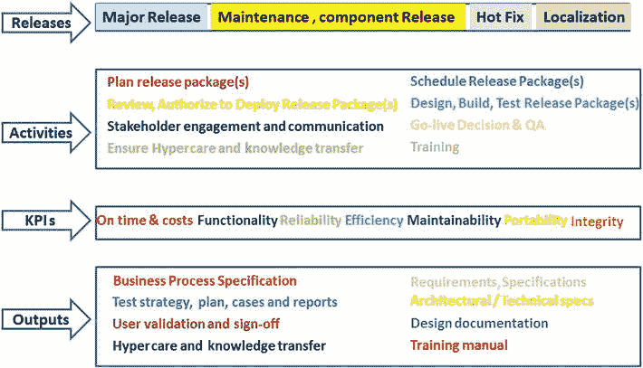

图 6-13. 版本发布管理策略

以下是版本发布管理成功的一些关键要素：

* 尽可能实现标准化。
* 在必要时进行本地化。
* 部署版本包，以最小化对生产环境中的 IT 服务以及运营和支持的影响。
* 引用正在维护的配置项和版本组件。
* 同步全球模板的部署以及本地适应性/部署的应用。

图 6-14 展示了不同版本中执行的活动。

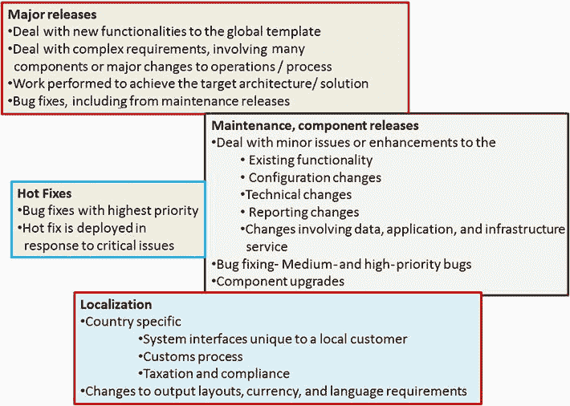

图 6-14. 版本发布管理活动

以下任务需与您的版本发布管理合作伙伴共同完成：

* 建立事件/变更管理流程。
* 建立配置管理流程。
* 就当前范围内要发布的需求清单达成一致。
* 制定阶段及其时间表。
* 构建清晰全面的发布计划。
* 安排或识别资源，并商定其角色和职责。
* 制定质量计划和验收流程。
* 进行本地化的设计与测试，并进行缺陷管理。
* 为测试环境设置数据加载、测试和验证。

*   为性能单元、系统、性能、容量、压力、安全、灾难恢复、回归测试（功能及接口）以及用户验收测试创建测试策略、测试计划和测试用例，以验证功能性和非功能性需求。
*   将版本包部署到各种环境，包括开发、质量保证和预生产环境。
*   评估与每个版本包相关的问题和风险。
*   商定并沟通部署的日期和时间线。
*   执行从发布到生产环境的交接。
*   更新增量部分的培训材料。
*   培训最终用户。
*   上线。
*   为版本提供支持。
*   移交项目可交付成果。
*   知识转移。
*   与变更管理团队沟通。

您的合作伙伴应通过每周状态报告与您保持同步，汇报计划进展以及任何可能影响交付、成本、里程碑和质量的问题。

## 项目组织与地点

你的版本发布管理团队应至少提供`每周 6 天、每天 24 小时`的支持。从根本上说，这意味着你需要在不同区域都配备支持团队。根据你组织的布局，你可以选择在`亚太区（APAC）`、`欧洲和北美（NA）`各设一个团队。

## 总结

诸如`SAP TM`等新解决方案的用户，希望了解系统的基本特性以及更复杂的功能。用户熟练度是项目发起人工作组需要持续关注的重要问题。一个新解决方案的成败，取决于用户社区多快、多准确地了解系统并在日常使用中挖掘其潜力。应通过定期为新用户提供培训来解决用户更替问题。此外，建议培训的用户数量超出实际需求。如果缺乏适当且持续的培训，用户会感到沮丧，并不得不创建变通方法来完成工作。

你的新解决方案的价值，取决于你对其持续投入的程度。我们建议至少每年进行一次系统审查，以通过版本升级、新接口、额外模块、更高效的流程以及额外的用户培训来识别改进领域。致力于这一过程将使你能够优化投资回报，同时扩展你的能力，助你取得更大的成功。
