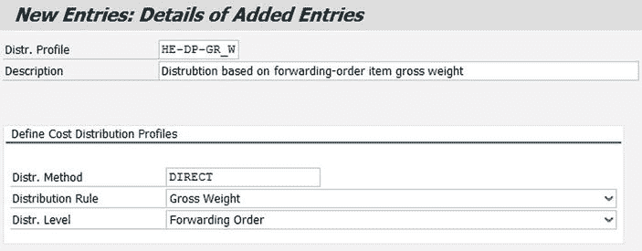

## 定义成本分摊参数文件

此选项允许您指定内部成本的分摊方式。您还可以定义其他属性，例如分摊方法（直接法、基于层级法），并指定分摊参数（净重、毛重、体积、距离）。

对于给定的场景，您必须定义表 A-141 中介绍的成本分摊参数文件。

表 A-141. 成本分摊参数文件数据

| 字段 | 值 |
| --- | --- |
| 分摊参数文件 | `HE-DP-GR_W` |
| 描述 | 基于货运单项目毛重的分摊 |
| 分摊方法 | 直接 |
| 分摊规则 | 毛重 |
| 分摊级别 | 货运单 |

要定义成本分摊参数文件，请转至 SAP Transportation Management 的定制设置，然后单击 `运输管理 ➤ 基本功能 ➤ 成本分摊 ➤ 定义成本分摊参数文件`。

接下来，单击新条目  按钮，然后输入表 A-141 中的数据。

图 A-159. 创建成本分摊参数文件

输入必要数据后，通过单击保存  按钮来保存数据。
