# 10. 端到端货运生命周期场景的流程映射

在本章中，我们将讨论以下内容：

*   构成货运物流端到端生命周期的顶层流程
*   在 `SAP TM` 中映射这些流程
*   在 `SAP TM` 中映射一个端到端货运物流流程场景

在了解了 `SAP TM` 及其架构之后，让我们来看看货运流程生命周期及其在 `SAP TM` 中的映射，以及它与 `SAP Event Management`（`SAP EM`）、`SAP Global Trade Services`（`SAP GTS`）和 `SAP ERP` 的结合。

## 设置客户账户

一旦客户同意财务和服务条款，第三方物流公司（3PL）的信用部门会审查客户的信用记录并设定信用额度。财务部门在系统中建立一个客户账户，包含信用额度，随后设定定价协议。

财务部门使用财务系统（例如 `SAP FICO`）来设置客户账户和信用额度。然后，客户账户作为业务伙伴或地点（或两者）被传输到 `SAP TM` 中。定价协议在 `SAP TM` 中作为货运代理协议创建。

## 接收货运订舱

第三方物流公司通过电话、传真、电子邮件、电子数据交换（`EDI`）或门户网站接收来自客户的订舱请求。客户会联系第三方物流公司的当地办事处、集中客服部门或代理/子公司。

客户联系的所在地的客服代理会向客户收集更多关于货运的信息。通常，这些信息包括运输方式（空运、海运或陆运[公路或铁路]）、货物规模（整箱 [`FCL`] 或拼箱 [`LCL`]）、货物是否包含危险品或易腐品、货物何时可以启运或何时需要到达目的地、货物的起运地和目的地，以及货物是由客户在第三方物流公司指定的地点（如分公司、中转站、港口、仓库等）自提还是交付。

来自多个应用程序、客户和模式（电话、传真、电子邮件、`EDI`、门户网站）的订单作为运输需求被接收到 `SAP TM` 中。根据订单需求及设定的业务规则，系统会构建货运单元（`SAP TM` 中最小的运输单位），用于合并或拆分运输需求（或两者兼有），以便将货物尺寸正确匹配到运输资源上，例如拖车、集装箱、船舶和铁路货车。

## 发送客户订单通知

客户的订单通知通过电话、传真或电子邮件发送给必要的相关方，例如出口代理和计划部门。

`SAP TM` 提供个性化对象工作列表（`POWL`），相关方（出口代理、计划部门等）可以通过该列表访问、管理和跟踪与订单相关的任务。

## 规划货运路线

规划部门负责制定货物运往目的地路线。有时，规划部门会安排货物经由客户、分公司再到关口；其他情况下，货物可能直接从客户运往关口、机场或港口。主要目标是以尽可能低的成本将货物从出发地运送到目的地。

在 SAP TM 中，规划部门可以选择手动或自动规划订单。自动规划时，后台运行的车辆调度与路线规划引擎会自动规划订单的路线。如需手动规划，规划部门应使用 SAP TM 提供的运输工作台。在提供选择配置和计划参数后，运输工作台会确定哪些订单将被列入规划范围，以及可用的资源和时间表。此外，在手动规划情况下，规划部门还有以下选项：

-   交互式规划：选中待规划订单，然后将其拖放到资源/时间表上。
-   一步式规划：选中待规划订单后，调用车辆调度与路线规划引擎进行规划。
-   生成运输方案：如需在决策前查看多种路线选择，可使用此选项。

路线规划完成后，即可选择承运商。SAP TM 提供手动和自动两种方式选择承运商。SAP TM 还具有以下招标选项：

-   点对点招标：货运询价单按顺序依次发送给每个拟定的承运商。
-   广播招标：货运询价单同时发送给所有拟定的承运商。

也可以使用直接招标流程，将订单直接发送给特定承运商，无需询价。

## 预订承运商

规划部门负责安排主干线路的承运商预订。规划部门通过电话、传真、电子邮件或 EDI 与承运商沟通，并预订所需舱位。收到预订请求后，承运商可决定接受、拒绝请求，或接受但需修改。无论哪种情况，承运商都会将决定通知规划部门。

为了输入预订信息，SAP TM 提供了货运预订用户界面。通过此界面，规划部门可以向承运商请求预订舱位。相关信息可通过传真、电子邮件、EDI 或门户从 SAP TM 传输给承运商。该界面还允许记录承运商的回复。

## 向客户确认订单

承运商接受预订后，客户将通过电话、传真、电子邮件或 EDI 收到订单确认信息。

SAP TM 中的货运订单用户界面提供了向客户确认订单的选项。

## 安排货物提取

如果需要提取货物，分公司出口代理会与本地承运商协调安排。提取请求通过电话、传真、电子邮件或 EDI 发送给本地承运商。提取请求包含以下信息：提货和交货地点、提货日期和时间以及是否需要特殊设备。收到承运商（执行提货）的确认后，便将必要文件提供给承运商。

分公司出口代理可以使用 SAP TM 中的货运订单用户界面发起提货请求。该界面允许用户输入所需信息、生成必要文件，并将信息和文件发送给承运商。此外，还可以记录提货请求的接受与拒绝情况。

## 提取货物并运至始发地仓库

在预先约定的提货日期，承运商携带文件被派往托运人/供应商所在地。在那里，货物被装上卡车，并从托运人/供应商处收集运输文件，例如商业发票、托运人指示信和托运人出口报关单。货物和文件被送达提取请求时指定的分公司或地点。码头工人将货物从承运商的卡车上卸下、办理入库、签署文件、将货物存放在分公司仓库或其他存储地点，并将文件交给出口代理。

货物执行和跟踪追溯在 SAP TM 中通过货运订单用户界面处理。SAP TM 提供一套关于货物的标准事件，例如“准备装载”、“已装载”、“已发运”和“已到达”，用于跟踪追溯。SAP TM 还可以与 SAP EM 集成，以实现更好的跟踪追溯。

## 准备货物装运

分公司出口代理从码头工人处接收文件，并为码头工人创建拣货单，以便其提取货物（整批或部分）进行集拼。任何可能需要执行的特别服务或处理指示也会在拣货单上注明。

SAP TM 的货运订单用户界面可用于打印各种文档。

## 办理出口海关清关（如需要）

并非每个客户都将此项业务委托给同一家第三方物流。但是，如果获得委托，则需要进行出口合规性检查，包括受限方、禁运国家、已知托运人和违禁商品。信息通过传真、电子邮件、EDI 或门户网站、使用第三方服务商或提交纸质文件副本的方式提供给海关官员。海关官员处理货物，或予以扣留，或放行。

可以在 SAP TM 中手动设置订单的海关清关状态。根据设置，SAP TM 可能会在需要时阻止进一步的订单执行。如果 SAP TM 与 SAP GTS 集成，则可以自动设置海关状态。

## 准备集拼和文件

根据出口代理提供的拣货单，码头工人从分公司仓库货架或其他存储地点提取货物，并根据需要进行集拼。如果需要执行任何额外服务，例如包装、收缩包装或熏蒸，这些都会在拣货单上注明。码头工人在拣货单上记录差异、已执行的服务以及收集到的相关文件，必要时添加额外备注。

可以使用 SAP TM 的货运订单用户界面查看和打印运输指示。

## 将集拼货物移交给干线承运商

干线承运商到达后，货物被装上卡车，文件被签署并交给承运商司机。

SAP TM 提供使用货运订单用户界面查看和打印装运清单的选项。

## 将货物运往关口

承运商从分公司或其他指定地点出发，前往关口。关口通过电话、传真或电子邮件收到通知。

SAP TM 通过货运订单用户界面提供一套标准的作状态事件，例如“已发运”和“执行中”。根据货运订单的状态，货运订单的状态会自动更新，从而实现订单跟踪。SAP TM 可以与 SAP EM 集成，以实现更增强的跟踪。此外，使用 POWL，人员可以访问和跟踪预计到达的订单。

## 将货物运送至集散枢纽

长途运输承运商将货物和单证文件运送至集散枢纽。码头工人从承运商的卡车上卸下货物、办理货物入库、签署单证、将货物存放在集散枢纽的仓库中，并将单证文件交给集散枢纽代理人。承运商就其提供的服务向第三方物流（3PL）开具发票。

可以使用 `SAP TM` 货运单用户界面来计算承运商将要开具发票的运费。该界面还可用于将状态更新为“已到达”。根据货运单的状态，转运单的状态会自动更新，从而实现订单跟踪。`SAP TM` 可与 `SAP EM` 集成，以实现更加强大的跟踪功能。

## 规划出站拼箱

集散枢纽代理人查看进站拼箱情况，并确定需要规划的出站拼箱，例如必要的设备（集装箱等）。出站拼箱计划基于以下因素：进站拼箱的到达时间、目的地、这些拼箱中货物所需的服务、商品类型、货物是否属于危险品、易腐品或高价值货物，以及货物是否因其运输方式而超尺寸或超重。

集散枢纽代理人可以使用计划引擎识别可用资源以及可合并的货物。在合并时，计划引擎会考虑各种参数，例如不兼容性、容量以及装卸时长。计划引擎还会检查危险品。计划可以自动或手动完成。

## 将货物指派给出站集散枢纽拼箱

集散枢纽代理人将货物（全部或部分）指派给承运商已确认的运输作业。代理人还会为码头工人创建拣货单文件，以便其能够提取货物进行拼箱操作。需要执行的任何特殊服务或操作说明都将被记录。

集散枢纽代理人可以使用 `SAP TM` 中的货运订舱用户界面生成一份装运单据交给码头工人，并提供有关实际拼箱操作的说明。

## 准备拼箱操作

码头工人收到集散枢纽代理人的拣货单，根据拣货单从集散枢纽仓库货架上提取货物，并构建拼箱；同时按需执行其他服务，例如包装、裹膜和熏蒸。码头工人在拣货单上记录差异、已执行的服务以及收集到的与这些服务相关的单证文件。码头工人将标注后的拣货单交回给集散枢纽代理人。

## 为干线运输创建单证

集散枢纽代理人创建合适的运输单证，例如分提单、主提单以及货代收据/分舱单总单。集散枢纽代理人将完成的单证发送给相关方，例如，将运输单证交给码头工人，或（通过传真、电子邮件或 EDI）将文件提供给承运商。

`SAP TM` 的货运订舱用户界面提供查看和打印舱单及其他文件的选项。

## 为拖车运输创建单证并调配至主承运商

集散枢纽代理人安排拼箱货物（通过拖车）从集散枢纽运往主承运商。拖车承运商可能提取并递送一个或多个拼箱货物。拖车承运商到达后，货物被装上卡车。签署单证文件并交给拖车承运商司机。拖车承运商离开，将拼箱货物运至相应的承运商处。集散枢纽代理人可以将运输作业状态更新为“已提交给承运商”。货物最终交付给主承运商。

可以使用 `SAP TM` 中的货运订舱用户界面创建货运单。集散枢纽代理人可以使用该界面安排拖车运输并生成必要的文件。

## 将货物运至目的地集散枢纽或分公司

交付给主承运商后，货物被装载到运输工具（飞机、轮船、卡车、火车车厢）上。运输工具启程；出发和到达信息可以通过 EDI 发送给目的地集散枢纽、分公司和转运集散枢纽（如适用）。

`SAP TM` 中的货运订舱用户界面提供一组标准的状态事件，例如“执行中”和“已确认装机”。一旦货运订舱的状态设置为“已确认装机”（空运）或“已装船”（海运），`SAP TM` 将自动创建进口货运订舱和转运单。`SAP TM` 可与 `SAP EM` 集成，以实现更强大的跟踪功能。

## 执行进口清关

一旦货物装上飞机、轮船、卡车或火车车厢，并且该运输工具启程前往国际目的地，目的地进港分公司/集散枢纽以及目的港/边境的海关代理机构会持续收到信息。第三方物流的目的地分公司会告知客户预计到达的货物。进港货物的清关工作可能由负责转运货物的第三方物流执行，也可能不执行，因为每个客户都可以自由指定报关代理，这可以是运输该货物的第三方物流，也可以是其他机构。海关可以选择使用 X 光、实物查验、单证审核等方式检查货物；关税和税款由第三方物流或客户直接向海关支付。

`SAP TM` 提供手动更新订单海关状态的选项。此外，`SAP TM` 可与 `SAP GTS` 集成，以实现合规性检查、与海关沟通以及接收海关的状态更新。

## 安排从承运商处提货

如果需要从主承运商处提货，分公司/进港集散枢纽代理人会安排与承运商进行此项操作。为拖车承运商生成一份提货单，用于从主承运商处提取货物。提货单发送给拖车承运商，告知其提货和送货地点，以及搬运货物所需的任何特殊设备。在主承运商所在地，货物被装上卡车。通常，装运单据（通过传真、电子邮件或邮件发送）会从主承运商处收集。拖车承运商将货物和单证文件运送至指定地点。

货物可以从主承运商处直接运往目的地分公司所在地，也可能在运往分公司之前先停靠在一个集散枢纽。拖车承运商就其提供的服务开具发票。码头工人从拖车承运商的卡车上卸下货物、办理入库、签署单据、将货物存放在仓库，并将单据交给进口代理人。

分公司代理可以使用 `SAP TM` 中的货运单用户界面或货运订舱用户界面创建一份货运单，用于从主承运商处提取货物并将其运送至目的地分公司或集散枢纽。

## 安排货物递送

一旦货物完成清关，客户可以从分公司提取货物。然而，如果需要送货，分公司代理会安排当地承运商进行此项操作。通过电话、传真、电子邮件或 EDI 向承运商发出送货请求。承运商使用这些相同方式之一确认请求。生成必要的文件并发送给承运商，告知其提货和送货地点以及搬运货物所需的任何特殊设备。

分公司代理可以使用 `SAP TM` 中的货运单用户界面请求送货。一旦订单被接受，可以生成必要的文件。

以下是根据要求翻译的中文版本，已保留所有 Markdown 格式、链接、代码块、图片和专有名词（如 `SAP TM`、`LTL` 等）：

## 向客户交付货运

本地承运人抵达指定的客户地点。货物被卸下，相关文件（如有）交给客户，客户则向承运人提供交付证明。承运人可将交付情况告知分公司代理，并将交付证明交予对方。分公司代理随后将订单标记为已交付。如需在交货地址收款，则负责送货的司机收取款项，并将其上交至分公司或其所属公司。

`SAP TM` 提供了一套标准事件，用于跟踪和追溯货运订单。此外，`SAP TM` 可与 `SAP EM` 集成，以实现更好的追踪与追溯功能。

## 计算货运费用

货运费用可分为以下几类：

- 起运地费用
- 运输费用（主运输费用及其相关费用，如燃油附加费、安保费）
- 目的地费用
- 关税及其他税项（代收代付费用）

费用可以以一种货币录入，而以另一种货币开票，此时将收取货币调整系数（`CAF`）。费用可包含在费率内、免收或汇总计算。国际贸易术语（`Incoterms`）有助于确定哪一方应支付哪些费用。

`SAP TM` 提供了存储与客户约定的合同费率的选项。这些费率用于计算应向客户收取的费用。

## 服务开票

账单文员可以手动开具费用发票，也可以根据预设的业务规则自动开票。此外，客户可以在不同的时间点被开票：

- 起运地客户可在货物从原产国离境后开票。
- 目的地客户可在货物交付收货人后开票。

发票创建后，可在用户指定的地点或集中地点打印，并通过电子方式（通过 `EDI`）或纸质格式发送给客户。通常从影像系统中调取的文档可能需要附在发票上，例如分运单（`HAWB`）、主空运单（`MAWB`/`MBL`）、收货凭证（`GRV`）以及 `FCR`。

`SAP TM` 提供了自动或手动计算费用的选项。费用计算完成后，将在 `SAP TM` 中生成转运结算凭证。该凭证随后被传输至财务系统（如 `SAP FICO`（`ERP`）），在其中创建并过账最终发票。

## 验证发票并执行运费结算

所使用服务的承运人将发票发送至应付账款部门进行结算。应付账款文员检查提交的发票是否存在差异。如无差异，则处理发票进行结算。如存在差异，则通过开具借方或贷方通知单来解决。

承运人开具的运费可在 `SAP TM` 中手动或自动计算。费用根据系统中的运费协议进行计算。将生成运费结算凭证并传输至财务系统。如果财务系统为 `SAP FICO`，则根据运费结算凭证自动创建采购订单和服务输入单。然后可进行发票验证，随后进行过账和最终结算。

现在，您已经对流程映射有了一个概览，让我们来看看门到门 `LTL`/包裹空运场景的流程及其在 `SAP TM` 中的映射（见图 10-1）。假设客户账户已设置，且客户要求门到门的国际 `LTL` 运输以及进出口两端的清关服务；主运段为空运，其他段为陆运。

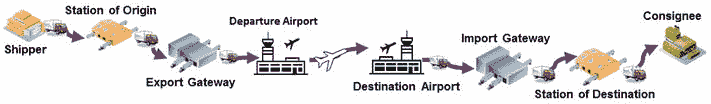

图 10-1. 门到门 LTL 空运场景

图 10-2 至 10-8 展示了该运输场景的流程。

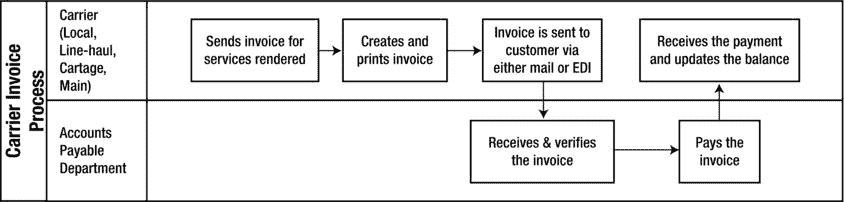

图 10-8. 承运人发票流程

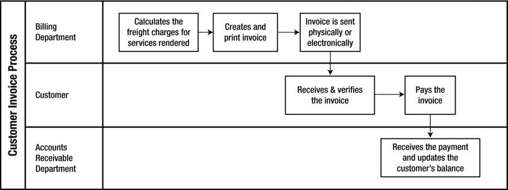

图 10-7. 客户发票流程

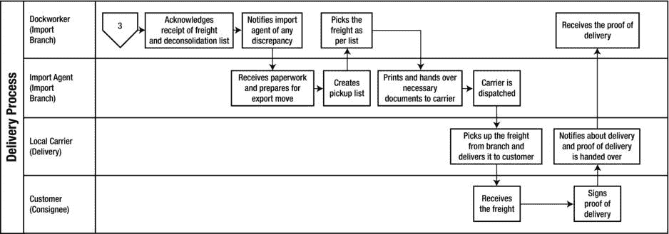

图 10-6. 交付流程

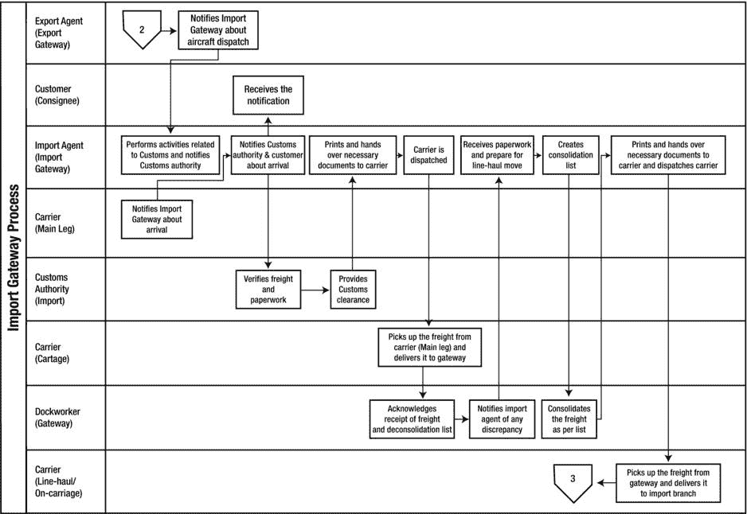

图 10-5. 进口网关流程

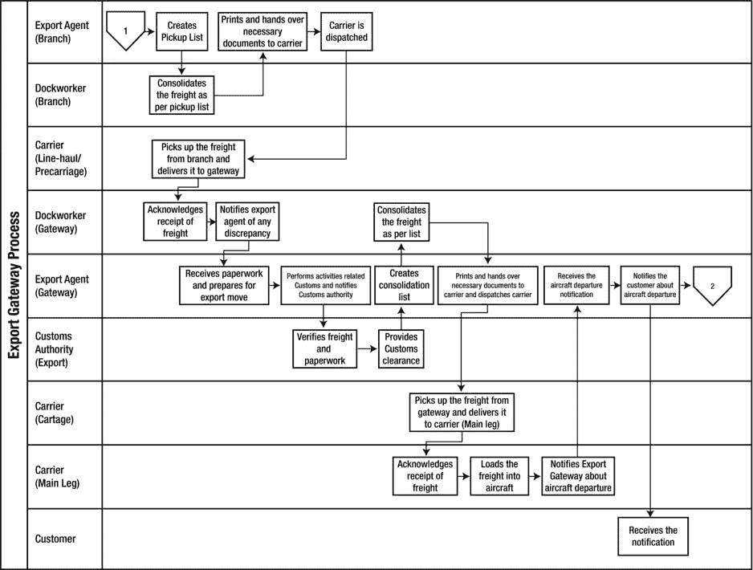

图 10-4. 出口网关流程

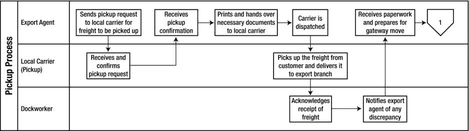

图 10-3. 提货流程

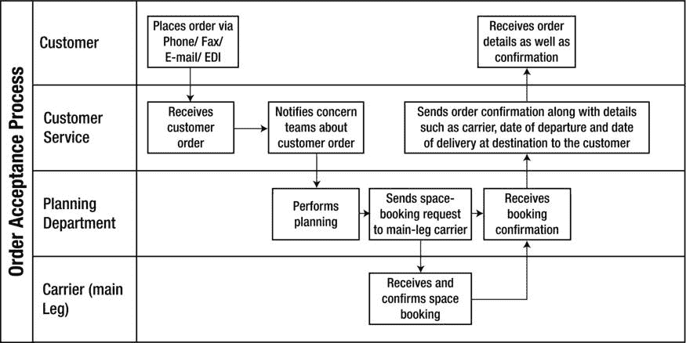

图 10-2. 订单接受流程

现在，让我们看看这些流程在 `SAP TM` 中是如何映射的（见图 10-9 至 10-15）。

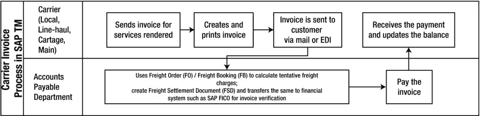

图 10-15. SAP TM 中的承运人发票流程

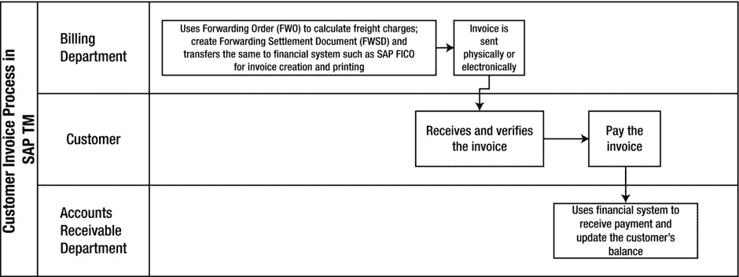

图 10-14. SAP TM 中的客户发票流程

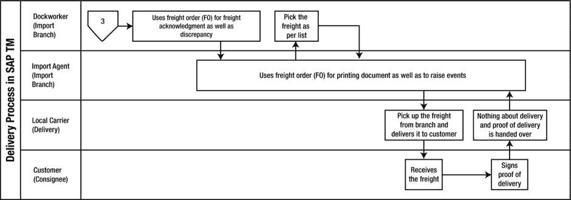

图 10-13. SAP TM 中的交付流程

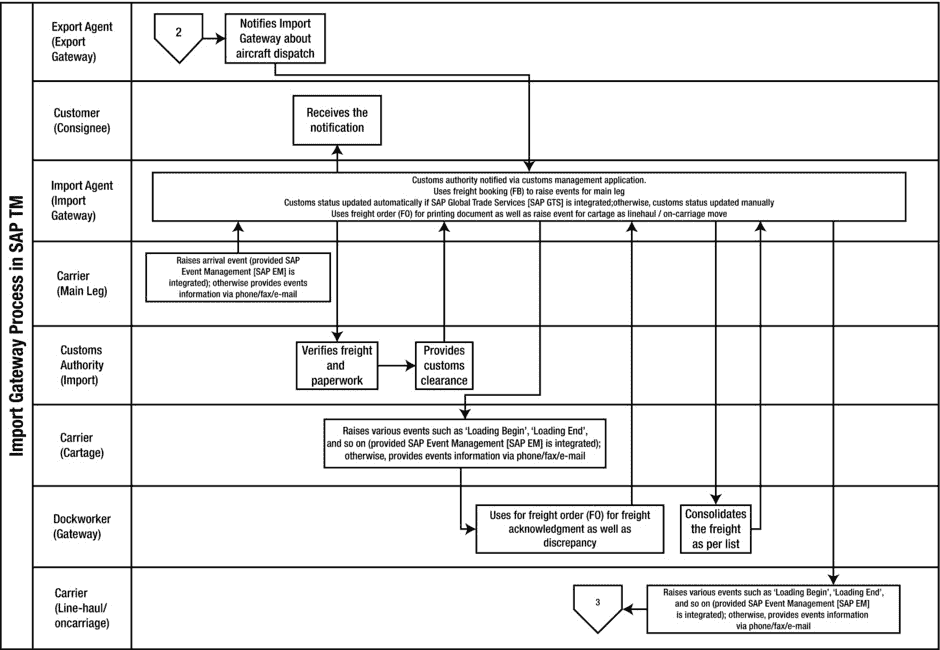

图 10-12. SAP TM 中的进口网关流程

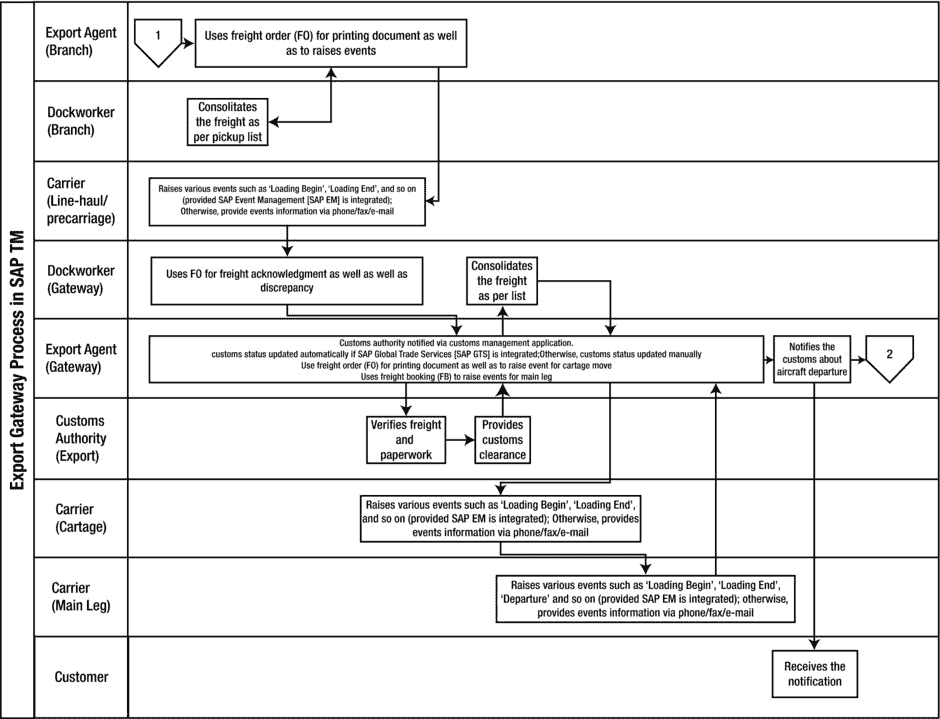

图 10-11. SAP TM 中的出口网关流程

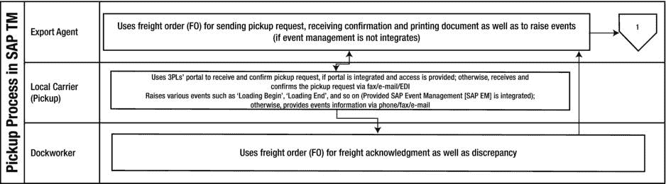

图 10-10. SAP TM 中的提货流程

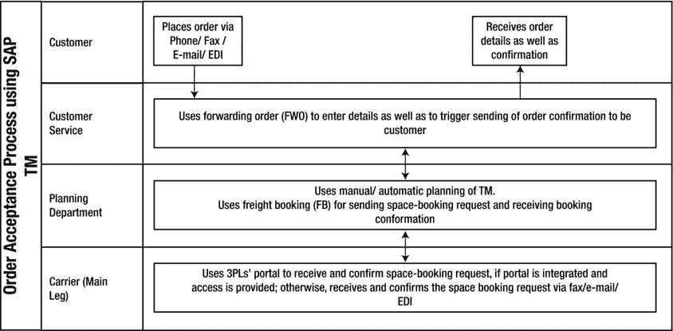

图 10-9. SAP TM 中的订单接受流程

## 总结

在本章中，我们概述了端到端货运生命周期及其在 `SAP TM` 中的映射。我们还通过一个场景示例，探讨了流程及其在 `SAP TM` 中的映射。更多信息将在附录中进一步说明。

