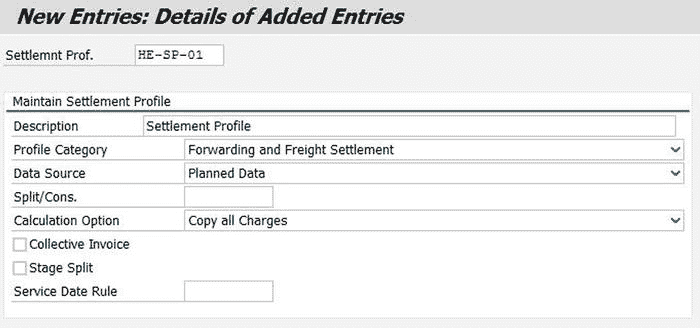

## 定义结算参数文件

此选项允许您指定控制系统如何创建发票的一组参数。

对于给定的场景，您必须定义表 A-143 中显示的结算参数文件。

表 A-143. 结算参数文件数据

| 字段 | 值 |
| --- | --- |
| 结算参数文件 | `HE-SP-01` |
| 描述 | 结算参数文件 |
| 参数文件类别 | 货运和运费结算 |
| 数据源 | 计划数据 |
| 拆分/合并 | <留空> |
| 计算选项 | 复制所有费用 |
| 汇总发票 | <取消选择> |
| 阶段拆分 | <取消选择> |

要定义结算参数文件，请转至 SAP Transportation Management 的定制设置，然后单击 `运输管理 ➤ 结算 ➤ 定义结算参数文件`。

然后，单击新条目  按钮，然后输入表 A-143 中的数据。

图 A-161. 创建结算参数文件

输入必要数据后，通过单击保存  按钮来保存数据。
