# 配置与实施 SAP TM 9.0 的分步指南

基于上一章讨论的货运生命周期流程映射，让我们深入探讨 `SAP TM` 中的典型配置和主数据。

在开始之前，让我们先了解本章中使用的一些术语和缩写：

- `Tcode`：事务代码。
- `SAP TM`/`SAP ERP` 的定制：输入 `SAP` 项目运行时对象（`SPRO`）的 `Tcode`，然后点击 `SAP Reference IMG` 按钮。
- 定制请求：任何定制都需要创建定制请求，以便将其传输到其他系统。

## 系统要求

配置该场景所需的系统为：

- `SAP TM 9.0` 服务包 5（`SAPK-11005INSAPTM`）
- `SAP Event Management`（`SAP EM`）9.0
- `SAP ERP 6.0` 增强包 6

## 假设条件

假设如下：

- 已在 `SAP TM` 系统中执行了基本设置，例如激活队列、创建活动版本和模型，以及激活业务功能。
- 已执行集成 `SAP TM` 和 `SAP ERP` 所需的基本配置。
- 已执行集成 `SAP TM` 和 `SAP EM` 所需的基本配置。

**注意**

本附录的目的是让读者对 `SAP TM` 的功能有所了解，不应视为标准参考。此外，`SAP TM` 提供了多种执行活动的方式，本附录仅限于展示每种活动中可用多种选项中的一种。

## 场景

为了更好地理解 SAP TM 的功能，请考虑以下场景：

HEPUSHA Corporation Ltd. 是一家跨国第三方物流公司，在日本和美国都有业务。日本业务由 HEPUSHA Japan 处理，美国业务由 HEPUSHA USA 处理。

在日本，HEPUSHA 拥有多个门户，包括成田机场的一个，以及众多服务于日本不同地点的站点，例如横滨。同样，该公司在美国的多个地点也设有门户和站点，分别如洛杉矶和旧金山。

横滨站点收到 Shipcam International 的订单，要求将货物从横滨运往圣地亚哥的 Coman Ltd.。

横滨站点转而雇佣 Vistala Roadways，从 Shipcam International 提取货物并运至横滨站点。为了将货物从横滨站点运往成田门户，使用了 Astala Carriers。在成田门户，货物将在成田国际机场 (NRT) 装载到 Mistala Airlines 的飞机上，运往洛杉矶国际机场 (LAX)，然后转运至洛杉矶门户。接下来，货物将使用 MacMovers Carriers 的服务运往旧金山站点。最后，将使用 Delta Roadways 的服务将货物交付给 Coman Ltd.。

以下是该场景所需的主数据和配置。

### 组织

SAP TM 的组织模型独立于 SAP ERP 的组织模型。SAP TM 提供了以下六种组织单元功能：

*   **集团**：此组织单元功能级别最高，为可选。
*   **公司**：这与 ERP 公司类似。
*   **货运代理公司**：此组织单元功能用于可执行计划与执行、采购和销售功能的单一组织。
*   **计划与执行**：适用于负责计划和执行功能的组织。
*   **采购**：适用于负责采购功能的组织。
*   **销售**：适用于负责销售功能的组织。

SAP TM 的三种组织单元角色如下：

*   **组织**：此组织单元角色是最高级别，可分配给一个组织。
*   **办事处**：办事处单元角色只能为具有销售功能的组织单元定义。该角色可分配给具有组织角色的组织单元。
*   **组**：此角色可为具有销售、采购、计划与执行，或货运代理公司功能的组织单元定义。该角色可分配给具有组织或办事处角色的组织单元。

针对给定场景，您需要创建表 A-1 中所示的组织。

**表 A-1. 组织数据**

| 字段 | 值 | 值 | 值 | 值 |
| --- | --- | --- | --- | --- |
| **基础数据选项卡** | | | | |
| 组织代码 | HEPUSHA | HEPUSHAJAP | HEJPFHNAR | HEJPFHYOK |
| 有效期 | 2013-01-01 至 9999-12-31 | 2013-01-01 至 9999-12-31 | 2013-01-01 至 9999-12-31 | 2013-01-01 至 9999-12-31 |
| 描述 | HEPUSHA Corporation Ltd. | HEPUSHA Ltd.—日本 | HEPUSHA 日本成田门户 | HEPUSHA 日本横滨站点 |
| **组织数据选项卡** | | | | |
| 组织功能 | 集团 | 公司 | 货运代理公司 | 货运代理公司 |
| 组织角色 | 组织 | 组织 | 组织 | 组织 |
| **地址选项卡** | | | | |
| 地址 | 5-28-11 Higashi-ikebukuro, Toshima-ku | 2-1-1 Akabane, Kita | 2130, Tokko | 20-1-3 Minato Mirai |
| 城市 | 东京 | 东京 | 成田 | 横滨 |
| 邮政编码 | 3981-9360 | 115-0046 | 286-0106 | 220-8173 |
| 国家/地区 | JP | JP | JP | JP |
| 区域 | 13 | 13 | 12 | 14 |
| **基础数据选项卡** | | | | |
| 组织代码 | HEPUSHAUSA | HEUSFHLA | HEUSFHSFR | |
| 有效期 | 2013-01-01 至 9999-12-31 | 2013-01-01 至 9999-12-31 | 2013-01-01 至 9999-12-31 | |
| 描述 | HEPUSHA Ltd.—美国 | HEPUSHA 美国洛杉矶门户 | HEPUSHA 美国旧金山站点 | |
| **组织数据选项卡** | | | | |
| 组织功能 | 公司 | 货运代理公司 | 货运代理公司 | |
| 组织角色 | 组织 | 组织 | 组织 | |
| **地址选项卡** | | | | |
| 地址 | 300 Park Plaza Dr. | 739 S. Main St. | 435 O’Farrell St. | |
| 城市 | Secaucus | 洛杉矶 | 旧金山 | |
| 邮政编码 | 07094 | 90014 | 94102 | |
| 国家/地区 | US | US | US | |
| 区域 | NJ | CA | CA | |

要定义一个组织，请在 SAP NetWeaver Business Client 中，点击 `主数据` ➤ `组织` ➤ `创建组织和人员配置`，或使用事务代码 (`PPOCE`)。

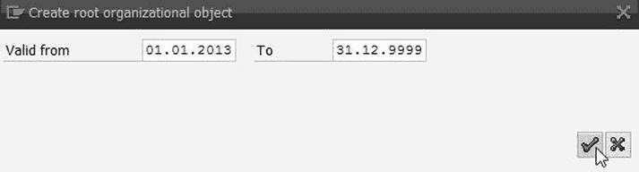

**图 A-1. 创建组织的有效期对话框**

接下来，点击 `继续` 按钮。输入组织详细信息，例如名称、组织数据和地址。

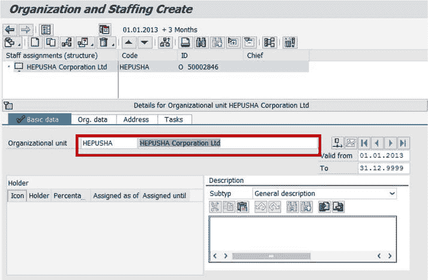

**图 A-2. 创建组织 – 基础数据选项卡**

输入组织单元的基础数据后，点击 `保存` 按钮保存条目。然后，选择 `组织数据` 选项卡，并点击 `创建` 按钮。

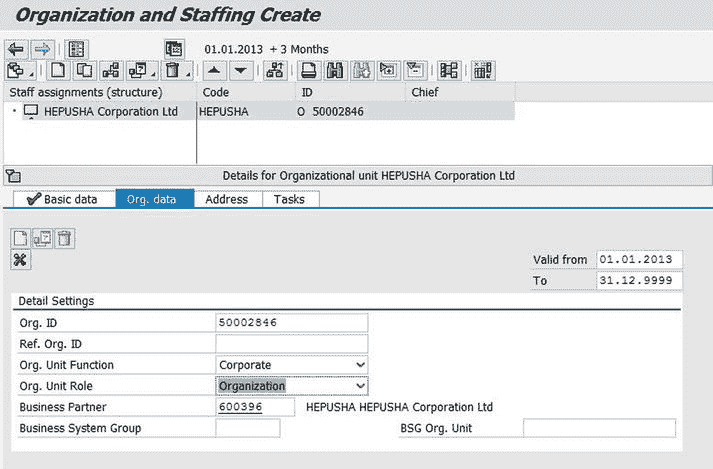

**图 A-3. 创建组织：组织数据选项卡**

> **注意：** 请务必备注自动创建的组织标识 (ID) 编号和业务伙伴；在后续的场景中会用到它们。

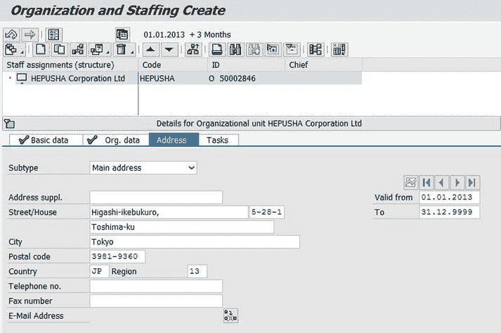

**图 A-4. 创建组织：地址选项卡**

#### 定义组织网络

组织网络可以通过以下两种方式定义：

*   创建组织
*   分配组织

##### 创建组织

右键单击该组织，然后从弹出菜单中选择 `创建`。

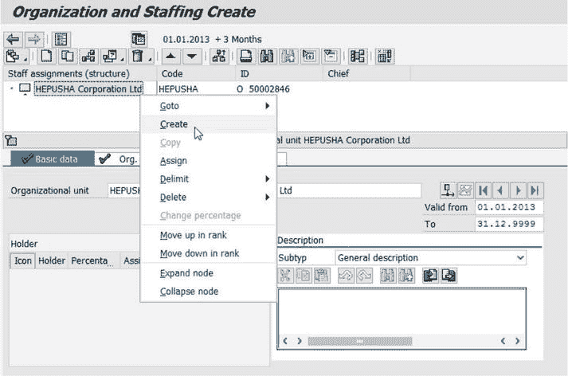

**图 A-5. 创建组织层级**

从对话框中选择 `组织单元`。

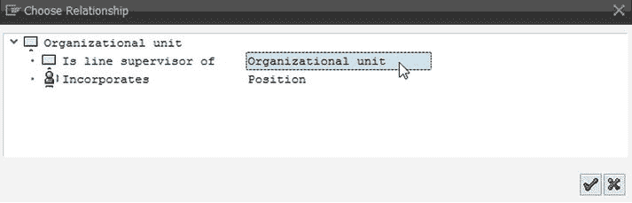

**图 A-6. 创建组织的关系对话框**

点击 `继续` 按钮，并使用表 A-1 创建其他组织。

##### 分配组织

要将一个组织分配给另一个组织，两个组织都必须已创建。要在 SAP NetWeaver Business Client 中将一个组织分配给另一个组织，请点击`主数据` ➤ `组织` ➤ `编辑组织与人员编制`，或使用事务代码（`PPOME`）。

现在，使用搜索词搜索父组织。双击名称打开组织层级结构。右键点击该组织，然后从弹出菜单中选择`分配`。

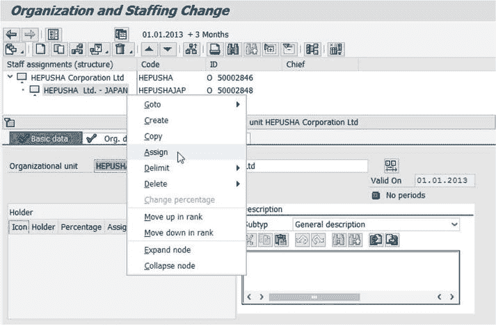

图 A-7. 分配组织

从对话框中选择`是其上级主管`。

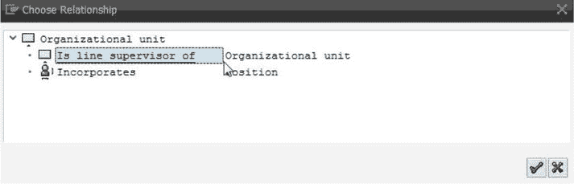

图 A-8. 用于分配组织的“关系”对话框

系统会提供一个搜索功能，用于搜索子组织（即待分配的组织）。

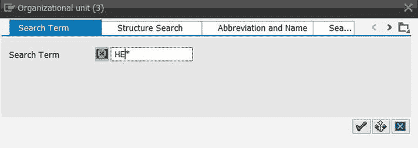

图 A-9. 搜索组织的搜索窗口

从搜索结果中，选择需要分配的组织。

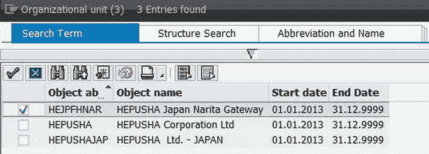

图 A-10. 在搜索窗口中选择要分配的组织

点击`复制`  按钮来分配组织。

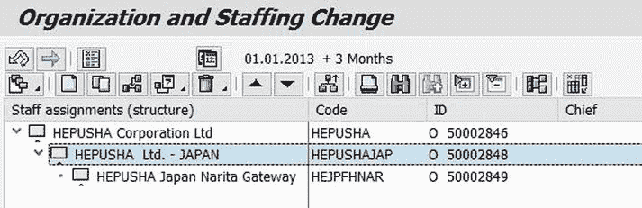

图 A-11. 分配后的组织层级结构

按此方式，创建其余的组织。

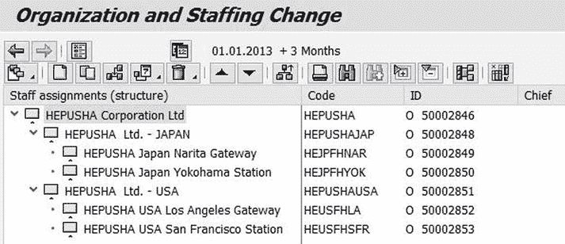

图 A-12. 完整的组织层级结构

## 定义业务伙伴

业务伙伴是指公司与其有业务往来的任何个人、组织、人群或组织团体。

对于类型为“组织”的业务伙伴，SAP TM 提供以下角色：

- **通用业务伙伴**：创建业务伙伴时，此角色会自动分配给它。与此业务伙伴相关的通用数据，例如名称和地址（对所有业务角色均有效），都存储在此角色中。

- **承运方**：此角色分配给作为承运方的业务伙伴。可以为此业务伙伴角色定义标准承运方字母代码或航空公司代码。

- **供应商**：将此角色分配给作为供应商的业务伙伴。

- **收货方**：此角色分配给作为客户的业务伙伴。

- **售达方**：此角色也分配给作为客户的业务伙伴。

- **组织单位**：此角色代表公司的组织单位。

对于类型为“人员”的业务伙伴，SAP TM 提供以下角色：

- **员工**：此角色分配给作为员工的业务伙伴。然后，可以将此业务伙伴分配到一个组织单位。

- **互联网用户**：将此角色分配给将要参与招标流程的业务伙伴。

- **联系人**：将此角色也分配给将要参与招标流程的业务伙伴。

**注意**：如果客户和供应商数据已在 SAP ERP 中设置，则可将这些数据传输到 SAP TM。

对于给定的场景，您需要将表 A-2 中列出的承运方创建为业务伙伴。

**表 A-2. 业务伙伴数据：承运方**

| 字段 | 值 | 值 | 值 | 值 | 值 | 值 |
| --- | --- | --- | --- | --- | --- | --- |
| 业务伙伴代码 | `HE-CR-01` | `HE-CR-02` | `HE-CR-03` | `HE-CR-04` | `HE-CR-05` | `HE-CR-06` |
| 分组 | 外部编号分配 | 外部编号分配 | 外部编号分配 | 外部编号分配 | 外部编号分配 | 外部编号分配 |
| 业务伙伴角色 | 承运方 | 承运方 | 承运方 | 承运方 | 承运方 | 承运方 |
| **地址选项卡** | | | | | | |
| **名称部分** | | | | | | |
| 名称 | Vistala Roadways | Astala Carriers | Mistala Airlines | MacMovers Carriers | Delta Roadways | Mistala Airlines—USA |
| **街道地址部分** | | | | | | |
| 街道/门牌号 | 10-97-1 Nakamura Ward | 1-47-1 Nagono, Nakamura Ward | 739 Hanasakicho | 9860 Crocker St. | 841 Harrison St. | 7225 W. Century Blvd. |
| 邮政编码 | 2310063 | 4640000 | 2860103 | 90013 | 94103 | 90045 |
| 城市 | Yokohama | Nagoya | Naritia-shi | Los Angeles | San Francisco | Los Angeles |
| 国家/地区 | JP | JP | JP | US | US | US |
| 地区 | 14 | 13 | 12 | CA | CA | CA |
| **标识选项卡** | | | | | | |
| **标识号部分** | | | | | | |
| ID 类型 | | | `TM0001` | | | |
| 标识号 | | | `MA` | | | |

对于给定的场景，还必须将表 A-3 中列出的客户创建为业务伙伴。

**表 A-3. 业务伙伴数据：发货方和收货方**

| 字段 | 值 | 值 |
| --- | --- | --- |
| 业务伙伴代码 | `HE-CU-01` | `HE-CO-01` |
| 分组 | 外部编号分配 | 外部编号分配 |
| 业务伙伴角色 | 收货方 | 售达方 |
| **地址选项卡** | | |
| **名称部分** | | |
| 名称 | Shipcam International | Coman Ltd. |
| **街道地址部分** | | |
| 街道/门号 | 2-2-19 Kanagawa Prefecture | 547 Bush St. |
| 邮政编码 | 2200012 | 92104 |
| 城市 | Yokohama | San Francisco |
| 国家/地区 | JP | US |
| 地区 | 14 | CA |

**注意**：要将发货方 `HE-CU-01` 设置为“已知发货方”，请为其分配业务伙伴角色“供应商”，并在`供应商数据`选项卡中创建表 A-4 给出的数据。

**表 A-4. HE-CU-01 的已知发货方数据**

| 字段 | 值 |
| --- | --- |
| **供应商数据选项卡** | |
| **空运货物安全部分** | |
| 发货方安全状态 | 已知发货方 |
| 已知起始日期 | `<输入距今 180 天前的日期（今天日期减 180 天）>` |
| 到期日期 | 31-12-2020 |

要定义一个业务伙伴，在 SAP NetWeaver Business Client 中，点击`主数据` ➤ `通用` ➤ `定义业务伙伴`，或使用事务代码（`BP`）。

要为此场景创建业务伙伴，请点击`组织`按钮或`业务伙伴` ➤ `创建` ➤ `组织`（`Ctrl+F5`）。

然后，点击`组织`  按钮，并在`地址`选项卡中输入表 A-2 和 A-3 中的数据。

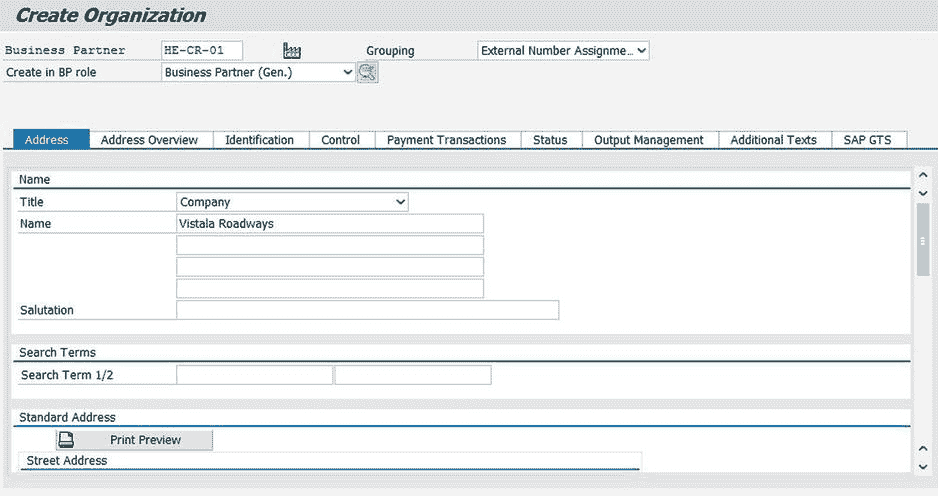

图 A-13. 创建业务伙伴

首先，创建业务伙伴，系统会自动分配一个通用角色。然后，通过点击`编辑`  按钮，将相应的角色添加到业务伙伴。

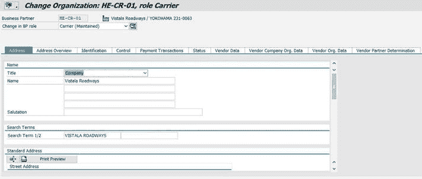

图 A-14. 向业务伙伴添加角色

按此方式，创建其余的业务伙伴及其各自的角色。

**注意**：要指定 `HE-CU-01` 为已知发货方，请在编辑模式下打开 `HE-CU-01` 业务伙伴，并选择供应商角色。在`供应商数据`选项卡的`空运货物安全`部分，输入表 A-5 中的数据。

**表 A-5. HE-CU-01 已知发货方数据**

| 字段 | 值 |
| --- | --- |
| 发货方安全状态 | 已知发货方 |
| 已知起始日期 | `<输入距今 180 天前的日期（今天日期减 180 天）>` |
| 到期日期 | 31-12-2020 |

#### 定义地点

地点是运输过程中使用的场所（来源地、目的地、转运地）。

`SAP TM` 提供了多种用于对地点进行分类的地点类型：

- 生产工厂
- 配送中心
- 装运点
- 客户
- 供应商
- 终端
- 港口
- 机场
- 火车站
- 集装箱货运站
- 枢纽
- 门户
- 集装箱堆场

针对给定的场景，你需要创建表 A-6 至 A-8 中所示的地点。

**表 A-8. 地点数据：机场**

| 字段 | 值 | 值 |
| --- | --- | --- |
| 地点代码 | HEMFNRT | HEMFLA |
| 地点类型 | 机场 | 机场 |
| 地址选项卡 | | |
| 名称部分 | | |
| 名称 | 米斯塔拉航空–NRT | 米斯塔拉航空–LA |
| 街道地址部分 | | |
| 街道/门牌号 | 1305, Tensai Atamo | 货物大楼 2 号，B 座，帝国公路，7201 |
| 邮政编码 | 2820007 | 90045 |
| 城市 | 成田 | 洛杉矶 |
| 国家 | JP | US |
| 地区 | 12 | CA |
| 常规选项卡 | | |
| 标识部分 | | |
| 国际航空运输协会代码 | NRT | LAX |
| 合作伙伴部分 | | |
| 业务伙伴 | HE-CR-03 | HE-CR-06 |

**表 A-7. 地点数据：组织**

| 字段 | 值 | 值 | 值 | 值 |
| --- | --- | --- | --- | --- |
| 地点代码 | HEGWJPNAR | HESTAJPYOK | HEGWUSLA | HESTAUSSFR |
| 地点类型 | 门户 | 配送中心 | 门户 | 配送中心 |
| 地址选项卡 | | | | |
| 名称部分 | | | | |
| 名称 | 成田门户 | 横滨站 | 洛杉矶门户 | 旧金山站 |
| 街道地址部分 | | | | |
| 街道/门牌号 | 2130, Tokko | 20-1-3 Minato Mirai | 739 S. Main St. | 435 O’Farrell St. |
| 邮政编码 | 2860106 | 2208173 | 90014 | 94102 |
| 城市 | 成田 | 横滨 | 洛杉矶 | 旧金山 |
| 国家 | JP | JP | US | US |
| 地区 | 12 | 14 | CA | CA |
| 常规选项卡 | | | | |
| 合作伙伴部分 | | | | |
| 业务伙伴 | 600399 | 600400 | 600402 | 600403 |

**表 A-6. 地点数据：客户**

| 字段 | 值 | 值 |
| --- | --- | --- |
| 地点代码 | HE-CO-01 | HE-CU-01 |
| 地点类型 | 客户 | 客户 |
| 地址选项卡 | | |
| 名称部分 | | |
| 名称 | Coman 有限公司 | Shipcam 国际 |
| 街道地址部分 | | |
| 街道/门牌号 | 547 Bush St. | 2-2-19 Kanagawa Prefecture |
| 邮政编码 | 92104 | 2200012 |
| 城市 | 旧金山 | 横滨 |
| 国家 | US | JP |
| 地区 | CA | 14 |
| 常规选项卡 | | |
| 合作伙伴部分 | | |
| 业务伙伴 | HE-CO-01 | HE-CU-01 |

要定义一个地点，请在 `SAP NetWeaver Business Client` 中单击 **主数据 ➤ 运输网络 ➤ 地点 ➤ 定义地点**，或使用事务代码 `/SCMTMS/LOC3`。

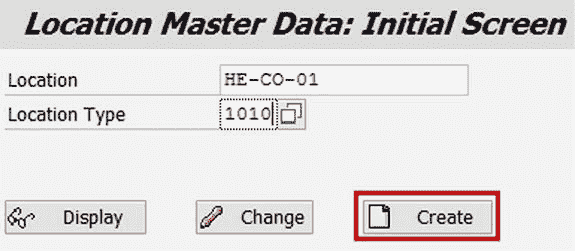

**图 A-15. 地点主数据的初始屏幕**

接下来，单击 **创建** 按钮。输入名称，然后选择 **地址** 选项卡来输入地址。

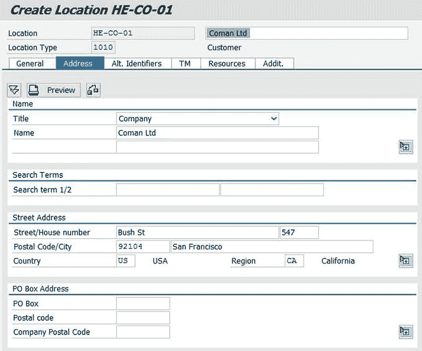

**图 A-16. 创建地点：地址选项卡**

在 **常规** 选项卡中将业务伙伴附加到该地点。

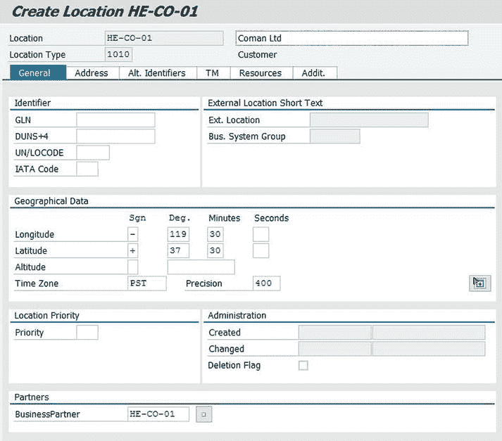

**图 A-17. 创建地点：常规选项卡**

在输入必要的数据后，单击 **保存**  按钮保存数据。

按此方式，创建其余的地点。

#### 定义运输方式

车辆资源类别被定义为运输方式，例如“货船”。

针对给定的场景，你必须创建表 A-9 中提供的运输方式。

**表 A-9. 运输方式数据**

| 字段 | 值 | 值 | 值 | 值 | 值 |
| --- | --- | --- | --- | --- | --- |
| 运输方式 | JP_TRUCK | JP_TRUCK_S | AIRPLANE | US_TRUCK | US_TRUCK_S |
| 运输方式描述 | 日本卡车 | 定期日本卡车 | 飞机 | 美国卡车 | 定期美国卡车 |
| 运输模式 | 公路 (01) | 公路 (01) | 航空 (05) | 公路 (01) | 公路 (01) |
| 速度 | | | | | |
| 低 | 40 | 40 | 650 | 45 | 45 |
| 中 | 50 | 50 | 750 | 55 | 55 |
| 高 | 60 | 60 | 850 | 65 | 65 |
| 平均 | 50 | 50 | 750 | 55 | 55 |
| 距离系数 | <留空> | <留空> | 1 | <留空> | <留空> |
| 多资源 | <选中> | <选中> | <选中> | <选中> | <选中> |
| 资源数量 | <留空> | <留空> | <留空> | <留空> | <留空> |
| 计划运输方式 | <取消选中> | <选中> | <选中> | <取消选中> | <选中> |

**注意**

如果需要输入资源数量，可以在记录保存后进行。

要定义一个运输方式，请转到 SAP 运输管理的自定义设置，并单击 **运输管理 ➤ 主数据 ➤ 资源 ➤ 定义运输方式**。

接下来，单击 **新条目**  按钮，并添加表 A-9 中的数据。

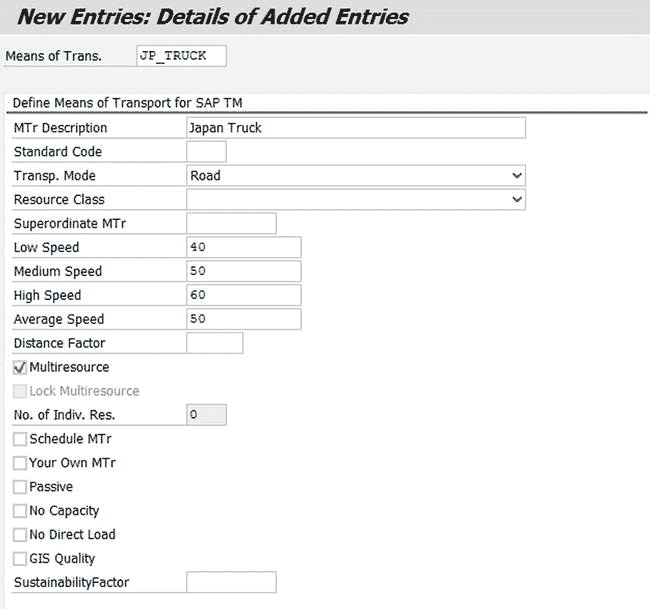

**图 A-18. 创建运输方式**

在输入必要的数据后，单击 **保存**  按钮保存数据。

按此方式，定义其余的运输方式。

#### 定义资源

在 `SAP TM` 中，资源在计划和执行中扮演着至关重要的角色。资源数据（例如容量和工作时间）是计划订单时的重要依据。

`SAP TM` 支持三种类型的资源：

- **车辆资源**：车辆资源是一种能够提供运输服务的交通工具。资源的容量和可用性在车辆资源中进行定义。
- **日曆资源**：这是一种可分配给日历的资源。日曆资源用于安排收货和发货的处理时间。
- **装卸资源**：装卸资源是在特定地点用于装卸货物的设备。资源的装卸能力在装卸资源中进行定义。

对于给定的场景，您需要创建表 A-10 中列出的资源。

**表 A-10.** 资源数据

| 字段 | 值 | 值 | 值 | 值 | 值 |
| --- | --- | --- | --- | --- | --- |
| 资源 | `HEJP_TRUCK` | `HEJP_TRUCK_S` | `HE_AIRPLAN` | `HEUS_TRUCK` | `HEUS_TRUCK_S` |
| 资源类型 | 车辆 (09) | 车辆 (09) | 车辆 (09) | 车辆 (09) | 车辆 (09) |
| 车辆选项卡 | | | | | |

### 定义资源

| 运输工具 | `JP_TRUCK` | `JP_TRUCK_S` | `AIRPLANE` | `US_TRUCK` | `US_TRUCK_S` |
| :--- | :--- | :--- | :--- | :--- | :--- |
| 时区 | 日本 | 日本 | 日本 | UTC-8 | UTC-8 |
| 连续维度 | 质量 | 质量 | 质量 | 质量 | 质量 |
| 工厂日历 | W8 | W8 | W8 | W8 | W8 |
| 容量 | 40 | 40 | 2,000 | 40 | 40 |
| 单位 | 吨 | 吨 | 吨 | 吨 | 吨 |
| 车辆选项卡的常规选项卡 | | | | | |
| 被动运输工具 | `<取消选择>` | `<取消选择>` | `<取消选择>` | `<取消选择>` | `<取消选择>` |
| 单个资源数量 | 0 | 0 | 0 | 0 | 0 |

要定义资源，请在 SAP NetWeaver Business Client 中点击 **主数据** ➤ **资源** ➤ **定义资源**，或使用事务码 (`/SCMTMS/RES01`)。

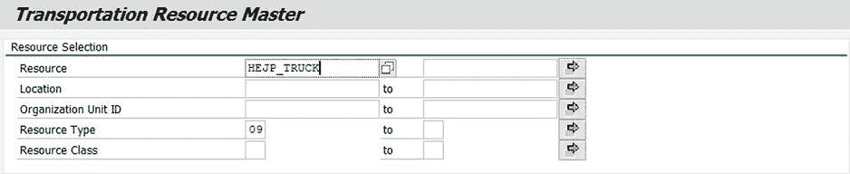

**图 A-19.** 运输资源主数据初始界面

输入资源和资源类型数据后，点击 **创建**  按钮。

接下来，在 **车辆** 选项卡中，根据表 A-10 输入运输工具、时区等信息。

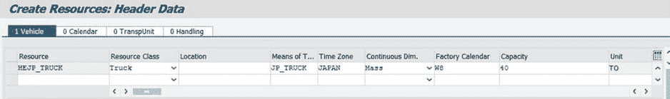

**图 A-20.** 创建资源：车辆选项卡

在 **车辆** 选项卡的 **常规** 选项卡中，再次根据表 A-10 输入资源的其他属性。

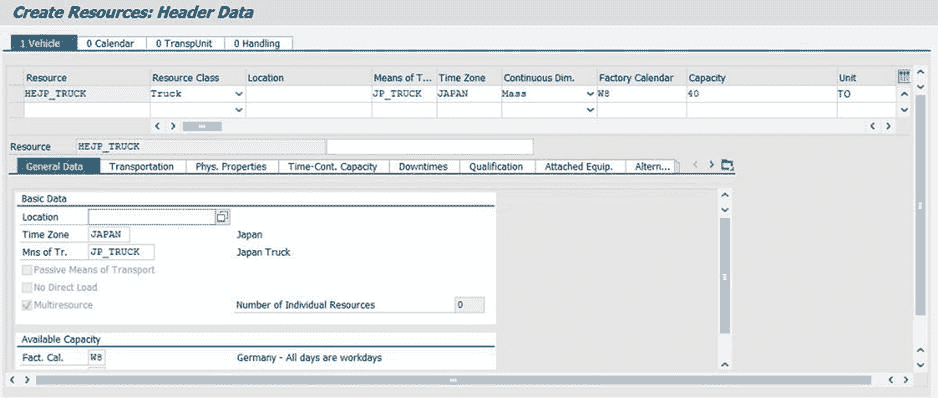

**图 A-21.** 创建资源：车辆选项卡的常规数据选项卡

输入必要数据后，点击 **保存**  按钮保存数据。

按照此方法，定义其余资源。

### 定义运输通道

运输通道用于定义两个地点或区域之间，或地点与区域的组合之间的连接。对于每个运输通道，必须指定运输工具；而承运商分配则是可选的。

对于给定的场景，创建表 A-11 中所示的运输通道。

**表 A-11.** 运输通道数据

| 字段 | 值 | 值 | 值 | 值 | 值 |
| :--- | :--- | :--- | :--- | :--- | :--- |
| 起始地点/区域 | `HE-CU-01` | `HESTAJPYOK` | `HEGWJPNAR` | `HEGWUSLA` | `HESTAUSSFR` |
| 目的地地点/区域 | `HESTAJPYOK` | `HEGWJPNAR` | `HEGWUSLA` | `HESTAUSSFR` | `HE-CO-01` |
| 运输工具部分 | | | | | |
| 运输工具 | `JP_TRUCK` | `JP_TRUCK_S` | `AIRPLANE` | `US_TRUCK_S` | `US_TRUCK` |
| 开始日期 | 01-01-2013 | 01-01-2013 | 01-01-2013 | 01-01-2013 | 01-01-2013 |
| 结束日期 | 31-12-9999 | 31-12-9999 | 31-12-9999 | 31-12-9999 | 31-12-9999 |
| 承运商选择相关 | `<选择>` | `<选择>` | `<选择>` | `<选择>` | `<选择>` |
| 优先级/成本 | 无成本也无优先级 | 无成本也无优先级 | 无成本也无优先级 | 无成本也无优先级 | 无成本也无优先级 |
| 成本来源 | 内部成本 | 内部成本 | 内部成本 | 内部成本 | 内部成本 |
| 运输工具部分的承运商 | | | | | |
| 业务合作伙伴（承运商） | `HE-CR-01` | `HE-CR-02` | `HE-CR-03` | `HE-CR-04` | `HE-CR-05` |
| 每公里运输成本 | 1,000 | 950 | 1,500 | 900 | 975 |
| 优先级 | 1 | 1 | 1 | 1 | 1 |

要定义运输通道，请在 SAP NetWeaver Business Client 中点击 **主数据** ➤ **运输网络** ➤ **运输通道** ➤ **定义运输通道**，或使用事务码 (`/SCMTMS/TL5`)。

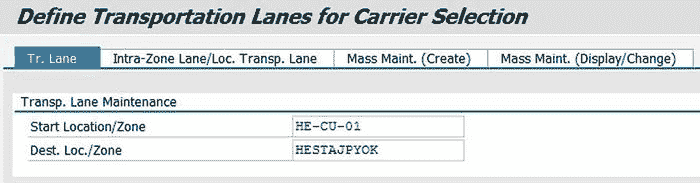

**图 A-22.** 创建运输通道

输入起始地点/区域和目的地地点/区域后，点击 **创建**  按钮。

现在，在 **运输工具** 部分，点击 **创建新条目**  按钮，根据表 A-11 添加属性，例如运输工具和有效期。

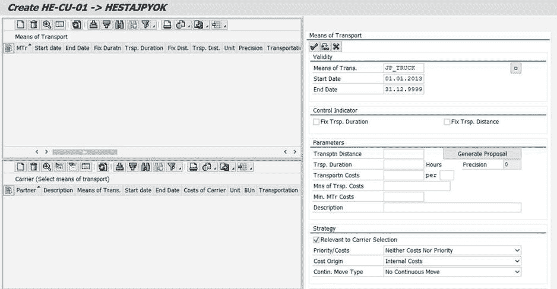

**图 A-23.** 创建运输通道：运输工具

输入与运输工具相关的数据后，点击 **复制并关闭**  按钮保存数据。

> **注意**：当系统询问是否要创建运输建议时，请点击 **否**。

接下来，在 **运输工具的承运商** 部分，点击 **创建新条目**  按钮，根据表 A-11 添加承运商及其属性。

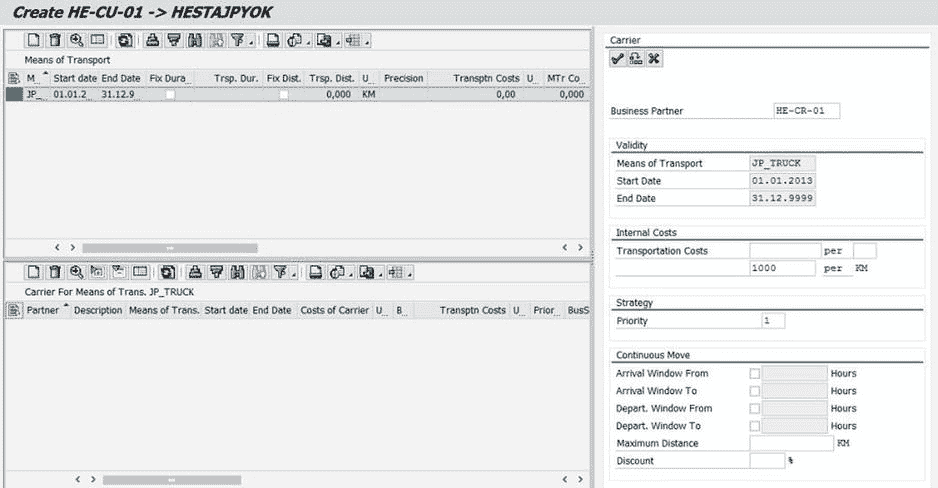

**图 A-24.** 创建运输通道：承运商

输入与承运商相关的数据后，点击 **复制并关闭**  按钮保存数据。

按照此方法，定义其余运输通道。

### 定义 IATA 飞机型号代码

国际航空运输协会 (IATA) 飞机型号代码用于定义飞机类型，并将飞机类型（例如货机或客机）分配给该型号。

对于给定的场景，您必须创建表 A-12 中所示的 IATA 飞机型号代码。

**表 A-12.** IATA 飞机型号代码数据

| 字段 | 值 | 值 |
| :--- | :--- | :--- |
| 飞机型号 | `74T` | `777` |
| 描述 | 波音 747-100（货机） | 波音 777（客机） |
| 类别 | 货机 | 客机 |

要定义 IATA 飞机型号代码，请转到 SAP 运输管理的定制中，点击 **运输管理** ➤ **主数据** ➤ **资源** ➤ **定义 IATA 飞机型号代码**。

然后，点击 **新条目**  按钮，并根据表 A-12 添加相应的飞机型号代码。

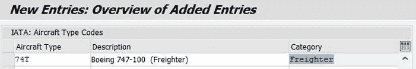

**图 A-25.** 创建 IATA 飞机型号代码

输入必要数据后，点击 **保存**  按钮保存数据。

按照此方式，定义其余 IATA 飞机型号代码。

### 定义 IATA 航空公司代码

此选项用于为每个航空货运承运商定义航空公司代码，并为其分配航空运单前缀。您还可以使用此选项指定该承运商是否为 IATA 成员。

在空运单据（例如空运委托书）的用户界面中，有一个输入航空公司代码的选项。如果输入了航空公司代码，系统会自动识别关联的航空运单前缀。此外，如果航空公司代码与相关承运商之间存在一对一的关系，系统可以根据输入的航空公司代码确定相应的承运商。

对于给定的场景，您需要创建表 A-13 中列出的 IATA 航空公司代码。

**表 A-13.** IATA 航空公司代码数据

| 字段 | 值 |
| --- | --- |
| 航空公司 | MA |
| 描述 | Mistala Airlines |
| AWB 前缀 | 739 |
| IATA 成员 | <选择> |
| 校验码 | <选择> |
| 前缀 | <取消选择> |

要定义 IATA 航空公司代码，请转至 SAP 运输管理的定制设置，然后点击 `Transportation Management ➤ Master Data ➤ Business Partner ➤ Define IATA Airline Codes`。

现在，点击 `New Entries` 按钮，并使用表 A-13 添加相应的航空公司代码。

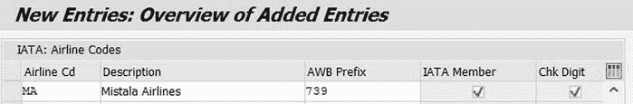

**图 A-26.** 创建 IATA 航空公司代码

输入必要的数据后，点击 `Save` 按钮保存数据。

### 定义航空货物安全状态

您可以使用此选项定义特定于国家的安全状态，并为每个状态分配航空安全状态。您还可以使用此选项指定是否阻止订单的计划和执行。

对于给定的场景，您必须定义表 A-14 中呈现的航空货物安全状态。

**表 A-14.** 航空货物安全状态数据

| 字段 | 值 | 值 |
| --- | --- | --- |
| 国家状态 | JP1 | US1 |
| 简短描述 | 由受监管代理处理的已知托运人 | 由受监管代理处理的已知托运人 |
| 国家 | JP | US |
| 经大型飞机 (LSP) 筛查 | <取消选择> | <取消选择> |
| 阻止状态 | <取消选择> | <取消选择> |
| 航空货物安全 (ACS) 状态 | 适合客机运输的安全货物 | 适合客机运输的安全货物 |

要定义航空货物安全状态，请转至 SAP 运输管理的定制设置，然后点击 `Transportation Management ➤ Basic Function ➤ Security ➤ Define Air Cargo Security Statuses`。

然后，点击 `New Entries` 按钮，并使用表 A-14 添加相应的数据。

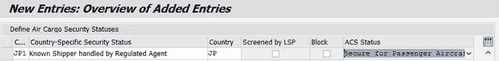

**图 A-27.** 创建航空货物安全状态

输入必要的数据后，点击 `Save` 按钮保存数据。

以此方式，定义其余航空货物安全状态。

### 定义计算已知托运人状态的偏移量

定义偏移量使系统能够确定托运人被认识的时间是否足够长，从而可以将来自该托运人的货物视为安全货物。系统允许以天为单位定义特定于国家的偏移量。

对于给定的场景，您必须定义表 A-15 中列出的偏移量。

**表 A-15.** 计算已知托运人状态的偏移量数据

| 字段 | 值 | 值 |
| --- | --- | --- |
| 国家 | 日本 | 美国 |
| 偏移天数 | 180 | 180 |

要定义计算已知托运人状态的偏移量，请转至 SAP 运输管理的定制设置，然后点击 `Transportation Management ➤ Basic Function ➤ Security ➤ Define Offsets for Calculating Known Shipper Status`。

现在，点击 `New Entries` 按钮，并使用表 A-15 添加相应的数据。

**图 A-28.** 创建计算已知托运人状态的偏移量

输入必要的数据后，点击 `Save` 按钮保存数据。

以此方式，定义其余计算已知托运人状态的偏移量。

### 定义运单号库存类型

此选项允许您指定运单的属性，例如运单号的位数、校验码和运单相关的前缀。

对于给定的场景，您需要定义表 A-16 中显示的运单号库存类型。

**表 A-16.** 运单号库存类型数据

| 字段 | 值 | 值 |
| --- | --- | --- |
| 库存类型 | MAWB | HAWB |
| 描述 | 主航空运单 | 分航空运单 |
| 运输方式代码 (TrM) | 05 | 05 |
| 组织类别 | 采购 | 销售 |
| 位数 | 7 | 10 |
| 校验码 | <选择> | <选择> |
| 前缀 | <选择> | <选择> |

要定义运单号库存类型，请转至 SAP 运输管理的定制设置，然后点击 `Transportation Management ➤ Master ➤ Waybill Stock ➤ Define Waybill Number Stock Types`。

接下来，点击 `New Entries` 按钮，并使用表 A-16 添加相应的数据。

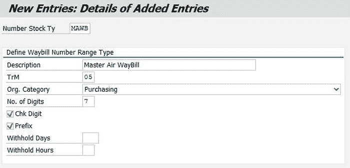

**图 A-29.** 创建运单号库存类型

输入必要的数据后，点击 `Save` 按钮保存数据。

以此方式，定义其余运单号库存类型。

### 定义包装类型代码

此选项允许您指定包装代码，从而标准化运输中使用的包装。

对于给定的场景，您必须定义表 A-17 中显示的包装类型代码。

**表 A-17.** 包装类型代码数据

| 字段 | 值 |
| --- | --- |
| 包装类型 | Box |
| 描述 | 箱 |

要定义包装类型代码，请转至 SAP 运输管理的定制设置，然后点击 `Transportation Management ➤ Forwarding Order Management ➤ Define Package Type Codes`。

然后，点击 `New Entries` 按钮，并使用表 A-17 添加相应的数据。

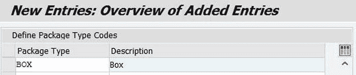

**图 A-30.** 创建包装类型代码

输入必要的数据后，点击 `Save` 按钮保存数据。

### 定义物料类型

此选项允许您为物料指定参数，例如物料类别、设备类型和默认计量单位。

针对给定的场景，您需要定义表 A-18 中提供的物料类型。

**表 A-18.** 物料类型数据

| 字段 | 值 | 值 |
| --- | --- | --- |
| 物料类型 | HEPK | HEPD |
| 物料类型描述 | 具有特定尺寸的包裹 | 产品 |
| 物料类别 | 包裹 | 产品 |
| 包裹类型 | 箱子 | 不适用 |
| 产品检查 | 不适用 | `<Deselect>` |
| 仅限单件 | `<Deselect>` | `<Deselect>` |
| 体积求和 | `<Deselect>` | `<Deselect>` |
| 默认重量计量单位 | kg | kg |
| 默认体积计量单位 | m³ | m³ |
| 默认件数计量单位 | ea. | ea. |

要定义物料类型，请进入 SAP 运输管理的定制设置，然后点击 `运输管理` ➤ `货运订单管理` ➤ `为货运订单管理定义物料类型`。

现在，点击 `新条目`  按钮，并使用表 A-18 添加相应的数据。

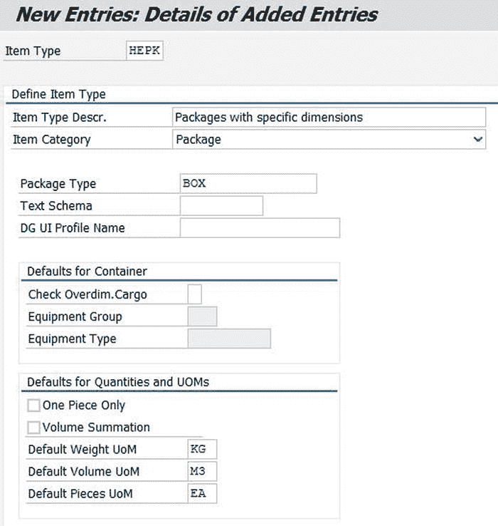

**图 A-31.** 创建物料类型

输入必要数据后，点击 `保存`  按钮保存数据。

以相同方式定义其余的物料类型。

### 定义运输组

此选项允许您指定运输组。

针对给定的场景，您需要定义表 A-19 中列出的运输组。

**表 A-19.** 运输组数据

| 字段 | 值 | 值 |
| --- | --- | --- |

# SAP 运输管理配置指南

## 定义运输组

| 运输组 | 0015 | 0017 |
| --- | --- | --- |
| 运输组描述 | 机械/电气 | 杂项 |

要定义运输组，请进入 SAP 运输管理的定制设置，然后点击`SCM 基础` ➤ `主数据` ➤ `产品` ➤ `维护运输组`。

接下来，点击`新条目`  按钮，并使用表 A-19 添加相应的数据。

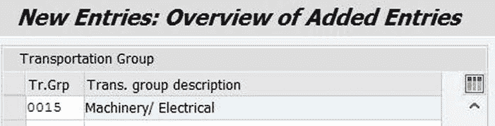

图 A-32. 创建运输组

输入必要数据后，点击`保存`  按钮保存数据。

以相同方式定义其余的运输组。

## 定义产品

此选项允许您指定可运输的商品。

针对给定的场景，您必须定义表 A-20 中呈现的产品。

**表 A-20. 产品数据**

| 字段 | 值 |
| --- | --- |
| 产品 | 汽车零部件 |
| 视图部分 | |
| 全局 | `<Select>` |
| 常规部分 | |
| 基本计量单位 | kg |
| 产品描述 | 汽车部件 |
| 属性选项卡 | |
| 运输组 | 0015 |
| 计量单位选项卡 | |
| 毛重 | 50 |
| 净重 | 45 |
| 重量单位 | kg |
| 体积 | 2 |
| 体积单位 | m³ |

要定义产品，在 SAP NetWeaver 业务客户端中，点击`主数据` ➤ `常规` ➤ `定义产品`，或使用事务代码（`/SAPAPO/MAT1`）。

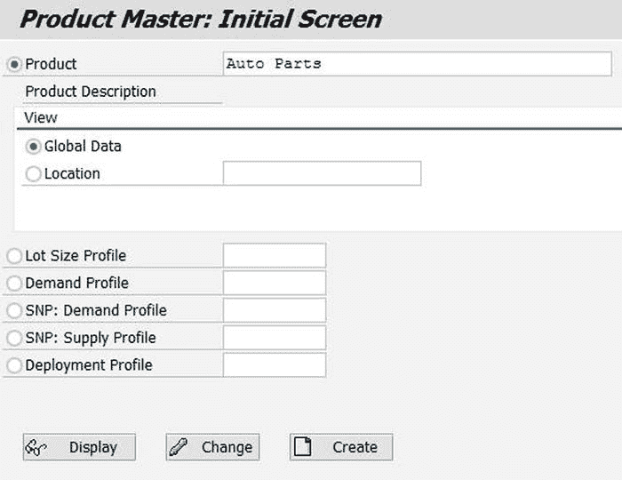

图 A-33. 产品主数据初始屏幕

输入产品和视图相关数据后，点击`创建`  按钮。

然后，输入基本计量单位和产品描述。在`属性`选项卡中，输入来自表 A-20 的相关数据。

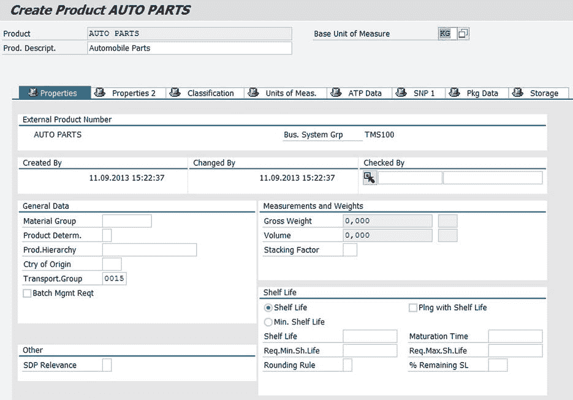

图 A-34. 创建产品：属性选项卡

在`计量单位`选项卡中，输入来自表 A-20 的相关数据。

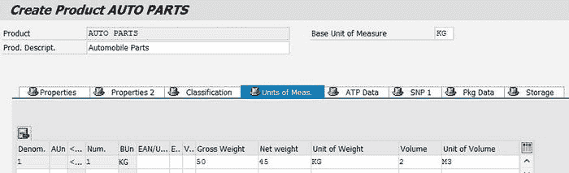

图 A-35. 创建产品：计量单位选项卡

输入必要数据后，点击`保存`  按钮保存数据。

## 定义设备组和设备类型

在创建运输订单或运输报价时插入容器项目类别后，可以使用设备类型。要将设备类型分组到类别中，请使用设备组。

对于给定的场景，如果您尚未定义，则需要定义表 A-21 中列出的设备组和设备类型。

**表 A-23. 设备组和设备类型：设备类型数据**

| 字段 | 值 | 值 | 值 |
| --- | --- | --- | --- |
| 设备类型 | | | |
| 设备类型 | `AKN` | `AAP` | `PAP` |
| 描述 | 集装箱 79 × 64 × 60 (LD3) | 集装箱 125 × 88 × 64 (LD9) | 平板托盘下舱和主甲板 |
| 空运部分 | | | |
| 符合 IATA 标准 | `<选择>` | `<选择>` | `<选择>` |
| 单元装载设备分类 | `LD3` | `LD9` | `LD7` |
| 物理属性部分 | | | |
| 自重 | 82 | 200 | 105 |
| 自重计量单位 | kg | kg | kg |
| 空载体积 | 4,300 | 10,000 | |
| 空载体积计量单位 | m³ | m³ | |
| 容量部分 | | | |
| 有效载荷重量 | 1,506 | 5,833 | 4,521 |
| 有效载荷重量计量单位 | kg | kg | kg |
| 立方容量 | 17,580 | 10,510 | |
| 立方容量计量单位 | m³ | m³ | |
| 内部长度 | 200 | 316 | 317 |
| 内部宽度 | 153 | 222 | 223 |
| 内部高度 | 162 | 161 | 162 |
| 内部高度计量单位 | cm | cm | cm |
| 温度部分 | | | |
| 温度控制 | `<取消选择>` | `<取消选择>` | `<取消选择>` |
| 通风 | 无通风 | 无通风 | 无通风 |

**表 A-22. 设备组和设备类型：运输方式分配数据**

| 字段 | 值 |
| --- | --- |
| 运输方式分配 | |
| 运输方式类别 | 航空 |

**表 A-21. 设备组和设备类型：运输单元组数据**

| 字段 | 值 |
| --- | --- |
| 运输单元组 | |
| 设备组 | `ULD` |
| 描述 | 单元装载设备 |

要定义设备组和设备类型，请前往 SAP 运输管理的定制，然后点击`运输管理` ➤ `主数据` ➤ `资源` ➤ `定义设备组和设备类型`。

然后，点击`新建条目`  按钮，并输入表 A-21 中与运输单元组相关的数据。

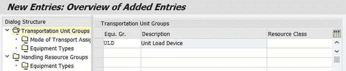

图 A-36. 创建设备组和设备类型：运输单元组

输入必要数据后，点击`保存`  按钮保存数据。

接下来，选择包含 `"ULD"` 的行，然后从树结构中选择`运输方式分配`。点击`新建条目`  按钮，并输入表 A-22 中与运输方式相关的数据。

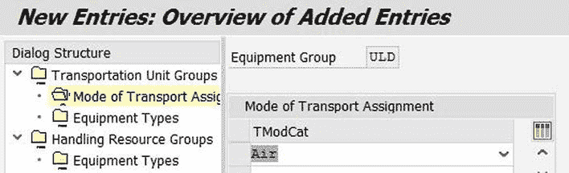

图 A-37. 创建设备组和设备类型：运输方式分配

输入必要数据后，点击`保存`  按钮保存数据。

返回到`运输单元组`部分，选择包含 `"ULD"` 的行，然后从树结构中选择`设备类型`。点击`新建条目`  按钮，并输入表 A-23 中与设备类型相关的数据。

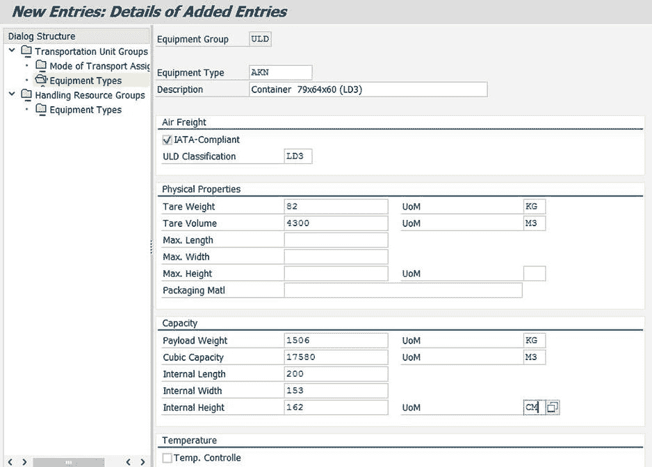

图 A-38. 创建设备组和设备类型：设备类型

输入必要数据后，点击`保存`  按钮保存数据。

以此方式，定义其余的设备组和设备类型。

## 定义运输服务等级代码

此选项允许您指定运输服务等级代码。

对于给定的场景，您必须定义表 A-24 中显示的运输服务等级代码。

**表 A-24. 运输服务等级代码数据**

| 字段 | 值 | 值 |
| --- | --- | --- |
| 服务等级代码 | `01` | `02` |
| 描述 | 标准 | 快递 |

# 定义运输服务等级代码

要定义运输服务等级代码，请前往 SAP 运输管理的定制，然后点击`运输管理` ➤ `运输订单管理` ➤ `定义运输服务等级代码`。

接下来，点击`新建条目`  按钮，并输入表 A-24 中的数据。

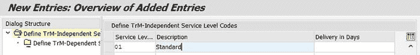

**图 A-39.** 创建运输服务等级代码

输入必要数据后，点击`保存`  按钮保存数据。

以此方式，定义其余运输服务等级代码。

## 定义运输段类型

主运输、前段运输、后段运输等是通过将它们分配给运输段类型来指定的。

对于给定的场景，您需要定义表 A-25 中提供的运输段类型。

**表 A-25. 运输段类型数据**

| 字段 | 值 | 值 | 值 | 值 | 值 |
| --- | --- | --- | --- | --- | --- |
| 运输段类型 | `HE1` | `HE2` | `HE3` | `HE4` | `HE5` |
| 描述 | 提货 | 前段运输 | 主运输 | 后段运输 | 交货 |
| 运输段类别 | 前段运输 | 前段运输 | 主运输 | 后段运输 | 后段运输 |

要定义运输段类型，请前往 SAP 运输管理的定制，然后点击`运输管理` ➤ `运输订单管理` ➤ `定义运输段类型`。

现在，点击`新建条目`  按钮，并使用表 A-25 输入相应的数据。

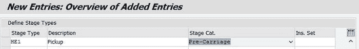

**图 A-40.** 创建运输段类型

输入必要数据后，点击`保存`  按钮保存数据。

以此方式，定义其余运输段类型。

## 定义运输方式类型

运输方式类型是用于指定物流服务提供商在组织运输时负责哪些运输段的参数之一。

对于给定的场景，您需要定义表 A-26 中显示的运输方式类型。

**表 A-26. 运输方式类型数据**

| 字段 | 值 |
| --- | --- |
| 运输方式类型 | `DD` |
| 描述 | 门到门 |
| 起始地点 | `<取消选择>` |
| 目的地点 | `<取消选择>` |

要定义运输方式类型，请前往 SAP 运输管理的定制，然后点击`运输管理` ➤ `运输订单管理` ➤ `定义运输方式类型`。

接下来，点击`新建条目`  按钮，并输入表 A-26 中的数据。

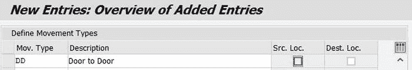

**图 A-41.** 创建运输方式类型

输入必要数据后，点击`保存`  按钮保存数据。

### 为移动类型定义阶段类型序列

此选项用于指定某个移动类型所允许的阶段类型及其序列。此选项还允许您指定哪些阶段与计划相关。

在“常规”选项卡中输入移动类型后，系统将使用指定的值，在货运报价或货运订单的“阶段”选项卡的“实际路线”部分中自动添加这些阶段。

针对给定的场景，您必须为表 A-27 中列出的移动类型定义阶段类型序列。

**表 A-27.** 移动类型数据的阶段类型序列

| 字段 | 值 | 值 | 值 | 值 | 值 |
| --- | --- | --- | --- | --- | --- |
| 移动类型 | DD | DD | DD | DD | DD |
| 序列号 | 10 | 20 | 30 | 40 | 50 |
| 阶段类型 | HE1 | HE2 | HE3 | HE4 | HE5 |
| 阶段类型出现次数 | 阶段类型必须至少出现一次 | 阶段类型必须至少出现一次 | 阶段类型必须至少出现一次 | 阶段类型必须至少出现一次 | 阶段类型必须至少出现一次 |
| 阶段建议 | `<选择>` | `<选择>` | `<选择>` | `<选择>` | `<选择>` |
| 非计划相关阶段的确定规则 | 当执行组织和销售组织属于不同公司组织时，不计划相关 | 当执行组织和销售组织属于不同公司组织时，不计划相关 | 当执行组织和销售组织属于不同公司组织时，不计划相关 | 当执行组织和销售组织属于不同公司组织时，不计划相关 | 当执行组织和销售组织属于不同公司组织时，不计划相关 |
| 内部结算规则 | 与内部结算无关 | 与内部结算无关 | 与内部结算无关 | 与内部结算无关 | 与内部结算无关 |

要为移动类型定义阶段类型序列，请转到 SAP 运输管理的定制设置，并点击 `Transportation Management` ➤ `Forwarding Order Management` ➤ `Define Stage Type Sequence for Movement Type`。

然后，点击“新条目”  按钮，并使用表 A-27 输入相应数据。

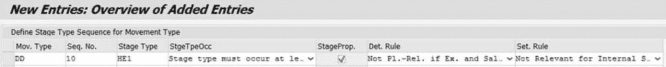

**图 A-42.** 为移动类型创建阶段类型序列

输入必要数据后，点击“保存”  按钮保存数据。

通过这种方式，为其他移动类型定义剩余的阶段类型序列。

### 定义阶段模板

此选项允许您指定要在货运报价或货运订单中创建哪些阶段类型、它们的序列以及各阶段的属性。

针对给定的场景，您必须定义表 A-28 中显示的阶段模板。

**表 A-28.** 阶段模板数据

| 字段 | 值 |
| --- | --- |
| 阶段模板 | `HEIM` |
| 描述 | 进口阶段模板 |

此外，您需要定义表 A-29 中所示的阶段类型序列。

**表 A-29.** 阶段模板：分配阶段类型序列数据

| 字段 | 值 | 值 | 值 | 值 | 值 |
| --- | --- | --- | --- | --- | --- |
| 序列号 | 10 | 20 | 30 | 40 | 50 |
| 阶段类型 | HE1 | HE2 | HE3 | HE4 | HE5 |
| 阶段类型出现次数 | 阶段类型必须至少出现一次 | 阶段类型必须至少出现一次 | 阶段类型必须至少出现一次 | 阶段类型必须至少出现一次 | 阶段类型必须至少出现一次 |
| 阶段建议 | `<选择>` | `<选择>` | `<选择>` | `<选择>` | `<选择>` |
| 非计划相关阶段的确定规则 | 从不与计划相关 | 从不与计划相关 | 从不与计划相关 | 始终与计划相关 | 始终与计划相关 |
| 内部结算规则 | 与内部结算无关 | 与内部结算无关 | 与内部结算无关 | 与内部结算无关 | 与内部结算无关 |

要定义阶段模板，请转到 SAP 运输管理的定制设置，并点击 `Transportation Management` ➤ `Forwarding Order Management` ➤ `Define Stage Profiles`。

接着，点击“新条目”  按钮，并输入表 A-28 中的数据。

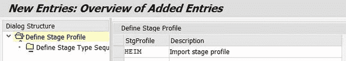

**图 A-43.** 创建阶段模板

# SAP运输管理配置

输入必要数据后，点击“保存”  按钮保存数据。

现在，选择阶段模板 `HEIM`，然后从树形结构中选择 `Define Stage Type Sequence for Stage Profile`。点击“新条目”  按钮，并从表 A-29 中输入与阶段模板序列相关的数据。

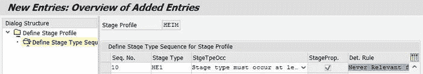

**图 A-44.** 创建阶段模板：分配阶段类型序列

通过这种方式，分配剩余的阶段类型序列。

## 定义运输类型

使用此选项指定运输类型。此选项还允许您指定是否应将货物项目（例如包裹或产品）分配给设备项目（例如集装箱或集装设备(ULD)）。

针对给定的场景，您需要定义表 A-30 中所示的运输类型。

**表 A-30.** 运输类型数据

| 字段 | 值 |
| --- | --- |
| 运输类型部分 | |
| 运输类型 | 10 |
| 描述 | 散货 |
| 分配给设备项目 | 货物项目不得分配给设备项目 |
| 运输方式分配部分 | |
| 运输方式代码 | 空运 (05) |

要定义运输类型，请转到 SAP 运输管理的定制设置，并点击 `Transportation Management` ➤ `Forwarding Order Management` ➤ `Define Shipping Types`。

然后，点击“新条目”  按钮，并从表 A-30 输入相关数据。

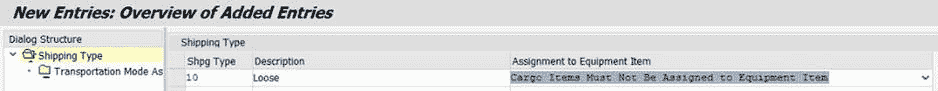

**图 A-45.** 创建运输类型

输入必要数据后，点击“保存”  按钮保存数据。

现在，选择运输类型 `10`，然后从树形结构中选择 `Transportation Mode Assignments`。点击“新条目”  按钮，并从表 A-30 输入与运输方式相关的数据。

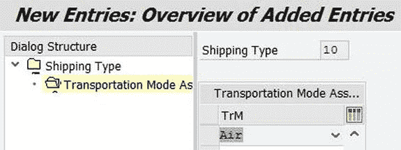

**图 A-46.** 创建运输类型：分配运输方式

输入必要数据后，点击“保存”  按钮保存数据。

## 定义地理选择属性

此选项允许您指定在筛选订单以进行计划时需要考虑的源地点和目的地地点。

对于给定的场景，您需要定义表 A-31 中显示的地理选择属性。

**表 A-31.** 地理选择属性数据

| 字段 | 值 | 值 | 值 |
| --- | --- | --- | --- |
| 常规数据部分 | | | |
| 地理选择属性 | `HE-GEO-SEL-PRE` | `HE-GEO-SEL-MAIN` | `HE-GEO-SEL-ON` |
| 描述 | 地理选择—前期运输 | 地理选择—主要运输 | 地理选择—后续运输 |
| 两个地点 | `<选择>` | `<选择>` | `<选择>` |
| 源地点选项卡 | | | |
| 符号 | 包含 | 包含 | 包含 |
| 选项 | = | = | = |
| 下限值 | `HESTAJPYOK` | `HEGWJPNAR` | `HEGWUSLA` |
| 上限值 | `<空>` | `<空>` | `<空>` |
| 目的地地点选项卡 | | | |
| 符号 | 包含 | 包含 | 包含 |
| 选项 | = | = | = |
| 下限值 | `HEGWJPNAR` | `HEGWUSLA` | `HESTAUSSFR` |
| 上限值 | `<空>` | `<空>` | `<空>` |

要定义地理选择属性，请在 SAP NetWeaver Business Client 中依次点击**应用程序管理** ➤ **计划** ➤ **选择配置文件属性** ➤ **地理选择属性** ➤ **创建地理选择属性**。

然后，在**常规数据**部分，输入表 A-31 中的相关数据。

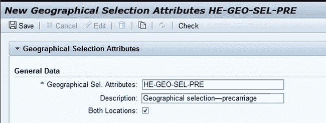

**图 A-47.** 创建地理选择属性：常规数据部分

在**源地点**选项卡中，再次输入表 A-31 中的相关数据。

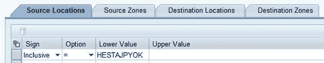

**图 A-48.** 创建地理选择属性：源地点选项卡

在**目的地地点**选项卡中执行相同操作。

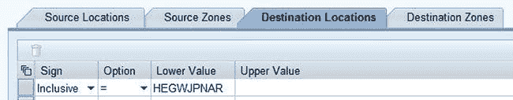

**图 A-49.** 创建地理选择属性：目的地地点选项卡

输入必要数据后，点击**保存**  按钮保存数据。

按照此方式，定义其余的地理选择属性。

## 定义时间相关选择属性

此选项允许您指定需求时界。

对于给定的场景，您必须定义表 A-32 中所示的时间相关选择属性。

**表 A-32.** 时间相关选择属性数据

| 字段 | 值 |
| --- | --- |
| 常规数据部分 | |
| 时间相关选择属性 | `HE-TIME-SEL` |
| 描述 | 时间相关选择 |
| 需求时界部分 | |
| 绝对时界或相对时界 | 使用相对时界 |
| 用于偏移/持续时间计算的工厂日历 | `W8` |
| 其他设置部分 | |
| 用于选择的索引时间 | 使用停靠点的索引时间 |
| 取货与送货窗口的组合 | 使用“或”组合 |
| 取货部分 | |
| 取货天数 | 30 |
| 偏移方向 | 未来 |
| 送货部分 | |
| 送货天数 | 45 |
| 偏移方向 | 未来 |

要定义时间相关选择属性，请在 SAP NetWeaver Business Client 中依次点击**应用程序管理** ➤ **计划** ➤ **选择配置文件属性** ➤ **时间相关选择属性** ➤ **创建时间相关选择属性**。

在**常规数据**、**需求时界**和**其他设置**部分，根据表 A-32 输入相应数据。

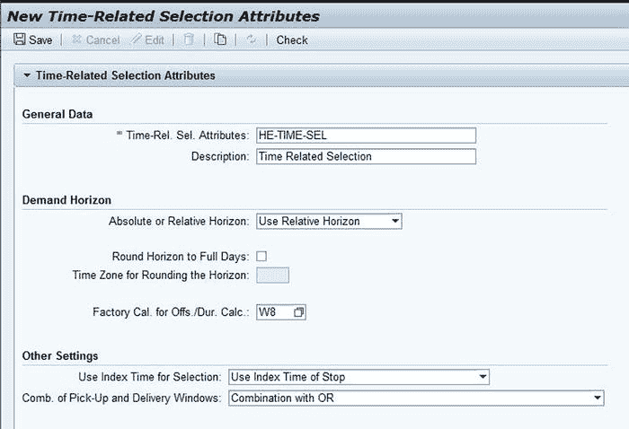

**图 A-50.** 创建时间相关选择属性：常规数据、需求时界、其他设置部分

在**取货**和**送货**部分，再次根据表 A-32 输入相应数据。

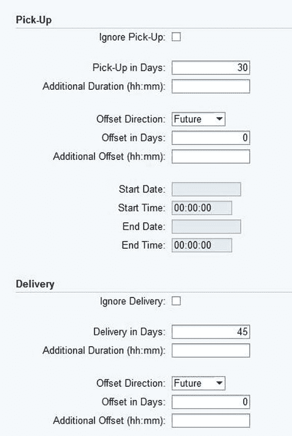

**图 A-51.** 创建时间相关选择属性：取货和送货部分

输入必要数据后，点击**保存**  按钮保存数据。

## 定义附加选择属性

此选项用于指定附加属性。

对于给定的场景，您需要定义表 A-33 至 A-35 中提供的附加选择属性。

**表 A-35.** 附加选择属性数据：前期运输阶段

| 字段 | 值 |
| --- | --- |
| 常规数据部分 | |
| 附加选择属性 | `HE-ADD-SEL-PRE` |
| 描述 | 附加选择 前期运输 |
| 计划需求 | 包含在选择中 |
| 冻结单据 | 在选择中排除 |

# 附加选择属性与配置文件定义

**表 A-34.** 附加选择属性数据：主要运输阶段；选择值选项卡

| 字段 | 值 | 值 |
| --- | --- | --- |
| 选择值选项卡 | | |
| 选择的业务对象 | `/SCMTMS/TO` | `/SCMTMS/TO` |
| 字段名称 | `TOR_TYPE` | `TOR_TYPE` |
| 符号 | 包含 | 包含 |
| 选项 | = | = |
| 下限值 | `FB01` | `FB02` |

**表 A-33.** 附加选择属性数据：主要运输阶段

| 字段 | 值 |
| --- | --- |
| 常规数据部分 | |
| 附加选择属性 | `HE-ADD-SEL-BOOK` |
| 描述 | 附加选择 预订 |
| 计划需求 | 包含在选择中 |
| 冻结单据 | 在选择中排除 |

要定义附加选择属性，请在 SAP NetWeaver Business Client 中依次点击`应用程序管理` ➤ `计划` ➤ `选择配置文件属性` ➤ `附加选择属性` ➤ `创建附加选择属性`。

然后，在`常规数据`部分，输入表 A-33 和 A-35 中的数据。

**图 A-52.** 创建附加选择属性：常规数据部分

在`选择值`选项卡中，输入表 A-34 中的数据。

**图 A-53.** 创建附加选择属性：选择值选项卡

输入必要数据后，点击`保存`  按钮保存数据。

按照此方式，定义其余的附加选择属性。

### 定义选择概要文件

此选项允许您指定系统要考虑的业务单据以及最大单据数量。

对于给定的场景，您需要定义表 A-36 中所示的选择概要文件。

**表 A-36.** 选择概要文件数据

| 字段 | 值 | 值 | 值 | 值 |
| --- | --- | --- | --- | --- |
| 通用数据部分 | | | | |
| 选择概要文件 | `HE-SEL-PRO-PRE` | `HE-SEL-PRO-MAIN` | `HE-SEL-PRO-ON` | `HE-SEL-PRO-BOOK` |
| 描述 | 选择概要文件——前置运输 | 选择概要文件——主要运输 | 选择概要文件——后续运输 | 选择概要文件——预订 |
| 所选对象的最大数量 | 75 | 75 | 75 | 250 |
| 概要文件分配部分 | | | | |
| 时间相关选择属性 | | | `HE-TIME-SEL` | `HE-TIME-SEL` |
| 地理选择属性 | `HE-GEO-SEL-PRE` | `HE-GEO-SEL-MAIN` | `HE-GEO-SEL-ON` | |
| 附加选择属性 | `HE-ADD-SEL-PRE` | `HE-ADD-SEL-PRE` | `HE-ADD-SEL-PRE` | `HE-ADD-SEL-BOOK` |

要定义选择概要文件，请在 SAP NetWeaver Business Client 中点击`应用管理` ➤ `计划` ➤ `选择概要文件` ➤ `创建选择概要文件`。

在`通用数据`和`概要文件分配`部分，使用表 A-36 输入相应的数据。

**图 A-54.** 创建选择概要文件

输入必要数据后，点击`保存`  按钮保存数据。

以相同方式定义其余的选择概要文件。

### 定义容量选择设置

此选项允许您指定与容量相关的标准，这些标准在计划时将被考虑。

对于给定的场景，您需要定义表 A-37 中显示的容量选择设置。

**表 A-37.** 容量选择设置数据

| 字段 | 值 | 值 | 值 |
| --- | --- | --- | --- |
| 通用数据部分 | | | |
| 容量选择设置 | `HE-CAP-SEL-PRE` | `HE-CAP-SEL-MAIN` | `HE-CAP-SEL-ON` |
| 描述 | 前置运输的容量设置 | 主要运输的容量设置 | 后续运输的容量设置 |
| 车辆资源选项卡 | | | |
| 车辆资源选择的属性 | `VEHICLERES_ID` | `VEHICLERES_ID` | `VEHICLERES_ID` |
| 符号 | 包含 | 包含 | 包含 |
| 选项 | 模式 | `=` | 模式 |
| 下限 | `HEJP_TRUCK*` | `HE_ AIRPLAN` | `HEUS_TRUCK*` |
| 计划选项卡 | | | |
| 计划选择的属性 | `SCH_ID` | `SCH_ID` | `SCH_ID` |
| 符号 | 包含 | 包含 | 包含 |
| 选项 | `=` | 模式 | `=` |
| 下限 | `HE-JPTR-SCH-PRE-01` | `HE-MF-SCH*` | `HE-USTR-SCH-ON-01` |

要定义容量选择设置，请在 SAP NetWeaver Business Client 中点击`应用管理` ➤ `计划` ➤ `计划概要文件设置` ➤ `容量选择设置` ➤ `创建容量选择设置`。

接下来，在`通用数据`部分，输入表 A-37 中的相关数据。

**图 A-55.** 创建容量选择设置：`通用数据`部分

在`车辆资源`选项卡中，再次输入表 A-37 中的相关数据。

**图 A-56.** 创建容量选择设置：`车辆资源`选项卡

在`计划`选项卡中执行相同操作。

**图 A-57.** 创建容量选择设置：`计划`选项卡

输入必要数据后，点击`保存`  按钮保存数据。

以相同方式定义其余的容量选择设置。

### 定义优化器设置

您可以使用此选项指定设置，例如优化器运行时间、最大转运地点和流程数量，以及货运单生成规则。

对于给定的场景，您必须定义表 A-38 中所示的优化器设置。

**表 A-38.** 优化器设置数据

| 字段 | 值 |
| --- | --- |
| 通用数据部分 | |
| 优化器设置 | `HE-OPT-SET` |
| 描述 | 优化器设置 |
| 计划策略 | `VSR_DEF` |
| 货运单生成规则 | 资源为空时生成新的货运单 |
| 运输建议设置部分 | |
| 接受运输建议 | 保存路线和货运单据 |
| 运输建议的计划策略 | `VSR_DEF` |
| 最大运输建议数量 | 7 |
| 优化器运行时间部分 | |
| 最大并行进程数 | 9 |
| 最大运行时间（秒） | 60 |
| 自动运行时间调节 | 未使用 |
| 粗略计划与容量约束部分 | |
| 粗略计划 | 不使用粗略计划 |
| 优化时考虑容量 | 是 |
| 转运地点部分 | |
| 最大转运地点数 | 6 |

要定义优化器设置，请在 SAP NetWeaver Business Client 中点击`应用管理` ➤ `计划` ➤ `计划概要文件设置` ➤ `优化器设置` ➤ `创建优化器设置`。

在`通用数据`和`运输建议设置`部分，使用表 A-38 输入相应的数据。

**图 A-58.** 创建优化器设置：`通用数据`和`运输建议设置`部分

在`优化器运行时间`、`粗略计划与容量约束`和`转运地点`部分，再次使用表 A-38 输入相应的数据。

**图 A-59.**

# 创建优化器设置

创建优化器设置：`优化器运行时间`、`粗略计划与容量约束`和`转运地点`部分。

输入必要数据后，点击`保存`  按钮保存数据。

## 定义承运商选择设置

此选项允许您指定系统在计划时是使用运输配额还是业务份额。

对于给定的场景，您需要定义表 A-39 中提供的承运商选择设置。

**表 A-39. 承运商选择设置数据**

| 字段 | 值 |
| --- | --- |
| **常规数据部分** | |
| 承运商选择设置 | `HE-CAR-SEL` |
| 描述 | 承运商选择 |
| 检查不兼容性 | `<选择>` |
| 并行处理配置文件 | `<空白>` |
| 承运商选择设置类型 | 通用承运商选择 |
| **其他设置部分** | |
| 配额使用 | 不使用运输配额 |
| 业务份额使用 | 不使用业务份额 |
| 策略 | 成本 |
| 承运商成本来源 | 使用内部成本 |
| **高级设置标签页** | |
| 计划策略 | `TSPS_DEF` |
| 优化器运行时间 | `6` |
| 手动排名的操作 | 移除 |
| 运输费用解释 | 接受费用为零的承运商 |
| 承运商选择运行后的操作 | 分配最佳承运商 |
| 连续运输类型 | 使用运输通道设置 |
| 连续运输信息 | `<选择>` |
| 检查配送和持续时间 | `<选择>` |
| 运输费用管理的连续运输成本重算 | 不重算 |
| 使用招标对象进行优化 | `<取消选择>` |

要定义承运商选择设置，请在 `SAP NetWeaver Business Client` 中，依次点击 `应用程序管理` ➤ `计划` ➤ `计划配置文件设置` ➤ `承运商选择设置` ➤ `创建承运商选择设置`。

然后，在 `常规数据` 部分，输入表 A-39 中的相关数据。

*图 A-60. 创建承运商选择设置：常规数据部分*

在 `其他设置` 部分，再次输入表 A-39 中的相关数据。

*图 A-61. 创建承运商选择设置：其他设置部分*

在 `高级设置` 标签页中执行相同操作。

*图 A-62. 创建承运商选择设置：高级设置标签页*

输入必要数据后，点击 `保存`  按钮保存数据。

## 定义货运结算单据的编号范围间隔

使用此选项指定货运结算单据的编号范围。

对于给定的场景，您必须定义表 A-40 中所示的编号范围间隔。

**表 A-40. 货运结算单据编号范围间隔数据**

| 字段 | 值 | 值 |
| --- | --- | --- |
| 编号范围编号 | `H1` | `H2` |
| 起始编号 | `00000000005100000000` | `00000000006100000000` |
| 终止编号 | `00000000005199999999` | `00000000006199999999` |
| 外部 | `<取消选择>` | `<取消选择>` |

要定义编号范围，请转到 `SAP 运输管理的自定义`，然后依次点击 `运输管理` ➤ `结算` ➤ `货运结算` ➤ `定义货运结算单据的编号范围间隔`。

要为货运结算单据定义编号范围间隔，请点击 `间隔`  按钮，然后点击 `插入行`  按钮。输入表 A-40 中的编号范围。

*图 A-63. 为货运结算单据创建编号范围间隔*

输入必要数据后，点击 `保存`  按钮保存数据。

> **注意：** 在 `运输编号范围间隔` 对话框中，点击 `继续`  按钮。

按此方式定义其余编号范围间隔。

## 定义货运结算单据类型

此选项允许您指定货运结算单据的各种参数。

对于给定的场景，您需要定义表 A-41 中显示的货运结算单据类型。

**表 A-41. 货运结算单据类型数据**

| 字段 | 值 | 值 |
| --- | --- | --- |
| 货运结算单据类型 | `FW01` | `IS01` |
| 描述 | 货运结算单据 | 内部结算单据 |
| 货运结算单据类别 | 货运结算单据 | 内部结算单据 |
| 跟踪更改 | `<选择>` | `<选择>` |
| 业务仓库相关性 | `<选择>` | `<选择>` |
| **编号范围设置部分** | |
| 编号范围间隔 | `H1` | `H2` |
| **输出选项部分** | |
| 输出配置文件 | `/SCMTMS/CFIR` | `/SCMTMS/CFIR` |
| 附加输出配置文件 | `/SCMTMS/CFIR_PRINT` | `/SCMTMS/CFIR_PRINT` |
| 输出配置文件的动态确定 | `<取消选择>` | `<取消选择>` |

要定义货运结算单据类型，请转到 `SAP 运输管理的自定义`，然后依次点击 `运输管理` ➤ `结算` ➤ `货运结算` ➤ `定义货运结算单据类型`。

接下来，选择 `新条目`  按钮，并输入表 A-41 中的相关数据。

*图 A-64. 创建货运结算单据类型*

在 `输出选项` 部分，再次输入表 A-41 中的相关数据。

*图 A-65. 创建货运结算单据类型：输出选项部分*

输入必要数据后，点击 `保存`  按钮保存数据。

按此方式定义其余结算单据类型。

## 定义运费结算单据的编号范围间隔

使用此选项指定运费结算单据的编号范围。

对于给定的场景，您必须定义表 A-42 中所示的编号范围间隔。

**表 A-42. 运费结算单据编号范围间隔数据**

| 字段 | 值 |
| --- | --- |
| 编号范围编号 | `H1` |
| 起始编号 | `00000000000400000000` |
| 终止编号 | `00000000000499999999` |
| 外部 | `<取消选择>` |

要定义编号范围，请转到 `SAP 运输管理的自定义`，然后依次点击 `运输管理` ➤ `结算` ➤ `运费结算` ➤ `定义运费结算单据的编号范围间隔`。

要为运费结算单据定义编号范围间隔，请点击 `间隔`  按钮，然后点击 `插入行`  按钮。输入表 A-42 中的编号范围。

*图 A-66. 为运费结算单据创建编号范围间隔*

输入必要数据后，点击`保存`  按钮保存数据。

> **注意：** 在`运输编号范围间隔`对话框中，点击`继续`  按钮。

### 定义运费结算单据类型

通过此选项，您可以指定运费结算单据的各种参数。

针对给定场景，您必须定义表 A-43 中提供的运费结算单据类型。

**表 A-43.** 运费结算单据类型数据

| 字段 | 值 |
| --- | --- |
| 运费结算单据类型 | `FS01` |
| 描述 | 承运人结算单据 |
| 运费结算单据类别 | 运费结算单据 |
| 跟踪更改 | `<选择>` |
| 业务仓库 | `<选择>` |
| 启用成本分摊 | `<选择>` |
| **编号范围设置部分** | |
| 编号范围区间 | `H1` |
| **输出选项部分** | |
| 输出描述文件 | `/SCMTMS/TOR_INV_PREP` |
| 附加输出描述文件 | `/SCMTMS/SFIR_PRINT` |
| 输出描述文件的动态确定 | `<取消选择>` |

要定义运费结算单据类型，请转到 SAP 运输管理的定制设置，然后点击`运输管理` ➤ `结算` ➤ `运费结算` ➤ `定义运费结算单据类型`。

然后，点击`新条目`  按钮，并输入表 A-43 中的相关数据。

**图 A-67.** 创建运费结算单据类型

在`输出选项`部分，再次输入表 A-43 中的相关数据。

**图 A-68.** 创建运费结算单据类型：输出选项部分

输入必要数据后，点击`保存`  按钮保存数据。

### 为货运单管理定义编号范围区间

使用此选项指定业务单据（例如货运单、货运预订、货运单元和运输单元）的编号范围。

针对给定场景，您需要定义表 A-44 中显示的编号范围区间。

**表 A-44.** 货运单管理编号范围区间数据

| 字段 | 值 | 值 | 值 | 值 | 值 |
| --- | --- | --- | --- | --- | --- |
| 编号范围编号 | `H1` | `H2` | `H3` | `H4` | `H5` |
| 起始编号 | `00000000000600000000` | `00000000000700000000` | `00000000000800000000` | `00000000000900000000` | `00000000001000000000` |
| 终止编号 | `00000000000699999999` | `00000000000799999999` | `00000000000899999999` | `00000000000999999999` | `00000000001999999999` |
| 外部 | `<取消选择>` | `<取消选择>` | `<取消选择>` | `<取消选择>` | `<取消选择>` |

要定义编号范围，请转到 SAP 运输管理的定制设置，然后点击`运输管理` ➤ `货运单管理` ➤ `为货运单管理定义编号范围区间`。

要为货运单管理定义编号范围区间，请点击`区间`  按钮，然后点击`插入行`  按钮。输入表 A-44 中的编号范围。

**图 A-69.** 为货运单管理创建编号范围区间

输入必要数据后，点击`保存`  按钮保存数据。

> **注意：** 在`运输编号范围区间`对话框中，点击`继续`  按钮。

以这种方式，定义剩余的编号范围区间。

### 定义货运单类型

通过此选项，您可以指定影响货运单处理的各种参数。

针对给定场景，您必须定义表 A-45 中所示的货运单类型。

**表 A-45.** 货运单类型数据

| 字段 | 值 | 值 |
| --- | --- | --- |
| 货运单类型 | `FO01` | `FO02` |
| 描述 | 空运取件/派送的货运单 | 空运前段/中段运输的货运单 |
| **基本设置部分** | | |
| 货运单可分包 | 与分包相关 | 与分包相关 |
| 发货方/收货方确定 | 基于前驱单据确定 | 基于前驱单据确定 |
| 保存时锁定单据 | `<取消选择>` | `<取消选择>` |
| 货运单可删除 | `<选择>` | `<选择>` |
| 启用结算 | `<选择>` | `<选择>` |
| 启用费用计算 | `<选择>` | `<选择>` |
| 启用内部结算 | `<选择>` | `<选择>` |
| 启用内部费用计算 | `<选择>` | `<选择>` |
| 启用成本分摊 | `<选择>` | `<选择>` |
| 运输顺序点类型 | 已定义且线性 | 已定义且线性 |
| **更改控制器设置部分** | | |
| 默认更改策略 | `DEF_CHACO` | `DEF_CHACO` |
| **执行设置部分** | | |
| 执行跟踪相关性 | 带外部事件管理的执行跟踪 `<(仅当配置了与 SAP EM 的集成时选择此选项)>` | 带外部事件管理的执行跟踪 `<(仅当配置了与 SAP EM 的集成时选择此选项)>` |
| 执行选项卡的显示模式 | 来自 TM 和 EM 的实际事件，来自 EM 的预期事件 | 来自 TM 和 EM 的实际事件，来自 EM 的预期事件 |
| 传播执行信息 | `<选择>` | `<选择>` |
| **事件管理设置部分** | | |
| 应用程序对象类型 | `ODT30_TO` | `ODT30_TO` |
| 最后预期事件 | `POD` | `POD` |
| **投标设置部分** | | |
| 使用默认设置 | `<选择>` | `<选择>` |
| **附加设置部分** | | |
| 默认运费结算单据类型 | 承运人结算单据 | 承运人结算单据 |
| 默认承运人选择设置 | `HE-CAR-SEL` | `HE-CAR-SEL` |
| 业务仓库相关性 | `<选择>` | `<选择>` |
| 跟踪更改 | `<选择>` | `<选择>` |
| **编号范围设置部分** | | |
| 抽取时间 | 立即抽取编号 | 立即抽取编号 |
| 编号范围区间 | `H1` | `H2` |
| **附加策略部分** | | |
| 保存策略 | `CALC_CHARG` | `CALC_CHARG` |
| **默认运输方式确定部分** | | |
| 运输方式 | `01` | `01` |
| **输出选项部分** | | |
| 输出描述文件 | `/SCMTMS/TOR_PRINT_ROAD` | `/SCMTMS/TOR_PRINT_ROAD` |

要定义货运单类型，请转到 SAP 运输管理的定制设置，然后点击`运输管理` ➤ `货运单管理` ➤ `货运单` ➤ `定义货运单类型`。

接下来，点击`新条目`  按钮，并输入货运单类型。

然后，在`基本设置`和`更改控制器设置`部分，使用表 A-45 输入相应的数据。

图 A-70. 创建货运单类型：`基本设置`和`更改控制器设置`部分

在`执行设置`和`投标设置`部分，使用表 A-45 输入相应的数据。

图 A-71. 创建货运单类型：`执行设置`和`投标设置`部分

在`附加设置`部分，输入表 A-45 中的相关数据。

图 A-72. 创建货运单类型：`附加设置`部分

在`编号范围设置`和`附加策略`部分，使用表格 A-45 输入相应的数据。

图 A-73. 创建货运订单类型：`编号范围设置`和`附加策略`部分

在`默认运输方式确定`和`输出选项`部分，使用表格 A-45 输入相应的数据。

图 A-74. 创建货运订单类型：`默认运输方式确定`和`输出选项`部分

输入必要数据后，点击`保存`  按钮保存数据。以这种方式，定义其余的货运订单类型。

### 定义货运预订类型

该选项允许您指定影响货运预订处理的各种参数。

对于给定的场景，您需要定义表格 A-46 中提供的货运预订类型。

**表 A-46.** 货运预订类型数据

| 字段 | 值 | 值 |
| --- | --- | --- |
| 货运预订类型 | `FB02` | `FB01` |
| 描述 | 空运进口货运预订 | 空运出口货运预订 |
| 运输方式类别 | 空运 | 空运 |
| 运输方式 | `05` | `05` |
| 基本设置部分 | | |
| 发货方/收货方确定 | 基于前序单据确定 | 基于前序单据确定 |
| 固定预订 | 不固定 | 不固定 |
| 预订可删除 | `<选择>` | `<选择>` |
| 启用结算 | `<选择>` | `<选择>` |
| 启用成本分摊 | `<选择>` | `<选择>` |
| 启用费用计算 | `<选择>` | `<选择>` |
| 拼载 | `<取消选择>` | `<取消选择>` |
| 变更控制器设置部分 | | |
| 默认变更策略 | `DEF_CHACO` | `DEF_CHACO` |
| 执行设置 | | |
| 承运人确认 | 不需要承运人确认 | 不需要承运人确认 |
| 执行跟踪相关性 | 使用外部事件管理进行执行跟踪 `<`(仅当配置了与 SAP EM 的集成时才选择此选项)`>` | 使用外部事件管理进行执行跟踪 `<`(仅当配置了与 SAP EM 的集成时才选择此选项)`>` |
| 执行选项卡的显示模式 | 来自 TM 和 EM 的实际事件，来自 EM 的预期事件 | 来自 TM 和 EM 的实际事件，来自 EM 的预期事件 |
| 立即处理 | 生命周期不立即设置为“处理中” | 生命周期不立即设置为“处理中” |
| 严格性执行检查 | `<取消选择>` | `<取消选择>` |
| 传播执行信息 | `<选择>` | `<选择>` |
| 事件管理设置部分 | | |
| 应用程序对象类型 | `ODT30_TO` | `ODT30_TO` |
| 最后一个预期事件 | `POD` | `POD` |
| 附加设置部分 | | |
| 默认货运结算单据类型 | 承运人结算单据 | 承运人结算单据 |
| 提货的默认货运订单类型 | `FO01` | `FO01` |
| 交货的默认货运订单类型 | `FO01` | `FO01` |
| 业务仓库相关性 | `<选择>` | `<选择>` |
| 跟踪更改 | `<选择>` | `<选择>` |
| 启用合规性检查 | `<取消选择>` | `<取消选择>` |
| 集装箱条目来源 | 集装箱条目在预订中定义 | 集装箱条目在预订中定义 |
| Web Dynpro 应用程序配置 | `/SCMTMS/FRE_BOOK_CBAIR` | `/SCMTMS/FRE_BOOK_CBAIR` |
| 进口预订类型 | | `FB02` |
| 空运货物安全 (ACS) 检查 | `<取消选择>` | `<取消选择>` |
| 编号范围设置部分 | | |
| 提取时间 | 立即提取号码 | 立即提取号码 |
| 编号范围区间 | `H4` | `H3` |
| 服务定义部分 | | |
| 合并（来源） | 带合并 | 带合并 |
| 合并（目的地） | 带合并 | 带合并 |
| 运输类型 | `10` | `10` |
| 运输方向 | 进口 | 出口 |
| 输出选项部分 | | |
| 输出配置 | `/SCMTMS/TOR` | `/SCMTMS/TOR` |
| 附加输出配置 | `/SCMTMS/TOR_PRINT_AIR` | `/SCMTMS/TOR_PRINT_AIR` |
| 前序单据处理部分 | | |
| 从前序更新 | 允许从前序进行异步更新 | 允许从前序进行异步更新 |

要定义货运预订类型，请转至 SAP 运输管理的定制，并点击`运输管理` ➤ `货运订单管理` ➤ `货运预订` ➤ `定义货运预订类型`。

接下来，点击`新条目`  按钮，并输入预订类型。

现在，在`基本设置`和`变更控制器设置`部分，使用表格 A-46 输入相应的数据。

图 A-75. 创建货运预订类型：`基本设置`和`变更控制器设置`部分

在`执行设置`部分，从表格 A-46 输入相关数据。

图 A-76. 创建货运预订类型：`执行设置`部分

在`附加设置`部分，再次从表格 A-46 输入相关数据。

图 A-77. 创建货运预订类型：`附加设置`部分

在`编号范围设置`、`服务定义`和`输出选项`部分，使用表格 A-46 输入相应的数据。

图 A-78. 创建货运预订类型：`编号范围设置`、`服务定义`和`输出选项`部分

在`前序单据处理`部分，从表格 A-46 输入相关数据。

图 A-79. 创建货运预订类型：`前序单据处理`部分

输入必要数据后，点击`保存`  按钮保存数据。以这种方式，定义其余的货运预订类型。

### 定义合同基础

对于货运预订，需要向承运人做出合同承诺。此选项允许您定义合同的基础。

对于给定的场景，您必须定义合同基础。

**表 A-47.** 合同基础数据

| 字段 | 值 | 值 |
| --- | --- | --- |

| 合同基础 | `01` | `02` |
| --- | --- | --- |
| 描述 | 配额分配 | 锁定仓位 |

要定义合同基础，请转至 SAP 运输管理的定制，并点击`运输管理` ➤ `货运订单管理` ➤ `货运预订` ➤ `定义合同基础`。

然后，点击`新条目`按钮，并从表格 A-47 输入数据。

图 A-80. 创建合同基础

输入必要数据后，点击`保存`  按钮保存数据。以这种方式，定义其余的合同基础。

### 定义货运单单元类型

此选项允许您指定影响货运单单元处理的各种参数。

对于给定的场景，您需要定义表 A-48 中显示的货运单单元类型。

**表 A-48.** 货运单单元类型数据

| 字段 | 值 |
| --- | --- |
| `货运单单元类型` | `FU01` |
| `描述` | 空运货运单单元 |
| `默认类型` | <取消选择> |
| `基本设置部分` | |
| `货运单单元可删除` | <选择> |
| `变更控制器设置部分` | |
| `默认变更策略` | `DEF_CHACO` |
| `执行设置部分` | |
| `执行跟踪相关性` | 使用外部事件管理进行执行跟踪 <（仅当配置了与 SAP EM 的集成时才选择此选项）> |
| `执行选项卡的显示模式` | 来自 TM 和 EM 的实际事件，来自 EM 的预期事件 |
| `立即处理` | <选择> |
| `事件管理设置部分` | |
| `应用程序对象类型` | `ODT30_FU` |
| `最后预期事件` | `POD` |
| `附加设置部分` | |
| `提货/交货窗口规则` | 按货运订单、FWO、FWQ、OTR 或 DTR 中定义的提货和交货 |
| `业务仓库相关性` | <选择> |
| `跟踪变更` | <选择> |
| `编号范围设置部分` | |
| `提取时间` | 保存文档时提取编号 |
| `编号范围区间` | `H5` |
| `货运单确定部分` | |
| `货运单类型` | `FO01` |

要定义货运单单元类型，请转到 SAP 运输管理的 Customizing，并点击`Transportation Management` ➤ `Planning` ➤ `Freight Unit` ➤ `Define Freight Unit Types`。

现在，点击`New Entries`  按钮，并输入单元类型。

在`Basic Settings`、`Change Controller Settings`和`Execution Settings`部分，使用表 A-48 输入相应的数据。

图 A-81. 创建货运单单元类型：基本设置、变更控制器设置和执行设置部分

在`Additional Settings`部分，从表 A-48 输入相关数据。

图 A-82. 创建货运单单元类型：附加设置部分

在`Number Range Settings`和`Freight-Order Determination`部分，使用表 A-48 输入相应的数据。

图 A-83. 创建货运单单元类型：编号范围设置和货运单确定部分

输入必要数据后，点击`Save`  按钮保存数据。

### 创建货运单构建规则

系统应如何根据货运订单创建货运单单元，是在系统中定义为一个规则。对于计划，此规则还允许您指定维度，这些维度作为能力需求从货运订单传输到货运单单元。

对于给定的场景，您需要创建货运单构建规则。

**表 A-50.** 货运单构建规则：计划数量表数据

| 字段 | 值 | 值 |
| --- | --- | --- |
| `计划数量选项卡` | | |
| `货运单构建的计划数量` | 毛重 | 毛体积 |
| `拆分数量计量单位` | kg | m³ |
| `拆分数量` | 4,000 | 7 |
| `舍入数量` | <留空> | <留空> |

**表 A-49.** 货运单构建规则数据

| 字段 | 值 |
| --- | --- |
| `通用数据部分` | |
| `货运单构建规则` | `HE-FUBR-01` |
| `描述` | 空运货运单规则 |
| `其他设置部分` | |
| `文档类型` | `FU01` |
| `控制部分` | |
| `货运单构建策略` | 按项目合并 |
| `临界数量` | 毛重 |
| `允许项目拆分` | <选择> |
| `高级设置选项卡` | |
| `文档类型确定条件` | <留空> |
| `流程控制器策略` | `FUB_AUTO` |

要创建货运单构建规则，请在 SAP NetWeaver 业务客户端中，点击`Application Administration` ➤ `Planning` ➤ `General Settings` ➤ `Freight Unit Building Rule` ➤ `Create Freight Unit Building Rule`。

接下来，在`General Data`选项卡的`General Data`和`Other Settings`部分，使用表 A-49 输入相应的数据。

图 A-84. 创建货运单构建规则：通用数据选项卡的通用数据和其他设置部分

在`General Data`选项卡的`Control`部分，从表 A-49 输入相关数据。

图 A-85. 创建货运单构建规则：通用数据选项卡的控制部分

在`Planning Quantities`选项卡中，从表 A-50 输入相关数据。

图 A-86. 创建货运单构建规则：计划数量选项卡

在`Advanced Settings`选项卡的`Advanced Settings`部分，再次从表 A-49 输入相关数据。

图 A-87. 创建货运单构建规则：高级设置选项卡

输入必要数据后，点击`Save`  按钮保存数据。

### 定义计划参数文件

此选项允许您指定执行计划时需要考虑的各种参数。

针对所给场景，您必须定义表 A-51 中所示的计划参数文件。

**表 A-51.** 计划参数文件数据

| 字段 | 值 | 值 | 值 |
| --- | --- | --- | --- |
| `通用数据部分` | | | |
| `计划参数文件` | `HE-PLAN-PRO-PRE` | `HE-PLAN-PRO-MAIN` | `HE-PLAN-PRO-ON` |
| `描述` | 用于前期运输的计划参数文件 | 用于主要运输的计划参数文件 | 用于后续运输的计划参数文件 |
| `计划范围部分` | | | |
| `持续时间（天）` | 100 | 75 | 100 |
| `偏移方向` | 未来 | 未来 | 未来 |
| `偏移量（天）` | 0 | 0 | 0 |

# SAP Transportation Management 配置指南

## 定义计划参数文件

| 用于偏移量/持续时间计算的工厂日历 | W8 | W8 | W8 |
| --- | --- | --- | --- |
| 将计划范围四舍五入到整天 | `<选择>` | `<选择>` | `<选择>` |
| 计划范围舍入时区 | CET | CET | CET |
| **参数文件分配部分** | | | |
| 货运预订的选择参数文件 | | `HE-SEL-PRO-BOOK` | |
| 运力选择设置 | `HE-CAP-SEL-PRE` | `HE-CAP-SEL-MAIN` | `HE-CAP-SEL-ON` |
| 优化器设置 | `HE-OPT-SET` | `HE-OPT-SET` | `HE-OPT-SET` |
| 承运商选择设置 | `HE-CAR-SEL` | `HE-CAR-SEL` | `HE-CAR-SEL` |
| **业务单据类型部分** | | | |
| 类型确定规则 | 在计划参数文件中按类别定义 | 在计划参数文件中按类别定义 | 在计划参数文件中按类别定义 |
| 车辆资源的默认类型 | `FO02` | `FO02` | `FO02` |
| 预订的默认类型（空运） | `FB01` | `FB01` | `FB01` |
| **手动计划部分** | | | |
| 手动计划策略 | `VSRI_DEF` | `VSRI_DEF` | `VSRI_DEF` |
| 考虑锁定状态 | 更改固定单据时出错 | 更改固定单据时出错 | 更改固定单据时出错 |
| **调度部分** | | | |
| 调度策略 | `VSS_DEF` | `VSS_DEF` | `VSS_DEF` |
| 考虑货运单日期 | 仅将货运单日期视为软约束 | 不考虑货运单日期 | 不考虑货运单日期 |
| 调度方向 | 向后 | 向后 | 向后 |
| **检查部分** | | | |
| 检查策略 | `VSR_CHECK` | `VSR_CHECK` | `VSR_CHECK` |
| 考虑运力 | 警告 | 警告 | 警告 |
| **装卸持续时间部分** | | | |
| 依赖性 | 货运单与运输工具无关 | 货运单与运输工具无关 | 货运单与运输工具无关 |
| 装卸持续时间 | `00:00:00` | `00:00:00` | `00:00:00` |

要定义计划参数文件，请在 `SAP NetWeaver Business Client` 中选择“应用管理”➤“计划”➤“计划参数文件”➤“创建计划参数文件”。

然后，在“通用数据”、“计划范围”和“参数文件分配”部分，分别输入表 A-51 中的相应数据。

图 A-88. 创建计划参数文件：计划参数文件选项卡的“通用数据”、“计划范围”和“参数文件分配”部分

在计划参数文件选项卡的“业务单据类型”、“手动计划”、“调度”、“检查”和“装卸持续时间”部分，分别输入表 A-51 中的相应数据。

图 A-89. 创建计划参数文件：计划参数文件选项卡的“业务单据类型”、“手动计划”、“调度”、“检查”和“装卸持续时间”部分

输入必要数据后，点击“保存” 按钮保存数据。

以同样方式定义其余的计划参数文件。

### 定义货运订单管理的编号范围间隔

使用此选项为货运订单指定编号范围。

针对所给场景，您必须定义表 A-52 中所示的编号范围间隔。

表 A-52. 货运订单管理编号范围间隔数据

| 字段 | 值 |
| --- | --- |
| 编号范围编号 | `H1` |
| 起始编号 | `00000000001000000000` |
| 结束编号 | `00000000001099999999` |
| 外部给号 | `<取消选择>` |

要定义编号范围，请转至 `SAP Transportation Management` 的定制，点击“运输管理”➤“货运订单管理”➤“定义货运订单管理的编号范围间隔”。

要为货运订单管理定义编号范围间隔，请点击“间隔” 按钮，然后点击“插入行” 按钮。输入表 A-52 中的编号范围。

图 A-90. 为货运订单管理创建编号范围间隔

输入必要数据后，点击“保存” 按钮保存数据。

**注意**：在“运输编号范围间隔”对话框中，点击“继续” 按钮。

### 定义货运订单类型

通过此选项，您可以指定各种参数，例如货运单位创建和计划概要，这些参数会影响货运订单的处理。

对于给定的场景，您必须定义表 A-53 中所示的货运订单类型。

**表 A-53.** 货运订单类型数据

| 字段 | 值 | 值 |
| --- | --- | --- |
| 货运订单类型 | `FW02` | `FW01` |
| 描述 | 进口货运订单 | 出口货运订单 |
| **编号范围设置部分** | | |
| 编号范围间隔 | `H1` | `H1` |
| 模板编号范围间隔 | `H1` | `H1` |
| **流程控制/业务对象模式部分** | | |
| 相同地点和业务伙伴 | `<取消选择>` | `<取消选择>` |
| 自动冻结 | `<取消选择>` | `<取消选择>` |
| 业务仓库相关性 | `<选择>` | `<选择>` |
| 自动建立货运单位 | `<选择>` | `<选择>` |
| 启用审批工作流 | `<取消选择>` | `<取消选择>` |
| 跟踪单据更改 | `<选择>` | `<选择>` |
| 启用费用计算 | `<选择>` | `<选择>` |
| 自动费用计算 | `<取消选择>` | `<取消选择>` |
| 启用内部费用计算 | `<选择>` | `<选择>` |
| 自动内部费用计算 | `<取消选择>` | `<取消选择>` |
| 运输方式 | `05` | `05` |
| 运输类型 | `10` | `10` |
| 交通方向 | `2` | `1` |
| **空运货物设置部分** | | |
| 空运提单类型 | `04` | `04` |
| 启用空运货物安全检查 | `<选择>` | `<选择>` |
| 复制空运货物安全数据 | `<选择>` | `<选择>` |
| 阶段确定 | 按阶段概要确定阶段 | 按移动类型确定阶段 |
| 阶段概要 | `HEIM` | |
| 启用货运结算 | `<选择>` | `<选择>` |
| 默认货运结算单据类型 | `FW01` | `FW01` |
| 启用内部结算 | `<选择>` | `<选择>` |
| 默认内部结算单据类型 | `IS01` | `IS01` |
| 自动确认 | `<取消选择>` | `<取消选择>` |
| 默认确认类型 | `O` | `O` |
| 事件管理(EM)集成已激活 | `<选择>` (仅当已配置与 `SAP EM` 的集成时，才选择此选项) | `<选择>` (仅当已配置与 `SAP EM` 的集成时，才选择此选项) |
| 事件管理器 | `<指定事件管理客户端的名称>` (仅当已配置与 `SAP EM` 的集成时，才选择此选项) | `<指定事件管理客户端的名称>` (仅当已配置与 `SAP EM` 的集成时，才选择此选项) |
| 输出概要 | `/SCMTMS/TRQ_FWO` | `/SCMTMS/TRQ_FWO` |
| 附加输出概要 | `/SCMTMS/TRQ_FWO_PRINT` | `/SCMTMS/TRQ_FWO_PRINT` |
| 接受运输方案 | 仅保存路线 | 仅保存路线 |
| 传播更改 | 更改同步传播，回退至异步 | 更改同步传播，回退至异步 |
| 海关处理 | 自动 | 手动 |
| 进口货运订单类型 | | `FW02` |
| **默认值部分** | | |
| 默认重量计量单位 | `kg` | `kg` |
| 默认体积计量单位 | `m³` | `m³` |
| 默认件数计量单位 | `PC` | `PC` |
| 货运单位建立 - 规则 | `HE-FUBR-01` | `HE-FUBR-01` |

# 计划概要

| 计划概要 | | `HE-PLAN-PRO-MAIN` |

| **组织单位确定部分** | | |

| 考虑用户分配 | `<取消选择>` | `<取消选择>` |

| 销售组织 | `<空白>` | `<空白>` |

要定义一个货运订单类型，请转至 SAP 运输管理的自定义设置，并点击 `运输管理` ➤ `货运订单管理` ➤ `货运订单` ➤ `定义货运订单类型`。

然后，点击 `新条目` 按钮，并输入订单类型。

在 `编号范围设置`、`流程控制 / 业务对象模式` 和 `空运货物设置` 部分，使用表 A-53 输入相应的数据。

`图 A-91.` 创建货运订单类型：`编号范围设置`、`流程控制 / 业务对象模式` 和 `空运货物设置`（前半部分）部分

在 `默认值` 和 `组织单位确定` 部分，再次使用表 A-53 输入相应的数据。

`图 A-92.` 创建货运订单类型：`空运货物设置`（后半部分）、`默认值` 和 `组织单位确定` 部分

输入必要数据后，点击 `保存` 按钮保存数据。

以这种方式，定义其余的货运订单类型。

**注意**

如果您发现某些字段未启用，请按 `回车` 键。

## 为货运订单类型分配项目类型

通过此选项，您可以为货运订单类型指定有效的项目类型和项目类别。此选项的目的是限制特定货运订单类型的项目类型和类别。

对于给定的场景，您需要定义表 A-54 中显示的分配。

`表 A-54.` 为货运订单类型分配项目类型的数据

| 字段 | 值 | 值 | 值 | 值 |
| --- | --- | --- | --- | --- |
| 货运订单类型 | `FW01` | `FW01` | `FW02` | `FW02` |
| 项目类型 | `HEPK` | `HEPD` | `HEPK` | `HEPD` |
| 默认项目类型 | `<选择>` | `<选择>` | `<选择>` | `<选择>` |
| 项目类别 | 包裹 | 产品 | 包裹 | 产品 |

要将项目类型分配给货运订单类型，请转至 SAP 运输管理的自定义设置，并点击 `运输管理` ➤ `货运订单管理` ➤ `货运订单` ➤ `将项目类型分配给货运订单类型`。

现在，点击 `新条目` 按钮，并从表 A-54 输入数据。

`图 A-93.` 将项目类型分配给货运订单类型

输入必要数据后，点击 `保存` 按钮保存数据。

以这种方式，将剩余的项目类型分配给货运订单类型。

## 定义运输阶段的默认货运单据类型

为运输阶段创建货运单据时，将使用此选项中指定的值，通过货运单的用户界面确定要创建的货运订单或货运预订的类型。

针对给定场景，您需要为表 A-55 中提供的运输阶段定义默认的货运单据类型。

`表 A-55.` 运输阶段的默认货运单据类型

| 字段 | 值 | 值 | 值 | 值 | 值 |
| --- | --- | --- | --- | --- | --- |
| 序列号 | 1 | 2 | 3 | 4 | 5 |
| 货运单类型 | FW01 | FW01 | FW01 | FW02 | FW02 |
| 运输类型 | 散货 | 散货 | 散货 | 散货 | 散货 |
| 运输阶段类型 | HE1 | HE2 | HE3 | HE4 | HE5 |
| 运输方式 | 01 | 01 | 05 | 01 | 01 |
| 销售组织 | `<空白>` | `<空白>` | `<空白>` | `<空白>` | `<空白>` |
| 单据类型 | FO01 | FO02 | FB01 | FO02 | FO01 |
| 创建货运单据 | `<选择>` | `<选择>` | `<选择>` | `<选择>` | `<选择>` |
| 选择货运单据 | `<选择>` | `<选择>` | `<选择>` | `<选择>` | `<选择>` |
| 选择计划 | `<选择>` | `<选择>` | `<选择>` | `<选择>` | `<选择>` |

要定义运输阶段的默认货运单据类型，请转到 SAP 运输管理的定制，然后单击`运输管理` ➤ `货运单管理` ➤ `货运单` ➤ `定义运输阶段的默认货运单据类型`。

然后，单击`新条目` 按钮，并输入表 A-55 中的数据。

`图 A-94.` 为运输阶段创建默认的货运单据类型

输入必要数据后，单击`保存` 按钮保存数据。

按照此方式，为其他运输阶段定义默认的货运单据类型。

## 定义计划的编号范围区间

使用此选项为计划指定编号范围。

针对给定场景，您需要定义表 A-56 中展示的编号范围区间。

`表 A-56.` 计划编号范围区间数据

| 字段 | 值 |
| --- | --- |
| 编号范围编号 | H1 |
| 起始编号 | AAAAAAAAAAAAAAAAAAAA |
| 终止编号 | ZZZZZZZZZZZZZZZZZZZZ |
| 外部 | `<选择>` |

要定义编号范围，请转到 SAP 运输管理的定制，然后单击`运输管理` ➤ `主数据` ➤ `运输网络` ➤ `计划` ➤ `定义计划的编号范围区间`。

要为计划定义编号范围区间，请单击`区间` 按钮，然后单击`插入行` 按钮。输入表 A-56 中的编号范围。

`图 A-95.` 为计划创建编号范围区间

输入必要数据后，单击`保存` 按钮保存数据。

**注意：** 在`运输编号范围区间`对话框中，单击`继续` 按钮。

## 定义航次的编号范围区间

使用此选项为航次指定编号范围。

针对给定场景，您必须定义表 A-57 中显示的编号范围区间。

`表 A-57.` 航次编号范围区间数据

| 字段 | 值 |
| --- | --- |
| 编号范围编号 | H1 |
| 起始编号 | 0030000000 |
| 终止编号 | 0039999999 |
| 外部 | `<取消选择>` |

要定义编号范围，请转到 SAP 运输管理的定制，然后单击`运输管理` ➤ `主数据` ➤ `运输网络` ➤ `计划` ➤ `定义航次的编号范围区间`。

## 为航次定义编号范围区间

要为航次定义编号范围区间，请单击`区间` 按钮，然后单击`插入行` 按钮。输入表 A-57 中的编号范围。

**图 A-96.** 为航次创建编号范围区间

输入必要数据后，单击`保存` 按钮保存数据。

**注意：** 在`运输编号范围区间`对话框中，单击`继续` 按钮。

### 定义计划类型

使用此选项定义在运输节点（如港口、机场或门户）序列中，特定时间段内有效的卡车、轮船或飞机的行程。

SAP TM 允许您定义以下计划：

-   **航班/承运人/公路计划：** 此计划允许您分别定义由飞机、轮船和卡车服务的运输节点序列。当起始站和目的站不是门户时，使用此计划。系统还允许您定义航次规则，航次规则进而会创建航班/航次/发运。

-   **主航班/海运/公路门户计划：** 当起始站和目的站是门户时，使用此计划。使用此计划，可以引用航班/承运人/公路计划。也可以复制航次规则和航班/航次/发运。

通过指定计划类型，可以在系统中定义计划。

针对给定场景，您需要定义表 A-58 中所示的计划类型。

**表 A-58.** 计划类型数据

| 字段 | 值 | 值 | 值 |
| --- | --- | --- | --- |
| 计划类型 | `HS01` | `HS02` | `HS03` |
| 描述 | 卡车运输计划 | 航班计划 | 主航班计划 |
| 默认类型 | `<取消选择>` | `<取消选择>` | `<取消选择>` |
| **基本设置部分** | | | |
| 运输方式 | `01` | `05` | `05` |
| 门户 | `<选择>` | `<取消选择>` | `<选择>` |
| 直达 | `<选择>` | `<取消选择>` | `<取消选择>` |
| 引用 | `<取消选择>` | `<取消选择>` | `<选择>` |
| 单据类型 | `FO02` | `FB01` | `FB01` |
| **编号范围设置部分** | | | |
| 抬头编号范围 | `H1` | `H1` | `H1` |
| 航次编号范围 | `H1` | `H1` | `H1` |
| **其他设置部分** | | | |
| 偏移时间类型 | 绝对 | 相对 | 相对 |
| 单一订单 | `<取消选择>` | `<取消选择>` | `<取消选择>` |
| 使用容量 | `<取消选择>` | `<取消选择>` | `<选择>` |
| 使用运输成本 | `<取消选择>` | `<取消选择>` | `<取消选择>` |

要定义计划类型，请转到 SAP 运输管理的定制，然后单击`运输管理` ➤ `主数据` ➤ `运输网络` ➤ `计划` ➤ `定义计划类型`。

现在，单击`新条目` 按钮，并输入表 A-58 中的数据。

**图 A-97.** 创建计划类型

输入必要数据后，单击`保存` 按钮保存数据。

按照此方式，定义其余的计划类型。

### 创建计划

定义计划类型后，您可以使用这些计划类型创建不同的计划。

#### 内陆运输与续程运输计划

对于给定的场景，您必须创建表 A-59 中显示的内陆运输与续程运输计划。

**表 A-59.** 计划（内陆运输与续程运输）数据

| 字段 | 值 | 值 |
| --- | --- | --- |
| `计划类型` | `HS01` | `HS01` |
| **常规数据选项卡** | | |
| `计划` | `HE-JPTR-SCH-PRE-01` | `HE-USTR-SCH-ON-01` |
| `计划描述` | 卡车计划——横滨至成田 | 卡车计划——洛杉矶至旧金山 |
| `有效期自` | `01-01-<当前年份>` | `01-01-<当前年份>` |
| `有效期至` | `31-12-<下一年份>` | `31-12-<下一年份>` |
| `运输方式` | `JP_TRUCK_S` | `US_TRUCK_S` |
| **承运人数据部分** | | |
| `承运人` | `HE-CR-02` | `HE-CR-04` |
| **标准网关部分/选项卡** | | |
| **来源网关部分** | | |
| `地点` | `HESTAJPYOK` | `HEGWUSLA` |
| `提货中转时长（小时）` | `4` | `5` |
| `货物截止时间` | `13:00:00` | `06:00:00` |
| `时区` | 日本 | UTC-8 |
| **目的地网关部分** | | |
| `地点` | `HEGWJPNAR` | `HESTAUSSFR` |
| `可提货时间` | `19:00:00` | `13:00:00` |
| `时区` | 日本 | UTC-8 |
| **出发部分/选项卡** | | |
| **出发规则选项卡** | | |
| `有效期的第一天` | `01-01-<当前年份>` | `01-01-<当前年份>` |
| `有效期的最后一天` | `31-12-<当前年份>` | `31-12-<当前年份>` |
| `星期一` | `<选择>` | `<选择>` |
| `星期二` | `<选择>` | `<选择>` |
| `星期三` | `<选择>` | `<选择>` |
| `星期四` | `<选择>` | `<选择>` |
| `星期五` | `<选择>` | `<选择>` |
| `星期六` | `<选择>` | `<选择>` |
| `星期日` | `<选择>` | `<选择>` |
| `工厂日历` | `W8` | `W8` |
| `出发时间` | `14:00:00` | `07:00:00` |
| `时区` | 日本 | UTC-8 |

要创建内陆运输与续程运输计划，请在 SAP NetWeaver Business Client 中，依次点击“主数据” ➤ “运输网络” ➤ “计划” ➤ “创建计划”。

输入表 A-59 中的计划类型，然后点击“继续”按钮。

**图 A-98.** 创建计划（内陆运输）的初始屏幕

在“常规数据”选项卡的“计划数据”和“承运人数据”部分，根据表 A-59 输入相应的数据。

**图 A-99.** 创建计划（内陆运输）：“常规数据”选项卡的“计划数据”和“承运人数据”部分

在“标准网关”选项卡的“来源网关”部分，根据表 A-59 输入相关数据。

**图 A-100.** 创建计划（内陆运输）：“标准网关”选项卡的“来源网关”部分

在“标准网关”选项卡的“目的地网关”部分，再次根据表 A-59 输入相关数据。

**图 A-101.** 创建计划（内陆运输）：“标准网关”选项卡的“目的地网关”部分

要根据表 A-59 创建出发规则，请在“出发”选项卡的“出发规则”子选项卡中，点击“创建”按钮。

**图 A-102.** 创建计划（内陆运输）：“出发”选项卡的“出发规则”子选项卡

要根据出发规则生成出发数据，请选中出发规则行，然后从“生成出发数据”菜单中选择“按有效期生成”。

**图 A-103.** 创建计划（内陆运输）：生成出发数据

输入必要数据后，点击“保存”按钮保存数据。

通过此方式，创建其余的内陆运输与续程运输计划。

### 航班计划

对于给定的场景，您还需要创建表 A-60 至 A-62 中显示的航班计划。

**表 A-62.** 计划（航班）：出发数据

| 字段 | 值 |
| --- | --- |
| **航班选项卡** | |
| **出发规则选项卡** | |
| `有效期的第一天` | `01-01-<当前年份>` |
| `有效期的最后一天` | `31-12-<当前年份>` |
| `星期一` | `<选择>` |
| `星期二` | `<选择>` |
| `星期三` | `<选择>` |
| `星期四` | `<选择>` |
| `星期五` | `<选择>` |
| `星期六` | `<选择>` |
| `星期日` | `<选择>` |
| `飞机类型` | `777` |
| `出发时间` | `23:55:00` |
| `时区` | `日本` |

**表 A-61.** 计划（航班）：标准机场顺序数据

| 字段 | 值 | 值 |
| --- | --- | --- |
| **标准机场顺序选项卡** | | |
| `顺序` | `10` | `20` |
| `地点` | `HEMFNRT` | `HEMFLA` |
| `IATA 代码` | `NRT` | `LAX` |
| `货物截止时间（分钟）` | `55` | `<空白>` |
| `中转时长（小时）` | `9` | `<空白>` |
| `中转时长（分钟）` | `50` | `<空白>` |
| `可提货时间（小时）` | `<空白>` | `2` |
| `可提货时间（分钟）` | `<空白>` | `15` |
| `时区` | `日本` | `UTC-8` |

**表 A-60.** 计划（航班）数据

| 字段 | 值 |
| --- | --- |
| `计划类型` | `HS02` |
| **常规数据选项卡** | |
| **计划数据部分** | |
| `计划` | `HE-FS-SCH-01` |
| `计划描述` | `航班计划——成田至洛杉矶` |
| `有效期自` | `01-01-<当前年份>` |
| `有效期至` | `31-12-<下一年份>` |
| **承运人数据部分** | |
| `航空公司代码` | `MF` |
| `航班号` | `739` |
| `飞机类型` | `777` |
| `承运人` | `HE-CR-03` |

要创建航班计划，请在`SAP NetWeaver Business Client`中，依次点击`主数据` ➤ `运输网络` ➤ `计划` ➤ `创建计划`。

输入表 A-60 中的计划类型，然后点击`继续`按钮。

**图 A-104.** 创建计划（航班）的初始屏幕

在“常规数据”选项卡的“计划数据”和“承运人数据”部分，根据表 A-60 输入相应的数据。

**图 A-105.** 创建计划（航班）：“常规数据”选项卡的“计划数据”和“承运人数据”部分

要创建机场顺序，请在“标准机场顺序”选项卡中，点击“创建”按钮，然后根据表 A-61 输入数据。

**图 A-106.** 创建计划（航班）：“标准机场顺序”选项卡

要根据表 A-62 创建出发规则，请在“出发”选项卡的“航班”部分，点击“创建”按钮。

**图 A-107.** 创建计划（航班）：“航班”选项卡的“出发规则”子选项卡

要根据出发规则生成航班数据，请选中出发规则行，然后从“常规航班”菜单中选择“按有效期生成”。

**图 A-108.** 创建计划（航班）：生成航班

输入必要数据后，点击“保存”按钮保存数据。

### 主航班计划

对于给定场景，您还需要创建表 A-63 至 A-65 中显示的主航班计划。

**表 A-65. 计划（主航班）：标准机场数据**

| 字段 | 值 |
| --- | --- |
| `标准机场选项卡` | |
| `出发机场部分` | |
| `地点` | `HEMFNRT` |
| `到达机场部分` | |
| `地点` | `HEMFLA` |

**表 A-64. 计划（主航班）：标准网关数据**

| 字段 | 值 |
| --- | --- |
| `标准网关选项卡` | |
| `源网关部分` | |
| `地点` | `HEGWJPNAR` |
| `提货中转时间（小时）` | `1` |
| `货物截止时间（小时）` | `1` |
| `时区` | `日本` |
| `目的网关部分` | |
| `地点` | `HEGWUSLA` |
| `送货中转时间（小时）` | `1` |
| `时区` | `UTC-8` |
| `可用时间（小时）` | `8` |

**表 A-63. 计划（主航班）数据**

| 字段 | 值 |
| --- | --- |
| `计划类型` | `HS03` |
| `常规数据选项卡` | |
| `计划数据部分` | |
| `计划` | `HE-MF-SCH-01` |
| `计划描述` | `主航班计划——成田至洛杉矶` |
| `有效期自` | `01-01-<当前年份>` |
| `有效期至` | `31-12-<下一年份>` |
| `运输类型` | `10` |
| `承运人数据部分` | |
| `承运人` | `HE-CR-03` |
| `运力部分` | |
| `重量` | `8,000 kg` |
| `体积` | `25 m³` |

在`出发规则`选项卡中，如果字段未自动填充，请输入表 A-66 中的数据。

**表 A-66. 计划（主航班）：出发数据**

| 字段 | 值 |
| --- | --- |
| `出发规则选项卡` | |
| `有效期首日` | `01-01-<当前年份>` |
| `有效期末日` | `31-12-<当前年份>` |
| `工厂日历` | `W8` |

要创建主航班计划，请在`SAP NetWeaver Business Client`中，依次点击`主数据` ➤ `运输网络` ➤ `计划` ➤ `创建计划`。

从表 A-63 中输入计划类型，然后点击`继续`按钮。

**图 A-109.** 创建计划（主航班）的初始屏幕

在`常规数据`选项卡的`计划数据`和`承运人数据`部分，根据表 A-63 输入相应数据。

`图 A-110. 创建计划（主航班）：常规数据选项卡的计划数据和承运人数据部分`

在`常规数据`选项卡的运力部分，根据表 A-63 输入相关数据。

`图 A-111. 创建计划（主航班）：常规数据选项卡的运力部分`

接下来，在`标准网关`选项卡的`源网关`部分，根据表 A-64 输入相关数据。

`图 A-112. 创建计划（主航班）：标准网关选项卡的源网关部分`

在`标准网关`选项卡的`目的网关`部分，再次根据表 A-64 输入相关数据。

`图 A-113. 创建计划（主航班）：标准网关选项卡的目的网关部分`

现在，在`标准机场`选项卡的`出发机场`部分，根据表 A-65 输入相关数据。

`图 A-114. 创建计划（主航班）：标准机场选项卡的出发机场部分`

在`标准机场`选项卡的`到达机场`部分，再次根据表 A-65 输入相关数据。

`图 A-115. 创建计划（主航班）：标准机场选项卡的到达机场部分`

要创建机场顺序，请在`标准机场顺序`部分/选项卡中，点击`创建`  按钮。选择顺序 `10`，转到`计划`菜单，然后选择`分配`。

`图 A-116. 创建计划（主航班）：标准机场顺序选项卡`

在`分配计划`窗口中，从可用航班计划中选择一个，然后点击`确定`  按钮。

`图 A-117. 创建计划（主航班）：分配计划窗口`

要创建出发规则，请在`出发`选项卡的`航班`部分，点击`创建`  按钮。

在创建的出发规则中，选择包含机场顺序（`HEMFNRT–HEMFLA`）的行，然后从`出发规则`菜单中选择`分配`。

`图 A-118. 创建计划（主航班）：航班选项卡的出发规则选项卡`

在`分配出发规则`窗口中，选择包含出发日为星期一的出发规则，然后点击`确定`  按钮。

`图 A-119. 创建计划（主航班）：分配出发规则窗口`

按照此方式，为其余日期（即星期二至星期日）创建出发规则，并相应地分配出发规则。现在您应当总共拥有七条出发规则。（应用注释 `1843455` 可为七天创建一条出发规则，而不是七条规则。）

要基于出发规则生成航班数据，请选中出发规则行（`HEGWJPNAR–HEGWUSLA`），然后从`生成航班`菜单中选择`针对有效期`。

`图 A-120. 创建计划（主航班）：生成航班`

输入必要数据后，点击`保存`  按钮保存数据。

### 定义费用类别

此选项允许您定义费用类别，以便对费用类型进行分组和分类。

对于给定场景，您必须定义表 A-67 中列出的费用类别（如果尚未定义）。

**表 A-67. 费用类别数据**

| 字段 | 值 | 值 |
| --- | --- | --- |
| 费用类别 | 003 | 004 |
| 描述 | 运输费用和附加费用 | 基本运费 |

要定义费用类别，请转至`SAP Transportation Management`的定制设置，然后依次点击`运输管理` ➤ `基本功能` ➤ `费用计算` ➤ `费用计算的基本设置` ➤ `定义费用类别`。

然后，点击`新条目`  按钮，并输入表 A-67 中的数据。

`图 A-121. 创建费用类别`

输入必要数据后，点击`保存`  按钮保存数据。

按此方式，定义其余的费用类别。

### 定义费用子类

此选项允许您定义费用子类，以便能够以比费用类别更精细的方式对费用类型进行分组和分类。

对于给定方案，如果尚未完成，您将需要定义表 A-68 中提供的费用子类。

**表 A-68. 费用子类数据**

| 字段 | 值 | 值 |
| --- | --- | --- |
| 费用子类 | 100000 | 103008 |
| 描述 | 运费 | 燃油附加费 |
| 费用类别 | 004 | 003 |

要定义费用子类，请转至 SAP 运输管理的定制，然后依次点击 `Transportation Management` ➤ `Basic Functions` ➤ `Charge Calculation` ➤ `Basic Settings for Charge Calculation` ➤ `Define Charge Subcategories`。

接下来，点击 `New Entries`  按钮，并输入表 A-68 中的数据。

`图 A-122. 创建费用子类`

输入必要数据后，点击 `Save`  按钮保存数据。

以这种方式，定义其余的费用子类。

#### 定义费用类型

此选项允许您定义费用类型及其属性，例如，费用类型是否可产生正值或负值，以及费用类型是绝对值还是百分比值。这些费用类型会进一步分配到一个计算表或费率表。

对于给定方案，如果尚未完成，您将需要定义表 A-69 中列出的费用类型。

**表 A-69. 费用类型数据**

| 字段 | 值 | 值 | 值 | 值 | 值 |
| --- | --- | --- | --- | --- | --- |

# 定义费用类型

要定义费用类型，请转至 SAP 运输管理的定制，然后依次点击 `Transportation Management` ➤ `Basic Functions` ➤ `Charge Calculation` ➤ `Basic Settings for Charge Calculation` ➤ `Define Charge Types`。

现在，点击 `New Entries`  按钮，并输入表 A-69 中的数据。

| 费用类型 | BASE_FA | FB00 | FUEL | PU_FEE | COO |
| --- | --- | --- | --- | --- | --- |
| 费用类别 | 004 | 004 | 003 | 004 | 004 |
| 费用子类 | 100000 | 100000 | 103008 | 100000 | 100000 |
| 正/负 | 正值或负值 | 正值或负值 | 正值或负值 | 正值或负值 | 正值或负值 |
| 值类型 | 绝对值 | 绝对值 | 百分比值 | 绝对值或百分比值 | 绝对值 |
| 描述 | 基础空运费 | 基础费率 | 燃油附加费 | 提货费 | 原产地证明书 |

图 A-123. 创建费用类型

输入必要数据后，点击 `Save`  按钮保存数据。

以这种方式，定义其余的费用类型。

## 定义费率表

您可以使用此选项来定义费率表，它是费率的一个维度。

对于给定方案，您将需要定义表 A-70 至 A-79 中显示的费率表。

**表 A-79. 费率表（目的地地点费率表）：“项目”选项卡数据**

| 字段 | 值 | 值 | 值 | 值 |
| --- | --- | --- | --- | --- |
| 项目选项卡 | | | | |
| 内部地点 | HEGWJPNAR | HEMFNRT | HEGWUSLA | HESTAUSSFR |
| 计算类型 | 绝对值 | 绝对值 | 绝对值 | 绝对值 |

**表 A-78. 费率表（目的地地点费率表）数据**

| 字段 | 值 |
| --- | --- |
| 常规数据选项卡 | |
| 基本数据部分 | |
| 费率表 | HE-SC-DES-LOC |
| 描述 | 目的地地点费率表 |
| 费率表基准 | 地点 |

**表 A-77. 费率表（源地点费率表）：“项目”选项卡数据**

| 字段 | 值 | 值 | 值 | 值 |
| --- | --- | --- | --- | --- |
| 项目选项卡 | | | | |
| 内部地点 | HESTAJPYOK | HEGWJPNAR | HEMFLA | HEGWUSLA |
| 计算类型 | 绝对值 | 绝对值 | 绝对值 | 绝对值 |

**表 A-76. 费率表（源地点费率表）数据**

| 字段 | 值 |
| --- | --- |
| 常规数据选项卡 | |
| 基本数据部分 | |
| 费率表 | HE-SC-SOC-LOC |
| 描述 | 源地点费率表 |
| 费率表基准 | 地点 |

**表 A-75. 费率表（主航段重量费率表）：“项目”选项卡数据**

| 字段 | 值 | 值 | 值 | 值 | 值 | 值 |
| --- | --- | --- | --- | --- | --- | --- |
| 项目选项卡 | | | | | | |
| 费率值 - 重量 | 500 | 750 | 1,000 | 3,000 | 5,000 | 10,000 |
| 计算类型 | 相对值 | 相对值 | 相对值 | 相对值 | 相对值 | 相对值 |

**表 A-74. 费率表（主航段重量费率表）数据**

| 字段 | 值 |
| --- | --- |
| 常规数据选项卡 | |
| 基本数据部分 | |
| 费率表 | HE-SC-WEIGHT-MAIN |
| 描述 | 主航段重量费率表 |
| 费率表基准 | 重量 |
| 费率表类型 | 基准表 (>=) |
| 费率表计量单位 | 千克 |

**表 A-73. 费率表（提货/交货重量费率表）：“项目”选项卡数据**

| 字段 | 值 | 值 | 值 | 值 | 值 |
| --- | --- | --- | --- | --- | --- |
| 项目选项卡 | | | | | |
| 费率值 - 重量 | 50 | 100 | 250 | 450 | 750 |
| 计算类型 | 相对值 | 相对值 | 相对值 | 相对值 | 相对值 |

**表 A-72. 费率表（提货/交货重量费率表）数据**

| 字段 | 值 |
| --- | --- |
| 常规数据选项卡 | |
| 基本数据部分 | |
| 费率表 | HE-SC-WEIGHT-PD |
| 描述 | 重量费率表 – 提货/交货 |
| 费率表基准 | 重量 |
| 费率表类型 | 基准表 (>=) |
| 费率表计量单位 | 千克 |

**表 A-71. 费率表（客户重量费率表）：“项目”选项卡数据**

| 字段 | 值 | 值 | 值 | 值 | 值 | 值 |
| --- | --- | --- | --- | --- | --- | --- |
| 项目选项卡 | | | | | | |
| 费率值 - 重量 | 100 | 300 | 500 | 1,000 | 3,000 | 5,000 |
| 计算类型 | 相对值 | 相对值 | 相对值 | 相对值 | 相对值 | 相对值 |

**表 A-70. 费率表（客户重量费率表）数据**

| 字段 | 值 |
| --- | --- |
| 常规数据选项卡 | |
| 基本数据部分 | |
| 费率表 | HE-SC-WEIGHT |
| 描述 | 客户重量费率表 |
| 费率表基准 | 重量 |
| 费率表类型 | 基准表 (>=) |
| 费率表计量单位 | 千克 |

要定义费率表，请在 SAP NetWeaver Business Client 中，依次点击 `Master Data` ➤ `Charge Management and Service Product Catalogs` ➤ `Scales` ➤ `Create Scale`。

在 `Basic Data` 部分和 `General Data` 选项卡的 `Items` 选项卡中，使用表 A-70 至 A-79 输入相应数据。

图 A-124. 创建费率表

输入必要数据后，点击 `Save`  按钮保存数据。

以这种方式，定义其余费率表。

## 定义费率

通过此选项，您可以指定运输服务的费率以及这些费率的有效期。针对所给场景，您必须定义表格 A-80 至 A-109 中提供的费率表。

**表 A-109. 费率表（内部陆路续运）：计算规则选项卡数据**

| 字段 | 值 |
| --- | --- |
| 日期与数值部分 | |
| 计算规则选项卡 | |
| 计算基准 | `ACTUAL_DIST` |
| 计算规则的应用层级 | 费率表 |
| 价格单位 | 1 |
| 度量单位 | km |

**表 A-108. 费率表（内部陆路续运）费率选项卡数据**

| 字段 | 值 |
| --- | --- |
| 日期与数值部分 | |
| 费率选项卡 | |
| 源地点 | `HEGWUSLA` |
| 目的地点 | `HESTAUSSFR` |
| 费率 | 2 |

**表 A-107. 费率表（内部陆路续运）数据**

| 字段 | 值 |
| --- | --- |
| 常规数据部分 | |
| 基础数据部分 | |
| 费率表 | `HE-RT-INT-ON` |
| 描述 | 基本运费——内部陆路续运 |
| 费用用途 | 内部 |
| 费用类型设置部分 | |
| 费用类型 | `FB00` |
| 值类型 | 绝对值 |
| 标度表部分 | |
| 参考标度 | `HE-SC-SOC-LOC` | `HE-SC-DES-LOC` |
| 计算基准 | `SOURCELOC` | `DESTLOC` |
| 标度类型 | 相同标度 (=) | 相同标度 (=) |
| 最小值 | `<取消选择>` | `<取消选择>` |
| 最大值 | `<取消选择>` | `<取消选择>` |

# 费率表配置数据

**表 A-106. 费率表（内部陆路前运）：计算规则选项卡数据**

| 字段 | 值 |
| --- | --- |
| 日期与数值部分 | |
| 计算规则选项卡 | |
| 计算基准 | `ACTUAL_DIST` |
| 计算规则的应用层级 | 费率表 |
| 价格单位 | 1 |
| 度量单位 | km |

**表 A-105. 费率表（内部陆路前运）：费率选项卡数据**

| 字段 | 值 |
| --- | --- |
| 日期与数值部分 | |
| 费率选项卡 | |
| 源地点 | `HESTAJPYOK` |
| 目的地点 | `HEGWJPNAR` |
| 费率 | 2 |

**表 A-104. 费率表（内部陆路前运）数据**

| 字段 | 值 |
| --- | --- |
| 常规数据选项卡 | |
| 基础数据部分 | |
| 费率表 | `HE-RT-INT-PRE` |
| 描述 | 基本运费——内部陆路前运 |
| 费用用途 | 内部 |
| 费用类型设置部分 | |
| 费用类型 | `FB00` |
| 值类型 | 绝对值 |
| 标度表部分 | |
| 参考标度 | `HE-SC-SOC-LOC` | `HE-SC-DES-LOC` |
| 计算基准 | `SOURCELOC` | `DESTLOC` |
| 标度类型 | 相同标度 (=) | 相同标度 (=) |
| 最小值 | `<取消选择>` | `<取消选择>` |
| 最大值 | `<取消选择>` | `<取消选择>` |
| 日期与数值部分 | |
| 有效起始日期 | 01-01-`<当前年份>` |
| 有效截止日期 | 31-12-`<当前年份>` |
| 货币 | JPY |

**表 A-103. 费率表（内部——出口至进口）：计算规则选项卡数据**

| 字段 | 值 |
| --- | --- |
| 日期与数值部分 | |
| 计算规则选项卡 | |
| 计算基准 | `CHRG_WEIGHT` |
| 计算规则的应用层级 | 费率表 |
| 价格单位 | 1 |
| 度量单位 | kg |

**表 A-102. 费率表（内部——出口至进口）：费率选项卡数据**

| 字段 | 值 | 值 | 值 | 值 | 值 | 值 | 值 |
| --- | --- | --- | --- | --- | --- | --- | --- |
| 日期与数值部分 | |
| 费率选项卡 | |
| 重量（将显示数值） | 最小 | 100 | 300 | 500 | 1,000 | 3,000 | 5,000 |
| 费率 | 2,000 | 500 | 450 | 400 | 350 | 250 | 150 |

**表 A-101. 费率表（内部——出口至进口）数据**

| 字段 | 值 |
| --- | --- |
| 常规数据选项卡 | |
| 基础数据部分 | |
| 费率表 | `HE-RT-EXP-IMP` |
| 描述 | 基本运费——出口至进口 |
| 费用用途 | 客户 |
| 费用类型设置部分 | |
| 费用类型 | `BASE_FA` |
| 值类型 | 绝对值 |
| 标度表部分 | |
| 参考标度 | `HE-SC-WEIGHT` |
| 计算基准 | `CHRG_WEIGHT` |
| 最小值 | `<选择>` |
| 最大值 | `<取消选择>` |
| 日期与数值部分 | |
| 有效起始日期 | 01-01-`<当前年份>` |
| 有效截止日期 | 31-12-`<当前年份>` |
| 货币 | JPY |

**表 A-100. 费率表（配送基本运费）：计算规则选项卡数据**

| 字段 | 值 |
| --- | --- |
| 日期与数值部分 | |
| 计算规则选项卡 | |
| 计算基准 | `GROSS_WEIGHT` |
| 计算规则的应用层级 | 费率表 |
| 价格单位 | 1 |
| 度量单位 | kg |

**表 A-99. 费率表（配送基本运费）：费率选项卡数据**

| 字段 | 值 | 值 | 值 | 值 | 值 |
| --- | --- | --- | --- | --- | --- |
| 日期与数值部分 | |
| 费率选项卡 | |
| 重量（将显示数值） | 50 | 100 | 250 | 450 | 750 |
| 费率 | 150 | 125 | 100 | 75 | 50 |

**表 A-98. 费率表（配送基本运费）数据**

| 字段 | 值 |
| --- | --- |
| 常规数据选项卡 | |
| 基础数据部分 | |
| 费率表 | `HE-RT-DEL` |
| 描述 | 基本运费——配送 |
| 费用用途 | 服务提供商 |
| 费用类型设置部分 | |
| 费用类型 | `FB00` |
| 值类型 | 绝对值 |
| 标度表部分 | |
| 参考标度 | `HE-SC-WEIGHT-PD` |
| 计算基准 | `GROSS_WEIGHT` |
| 最小值 | `<取消选择>` |
| 最大值 | `<取消选择>` |
| 日期与数值部分 | |
| 有效起始日期 | 01-01-`<当前年份>` |
| 有效截止日期 | 31-12-`<当前年份>` |
| 货币 | USD |

**表 A-97. 费率表（陆路续运基本运费）：计算规则选项卡数据**

| 字段 | 值 |
| --- | --- |
| 日期与数值部分 | |
| 计算规则选项卡 | |
| 计算基准 | `GROSS_WEIGHT` |
| 计算规则的应用层级 | 费率表 |
| 价格单位 | 1 |
| 度量单位 | kg |

**表 A-96. 费率表（陆路续运基本运费）：费率选项卡数据**

| 字段 | 值 | 值 |
| --- | --- | --- |
| 日期与数值部分 | |
| 费率选项卡 | |
| 源地点 | `HEGWUSLA` | `HEMFLA` |
| 目的地点 | `HESTAUSSFR` | `HEGWUSLA` |
| 费率 | 40 | 5 |

**表 A-95. 费率表（陆路续运基本运费）数据**

| 字段 | 值 |
| --- | --- |
| 常规数据选项卡 | |
| 基础数据部分 | |
| 费率表 | `HE-RT-ONCARRIAGE` |
| 描述 | 基本运费——陆路续运 |
| 费用用途 | 服务提供商 |
| 费用类型设置部分 | |
| 费用类型 | `FB00` |
| 值类型 | 绝对值 |
| 标度表部分 | |
| 参考标度 | `HE-SC-SOC-LOC` | `HE-SC-DES-LOC` |
| 计算基准 | `SOURCELOC` | `DESTLOC` |
| 标度类型 | 相同标度 (=) | 相同标度 (=) |
| 最小值 | `<取消选择>` | `<取消选择>` |
| 最大值 | `<取消选择>` | `<取消选择>` |
| 日期与数值部分 | |
| 有效起始日期 | 01-01-`<当前年份>` |
| 有效截止日期 | 31-12-`<当前年份>` |
| 货币 | USD |

**表 A-94. 费率表（主程基本运费）：计算规则选项卡数据**

| 字段 | 值 |
| --- | --- |
| 日期与数值部分 | |
| 计算规则选项卡 | |
| 计算基准 | `GROSS_WEIGHT` |
| 计算规则的应用层级 | 费率表 |
| 价格单位 | 1 |
| 度量单位 | kg |

**表 A-93. 费率表（主程基本运费）：费率选项卡数据**

| 字段 | 值 | 值 | 值 | 值 | 值 | 值 |
| --- | --- | --- | --- | --- | --- | --- |
| 日期与数值部分 | |
| 费率选项卡 | |
| 重量（将显示数值） | 500 | 750 | 1,000 | 3,000 | 5,000 | 10,000 |
| 费率 | 400 | 350 | 300 | 275 | 250 | 225 |

**表 A-92. 费率表（主程基本运费）数据**

| 字段 | 值 |
| --- | --- |
| 常规数据选项卡 | |
| 基础数据部分 | |
| 费率表 | `HE-RT-MAIN` |
| 描述 | 基本运费——主程 |
| 费用用途 | 服务提供商 |
| 费用类型设置部分 | |
| 费用类型 | `FB00` |
| 值类型 | 绝对值 |
| 标度表部分 | |
| 参考标度 | `HE-SC-WEIGHT-MAIN` |
| 计算基准 | `GROSS_WEIGHT` |

# 费率表配置

## 费率表定义

### 表 A-80. 费率表（客户基本运费）数据

| 字段 | 值 |
| --- | --- |
| 常规数据选项卡 | |
| 基础数据部分 | |
| 费率表 | `HE-RT-CU-01` |
| 描述 | 基本运费—`HE-CU-01` |
| 费用用途 | 客户 |
| 费用类型设置部分 | |
| 费用类型 | `BASE_FA` |
| 值类型 | 绝对值 |
| 标度表部分 | |
| 参考标度 | `HE-SC-WEIGHT` |
| 计算基础 | `CHRG_WEIGHT` |
| 最小值 | `<选择>` |
| 最大值 | `<取消选择>` |
| 日期与数值部分 | |
| 生效日期 | `01-01-<当前年份>` |
| 失效日期 | `31-12-<当前年份>` |
| 货币 | `JPY` |

### 表 A-81. 费率表（客户基本运费）：费率选项卡数据

| 字段 | 值 | 值 | 值 | 值 | 值 | 值 | 值 |
| --- | --- | --- | --- | --- | --- | --- | --- |
| 日期与数值部分 | |
| 费率选项卡 | |
| 重量（将显示值） | 最小值 | 100 | 300 | 500 | 1,000 | 3,000 | 5,000 |
| 费率 | 5,000 | 1,000 | 900 | 800 | 700 | 500 | 300 |

### 表 A-82. 费率表（客户基本运费）：计算规则选项卡数据

| 字段 | 值 |
| --- | --- |
| 日期与数值部分 | |
| 计算规则选项卡 | |
| 计算基础 | `CHRG_WEIGHT` |
| 计算规则应用层级 | 费率表 |
| 价格单位 | 1 |
| 计量单位 | kg |

### 表 A-83. 费率表（收货方基本运费）数据

| 字段 | 值 |
| --- | --- |
| 常规数据选项卡 | |
| 基础数据部分 | |
| 费率表 | `HE-RT-CO-01` |
| 描述 | 基本运费—`HE-CO-01` |
| 费用用途 | 客户 |
| 费用类型设置部分 | |
| 费用类型 | `BASE_FA` |
| 值类型 | 绝对值 |
| 标度表部分 | |
| 参考标度 | `HE-SC-WEIGHT` |
| 计算基础 | `CHRG_WEIGHT` |
| 最小值 | `<选择>` |
| 最大值 | `<取消选择>` |
| 日期与数值部分 | |
| 生效日期 | `01-01-<当前年份>` |
| 失效日期 | `31-12-<当前年份>` |
| 货币 | `USD` |

### 表 A-84. 费率表（收货方基本运费）：费率选项卡数据

| 字段 | 值 | 值 | 值 | 值 | 值 | 值 | 值 |
| --- | --- | --- | --- | --- | --- | --- | --- |
| 日期与数值部分 | |
| 费率选项卡 | |
| 重量（将显示值） | 最小值 | 100 | 300 | 500 | 1,000 | 3,000 | 5,000 |
| 费率 | 6,000 | 1,500 | 1,400 | 1,300 | 1,200 | 1,000 | 800 |

### 表 A-85. 费率表（收货方基本运费）：计算规则选项卡数据

| 字段 | 值 |
| --- | --- |
| 日期与数值部分 | |
| 计算规则选项卡 | |
| 计算基础 | `CHRG_WEIGHT` |
| 计算规则应用层级 | 费率表 |
| 价格单位 | 1 |
| 计量单位 | kg |

### 表 A-86. 费率表（提货基本运费）数据

| 字段 | 值 |
| --- | --- |
| 常规数据选项卡 | |
| 基础数据部分 | |
| 费率表 | `HE-RT-PICKUP` |
| 描述 | 基本运费—提货 |
| 费用用途 | 服务提供商 |
| 费用类型设置部分 | |
| 费用类型 | `FB00` |
| 值类型 | 绝对值 |
| 标度表部分 | |
| 参考标度 | `HE-SC-WEIGHT-PD` |
| 计算基础 | `GROSS_WEIGHT` |
| 最小值 | `<取消选择>` |
| 最大值 | `<取消选择>` |
| 日期与数值部分 | |
| 生效日期 | `01-01-<当前年份>` |
| 失效日期 | `31-12-<当前年份>` |
| 货币 | `JPY` |

### 表 A-87. 费率表（提货基本运费）：费率选项卡数据

| 字段 | 值 | 值 | 值 | 值 | 值 |
| --- | --- | --- | --- | --- | --- |
| 日期与数值部分 | |
| 费率选项卡 | |
| 重量（将显示值） | 50 | 100 | 250 | 450 | 750 |
| 费率 | 200 | 150 | 100 | 75 | 50 |

### 表 A-88. 费率表（提货基本运费）：计算规则选项卡数据

| 字段 | 值 |
| --- | --- |
| 日期与数值部分 | |
| 计算规则选项卡 | |
| 计算基础 | `GROSS_WEIGHT` |
| 计算规则应用层级 | 费率表 |
| 价格单位 | 1 |
| 计量单位 | kg |

### 表 A-89. 费率表（前程运输基本运费）数据

| 字段 | 值 |
| --- | --- |
| 常规数据选项卡 | |
| 基础数据部分 | |
| 费率表 | `HE-RT-PRECARRIAGE` |
| 描述 | 基本运费—前程运输 |
| 费用用途 | 服务提供商 |
| 费用类型设置部分 | |
| 费用类型 | `FB00` |
| 值类型 | 绝对值 |
| 标度表部分 | |
| 参考标度 | `HE-SC-SOC-LOC` | `HE-SC-DES-LOC` |
| 计算基础 | `SOURCELOC` | `DESTLOC` |
| 标度类型 | 相同标度 (=) | 相同标度 (=) |
| 最小值 | `<取消选择>` | `<取消选择>` |
| 最大值 | `<取消选择>` | `<取消选择>` |
| 日期与数值部分 | |
| 生效日期 | `01-01-<当前年份>` |
| 失效日期 | `31-12-<当前年份>` |
| 货币 | `JPY` |

### 表 A-90. 费率表（前程运输基本运费）：费率选项卡数据

| 字段 | 值 | 值 |
| --- | --- | --- |
| 日期与数值部分 | |
| 费率选项卡 | |
| 来源地点 | `HESTAJPYOK` | `HEGWJPNAR` |
| 目的地点 | `HEGWJPNAR` | `HEMFNRT` |
| 费率 | 50 | 10 |

### 表 A-91. 费率表（前程运输基本运费）：计算规则选项卡数据

| 字段 | 值 |
| --- | --- |
| 日期与数值部分 | |
| 计算规则选项卡 | |
| 计算基础 | `GROSS_WEIGHT` |
| 计算规则应用层级 | 费率表 |
| 价格单位 | 1 |
| 计量单位 | kg |

## 在 SAP 中创建费率表

要定义费率表，请在 SAP NetWeaver Business Client 中，点击 `主数据` ➤ `费用管理与服务产品目录` ➤ `费率表` ➤ `创建费率表定义`。

不输入费率表模板，直接点击 `继续` 按钮。在 `常规数据` 选项卡的 `基础数据` 部分，输入表中的相关数据。

**图 A-125.** 创建费率表：常规数据选项卡的基础数据部分

在 `常规数据` 选项卡的 `费用类型设置` 部分，再次输入相关数据。

**图 A-126.** 创建费率表：常规数据选项卡的费用类型设置部分

现在，通过点击 `插入` 按钮在标度表中插入一行，并在 `标度表` 部分输入数据。

### 定义计算单

为了计算货运订单/订舱或转运订单产生的费用，需要在系统中定义计算单。

针对给定场景，您需要定义表 A-110 至 A-129 中提供的计算单。

#### 表 A-129. 计算单（进口网关到站点）：项目部分数据

| 字段 | 值 | 值 |
| --- | --- | --- |
| `基础数据选项卡` | | |
| `通用数据部分` | | |
| `行号` | `20` | `30` |
| `指令类型` | `Standard` | `Standard` |
| `描述` | `基础运费` | `拖车费` |
| `费用类型` | `FB00` | `FB00` |
| `计算方法部分` | `Standard` | `Standard` |
| `费率选项卡` | | |
| `通用数据部分` | | |
| `费率表确定规则` | `HE-RT-INT-ON` | `<Blank>` |
| `金额` | | `1,000` |
| `币种/百分比` | | `USD` |

#### 表 A-128. 计算单（进口网关到站点）数据

| 字段 | 值 |
| --- | --- |
| `通用数据选项卡` | |
| `基础数据部分` | |
| `计算单` | `HE-CS-IMP-GW-ST` |
| `描述` | `计算单——进口网关到站点` |
| `费用用途` | `Internal` |

#### 表 A-127. 计算单（出口网关到站点）：项目部分数据

| 字段 | 值 | 值 |
| --- | --- | --- |
| `基础数据选项卡` | | |
| `通用数据部分` | | |
| `行号` | `20` | `30` |
| `指令类型` | `Standard` | `Standard` |
| `描述` | `基础运费` | `拖车费` |
| `费用类型` | `FB00` | `FB00` |
| `计算方法部分` | `Standard` | `Standard` |
| `费率选项卡` | | |
| `通用数据部分` | | |
| `费率表确定规则` | `HE-RT-INT-PRE` | `<Blank>` |
| `金额` | `<Blank>` | `1,500` |
| `币种/百分比` | | `JPY` |

#### 表 A-126. 计算单（出口网关到站点）数据

| 字段 | 值 |
| --- | --- |
| `通用数据选项卡` | |
| `基础数据部分` | |
| `计算单` | `HE-CS-EXP-GW-ST` |
| `描述` | `计算单——出口网关到站点` |
| `费用用途` | `Internal` |

#### 表 A-125. 计算单（出口到进口）：项目部分数据

| 字段 | 值 | 值 |
| --- | --- | --- |
| `基础数据选项卡` | | |
| `通用数据部分` | | |
| `行号` | `20` | `30` |
| `指令类型` | `Standard` | `Standard` |
| `描述` | `基础运费` | `燃油附加费` |
| `费用类型` | `BASE_FA` | `FUEL` |
| `计算方法部分` | `Standard` | `Standard` |
| `费率选项卡` | | |
| `通用数据部分` | | |
| `费率表确定规则` | `HE-RT-EXP-IMP` | |
| `金额` | `<Blank>` | `5` |
| `币种/百分比` | | `%` |
| `引用——起始行号` | | `20` |
| `引用——终止行号` | | `0` |

#### 表 A-124. 计算单（出口到进口）数据

| 字段 | 值 |
| --- | --- |
| `通用数据选项卡` | |
| `基础数据部分` | |
| `计算单` | `HE-CS-EXP-IMP` |
| `描述` | `计算单——出口到进口` |
| `费用用途` | `Customer` |

#### 表 A-123. 计算单（配送）：项目部分数据

| 字段 | 值 | 值 |
| --- | --- | --- |
| `基础数据选项卡` | | |
| `通用数据部分` | | |
| `行号` | `20` | `30` |
| `指令类型` | `Standard` | `Standard` |
| `描述` | `基础运费` | `燃油附加费` |
| `费用类型` | `FB00` | `FUEL` |
| `计算方法部分` | `Standard` | `Standard` |
| `费率选项卡` | | |
| `通用数据部分` | | |
| `费率表确定规则` | `HE-RT-DEL` | |
| `金额` | `<Blank>` | `10` |
| `币种/百分比` | | `%` |
| `引用——起始行号` | | `20` |
| `引用——终止行号` | | `0` |

#### 表 A-122. 计算单（配送）数据

| 字段 | 值 |
| --- | --- |
| `通用数据选项卡` | |
| `基础数据部分` | |
| `计算单` | `HE-CS-DELIVERY` |
| `描述` | `计算单——配送` |
| `费用用途` | `服务提供商` |

#### 表 A-121. 计算单（续运）：项目部分数据

| 字段 | 值 | 值 |
| --- | --- | --- |
| `基础数据选项卡` | | |
| `通用数据部分` | | |
| `行号` | `20` | `30` |
| `指令类型` | `Standard` | `Standard` |
| `描述` | `基础运费` | `燃油附加费` |
| `费用类型` | `FB00` | `FUEL` |
| `计算方法部分` | `Standard` | `Standard` |
| `费率选项卡` | | |
| `通用数据部分` | | |
| `费率表确定规则` | `HE-RT-ONCARRIAGE` | |
| `金额` | `<Blank>` | `10` |
| `币种/百分比` | | `%` |
| `引用——起始行号` | | `20` |
| `引用——终止行号` | | `0` |

#### 表 A-120. 计算单（续运）数据

| 字段 | 值 |
| --- | --- |
| `通用数据选项卡` | |
| `基础数据部分` | |
| `计算单` | `HE-CS-ONCARRIAGE` |
| `描述` | `计算单——续运` |
| `费用用途` | `服务提供商` |

#### 表 A-119. 计算单（主运）：项目部分数据

| 字段 | 值 | 值 | 值 |
| --- | --- | --- | --- |
| `基础数据选项卡` | | | |
| `通用数据部分` | | | |
| `行号` | `20` | `30` | `40` |
| `指令类型` | `Standard` | `Standard` | `Standard` |
| `描述` | `基础运费` | `基础运费` | `燃油附加费` |
| `费用类型` | `FB00` | `COO` | `FUEL` |
| `计算方法部分` | `Standard` | `Standard` | `Standard` |
| `费率选项卡` | | | |
| `通用数据部分` | | | |
| `费率表确定规则` | `HE-RT-MAIN` | | |
| `金额` | `<Blank>` | `2,000` | `10` |
| `币种/百分比` | | `JPY` | `%` |
| `引用——起始行号` | | | `20` |
| `引用——终止行号` | | | `0` |

#### 表 A-118. 计算单（主运）数据

| 字段 | 值 |
| --- | --- |
| `通用数据选项卡` | |
| `基础数据部分` | |
| `计算单` | `HE-CS-MAIN` |
| `描述` | `计算单——主运` |
| `费用用途` | `服务提供商` |

#### 表 A-117. 计算单（前段运输）：项目部分数据

| 字段 | 值 | 值 |
| --- | --- | --- |
| `基础数据选项卡` | | |
| `通用数据部分` | | |
| `行号` | `20` | `30` |
| `指令类型` | `Standard` | `Standard` |
| `描述` | `基础运费` | `燃油附加费` |
| `费用类型` | `FB00` | `FUEL` |

# SAP运输管理配置指南

## 计算表配置

### 计算单（前段运输）数据

| 字段 | 值 |
| --- | --- |
| 通用数据选项卡 | |
| 基础数据部分 | |
| 计算单 | `HE-CS-PRECARRIAGE` |
| 描述 | 计算单——前段运输 |
| 费用用途 | 服务提供商 |

### 计算单（提货）：项目部分数据

| 字段 | 值 | 值 | 值 |
| --- | --- | --- | --- |
| 基础数据选项卡 | | | |
| 通用数据部分 | | | |
| 行号 | 20 | 30 | 40 |
| 指令类型 | Standard | Standard | Standard |
| 描述 | 基础运费 | 提货费 | 燃油附加费 |
| 费用类型 | `FB00` | `PU_FEE` | `FUEL` |
| 计算方法部分 | Standard | Standard | Standard |
| 费率选项卡 | | | |
| 通用数据部分 | | | |
| 费率表确定规则 | `HE-RT-PICKUP` | | |
| 金额 | `<Blank>` | 200 | 10 |
| 币种/百分比 | | JPY | % |
| 引用——起始行号 | | | 20 |
| 引用——终止行号 | | | 0 |

### 计算单（提货）数据

| 字段 | 值 |
| --- | --- |
| 通用数据选项卡 | |
| 基础数据部分 | |
| 计算单 | `HE-CS-PICKUP` |
| 描述 | 计算单——提货 |
| 费用用途 | 服务提供商 |

### 计算单（收货人）：项目部分数据

| 字段 | 值 | 值 | 值 |
| --- | --- | --- | --- |
| 基本数据标签页 | | | |
| 常规数据区段 | | | |
| 行号 | 20 | 30 | 40 |
| 指令类型 | 标准 | 标准 | 标准 |
| 描述 | 空运基本运费 | 基本运费 | 燃油附加费 |
| 费用类型 | `BASE_FA` | `COO` | `FUEL` |
| 计算方法区段 | 标准 | 标准 | 标准 |
| 费率标签页 | | | |
| 常规数据区段 | | | |
| 费率表确定规则 | `HE-RT-CO-01` | | |
| 金额 | `<空白>` | 4,000 | 20 |
| 币种/百分比 | | 美元 | % |
| 参考——起始行号 | | | 20 |
| 参考——终止行号 | | | 0 |

### 计算表（收货方）数据

| 字段 | 值 |
| --- | --- |
| 常规数据标签页 | |
| 基本数据区段 | |
| 计算表 | `HE-CS-CO-01` |
| 描述 | 计算表——`HE-CO-01` |
| 费用用途 | 客户 |

### 计算表（客户）：项目区段数据

| 字段 | 值 | 值 | 值 | 值 |
| --- | --- | --- | --- | --- |
| 项目标签页 | | | | |
| 基本数据标签页 | | | | |
| 常规数据区段 | | | | |
| 行号 | 20 | 30 | 40 | 50 |
| 指令类型 | 标准 | 标准 | 标准 | 标准 |
| 描述 | 空运基本运费 | 提货费 | 基本运费 | 燃油附加费 |
| 费用类型 | `BASE_FA` | `PU_FEE` | `COO` | `FUEL` |
| 计算方法区段 | 标准 | 标准 | 标准 | 标准 |
| 费率标签页 | | | | |
| 常规数据区段 | | | | |
| 费率表确定规则 | `HE-RT-CU-01` | | | |
| 金额 | `<空白>` | 5,000 | 4,000 | 20 |
| 币种/百分比 | | 日元 | 日元 | % |
| 参考——起始行号 | | | | 20 |
| 参考——终止行号 | | | | 0 |

### 计算表（客户）数据

| 字段 | 值 |
| --- | --- |
| 常规数据标签页 | |
| 基本数据区段 | |
| 计算表 | `HE-CS-CU-01` |
| 描述 | 计算表——`HE-CU-01` |
| 费用用途 | 客户 |

定义计算表时，在 `SAP NetWeaver Business Client` 中，依次点击主数据 ➤ 费用管理与服务产品目录 ➤ 计算表 ➤ 创建计算表。

不输入计算表模板，直接点击继续  按钮。在常规数据标签页的基本数据区段中，根据表格输入相关数据。

图 A-131. 创建计算表：常规数据标签页的基本数据区段

接下来，在项目标签页的项目区段中，通过点击插入 ➤ 单个项目来添加一个新项目行。

图 A-132. 创建计算表：项目标签页的项目区段

选择新的项目行，然后在基本数据标签页的常规数据区段和计算方法区段中，输入相应的数据。

图 A-133. 创建计算表：基本数据标签页的常规数据区段和计算方法区段

在费率标签页的常规数据区段中，输入相关数据。

图 A-134. 创建计算表：费率标签页的常规数据区段

按此方式创建其余项目，并定义其余的计算表。

输入必要数据后，点击保存  按钮保存数据。

## 定义协议编号范围间隔

使用此选项指定货运、运费和内部协议文档的编号范围。

对于给定的场景，您需要定义表 A-130 中列出的编号范围间隔。

### 表 A-130. 协议编号范围间隔数据

| 字段 | 值 | 值 | 值 |
| --- | --- | --- | --- |
| 编号范围编号 | H1 | H2 | H3 |
| 起始编号 | 00000000004100000000 | 00000000005100000000 | 00000000006100000000 |
| 终止编号 | 00000000004199999999 | 00000000005199999999 | 00000000006199999999 |
| 外部 | `<取消选择>` | `<取消选择>` | `<取消选择>` |

要定义编号范围，请转到 `SAP` 运输管理的定制设置，依次点击运输管理 ➤ 主数据 ➤ 协议和服务产品 ➤ 定义协议的编号范围间隔。

要为协议定义编号范围间隔，请点击间隔  按钮，然后点击插入行  按钮。输入表 A-130 中的编号范围。

图 A-135. 创建协议的编号范围间隔

输入必要数据后，点击保存  按钮保存数据。

**注意**

在运输编号范围间隔对话框中，点击继续  按钮。

按此方式定义其余的编号范围间隔。

### 定义货运协议项目类型

此选项允许您指定添加到货运协议中的项目的属性。

对于给定的场景，您必须定义表 A-131 中提供的货运协议项目类型。

表 A-131. 货运协议项目类型数据

| 字段 | 值 |
| --- | --- |
| 项目类型 | `HEFI` |
| 描述 | 货运协议项目 |
| 计算表 | 允许 |
| 添加服务 | `<取消选择>` |

要定义货运协议项目类型，请转到 SAP 运输管理的定制设置，依次点击运输管理 ➤ 主数据 ➤ 协议和服务产品 ➤ 定义 FWA 和服务产品项目类型。

然后，点击新条目  按钮，并输入表 A-131 中的数据。

图 A-136. 创建货运协议项目类型

输入必要数据后，点击保存  按钮保存数据。

### 定义货运协议类型

此选项允许您指定与货运协议相关的各种属性。

对于给定的场景，您需要定义表 A-132 中列出的货运协议类型。

表 A-132. 货运协议类型数据

| 字段 | 值 |
| --- | --- |
| 协议类型 | `HEFW` |
| 描述 | 货运协议 |
| 跟踪更改 | `<选择>` |
| 多方 | `<取消选择>` |
| 协议编号范围 | `H1` |

要定义货运协议类型，请转到 SAP 运输管理的定制设置，依次点击运输管理 ➤ 主数据 ➤ 协议和服务产品 ➤ 定义 FWA 和服务产品目录类型。

然后，点击新条目  按钮，并输入表 A-132 中的数据。

图 A-137. 创建货运协议类型

输入必要数据后，点击保存  按钮保存数据。

### 定义货运协议类型

此选项允许您指定与货运协议相关的各种属性。

对于给定的场景，您需要定义表 A-133 中显示的货运协议类型。

表 A-133. 货运协议类型数据

| 字段 | 值 |
| --- | --- |
| 协议类型 | `HEFA` |
| 描述 | 货运协议 |
| 跟踪变更 | `<选择>` |
| 多方协议 | `<选择>` |
| 协议编号范围 | `H2` |

要定义货运协议类型，请转至 SAP 运输管理系统的自定义设置，并点击 `Transportation Management ➤ Master Data ➤ Agreements and Service Products ➤ Define Freight Agreement Types`。

现在，点击 `New Entries` 按钮，并输入表 A-133 中的数据。

图 A-138. 创建货运协议类型

输入必要数据后，点击 `Save` 按钮保存数据。

### 定义内部协议类型

此选项用于指定与内部协议相关的各种属性。

对于给定的场景，您需要定义表 A-134 中列出的内部协议类型。

表 A-134. 内部协议类型数据

| 字段 | 值 |
| --- | --- |
| 协议类型 | `HEIA` |
| 描述 | 内部协议 |
| 跟踪变更 | `<选择>` |
| 协议编号范围 | `H3` |

要定义内部协议类型，请转至 SAP 运输管理系统的自定义设置，并点击 `Transportation Management ➤ Master Data ➤ Agreements and Service Products ➤ Define Internal Agreement Types`。

接下来，点击 `New Entries` 按钮，并输入表 A-134 中的数据。

图 A-139. 创建内部协议类型

输入必要数据后，点击 `Save` 按钮保存数据。

### 定义货运协议

货运协议用于定义应向客户收取的运输费用。

对于给定的场景，您必须定义表 A-135 中列出的货运协议。

表 A-135. 货运协议数据

| 字段 | 值 | 值 | 值 |
| --- | --- | --- | --- |
| 协议类型 | `HEFW` | `HEFW` | `HEFW` |
| **常规数据选项卡** | | | |
| **基本数据部分** | | | |
| 协议 | `HE-FWA-CU-01` | `HE-FWA-CO-01` | `HE-FWA-EXP-IMP` |
| 描述 | `HE-CU-01` 的货运协议 | `HE-CO-01` 的货运协议 | 货运协议—出口至进口 |
| **参与方部分** | | | |
| 销售组织 | `<输入 HEJPFHYOK 的组织 ID>` | `<输入 HEUSFHSFR 的组织 ID>` | `<输入 HEJPFHYOK 的组织 ID>` |
| 订货方 | `HE-CU-01` | `HE-CO-01` | `<输入 HEUSFHSFR 的业务伙伴 ID>` |
| **详细信息部分** | | | |
| 生效日期 | `01-01-<当前年份>` | `01-01-<当前年份>` | `01-01-<当前年份>` |
| 失效日期 | `31-12-<当前年份>` | `31-12-<当前年份>` | `31-12-<当前年份>` |
| 单据货币 | `JPY` | `USD` | `JPY` |
| **项目选项卡/部分** | | | |
| 项目编号 | `100` | `100` | `100` |
| 项目类型 | `HEFI` | `HEFI` | `HEFI` |
| 描述 | 运输费用 | 运输费用 | 运输费用 |
| 计算表 | `HE-CS-CU-01` | `HE-CS-CO-01` | `HE-CS-EXP-IMP` |

要定义货运协议，请在 SAP NetWeaver 业务客户端中，点击 `Master Data ➤ Charge Management and Service Product Catalogs ➤ Forwarding Agreements ➤ Create Forwarding Agreement`。

输入表 A-135 中的货运协议类型，并点击 `Continue` 按钮。

图 A-140. 创建货运协议的初始屏幕

在 `General Data` 选项卡的 `Basic Data` 和 `Involved Parties` 部分，根据表 A-135 输入相应的数据。

图 A-141. 创建货运协议：常规数据选项卡的基本数据和参与方部分

在 `General Data` 选项卡的 `Details` 部分，根据表 A-135 输入相关数据。

图 A-142. 创建货运协议：常规数据选项卡的详细信息部分

接下来，在 `Items` 选项卡中，转到 `Insert` 菜单，并选择 `Item`。

### 创建货运协议

**图 A-143.** 创建货运协议：项目选项卡

在 `Items` 选项卡的项目部分，输入表 A-135 中的数据。

**图 A-144.** 创建货运协议：项目选项卡的项目部分

输入必要数据后，通过从 `Set Status` 菜单中选择 `Released` 来发布协议。

**图 A-145.** 创建货运协议：发布协议

发布协议后，点击 `Save` 按钮保存数据。

以这种方式，定义其余的货运协议。

### 定义货运协议

货运协议用于定义承运商可收取的运输费用。

针对给定场景，您需要定义表 A-136 至 A-139 中所示的货运协议。

**表 A-139. 货运协议（内陆运输和交货）：项目部分数据**

| 字段 | 值 | 值 |
| --- | --- | --- |
| 项目选项卡/部分 | | |
| 项目编号 | 100 | 200 |
| 计算表 | `HE-CS-ONCARRIAGE` | `HE-CS-DELIVERY` |
| 前提条件选项卡 | | |
| 合作方选项卡 | | |
| 业务合作方 | `HE-CR-04` | `HE-CR-05` |
| 合作方角色 | 12（承运商） | 12（承运商） |

**表 A-138. 货运协议（内陆运输和交货）数据**

| 字段 | 值 |
| --- | --- |
| 协议类型 | `HEFA` |
| 常规数据选项卡 | |
| 基本数据部分 | |
| 协议 | `HE-FA-US-CR` |
| 描述 | 美国承运商的货运协议 |
| 详细信息部分 | |
| 有效期起始日 | 01-01-<当前年份> |
| 有效期截止日 | 31-12-<当前年份> |
| 凭证货币 | `USD` |
| 相关方部分 | |
| 组织单位 | <输入 `HEUSFHLA`、`HEUSFHSFR` 的组织 ID> |
| 业务合作方 | `HE-CR-04` `HE-CR-05` |

**表 A-137. 货运协议（提货、前期运输和干线运输）：项目部分数据**

| 字段 | 值 | 值 | 值 |
| --- | --- | --- | --- |
| 项目选项卡/部分 | | | |
| 项目编号 | 100 | 200 | 300 |
| 计算表 | `HE-CS-PICKUP` | `HE-CS-PRECARRIAGE` | `HE-CS-MAIN` |
| 前提条件选项卡 | | | |
| 合作方选项卡 | | | |
| 业务合作方 | `HE-CR-01` | `HE-CR-02` | `HE-CR-03` |
| 合作方角色 | 12（承运商） | 12（承运商） | 12（承运商） |

**表 A-136. 货运协议（提货、前期运输和干线运输）数据**

| 字段 | 值 |
| --- | --- |
| 协议类型 | `HEFA` |
| 常规数据选项卡 | |
| 基本数据部分 | |
| 协议 | `HE-FA-JP-CR` |
| 描述 | 日本承运商的货运协议 |
| 详细信息部分 | |
| 有效期起始日 | 01-01-<当前年份> |
| 有效期截止日 | 31-12-<当前年份> |
| 凭证货币 | `JPY` |
| 相关方部分 | |
| 组织单位 | <输入 `HEJPFHYOK`、`HEJPFHNAR` 的组织 ID> |
| 业务合作方 | `HE-CR-01` `HE-CR-02` `HE-CR-03` |

要定义货运协议，请在 `SAP NetWeaver Business Client` 中，依次点击 `主数据` ➤ `费用管理与服务产品目录` ➤ `货运协议` ➤ `创建货运协议`。

从表 A-136 和 A-138 中输入货运协议类型，然后点击继续  按钮。

**图 A-146.** 创建货运协议的初始界面

在 `常规数据` 选项卡的 `基本数据` 部分，输入表 A-136 和 A-138 中的相关数据。

**图 A-147.** 创建货运协议：常规数据选项卡的基本数据部分

在 `常规数据` 选项卡的 `详细信息` 部分，再次输入表 A-136 和 138 中的相关数据。

**图 A-148.** 创建货运协议：常规数据选项卡的详细信息部分

在 `常规数据` 选项卡的 `相关方` 部分执行相同操作。

**图 A-149.** 创建货运协议：常规数据选项卡的相关方部分

在 `项目` 选项卡中，点击插入  按钮以插入新的项目行。然后，在 `项目` 部分中，输入表 A-137 和 A-139 中的相关数据。

**图 A-150.** 创建货运协议：项目选项卡的项目部分

选中新的项目行，然后在 `前提条件` 选项卡中，输入表 A-137 中的相关数据。

**图 A-151.** 创建货运协议：项目选项卡的前提条件选项卡

按照此方式，创建其他项目及其前提条件。

输入必要数据后，从 `设置状态` 菜单中选择 `已发布`，以发布该协议。

**图 A-152.** 创建货运协议：发布协议

发布协议后，点击保存  按钮保存数据。

按照此方式，定义其余货运协议。

### 定义内部协议

内部协议用于定义同一公司代码下的组织之间，以及同一公司内不同公司代码下的组织之间的运输费用。内部协议还用于将进出口网关的费用分摊给进出口站点，包括约定的拖车费用。

对于给定的场景，您需要定义表 A-140 中显示的内部协议。

**表 A-140. 内部协议数据**

| 字段 | 值 | 值 |
| --- | --- | --- |
| 协议类型 | `HEIA` | `HEIA` |
| 常规数据标签页 | | |
| 基本数据部分 | | |
| 协议 | `HE-IA-EXP-GW-ST` | `HE-IA-IMP-GW-ST` |
| 描述 | 内部协议（出口）— 网关到站点 | 内部协议（进口）— 网关到站点 |
| 详细信息部分 | | |
| 生效日期 | 01-01-<当前年份> | 01-01-<当前年份> |
| 失效日期 | 31-12-<当前年份> | 31-12-<当前年份> |
| 单据货币 | `JPY` | `USD` |
| 参与方部分 | | |
| 组织单位 | <输入 `HEJPFHNAR` 的组织 ID> | <输入 `HEUSFHLA` 的组织 ID> |
| 业务伙伴 | <输入 `HEJPFHYOK` 的业务伙伴 ID> | <输入 `HEUSFHSFR` 的业务伙伴 ID> |
| 项目标签页/部分 | | |
| 项目编号 | 100 | 100 |
| 计算表 | `HE-CS-EXP-GW-ST` | `HE-CS-IMP-GW-ST` |

要定义内部协议，在 `SAP NetWeaver Business Client` 中，单击 `主数据` ➤ `费用管理和服务产品目录` ➤ `内部协议` ➤ `创建内部协议`。

# SAP Transportation Management 配置指南

输入表 A-140 中的内部协议类型，然后单击继续  按钮。

图 A-153. 创建内部协议的初始屏幕

在“常规数据”标签页的“基本数据”部分，输入表 A-140 中的相关数据。

图 A-154. 创建内部协议：“常规数据”标签页的“基本数据”部分

在“常规数据”标签页的“详细信息”部分，再次输入表 A-140 中的相关数据。

图 A-155. 创建内部协议：“常规数据”标签页的“详细信息”部分

在“常规数据”标签页的“参与方”部分执行相同操作。

图 A-156. 创建内部协议：“常规数据”标签页的“参与方”部分

在“项目”标签页中，单击插入  按钮以插入一个新的项目行。然后，在“项目”部分，输入表 A-140 中的相关数据。

图 A-157. 创建内部协议：“项目”标签页的“项目”部分

输入必要数据后，通过从 `设置状态` 菜单中选择 `已发布` 来发布协议。

图 A-158. 创建内部协议：发布协议

发布协议后，通过单击保存  按钮来保存数据。

用此方法，定义其余的内部协议。

## 定义成本分摊参数文件

此选项允许您指定内部成本的分摊方式。您还可以定义其他属性，例如分摊方法（直接法、基于层级法），并指定分摊参数（净重、毛重、体积、距离）。

对于给定的场景，您必须定义表 A-141 中介绍的成本分摊参数文件。

表 A-141. 成本分摊参数文件数据

| 字段 | 值 |
| --- | --- |
| 分摊参数文件 | `HE-DP-GR_W` |
| 描述 | 基于货运单项目毛重的分摊 |
| 分摊方法 | 直接 |
| 分摊规则 | 毛重 |
| 分摊级别 | 货运单 |

要定义成本分摊参数文件，请转至 SAP Transportation Management 的定制设置，然后单击 `运输管理 ➤ 基本功能 ➤ 成本分摊 ➤ 定义成本分摊参数文件`。

接下来，单击新条目  按钮，然后输入表 A-141 中的数据。

图 A-159. 创建成本分摊参数文件

输入必要数据后，通过单击保存  按钮来保存数据。

## 定义计算参数文件

此选项允许您指定系统在计算运输费用时应使用的设置。

对于给定的场景，您需要定义表 A-142 中显示的计算参数文件。

表 A-142. 计算参数文件数据

| 字段 | 值 | 值 |
| --- | --- | --- |
| 计算参数文件 | `HE-CP-01` | `HE-CP-02` |
| 描述 | 计算参数文件—按阶段 | 计算参数文件—按项目 |
| 计算日期类型 | 主运输预期开始日期 | 主运输预期开始日期 |
| 计算级别 | 在阶段级别计算 | 在项目级别计算 |
| 直达费率 | <取消选择> | <选择> |
| 体积重量参数文件 | `I166` | `I166` |
| 数据源 | 实际路线 | 实际路线 |

要定义计算参数文件，请转至 SAP Transportation Management 的定制设置，然后单击 `运输管理 ➤ 基本功能 ➤ 费用计算 ➤ 费用计算的基本设置 ➤ 定义计算参数文件`。

现在，单击新条目  按钮，然后输入表 A-142 中的数据。

图 A-160. 创建计算参数文件

输入必要数据后，通过单击保存  按钮来保存数据。

用此方法，定义其余的计算参数文件。

## 定义结算参数文件

此选项允许您指定控制系统如何创建发票的一组参数。

对于给定的场景，您必须定义表 A-143 中显示的结算参数文件。

表 A-143. 结算参数文件数据

| 字段 | 值 |
| --- | --- |
| 结算参数文件 | `HE-SP-01` |
| 描述 | 结算参数文件 |
| 参数文件类别 | 货运和运费结算 |
| 数据源 | 计划数据 |
| 拆分/合并 | <留空> |
| 计算选项 | 复制所有费用 |
| 汇总发票 | <取消选择> |
| 阶段拆分 | <取消选择> |

要定义结算参数文件，请转至 SAP Transportation Management 的定制设置，然后单击 `运输管理 ➤ 结算 ➤ 定义结算参数文件`。

然后，单击新条目  按钮，然后输入表 A-143 中的数据。

图 A-161. 创建结算参数文件

输入必要数据后，通过单击保存  按钮来保存数据。

## 定义常规设置

此选项允许您将计算模板、结算模板和分配模板分配给一个组织单元。

对于给定的场景，您需要定义表 A-144 中显示的常规设置。

表 A-144. 常规设置数据

| 字段 | 值 | 值 | 值 | 值 |
| --- | --- | --- | --- | --- |
| 组织单元 | `<输入 HEJPFHYOK 的组织 ID>` | `<输入 HEJPFHNAR 的组织 ID>` | `<输入 HEUSFHLA 的组织 ID>` | `<输入 HEUSFHSFR 的组织 ID>` |
| 默认采购组织 | `<输入 HEJPFHYOK 的组织 ID>` | `<输入 HEJPFHNAR 的组织 ID>` | `<输入 HEUSFHLA 的组织 ID>` | `<输入 HEUSFHSFR 的组织 ID>` |
| 默认承运方 | `<留空>` | `<留空>` | `<留空>` | `<留空>` |
| 结算模板 | `HE-SP-01` | `HE-SP-01` | `HE-SP-01` | `HE-SP-01` |
| 计算模板 | `HE-CP-01` | `HE-CP-01` | `HE-CP-01` | `HE-CP-01` |
| 采购计算模板 | `HE-CP-02` | `HE-CP-02` | `HE-CP-02` | `HE-CP-02` |

| 本位币 | `JPY` | `JPY` | `USD` | `USD` |
| --- | --- | --- | --- | --- |
| 分配模板 | `HE-DP-GR_W` | `HE-DP-GR_W` | `HE-DP-GR_W` | `HE-DP-GR_W` |

## 定义常规设置

要定义常规设置，请转至 SAP 运输管理的定制设置，然后点击 `Transportation Management` ➤ `Basic Function` ➤ `Charge Calculation` ➤ `Basic Settings for Charge Calculation` ➤ `Define General Settings`，或者使用事务代码 `/SCMTMS/TCM_FASET`。

接下来，点击 `New Entries`  按钮，然后输入表 A-144 中的数据。

图 A-162. 创建常规设置

输入必要数据后，点击 `Save`  按钮保存数据。

按照此方式，定义其余的常规设置。

## 定义运输段的默认协议方角色

此选项可用于为运输段类型 - 国际贸易术语解释通则（Incoterms）组合指定协议方角色。在货运订单中指定 Incoterms 规则时，系统会使用协议方角色来识别运输段的默认协议方。系统在货运订单用户界面的 `Stages` 选项卡中显示相关的协议方。在计算费用时，系统还会使用协议方来确定合同。

对于给定的场景，您需要定义表 A-145 中提供的运输段默认协议方角色。

表 A-145. 运输段默认协议方角色数据

| 字段 | 值 | 值 | 值 | 值 | 值 |
| --- | --- | --- | --- | --- | --- |
| Incoterms 规则 | `FOB` | `FOB` | `FOB` | `FOB` | `FOB` |
| 协议角色 | 预付协议方 | 预付协议方 | 到付协议方 | 到付协议方 | 到付协议方 |

**注意**

假定 Incoterms 规则已定义。如果尚未定义，请转至 SAP 运输管理的定制设置，然后点击 `Transportation Management` ➤ `SMC Basis` ➤ `Master Data` ➤ `Define Incoterms` 进行定义。

要为运输段定义默认协议方角色，请转至 SAP 运输管理的定制设置，然后点击 `Transportation Management` ➤ `Forwarding Order Management` ➤ `Define Default Agreement Party Roles for Stages`。

然后，点击 `New Entries`  按钮，并输入表 A-145 中的数据。

图 A-163. 创建运输段的默认协议方角色

输入必要数据后，点击 `Save`  按钮保存数据。

按照此方式，定义其余默认协议方角色。

## 与开票和结算（结算凭证）相关的 SAP ERP 定制设置

让我们看看 SAP ERP 中与开票（货运结算——客户发票）和结算（费用结算——承运方发票）相关的定制设置。

**注意**

假定 SAP ERP 系统已针对 SAP 销售与分销 (SAP SD)、SAP 物料管理 (SAP MM)（从采购到付款）以及 SAP 财务与控制 (SAP FICO) 进行了配置。在 SAP ERP 系统中，用户配置文件 `TM_INVOICE_CLERK` 也已配置/分配。此外，已定义了相关的客户主数据、供应商主数据（承运方）和组织结构。

### 定义类别代码

此选项允许您为运输费用项目定义类别代码。

对于给定的场景，如果尚未定义，您必须定义表 A-146 中显示的类别代码。

表 A-146. 类别代码数据

| 字段 | 值 | 值 |
| --- | --- | --- |
| 类别代码 | `003` | `004` |
| 简短描述 | 运输费用和附加费用 | 基本运费 |

这些类别代码需要针对开票和结算同时定义。

要为开票定义类别代码，请转至 SAP ERP 的定制设置，然后点击 `Integration with Other SAP Components` ➤ `Transportation Management` ➤ `Invoice Integration` ➤ `Billing` ➤ `Definition for Transportation Charge Types` ➤ `Define Category Codes`。

要为结算定义类别代码，请转至 SAP ERP 的定制设置，然后点击 `Integration with Other SAP Components` ➤ `Transportation Management` ➤ `Invoice Integration` ➤ `Invoicing` ➤ `Definition for Transportation Charge Types` ➤ `Define Category Codes`。

接下来，点击 `New Entries`  按钮，然后输入表 A-146 中的数据。

图 A-164. 创建类别代码

输入必要数据后，点击 `Save`  按钮保存数据。

按照此方式，定义其余的类别代码。

### 定义子类别代码

此选项允许您为运输费用项目定义子类别代码。

对于给定的场景，如果尚未定义，您必须定义表 A-147 中的子类别代码。

表 A-147. 子类别代码数据

| 字段 | 值 | 值 |
| --- | --- | --- |
| 子类别代码 | `100000` | `103008` |
| 简短描述 | 运费 | 燃油附加费 |

这些子类别代码需要针对开票和结算同时定义。

要为开票定义子类别代码，请转至 SAP ERP 的定制设置，然后点击 `Integration with Other SAP Components` ➤ `Transportation Management` ➤ `Invoice Integration` ➤ `Billing` ➤ `Definition for Transportation Charge Types` ➤ `Define Subcategory Codes`。

要为结算定义子类别代码，请转至 SAP ERP 的定制设置，然后点击 `Integration with Other SAP Components` ➤ `Transportation Management` ➤ `Invoice Integration` ➤ `Invoicing` ➤ `Definition for Transportation Charge Types` ➤ `Define Subcategory Codes`。

现在，点击 `New Entries`  按钮，然后输入表 A-147 中的数据。

图 A-165. 创建子类别代码

输入必要数据后，点击 `Save`  按钮保存数据。

按照此方式，定义其余的子类别代码。

#### 定义费用类型

此选项可用于定义运输费用类型的代码。

针对给定的场景，如果您尚未完成操作，则需要定义表 A-148 中所示的费用类型。

**表 A-148.** 费用类型数据

| 字段 | 值 | 值 | 值 | 值 | 值 |
| --- | --- | --- | --- | --- | --- |
| 费用类型 | `BASE_FA` | `FB00` | `FUEL` | `PU_FEE` | `COO` |
| 费用类型描述 | 基本空运费 | 基本费率 | 燃油附加费 | 提货费 | 原产地证书 |
| 类别代码 | `004` | `004` | `003` | `004` | `004` |
| 子类别代码 | `100000` | `100000` | `103008` | `100000` | `100000` |

这些费用类型需要为开票和记账进行定义。

要为开票定义费用类型，请转至 SAP ERP 的定制，然后点击与其他 SAP 组件的集成 ➤ 运输管理 ➤ 发票集成 ➤ 开票 ➤ 运输费用类型定义 ➤ 定义费用类型。

要为记账定义子类别代码，请转至 SAP ERP 的定制，然后点击与其他 SAP 组件的集成 ➤ 运输管理 ➤ 发票集成 ➤ 记账 ➤ 运输费用类型定义 ➤ 定义费用类型。

接着，点击新条目  按钮，并输入表 A-148 中的数据。

**图 A-166.** 创建费用类型

输入必要数据后，点击保存  按钮保存数据。

用此方法，定义其余的费用类型。

#### 分配条件类型

此选项允许您将运输费用类型类别、运输费用类型子类别以及运输费用类型指定给条件类型。

针对给定的场景，如果您尚未完成操作，则必须定义表 A-149 中提供的分配。

**表 A-149.** 分配条件类型数据

| 字段 | 值 | 值 | 值 | 值 | 值 |
| --- | --- | --- | --- | --- | --- |
| 类别代码 | `004` | `004` | `003` | `004` | `004` |
| 子类别代码 | `100000` | `100000` | `103008` | `100000` | `100000` |
| 费用类型 | `BASE_FA` | `FB00` | `FUEL` | `PU_FEE` | `COO` |
| 条件类型 (`CTyp`) | `<输入适合您业务需求的条件类型>` | `<输入适合您业务需求的条件类型>` | `<输入适合您业务需求的条件类型>` | `<输入适合您业务需求的条件类型>` | `<输入适合您业务需求的条件类型>` |

**注意**

假设该条件类型已在结算凭证定价过程中定义并可用。

要为开票分配条件类型，请转至 SAP ERP 的定制，然后点击与其他 SAP 组件的集成 ➤ 运输管理 ➤ 发票集成 ➤ 开票 ➤ 运输费用类型分配 ➤ 分配条件类型。

接下来，点击新条目  按钮，并输入表 A-149 中的数据。

**图 A-167.** 分配条件类型

输入必要数据后，点击保存  按钮保存数据。

用此方法，分配其余的条件类型。

#### 分配销售与分销的组织单元

此选项允许您将 SAP TM 销售组织分配/映射到 SAP ERP 销售与分销组织单元。

针对给定的场景，如果您尚未完成操作，则必须定义表 A-150 中列出的分配。

**表 A-150.** 分配销售与分销的组织单元数据

| 字段 | 值 | 值 |
| --- | --- | --- |
| 逻辑系统 | `<指定 SAP TM 客户端的名称>` | `<指定 SAP TM 客户端的名称>` |
| SAP TM 销售组织 | `<输入在 SAP TM 中定义的 HEJPFHYOK 的组织 ID>` | `<输入在 SAP TM 中定义的 HEJPFHSFR 的组织 ID>` |
| SAP TM 销售办事处 | `<空白>` | `<空白>` |
| SAP TM 销售组 | `<空白>` | `<空白>` |
| 结算类型 | `FW01` | `FW01` |
| 货运结算凭证类别代码 | `<输入来自 SAP TM 的货运结算凭证类别代码>` | `<输入来自 SAP TM 的货运结算凭证类别代码>` |
| **将 SAP TM 组织单元映射到销售组织部分** | | |
| 销售组织 | `<输入在 SAP ERP 中定义的销售组织 ID>` | `<输入在 SAP ERP 中定义的销售组织 ID>` |
| 分销渠道 | `<输入在 SAP ERP 中定义的分销渠道>` | `<输入在 SAP ERP 中定义的分销渠道>` |
| 部门 | `<输入在 SAP ERP 中定义的部门>` | `<输入在 SAP ERP 中定义的部门>` |
| 流程 | `<输入在 SAP ERP 中定义的流程>` | `<输入在 SAP ERP 中定义的流程>` |
| 开票类型 | `<输入在 SAP ERP 中定义的开票类型>` | `<输入在 SAP ERP 中定义的开票类型>` |
| 销售凭证类型 | `<输入在 SAP ERP 中定义的销售凭证类型>` | `<输入在 SAP ERP 中定义的销售凭证类型>` |
| 项目类别 | `<空白>` | `<空白>` |
| 编号范围区间分配 | `<输入在 SAP ERP 中定义的编号范围>` | `<输入在 SAP ERP 中定义的编号范围>` |

要将 SAP TM 销售组织分配给 SAP ERP 销售与分销组织单元，请转至 SAP ERP 的定制，然后点击与其他 SAP 组件的集成 ➤ 运输管理 ➤ 发票集成 ➤ 开票 ➤ 组织单元映射 ➤ 分配销售与分销的组织单元。

现在，点击新条目  按钮，并输入表 A-150 中的数据。

**图 A-168.** 分配销售与分销的组织单元

输入必要数据后，点击保存  按钮保存数据。

用此方法，将剩余的 SAP TM 销售组织分配给 SAP ERP 销售与分销组织单元。

#### 分配服务主记录和科目分配类别

此选项可用于为特定的服务主数据记录和科目分配类别指定运输费用项目类别、运输费用项目子类别以及运输费用项目。

对于给定的场景，如果尚未完成，您必须定义表 A-151 中所示的分配。

**表 A-151.** 分配服务主记录和科目分配类别

| 字段 | 值 | 值 | 值 | 值 | 值 |
| --- | --- | --- | --- | --- | --- |
| 类别代码 | `004` | `004` | `003` | `004` | `004` |
| 子类别代码 | `100000` | `100000` | `103008` | `100000` | `100000` |
| 费用类型 | `BASE_FA` | `FB00` | `FUEL` | `PU_FEE` | `COO` |
| A | `<输入符合您业务需求的科目分配类别>` | `<输入符合您业务需求的科目分配类别>` | `<输入符合您业务需求的科目分配类别>` | `<输入符合您业务需求的科目分配类别>` | `<输入符合您业务需求的科目分配类别>` |

| 作业编号 | <输入在 SAP ERP 中定义的服务主记录编号> | <输入在 SAP ERP 中定义的服务主记录编号> | <输入在 SAP ERP 中定义的服务主记录编号> | <输入在 SAP ERP 中定义的服务主记录编号> | <输入在 SAP ERP 中定义的服务主记录编号> |
| --- | --- | --- | --- | --- | --- |
| 服务短文本 | 基本空运费 | 基本费率 | 燃油附加费 | 提货费 | 原产地证明 |

**注意**

假定这些服务主记录已在 `SAP ERP` 中定义。

要为运费结算分配服务主记录和科目分配类别，请转到 `SAP ERP` 的定制设置，点击 **与其他 SAP 组件的集成** ➤ **运输管理** ➤ **发票集成** ➤ **开票** ➤ **运输费用类型分配** ➤ **分配服务主记录和科目分配类别**。

然后，点击 **新条目**  按钮，并输入表 A-151 中的数据。

图 A-169. 分配服务主记录和科目分配类别

输入必要数据后，点击 **保存**  按钮保存数据。

以相同的方式，分配其余的服务主记录和科目分配类别。

### 分配采购组织单位

此选项允许您将 `SAP TM` 采购组织分配/映射到 `SAP ERP` 采购组织单位。

对于给定的场景，如果尚未完成，您必须定义表 A-152 中所示的分配。

表 A-152. 分配采购组织单位

| 字段 | 值 | 值 | 值 | 值 |
| --- | --- | --- | --- | --- |
| 逻辑系统 | <指定 `SAP TM` 客户端的名称> | <指定 `SAP TM` 客户端的名称> | <指定 `SAP TM` 客户端的名称> | <指定 `SAP TM` 客户端的名称> |
| `SAP TM` 采购组织 | <输入在 `SAP TM` 中定义的 `HEJPFHYOK` 的组织 ID> | <输入在 `SAP TM` 中定义的 `HEJPFHNAR` 的组织 ID> | <输入在 `SAP TM` 中定义的 `HEUSFHLA` 的组织 ID> | <输入在 `SAP TM` 中定义的 `HEUSFHSFR` 的组织 ID> |
| `SAP TM` 采购组 | <留空> | <留空> | <留空> | <留空> |
| 结算类型 | `FS01` | `FS01` | `FS01` | `FS01` |
| 将 `SAP TM` 组织单位映射到采购部门 | | | | |
| 采购组织 | <输入在 `SAP ERP` 中定义的采购组织 ID> | <输入在 `SAP ERP` 中定义的采购组织 ID> | <输入在 `SAP ERP` 中定义的采购组织 ID> | <输入在 `SAP ERP` 中定义的采购组织 ID> |
| 采购组 | <输入在 `SAP ERP` 中定义的采购组> | <输入在 `SAP ERP` 中定义的采购组> | <输入在 `SAP ERP` 中定义的采购组> | <输入在 `SAP ERP` 中定义的采购组> |
| 工厂 | <输入在 `SAP ERP` 中定义的工厂> | <输入在 `SAP ERP` 中定义的工厂> | <输入在 `SAP ERP` 中定义的工厂> | <输入在 `SAP ERP` 中定义的工厂> |
| 公司代码 | <输入在 `SAP ERP` 中定义的公司代码> | <输入在 `SAP ERP` 中定义的公司代码> | <输入在 `SAP ERP` 中定义的公司代码> | <输入在 `SAP ERP` 中定义的公司代码> |
| 凭证类型 | <输入在 `SAP ERP` 中定义的凭证类型> | <输入在 `SAP ERP` 中定义的凭证类型> | <输入在 `SAP ERP` 中定义的凭证类型> | <输入在 `SAP ERP` 中定义的凭证类型> |
| 物料组 | <输入在 `SAP ERP` 中定义的物料组> | <输入在 `SAP ERP` 中定义的物料组> | <输入在 `SAP ERP` 中定义的物料组> | <输入在 `SAP ERP` 中定义的物料组> |

要将 `SAP TM` 采购组织分配到 `SAP ERP` 采购组织单位，请转到 `SAP ERP` 的定制设置，点击 **与其他 SAP 组件的集成** ➤ **运输管理** ➤ **发票集成** ➤ **开票** ➤ **组织单位映射** ➤ **分配采购组织单位**。

现在，点击 **新条目**  按钮，并输入表 A-152 中的数据。

图 A-170. 分配采购组织单位

输入必要数据后，点击 **保存**  按钮保存数据。

以相同的方式，将剩余的 `SAP TM` 采购组织分配到 `SAP ERP` 采购组织单位。

至此，主数据和配置部分介绍完毕。现在，让我们看看这些数据和配置将如何在端到端的运输管理流程中使用。

该流程可进一步划分为以下阶段：

- 运力采购
- 订单管理
- 规划和分包
- 运输执行与监控
- 客户开票与运费结算

## 运力采购：货运预订

在此流程中，采购部门向承运商预订运力。只有在承运商确认预订后，该运力预订才会对各个组织单位可用。货运预订用户界面是 `SAP TM` 中提供的用于执行此流程的界面之一。

要创建空运预订，请在 `SAP NetWeaver Business Client` 中，点击 `货运单管理 ➤ 空运 ➤ 创建空运预订`。

对于给定的场景，创建一个货运预订（出口），如图 171 至 180 所示。

输入货运预订类型为 `FB01`，然后点击“继续”按钮 。

图 A-171. 创建货运预订的初始界面

选择“综合视图”页面视图。然后，选择“预订”选项卡，并输入表 A-153 中的数据。

图 A-172. 创建货运预订（出口）：“预订”选项卡的“货运预订数据”和“组织数据”部分

表 A-153. 货运预订（出口）：“预订”选项卡数据

| 字段 | 值 |
| --- | --- |
| `预订` 选项卡 |
| 货运预订数据部分 |
| 开票承运商航空公司代码/本地承运商 | `MA` |
| 组织数据部分 |
| 始发组织 | `<输入 HEJPFHNAR 的业务伙伴 ID>` |
| 目的组织 | `<输入 HEUSFHLA 的业务伙伴 ID>` |

通过从“日程表”菜单中选择“分配”，将日程表分配给预订。

图 A-173. 创建货运预订（出口）：分配日程表

在“选择日程表发运”窗口中，搜索日程表。从列表中选择一个，然后点击“确定”按钮 。

图 A-174. 创建货运预订（出口）：“选择日程表发运”窗口

日程表中的数据将被包含在货运预订中，并可在“预订”选项卡中查看。

图 A-175. 创建货运预订（出口）：“预订”选项卡中分配的日程表的链接

接下来，选择“操作”选项卡，并输入表 A-154 中的数据。

图 A-176. 创建货运预订（出口）：“操作”选项卡的“组织数据”部分

表 A-154. 货运预订（出口）：“操作”选项卡数据

| 字段 | 值 |
| --- | --- |
| `操作` 选项卡 | |
| 组织数据部分 | |
| 采购组织 | `<输入 HEJPFHNAR 的组织 ID>` |

通过点击“保存”按钮  来保存货运预订（出口）。

要将预订信息发送给承运商，通过点击“编辑”按钮  来编辑货运预订（出口），然后从“分包”菜单中选择“发送预订”。

图 A-177. 货运预订（出口）：向承运商发送预订信息

假设预订被承运商接受，并且需要在系统中进行报告。为此，通过点击“编辑”按钮  来编辑货运预订（出口），然后从“分包”菜单中选择“设置为承运商已确认”。

图 A-178. 货运预订（出口）：确认承运商的接受

结果，预订确认状态更改为“承运商已确认”，并且可以在货运预订用户界面的“预订”选项卡中进行验证。确认状态同样更改为“已确认”，并且可以在货运预订用户界面的“状态”选项卡中进行验证。

图 A-180. 货运预订（出口）：“状态”选项卡中确认状态的更新

图 A-179. 货运预订（出口）：“预订”选项卡中预订确认状态的更新

## 订单管理：创建货运订单

在此流程中，客服人员通过电话、传真或电子邮件获取客户传达的必要数据，并创建运输订单。`货运订单` 用户界面是 SAP TM 中用于执行此流程的界面之一。

要创建货运订单，请在 SAP NetWeaver Business Client 中，依次点击 `货运订单管理` ➤ `货运订单` ➤ `创建货运订单`。

对于给定的场景，请按图 181 至图 191 所示创建一个货运订单（出口）。

将货运订单输入为 `FW01`，然后点击 `继续` 按钮。

图 A-181. 创建货运订单的初始屏幕

选择 `常规` 选项卡，并输入表 A-155 中的数据。

图 A-182. 创建货运订单（出口）：`常规数据` 选项卡的“组织数据”部分

表 A-155. 货运订单（出口）：常规数据选项卡数据

| 字段 | 值 |
| --- | --- |
| 常规选项卡 | |
| 组织数据部分 | |
| 销售组织 | `<输入 HEJPFHYOK 的组织 ID>` |

现在，选择 `项目` 选项卡，并通过从 `插入` 菜单中选择 `产品` 来插入一个新项目行。

图 A-183. 创建货运订单（出口）：项目选项卡

在新项目行中，输入表 A-156 中的数据。

图 A-184. 创建货运订单（出口）：项目选项卡中的项目数据

表 A-156. 货运订单（出口）：项目选项卡数据

| 字段 | 值 |
| --- | --- |
| 项目选项卡 | |
| 项目 | 10 |
| 项目类型 | HEPD |
| 产品 | 汽车零部件 |
| 件数 | 150 |
| 件数计量单位 | 个 |
| 毛重 | 3,500 |
| 毛重计量单位 | kg |
| 毛体积 | 6 |
| 毛体积计量单位 | m³ |

选择 `业务伙伴` 选项卡，并输入表 A-157 中的数据。

图 A-185. 创建货运订单（出口）：业务伙伴选项卡

表 A-157. 货运订单（出口）：业务伙伴选项卡数据

| 字段 | 值 | 值 | 值 | 值 | 值 | 值 |
| --- | --- | --- | --- | --- | --- | --- |
| 业务伙伴选项卡 | | | | | | |
| 参与方角色 | 订购方 | 发货方 | 收货方 | 预付协议方 | 到付协议方 | 进口组织 |
| 业务伙伴 | HE-CU-01 | HE-CU-01 | HE-CO-01 | HE-CU-01 | HE-CO-01 | `<输入 HEUSFHSFR 的业务伙伴 ID>` |

选择 `地点和日期/时间` 选项卡，并输入表 A-158 中的数据。

图 A-186. 创建货运订单（出口）：`地点和日期/时间` 选项卡的“源”和“目标”部分

表 A-158. 货运订单（出口）：地点和日期/时间选项卡数据

| 字段 | 值 |
| --- | --- |
| 地点和日期/时间选项卡 | |
| 源部分 | |
| 地点 | HE-CU-01 |
| 提货日期 | `<输入一个日期>` |
| 目标部分 | |
| 目的地 | HE-CO-01 |
| 交货日期 | `<输入一个晚于提货日期的日期>` |

选择 `常规数据` 选项卡，并输入表 A-159 中的数据。

图 A-188. 创建货运订单（出口）：`常规数据` 选项卡的“常规条款”部分

图 A-187. 创建货运订单（出口）：`常规数据` 选项卡的“国际贸易术语”部分

表 A-159. 货运订单（出口）：国际贸易术语和常规条款部分数据

| 字段 | 值 |
| --- | --- |
| 常规数据选项卡 | |
| 国际贸易术语部分 | |
| 国际贸易术语规则 | FOB |
| 常规条款部分 | |
| 移动类型 | DD |

选择 `阶段` 选项卡，并输入表 A-160 中的数据。

注意：默认情况下，所有五个阶段都应已填充。

表 A-160. 货运订单（出口）：阶段选项卡数据

| 字段 | 值 | 值 | 值 | 值 | 值 |
| --- | --- | --- | --- | --- | --- |
| 阶段选项卡 | | | | | |
| 实际路线 | | | | | |
| 阶段类型（如未自动填充） | HE1 | HE2 | HE3 | HE4 | HE5 |
| 运输方式（如未自动填充） | 01 | 01 | 05 | 01 | 01 |
| 目标地点 | HESTAJPYOK | HEGWJPNAR | HEGWUSLA | HESTAUSSFR | HE-CO-01 |

| 计划与执行组织（如未自动填充） | `<输入 HEJPFHYOK 的组织 ID>` | `<输入 HEJPFHYOK 的组织 ID>` | `<输入 HEJPFHYOK 的组织 ID>` | `<输入 HEUSFHLA 的组织 ID>` | `<输入 HEUSFHSFR 的组织 ID>` |
| --- | --- | --- | --- | --- | --- |
| 协议方角色（如未自动填充） | 预付协议方 | 预付协议方 | 到付协议方 | 到付协议方 | 到付协议方 |

图 A-189. 创建货运订单（出口）：阶段选项卡

通过点击 `保存` 按钮来保存货运订单（出口）。

保存货运订单时，系统还会根据货运单元构建规则创建货运单元。可以在货运订单用户界面的 `单据流` 选项卡中查看货运单元。

图 A-190. 货运订单（出口）：在 `单据流` 选项卡中显示货运单元

编辑货运订单（出口），并点击 `编辑` 按钮。

接下来，选择 `空运货物安全` 选项卡，并输入表 A-161 中的数据。

图 A-191. 编辑货运订单（出口）：空运货物安全选项卡

表 A-161. 货运订单（出口）：空运货物安全选项卡数据

| 字段 | 值 |
| --- | --- |
| 空运货物安全选项卡 | |
| 货物交接方部分 | |
| 安全状态 | 已知发货人 |
| 空运货物安全状态部分 | |
| 特定国家/地区安全状态 | JP1 |

通过点击 `保存` 按钮来保存货运订单（出口）。

## 计划与转包

在此流程中，计划员计划订单执行，并将各项订单分配给承运商。运输控制台用户界面是 SAP TM 中用于执行此流程的界面之一。此外，SAP TM 还提供以下计划选项：

- 手动
- 单步
- 交互式

对于给定场景，将使用手动计划。

要打开运输控制台，请在 SAP NetWeaver Business Client 中，依次点击 `计划` → `手动计划` → `运输控制台`。

在运输控制台参数文件和布局组用户界面中，点击新建  按钮，以输入表 A-162 中的选择和计划参数文件。

图 A-192. 运输控制台

表 A-162. 运输控制台数据

| 字段 | 值 | 值 | 值 |
| --- | --- | --- | --- |
| 选择参数文件（货运单单位） | `HE-SEL-PRO-PRE` | `HE-SEL-PRO-MAIN` | `HE-SEL-PRO-ON` |
| 计划参数文件 | `HE-PLAN-PRO-PRE` | `HE-PLAN-PRO-MAIN` | `HE-PLAN-PRO-ON` |
| 运输控制台布局 | 标准布局 | 标准布局 | 标准布局 |
| 计划结果屏幕布局 | 标准布局 | 标准布局 | 标准布局 |

通过点击保存  按钮来保存参数文件和布局。

按此方式，指定其余的参数文件和布局。

### 将货运订单分配给货运预订（产能分配）

要将货运订单分配给货运预订，请打开运输控制台，选择包含选择参数文件 `HE-SEL-PRO-MAIN` 和计划参数文件 `HE-PLAN-PRO-MAIN` 的行，然后点击继续  按钮。

在运输控制台屏幕的 `货运单阶段` 区域，选择要分配给货运预订的货运单单位，并将其拖放到 `货运订单/货运预订` 区域中可用的货运预订上。

图 A-194. 运输控制台：拖放货运单单位以分配给货运预订（出口）

图 A-193. 运输控制台：拖动货运单单位以分配给货运预订（出口）

通过点击保存  按钮来保存分配。

图 A-195. 运输控制台：已分配给货运预订的货运单单位（出口）

该分配在货运订单用户界面的 `阶段` 选项卡的阶段 3 中可见。其中显示了货运预订单据编号、承运商和航空公司代码。同时，状态更改为 `已计划`。

图 A-196. 货运订单（出口）：分配后在阶段选项卡中显示货运预订（出口）编号

### 提货计划

要计划货物的提货，请通过点击编辑  按钮来编辑货运订单（出口）。

现在，在 `阶段` 选项卡中，选择阶段 1。然后，从 `货运单据` 菜单中选择 `创建`。

图 A-197. 货运订单（出口）：为阶段 1 创建货运订单（提货）

通过点击保存  按钮来保存货运订单（出口）。

点击新创建的货运订单（提货），该订单在货运订单用户界面的 `阶段` 选项卡的 `单据` 列中可见。

图 A-198. 货运订单（出口）：阶段选项卡中显示货运订单编号

这将打开货运订单窗口。通过点击编辑  按钮来编辑货运订单。然后，选择 `常规数据` 选项卡，并输入表 A-163 中的数据。

图 A-200. 编辑货运订单（提货）：常规数据选项卡的组织数据部分

图 A-199. 编辑货运订单（提货）：常规数据选项卡的运输和资源产能部分

表 A-163. 货运订单（提货）：常规数据选项卡数据

| 字段 | 值 |
| --- | --- |
| 常规数据选项卡 | |
| 运输部分 | |
| 承运商 | `HE-CR-01` |
| 资源产能部分 | |
| 车辆 | `HEJP_TRUCK` |
| 组织数据部分 | |
| 采购组织 | `<输入 HEJPFHYOK 的组织 ID>` |
| 计划与执行组织 | `<输入 HEJPFHYOK 的组织 ID>` |

通过点击保存  按钮来保存货运订单（提货）。

### 规划前程运输

要规划前程运输，请打开运输驾驶舱，选择包含选择模板`HE-SEL-PRO-PRE`和计划模板`HE-PLAN-PRO-PRE`的行，然后点击“继续”按钮。

接着，在“运输驾驶舱”屏幕的“货运单元阶段”部分，选择需要规划前程运输的货运单元。在“时间表”选项卡中，选择符合要求的时间表，然后点击“计划选定项目”按钮。系统将为此前程运输创建一个新的货运订单。

图 A-201. 运输驾驶舱：规划前程运输

点击“保存”按钮来保存计划。

在运输驾驶舱的“货运订单/货运预订”部分，点击“单据”列中可见的新创建的货运订单。

图 A-203. 货运订单（前程运输）

图 A-202. 运输驾驶舱：通过计划创建的货运订单（前程运输）

这将打开“货运订单”窗口。点击“编辑”按钮编辑货运订单（前程运输）。接下来，选择“常规数据”选项卡，并输入表 A-164 中的数据。

图 A-204. 货运订单（前程运输）：“常规数据”选项卡中的“组织数据”部分

**表 A-164.** 货运订单（前程运输）：“常规数据”选项卡数据

| 字段 | 值 |
| --- | --- |
| 常规数据选项卡 | |
| 组织数据部分 | |
| 采购组织 | `<输入 HEJPFHNAR 的组织 ID>` |
| 计划与执行组织 | `<输入 HEJPFHNAR 的组织 ID>` |

点击“保存”按钮保存货运订单（前程运输）。

现在，所有出口阶段都已计划完毕，可以通过货运订单用户界面，向订货方发送确认。

要编辑货运订单，请在`SAP NetWeaver Business Client`中，点击`货运订单管理` ➤ `货运订单` ➤ `编辑货运订单`。

输入出口货运订单编号，然后点击“继续”按钮。

图 A-205. 编辑货运订单的初始屏幕

现在，点击“确认”按钮确认订单。

图 A-206. 货运订单（出口）：确认订单

点击“保存”按钮保存货运订单（出口）。

订单确认后，确认状态将变为“已确认”，并在货运订单用户界面的“状态”选项卡中可见。

图 A-207. 货运订单（出口）：确认状态的更新

## 货运执行与监控

在此流程中，调度员和单据处理代理执行订单、处理差异，并记录和监控订单。货运订单/货运预订用户界面是`SAP TM`中提供的用于执行这些任务的界面之一。此外，如果`SAP EM`作为系统环境的一部分可用并与`SAP TM`集成，则可以使用`SAP EM`用户界面来触发各类运输事件并进行监控。

下面，我们来看一下在给定的场景中，如何执行和监控订单。

### 提货执行

要开始执行货运订单（提货），请在`SAP NetWeaver Business Client`中，点击`货运订单管理` ➤ `货运订单` ➤ `显示货运订单`。

输入货运订单编号，然后点击“继续”按钮。

图 A-208. 显示货运订单的初始屏幕

接下来，选择“阶段”选项卡，然后点击“单据”列中可见的货运订单（阶段 1）。

图 A-209. 显示货运订单（出口）：“阶段”选项卡

这将打开“货运订单”窗口。点击“编辑”按钮编辑货运订单（提货），然后从“设置状态”菜单中选择“设置为运输执行就绪”。

图 A-210. 货运订单（提货）：设置状态为“运输执行就绪”

点击“保存”按钮保存货运订单（提货）。

假设承运商已开始将货物装车并希望报告此事件。

> **注意：** 假设`SAP EM`是系统环境的一部分并与`SAP TM`集成。

为此，请在事件管理 Web 用户界面中（要在`SAP NetWeaver Business Client`中调用事件管理 Web 用户界面，请点击`事件管理` ➤ `Web 界面` ➤ `搜索`，或使用事务代码`/SAPTRX/EM_Start`），或者通过门户搜索货运订单（提货）的结果，点击该货运订单（提货），选择“事件消息”选项卡（其中提供了可以触发的各种事件）。

图 A-211. 事件管理：搜索结果窗口

选择“开始装货”事件，然后点击“报告所有预期事件”按钮。

接着，在“报告所有预期事件”窗口中，点击“开始装货”事件，然后点击“发送”按钮。

其他事件也可以通过`SAP EM`触发。如果`SAP EM`不可用，则可以直接在`SAP TM`中触发事件。

当货物抵达横滨站时，会触发“到达”事件。下面我们看看如何使用货运订单用户界面记录此事件。

以编辑模式打开货运订单（提货），然后选择“执行”选项卡。

> **注意：** 如果`SAP EM`与`SAP TM`集成，则各种事件将默认填充。

# 货运订单执行流程

图 A-212. 货运订单（提货）：在`执行`选项卡中报告“到达目的地”事件

现在，选择包含“到达目的地”的行，然后点击“报告事件”按钮。

点击“保存”按钮保存货运订单（提货）。

通过这种方式，可以触发其他事件，例如“开始卸货”和“结束卸货”。

到达状态也会在货运订单（出口）中更新，并在`阶段`选项卡的“阶段状态”列（阶段 1）中可见。

图 A-213. 货运订单（出口）：状态（阶段 1）更新为“已到达”

## 执行步骤

### 前置运输执行

要开始执行货运订单（前置运输），请以显示模式打开运输订单（出口）。接着，选择`阶段`标签页，并点击`单据`列中可见的货运订单（阶段 2）。

这将打开`货运订单`窗口。点击`编辑`按钮以编辑货运订单（前置运输），然后从`设置状态`菜单中选择`设为准备运输执行`。

图 A-214. 货运订单（前置运输）：将状态设置为“准备运输执行”

点击`保存`按钮保存货运订单（前置运输）。

要触发离港事件，请点击`编辑`按钮编辑货运订单（前置运输），然后选择`执行`标签页。

图 A-215. 货运订单（前置运输）：在`执行`标签页中报告离港事件

选择包含离港事件的行，然后点击`报告事件`按钮。

点击`保存`按钮保存货运订单（前置运输）。以此方式，触发其他事件，例如`到达目的地`。

### 主运输执行

假设货物已抵达网关。现在可以开始网关操作。作为第一步，货物被分配用于装载。

要开始货运预订（出口），请以显示模式打开运输订单（出口）。接着，选择`阶段`标签页，并点击`单据`列中可见的货运预订（阶段 3）。

这将打开`货运预订`窗口。点击`编辑`按钮以编辑货运预订（出口），然后从`设置项目状态`菜单中选择`设为已装载`。

图 A-216. 货运预订（出口）：将状态设置为“已装载”

点击`保存`按钮保存货运预订（出口）。结果，执行状态被设置为“正在装载中”。

要向承运人发送运输指令，请以编辑模式打开货运预订（出口），然后从`分包`菜单中选择`发送运输指令`。

图 A-217. 货运预订（出口）：发送运输指令

点击`保存`按钮保存货运预订（出口）。结果，预订确认状态被设置为“运输指令已发送至承运人”。

一旦集拼结束，且货物准备好转交给承运人，就需要创建到机场的短途运输。

为此，以编辑模式打开货运预订（出口），并选择`容量和货物`标签页。选择货运单位，然后从`创建取货货运订单`菜单中选择`创建取货货运订单`。

图 A-218. 货运预订（出口）：创建货运订单（短途取货）

点击`保存`按钮保存货运预订（出口）。新创建的取货货运订单现在会显示在货运预订用户界面的`容量和货物`标签页的`取货货运订单`列中。

图 A-219. 货运预订（出口）：在`容量和货物`标签页中显示货运订单编号（短途取货）

通过点击`取货货运订单`列中的货运订单来打开该货运订单（短途取货）。

这将打开`货运订单`窗口。点击`编辑`按钮以编辑货运订单（短途取货），选择`常规数据`标签页，并输入表 A-165 中的数据。

图 A-221. 货运订单（短途取货）：`常规数据`标签页的组织数据部分

图 A-220. 货运订单（短途取货）：`常规数据`标签页的运输部分

表 A-165. 货运订单（短途取货）：常规数据标签页数据

| 字段 | 值 |
| --- | --- |
| 常规数据标签页 | |
| 运输部分 | |
| 承运人 | `HE-CR-02` |
| 组织数据部分 | |
| 采购组织 | `<输入 HEJPFHNAR 的组织 ID>` |
| 计划与执行组织 | `<输入 HEJPFHNAR 的组织 ID>` |

选择`阶段`标签页，并输入表 A-166 中的数据。

图 A-222. 货运订单（短途取货）：`阶段`标签页

表 A-166. 货运订单（短途取货）：阶段标签页数据

| 字段 | 值 |
| --- | --- |
| 阶段标签页 | |
| 阶段类型 | `HE2` |

通过点击`Save`按钮保存货运订单（拖车提货）。

要生成货运单据，请在编辑模式下打开货运预订（出口），然后从 `Print` 菜单中选择 `Print Preview`。

图 A-223. 货运预订（出口）：选择打印预览

在 `Print` 窗口中选择要生成的文档，然后点击 `OK` 按钮。

图 A-224. 货运预订（出口）：文档选择窗口

通过这种方式，为货运订单（拖车提货）触发必要的事件，例如离港和抵达目的地。

图 A-225. 货运订单（拖车提货）：在`执行`选项卡中报告离港和抵达目的地事件

现在，假设货物已装载到飞机上，航空公司已确认数量，并且出口方已确认离港（装机）。

在编辑模式下打开货运预订（出口），然后从 `Set Status` 菜单中选择 `Set to Uplift Confirmed`。

图 A-226. 货运预订（出口）：确认货物装机

在 `Set to Uplift Confirmed` 窗口中，输入日期，然后点击 `OK` 按钮。

图 A-227. 货运预订（出口）：设置为“已确认装机”窗口

通过点击`Save`按钮保存货运预订（出口）。因此，货运预订（出口）的装机确认状态被设置为“已确认装机”。同时，会自动创建货运预订（进口）和货运委托（进口），其生命周期状态设置为“草稿”，并且货运预订（进口）会显示在`Document Flow`选项卡中。

图 A-228. 货运预订（出口）：在“文档流”选项卡中显示货运预订（进口）

点击新创建的货运预订（进口）。

## 处理货运委托（进口）和货运预订（进口）

这将在新窗口中打开该货运预订。选择 `Document Flow` 选项卡以查看货运委托（进口）。

图 A-229. 货运预订（进口）：在“文档流”选项卡中显示货运委托（进口）

要处理货运预订（进口）和货运委托（进口），必须先移除它们的草稿状态。

> `注意`
>
> 在移除草稿状态之前，请检查货运预订（进口）和货运委托（进口）的合作伙伴、采购组织、销售组织、预付协议方、到付协议方等信息是否正确，并进行必要的更改。

要移除货运预订（进口）的草稿状态，请在编辑模式下打开它，然后从 `Set Status` 菜单中选择 `Set In Process`。

图 A-230. 货运预订（进口）：将状态设置为“处理中”

通过点击 `Save` 按钮保存货运预订（进口）。

要移除货运委托（进口）的草稿状态，请在编辑模式下打开它，然后点击 `Set to In Process` 按钮。通过点击 `Save` 按钮保存货运委托（进口）。

图 A-231. 货运委托（进口）：生命周期状态更新为“计划中”

### 计划和分包（进口）

#### 规划陆路运输（续程）

规划陆路运输（续程）涉及的过程与规划前期陆路运输类似。

在运输驾驶舱的 `Freight Orders/Freight Bookings` 部分，点击 `Document` 列中可见的新创建的货运订单。

图 A-232. 运输驾驶舱：通过计划创建的货运订单（续程运输）

这将打开 `Freight-Order` 窗口。点击 `Edit` 按钮以编辑该货运订单（续程运输）。接下来，选择 `General Data` 选项卡，并输入表 A-167 中的数据。

图 A-233. 货运订单（续程运输）：常规数据选项卡的组织数据部分

**表 A-167. 货运订单（续程运输）：常规数据选项卡数据**

| 字段 | 值 |
| --- | --- |
| 常规数据选项卡 | |
| 组织数据部分 | |
| 采购组织 | `<输入 HEJPFHLA 的组织 ID>` |
| 计划与执行组织 | `<输入 HEJPFHLA 的组织 ID>` |

通过点击 `Save` 按钮保存该货运订单（续程运输）。

#### 规划派送

规划派送涉及的过程与规划提货类似。

在货运委托（进口）的 `Stages` 选项卡中，点击 `Document` 列（第 5 阶段）中可见的新创建的货运订单。

这将打开 `Freight-Order` 窗口。点击 `Edit` 按钮以编辑该货运订单（派送）。然后，选择 `General Data` 选项卡，并输入表 A-168 中的数据。

图 A-235. 货运订单（派送）：常规数据选项卡的组织数据部分

图 A-234. 货运订单（派送）：常规数据选项卡的运输和资源能力部分

**表 A-168. 货运订单（派送）：常规数据选项卡数据**

| 字段 | 值 |
| --- | --- |
| 常规数据选项卡 | |
| 运输部分 | |
| 承运人 | `HE-CR-05` |
| 资源能力部分 | |
| 车辆 | `HEUS_TRUCK` |
| 组织数据部分 | |
| 采购组织 | `<输入 HEJPFHSFA 的组织 ID>` |
| 计划与执行组织 | `<输入 HEJPFHSFA 的组织 ID>` |

通过点击 `Save` 按钮保存该货运订单（派送）。

### 货运执行与监控（进口）

假设飞机已抵达洛杉矶国际机场（LAX）。

要捕获此状态，请以编辑模式打开发货单（进口），然后从 `设置状态` 菜单中选择 `设置为已抵达目的地最终机场`。

图 A-236. 发货单（进口）：报告 `已抵达目的地最终机场` 事件

在 `设置为已抵达目的地最终机场` 窗口中，输入日期，然后单击 `确定` 按钮。

图 A-237. 发货单（进口）：`设置为已抵达目的地最终机场` 窗口

单击 `保存` 按钮以保存发货单（进口）。

对于从目的地机场到目的地门户的拖车运输，请以编辑模式打开发货单（进口）。在 `容量与货物` 标签页中，选择货运单位，然后从 `创建提货货运订单` 菜单中选择 `创建交货货运订单`。

图 A-238. 发货单（进口）：创建货运订单（拖车运输交货）

单击 `保存` 按钮以保存发货单（进口）。新创建的货运订单（拖车运输交货）将显示在 `容量与货物` 标签页的 `交货货运订单` 列中。

图 A-239. 发货单（进口）：在 `容量与货物` 标签页中显示货运订单编号（拖车运输交货）

单击货运订单（拖车运输交货）。这将打开 `货运订单` 窗口。单击 `编辑` 按钮以编辑货运订单（拖车运输交货）。然后，选择 `常规数据` 标签页，并输入表 A-169 中的数据。

图 A-241. 货运订单（拖车运输交货）：`常规数据` 标签页的组织数据部分

图 A-240. 货运订单（拖车运输交货）：`常规数据` 标签页的运输部分

**表 A-169. 货运订单（拖车运输交货）：`常规数据` 标签页数据**

| 字段 | 值 |
| --- | --- |
| 常规数据标签页 | |
| 运输部分 | |
| 承运人 | `HE-CR-04` |
| 组织数据部分 | |
| 采购组织 | `<输入 HEJPFHLA 的组织 ID>` |
| 计划与执行组织 | `<输入 HEJPFHLA 的组织 ID>` |

选择 `阶段` 标签页，并输入表 A-170 中的数据。

图 A-242. 货运订单（拖车运输交货）：`阶段` 标签页

**表 A-170. 货运订单（拖车运输交货）：`阶段` 标签页数据**

| 字段 | 值 |
| --- | --- |
| 阶段标签页 | |
| 阶段类型 | `HE4` |

单击 `保存` 按钮以保存货运订单（拖车运输交货）。

通过这种方式，为剩余的货运订单（续程运输、交货）触发必要的事件，例如 `出发` 和 `抵达目的地`。

注意：当触发最后一个预期的定制化事件（货运订单类型、发货单类型、货运单位类型）时，执行状态将设置为 `已执行`。

### 客户开票与运费结算

在此流程中，财务部门将计算应向客户收取的费用，进行核对，并向客户开具发票。同样，应付账款部门将执行运费单审计，核实承运人收取的费用，并进行运费结算。货代结算和运费结算用户界面是 SAP TM 中用于执行此流程的界面之一。

#### 计算开票费用

## 计算费用

对于给定的场景，要计算费用，请以编辑模式打开货代订单（出口），然后从 `计算费用` 菜单中选择 `计算费用`。

图 A-244. 货代订单（出口）：费用显示

图 A-243. 货代订单（出口）：选择 `计算费用`

单击 `保存` 按钮以保存货代订单（出口）。

通过这种方式，计算货代订单（进口）的费用。

### 计算开票费用

对于给定的场景，所有货运订单（提货、前置运输、续程运输、交货）以及发货单的费用将由系统自动计算。

然而，我们假设由于某种原因，货运订单（提货）的费用尚未自动计算。要计算费用，请以编辑模式打开货运订单（提货），然后从 `计算费用` 菜单中选择 `计算费用`。

图 A-245. 货运订单（提货）：选择 `计算费用`

结果，费用将根据货运协议进行计算。

图 A-246. 货运订单（提货）：费用显示

单击 `保存` 按钮以保存货运订单（提货）。

检查其他订单（前置运输、续程运输等）的费用是否已计算。如果费用未计算，则按照相同方法进行计算。

### 开票（货运结算）

要为客户创建发票，需先生成货运结算单据，然后将其传输至 SAP ERP 系统或其他财务系统。

要为给定场景创建货运结算，以编辑模式打开货运订单（出口），然后从 `跟进` 菜单中选择 `创建货运结算单据`。

图 A-247. 货运订单（出口）：创建货运结算单据

随后，程序会提示您为货运结算单据指定业务伙伴。选择合适的业务伙伴，并点击 `确定`  按钮。随即，`货运结算单据` 窗口将打开，其在 SAP ERP 中的生命周期状态将被设置为 `"待开票"`。

图 A-248. 货运结算单据：生命周期状态设置为 `"待 SAP ERP 开票"`

要将货运结算单据传输至 SAP ERP，在 `结算单据` 区域选中该货运结算单据，然后点击 `保存并传输`  按钮。

至此，货运结算单据的生命周期状态被设置为 `已传输至 SAP ERP 开票`，并将在 SAP ERP 中生成开票凭证。

一旦开票凭证在 SAP ERP 中成功创建，该开票凭证编号将显示在货运结算用户界面的 `单据流` 选项卡中，并且货运结算单据的生命周期状态将被设置为 `已在 SAP ERP 中开票`。

图 A-249. 货运结算单据：生命周期状态设置为 `"已在 SAP ERP 中开票"`

以此方式，为货运订单（进口）创建并传输货运结算单据。

### 开票（运费结算）

要验证是否已收到承运商的发票，需生成运费结算单据并传输至 SAP ERP 系统或其他财务系统。

我们来看如何为运费订单（提货）创建运费结算单据。为此，以编辑模式打开运费订单（提货），并从 `跟进` 菜单中选择 `创建运费结算`。

图 A-250. 运费订单（提货）：创建运费结算单据

随后，运费结算窗口将打开，其生命周期状态被设置为 `"待计提"`。

图 A-251. 运费结算单据：生命周期状态设置为 `"待计提"`

要将运费结算传输至 SAP ERP，在 `结算单据` 区域选中该运费结算单据，并点击 `保存并传输`  按钮。

至此，运费结算单据的生命周期状态被设置为 `"已传输待计提"`，并将在 SAP ERP 中创建采购订单和服务录入表。

一旦采购订单和服务录入表在 SAP ERP 中成功创建，采购订单和服务录入表编号将显示在运费结算用户界面的 `单据流` 选项卡中，并且运费结算单据的生命周期状态将被设置为 `"已过账计提"`。

图 A-252. 运费结算单据：生命周期状态设置为 `"已过账计提"`

一旦发票在 SAP ERP 中通过验证，发票编号也会显示在运费结算用户界面的 `单据流` 选项卡中，此时运费结算单据的生命周期状态被设置为 `"发票已在 ERP 中验证"`。

以此方式，为其他订单（前期运输、后续运输等）创建运费结算单据。

一旦结算单据创建并传输至 SAP ERP，且最后一个预期事件已触发，则订单（货运订单、运费订单、运费预订）的生命周期状态将变更为 `"已完成"`。

图 A-254. 运费订单（提货）：生命周期状态设置为 `"已完成"`

图 A-253.

## 转发订单（导出）

生命周期状态设置为“已完成”