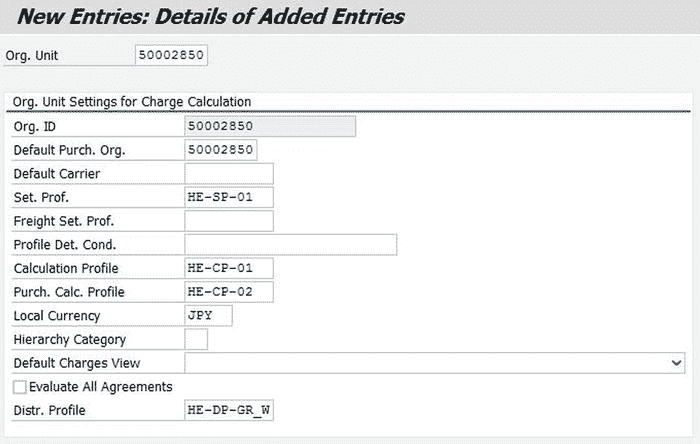

## 定义常规设置

要定义常规设置，请转至 SAP 运输管理的定制设置，然后点击 `Transportation Management` ➤ `Basic Function` ➤ `Charge Calculation` ➤ `Basic Settings for Charge Calculation` ➤ `Define General Settings`，或者使用事务代码 `/SCMTMS/TCM_FASET`。

接下来，点击 `New Entries`  按钮，然后输入表 A-144 中的数据。

图 A-162. 创建常规设置

输入必要数据后，点击 `Save`  按钮保存数据。

按照此方式，定义其余的常规设置。
