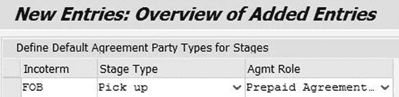

## 定义运输段的默认协议方角色

此选项可用于为运输段类型 - 国际贸易术语解释通则（Incoterms）组合指定协议方角色。在货运订单中指定 Incoterms 规则时，系统会使用协议方角色来识别运输段的默认协议方。系统在货运订单用户界面的 `Stages` 选项卡中显示相关的协议方。在计算费用时，系统还会使用协议方来确定合同。

对于给定的场景，您需要定义表 A-145 中提供的运输段默认协议方角色。

表 A-145. 运输段默认协议方角色数据

| 字段 | 值 | 值 | 值 | 值 | 值 |
| --- | --- | --- | --- | --- | --- |
| Incoterms 规则 | `FOB` | `FOB` | `FOB` | `FOB` | `FOB` |
| 协议角色 | 预付协议方 | 预付协议方 | 到付协议方 | 到付协议方 | 到付协议方 |

**注意**

假定 Incoterms 规则已定义。如果尚未定义，请转至 SAP 运输管理的定制设置，然后点击 `Transportation Management` ➤ `SMC Basis` ➤ `Master Data` ➤ `Define Incoterms` 进行定义。

要为运输段定义默认协议方角色，请转至 SAP 运输管理的定制设置，然后点击 `Transportation Management` ➤ `Forwarding Order Management` ➤ `Define Default Agreement Party Roles for Stages`。

然后，点击 `New Entries`  按钮，并输入表 A-145 中的数据。

图 A-163. 创建运输段的默认协议方角色

输入必要数据后，点击 `Save`  按钮保存数据。

按照此方式，定义其余默认协议方角色。
