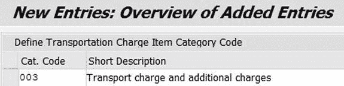
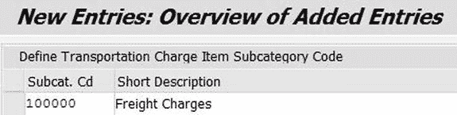
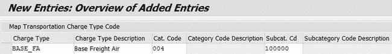
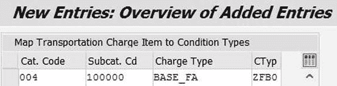
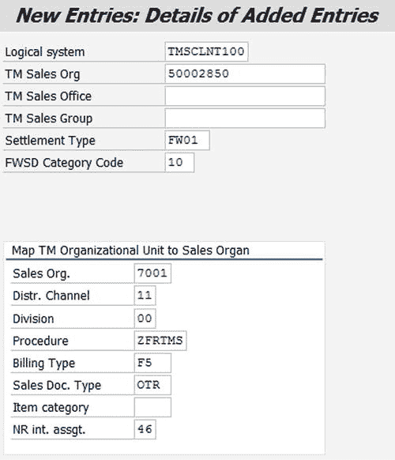
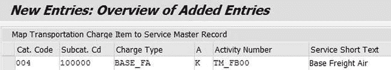
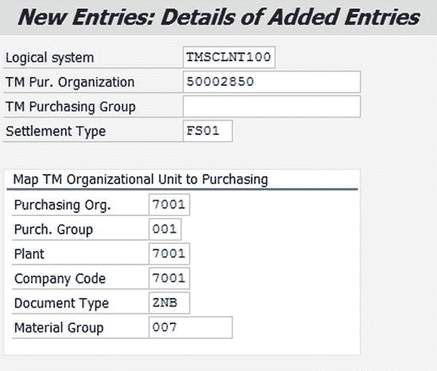

## 与开票和结算（结算凭证）相关的 SAP ERP 定制设置

让我们看看 SAP ERP 中与开票（货运结算——客户发票）和结算（费用结算——承运方发票）相关的定制设置。

**注意**

假定 SAP ERP 系统已针对 SAP 销售与分销 (SAP SD)、SAP 物料管理 (SAP MM)（从采购到付款）以及 SAP 财务与控制 (SAP FICO) 进行了配置。在 SAP ERP 系统中，用户配置文件 `TM_INVOICE_CLERK` 也已配置/分配。此外，已定义了相关的客户主数据、供应商主数据（承运方）和组织结构。

### 定义类别代码

此选项允许您为运输费用项目定义类别代码。

对于给定的场景，如果尚未定义，您必须定义表 A-146 中显示的类别代码。

表 A-146. 类别代码数据

| 字段 | 值 | 值 |
| --- | --- | --- |
| 类别代码 | `003` | `004` |
| 简短描述 | 运输费用和附加费用 | 基本运费 |

这些类别代码需要针对开票和结算同时定义。

要为开票定义类别代码，请转至 SAP ERP 的定制设置，然后点击 `Integration with Other SAP Components` ➤ `Transportation Management` ➤ `Invoice Integration` ➤ `Billing` ➤ `Definition for Transportation Charge Types` ➤ `Define Category Codes`。

要为结算定义类别代码，请转至 SAP ERP 的定制设置，然后点击 `Integration with Other SAP Components` ➤ `Transportation Management` ➤ `Invoice Integration` ➤ `Invoicing` ➤ `Definition for Transportation Charge Types` ➤ `Define Category Codes`。

接下来，点击 `New Entries`  按钮，然后输入表 A-146 中的数据。

图 A-164. 创建类别代码

输入必要数据后，点击 `Save`  按钮保存数据。

按照此方式，定义其余的类别代码。

### 定义子类别代码

此选项允许您为运输费用项目定义子类别代码。

对于给定的场景，如果尚未定义，您必须定义表 A-147 中的子类别代码。

表 A-147. 子类别代码数据

| 字段 | 值 | 值 |
| --- | --- | --- |
| 子类别代码 | `100000` | `103008` |
| 简短描述 | 运费 | 燃油附加费 |

这些子类别代码需要针对开票和结算同时定义。

要为开票定义子类别代码，请转至 SAP ERP 的定制设置，然后点击 `Integration with Other SAP Components` ➤ `Transportation Management` ➤ `Invoice Integration` ➤ `Billing` ➤ `Definition for Transportation Charge Types` ➤ `Define Subcategory Codes`。

要为结算定义子类别代码，请转至 SAP ERP 的定制设置，然后点击 `Integration with Other SAP Components` ➤ `Transportation Management` ➤ `Invoice Integration` ➤ `Invoicing` ➤ `Definition for Transportation Charge Types` ➤ `Define Subcategory Codes`。

现在，点击 `New Entries`  按钮，然后输入表 A-147 中的数据。

图 A-165. 创建子类别代码

输入必要数据后，点击 `Save`  按钮保存数据。

按照此方式，定义其余的子类别代码。

#### 定义费用类型

此选项可用于定义运输费用类型的代码。

针对给定的场景，如果您尚未完成操作，则需要定义表 A-148 中所示的费用类型。

**表 A-148.** 费用类型数据

| 字段 | 值 | 值 | 值 | 值 | 值 |
| --- | --- | --- | --- | --- | --- |
| 费用类型 | `BASE_FA` | `FB00` | `FUEL` | `PU_FEE` | `COO` |
| 费用类型描述 | 基本空运费 | 基本费率 | 燃油附加费 | 提货费 | 原产地证书 |
| 类别代码 | `004` | `004` | `003` | `004` | `004` |
| 子类别代码 | `100000` | `100000` | `103008` | `100000` | `100000` |

这些费用类型需要为开票和记账进行定义。

要为开票定义费用类型，请转至 SAP ERP 的定制，然后点击与其他 SAP 组件的集成 ➤ 运输管理 ➤ 发票集成 ➤ 开票 ➤ 运输费用类型定义 ➤ 定义费用类型。

要为记账定义子类别代码，请转至 SAP ERP 的定制，然后点击与其他 SAP 组件的集成 ➤ 运输管理 ➤ 发票集成 ➤ 记账 ➤ 运输费用类型定义 ➤ 定义费用类型。

接着，点击新条目  按钮，并输入表 A-148 中的数据。

**图 A-166.** 创建费用类型

输入必要数据后，点击保存  按钮保存数据。

用此方法，定义其余的费用类型。

#### 分配条件类型

此选项允许您将运输费用类型类别、运输费用类型子类别以及运输费用类型指定给条件类型。

针对给定的场景，如果您尚未完成操作，则必须定义表 A-149 中提供的分配。

**表 A-149.** 分配条件类型数据

| 字段 | 值 | 值 | 值 | 值 | 值 |
| --- | --- | --- | --- | --- | --- |
| 类别代码 | `004` | `004` | `003` | `004` | `004` |
| 子类别代码 | `100000` | `100000` | `103008` | `100000` | `100000` |
| 费用类型 | `BASE_FA` | `FB00` | `FUEL` | `PU_FEE` | `COO` |
| 条件类型 (`CTyp`) | `<输入适合您业务需求的条件类型>` | `<输入适合您业务需求的条件类型>` | `<输入适合您业务需求的条件类型>` | `<输入适合您业务需求的条件类型>` | `<输入适合您业务需求的条件类型>` |

**注意**

假设该条件类型已在结算凭证定价过程中定义并可用。

要为开票分配条件类型，请转至 SAP ERP 的定制，然后点击与其他 SAP 组件的集成 ➤ 运输管理 ➤ 发票集成 ➤ 开票 ➤ 运输费用类型分配 ➤ 分配条件类型。

接下来，点击新条目  按钮，并输入表 A-149 中的数据。

**图 A-167.** 分配条件类型

输入必要数据后，点击保存  按钮保存数据。

用此方法，分配其余的条件类型。

#### 分配销售与分销的组织单元

此选项允许您将 SAP TM 销售组织分配/映射到 SAP ERP 销售与分销组织单元。

针对给定的场景，如果您尚未完成操作，则必须定义表 A-150 中列出的分配。

**表 A-150.** 分配销售与分销的组织单元数据

| 字段 | 值 | 值 |
| --- | --- | --- |
| 逻辑系统 | `<指定 SAP TM 客户端的名称>` | `<指定 SAP TM 客户端的名称>` |
| SAP TM 销售组织 | `<输入在 SAP TM 中定义的 HEJPFHYOK 的组织 ID>` | `<输入在 SAP TM 中定义的 HEJPFHSFR 的组织 ID>` |
| SAP TM 销售办事处 | `<空白>` | `<空白>` |
| SAP TM 销售组 | `<空白>` | `<空白>` |
| 结算类型 | `FW01` | `FW01` |
| 货运结算凭证类别代码 | `<输入来自 SAP TM 的货运结算凭证类别代码>` | `<输入来自 SAP TM 的货运结算凭证类别代码>` |
| **将 SAP TM 组织单元映射到销售组织部分** | | |
| 销售组织 | `<输入在 SAP ERP 中定义的销售组织 ID>` | `<输入在 SAP ERP 中定义的销售组织 ID>` |
| 分销渠道 | `<输入在 SAP ERP 中定义的分销渠道>` | `<输入在 SAP ERP 中定义的分销渠道>` |
| 部门 | `<输入在 SAP ERP 中定义的部门>` | `<输入在 SAP ERP 中定义的部门>` |
| 流程 | `<输入在 SAP ERP 中定义的流程>` | `<输入在 SAP ERP 中定义的流程>` |
| 开票类型 | `<输入在 SAP ERP 中定义的开票类型>` | `<输入在 SAP ERP 中定义的开票类型>` |
| 销售凭证类型 | `<输入在 SAP ERP 中定义的销售凭证类型>` | `<输入在 SAP ERP 中定义的销售凭证类型>` |
| 项目类别 | `<空白>` | `<空白>` |
| 编号范围区间分配 | `<输入在 SAP ERP 中定义的编号范围>` | `<输入在 SAP ERP 中定义的编号范围>` |

要将 SAP TM 销售组织分配给 SAP ERP 销售与分销组织单元，请转至 SAP ERP 的定制，然后点击与其他 SAP 组件的集成 ➤ 运输管理 ➤ 发票集成 ➤ 开票 ➤ 组织单元映射 ➤ 分配销售与分销的组织单元。

现在，点击新条目  按钮，并输入表 A-150 中的数据。

**图 A-168.** 分配销售与分销的组织单元

输入必要数据后，点击保存  按钮保存数据。

用此方法，将剩余的 SAP TM 销售组织分配给 SAP ERP 销售与分销组织单元。

#### 分配服务主记录和科目分配类别

此选项可用于为特定的服务主数据记录和科目分配类别指定运输费用项目类别、运输费用项目子类别以及运输费用项目。

对于给定的场景，如果尚未完成，您必须定义表 A-151 中所示的分配。

**表 A-151.** 分配服务主记录和科目分配类别

| 字段 | 值 | 值 | 值 | 值 | 值 |
| --- | --- | --- | --- | --- | --- |
| 类别代码 | `004` | `004` | `003` | `004` | `004` |
| 子类别代码 | `100000` | `100000` | `103008` | `100000` | `100000` |
| 费用类型 | `BASE_FA` | `FB00` | `FUEL` | `PU_FEE` | `COO` |
| A | `<输入符合您业务需求的科目分配类别>` | `<输入符合您业务需求的科目分配类别>` | `<输入符合您业务需求的科目分配类别>` | `<输入符合您业务需求的科目分配类别>` | `<输入符合您业务需求的科目分配类别>` |

| 作业编号 | <输入在 SAP ERP 中定义的服务主记录编号> | <输入在 SAP ERP 中定义的服务主记录编号> | <输入在 SAP ERP 中定义的服务主记录编号> | <输入在 SAP ERP 中定义的服务主记录编号> | <输入在 SAP ERP 中定义的服务主记录编号> |
| --- | --- | --- | --- | --- | --- |
| 服务短文本 | 基本空运费 | 基本费率 | 燃油附加费 | 提货费 | 原产地证明 |

**注意**

假定这些服务主记录已在 `SAP ERP` 中定义。

要为运费结算分配服务主记录和科目分配类别，请转到 `SAP ERP` 的定制设置，点击 **与其他 SAP 组件的集成** ➤ **运输管理** ➤ **发票集成** ➤ **开票** ➤ **运输费用类型分配** ➤ **分配服务主记录和科目分配类别**。

然后，点击 **新条目**  按钮，并输入表 A-151 中的数据。

图 A-169. 分配服务主记录和科目分配类别

输入必要数据后，点击 **保存**  按钮保存数据。

以相同的方式，分配其余的服务主记录和科目分配类别。

### 分配采购组织单位

此选项允许您将 `SAP TM` 采购组织分配/映射到 `SAP ERP` 采购组织单位。

对于给定的场景，如果尚未完成，您必须定义表 A-152 中所示的分配。

表 A-152. 分配采购组织单位

| 字段 | 值 | 值 | 值 | 值 |
| --- | --- | --- | --- | --- |
| 逻辑系统 | <指定 `SAP TM` 客户端的名称> | <指定 `SAP TM` 客户端的名称> | <指定 `SAP TM` 客户端的名称> | <指定 `SAP TM` 客户端的名称> |
| `SAP TM` 采购组织 | <输入在 `SAP TM` 中定义的 `HEJPFHYOK` 的组织 ID> | <输入在 `SAP TM` 中定义的 `HEJPFHNAR` 的组织 ID> | <输入在 `SAP TM` 中定义的 `HEUSFHLA` 的组织 ID> | <输入在 `SAP TM` 中定义的 `HEUSFHSFR` 的组织 ID> |
| `SAP TM` 采购组 | <留空> | <留空> | <留空> | <留空> |
| 结算类型 | `FS01` | `FS01` | `FS01` | `FS01` |
| 将 `SAP TM` 组织单位映射到采购部门 | | | | |
| 采购组织 | <输入在 `SAP ERP` 中定义的采购组织 ID> | <输入在 `SAP ERP` 中定义的采购组织 ID> | <输入在 `SAP ERP` 中定义的采购组织 ID> | <输入在 `SAP ERP` 中定义的采购组织 ID> |
| 采购组 | <输入在 `SAP ERP` 中定义的采购组> | <输入在 `SAP ERP` 中定义的采购组> | <输入在 `SAP ERP` 中定义的采购组> | <输入在 `SAP ERP` 中定义的采购组> |
| 工厂 | <输入在 `SAP ERP` 中定义的工厂> | <输入在 `SAP ERP` 中定义的工厂> | <输入在 `SAP ERP` 中定义的工厂> | <输入在 `SAP ERP` 中定义的工厂> |
| 公司代码 | <输入在 `SAP ERP` 中定义的公司代码> | <输入在 `SAP ERP` 中定义的公司代码> | <输入在 `SAP ERP` 中定义的公司代码> | <输入在 `SAP ERP` 中定义的公司代码> |
| 凭证类型 | <输入在 `SAP ERP` 中定义的凭证类型> | <输入在 `SAP ERP` 中定义的凭证类型> | <输入在 `SAP ERP` 中定义的凭证类型> | <输入在 `SAP ERP` 中定义的凭证类型> |
| 物料组 | <输入在 `SAP ERP` 中定义的物料组> | <输入在 `SAP ERP` 中定义的物料组> | <输入在 `SAP ERP` 中定义的物料组> | <输入在 `SAP ERP` 中定义的物料组> |

要将 `SAP TM` 采购组织分配到 `SAP ERP` 采购组织单位，请转到 `SAP ERP` 的定制设置，点击 **与其他 SAP 组件的集成** ➤ **运输管理** ➤ **发票集成** ➤ **开票** ➤ **组织单位映射** ➤ **分配采购组织单位**。

现在，点击 **新条目**  按钮，并输入表 A-152 中的数据。

图 A-170. 分配采购组织单位

输入必要数据后，点击 **保存**  按钮保存数据。

以相同的方式，将剩余的 `SAP TM` 采购组织分配到 `SAP ERP` 采购组织单位。

至此，主数据和配置部分介绍完毕。现在，让我们看看这些数据和配置将如何在端到端的运输管理流程中使用。

该流程可进一步划分为以下阶段：

- 运力采购
- 订单管理
- 规划和分包
- 运输执行与监控
- 客户开票与运费结算
