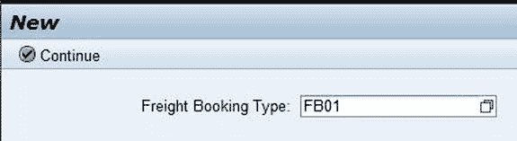
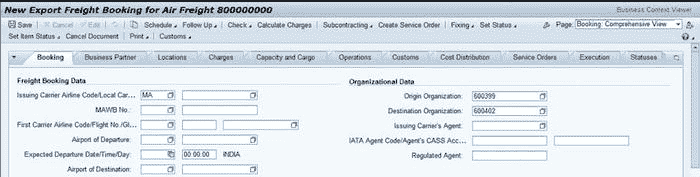
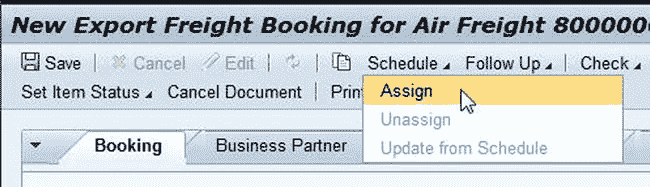
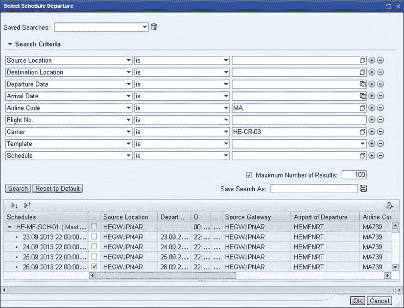
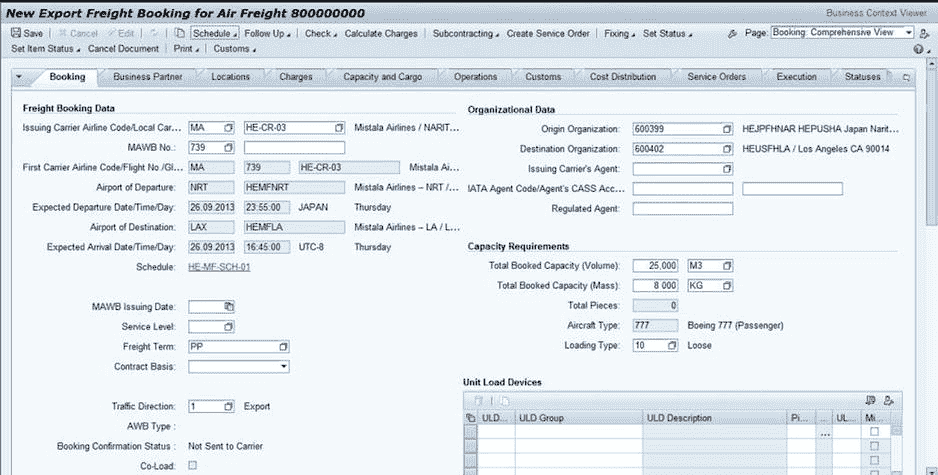
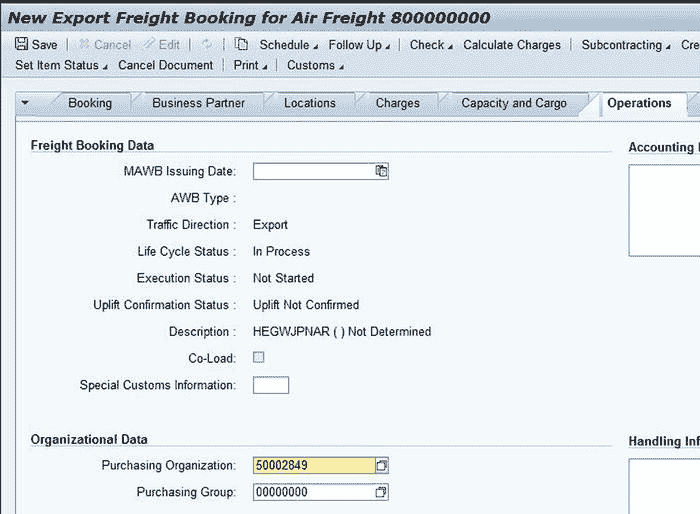
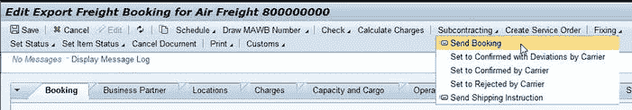
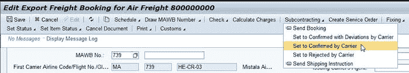
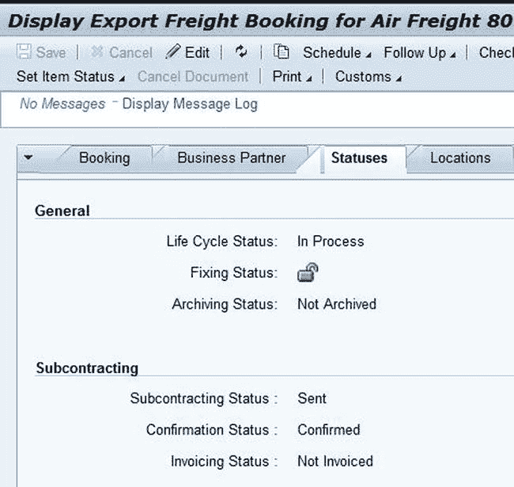
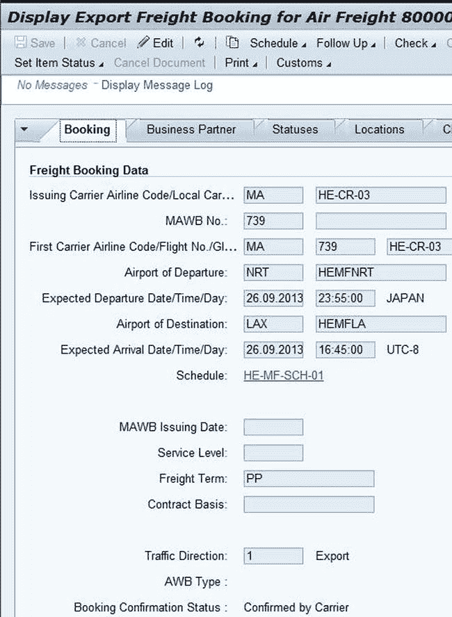

## 运力采购：货运预订

在此流程中，采购部门向承运商预订运力。只有在承运商确认预订后，该运力预订才会对各个组织单位可用。货运预订用户界面是 `SAP TM` 中提供的用于执行此流程的界面之一。

要创建空运预订，请在 `SAP NetWeaver Business Client` 中，点击 `货运单管理 ➤ 空运 ➤ 创建空运预订`。

对于给定的场景，创建一个货运预订（出口），如图 171 至 180 所示。

输入货运预订类型为 `FB01`，然后点击“继续”按钮 。

图 A-171. 创建货运预订的初始界面

选择“综合视图”页面视图。然后，选择“预订”选项卡，并输入表 A-153 中的数据。

图 A-172. 创建货运预订（出口）：“预订”选项卡的“货运预订数据”和“组织数据”部分

表 A-153. 货运预订（出口）：“预订”选项卡数据

| 字段 | 值 |
| --- | --- |
| `预订` 选项卡 |
| 货运预订数据部分 |
| 开票承运商航空公司代码/本地承运商 | `MA` |
| 组织数据部分 |
| 始发组织 | `<输入 HEJPFHNAR 的业务伙伴 ID>` |
| 目的组织 | `<输入 HEUSFHLA 的业务伙伴 ID>` |

通过从“日程表”菜单中选择“分配”，将日程表分配给预订。

图 A-173. 创建货运预订（出口）：分配日程表

在“选择日程表发运”窗口中，搜索日程表。从列表中选择一个，然后点击“确定”按钮 。

图 A-174. 创建货运预订（出口）：“选择日程表发运”窗口

日程表中的数据将被包含在货运预订中，并可在“预订”选项卡中查看。

图 A-175. 创建货运预订（出口）：“预订”选项卡中分配的日程表的链接

接下来，选择“操作”选项卡，并输入表 A-154 中的数据。

图 A-176. 创建货运预订（出口）：“操作”选项卡的“组织数据”部分

表 A-154. 货运预订（出口）：“操作”选项卡数据

| 字段 | 值 |
| --- | --- |
| `操作` 选项卡 | |
| 组织数据部分 | |
| 采购组织 | `<输入 HEJPFHNAR 的组织 ID>` |

通过点击“保存”按钮  来保存货运预订（出口）。

要将预订信息发送给承运商，通过点击“编辑”按钮  来编辑货运预订（出口），然后从“分包”菜单中选择“发送预订”。

图 A-177. 货运预订（出口）：向承运商发送预订信息

假设预订被承运商接受，并且需要在系统中进行报告。为此，通过点击“编辑”按钮  来编辑货运预订（出口），然后从“分包”菜单中选择“设置为承运商已确认”。

图 A-178. 货运预订（出口）：确认承运商的接受

结果，预订确认状态更改为“承运商已确认”，并且可以在货运预订用户界面的“预订”选项卡中进行验证。确认状态同样更改为“已确认”，并且可以在货运预订用户界面的“状态”选项卡中进行验证。

图 A-180. 货运预订（出口）：“状态”选项卡中确认状态的更新

图 A-179. 货运预订（出口）：“预订”选项卡中预订确认状态的更新
