## 订单管理：创建货运订单

在此流程中，客服人员通过电话、传真或电子邮件获取客户传达的必要数据，并创建运输订单。`货运订单` 用户界面是 SAP TM 中用于执行此流程的界面之一。

要创建货运订单，请在 SAP NetWeaver Business Client 中，依次点击 `货运订单管理` ➤ `货运订单` ➤ `创建货运订单`。

对于给定的场景，请按图 181 至图 191 所示创建一个货运订单（出口）。

将货运订单输入为 `FW01`，然后点击 `继续` 按钮。

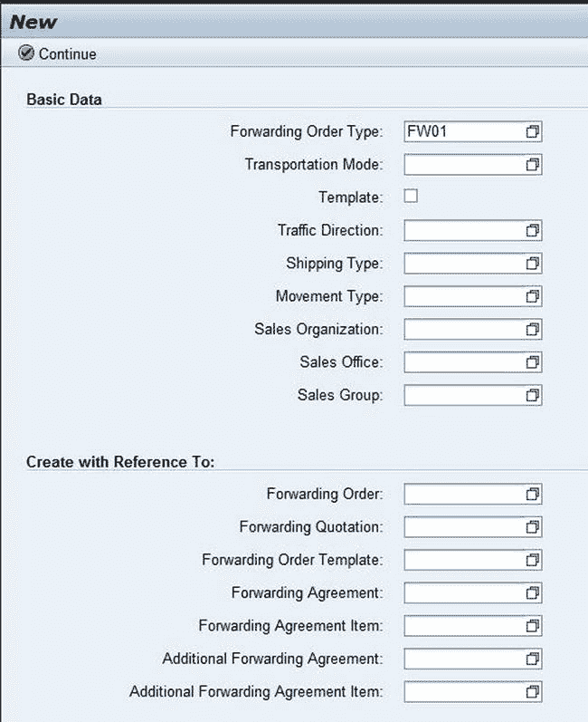

图 A-181. 创建货运订单的初始屏幕

选择 `常规` 选项卡，并输入表 A-155 中的数据。

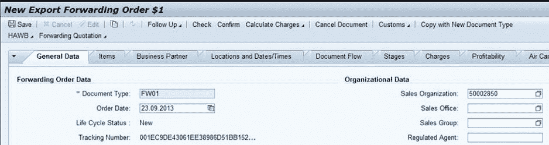

图 A-182. 创建货运订单（出口）：`常规数据` 选项卡的“组织数据”部分

表 A-155. 货运订单（出口）：常规数据选项卡数据

| 字段 | 值 |
| --- | --- |
| 常规选项卡 | |
| 组织数据部分 | |
| 销售组织 | `<输入 HEJPFHYOK 的组织 ID>` |

现在，选择 `项目` 选项卡，并通过从 `插入` 菜单中选择 `产品` 来插入一个新项目行。

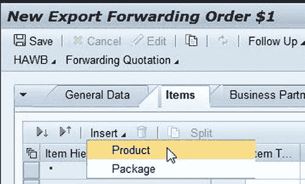

图 A-183. 创建货运订单（出口）：项目选项卡

在新项目行中，输入表 A-156 中的数据。

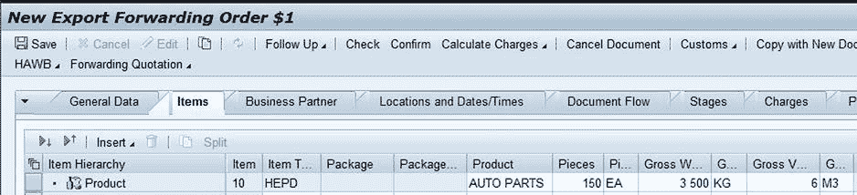

图 A-184. 创建货运订单（出口）：项目选项卡中的项目数据

表 A-156. 货运订单（出口）：项目选项卡数据

| 字段 | 值 |
| --- | --- |
| 项目选项卡 | |
| 项目 | 10 |
| 项目类型 | HEPD |
| 产品 | 汽车零部件 |
| 件数 | 150 |
| 件数计量单位 | 个 |
| 毛重 | 3,500 |
| 毛重计量单位 | kg |
| 毛体积 | 6 |
| 毛体积计量单位 | m³ |

选择 `业务伙伴` 选项卡，并输入表 A-157 中的数据。

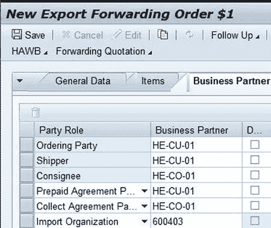

图 A-185. 创建货运订单（出口）：业务伙伴选项卡

表 A-157. 货运订单（出口）：业务伙伴选项卡数据

| 字段 | 值 | 值 | 值 | 值 | 值 | 值 |
| --- | --- | --- | --- | --- | --- | --- |
| 业务伙伴选项卡 | | | | | | |
| 参与方角色 | 订购方 | 发货方 | 收货方 | 预付协议方 | 到付协议方 | 进口组织 |
| 业务伙伴 | HE-CU-01 | HE-CU-01 | HE-CO-01 | HE-CU-01 | HE-CO-01 | `<输入 HEUSFHSFR 的业务伙伴 ID>` |

选择 `地点和日期/时间` 选项卡，并输入表 A-158 中的数据。

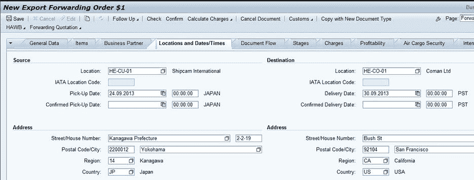

图 A-186. 创建货运订单（出口）：`地点和日期/时间` 选项卡的“源”和“目标”部分

表 A-158. 货运订单（出口）：地点和日期/时间选项卡数据

| 字段 | 值 |
| --- | --- |
| 地点和日期/时间选项卡 | |
| 源部分 | |
| 地点 | HE-CU-01 |
| 提货日期 | `<输入一个日期>` |
| 目标部分 | |
| 目的地 | HE-CO-01 |
| 交货日期 | `<输入一个晚于提货日期的日期>` |

选择 `常规数据` 选项卡，并输入表 A-159 中的数据。

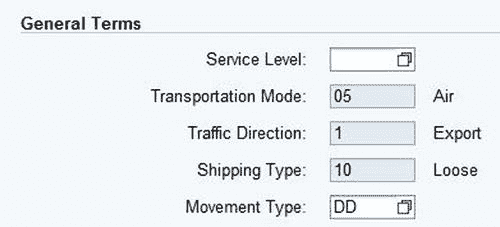

图 A-188. 创建货运订单（出口）：`常规数据` 选项卡的“常规条款”部分

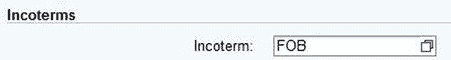

图 A-187. 创建货运订单（出口）：`常规数据` 选项卡的“国际贸易术语”部分

表 A-159. 货运订单（出口）：国际贸易术语和常规条款部分数据

| 字段 | 值 |
| --- | --- |
| 常规数据选项卡 | |
| 国际贸易术语部分 | |
| 国际贸易术语规则 | FOB |
| 常规条款部分 | |
| 移动类型 | DD |

选择 `阶段` 选项卡，并输入表 A-160 中的数据。

注意：默认情况下，所有五个阶段都应已填充。

表 A-160. 货运订单（出口）：阶段选项卡数据

| 字段 | 值 | 值 | 值 | 值 | 值 |
| --- | --- | --- | --- | --- | --- |
| 阶段选项卡 | | | | | |
| 实际路线 | | | | | |
| 阶段类型（如未自动填充） | HE1 | HE2 | HE3 | HE4 | HE5 |
| 运输方式（如未自动填充） | 01 | 01 | 05 | 01 | 01 |
| 目标地点 | HESTAJPYOK | HEGWJPNAR | HEGWUSLA | HESTAUSSFR | HE-CO-01 |

| 计划与执行组织（如未自动填充） | `<输入 HEJPFHYOK 的组织 ID>` | `<输入 HEJPFHYOK 的组织 ID>` | `<输入 HEJPFHYOK 的组织 ID>` | `<输入 HEUSFHLA 的组织 ID>` | `<输入 HEUSFHSFR 的组织 ID>` |
| --- | --- | --- | --- | --- | --- |
| 协议方角色（如未自动填充） | 预付协议方 | 预付协议方 | 到付协议方 | 到付协议方 | 到付协议方 |

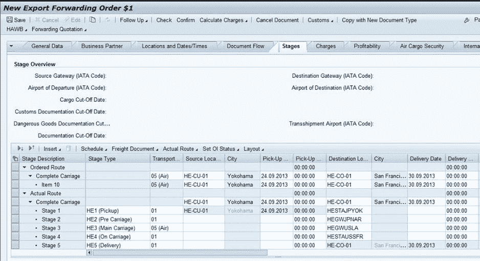

图 A-189. 创建货运订单（出口）：阶段选项卡

通过点击 `保存` 按钮来保存货运订单（出口）。

保存货运订单时，系统还会根据货运单元构建规则创建货运单元。可以在货运订单用户界面的 `单据流` 选项卡中查看货运单元。

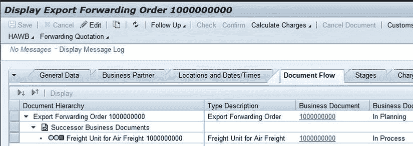

图 A-190. 货运订单（出口）：在 `单据流` 选项卡中显示货运单元

编辑货运订单（出口），并点击 `编辑` 按钮。

接下来，选择 `空运货物安全` 选项卡，并输入表 A-161 中的数据。

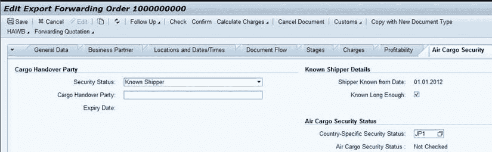

图 A-191. 编辑货运订单（出口）：空运货物安全选项卡

表 A-161. 货运订单（出口）：空运货物安全选项卡数据

| 字段 | 值 |
| --- | --- |
| 空运货物安全选项卡 | |
| 货物交接方部分 | |
| 安全状态 | 已知发货人 |
| 空运货物安全状态部分 | |
| 特定国家/地区安全状态 | JP1 |

通过点击 `保存` 按钮来保存货运订单（出口）。
