## 计划与转包

在此流程中，计划员计划订单执行，并将各项订单分配给承运商。运输控制台用户界面是 SAP TM 中用于执行此流程的界面之一。此外，SAP TM 还提供以下计划选项：

- 手动
- 单步
- 交互式

对于给定场景，将使用手动计划。

要打开运输控制台，请在 SAP NetWeaver Business Client 中，依次点击 `计划` → `手动计划` → `运输控制台`。

在运输控制台参数文件和布局组用户界面中，点击新建  按钮，以输入表 A-162 中的选择和计划参数文件。

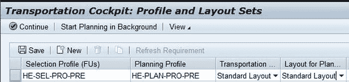

图 A-192. 运输控制台

表 A-162. 运输控制台数据

| 字段 | 值 | 值 | 值 |
| --- | --- | --- | --- |
| 选择参数文件（货运单单位） | `HE-SEL-PRO-PRE` | `HE-SEL-PRO-MAIN` | `HE-SEL-PRO-ON` |
| 计划参数文件 | `HE-PLAN-PRO-PRE` | `HE-PLAN-PRO-MAIN` | `HE-PLAN-PRO-ON` |
| 运输控制台布局 | 标准布局 | 标准布局 | 标准布局 |
| 计划结果屏幕布局 | 标准布局 | 标准布局 | 标准布局 |

通过点击保存  按钮来保存参数文件和布局。

按此方式，指定其余的参数文件和布局。

### 将货运订单分配给货运预订（产能分配）

要将货运订单分配给货运预订，请打开运输控制台，选择包含选择参数文件 `HE-SEL-PRO-MAIN` 和计划参数文件 `HE-PLAN-PRO-MAIN` 的行，然后点击继续  按钮。

在运输控制台屏幕的 `货运单阶段` 区域，选择要分配给货运预订的货运单单位，并将其拖放到 `货运订单/货运预订` 区域中可用的货运预订上。

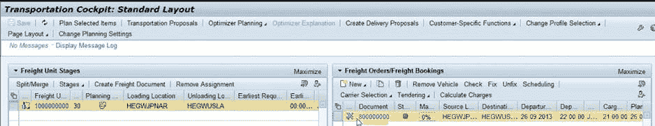

图 A-194. 运输控制台：拖放货运单单位以分配给货运预订（出口）

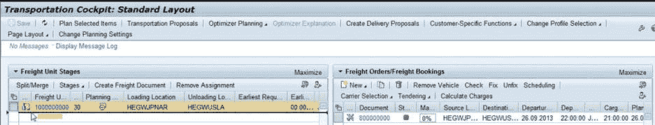

图 A-193. 运输控制台：拖动货运单单位以分配给货运预订（出口）

通过点击保存  按钮来保存分配。

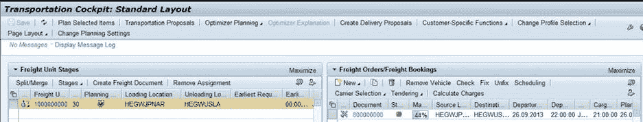

图 A-195. 运输控制台：已分配给货运预订的货运单单位（出口）

该分配在货运订单用户界面的 `阶段` 选项卡的阶段 3 中可见。其中显示了货运预订单据编号、承运商和航空公司代码。同时，状态更改为 `已计划`。

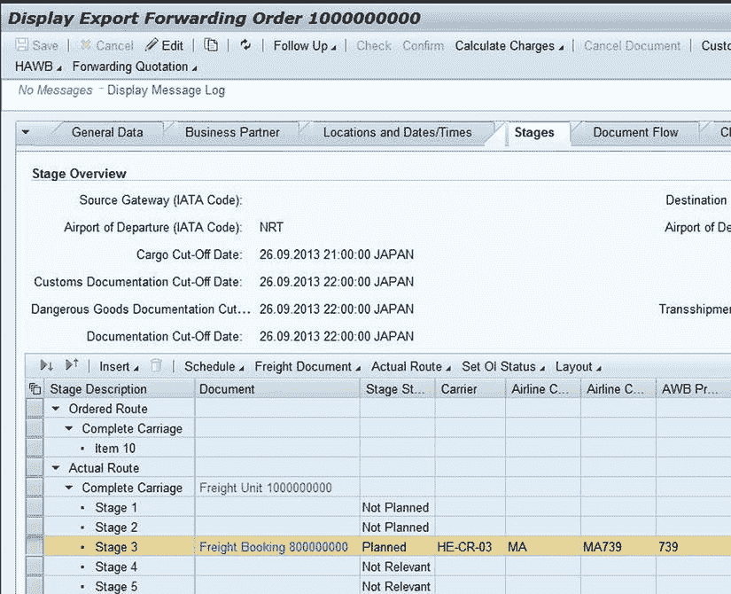

图 A-196. 货运订单（出口）：分配后在阶段选项卡中显示货运预订（出口）编号

### 提货计划

要计划货物的提货，请通过点击编辑  按钮来编辑货运订单（出口）。

现在，在 `阶段` 选项卡中，选择阶段 1。然后，从 `货运单据` 菜单中选择 `创建`。

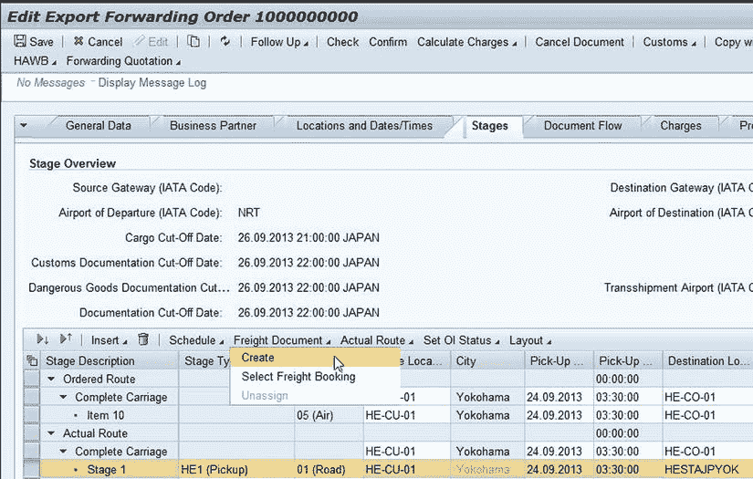

图 A-197. 货运订单（出口）：为阶段 1 创建货运订单（提货）

通过点击保存  按钮来保存货运订单（出口）。

点击新创建的货运订单（提货），该订单在货运订单用户界面的 `阶段` 选项卡的 `单据` 列中可见。

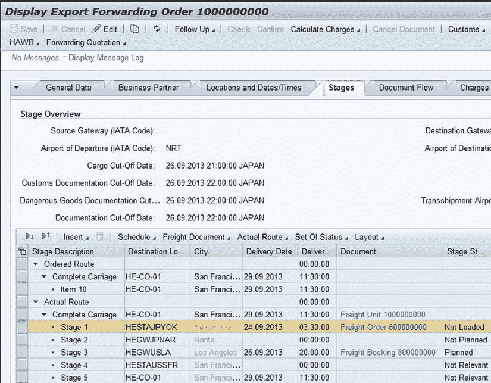

图 A-198. 货运订单（出口）：阶段选项卡中显示货运订单编号

这将打开货运订单窗口。通过点击编辑  按钮来编辑货运订单。然后，选择 `常规数据` 选项卡，并输入表 A-163 中的数据。

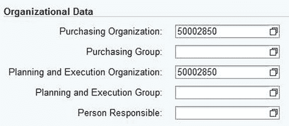

图 A-200. 编辑货运订单（提货）：常规数据选项卡的组织数据部分

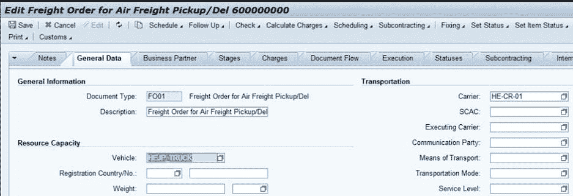

图 A-199. 编辑货运订单（提货）：常规数据选项卡的运输和资源产能部分

表 A-163. 货运订单（提货）：常规数据选项卡数据

| 字段 | 值 |
| --- | --- |
| 常规数据选项卡 | |
| 运输部分 | |
| 承运商 | `HE-CR-01` |
| 资源产能部分 | |
| 车辆 | `HEJP_TRUCK` |
| 组织数据部分 | |
| 采购组织 | `<输入 HEJPFHYOK 的组织 ID>` |
| 计划与执行组织 | `<输入 HEJPFHYOK 的组织 ID>` |

通过点击保存  按钮来保存货运订单（提货）。

### 规划前程运输

要规划前程运输，请打开运输驾驶舱，选择包含选择模板`HE-SEL-PRO-PRE`和计划模板`HE-PLAN-PRO-PRE`的行，然后点击“继续”按钮。

接着，在“运输驾驶舱”屏幕的“货运单元阶段”部分，选择需要规划前程运输的货运单元。在“时间表”选项卡中，选择符合要求的时间表，然后点击“计划选定项目”按钮。系统将为此前程运输创建一个新的货运订单。

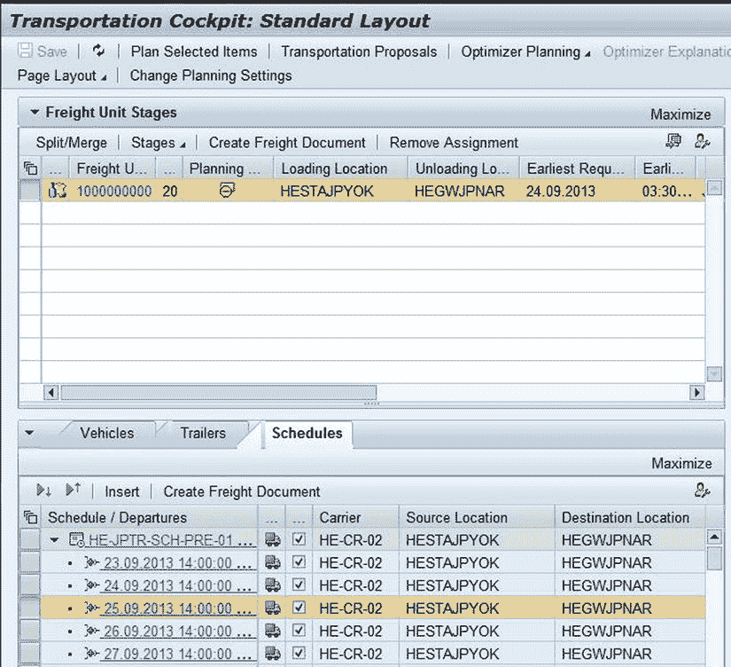
图 A-201. 运输驾驶舱：规划前程运输

点击“保存”按钮来保存计划。

在运输驾驶舱的“货运订单/货运预订”部分，点击“单据”列中可见的新创建的货运订单。

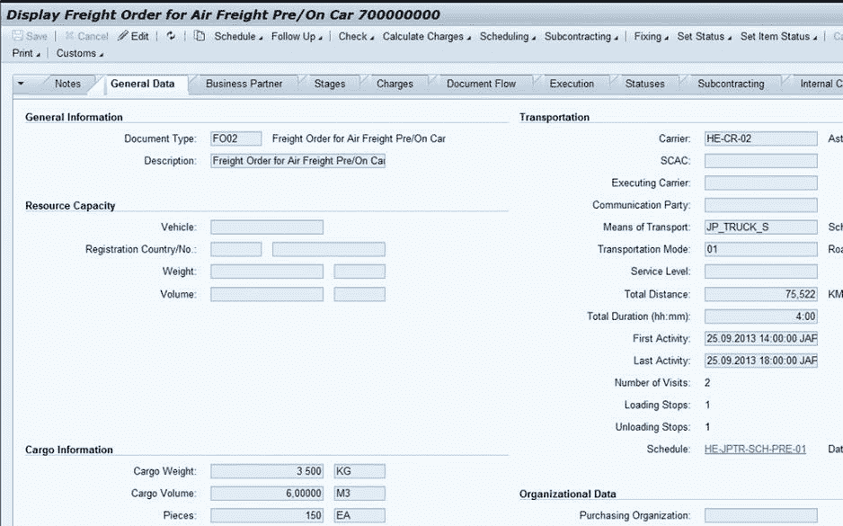
图 A-203. 货运订单（前程运输）

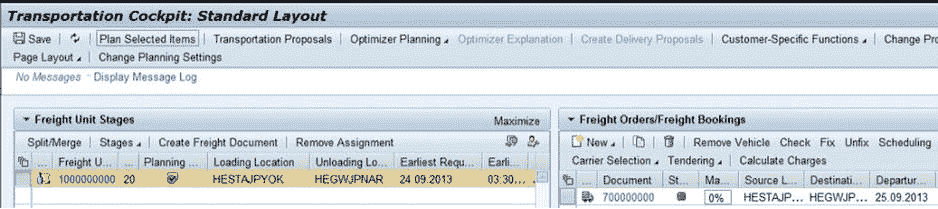
图 A-202. 运输驾驶舱：通过计划创建的货运订单（前程运输）

这将打开“货运订单”窗口。点击“编辑”按钮编辑货运订单（前程运输）。接下来，选择“常规数据”选项卡，并输入表 A-164 中的数据。

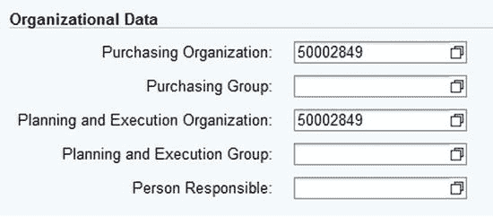
图 A-204. 货运订单（前程运输）：“常规数据”选项卡中的“组织数据”部分

**表 A-164.** 货运订单（前程运输）：“常规数据”选项卡数据

| 字段 | 值 |
| --- | --- |
| 常规数据选项卡 | |
| 组织数据部分 | |
| 采购组织 | `<输入 HEJPFHNAR 的组织 ID>` |
| 计划与执行组织 | `<输入 HEJPFHNAR 的组织 ID>` |

点击“保存”按钮保存货运订单（前程运输）。

现在，所有出口阶段都已计划完毕，可以通过货运订单用户界面，向订货方发送确认。

要编辑货运订单，请在`SAP NetWeaver Business Client`中，点击`货运订单管理` ➤ `货运订单` ➤ `编辑货运订单`。

输入出口货运订单编号，然后点击“继续”按钮。

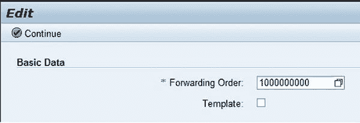
图 A-205. 编辑货运订单的初始屏幕

现在，点击“确认”按钮确认订单。

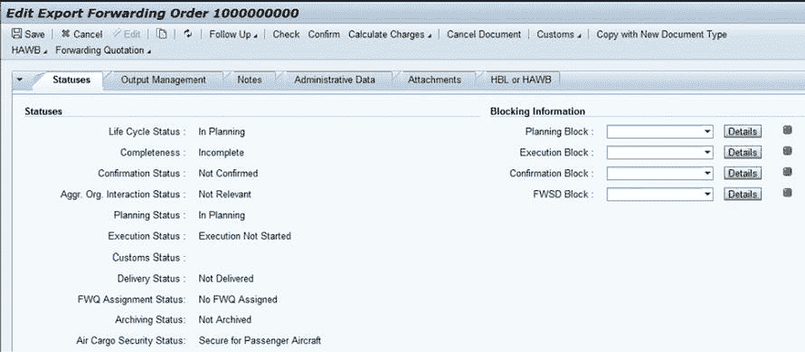
图 A-206. 货运订单（出口）：确认订单

点击“保存”按钮保存货运订单（出口）。

订单确认后，确认状态将变为“已确认”，并在货运订单用户界面的“状态”选项卡中可见。

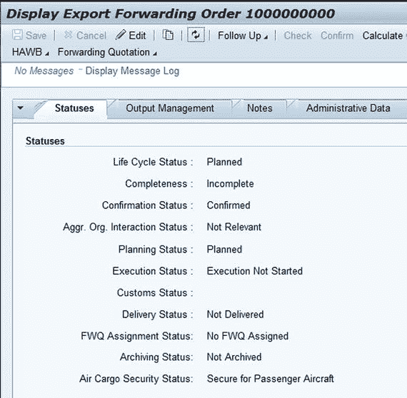
图 A-207. 货运订单（出口）：确认状态的更新
