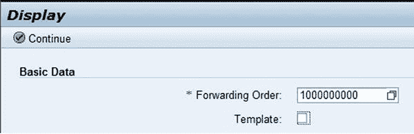
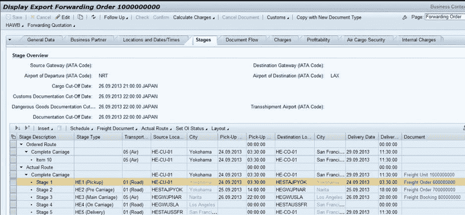
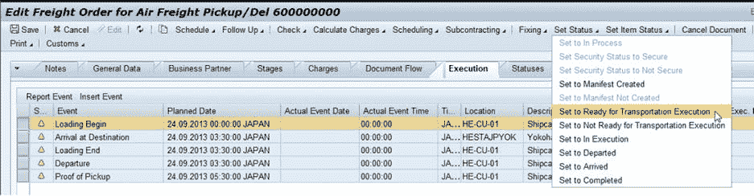
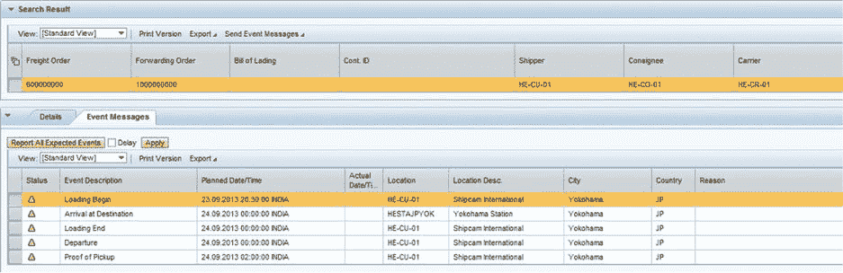
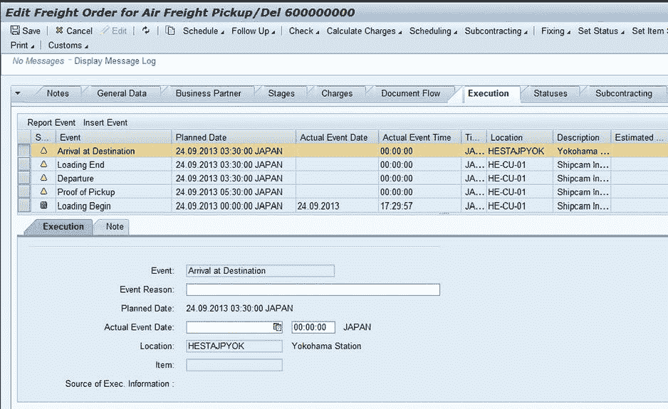
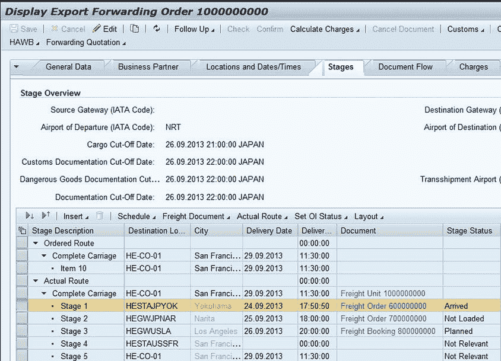

## 货运执行与监控

在此流程中，调度员和单据处理代理执行订单、处理差异，并记录和监控订单。货运订单/货运预订用户界面是`SAP TM`中提供的用于执行这些任务的界面之一。此外，如果`SAP EM`作为系统环境的一部分可用并与`SAP TM`集成，则可以使用`SAP EM`用户界面来触发各类运输事件并进行监控。

下面，我们来看一下在给定的场景中，如何执行和监控订单。

### 提货执行

要开始执行货运订单（提货），请在`SAP NetWeaver Business Client`中，点击`货运订单管理` ➤ `货运订单` ➤ `显示货运订单`。

输入货运订单编号，然后点击“继续”按钮。

图 A-208. 显示货运订单的初始屏幕

接下来，选择“阶段”选项卡，然后点击“单据”列中可见的货运订单（阶段 1）。

图 A-209. 显示货运订单（出口）：“阶段”选项卡

这将打开“货运订单”窗口。点击“编辑”按钮编辑货运订单（提货），然后从“设置状态”菜单中选择“设置为运输执行就绪”。

图 A-210. 货运订单（提货）：设置状态为“运输执行就绪”

点击“保存”按钮保存货运订单（提货）。

假设承运商已开始将货物装车并希望报告此事件。

> **注意：** 假设`SAP EM`是系统环境的一部分并与`SAP TM`集成。

为此，请在事件管理 Web 用户界面中（要在`SAP NetWeaver Business Client`中调用事件管理 Web 用户界面，请点击`事件管理` ➤ `Web 界面` ➤ `搜索`，或使用事务代码`/SAPTRX/EM_Start`），或者通过门户搜索货运订单（提货）的结果，点击该货运订单（提货），选择“事件消息”选项卡（其中提供了可以触发的各种事件）。

图 A-211. 事件管理：搜索结果窗口

选择“开始装货”事件，然后点击“报告所有预期事件”按钮。

接着，在“报告所有预期事件”窗口中，点击“开始装货”事件，然后点击“发送”按钮。

其他事件也可以通过`SAP EM`触发。如果`SAP EM`不可用，则可以直接在`SAP TM`中触发事件。

当货物抵达横滨站时，会触发“到达”事件。下面我们看看如何使用货运订单用户界面记录此事件。

以编辑模式打开货运订单（提货），然后选择“执行”选项卡。

> **注意：** 如果`SAP EM`与`SAP TM`集成，则各种事件将默认填充。

# 货运订单执行流程

图 A-212. 货运订单（提货）：在`执行`选项卡中报告“到达目的地”事件

现在，选择包含“到达目的地”的行，然后点击“报告事件”按钮。

点击“保存”按钮保存货运订单（提货）。

通过这种方式，可以触发其他事件，例如“开始卸货”和“结束卸货”。

到达状态也会在货运订单（出口）中更新，并在`阶段`选项卡的“阶段状态”列（阶段 1）中可见。

图 A-213. 货运订单（出口）：状态（阶段 1）更新为“已到达”
