## 执行步骤

### 前置运输执行

要开始执行货运订单（前置运输），请以显示模式打开运输订单（出口）。接着，选择`阶段`标签页，并点击`单据`列中可见的货运订单（阶段 2）。

这将打开`货运订单`窗口。点击`编辑`按钮以编辑货运订单（前置运输），然后从`设置状态`菜单中选择`设为准备运输执行`。

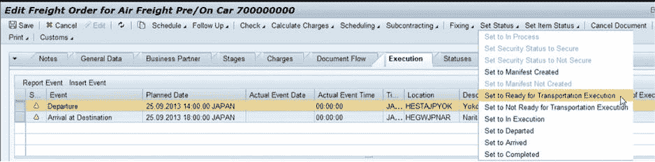

图 A-214. 货运订单（前置运输）：将状态设置为“准备运输执行”

点击`保存`按钮保存货运订单（前置运输）。

要触发离港事件，请点击`编辑`按钮编辑货运订单（前置运输），然后选择`执行`标签页。

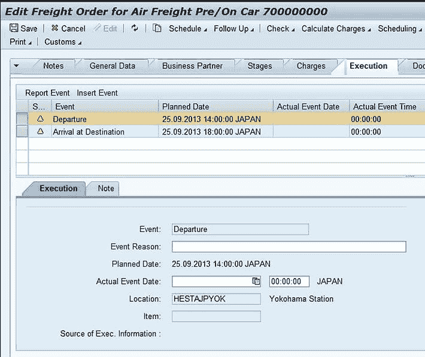

图 A-215. 货运订单（前置运输）：在`执行`标签页中报告离港事件

选择包含离港事件的行，然后点击`报告事件`按钮。

点击`保存`按钮保存货运订单（前置运输）。以此方式，触发其他事件，例如`到达目的地`。

### 主运输执行

假设货物已抵达网关。现在可以开始网关操作。作为第一步，货物被分配用于装载。

要开始货运预订（出口），请以显示模式打开运输订单（出口）。接着，选择`阶段`标签页，并点击`单据`列中可见的货运预订（阶段 3）。

这将打开`货运预订`窗口。点击`编辑`按钮以编辑货运预订（出口），然后从`设置项目状态`菜单中选择`设为已装载`。

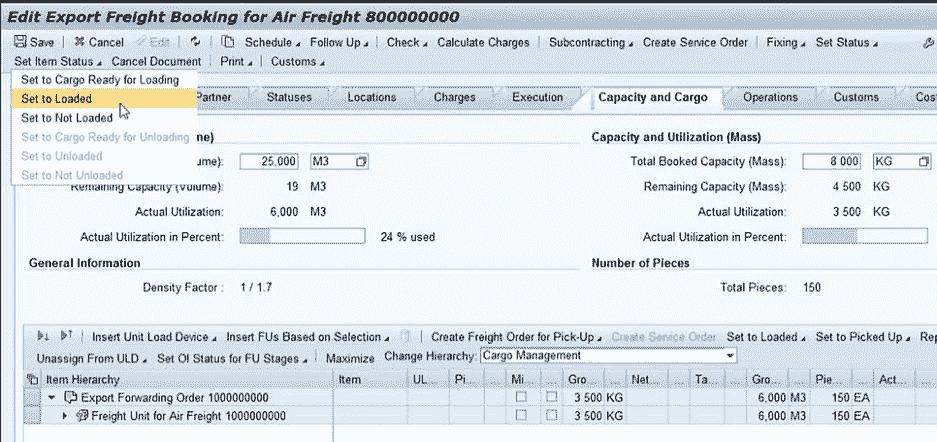

图 A-216. 货运预订（出口）：将状态设置为“已装载”

点击`保存`按钮保存货运预订（出口）。结果，执行状态被设置为“正在装载中”。

要向承运人发送运输指令，请以编辑模式打开货运预订（出口），然后从`分包`菜单中选择`发送运输指令`。

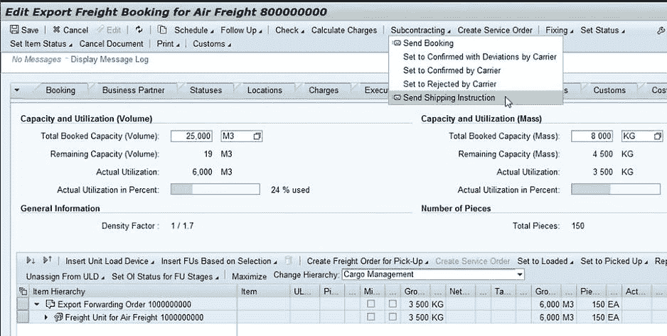

图 A-217. 货运预订（出口）：发送运输指令

点击`保存`按钮保存货运预订（出口）。结果，预订确认状态被设置为“运输指令已发送至承运人”。

一旦集拼结束，且货物准备好转交给承运人，就需要创建到机场的短途运输。

为此，以编辑模式打开货运预订（出口），并选择`容量和货物`标签页。选择货运单位，然后从`创建取货货运订单`菜单中选择`创建取货货运订单`。

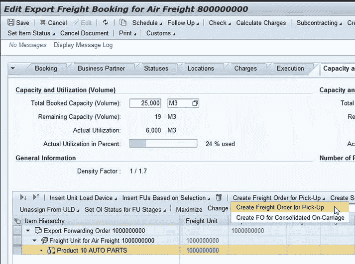

图 A-218. 货运预订（出口）：创建货运订单（短途取货）

点击`保存`按钮保存货运预订（出口）。新创建的取货货运订单现在会显示在货运预订用户界面的`容量和货物`标签页的`取货货运订单`列中。

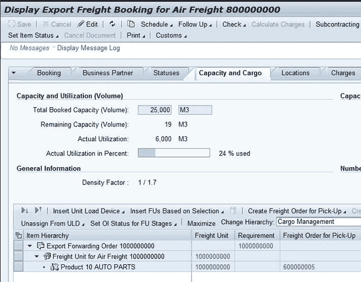

图 A-219. 货运预订（出口）：在`容量和货物`标签页中显示货运订单编号（短途取货）

通过点击`取货货运订单`列中的货运订单来打开该货运订单（短途取货）。

这将打开`货运订单`窗口。点击`编辑`按钮以编辑货运订单（短途取货），选择`常规数据`标签页，并输入表 A-165 中的数据。

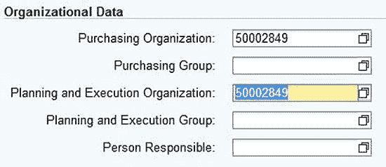

图 A-221. 货运订单（短途取货）：`常规数据`标签页的组织数据部分

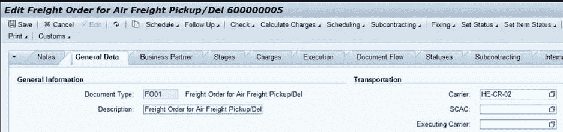

图 A-220. 货运订单（短途取货）：`常规数据`标签页的运输部分

表 A-165. 货运订单（短途取货）：常规数据标签页数据

| 字段 | 值 |
| --- | --- |
| 常规数据标签页 | |
| 运输部分 | |
| 承运人 | `HE-CR-02` |
| 组织数据部分 | |
| 采购组织 | `<输入 HEJPFHNAR 的组织 ID>` |
| 计划与执行组织 | `<输入 HEJPFHNAR 的组织 ID>` |

选择`阶段`标签页，并输入表 A-166 中的数据。

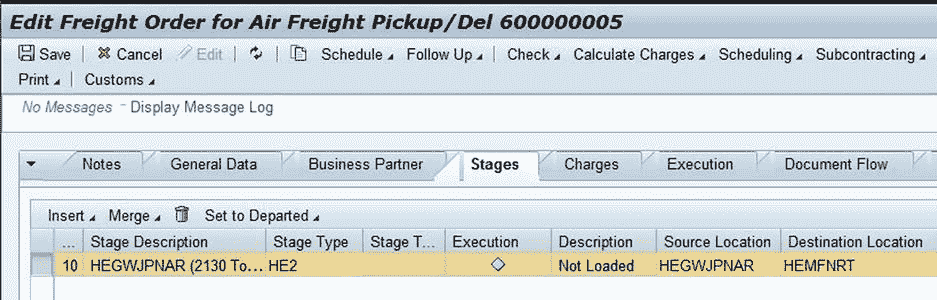

图 A-222. 货运订单（短途取货）：`阶段`标签页

表 A-166. 货运订单（短途取货）：阶段标签页数据

| 字段 | 值 |
| --- | --- |
| 阶段标签页 | |
| 阶段类型 | `HE2` |

通过点击`Save`按钮保存货运订单（拖车提货）。

要生成货运单据，请在编辑模式下打开货运预订（出口），然后从 `Print` 菜单中选择 `Print Preview`。

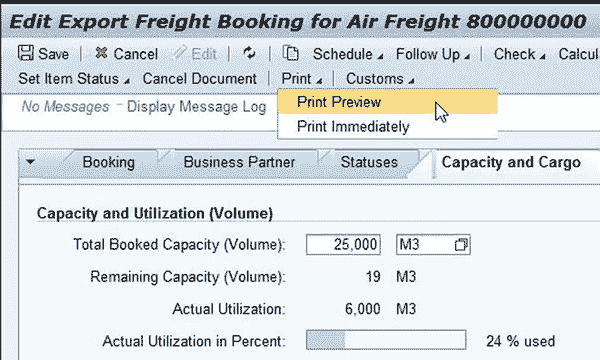

图 A-223. 货运预订（出口）：选择打印预览

在 `Print` 窗口中选择要生成的文档，然后点击 `OK` 按钮。

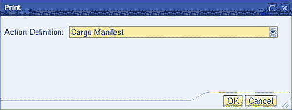

图 A-224. 货运预订（出口）：文档选择窗口

通过这种方式，为货运订单（拖车提货）触发必要的事件，例如离港和抵达目的地。

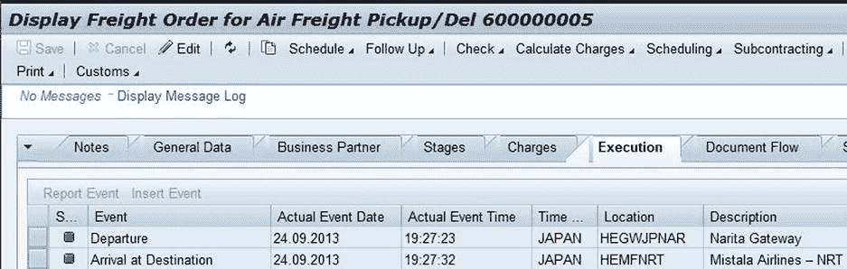

图 A-225. 货运订单（拖车提货）：在`执行`选项卡中报告离港和抵达目的地事件

现在，假设货物已装载到飞机上，航空公司已确认数量，并且出口方已确认离港（装机）。

在编辑模式下打开货运预订（出口），然后从 `Set Status` 菜单中选择 `Set to Uplift Confirmed`。

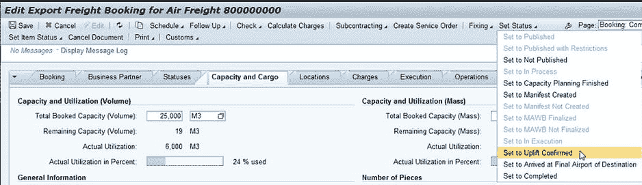

图 A-226. 货运预订（出口）：确认货物装机

在 `Set to Uplift Confirmed` 窗口中，输入日期，然后点击 `OK` 按钮。

图 A-227. 货运预订（出口）：设置为“已确认装机”窗口

通过点击`Save`按钮保存货运预订（出口）。因此，货运预订（出口）的装机确认状态被设置为“已确认装机”。同时，会自动创建货运预订（进口）和货运委托（进口），其生命周期状态设置为“草稿”，并且货运预订（进口）会显示在`Document Flow`选项卡中。

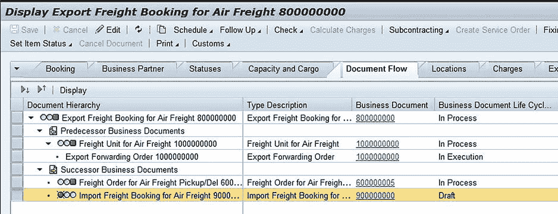

图 A-228. 货运预订（出口）：在“文档流”选项卡中显示货运预订（进口）

点击新创建的货运预订（进口）。
