## 处理货运委托（进口）和货运预订（进口）

这将在新窗口中打开该货运预订。选择 `Document Flow` 选项卡以查看货运委托（进口）。

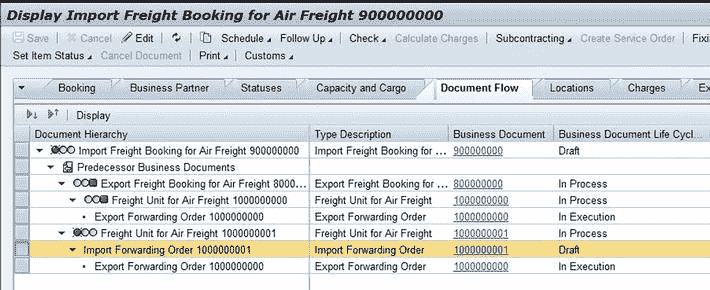

图 A-229. 货运预订（进口）：在“文档流”选项卡中显示货运委托（进口）

要处理货运预订（进口）和货运委托（进口），必须先移除它们的草稿状态。

> `注意`
>
> 在移除草稿状态之前，请检查货运预订（进口）和货运委托（进口）的合作伙伴、采购组织、销售组织、预付协议方、到付协议方等信息是否正确，并进行必要的更改。

要移除货运预订（进口）的草稿状态，请在编辑模式下打开它，然后从 `Set Status` 菜单中选择 `Set In Process`。

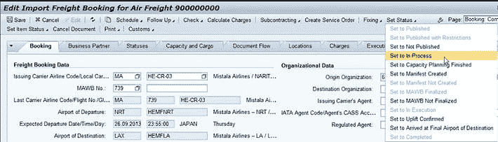

图 A-230. 货运预订（进口）：将状态设置为“处理中”

通过点击 `Save` 按钮保存货运预订（进口）。

要移除货运委托（进口）的草稿状态，请在编辑模式下打开它，然后点击 `Set to In Process` 按钮。通过点击 `Save` 按钮保存货运委托（进口）。

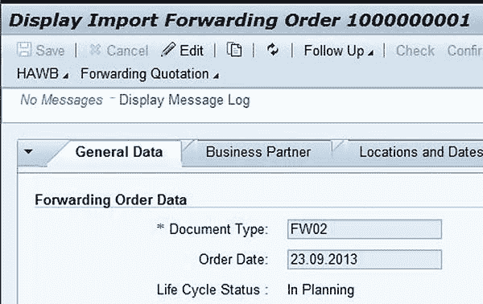

图 A-231. 货运委托（进口）：生命周期状态更新为“计划中”

### 计划和分包（进口）

#### 规划陆路运输（续程）

规划陆路运输（续程）涉及的过程与规划前期陆路运输类似。

在运输驾驶舱的 `Freight Orders/Freight Bookings` 部分，点击 `Document` 列中可见的新创建的货运订单。

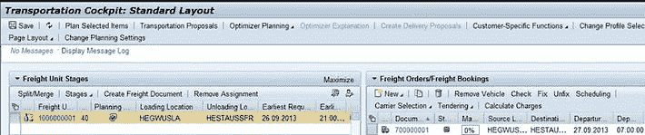

图 A-232. 运输驾驶舱：通过计划创建的货运订单（续程运输）

这将打开 `Freight-Order` 窗口。点击 `Edit` 按钮以编辑该货运订单（续程运输）。接下来，选择 `General Data` 选项卡，并输入表 A-167 中的数据。

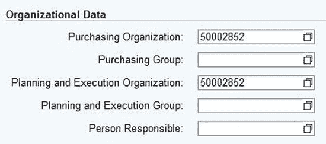

图 A-233. 货运订单（续程运输）：常规数据选项卡的组织数据部分

**表 A-167. 货运订单（续程运输）：常规数据选项卡数据**

| 字段 | 值 |
| --- | --- |
| 常规数据选项卡 | |
| 组织数据部分 | |
| 采购组织 | `<输入 HEJPFHLA 的组织 ID>` |
| 计划与执行组织 | `<输入 HEJPFHLA 的组织 ID>` |

通过点击 `Save` 按钮保存该货运订单（续程运输）。

#### 规划派送

规划派送涉及的过程与规划提货类似。

在货运委托（进口）的 `Stages` 选项卡中，点击 `Document` 列（第 5 阶段）中可见的新创建的货运订单。

这将打开 `Freight-Order` 窗口。点击 `Edit` 按钮以编辑该货运订单（派送）。然后，选择 `General Data` 选项卡，并输入表 A-168 中的数据。

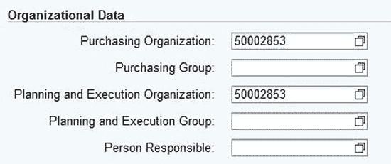

图 A-235. 货运订单（派送）：常规数据选项卡的组织数据部分

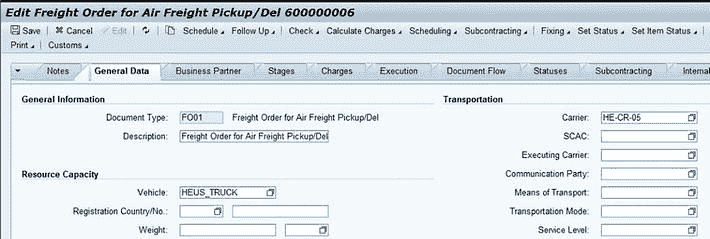

图 A-234. 货运订单（派送）：常规数据选项卡的运输和资源能力部分

**表 A-168. 货运订单（派送）：常规数据选项卡数据**

| 字段 | 值 |
| --- | --- |
| 常规数据选项卡 | |
| 运输部分 | |
| 承运人 | `HE-CR-05` |
| 资源能力部分 | |
| 车辆 | `HEUS_TRUCK` |
| 组织数据部分 | |
| 采购组织 | `<输入 HEJPFHSFA 的组织 ID>` |
| 计划与执行组织 | `<输入 HEJPFHSFA 的组织 ID>` |

通过点击 `Save` 按钮保存该货运订单（派送）。

### 货运执行与监控（进口）

假设飞机已抵达洛杉矶国际机场（LAX）。

要捕获此状态，请以编辑模式打开发货单（进口），然后从 `设置状态` 菜单中选择 `设置为已抵达目的地最终机场`。

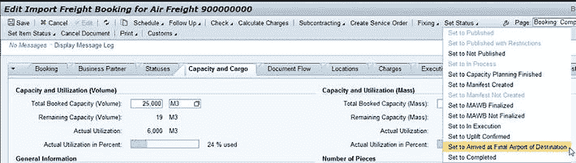

图 A-236. 发货单（进口）：报告 `已抵达目的地最终机场` 事件

在 `设置为已抵达目的地最终机场` 窗口中，输入日期，然后单击 `确定` 按钮。

图 A-237. 发货单（进口）：`设置为已抵达目的地最终机场` 窗口

单击 `保存` 按钮以保存发货单（进口）。

对于从目的地机场到目的地门户的拖车运输，请以编辑模式打开发货单（进口）。在 `容量与货物` 标签页中，选择货运单位，然后从 `创建提货货运订单` 菜单中选择 `创建交货货运订单`。

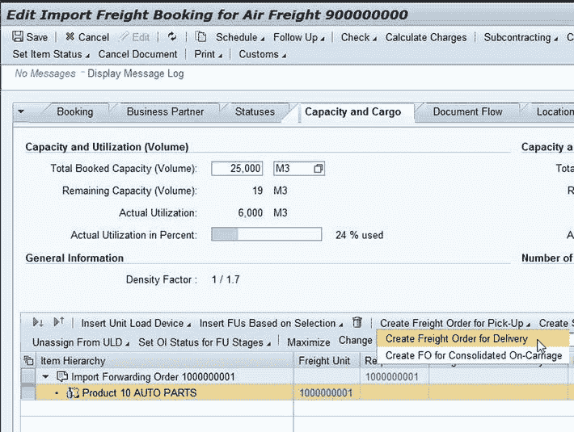

图 A-238. 发货单（进口）：创建货运订单（拖车运输交货）

单击 `保存` 按钮以保存发货单（进口）。新创建的货运订单（拖车运输交货）将显示在 `容量与货物` 标签页的 `交货货运订单` 列中。

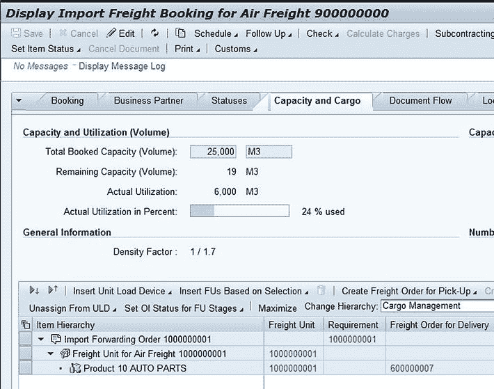

图 A-239. 发货单（进口）：在 `容量与货物` 标签页中显示货运订单编号（拖车运输交货）

单击货运订单（拖车运输交货）。这将打开 `货运订单` 窗口。单击 `编辑` 按钮以编辑货运订单（拖车运输交货）。然后，选择 `常规数据` 标签页，并输入表 A-169 中的数据。

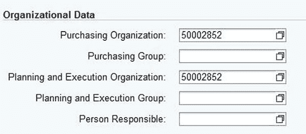

图 A-241. 货运订单（拖车运输交货）：`常规数据` 标签页的组织数据部分

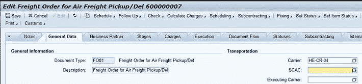

图 A-240. 货运订单（拖车运输交货）：`常规数据` 标签页的运输部分

**表 A-169. 货运订单（拖车运输交货）：`常规数据` 标签页数据**

| 字段 | 值 |
| --- | --- |
| 常规数据标签页 | |
| 运输部分 | |
| 承运人 | `HE-CR-04` |
| 组织数据部分 | |
| 采购组织 | `<输入 HEJPFHLA 的组织 ID>` |
| 计划与执行组织 | `<输入 HEJPFHLA 的组织 ID>` |

选择 `阶段` 标签页，并输入表 A-170 中的数据。

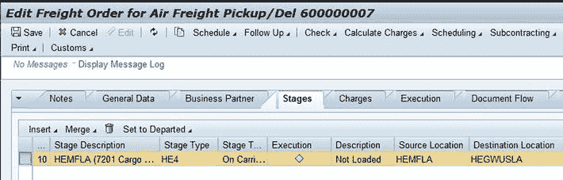

图 A-242. 货运订单（拖车运输交货）：`阶段` 标签页

**表 A-170. 货运订单（拖车运输交货）：`阶段` 标签页数据**

| 字段 | 值 |
| --- | --- |
| 阶段标签页 | |
| 阶段类型 | `HE4` |

单击 `保存` 按钮以保存货运订单（拖车运输交货）。

通过这种方式，为剩余的货运订单（续程运输、交货）触发必要的事件，例如 `出发` 和 `抵达目的地`。

注意：当触发最后一个预期的定制化事件（货运订单类型、发货单类型、货运单位类型）时，执行状态将设置为 `已执行`。
