### 客户开票与运费结算

在此流程中，财务部门将计算应向客户收取的费用，进行核对，并向客户开具发票。同样，应付账款部门将执行运费单审计，核实承运人收取的费用，并进行运费结算。货代结算和运费结算用户界面是 SAP TM 中用于执行此流程的界面之一。

#### 计算开票费用

## 计算费用

对于给定的场景，要计算费用，请以编辑模式打开货代订单（出口），然后从 `计算费用` 菜单中选择 `计算费用`。

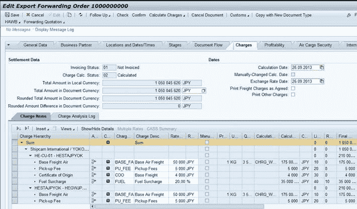

图 A-244. 货代订单（出口）：费用显示

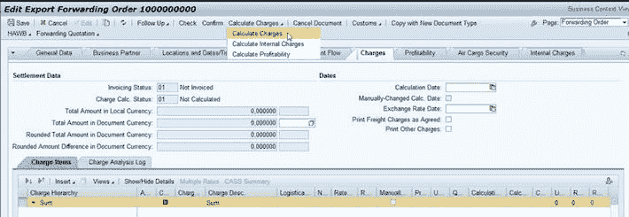

图 A-243. 货代订单（出口）：选择 `计算费用`

单击 `保存` 按钮以保存货代订单（出口）。

通过这种方式，计算货代订单（进口）的费用。

### 计算开票费用

对于给定的场景，所有货运订单（提货、前置运输、续程运输、交货）以及发货单的费用将由系统自动计算。

然而，我们假设由于某种原因，货运订单（提货）的费用尚未自动计算。要计算费用，请以编辑模式打开货运订单（提货），然后从 `计算费用` 菜单中选择 `计算费用`。

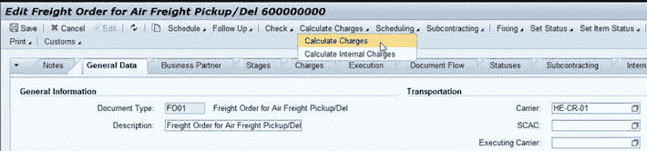

图 A-245. 货运订单（提货）：选择 `计算费用`

结果，费用将根据货运协议进行计算。

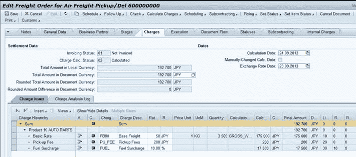

图 A-246. 货运订单（提货）：费用显示

单击 `保存` 按钮以保存货运订单（提货）。

检查其他订单（前置运输、续程运输等）的费用是否已计算。如果费用未计算，则按照相同方法进行计算。

### 开票（货运结算）

要为客户创建发票，需先生成货运结算单据，然后将其传输至 SAP ERP 系统或其他财务系统。

要为给定场景创建货运结算，以编辑模式打开货运订单（出口），然后从 `跟进` 菜单中选择 `创建货运结算单据`。

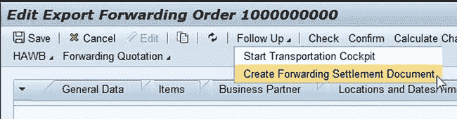

图 A-247. 货运订单（出口）：创建货运结算单据

随后，程序会提示您为货运结算单据指定业务伙伴。选择合适的业务伙伴，并点击 `确定`  按钮。随即，`货运结算单据` 窗口将打开，其在 SAP ERP 中的生命周期状态将被设置为 `"待开票"`。

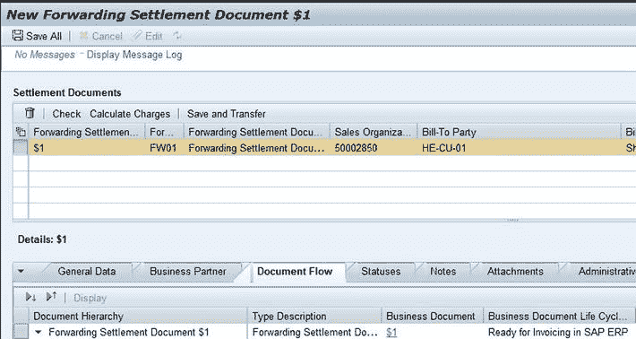

图 A-248. 货运结算单据：生命周期状态设置为 `"待 SAP ERP 开票"`

要将货运结算单据传输至 SAP ERP，在 `结算单据` 区域选中该货运结算单据，然后点击 `保存并传输`  按钮。

至此，货运结算单据的生命周期状态被设置为 `已传输至 SAP ERP 开票`，并将在 SAP ERP 中生成开票凭证。

一旦开票凭证在 SAP ERP 中成功创建，该开票凭证编号将显示在货运结算用户界面的 `单据流` 选项卡中，并且货运结算单据的生命周期状态将被设置为 `已在 SAP ERP 中开票`。

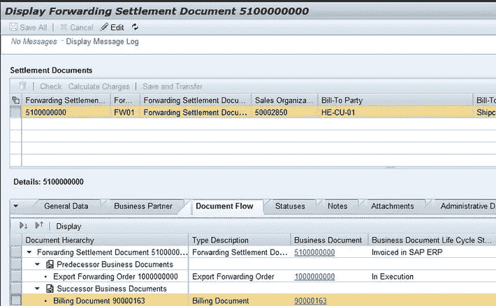

图 A-249. 货运结算单据：生命周期状态设置为 `"已在 SAP ERP 中开票"`

以此方式，为货运订单（进口）创建并传输货运结算单据。

### 开票（运费结算）

要验证是否已收到承运商的发票，需生成运费结算单据并传输至 SAP ERP 系统或其他财务系统。

我们来看如何为运费订单（提货）创建运费结算单据。为此，以编辑模式打开运费订单（提货），并从 `跟进` 菜单中选择 `创建运费结算`。

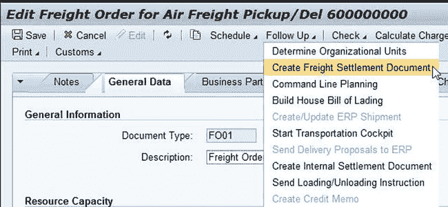

图 A-250. 运费订单（提货）：创建运费结算单据

随后，运费结算窗口将打开，其生命周期状态被设置为 `"待计提"`。

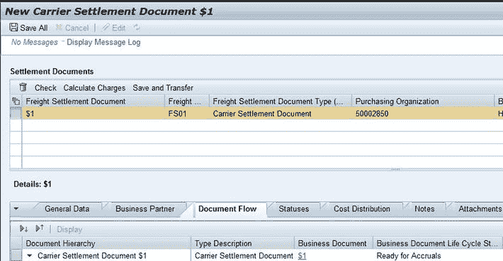

图 A-251. 运费结算单据：生命周期状态设置为 `"待计提"`

要将运费结算传输至 SAP ERP，在 `结算单据` 区域选中该运费结算单据，并点击 `保存并传输`  按钮。

至此，运费结算单据的生命周期状态被设置为 `"已传输待计提"`，并将在 SAP ERP 中创建采购订单和服务录入表。

一旦采购订单和服务录入表在 SAP ERP 中成功创建，采购订单和服务录入表编号将显示在运费结算用户界面的 `单据流` 选项卡中，并且运费结算单据的生命周期状态将被设置为 `"已过账计提"`。

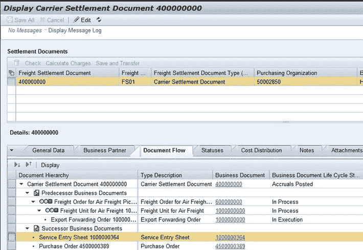

图 A-252. 运费结算单据：生命周期状态设置为 `"已过账计提"`

一旦发票在 SAP ERP 中通过验证，发票编号也会显示在运费结算用户界面的 `单据流` 选项卡中，此时运费结算单据的生命周期状态被设置为 `"发票已在 ERP 中验证"`。

以此方式，为其他订单（前期运输、后续运输等）创建运费结算单据。

一旦结算单据创建并传输至 SAP ERP，且最后一个预期事件已触发，则订单（货运订单、运费订单、运费预订）的生命周期状态将变更为 `"已完成"`。

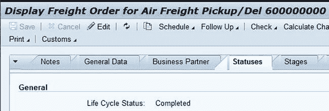

图 A-254. 运费订单（提货）：生命周期状态设置为 `"已完成"`

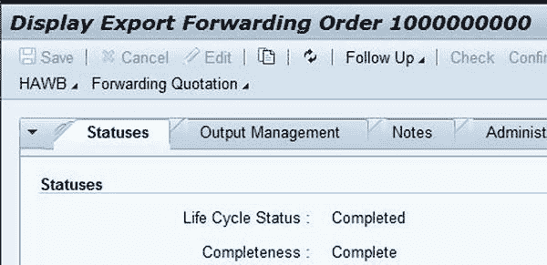

图 A-253.

## 转发订单（导出）

生命周期状态设置为“已完成”
