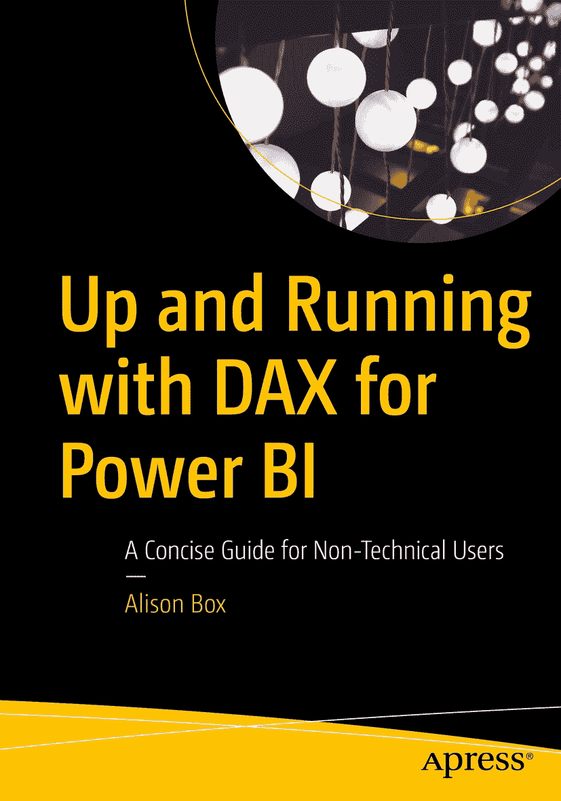

ISBN 978-1-4842-8187-1 电子版 ISBN 978-1-4842-8188-8 [`doi.org/10.1007/978-1-4842-8188-8`](https://doi.org/10.1007/978-1-4842-8188-8)
© Alison Box 2022

本作品受版权保护。所有权利均由出版社独家许可，涵盖全部或部分材料，特别包括翻译、重印、复用插图、朗诵、广播、以微缩胶片或任何其他物理形式复制，以及传输或信息存储与检索、电子改编、计算机软件，或采用目前已知或未来开发的类似或不同方法。本出版物中使用通用描述性名称、注册商标名称、商标、服务标志等，并不意味着，即使未作明确声明，这些名称可豁免于相关保护法律法规，因此可自由用于一般用途。出版商、作者及编辑认为，本书中的建议和信息在出版日期时是真实准确的。出版商、作者及编辑均不对本书所含材料或可能存在的任何错误或遗漏作出明示或暗示的保证。出版商对于已出版地图中的管辖权主张及机构归属保持中立。

此 Apress 印记由注册公司 APress Media, LLC（Springer Nature 旗下）出版。

注册公司地址为：1 New York Plaza, New York, NY 10004, U.S.A.

*献给玛德琳、约翰和艾伦*
