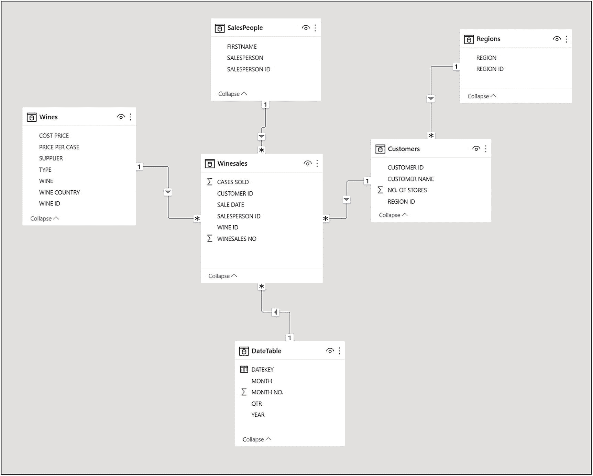
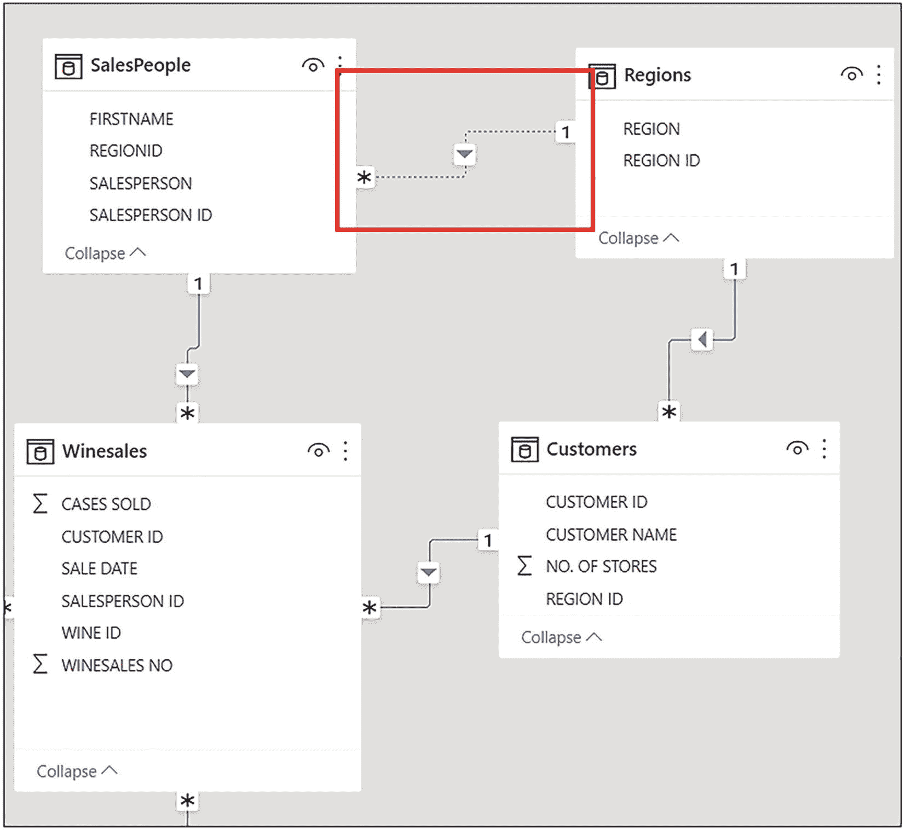
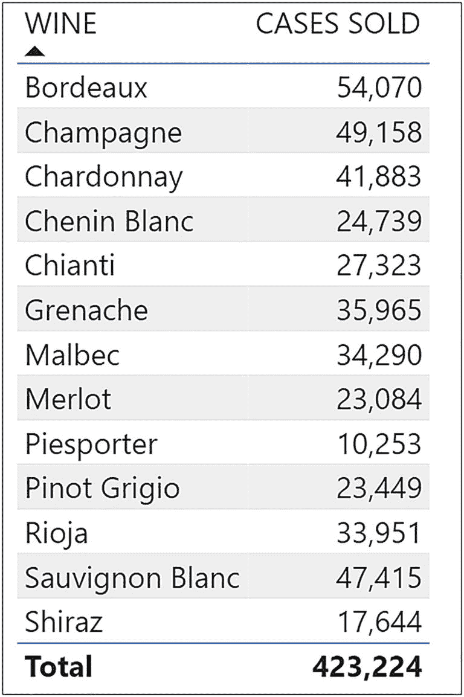
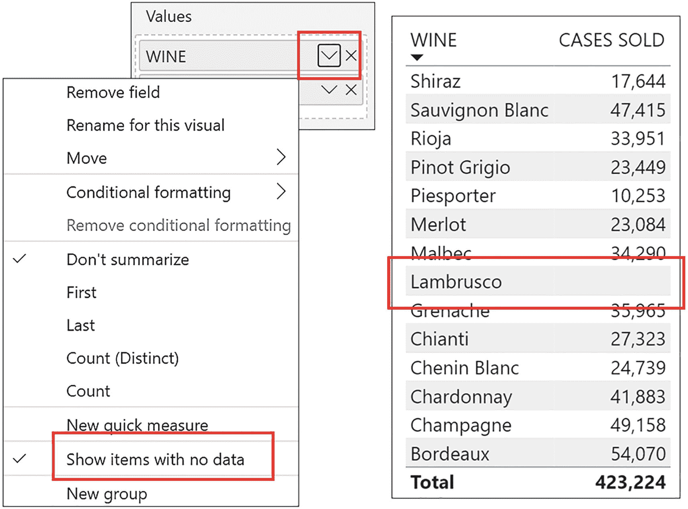
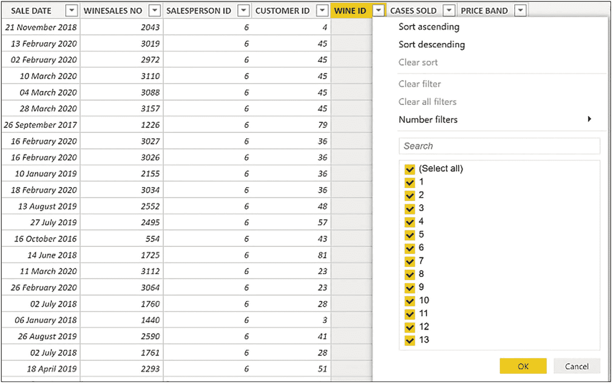
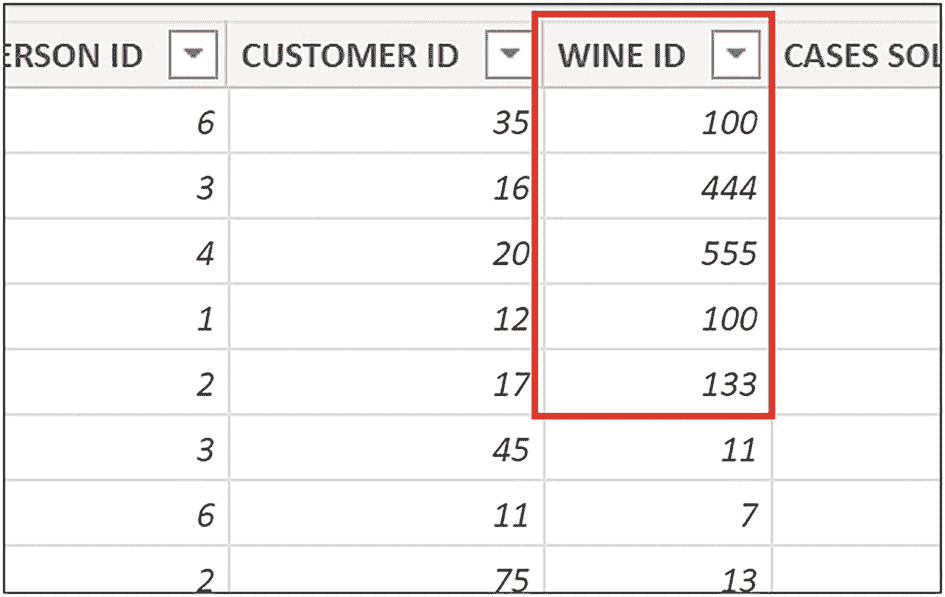

# 1. 让我看看数据

掌握 DAX 的关键在于理解支撑表达式的那些具有挑战性的核心概念。你编写的大多数 DAX 表达式通常只有寥寥几行代码，但真正理解其求值过程的奥秘在于引擎盖下的运作机制。例如，看这个 DAX 表达式：

- `=MAXX ( Customers, [Total Sales] )`

它包含一个函数、一个表名和一个度量值名称。看起来应该很简单。然而，要揭开这个表达式背后的计算过程，你需要扎实掌握以下概念：行上下文、筛选上下文、迭代器和上下文转换。对于 DAX 而言，细节之中确实暗藏玄机。这就是为什么你不能简单地复制粘贴别人的表达式，胡乱修改后指望它们能神奇地生效。你会发现，用这种方法学习 DAX 困难重重。你必须专注于函数语言的核心原理。只要你留意细节，就会发现 DAX 并没有那么难理解。

不过，在开始编写代码之前，我们必须先做好必要的准备工作，才能踏上 DAX 语言的学习之旅。

注释

如需详细了解 DAX 语言的起源及其首次出现的时间，其历史可参阅：[*https://en.wikipedia.org/wiki/Data_analysis_expressions*](https://en.wikipedia.org/wiki/Data_analysis_expressions)。

例如，如果不了解底层数据的结构和形态，就不可能创建出正确的 DAX 表达式。这是因为表达式的构造将直接取决于数据模型中表的排列方式。正因如此，任何 DAX 专家在尝试编写相关 DAX 代码之前，都会对你说"让我看看数据"。

因此，在本章中，你将熟悉本书 DAX 示例中将要使用的数据，并重点关注这些数据的结构。你将学习描述数据组成部分的各种术语，以及支撑其结构的核心原则。只有理解了这些原则，你才能继续编写 DAX 代码。

我们的示例数据包含一个虚构的销售场景，而最好的销售产品莫过于葡萄酒（也许比销售自行车或电气设备更具吸引力）。在本书后续的所有内容中，你需要设想自己正从事这款产品的销售工作。通过使用 DAX 来分析对您至关重要的指标，您将洞察数据，从而助力实现成功的业务成果和盈利能力。

注释

我理解您的数据可能与销售无关。不过，我们的葡萄酒销售数据是通用数据，包含实体名称、数字和日期，您的数据与此并无不同。

我们已将六个表导入 Power BI Desktop，具体如下：

- **Winesales** – 记录我们的销售交易。
- **Wines** – 记录我们销售的葡萄酒的名称和详细信息。
- **Customers** – 我们的葡萄酒销售对象。
- **SalesPeople** – 负责销售的人员。
- **Regions** – 我们的客户按区域分组。
- **DateTable** – 记录每一天，从销售开始月份的月初到当前财务年度的最后一天，并将这些日期归类为年、季度和月。

注释

稍后我们会发现，使用单个单词作为表名会更简单，这就是我们将表命名为`Winesales`、`SalesPeople`和`DateTable`的原因。

我们的表之间通过多对一关系关联，如图 1-1 所示。

*图 1-1* 本书全程使用的数据模型

要查看这些关系，请点击报表画布左上角的**模型**按钮。此视图显示了表之间的关系，这种结构被称为*数据模型*。

您会注意到，`DateTable`、`SalesPeople`、`Customers`和`Wines`表都与`Winesales`表相关。请注意分别表示一端和多端的"1"和"*"。用于创建关系的列在两个表中具有相同的列名；例如，`Wines`表中的`WINE ID`与`Winesales`表中的`WINE ID`相关联。`Regions`表比较特殊，它不直接与`Winesales`表关联，而是通过`Customers`表*间接*关联。

如果您想了解有关在 Power BI Desktop 中创建表间关系的更多信息，请参阅以下链接：

[*https://docs.microsoft.com/en-us/power-bi/desktop-create-and-manage-relationships*](https://docs.microsoft.com/en-us/power-bi/desktop-create-and-manage-relationships)

## 星型与雪花型

您可能会注意到，我们的数据模型结构非常简单。如前所述，DAX 的一个关键方面（也是初学者经常忽视的一点）是：您的 DAX 表达式细节将与模型结构密不可分。模型越简单，计算就越直接。对于 DAX 专家来说，没有什么比遇到一个设计欠妥的数据模型更令人头疼的了，因为这可能意味着他们需要编写更复杂的 DAX 表达式。我们稍后会探讨如何使用 DAX 来克服数据模型中的异常情况，但何必自寻烦恼呢？那么，我们不妨仔细看看模型的结构，并思考为什么我称它"简单"。

首先，我们来分析构成模型的表。在 Power BI 数据模型中，一个表应属于以下两种类型之一：*事实表*或*维度表*，具体描述如下。

### 事实表

此类表存储"事件"。"事件"在这里是一个广义的概念，用于描述销售、订单或调查结果等活动。事实表回答的问题是"是什么？"——也就是说，你在报表中分析的是什么？你可以通过向自己提出以下三个问题来识别事实表：

1.  哪个表包含你希望在报表中分析的数据？
2.  如果删除这个表，剩下的表是否还能与数据模型中的其他表保持关联？
3.  哪个表位于所有其他关系的多端？

让我们用我们的数据来回答这些问题。我们希望报告记录在`Winesales`表中的销售情况。如果删除`Winesales`表，我们就会在模型视图中看到一些互不关联的表。`Winesales`表位于所有其他关系的多端。显然，`Winesales`表就是我们的**事实表**。根据定义，事实表位于多对一关系的多端。事实表的另一个属性是，其数据会频繁变化，并且其行数可能远多于维度表。

### 维度

这些表存储了模型中实体的描述信息。维度回答的是*如何*（*how*）这个问题。即，你希望如何分析数据？在我们的数据模型中，我们可以利用这些表中的列数据，按葡萄酒、销售人员、客户、地区和日期来分析销售额。维度中的数据通常不会频繁变化，并且维度的行数往往少于事实表。

没有专门的表属性可以将表类型配置为维度表或事实表。这取决于表在关系中所处的端。位于“一”端的表始终是维度类型的表，而*仅*位于“多”端的表则是事实表。

区分这两种表类型之所以如此重要，是因为它们在数据模型中支持两种不同的行为，具体如下：

*   维度表支持*分组*（*grouping*）和*筛选*（*filtering*）。
*   事实表支持*汇总*（*summarization*）。

正如我们稍后将学到的，`DAX`*度量值*通常设计用于汇总来自事实表的数据，而这些数据已经由维度表进行了分组和筛选。

### 星型架构

你会在模型视图中注意到，我们将事实表放置在视图中央，并将我们的维度表围绕事实表排列。这种排列可以描述为星形，因此这种结构得名*星型架构*（*star schema*）。在一个完美的星型架构中，所有维度表都直接与事实表关联。我们的数据模型中存在一个不完美之处：`Regions`表是一个与另一个维度关联的维度。那些不直接与事实表关联，而是通过其他维度表间接关联的维度，被称为*雪花型*（*snowflake*）维度。你可以想象，如果从事实表向外延伸出一连串相互关联的维度，这种架构会更像雪花。

由于数据是无限变化的，你数据模型中的表可能不会严格遵循完美的星型架构排列。例如，拥有多个事实表本身不一定是问题。然而，需要谨记的是，你的模型偏离星型架构越远，就越需要依赖`DAX`来管理它。在本节后续部分，当我们探讨`CROSSFILTER`和`TREATAS`函数时，我们将解决数据模型结构中固有的问题，届时我们将创建“虚拟”关系。

正如我们将在学习控制筛选器，特别是计算非重复计数时发现的那样，处理不与事实表直接关联的维度可能会很困难。因此，有时将雪花型维度整合到其父表中是有意义的，从而将架构恢复成星型，这一过程称为反规范化。你可以在此处及一般性星型架构指南中找到更多信息：[`https://docs.microsoft.com/en-us/power-bi/guidance/star-schema`](https://docs.microsoft.com/en-us/power-bi/guidance/star-schema)。

`Power BI` 阻止的一件事是数据模型中的*歧义*（*ambiguity*），即存在多条路径供筛选器传播。因此，如果你试图将一个维度关联到另外两个或更多维度，这将导致创建一个*非活动*（*inactive*）关系，用虚线表示。例如，在图 1-2 中，我们将`SalesPeople`维度同时与`Customers`维度和`Regions`维度关联，这导致`SalesPeople`和`Regions`之间形成了一个非活动关系。

图 1-2

创建非活动关系是为了避免歧义

我们将在后续章节探讨歧义的概念以及如何处理非活动关系，但目前，我们至少可以庆幸系统不允许我们做任何妨碍模型正常机制的事情。

## 查找不匹配的值

一个经常被问到的问题是，当用于创建关系的链接列中存在缺失值时会发生什么。这里有两种不同的情况，以`Wines`维度为例：

1.  在`Wines`维度表的`WINE ID`列中存在值，但这些值在`Winesales`事实表的`WINE ID`列中不存在。
2.  在`Winesales`事实表的`WINE ID`列中存在值，但这些值在`Wines`维度表的`WINE ID`列中不存在。

我们先来看场景 #1。理解这种情况能够帮助我们回答以下问题：哪些葡萄酒我们没有销售过？当你构建一个可视化对象，该对象从维度中取一列并汇总事实表中的一列时，你只会看到链接列值匹配的项目。默认情况下，所有可视化对象都会移除那些没有值可显示的项目。

> 注意
> 关于构建`Power BI`可视化对象（包括图 1-3 中所示的表格可视化对象）的信息，请访问
> [`https://docs.microsoft.com/en-us/power-bi/visuals/power-bi-report-add-visualizations-i`](https://docs.microsoft.com/en-us/power-bi/visuals/power-bi-report-add-visualizations-i)

例如，在图 1-3 中，它使用了`Wines`维度表中的`WINE`列，并汇总了`Winesales`表中的`CASES SOLD`，我们只看到在两个表的`WINE ID`列中值相匹配的葡萄酒。换句话说，我们只看到了我们已经售出的葡萄酒。

图 1-3

默认情况下，你只看到链接列中值匹配的项目

我们如何在这个可视化对象中看到我们没有销售过的葡萄酒呢？操作很简单，不需要任何`DAX`。在“可视化”窗格的“值”字段中，单击维度列（例如`WINE`列）的下拉箭头，然后选择**显示无数据的项目**。现在，你会在那些在事实表中没有匹配项的项目旁边看到一个空白值，在我们的例子中，就是“Lambrusco”葡萄酒。这告诉我们，我们还没有销售过这种葡萄酒；见图 1-4。

图 1-4

查找没有数据的项目

如果我们查看数据视图（点击报表画布左侧模型上方的按钮）中的`Wines`维度表，我们会发现“Lambrusco”的`WINE ID`是 14。使用筛选器检查`Winesales`表`WINE ID`列的值，会发现该列中没有`WINE ID`为 14 的值；见图 1-5。

图 1-5

事实表的链接列中不包含维度表中的该值

正如“显示无数据的项目”选项名称所暗示的那样，它可以在你想查看没有计算结果可显示的项目时使用，例如，当某个度量值对一个项目没有返回值时。这并不表示永远没有值可显示（如“Lambrusco”葡萄酒的情况）；而是意味着模型当前的筛选器导致没有值可显示。

现在，我们来看场景 #2，在`Winesales`事实表的`WINE ID`列中存在值，但这些值在`Wines`维度表的`WINE ID`列中不存在。

> 注意
> 示例文件不包含场景 #2 中描述的数据。但是，图 1-6 向你展示了这些数据的样子。

在图 1-6 中，你看到的正是这种场景。显示的葡萄酒 ID 在`Wines`维度表中没有匹配项。

图 1-6

事实表中存在于维度之外的值

