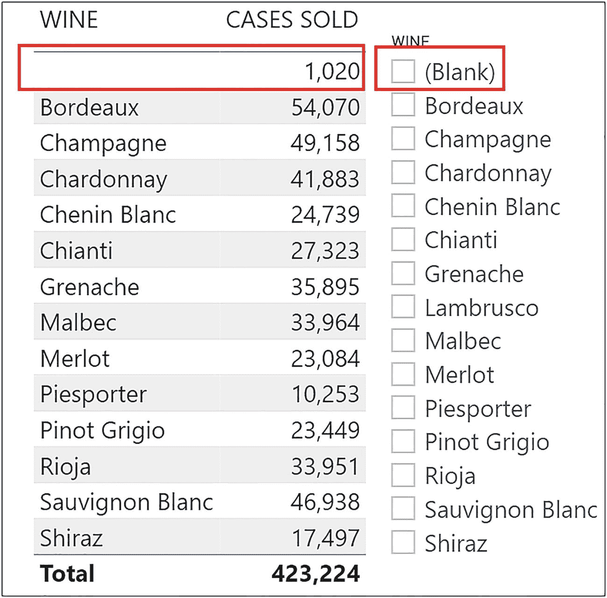

# 当数据中出现此类值时，只要从维度中选取一个列并分析事实表中的某个列，你便会在任何视觉对象中看到结果，如图 1-7 所示。此处我们将数据放入表格视觉对象和切片器中。这里有一个“空白”酒名，它代表事实表中所有在维度中无匹配项的`WINE ID`值。即使切片器未使用关系且仅显示维度中的值，你也会在其中看到相同的结果。

图 1-7

“空白”条目表明事实表中存在与维度值不匹配的值

“空白”条目是我们有时称之为“脏数据”的结果。为什么事实表中会存在维度中无匹配项的值？你将如何解决这种情况？这个问题只有数据建模者才能回答，而最终的解决方案在于从源头修正数据。

我们希望你能意识到识别数据中不匹配值的重要性，并理解你不需要`DAX`来完成这项工作。发现哪里没有数据，与知道哪里有数据同样有价值，而星型模式使我们能够做到这一点。

在本章中，你已经熟悉了我们之后将使用的数据。你现在也理解了支撑数据模型的概念，以及它如何由与多对一关系相关的事实表和维度组成。最简单的结构化数据模型是星型模式，其中维度直接与事实表关联。然而，也可以让维度通过其他维度间接关联到事实表，从而形成雪花维度。这是理解`DAX`必备的前置知识，因为随着本书内容的深入，你将学到许多`DAX`计算会涉及操作数据模型中的表，而在此过程中，表的结构方式至关重要。

脚注 1 2

