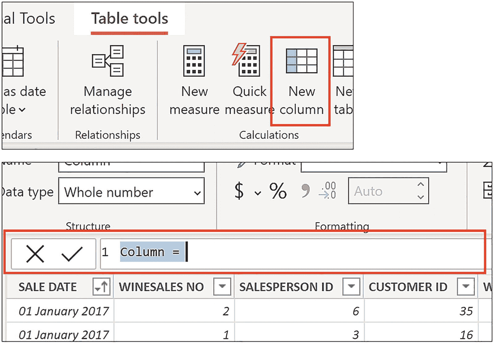
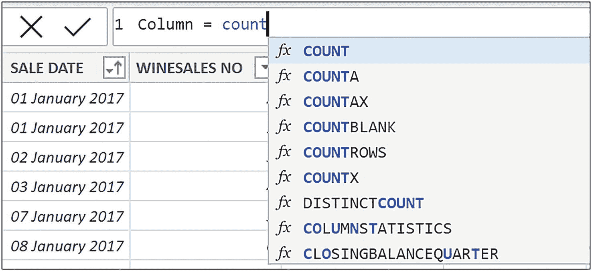
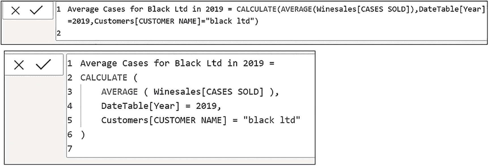

# 2. DAX 对象、语法与格式

既然你已理解全书所用数据的结构，下一步就是学习如何构建`DAX`表达式。在本章中，我们将比较和对比`DAX`表达式与 Excel 公式的异同，这将为你的知识提供上下文。你将学习如何引用`DAX`表达式中使用的对象、表达式的语法，以及如何格式化`DAX`代码，使其更易于阅读和调试。

若要跟随本章示例操作，请在 Power BI Desktop 的“数据”视图中，从字段列表选择`Winesales`表，然后在**表工具**选项卡上，单击**新建列**按钮。这将显示`DAX`“公式栏”，如图 2-1 所示。



图 2-1

跟随示例操作时，请使用`新建列`按钮

与 Excel 的第一个相似之处是，创建新列或度量时弹出的“公式栏”。我们现在将开始在公式栏中输入一些表达式。不过，在这个阶段，你不需要知道这些表达式在计算什么。你只需学习如何输入正确的语法。

## DAX 语法

注意左侧，与 Excel 一样，公式栏有一个取消按钮（叉号）和一个输入按钮（对勾）。然而，公式栏实际上是一个代码编辑器，如果按下`SHIFT + ENTER`组合键，它可以扩展到多行（参见下方关于格式化的章节）。正因如此，与 Excel 公式栏不同，`DAX`代码编辑器的每一行都有编号。例如，你会注意到在图 2-1 中，我们位于第 1 行。

与 Excel 的另一个相似之处是，`DAX`表达式的构建方式与 Excel 公式相同。例如，所有`DAX`表达式都以等号开头，并且函数参数之间用逗号分隔。同样，与 Excel 一样，`DAX`表达式是*不区分大小写*的；你以何种大小写输入`DAX`代码没有区别。

然而，`DAX`与 Excel 的主要区别之一是，在`DAX`中，你无法引用“单元格”。在`DAX`表达式中引用的唯一两个对象是表和列。

引用表时只需给出其名称。例如，要计算`Winesales`表中的行数，表达式如下：

```
= COUNTROWS ( Winesales )
```

请注意，当你开始在`DAX`编辑器中输入此表达式时，与 Excel 一样，`DAX`编辑器会从建议列表中匹配你输入的内容。此列表被称为`DAX` `IntelliSense`（智能感知）；见图 2-2。只需在`IntelliSense`列表中点击某个建议，即可将其放入你的代码中。你不能在表达式中放入任何不在列表中的内容。



图 2-2

`DAX` `IntelliSense`列表

另外，请注意在`COUNTROWS`表达式中，括号前后都使用了空格。输入空格是随意的，因为`DAX`编辑器会忽略它们，你可以根据需要在任何能提高表达式清晰度的地方使用空格（参见下方关于格式化的章节）。

如果表名包含空格，表名必须用单引号括起来：

```
= COUNTROWS (  'Wine Sales' )
```

要引用列，需将列名放在方括号（`[ ]`）中，并且*始终在列名前加上表名*。例如，要对`Winesales`表中的`CASES SOLD`列求和，表达式如下：

```
= SUM ( Winesales[CASES SOLD] )
```

如前所述，在`DAX`中，不存在单元格这种东西，只有表和列。

表 2-1 展示了等效的 Excel 公式和`DAX`表达式的对比，你可以看到两者语法之间的相似性。

表 2-1

对比 Excel 公式和`DAX`表达式

| Excel | DAX |
| --- | --- |
| `=IF ( B2 > 50 , “Yes” , “No”)` *当此公式向下复制时，“B2”将相对地变为“B3、B4、B5 等”。* | `=IF ( Winesales[CASES SOLD] > 50 , “Yes” , “No”)` *在计算列中使用时，此表达式会自动应用于整个列。* |
| `= SUM ( Winesales[CASES SOLD] )` *这使用了 Excel 表语法，其中表名为“Winesales”，列名为“CASES SOLD”。* | `= SUM ( Winesales[CASES SOLD] )` *在度量值或计算列中使用，用于查找 Winesales 表中 CASES SOLD 列的总箱数。* |

Excel 与`DAX`之间的另一个对比在于引用“AND”和“OR”的方式。在 Excel 中，你使用`AND()`和`OR()`函数。在`DAX`中，你通常使用这些运算符代替：`AND`用`&&`（双与号），`OR`用`||`（双竖线）。

注意

你可以在键盘左下角找到管道符号“|”，它位于反斜杠上方，`SHIFT`键的右侧。

表 2-2 展示了在 Excel 公式和`DAX`表达式中使用“AND”和“OR”的对比。

表 2-2

Excel 与`DAX`中`AND`和`OR`的用法对比

| Excel | DAX |
| --- | --- |
| `AND` | `AND` |
| `= IF ( AND ( Winesales[@CASES SOLD] > 50, Winesales[@CASES SOLD] < 100 ), “Yes” , “No” )` *使用 Excel 表格语法，表名为“Winesales”，列名为“CASES SOLD”* *注意使用“@”表示“当前行”。* | `= IF ( Winesales[CASES SOLD] > 50&&Winesales[CASES SOLD] < 100 ,“Yes” , “No” )` *用于计算列。* *在计算列中，使用当前行的值是隐式的。* |
| `OR` | `OR` |
| `= IF ( OR ( Winesales[@SALESPERSON ID] = 2 , Winesales[@SALESPERSON ID] = 6 ),“Yes” , “No” )` *使用 Excel 表格语法，表名为“Winesales”，列名为“SALESPERSON ID”* | `= IF ( Winesales[SALESPERSON ID] = 2&#124;&#124;Winesales[SALESPERSON ID] = 6 , “Yes” , “No” )` *用于计算列。* |

注意

DAX 确实有 `AND` 函数和 `OR` 函数，但在 DAX 中，这些函数只接受两个参数，因此通常最好使用运算符。

在 DAX 中，单个与号（`&`）用作连接运算符，与 Excel 中的用法相同。

## DAX 格式设置

在我们正式开始编写 DAX 表达式之前，让我们先养成一些关于 DAX 代码格式化的好习惯。请看图 2-3 中的两个表达式。它们是相同的表达式，但有两个不同的布局。



*比较未格式化和格式化后的表达式*

问题：哪种布局让 DAX 代码更易于理解？我想你会同意第二种布局，即我们将代码分隔到不同的行上。在 DAX 编辑器中，你可以使用组合键 `SHIFT + ENTER` 切换到新行，并使用 `TAB` 键缩进行。可以添加空格以提高清晰度。还建议将嵌套函数放在新行开始，并在与其闭合函数相同的缩进位置闭合括号。

要为你的代码添加注释，请使用以下方式：

*   `--` – 单行注释（双破折号）
*   `//` – 单行注释（双斜杠）
*   `/*` – 开始多行注释（斜杠加星号）
*   `*/` – 结束多行注释（星号加斜杠）

然而，关于如何格式化 DAX 代码并没有硬性规定。适合你的方式就是最好的。

如果你想快速格式化杂乱的 DAX 代码，请在此处使用 DAX 格式化工具：

[`https://www.daxformatter.com/`](https://www.daxformatter.com/)

你还可以在此处找到更多关于最佳实践的信息和指南：

[`https://www.sqlbi.com/articles/rules-for-dax-code-formatting/`](https://www.sqlbi.com/articles/rules-for-dax-code-formatting/)

现在，你应该能够正确输入 DAX 代码了。使用方括号引用列，并且始终在列引用前加上该列所属的表名。你已经了解到，在 DAX 中，我们经常使用“AND”和“OR”运算符，而不是 Excel 中使用的等效函数。在代码编辑器中使用单独的行将大大提高表达式的清晰度。然而，DAX 并不关心你的代码如何格式化。无论表达式的布局看起来多么糟糕，它都会执行你的代码！

本章结束了我么在继续编写 DAX 表达式和生成计算之前的准备工作。下一步是理解在 DAX 中，我们处理不同类型的表达式，这将是下一章的重点。