# 3. 计算列和度量值

在上一章中，你学习了 DAX 语言使用的语法，现在你已经准备好编写第一个 DAX 表达式了。在 DAX 中，有三种类型的表达式：*计算列*、*度量值*和*计算表*。不过，在本章中，我们将只讨论前两种类型（我们将在第 15 章简要介绍计算表）。

注意

你已经知道 DAX 是“数据分析表达式”的缩写。然而，我们经常称其为“DAX *表达式*”，因为这样表达更清晰。

首先，你将学习如何使用计算列编写计算。这将是 DAX 中让你感到直观的部分，特别是如果你是一位 Excel 用户。计算列对你来说似乎与使用 Excel 公式没有什么区别。然而，当我们继续学习如何以及为什么需要 DAX 度量值时，情况可能会变得更具挑战性。学习 DAX 时最大的障碍之一就是理解计算列和度量值之间的区别，这也是我们将在本章中探讨的内容。例如，同一个在计算列中使用的 DAX 表达式通常不能用于 DAX 度量值，但反常的是，大多数用于度量值的 DAX 表达式却可以放入计算列。

## 计算列

在学习 DAX 时，大多数人能理解输入到计算列中的表达式，因为它们与创建 Excel 公式非常相似，特别是如果你在 Excel 表格中使用公式的话。在 DAX 中，你会发现许多你喜欢的 Excel 函数，如 `IF`、`TODAY`、`ROUNDUP` 和 `SUM`，都可以在计算列中使用。

这就是为什么 DAX 新手会错误地认为 DAX 就像 Excel 一样，从而创建大量计算列，而实际上他们应该创建在各方面都更高效的度量值。关于计算列需要理解的一点是，就像在 Excel 中向下复制公式一样，计算列会为表中的*每一行*进行计算，因此可能会消耗大量处理资源。我们将看到，这与度量值的计算方式截然不同。


### 创建简单的计算列

要在计算列中创建第一个 DAX 表达式，我们来做一个非常简单的计算：将 `Winesales` 表中“已售箱数”(`CASES SOLD`)的值乘以 10%。在第 2 章中，你已经学会了如何创建新列。确保在数据视图中已选中 `Winesales` 表，然后点击**表工具**选项卡上的**新建列**按钮。在 DAX 编辑器中，输入以下表达式：

```
10 PC of Cases = Winesales[CASES SOLD] * 0.1
```

输入完成后，可以按回车键，也可以点击 DAX 编辑器左侧的对勾。名为 `"10 PC of Cases"` 的计算列即被创建，并加入到字段列表中，见图 3-1。

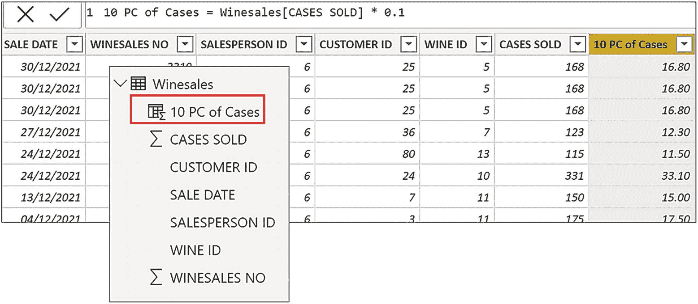

图 3-1 – 计算列加入字段列表

现在，我们来看看如何在计算列中使用 DAX 中的 `IF` 函数。例如，我们可以在 `Winesales` 表中添加一个列，该列填充“A 组”(`"Team A"`)或“B 组”(`"Team B"`)。该列将按如下方式对销售人员分组：ID 为 `1`、`3` 和 `6` 的销售人员属于 A 组，其他销售人员属于 B 组。我们将这个新列命名为 `"Team"`。

在 DAX 编辑器中，输入以下代码，注意双竖线“OR”的用法：

```
Team =
IF (
Winesales[SALESPERSON ID] = 1
|| Winesales[SALESPERSON ID] = 3
|| Winesales[SALESPERSON ID] = 6,
"Team A",
"Team B"
)
```

类似地，你可以将 `CASES SOLD` 列中的值分组为“高”(`"High"`)和“低”(`"Low"`)销量，其中高销量是指 `CASES SOLD` 在 `50` 到 `400` 之间的任何销售记录。使用以下 DAX 表达式，注意双与号“AND”的用法：

```
Volume =
IF (
Winesales[CASES SOLD] >= 50
&& Winesales[CASES SOLD] <= 400,
"High",
"Low"
)
```

创建这些计算列是引入 DAX 的一个简单方法，因为正如我们所看到的，这些表达式与 Excel 中的公式非常相似。我们在此引入这些计算列，是因为它们是教授 DAX 语法的简单示例，并且每个 Excel 用户都能操作。

然而，我们不建议你在此处进行此类计算。^(⁵) 有一种更高效的方法来创建这些列，那就是在 Power Query 中使用其条件列功能来生成。

### 了解 RELATED 函数

我们已经确定了 Excel 和 DAX 中都有一些通用函数，例如 `IF` 函数。但是，如果使用计算列并不总是生成数据最高效的方法，我们为什么还需要使用它们呢？有一些 DAX 特有的函数，它们为我们提供了在计算列上下文中编写 DAX 表达式的理由。其中一个函数就是 `RELATED` 函数。

该函数从相关表中返回一个值，其用途与 Excel 中的 `VLOOKUP` 函数类似。然而，`RELATED` 只会从关系的“一端”向“多端”返回值。例如，如果你想显示与 `Winesales` 表中 `CUSTOMER ID` 相关联的客户名称，可以在 `Winesales` 表的计算列中使用以下 DAX 表达式：

```
Customer Name from Customers Table =
RELATED ( Customers[CUSTOMER NAME] )
```

现在，你将在计算列中看到与每个 `CUSTOMER ID` 关联的名称，见图 3-2。

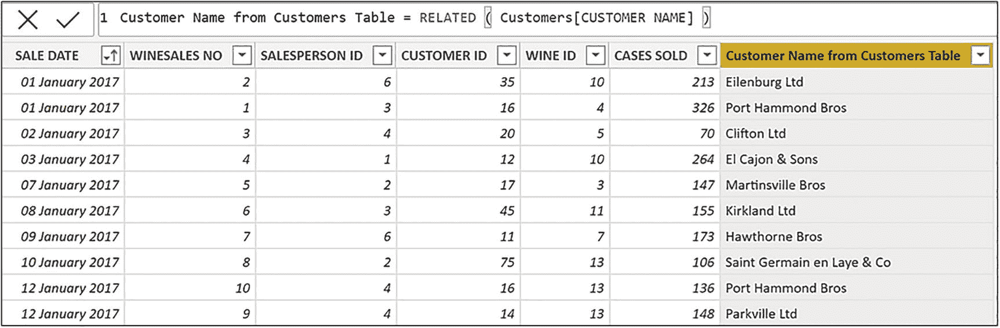

图 3-2 – `RELATED` 函数从相关表中返回值

通常，使用 `RELATED` 创建计算列来从相关表中填充值，仅仅是为了临时需求。一旦你将客户名称与交易记录放在一起，你就会发现交叉核对数据分析更容易了。当该列完成其使命后，就可以删除了。

> **注意：** 如果这些是 Excel 表格，而我们希望将 `Customers` Excel 表中的客户名称填充到 `Winesales` Excel 表中，我们会在 `Winesales` Excel 表中像这样使用 `VLOOKUP` 函数：
> `=VLOOKUP ( [@CUSTOMER ID] , Customers, 2, 0)`
> “@”符号表示“使用 Excel 表格当前行中的值”。在 DAX 计算列中，使用当前行的值是隐含的。

你还可以使用 `RELATED` 将*间接*相关表中的值提取到事实表中。例如，`Regions` 表与 `Customers` 表相关，而 `Customers` 表又与 `Winesales` 表相关，如图 3-3 所示。

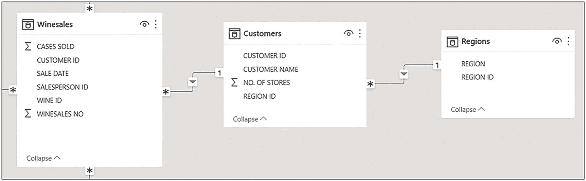

图 3-3 – `Regions` 表与 `Winesales` 表存在间接关系

因此，我们可以通过以下代码（见图 3-4）将每个 `REGION` 名称填充到 `Winesales` 表的每条销售记录旁：

```
REGION NAME = RELATED ( Regions[REGION] )
```

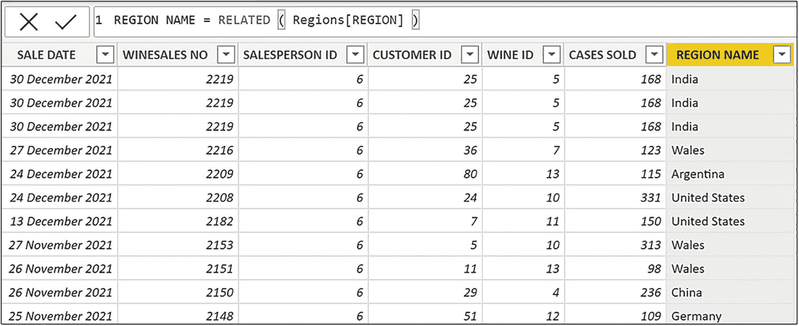

图 3-4 – 使用 `RELATED` 返回区域名称

请注意，我们将此列命名为 `REGION NAME`，以便与 `Regions` 表中的 `REGION` 列区分开来。

让我们更仔细地看看 `RELATED` 函数。你应该明白，此函数只能在以下两种情况下使用：

1.  表之间必须存在关系。
2.  只能将关系“一端”表中的值返回到“多端”表中。

从位于关系一端的表中将值填充到位于多端的表中的行为称为*反规范化*。例如，在图 3-4 的示例中，我们通过使用 `RELATED` 将 `REGION` 列中的值提取到 `Winesales` 表中，从而对 `Regions` 表进行了反规范化。这样做至少有三个好处：

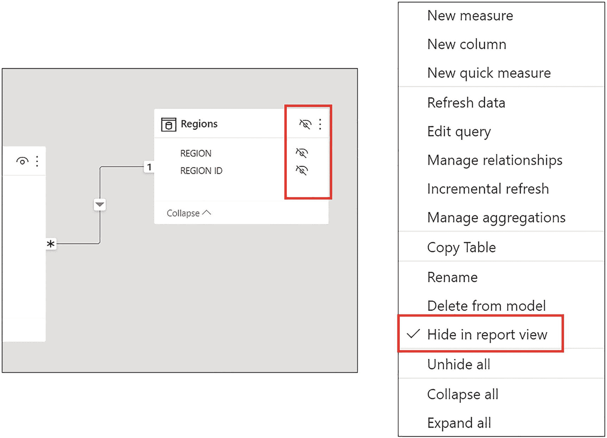

图 3-5 – 在报表视图中隐藏表

1.  你现在知道每笔销售交易发生在哪个区域了。


## DAX 度量值

如果你需要在视觉对象中使用区域名称，可以使用 `Winesales` 表中的计算列。因此，你不再需要在报表视图中看到 `Regions` 表。如果情况如此，你可以隐藏 `Regions` 表。要在报表视图中隐藏表，请在**数据视图**或**模型视图**的字段列表中右键单击表名，然后选择**在报表视图中隐藏**；参见图 3-5。

你可以对 `Winesales` 表中的 `REGION NAME` 列执行非重复计数，来计算我们在多少个*不同*区域销售了葡萄酒。我们稍后将会进行此计算，但若销售交易必须直接与其发生的区域相关联，如果我们将 `REGION` 值保留在 `Regions` 表中，这将是一个复杂的表达式。

理解 `RELATED` 函数使我们能够在数据模型中执行另一个强制计算。或许你已经注意到，尽管我们有 `Winesales` 表，但我们没有销售额值。不过，我们现在可以计算它们了。我们可以将 `Winesales` 表中的 `CASES SOLD` 列与 `Wines` 表中的 `PRICE PER CASE` 列相乘，并且由于 `Winesales` 表与 `Wines` 表之间存在多对一关系，我们可以使用 `RELATED` 来实现这一点。

我们将探讨使用 `RELATED` 计算销售收入值的两种不同方法。

对于方法 #1，我们可以创建两个计算列。第一列名为“PRICE”，使用 `RELATED` 将 `PRICE PER CASE` 值填充到 `Winesales` 表中。第二列将“PRICE”列与 `CASES SOLD` 列相乘，并命名为“Sales”：

```
PRICE =
RELATED ( Wines[PRICE PER CASE] )
SALES =
Winesales[CASES SOLD] * Winesales[PRICE]
```

方法 #2 只需要一个计算列。你可以在内存中*使用 `RELATED` 为 `Winesales` 表中的每一行找到 `Wines` 表中的 `PRICE PER CASE` 值，然后乘以 `CASES SOLD`。换句话说，你无需先将每款葡萄酒的价格展示出来，再与 `CASES SOLD` 值相乘：

```
SALES =
Winesales[CASES SOLD] * RELATED ( Wines[PRICE PER CASE] )
```

许多刚接触 DAX 的人现在会认为，`SALES` 计算列已经解决了在报表画布上的视觉对象中计算总销售额的问题。例如，我们现在可以在视觉对象的“值”字段中使用此列来查找每款葡萄酒的总销售额；参见图 3-6。

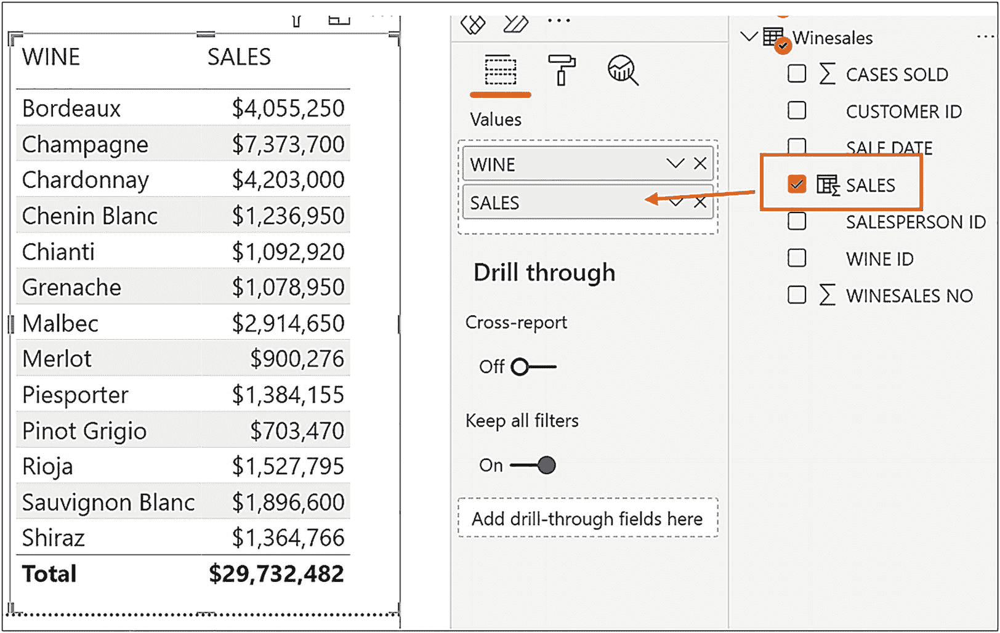
**图 3-6** 在“值”字段中使用 `SALES` 计算列来汇总销售额

然而，这可能不是一个好主意。想一想：首先，计算列会对 `Winesales` 事实表中的*每一行*进行计算，并在数据刷新时*重新计算*。如果你的事实表中有数百万行数据，这将带来大量的处理负担。

其次，当您将此列放入包含维度项的视觉对象中时，它会执行*另一次*计算，以对每个维度项的这些值进行求和。这听起来是一种非常高效的计算方式吗？可能不是。低效数据模型的后果是，在其之上构建的报表刷新和渲染速度会变慢（有关此主题的更多信息，请参见脚注 1）。

因此，现在的问题是：如果不应该使用计算列来进行销售额计算，那么应该使用什么呢？

这时，*度量值*就可以帮助我们了。我们将在第 5 章重新审视我们的销售额计算，届时我们将使用度量值，而不是使用计算列来执行计算。但现在，我们暂时将计算列放到一边（在本书后面探索一些需要使用计算列的复杂表达式时，我们会再次讨论它）。如果你是一位 Excel 用户，使用 DAX 函数（在 Excel 中有对应函数）创建计算列会让你感觉非常得心应手。然而，当开始编写 DAX 度量值时，你可能就不会有同样舒适的感觉了。而这正是 DAX 变得更具挑战性的地方，所以让我们继续前进，学习如何编写 DAX 度量值。

## DAX 度量值

现在我们准备开始学习第二种类型的 DAX 表达式：度量值。有两种类型的度量值可以在视觉对象中使用：*隐式*度量值和*显式*度量值（不过，我们通常不称其为“显式度量值”，只称“度量值”，但隐式度量值则始终按此命名）。隐式度量值和显式度量值有什么区别？好吧，我们先从隐式度量值开始。

### 隐式度量值

如果你创建过任何 Power BI 视觉对象，那么你就已经创建过隐式度量值。你是否曾想过字段列表中的数值列旁边的西格玛符号（`∑`）的含义？它的作用不仅仅是标记包含数字的列。西格玛表示，当你将此列放入视觉对象的“值”字段时，此列中的数据将自动聚合。这就是隐式度量值的含义。

西格玛通常表示该列将被求和，但你也可以通过临时更改函数来执行其他聚合，例如求平均值、最大值或最小值。为此，请使用“值”字段中列名旁边的下拉菜单，例如，将其更改为“平均值”，如图 3-7 所示，其中生成隐式度量值的步骤已编号。

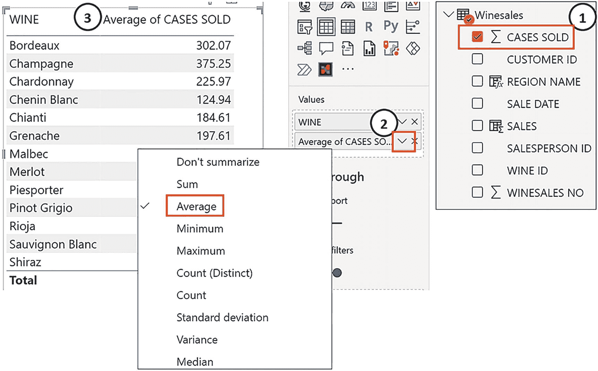
**图 3-7** 创建隐式度量值

1. 列 `CASES SOLD` 旁边有一个西格玛符号 - `∑`。

2. 当此列被放入“值”字段时，默认使用 `SUM` 函数，但你可以通过下拉菜单将其函数更改为 `AVERAGE`。

3. 隐式度量值已计算出视觉对象中显示的项（此处为每个葡萄酒）的平均 `CASES SOLD`。

然而，使用隐式度量值有几个缺点。思考以下场景：

* 你可能想将隐式度量值的名称“CASES SOLD 的平均值”重命名为更简洁的名称。你可以通过双击“值”字段中的条目来实现，但每次使用隐式度量值并想要重命名时，都必须重复此操作。

* 如果你重命名了隐式度量值，视觉对象中的度量值名称将与字段列表中的列名不匹配。

* 虽然你通常想使用 `SUM` 函数，但你*也经常*想使用 `AVERAGE`。你将不得不不断将函数更改为 `AVERAGE`。

* 在一些视觉对象中，你可能希望将隐式度量值格式化为两位小数，而在另一些视觉对象中则希望没有小数位数。你将无法在不同的视觉对象中为隐式度量值设置不同的数字格式。

* 如果你想计算每款葡萄酒的 `CASES SOLD` 值总和的 10%，或者对总值进行任何计算，该怎么办？使用隐式度量值是无法做到这一点的。

这就是隐式度量值的问题所在；它们根本不够格。所以，让我们将本章的重点转移到我们真正要做的内容上，那就是学习如何使用 DAX 创建我们自己的显式度量值。


好的，作为一名高级文档工程师和翻译员，我将严格遵循您提供的注意事项和示例，将给定的英文文本翻译成中文。


### 显式度量值

如果您创建自己的度量值，而不是依赖隐式度量值，将会带来以下好处：

-   您可以更好地控制度量值执行的聚合，并为其指定相应的名称。
-   您可以为不同的度量值使用不同的数字格式。
-   显式度量值将成为数据模型的组成部分。您的度量值将加入`Fields`列表，您或使用您数据的人员，在需要可视化特定计算时，都可以使用和复用这些度量值。
-   通过使用`DAX`，您可以远远超越简单的数据聚合。您可以执行复杂的计算，从而获得真正需要的见解。

那么，让我们勇敢地创建第一个`DAX`度量值。完成后，我们就可以回答那个尚未解答的紧迫问题，即*度量值究竟是什么*？

然而，在开始之前，我们需要找到一个地方来存放度量值。显式度量值与表无关，可以存放在任何表中。但是，创建一个专门用来存放度量值的表是有意义的。

### 创建度量值表

为此，请在**Home**选项卡上，点击**Enter Data**按钮。在**Create Table**窗格中，为您的表命名，例如“Measures Table”（不能将表命名为“Measures”，因为这是一个保留字），然后加载该表。

当您将度量值放入此表并删除其中的列后，`Fields`列表中的该表旁边会显示一个“度量值”图标，并且该表会移动到列表顶部；见图 3-8。

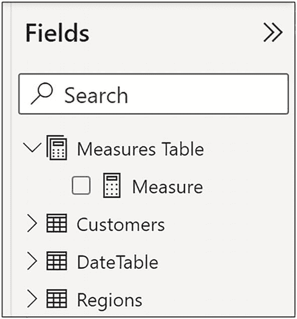

**图 3-8** Measures 表将位于 `Fields` 列表的顶部

但是，将度量值存储在单独的表中并非强制要求。一些数据建模者更倾向于将度量值存储在事实表或度量值所使用数据的源表中。

### 创建简单的 DAX 度量值

我们要创建的第一个度量值将替换计算`CASES SOLD`总和的隐式度量值。要创建此度量值，请在**Report**视图中，右键单击`Fields`列表中的度量值表，然后从快捷菜单中选择**New measure**。或者，您也可以点击**Home**选项卡上的**New Measure**按钮。但是，如果使用此方法，请确保您在`Fields`列表中所选的表格正是您要放置度量值的表格。

**提示**
如果您的度量值意外存储在了错误的表中（或者您只是想移动它），请使用**Model**视图中的`Fields`列表，您可以在其中通过拖放操作在表之间移动度量值。

选择**New measure**后，DAX 编辑器将像我们创建计算列时一样出现在屏幕顶部。在 DAX 编辑器中，在等号（`=`）前面，为您的度量值命名，例如“Total Cases”，然后键入以下 DAX 表达式：

```
Total Cases =
SUM ( Winesales[CASES SOLD] )
```

您可以在图 3-9 的 DAX 编辑器中看到此表达式。

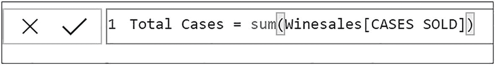

**图 3-9** 您在 DAX 编辑器中的第一个 DAX 度量值

按 **Enter** 键，您的度量值将显示在度量值表中。您现在可以在此表中删除“Column1”。

**注意**
DAX 度量值名称不区分大小写，并且可以包含任何字符。但是，我们建议您将度量值名称限制为仅包含字母和/或数字及空格。我们还建议您保持表、列和度量值的名称简单明了。我特别喜欢 Chris Webb 关于此主题的博客：[`https://blog.crossjoin.co.uk/2020/06/28/naming-tables-columns-and-measures-in-power-bi/`](https://blog.crossjoin.co.uk/2020/06/28/naming-tables-columns-and-measures-in-power-bi/)

DAX 度量值仅在被使用时才会计算，因此您必须将度量值放入可视化的`Values`值桶中，才能看到计算结果。例如，在图 3-10 中，在一个**Table**可视化中，我们使用了`Wines`维度中的`WINE`列，然后将“Total Cases”度量值拖入该可视化的`Values`值桶中。

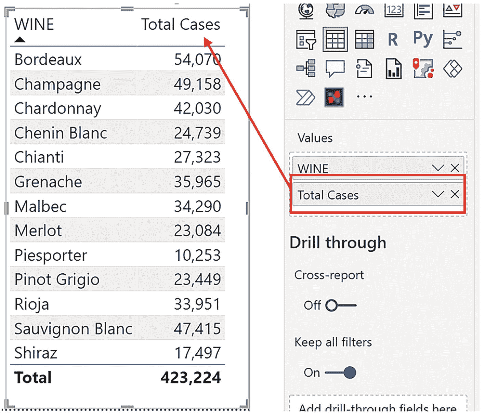

**图 3-10** 度量值在使用时进行计算

使用显式度量值的一大优势在于，数字格式会随度量值一起存储。要格式化度量值，请在`Fields`列表中点击选中该度量值，此时度量值表达式会显示在 DAX 编辑器中。然后，在**Measures tools**选项卡上，在**Formatting**命令组中，您可以选择所需的数字格式，例如千位分隔符；见图 3-11。

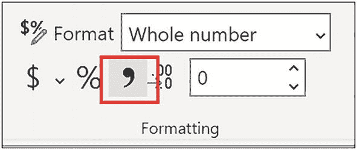

**图 3-11** 使用 Measures tools 选项卡上的 Formatting 命令组来格式化您的度量值

让我们创建第二个度量值，这次来计算平均销量，如下所示：

```
Avg Cases =
AVERAGE ( Winesales[CASES SOLD] )
```

您可能需要对数据执行的另一项分析是计算“有多少”，例如，每种不同葡萄酒的销售数量。换句话说，我们需要统计可视化中显示的每种葡萄酒在`Winesales`表中的行数。此处可以使用的隐式度量值使用了 DAX `COUNT`函数，该函数计算所引用列中的*值数量*（有关`COUNT`函数的更多信息，请访问 [`https://docs.microsoft.com/en-us/dax/count-function-dax`](https://docs.microsoft.com/en-us/dax/count-function-dax)）。但是，我们想要统计的是*行数*，因此，只有显式度量值才能完成我们想要的工作。我们需要的 DAX 函数是`COUNTROWS`，其名称即描述了其用途。该函数接受一个表作为其唯一参数，该表是您要统计行数的表，因此表达式如下：

```
No. of Sales =
COUNTROWS ( Winesales )
```

创建这些简单度量值的好处之一是，您可以使用它们分析来自任何维度的任何项目。在生成可视化并从中获取不同维度的项目时，度量值将相应地持续重新计算。例如，在图 3-12 中，我们在三个**Table**可视化中使用了我们的度量值，这些可视化显示了来自以下维度的数据：

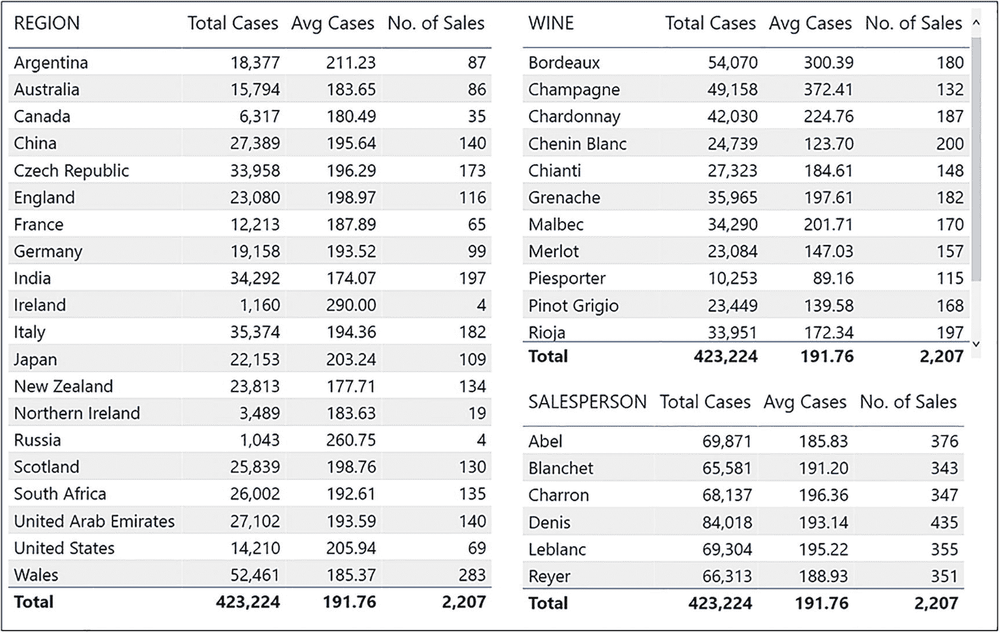

**图 3-12** 度量值根据构成可视化的数据计算得出

-   来自`Wines`维度的`WINE`
-   来自`SalesPeople`维度的`SALESPERSON`
-   来自`Regions`维度的`REGION`

我们最后一个简单 DAX 度量值的示例，将完成一项在 Excel 中难以重复且富有洞察力的计算，即非重复计数。在 DAX 中，我们有一个聚合函数负责此任务。它的名称是`DISTINCTCOUNT`，我们可以简单地引用分析所需的列。让我们通过编写以下度量值来了解我们向多少*不同的*客户销售了葡萄酒：

```
Distinct Customers =
DISTINCTCOUNT ( Winesales[CUSTOMER ID] )
```

在我们专注于`DISTINCTCOUNT`函数的同时，请记住我们在`Winesales`表中创建了这个*计算列*：

```
REGION NAME =
RELATED ( Regions[REGION NAME] )
```

我们可以使用这个计算列来创建一个度量值，以计算我们在多少*不同的*地区销售了葡萄酒：

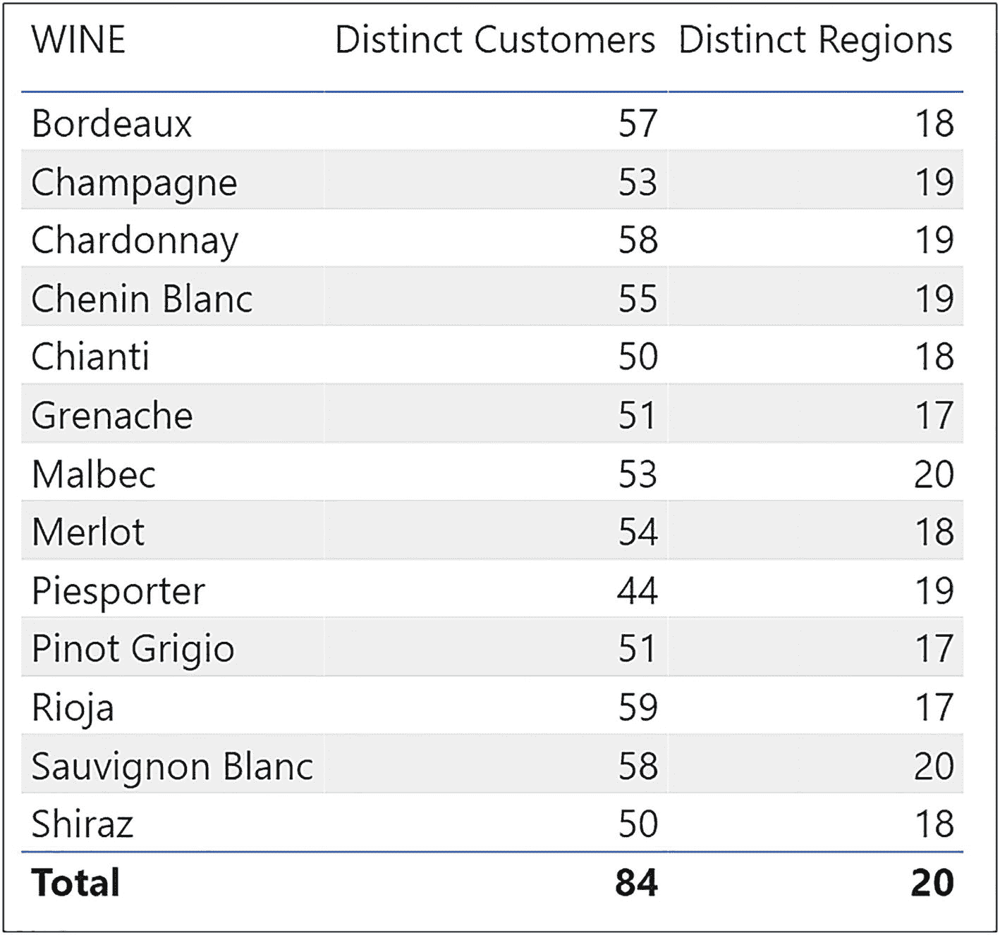

**图 3-13** 使用 `DISTINCTCOUNT` 函数

```
Distinct Regions =
DISTINCTCOUNT ( Winesales[REGION NAME] )
```

您会在图 3-13 中观察到，我们将“Bordeaux”销售给了 57 个不同的客户，将“Champagne”销售给了 53 个不同的客户。我们在 17 个不同的地区销售了“Rioja”。


### 度量值究竟是什么？

我们已经创建了几个简单的显式度量值，但尚未回答以下问题：什么是度量值？答案，就像度量值本身一样，并非直截了当。度量值是一个 `DAX` 表达式，用于 Power BI 视觉对象以返回标量值，并在特定的筛选上下文中进行计算。换句话说，`DAX` 度量值会筛选表行，并通常对筛选后的数据执行聚合运算，以返回一个可在报表中可视化的标量值（即单个值）。

注意：
并非所有 `DAX` 度量值都执行聚合运算。正如我们稍后将看到的，某些 `DAX` 度量值可以返回文本值。尽管如此，它们本质上仍是标量的，因为它们将返回单个值。

例如，一个典型的 `DAX` 度量值可能会对包含数量的列中的值进行求和（例如，“总案例数”度量值），其中事实表中的行按年份进行筛选，此分析在柱形图中可视化，可以看到每年的总数（例如，2021 年）；见图 3-14。

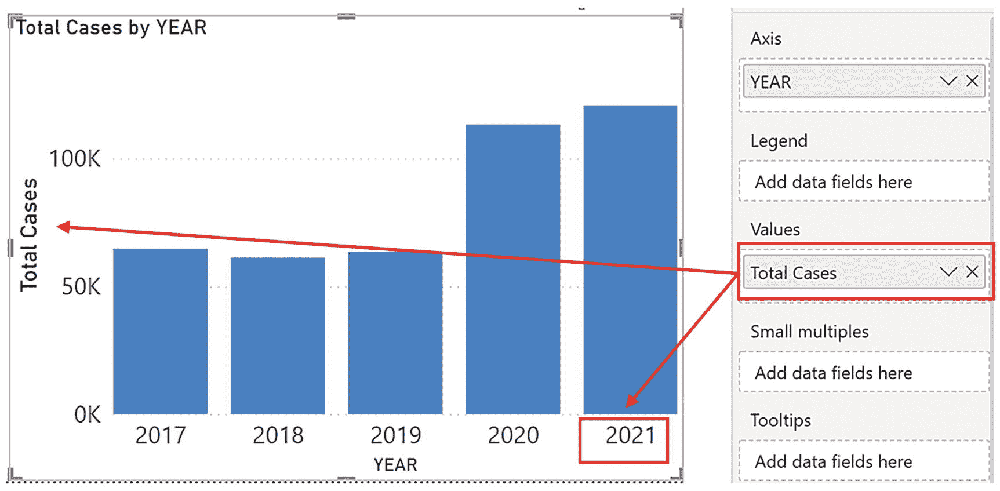

图 3-14  
度量值通常对筛选后的数据进行聚合

让我们更仔细地看看度量值的这三个方面：

1.  报表画布上的所有视觉对象都使用度量值。
2.  度量值返回标量（单个）值。
3.  度量值是在数据模型上设置了筛选条件的地方计算的。这被称为筛选上下文，是下一章的主题。

#### 所有报表视觉对象均使用度量值

当我们编写计算列时，它们会出现在“数据”视图中，并为表中的每一行返回一个值。另一方面，度量值在“报表”视图中使用，并放置在视觉对象的“值”字段中。所有视觉对象都在“值”字段中使用度量值，即使是隐式度量值（如前所述，即已拖入“值”字段的数值列）。

注意：
此规则有一个例外。关键影响因素视觉对象最好与未聚合的列一起使用，而不是度量值。有关关键影响因素视觉对象的更多信息，请访问我的博客：[`www.burningsuit.co.uk/blog/2020/01/the-key-influencers-visual-versus-strictly-come-dancing/`](http://www.burningsuit.co.uk/blog/2020/01/the-key-influencers-visual-versus-strictly-come-dancing/)

理解度量值的另一种方式是，它们是报表级别的计算，而你在计算列中创建的是行级别的计算。

#### 度量值返回标量值

所有 Power BI 视觉对象都是对数据进行分组和聚合的报表工具，就像 Excel 数据透视表或数据透视图一样。因此，为了理解度量值的这一方面，让我们戴上 Excel 的帽子，提醒自己：在 Power BI 中，`表` 和 `矩阵` 视觉对象等同于 Excel 数据透视表。例如，考虑图 3-15 中 `表` 视觉对象中的值。

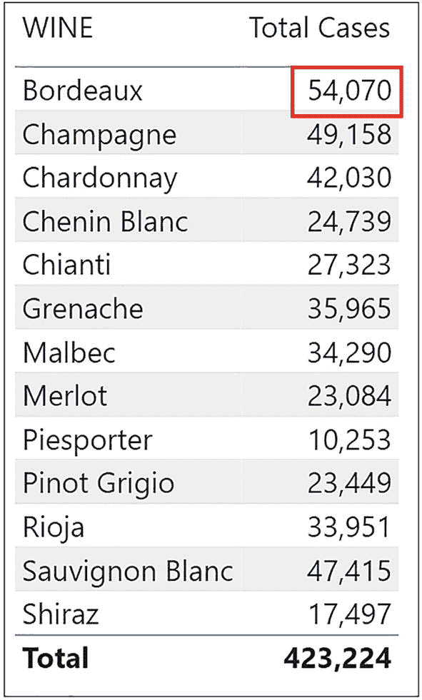

图 3-15  
所标识的值位于 Excel 数据透视表“值”区域对应的位置，并将处于一个“单元格”中

如果这是 Excel 数据透视表，“总案例数”值将位于数据透视表的“值”区域，并且计算返回的每个值都将位于一个“单元格”中。我们已经确定了“波尔多”葡萄酒对应的“单元格”，其中包含此度量值返回的值 **54,070**：

```
Total Cases =
SUM ( Winesales[Cases Sold] )
```

这个值代表什么？它代表 `Winesales` 表中所有与“波尔多”葡萄酒对应的行的 `CASES SOLD` 列中值的总和。

如果相同的数据位于 Excel 数据透视表中，我们可以双击此值并向下钻取，以在单独的工作表上显示这些行，如图 3-16 所示。

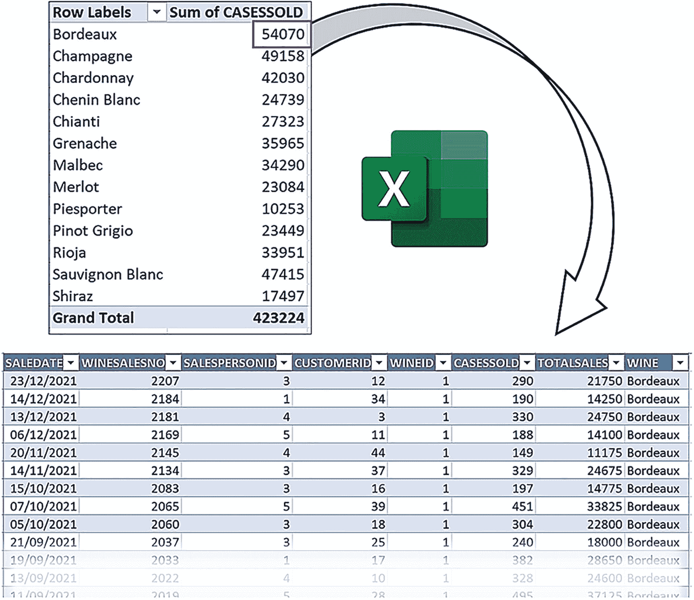

图 3-16  
在 Excel 数据透视表中，您可以向下钻取

我们无法在 Power BI `表` 视觉对象中向下钻取其值，但内存中的度量值执行相同的操作。它从表中筛选出一组特定的行。在我们的示例中，它筛选 `Winesales` 表中关于“波尔多”葡萄酒的行。然而，度量值的结果必须位于 `表` 视觉对象的“单元格”中，就像它位于数据透视表的单元格中一样。因此，度量值必须返回一个标量值。通常，这意味着度量值必须对数据进行聚合；例如，对“波尔多”葡萄酒售出的案例数求和。

注意：
通常，标量值是一个单一的数值，但度量值也可以返回单一的文本值，因此，这里的“标量”一词是在更一般的意义上使用的，指代任何数据类型的单个值。

我们已经确定度量值必须返回标量或单个值，我们相信您认为这个概念简单易懂，但有时，您尝试创建的度量值会返回类似图 3-17 所示的错误。

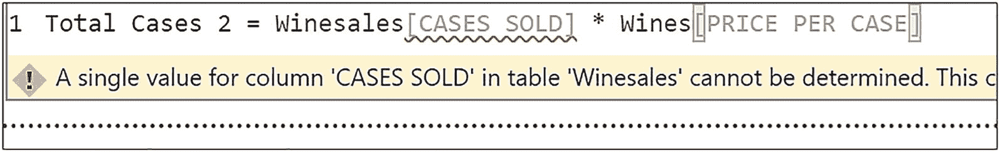

图 3-17  
当没有聚合时显示此错误消息

图 3-17 中的错误信息如下：

*“无法确定表‘Winesales’中列‘CASES SOLD’的单个值。这可能发生在度量公式引用包含多个值的列，但未指定聚合（如 min、max、count 或 sum）以获取单个结果时。”*

导致此错误消息的原因是什么？度量值中没有聚合；它只是将两个值相乘。

度量值不返回标量值的另一个示例如图 3-18 所示。这里，在 `表` 视觉对象中使用了 `VALUES` 函数（我们将在后面的章节中讨论 `VALUES` 函数）。度量值应返回标量值，当评估 `表` 视觉对象中的单个行时确实如此，但在计算视觉对象的“总计”行时，它返回了多个值，因此当度量值被放入启用了“总计”行的 `表` 视觉对象中时，会显示错误消息。

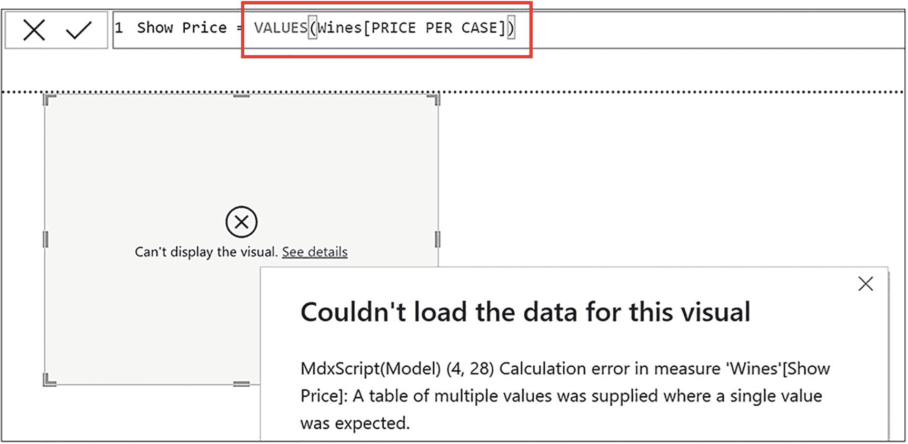

图 3-18  
某些度量值返回一个值表

错误信息如下：

*“提供了多个值的表，但预期是单个值。”*

即使是经验最丰富的 `DAX` 专家也可能因创建了不返回标量值的度量值而出错！

在本章中，我们探讨了计算列和度量值之间的区别。您已理解计算列是行级别的计算，而度量值用于所有视觉对象，是在报表级别执行的计算。然而，我们仍未解释 `DAX` 度量值的第三个也是最重要的组成部分，即所有度量值都在特定的筛选上下文中进行计算。要理解其含义，您需要继续阅读下一章，我们将重点探讨计算表达式的上下文，以及为什么这对于理解 `DAX` 度量值如此重要。

脚注 1


