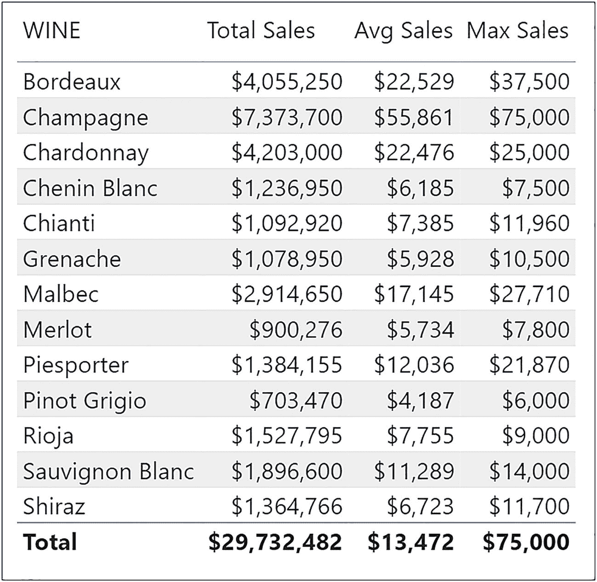
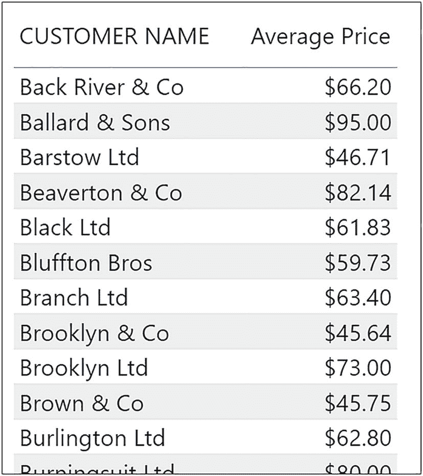
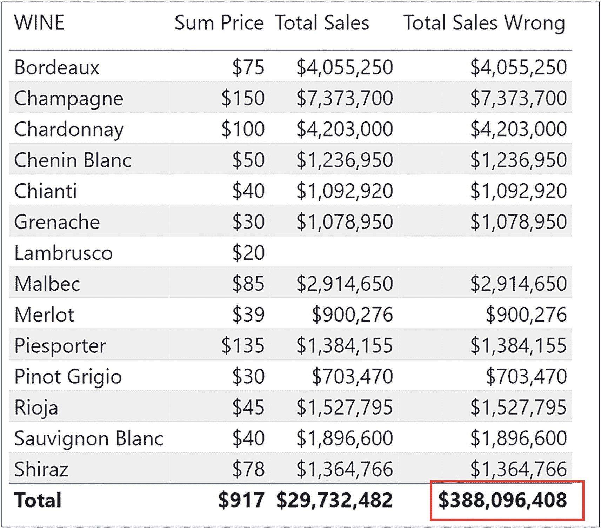
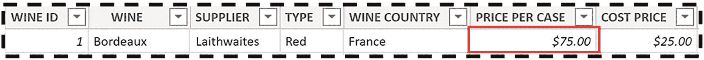
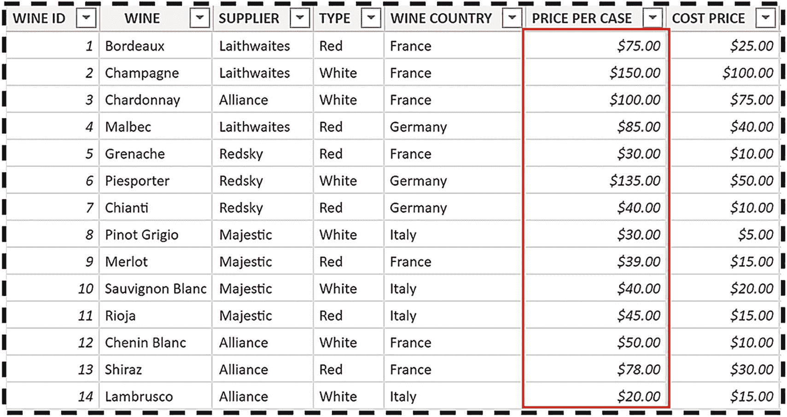

# 5. 迭代器

DAX 中有一组函数被称为*迭代器*，从名称可以推断，这些函数会在 DAX 表达式的求值过程中遍历表。任何以“X”结尾的 DAX 函数都是迭代器，例如“X”聚合函数：`SUMX`、`AVERAGEX`、`MAXX`、`MINX`、`COUNTAX`。还有一些非聚合的“X”迭代函数，如 `CONCATENATEX` 和 `RANKX`。更让人困惑的是，有些迭代函数并不以“X”结尾，例如 `FILTER` 和 `ADDCOLUMNS`。

我们将在后文探讨 `FILTER`、`CONCATENATEX` 和 `RANKX` 函数。`ADDCOLUMNS` 函数超出了本书的讨论范围，但希望随着你对 DAX 知识的增长，能够自行探索。本章的重点将是聚合迭代器：`SUMX`、`AVERAGEX`、`MAXX`、`MINX` 和 `COUNTAX`。

聚合迭代器有两个参数：要迭代的表，以及针对表的每一行进行求值的表达式，求值结果将被聚合。这些函数通过迭代函数引用的表，在度量值内部创建一个行上下文，度量值会在内存中“访问”表中的每一行。请记住，度量值会先生成一个筛选上下文，因此被迭代的表可能带有筛选或交叉筛选。

图 5-1

`SUMX` 函数遍历经过交叉筛选的事实表，执行行级计算，然后由度量值对结果求和

例如，考虑在图 5-1 中正在求值的度量值“10% 增长总额”。这里，我们在度量值中使用了聚合迭代器 `SUMX`，在内存中将事实表中每一行的 `CASES SOLD` 值乘以 1.1。然后，这些行级计算的结果被聚合，返回一个由度量值计算出的标量值，例如“波尔多”葡萄酒的结果为 **59,477.00**。类似地，我们也可以使用 `AVERAGEX`、`MAXX` 或任何其他聚合迭代器。

包含迭代函数的度量值在迭代过程中使用行上下文，然后使用筛选上下文生成标量值。

现在让我们继续深入探索这些聚合迭代器，首先从 `SUMX` 开始。

## `SUMX` 函数（以及其他“X”函数）

既然你已经了解了 DAX 聚合迭代器的用途，接下来让我们认识一个 DAX 中的主要迭代函数——`SUMX` 函数。然后我们再探讨其他“X”聚合函数。

`SUMX` 返回针对表中每一行求值的表达式之和，其语法如下：

```
= SUMX ( table, expression )
```

其中：

`table` 是你要执行计算的表。

`expression` 是你要针对表中每一行执行的计算。

以下是 `SUMX` 语法的一个示例：

```
= SUMX ( Winesales, Winesales[CASES SOLD] * 0.1 )
```

为了演示 `SUMX` 的用法，我们先从一个不太现实但易于理解的场景开始。我们被要求找出所有大于 100 的 `CASES SOLD` 值，并将其增加 20%；否则，只增加 10%。这或许是预测明年销售箱数的一种奇特方法，因此我们将此计算命名为“明年箱数”。然后，我们想查看每种葡萄酒对应的“明年箱数”值。

如果我们不知道如何使用 `SUMX`，可能会以一种笨拙的方式完成这个计算，即同时使用计算列和隐式度量值。我们可以像下面这样使用 `IF` 函数创建计算列，然后通过将该计算列拖拽到表格视觉对象的“值”字段中来使用隐式度量值；见图 5-2。

图 5-2

创建计算列并用作隐式度量值效率不高

但让我们仔细想想。我们不需要先创建一个计算列来查看每一行的增加值，然后再在*另一步*中使用隐式度量值对每种葡萄酒的这个值求和。我们可以使用 `SUMX` 一步到位。如果这样做，则计算列就多余了；我们只需使用度量值即可。这才是真正的好处，因为度量值总是比计算列更高效。

以下是使用 `SUMX` 的显式度量值，我们可以用它来代替“计算列 + 隐式度量值”的组合：

```
明年箱数 度量值 =
SUMX (
    Winesales,
    IF ( Winesales[CASES SOLD] > 100,
        Winesales[CASES SOLD] * 1.2,
        Winesales[CASES SOLD] * 1.1
    )
)
```

这个 `SUMX` 度量值是如何工作的？

我们知道 `SUMX` 会对针对*表中每一行*求值的表达式进行求和。`SUMX` 的第一个参数引用了执行计算的表，在我们的例子中是 `Winesales`。第二个参数是你希望在内存中对表中*每一行*执行的计算。这是我们使用 `IF` 编写的表达式，`SUMX` 通过遍历每一行在内存中计算该表达式。然后，它将此计算的结果求和，在本例中是对每种葡萄酒求和（因为这是度量值求值时的当前筛选上下文）。

既然我们已经了解了 `SUMX` 函数，就可以重新审视一下在第 3 章中学过的一个计算，即当前位于*计算列*中的“销售额”计算；见图 3-6。你还记得我们使用 `RELATED` 函数创建了这个*列*吗？

```
销售额 =
Winesales[CASES SOLD] * RELATED ( Wines[PRICE PER CASE] )
```

然后我们在隐式度量值中使用了这个列来计算总销售额，但这并不是完成此任务最高效的方法。现在，我们可以使用 `SUMX` 编写一个*度量值*，将其作为我们最终的“总销售额”计算，如下所示：

```
总销售额 =
SUMX (
    Winesales,
    Winesales[CASES SOLD] * RELATED ( Wines[PRICE PER CASE] )
)
```

这是一个更简洁的`Total Sales`计算方法。`SUMX`函数会遍历`Winesales`表，对于当前筛选上下文中的每一行，它会将`CASES SOLD`列中的值与`Wines`表中的`PRICE PER CASE`列的值相乘（使用`RELATED`找到当前行上下文中葡萄酒的价格）。然后，它会将这些逐行计算的结果求和。

**提示**

选中一个度量值，然后使用“度量工具”选项卡和“格式”组，将度量值格式化为所需的货币格式。

类似地，如果您想找到最大销售额或平均销售额，DAX 度量值将分别如下所示：

```
Max Sales =
MAXX (
    Winesales,
    Winesales[CASES SOLD] * RELATED ( Wines[PRICE PER CASE] )
)
Avg Sales =
AVERAGEX (
    Winesales,
    Winesales[CASES SOLD] * RELATED ( Wines[PRICE PER CASE] )
)
```

您可以在图 5-3 中看到这些度量值的结果。



**图 5-3** 使用`SUMX`、`AVERAGEX`和`MAXX`的度量值

让我们通过计算客户为葡萄酒支付的平均价格来探索另一个使用`AVERAGEX`的示例。首先需要找到`Winesales`表中每笔交易的价格（在当前筛选上下文中），然后计算这些价格的平均值，因此度量值如下所示：

```
Average Price =
AVERAGEX (
    Winesales,
    RELATED ( Wines[PRICE PER CASE] )
)
```

“Average Price”度量值使用`RELATED`函数在内存中计算每笔交易的价格，然后`AVERAGEX`对这些价格取平均值。您可以在图 5-4 中看到此度量值的结果。



**图 5-4** 计算客户为葡萄酒支付的平均价格

这看起来是一个简单的度量值，但即使是一些有经验的 DAX 用户也难以正确掌握，因此我们来解释一下它的计算过程。在图 5-4 中，我们可以看到筛选上下文位于`Customers`维度的`CUSTOMER NAME`列上，“Black River & Co”是第一个实例。`Winesales`事实表进行交叉筛选，只包含该客户的销售记录。嵌套在`AVERAGEX`中的`RELATED`函数在内存中计算“Black River & Co”的`Winesales`表中每一行对应的`Wines`维度的`PRICE PER CASE`值。然后，`AVERAGEX`函数计算这些价格的平均值（它将价格求和并除以该客户的`Winesales`表中的行数）。

## 合计行的困扰

这引出了 DAX 新手常遇到的另一个问题：理解表或矩阵视觉对象中“合计”行的计算。人们经常抱怨计算结果不正确。这很可能是因为他们在应该使用`SUMX`时却使用了`SUM`。

比较图 5-5 中的度量值，其中“Total Sales”度量值与“Total Sales Wrong”度量值进行对比。您可以看到，对于每种葡萄酒，“Total Sales”和“Total Sales Wrong”度量值都返回了正确的结果。但是，当度量值计算总计行时，“Total Sales Wrong”度量值显示了错误的结果。



**图 5-5** “Total Sales Wrong”度量值的“合计”行计算不正确

那么，当“Total Sales Wrong”计算总计行时，问题出在哪里呢？正如通常情况一样，问题在于筛选上下文。回想一下我们之前学过的知识：总计行的计算不是您在图中所见各个值的总和。在总计行中，度量值是在一个不同的筛选上下文中计算的，该上下文移除了对`WINE`列的筛选。那么，让我们看看事情是如何轻易出错的。以下是“Total Sales Wrong”度量值：

```
Total Sales Wrong =
SUM ( Winesales[CASES SOLD] ) * SUM ( Wines[PRICE PER CASE] )
```

我们再将这两个组成表达式提取出来，分别作为单独的度量值：

```
Total Cases =
SUM ( Winesales[CASES SOLD] )
Sum Price =
SUM ( Wines[PRICE PER CASE] )
```

我们的“Total Sales Wrong”度量值是将这两个表达式的结果相乘；请参考图 5-5。

您可以看到，问题在于使用了`SUM`，特别是试图对`PRICE PER CASE`值求和。这些值的总和是多少？它是在当前筛选上下文中的价格总和。因此，对于每种葡萄酒的计算，它只是该葡萄酒的价格，例如，波尔多的价格为`$75`；参见图 5-6。



**图 5-6** 计算每种葡萄酒时的价格总和就是该葡萄酒的价格

将此值乘以每种葡萄酒已售出的箱数总和，能在计算每种葡萄酒时给出正确的总销售额。但是，对于总计行的计算，筛选器已从`WINE`列释放，因此`SUM ( Wines[PRICE PER CASE] )`表达式对所有葡萄酒的价格求和并返回`$917`，请参见图 5-7。正是这个值与已售出箱数的总和相乘。



**图 5-7** 计算每个合计行时的价格总和

因此，在“Total Sales Wrong”度量值中，总计行的计算是所有葡萄酒的价格总和乘以所有葡萄酒的箱数总和：`917` x `423,224` = `388,096,408`。

使用`SUM`的错误表达式是先求和再相乘。而使用`SUMX`的正确表达式是先相乘再求和。

`SUM`函数只应在最简单的度量值中使用，用于对单个列的值求和，并且绝不应在需要对乘法或其他计算的结果求和时使用。实际上，即使在 DAX 表达式中使用`SUM`函数，DAX 引擎内部也会将其转换为`SUMX`。

例如，此表达式

```
=SUM ( Winesales[CASES SOLD] )
```

在内部会被转换为：

```
=SUMX ( Winesales, Winesales[CASES SOLD] )
```

通过学习迭代器以及如何使用`SUMX`和其他“X”迭代函数，我们在 DAX 的更困难领域取得了良好的进展。我们也阐明了 DAX 中其他具有挑战性的领域，例如筛选上下文和度量值的本质。您还学到了一些其他重要的概念，理解了数据模型中事实表和维度表的作用，但这仅仅是个开始。

DAX 的真正威力还在等待我们去发现，那就是名为`CALCULATE`的函数。
