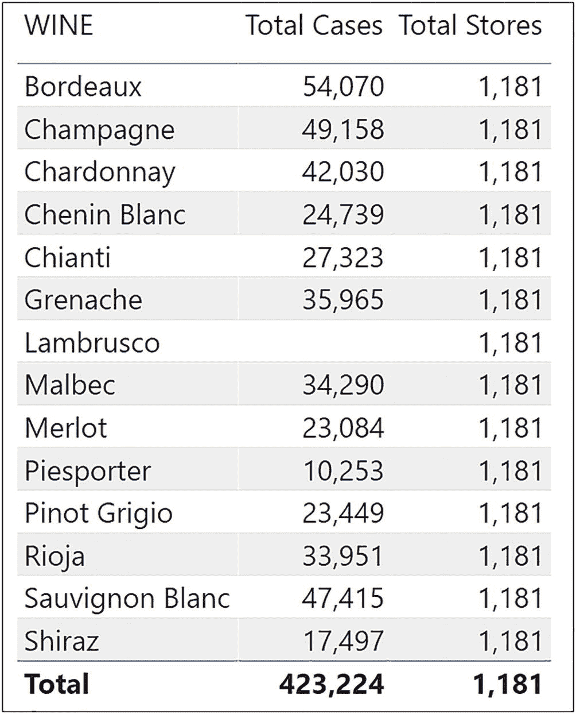
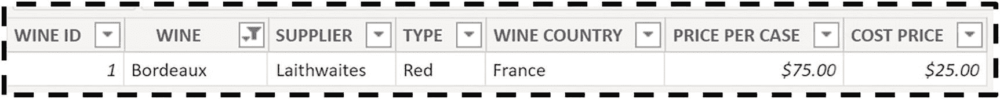
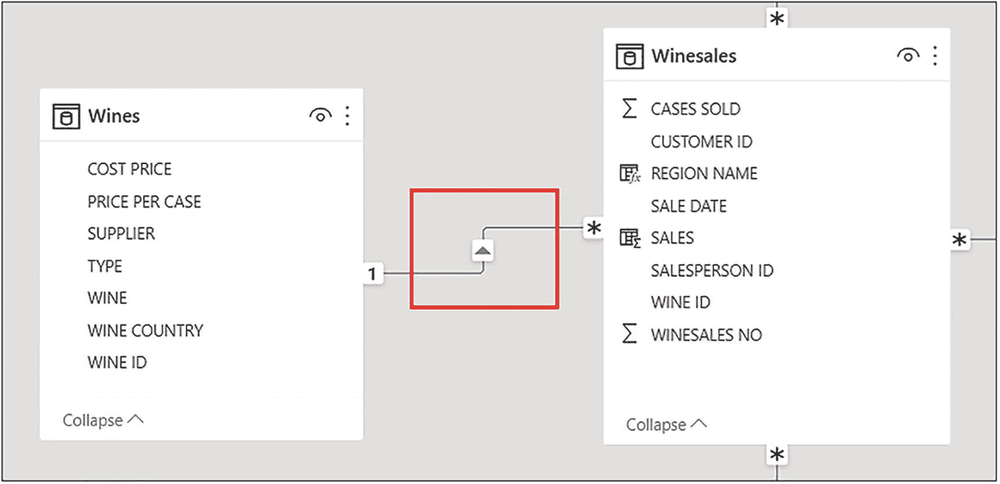
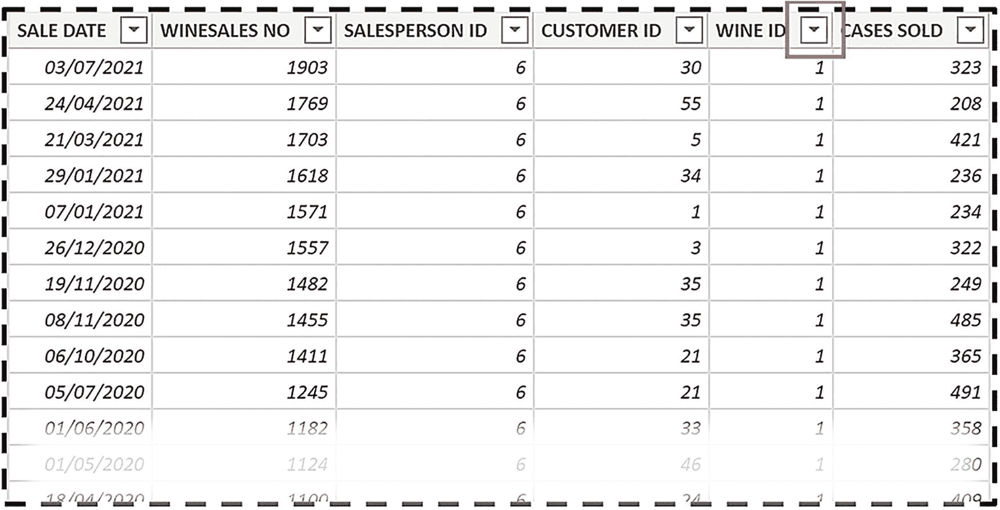
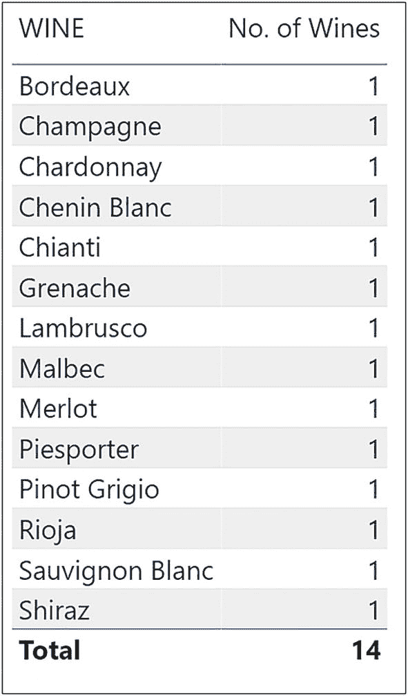
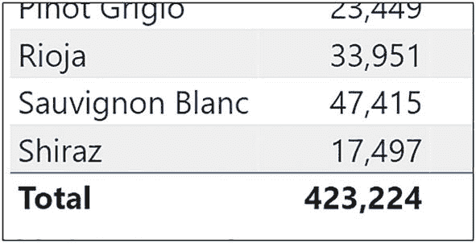
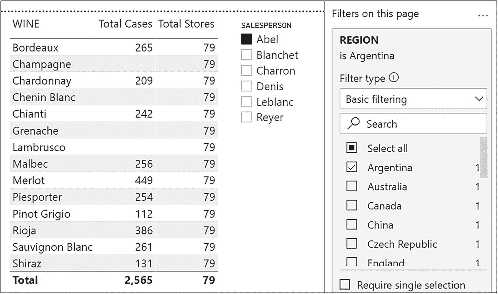
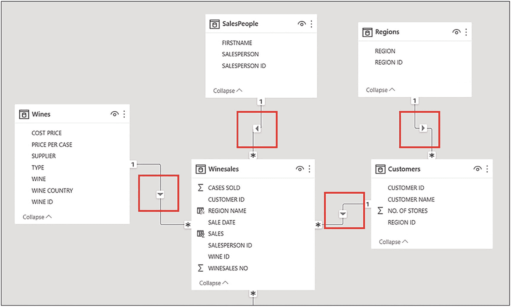
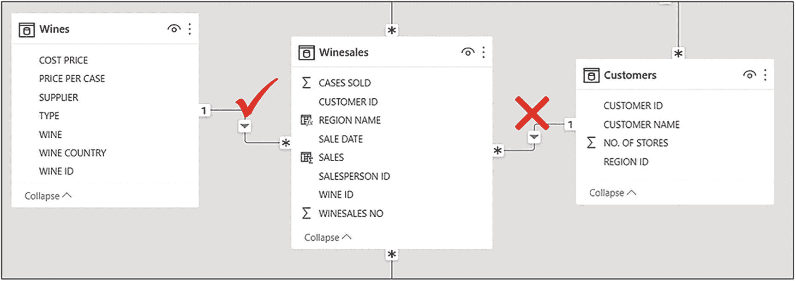
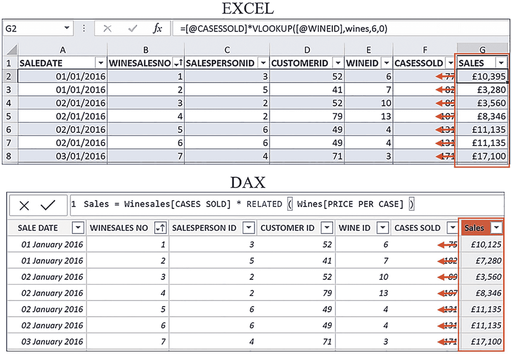

# 4. 计值上下文

你已经学会了编写简单的计算列和度量值，但对于 DAX 用户而言，最根本的问题之一是这两种表达式有何不同。目前，你了解到计算列是行级别的计算，而度量值是在报表级别执行的计算。然而，关于这一区别，我们需要更具体地说明，你需要理解其根本差异在于表达式计值的`上下文`。在计算列中，表达式在`行上下文`中计值；在度量值中，表达式在`筛选上下文`中计值。本章的重点将是后者。一旦你理解了筛选上下文的作用，行上下文的作用就更容易理解了。

## 筛选上下文

在上一章中，你了解到度量值是报表级别的计算，并且必须返回一个标量值。这引出了度量值的第三个也是最重要的方面，即所有 DAX 度量值都在`特定的筛选上下文`中进行计值。为了理解“特定的筛选上下文”的含义，让我们比较以下两个不同的度量值：

```
Total Cases =
SUM ( Winesales[CASES SOLD] )
Total Stores =
SUM ( Customers[NO. OF STORES] )
```

你可以在图 4-1 中看到这些度量值的计值结果，但为什么第一个度量值对每个葡萄酒返回不同的值，而第二个度量值却返回相同的值？原因在于当这两个度量值计值时，处于活动状态的`筛选上下文`。



图 4-1

由于处于活动状态的筛选上下文，度量值会返回不同的值或相同的值

当度量值被放入任何视觉对象时，在进行度量值计值之前，DAX 引擎会`在内存中`根据三个因素对数据模型中的表应用筛选：

1.  放置在视觉对象中用于对数据进行分组和分类的列

2.  筛选视觉对象中数据的切片器中的列

3.  筛选视觉对象中数据的“筛选器”窗格中的任何列

这三个因素共同构成了度量值计值的筛选上下文。我们无法看到数据模型上的这些筛选器。我们必须去想象它们。

注意

对数据模型的筛选发生在内存中，对我们是不可见的。因此，在下文及本书的插图中，当我们模拟内存中发生的情况时，内存中的表会带有虚线边框，以区别于你在“数据”视图中看到的表。

在图 4-1 的表格视觉对象中，只有因素 #1 是相关的（没有切片器或其他筛选器）。

### 使用单个筛选器进行计值

对数据进行分组的视觉对象中的列是来自 `Wines` 维度的 `WINE` 列。此列中要计算的第一个值是“Bordeaux”葡萄酒的总箱数。

在 `Total Cases` 度量值计算“Bordeaux”的值之前，会在内存中对 `Wines` 维度应用一个筛选器，以筛选出“Bordeaux”葡萄酒。如果我们能看到此表上的筛选器，它可能类似于图 4-2。



图 4-2

已筛选为单行的内存中的 `Wines` 维度

如果我们检查数据模型（图 4-3），可以看到 `Wines` 维度与 `Winesales` 事实表之间存在多对一关系。箭头告诉我们，如果 `Wines` 维度被筛选，则此筛选器会`传播`到 `Winesales` 事实表。



图 4-3

筛选器从 `Wines` 维度传播到 `Winesales` 事实表

因此，`Winesales` 事实表现在被`交叉筛选`，仅包含 `WINE ID` 等于 1 的“Bordeaux”葡萄酒的销售数据；请参见图 4-4。注意，在 `Winesales` 表的 `WINE ID` 列中没有筛选器，因为 `Winesales` 表上的筛选器是一个仅通过筛选器传播生成的交叉筛选器。



图 4-4

事实表通过维度被交叉筛选

这是影响此视觉对象的唯一筛选器，因此度量值现在对“Bordeaux”葡萄酒的 `CASES SOLD` 列求和，并返回 **54,070**。

然后，度量值的计值过程转向“Champagne”，并重复过滤 `Wines` 维度以及使用`不同的筛选上下文`交叉筛选 `Winesales` 事实表的过程。例如，在下一次计值中，`Wines` 维度的 `WINE` 列现在等于“Champagne”，因此计算结果变为 **49,158**。

注意

经验丰富的 DAX 用户会知道，这个关于筛选上下文实际运作的解释是对内存中发生情况的近似描述，并非完全精确。然而，在你目前的知识水平下，这个解释易于理解，并且暂时对你很有帮助。我们将在本书后面揭示底层真正发生的事情。

表格视觉对象的 `WINE` 列中所有葡萄酒的计值依此类推。*每次对 `Total Cases` 度量值的计值都在不同的筛选上下文中进行。*

有一种方法可以证明，在计值分析每种葡萄酒的度量值时，`Wines` 维度在内存中被筛选为单行。我们可以创建以下度量值来计算 `Wines` 维度的行数：

```
No. of Wines = COUNTROWS ( Wines )
```

如果我们将此度量值放入一个包含 `Wines` 维度中 `WINE` 列的表格视觉对象中，该度量值对每种葡萄酒的计值将返回 **1**；请参见图 4-5。



图 4-5

`No. of Wines` 度量值返回 1，因为 `Wines` 维度在每次计值中被筛选为单行

还要注意，“Lambrusco”葡萄酒是如何返回一个值的，因为此度量值仅筛选 `Wines` 维度，没有涉及其他表。

### 总计行中的计算

现在，我们来看视觉对象总计行的计算，它返回 **423,224**；请参见图 4-6。



图 4-6

总计行在另一个不同的筛选上下文中计值

这个值*并非*视觉对象中显示的每种葡萄酒总计值的总和。当为总计行计值度量值时，筛选器会从 `Wines` 维度的 `WINE` 列中移除，因此表达式针对*所有*葡萄酒进行计值。换句话说，它是在又一个`不同的筛选上下文`中计算得到的表达式“`= SUM ( Winesales[CASES SOLD] )`”。

### 使用多重筛选器进行评估

接下来，我们创建更多会影响“表”视觉对象的筛选器。例如，我们可以使用来自 `SalesPeople` 维度^(⁶)的 `SALESPERSON` 列添加一个切片器，同时将 `Regions` 维度中的 `REGION` 列放入页面级筛选器中^(⁷)；请参见图 4-7。



图 4-7：筛选器现在通过切片器和页面级筛选器应用于“表”视觉对象

我们筛选了销售人员“Abel”和区域“Argentina”。可以看到，“Bordeaux”的“案例总数”值现在变为 **265**，因为筛选上下文发生了变化；`WINE` 等于“Bordeaux”，`SALESPERSON` 等于“Abel”，且 `REGION` 等于“Argentina”。同样，我们可以想象这些表在内存中的状态；请参见图 4-8。


图 4-8：对“表”视觉对象进行筛选的内存表

然而，您会注意到，`Total Stores` 度量值对于每种葡萄酒仍然返回相同的值（即 79）。接下来我们将解释原因。

同样，我们可以检查数据模型（图 4-9），并查看这些筛选器如何在模型中传播，并最终始终到达 `Winesales` 事实表，然后该事实表会相应地受到交叉筛选。



图 4-9：筛选器在数据模型中传播，并始终到达事实表

请注意，`Regions` 表如何在架构中形成“雪花”结构，因为它通过 `Customers` 维度与事实表*间接*相关。您可以看到这种表结构是如何运作的；例如，如果 `Regions` 表被筛选为“Argentina”，此筛选器会传播到 `Customers` 维度，因此内存中的阿根廷客户会被筛选出来。然后，这个筛选器会继续传播到事实表。

视觉对象的构建方式以及影响视觉对象的筛选器将决定度量值的计算结果。现在，我们回到图 4-1 中所示的“Total Stores”度量值。请注意，它对每种葡萄酒以及“合计”行都返回相同的值 **1,181**。该度量值是对 `Customers` 维度中的 `NO. OF STORES` 列进行求和。当此度量值被计算时，`Customers` 维度上没有应用任何筛选器。唯一的筛选器是在 `Wines` 维度上。因此，对于每种葡萄酒的计算，度量值都会对 `Customers` 表中 ***所有*** 客户在 `NO. OF STORES` 列中的值进行求和。

再次查看数据模型（图 4-10），我们可以看到，如果 `Wines` 维度被筛选，此筛选器会传播到事实表（由勾选标记表示），但筛选器***不会***继续传播到 `Customers` 维度（由叉号表示），因为关系箭头始终是从关系的一端指向多端。



图 4-10：筛选器不会从事实表流向维度表

# DAX 评估上下文：筛选上下文与行上下文

**注意**：那么，如何正确计算每种葡萄酒已售出的店铺数量呢？有一件*不应*做的事——尽管很有诱惑力——就是编辑关系使其成为“双向”筛选器。相反，您可以使用 DAX 函数 `CROSSFILTER` 以编程方式反转筛选器传播的方向。我们将在本书后续部分介绍 `CROSSFILTER` 函数。

## 筛选上下文

筛选上下文是所有 DAX 度量值的基础，这也是区分两种不同类型的表（维度表和事实表）至关重要的原因，因为它们在度量值评估中扮演着两种不同的角色：

-   维度表的作用是分组数据，并将筛选器通过数据模型传播到事实表中。
-   事实表的作用是对已从维度表交叉筛选出的数据子集进行汇总。

*DAX 度量值通常汇总事实表中已由维度表交叉筛选过的数据。*

所以，下次当您疑惑“为什么我的度量值返回了错误的值”时，很可能不是表达式本身的问题；更可能是因为您没有理解度量值被计算时所处的当前筛选上下文。

## 行上下文

筛选上下文并非 DAX 使用的唯一评估上下文。还有另一种评估上下文，称为*行上下文*。行上下文适用于任何*遍历表中的行*的 DAX 表达式，其中表达式与当前行的值绑定。所有计算列都是在行上下文中评估的，这就是它们与度量值的区别，度量值总是在筛选上下文中评估。但为了增加一些复杂性，有些度量值会在其评估中同时使用筛选上下文*和*行上下文。此外，还有一些计算列，其行上下文可以转换为筛选上下文。随着本书的推进，我们将会探讨这些概念。

为了理解行上下文，让我们再次参考我们对 Excel 公式的了解。在 Excel 表格中，公式会“向下填充”，对列中的每一行进行计算。公式中使用“`@`”字符来表示使用当前行的值。这本质上就是 DAX 中的行上下文。当使用行上下文时，DAX 表达式会遍历表中的每一行，表达式中使用的值是*当前行中的值*；请参见图 4-11。



我们可以理解，计算列通常使用行上下文，但度量值在评估时也可以使用行上下文。但可以肯定的是，所有 DAX 度量值的本质都是对数据进行分组和汇总，而不是执行行级计算。嗯，度量值也可以执行行级计算，这就是*迭代器*行为发挥作用的地方，我们将在下一章探讨这个概念。

现在，我们来总结一下您在本章中学到的内容：所有度量值在其评估中都使用筛选上下文。筛选上下文指的是在度量值评估过程中作用于数据模型的筛选器，它取决于度量值被计算时所处的视觉对象结构，以及任何影响该视觉对象的筛选器。您现在还知道存在第二种评估上下文，即行上下文，DAX 表达式在其中扫描表并执行行级计算（例如计算列）。理解区分度量值和计算列的这两种评估上下文，是您学到的第一个重要的 DAX 概念。有些可能已经使用了一段时间 DAX 的人，往往无法解释度量值和计算列之间的这一根本区别。

脚注 1 2