# 6. `CALCULATE` 函数

`CALCULATE`是 DAX 中最重要的函数。您可能会认为这是一个相当绝对的论断，但只要您掌握了`CALCULATE`，就会很快意识到，您编写的绝大多数 DAX 表达式都离不开这个函数，尽管您可能认为到目前为止我们已经做得相当不错了。在本章中，您将学习如何使用`CALCULATE`构建表达式，您会发现这相对简单。更具挑战性的是理解何时以及为何必须使用`CALCULATE`，以及它在度量值中的作用，这将是本章真正的重点。


## 为何你需要 `CALCULATE`

我们来看一个场景，它将解释 `CALCULATE` 如何帮助我们。在我们的数据模型中，`DateTable` 维度通过 `DateTable[DATEKEY]` 列与 `Winesales` 事实表的 `Winesales[SALE DATE]` 列相关联，如图 6-1 所示。

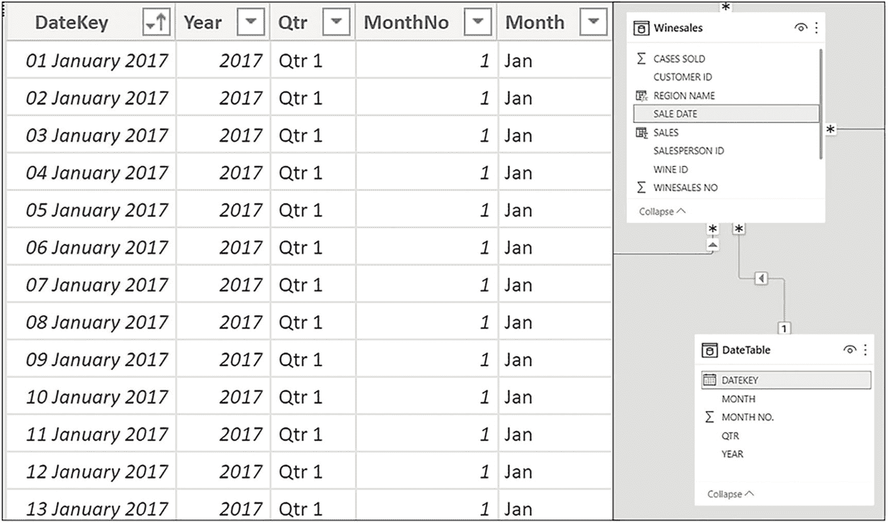

**图 6-1** `DateTable` 维度与事实表相关联

如果我们筛选 `DateTable` 中的 `YEAR` 列，该筛选器将传播到 `Winesales` 表，以筛选该年度的销售数据。我们需要对数据进行一项特定的分析：对于每一种葡萄酒，我们要计算 2021 年销售的总箱数占所有年份总销售箱数的百分比，如图 6-2 所示。

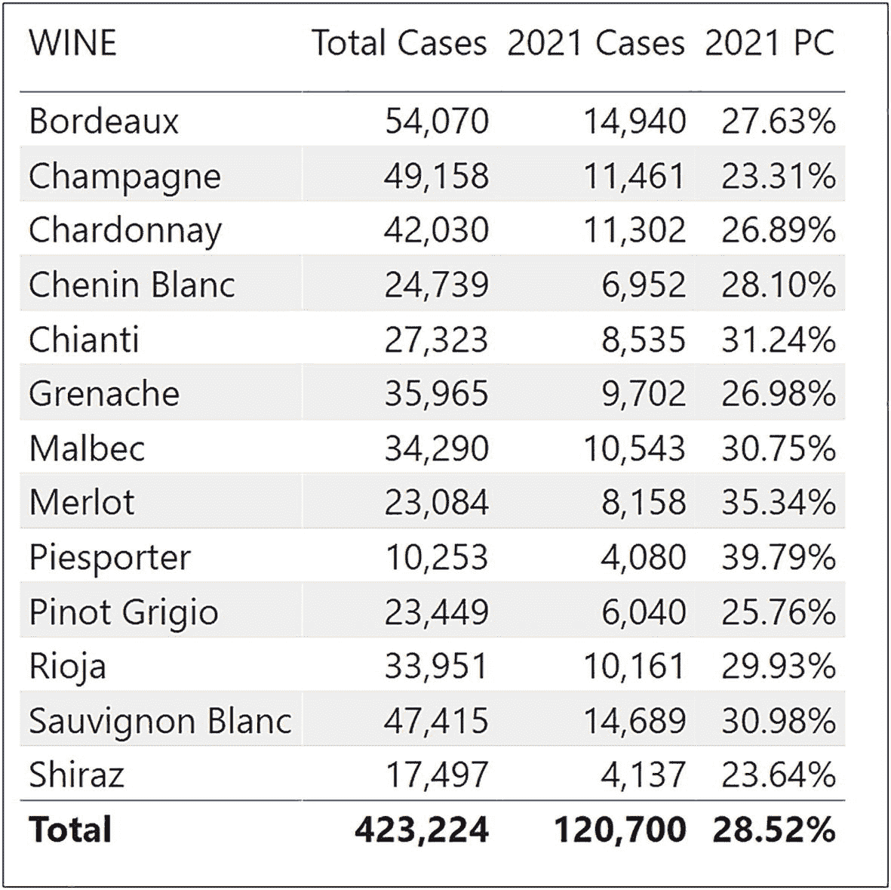

**图 6-2** 一个表格视觉对象，展示了 2021 年销售箱数占所有年份总箱数的百分比

换句话说，*在同一个视觉对象中*，我们需要同时拥有所有年份的“总箱数”度量值和仅筛选了 2021 年的“总箱数”度量值。然后，我们可以将 2021 年箱数除以所有年份的总箱数，并以百分比形式表示。

如果你查看图 6-3 中的示例，你会看到我们复制并粘贴了“总箱数”度量值，并将其命名为“2021 年箱数”。

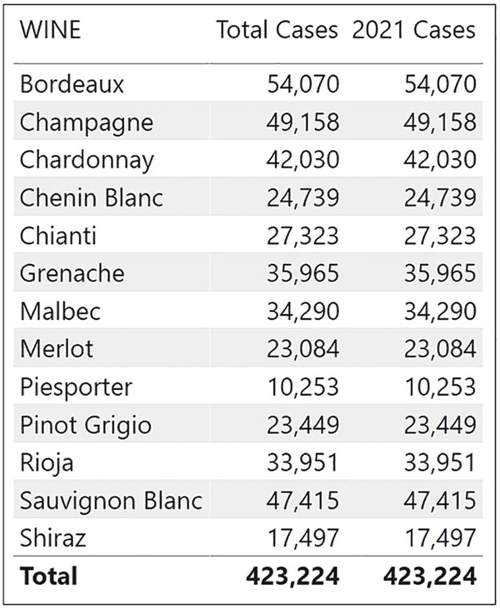

**图 6-3** 我们可以复制一个度量值，并尝试对复制的度量值应用筛选器

我们希望看看能否筛选“2021 年箱数”度量值，使其仅显示 2021 年的数值，*同时*让“总箱数”度量值显示所有年份的数值。然而，我们遇到了一个问题。如果我们使用切片器来筛选 `DateTable` 中的 `YEAR` 列，它会筛选*两个*度量值；见图 6-4。

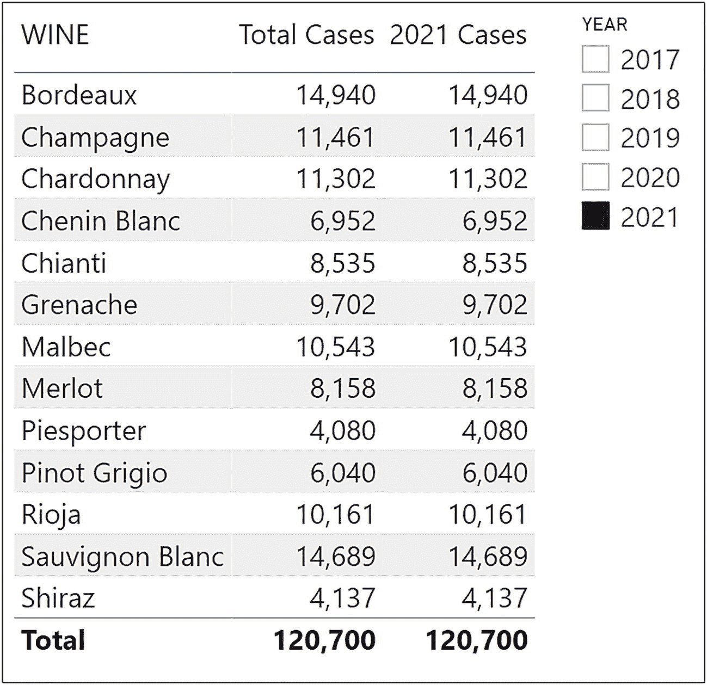

**图 6-4** 筛选器应用于视觉对象中的所有度量值

看来，我们必须找到一种方法，*在同一个视觉对象中*为不同的度量值应用不同的筛选上下文。然而，到目前为止，视觉对象使用的任何筛选器（无论是来自视觉对象本身、切片器还是筛选器窗格）都会将*相同的*筛选器应用于视觉对象中的所有度量值。我们还无法选择哪些筛选器影响哪些度量值。目前，要么全部应用，要么全不应用。这正是 `CALCULATE` 函数可以帮助我们的地方。

**注意：** 此时，可以删除画布上筛选 `YEAR` 列的切片器，因为它无法按要求影响数据，现已多余。

`CALCULATE` 在*修改后的*筛选上下文中计算一个表达式，语法如下：

`= CALCULATE ( expression , filter1 , filter2 …… )`

其中：

- **expression** 是你要计算的内容。可以是一个 DAX **表达式**，也可以是一个定义了表达式的**度量值**。
- **filter1, filter2, ……** 是你希望如何筛选**表达式**或**度量值**。你可以使用多个筛选器，它们通过“AND”逻辑语句组合。

以下是两个 `CALCULATE` 语法的示例：

`= CALCULATE ( SUM ( Winesales[CASES SOLD] ), Wines[WINE] = "Bordeaux" )`

`= CALCULATE ( [Total Cases], Wines[WINE] = "Bordeaux" )`

第一个示例在表达式参数中使用了***表达式***，第二个示例在表达式参数中使用了***度量值***（以灰色高亮显示）。

这是我们第一次将度量值嵌套在“父”度量值中。请注意，当你在 DAX 编辑器中输入表达式时，如果你输入方括号 ``，IntelliSense 将仅列出度量值；见图 [6-5。

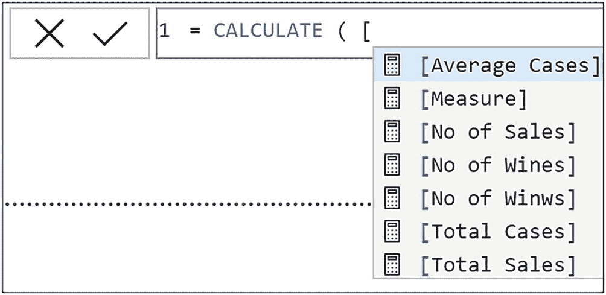

**图 6-5** 在 DAX 编辑器中输入方括号 ``，会列出所有度量值

`CALCULATE` 接收一个***表达式***或***度量值***，并在与来自视觉对象、切片器或筛选器窗格的活动筛选器不同的筛选上下文中计算它。`CALCULATE` 生成的新筛选上下文的最终结果取决于活动筛选器的当前状态。这就是 `CALCULATE` 描述中“修改”筛选上下文的意思。然而，与其尝试解释 `CALCULATE` 的作用，不如通过一些示例来理解更容易。

## 使用单个筛选器

回到我们的场景。在图 [6-4 的表格视觉对象中，我们如何生成一个度量值来计算 2021 年的总箱数，同时保留计算所有年份总箱数的度量值？以下就是使用 `CALCULATE` 实现此目的的度量值：

```
2021 年箱数 =
CALCULATE ( [总箱数], DateTable[Year] = 2021 )
```

现在，我们可以创建最终度量值，计算每种葡萄酒 2021 年总箱数占所有年份总箱数的百分比，并将其格式设置为百分比：

```
2021 年百分比 =
[2021 年箱数] / [总箱数]
```

或者更好：

```
2021 年百分比 =
DIVIDE ( [2021 年箱数], [总箱数] )
```

**注意：** 默认情况下，如果出现除以零错误，`DIVIDE` 函数将返回空值，因此使用 `DIVIDE` 是执行除法运算的首选方法。

当我们将这些度量值中的任意一个放入表格视觉对象时，我们可以看到“Bordeaux”葡萄酒在 2021 年的总箱数占其所有年份（2017 年至 2021 年）总箱数的 **27.63%**。

让我们更仔细地看一下图 6-2 中“2021 年箱数”度量值的计算过程。我们可以看到，来自表格视觉对象，我们对 `Wines` 维度中的 `WINE` 列有一个筛选器。然而，使用“2021 年箱数”度量值时，`CALCULATE` 在内存中*还*会筛选 `DateTable` 维度，使得 `YEAR` 等于 2021。然后，此筛选器会与来自 `Wines` 维度的筛选器一起应用于 `Winesales` 事实表；见图 6-6。

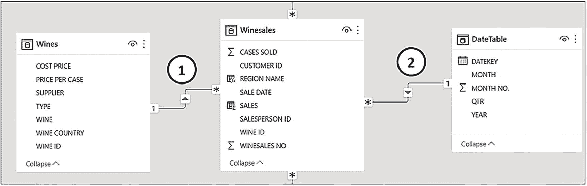

**图 6-6** “2021 年箱数”度量值的筛选器传播方式：

1. 当前筛选上下文筛选 `Wines` 维度中的每个 `WINE`。此筛选器传播到 `Winesales` 表，并对每种葡萄酒进行交叉筛选。
2. 由 `CALCULATE` 以编程方式提供的筛选器将 `DateTable` 筛选为年份“2021”。此筛选器也传播到 `Winesales` 表，从而对 `Winesales` 应用第二个交叉筛选。

这里需要注意的是，对 `DateTable` 维度的 2021 年筛选器只影响*此*度量值的计算，而不会影响视觉对象中的其他度量值。你可以将 `CALCULATE` 视为一种以*编程方式*在内存中生成筛选上下文的方法，该筛选上下文与来自视觉对象、切片器和筛选器窗格的活动筛选器进行交互。

现在，让我们探索更多使用 `CALCULATE` 的示例。例如，计算 `CASES SOLD` 值大于 350 的总销售额。

```
销售箱数大于 350 的总销售额 =
CALCULATE (
[总销售额],
Winesales[CASES SOLD]  > 350
)
```

## 使用多个筛选器

`CALCULATE` 接受多个筛选器参数，这些参数通过 AND 逻辑语句组合。如果你需要 OR 语句，可以在 `CALCULATE` 内部的单个筛选器参数中使用 `OR` 运算符或 `OR` 函数，我们将在后续探索这两种情况。你也可以在 `CALCULATE` 的筛选器参数中使用需要聚合表达式的更复杂的筛选器，我们也将逐步理解这些表达式。


### AND 与 OR 筛选器

以下三个度量值示例使用了 `CALCULATE` 来修改筛选上下文。请注意，`CALCULATE` 的所有筛选参数都是通过“AND”逻辑组合的。

```
2021 年 5 月总病例数 =
CALCULATE (
[总病例数],
DateTable[年份] = 2021,
DateTable[月份] = "五月"
)
阿根廷地区阿贝尔的总病例数 =
CALCULATE (
[总病例数],
SalesPeople[销售人员] = "abel",
Regions[地区] = "argentina"
)
2021 年 Black Ltd 的平均病例数 =
CALCULATE (
AVERAGE ( Winesales[已售病例数] ),
DateTable[年份] = 2021,
Customers[客户名称] = "black ltd"
)
```

你可以通过图 6-7 中 `Wines` 维度的 `WINE` 列查看这些表达式的结果。

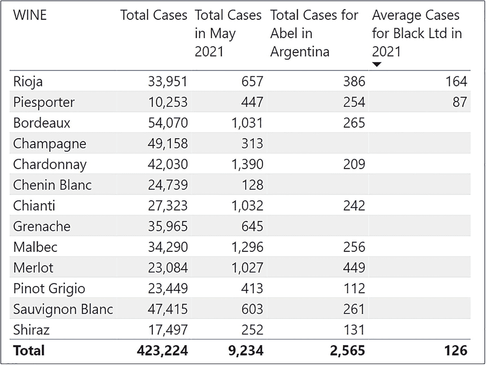

图 6-7

使用 `CALCULATE` 生成多重筛选器的度量值

在前面的示例中，`CALCULATE` 中的筛选参数通过“AND”语句组合，例如，2021 年 **且** 5 月的已售病例数。但是，如果你需要一个使用“OR”逻辑的筛选器，例如，2021 年 **或** 2020 年，又该如何处理呢？使用 `CALCULATE` 对同一列进行“OR”筛选是直接的。而在*不同*列上使用“OR”筛选则更具挑战性，这也是我们计算会变得稍显棘手的地方。我们先来看较为简单的计算。

要对同一列使用“OR”逻辑，你可以在同一个筛选参数中使用双竖线（`||`）运算符，如下例所示：

```
2020 或 2021 年总病例数 =
CALCULATE ( [总病例数],
DateTable[年份] = 2021
|| DateTable[年份] = 2020
)
阿根廷或澳大利亚平均病例数 =
CALCULATE (
AVERAGE ( Winesales[已售病例数] ),
Regions[地区] = "argentina"
|| Regions[地区] = "australia"
)
```

你也可以使用 `OR` 函数，但与 Excel 不同，在 DAX 的 `OR` 函数中你只能放入两个参数，如下例所示：

```
阿根廷或澳大利亚平均病例数 =
CALCULATE (
AVERAGE ( Winesales[已售病例数] ),
OR ( Regions[地区] = "argentina",
Regions[地区] = "australia")
)
```

### 复杂筛选器

我们再来看一个“OR”筛选器的例子。例如，我们可能希望分别使用 `Wines` 表中的 `TYPE` 和 `WINECOUNTRY` 列，查找红葡萄酒 **或** 法国葡萄酒的总销售额，并据此分析我们销售人员在这些葡萄酒上的业绩。表达式如下：

```
红葡萄酒或法国葡萄酒销售额 #1 =
CALCULATE (
[总销售额],
Wines[类型] = "红葡萄酒"
|| Wines[葡萄酒产地] = "法国"
)
```

这个度量值看起来运行良好，如图 6-8 所示。

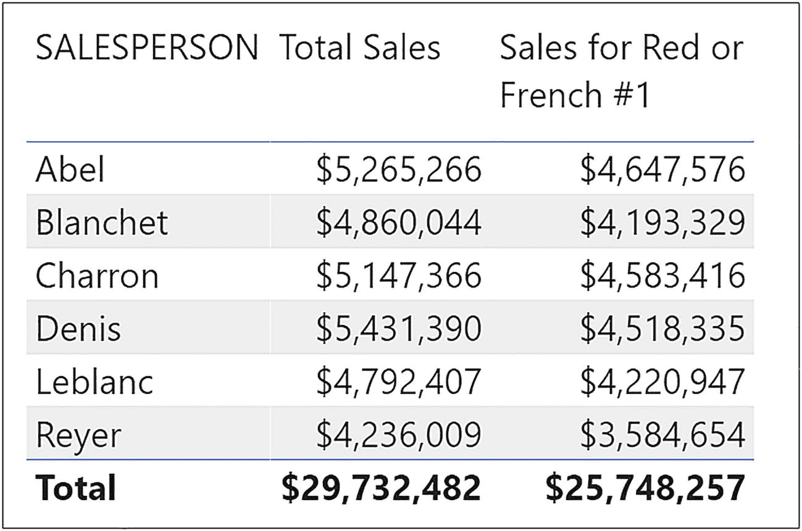

图 6-8

针对每位销售人员计算的“红葡萄酒或法国葡萄酒销售额 #1”度量值

然而，经验丰富的 DAX 用户会对这个表达式有效感到惊讶，并预期会看到一个如图 6-9 所示的错误消息，内容为：

> “表达式包含多个列，但用作表筛选表达式的 True/False 表达式中只能使用单个列。”

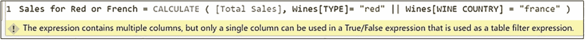

图 6-9

此错误消息已在 Power BI 2021 年 3 月更新中被移除

这条消息告诉我们，不允许在单个筛选器中引用同一张表中的两个列。事实上，在不同列上使用“OR”的表达式，只是在 Power BI 2021 年 3 月更新之后才变得合法。

然而，尽管它现在看似有效，但仍存在一个固有问题。这个表达式无法正确响应特定的筛选器选择。为了说明这一点，我们编写了另一个度量值“红葡萄酒或法国葡萄酒销售额 #2”，现在我们可以通过一个表格视觉对象来比较这两个版本的表达式，在该视觉对象中，我们通过切片器筛选了“红”葡萄酒；见图 6-10。

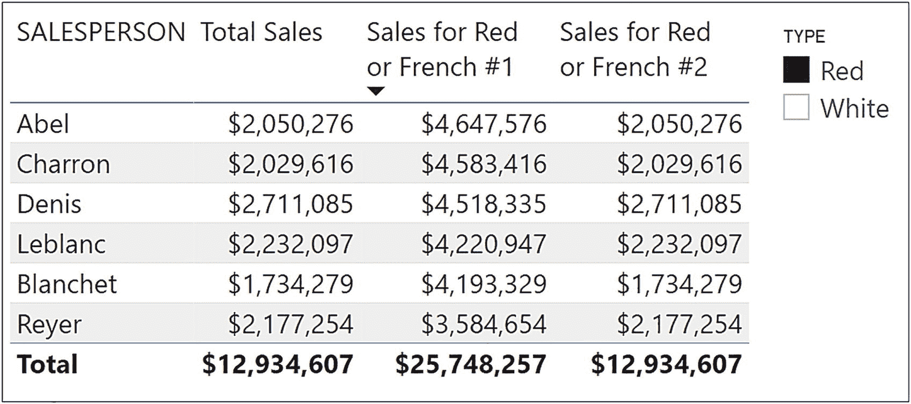

图 6-10

对来自同一表的不同列使用“OR”无法正确响应特定筛选器

你会发现度量值“红葡萄酒或法国葡萄酒销售额 #1”无法响应来自使用 `Wines` 维度中 `TYPE` 列的切片器的筛选。它继续计算红葡萄酒或法国葡萄酒的总销售额，而忽略了切片器。然而，第二个度量值“红葡萄酒或法国葡萄酒销售额 #2”确实只显示了红葡萄酒的销售额。我们将在讨论 `FILTER` 函数的章节中详细探讨这个度量值，但眼下，我们必须提出这个问题：为什么一个筛选来自同一表两个不同列的表达式直到最近才有效，而现在即便允许这样做，为什么它在 `TYPE` 列上应用筛选器时却无法正确计算呢？

让我们更深入地审视这个问题。当只在一个列上有筛选器时，表的内存中行会被筛选，只保留该列筛选条件为真的行。但是，当你在*多个*列上应用筛选器时，你只能进一步减少行数。例如，一旦你筛选出了红葡萄酒，你只能进一步筛选出这些红葡萄酒中哪些是法国产的。

我们该如何解决这个难题？一种方法是确保 `Wines[类型]` 列和 `Wines[葡萄酒产地]` 列上都没有筛选器，这样在每次计算中，*两个*列的值都会被考虑。这正是 DAX 在表达式“红葡萄酒或法国葡萄酒销售额 #1”中所采取的路径。

注意

详细阐述“红葡萄酒或法国葡萄酒销售额 #1”表达式的细节，或解释为何它在某些筛选器存在时会返回错误，超出了本章的范围。不过，我们会在第 18 章揭示这个问题。在这个阶段，我们只需要注意该表达式并不总是返回正确的结果。

是否有其他方法？也许我们可以尝试这样做：不直接将筛选器应用于列，而是*筛选出*我们想要计算的那些行。例如，我们可以遍历 `Wines` 维度中的行，如果找到红葡萄酒，就筛选出该行，如果找到法国葡萄酒，也筛选出该行。然后，我们可以在内存中构建一个新的*虚拟表*，其中只包含红葡萄酒或法国葡萄酒的行。这个经过筛选、只包含我们所需行的内存中虚拟 `Wines` 表，随后可以将该筛选器传播到 `Winesales` 事实表，就像“真实的” `Wines` 维度筛选 `Winesales` 表一样。这样可行吗？

嗯，是的，它会有效，因为在 DAX 中有一类被称为“表”函数的函数，它们可以生成*内存中的虚拟*表，当在 `CALCULATE` 内部使用时，它们会像“真实”表一样传播筛选器。既然我们知道了这一点，剩下的就是去发现那个能够生成仅包含红葡萄酒或法国葡萄酒行的虚拟表的表函数名称。

然而，在我们找到这个函数之前，还需要学习更多内容。我们需要更仔细地了解 DAX 函数的*不同类型*，特别是理解我们所说的“表函数”的含义。然后，我们就能解决“红葡萄酒或法国葡萄酒”这个难题了。


好的，作为高级文档工程师，我将根据您提供的注意事项和格式要求，对给定的文本进行翻译和排版。

---


在处理 DAX 时，一项对你大有裨益的技能就是拥有丰富的想象力。你已经学会了在脑海中构建当前筛选条件在数据模型中传播的画面。迭代器对表的扫描只能通过设想来完成，而设计正确的 `CALCULATE` 表达式则需要推断哪些筛选条件必须更改。DAX 还有另一个隐藏的方面，因此也必须靠想象。那就是虚拟表的生成。你的很多 DAX 代码将涉及构建用于度量值计算的内存表。在本章中，我们将探讨这一概念，即我们如何通过使用表函数来创建表表达式，以及它们在操作数据模型中的目的。在这个过程中，我们将专注于最普遍存在的表函数，即 `FILTER` 函数。

## DAX 函数类型

在 DAX 中，我们可以根据函数返回值的类型将函数分为三类；参见表 7-1。

**表 7-1** DAX 函数类型

| 函数类型 | 示例 | 描述 |
| --- | --- | --- |
| **标量函数** | 返回标量值。例如：`SUM`、`COUNTROWS`、`SUMX`、`CALCULATE` | 这些函数返回一个标量或单个值，用于所有度量值中。 |
| **表函数** | 返回虚拟表。例如：`FILTER`、`VALUES`、`PREVIOUSMONTH`、`ALL` | 表函数用于生成“虚拟”表，这些表与“真实”表一样，通过数据模型传播筛选条件。虚拟表通常是原始表的行子集或列子集，但在使用 `ALL` 函数时，它们可以扩展行数。由于度量值必须始终返回标量值而非表，因此表函数总是嵌套在标量函数内部。 |
| **CALCULATE 修饰符** | 修改 `CALCULATE` 的筛选参数。例如：`CROSSFILTER`、`USERELATIONSHIP`、`KEEPFILTERS`、`ALL` | 我们将在后面介绍这类函数。这些函数会改变由 `CALCULATE` 生成的任何筛选条件的行为，因此它们总是嵌套在 `CALCULATE` 内部。这些函数不返回任何值。 |

**注意**

`ALL` 函数既是一个表函数，也是一个 `CALCULATE` 修饰符。我们稍后会详细研究这一点。

你怎么知道自己在使用哪种类型的函数呢？最好的方法是查阅此处的 DAX 函数库：[`https://docs.microsoft.com/en-us/dax/dax-function-reference`](https://docs.microsoft.com/en-us/dax/dax-function-reference)，它会告诉你一个 DAX 函数返回什么；例如，`FILTER` 函数返回“*一个只包含已筛选行的表*”，参见图 7-1。

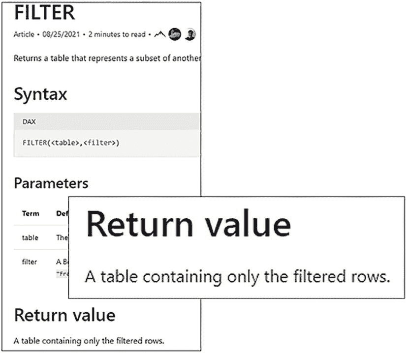

**图 7-1** 使用 DAX 函数库检查函数类型

我们已经探讨过一些标量函数，并且在后续章节中还会遇到更多，例如 `SELECTEDVALUE` 函数。稍后我们也将深入探讨像 `CROSSFILTER`、`USERELATIONSHIP` 和 `ALL` 这样的 `CALCULATE` 修饰符。在本章中，我们将只关注表函数。

## 表函数

表函数可以创建*表表达式*，并用于两个目的：

1.  使用**新建表**按钮在数据模型中生成额外的表。这些表被称为*计算表*。如果这是你的需求，建议使用 Power Query 而不是 DAX 来生成新表。
2.  作为度量值计算的一部分，生成内存中的虚拟表。

在本章中，我们将只考虑后者，即在 DAX 度量值内部使用表表达式生成虚拟表。

在度量值中，只要函数接受“表”作为其参数之一，或者作为 `CALCULATE` 内部的筛选参数，就可以使用表表达式。到目前为止，我们总是在像 `COUNTROWS` 或 `SUMX` 这样的函数中引用一个实际的表，但现在我们可以使用表表达式来代替。在 `CALCULATE` 内部，我们创建了布尔表达式作为列筛选器，但我们也可以使用表表达式。在创建度量值时，表表达式*总是*嵌套在返回标量值的函数内部，从不单独使用。

### 表表达式示例

请考虑图 7-2 中的表达式，这里我们使用表表达式来代替对表的引用。

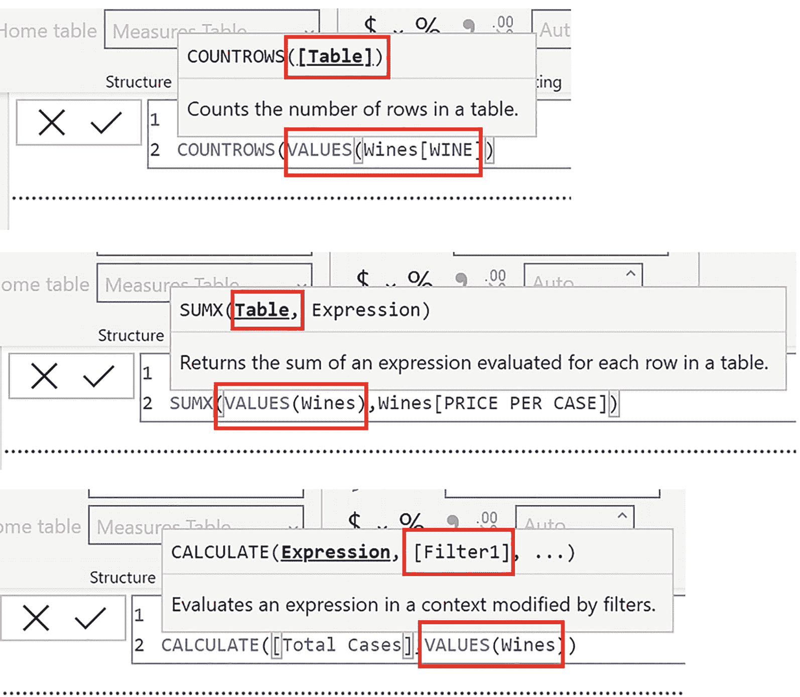

**图 7-2** 表表达式示例

这些示例使用了一个名为 `VALUES` 的表函数。在此阶段，你不需要了解 `VALUES` 函数在做什么（我们将在后面的章节中介绍 `VALUES`）。你只需要理解它是一个用作“表”参数或 `CALCULATE` 内部“筛选”参数的*表表达式*。

### 为什么我们需要表表达式？

我们在 DAX 度量值内部使用表表达式，有两个截然不同的原因。

当嵌套在除 `CALCULATE` 之外的任何其他函数内部时，表表达式提供“表”参数，并且通常会创建原始表的子集，可以是行的子集，也可以是列的子集。例如，嵌套在 `SUMX` 内部的 `FILTER` 通常会生成一个行数更少的表供 `SUMX` 进行迭代。正如我们将在后续章节中发现的，一些表函数也被用于生成包含来自不同表的列组合的“混合”表。

另一方面，作为 `CALCULATE` 内部的筛选参数，表表达式生成的虚拟表被用作*筛选条件*。理解在 `CALCULATE` 内部作为筛选参数使用表表达式，对于 DAX 初学者来说是一个具有挑战性的概念，我们将在本章的学习过程中详细探讨这一概念。

然而，我们将从理解 DAX 中最常见的表函数开始我们对表函数的探索，那就是 `FILTER`。

## FILTER 函数

`FILTER` 函数返回一个*表*，该表是另一个表的子集，其语法如下：

```
= FILTER ( table , filter )
```

其中：

**table** 是你要筛选的表。该表也可以由另一个表函数提供。

**filter** 是你要应用于 **table** 的筛选条件，作为一个布尔表达式，例如：`Wines[TYPE]= "red"`。

以下是 `FILTER` 函数语法的一个示例：

```
= COUNTROWS ( FILTER ( Wines, Wines[TYPE]= "red" ) )
```

作为表函数的 `FILTER` 可用于生成表表达式，如“为什么我们需要表表达式？”一节所述。我们了解到，这些函数根据其用途（是用于改变数据的形状，例如减少表达式所考虑的行数，还是用于 `CALCULATE` 内部）而具有不同的行为。`FILTER` 函数也不例外，因此让我们现在来考虑这两种行为。


### FILTER 用于减少行数

例如，我们可以计算高销量交易的数量，其中高销量指的是 `CASES SOLD` 值大于 300 的任何交易。为此，我们可以在 `COUNTROWS` 中嵌套使用 `FILTER` 来对筛选后的 `Winesales` 表进行行计数，如以下表达式所示：

```
No. of High Volume Sales =
COUNTROWS ( FILTER ( Winesales, Winesales[CASES SOLD] > 300 ) )
```

你可以在图 7-3 中看到该度量的结果。`FILTER` 也可以嵌套在 `SUMX` 中使用，这样 `SUMX` 迭代的表中的行数将通过 `FILTER` 而减少。例如，我们在第 5 章编写的“总销售额”度量可以扩展为筛选箱数大于 300 的销售额（如图 7-4 所示）：

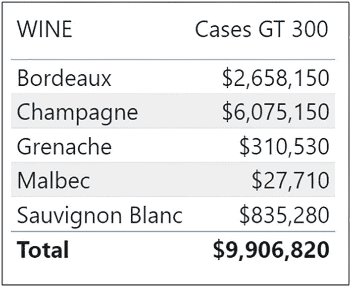

图 7-4：在 `SUMX` 中嵌套使用 `FILTER` 来计算箱数大于 300 的销售额

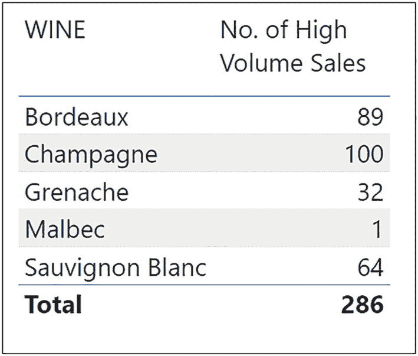

图 7-3：在 `COUNTROWS` 中嵌套使用 `FILTER` 来计算高销量的数量

```
Cases GT 300 =
SUMX (
    FILTER ( Winesales, Winesales[CASES SOLD] > 300 ),
    Winesales[CASES SOLD] * RELATED ( Wines[PRICE PER CASE] )
)
```

然而，如果你打算使用这个计算，这并不是完成该任务的最佳表达式。我们将会发现 `FILTER` 是一个迭代器，因此它会扫描可能包含数百万行数据的 `Winesales` 事实表。本章后面我们将探讨执行此任务的更高效方法。

### FILTER 作为 CALCULATE 的筛选参数

如果 `FILTER` 用于 `CALCULATE` 的筛选参数中，`FILTER` 会生成一个内存表，用于筛选数据模型，就像维度筛选数据模型一样。

在 2021 年 3 月之前，在以下两种情况下，必须在 `CALCULATE` 内部使用 `FILTER` 函数：

1.  当筛选条件包含同一张表的*多个列*时
2.  当筛选条件包含*一个表达式*时

然而，现在在筛选同一张表中的两个或多个列时，可以省略 `FILTER` 函数，但这取决于切片器的选择，度量仍可能失败。如果表达式是使用聚合函数（例如 `AVERAGE` 的简单布尔测试，现在也可以省略 `FILTER`，但在筛选参数中使用任何其他表达式仍然需要使用 `FILTER`。

对于刚接触 `DAX` 的人来说，理解在之前概述的情况下不再需要 `FILTER` 的新语法是一个近期的发展（`DAX` 最初于 2009 年引入），这一点非常重要。你浏览的任何 `DAX` 资料或复制粘贴的任何代码，很可能使用的是包含 `FILTER` 的旧语法。

考虑到这一点，让我们回到上一章探索 `CALCULATE` 函数时编写的“红色或法国葡萄酒销售额 #1”度量。该度量如下：

```
Sales for Red or French #1 =
CALCULATE (
    [Total Sales],
    Wines[TYPE] = "red"
    || Wines[WINE COUNTRY] = "France"
)
```

如果 `TYPE` 列或 `WINE COUNTRY` 列存在筛选器，该表达式将返回错误结果，因为假设你在切片，你现在只想计算红酒和法国酒的销售额，而不是红色*或*法国酒的销售额（这是当前的计算结果）。如果是这样，正确的值显示在图 7-5 左侧的“总销售额”度量中，因为该度量是对切片器中的筛选器做出响应。

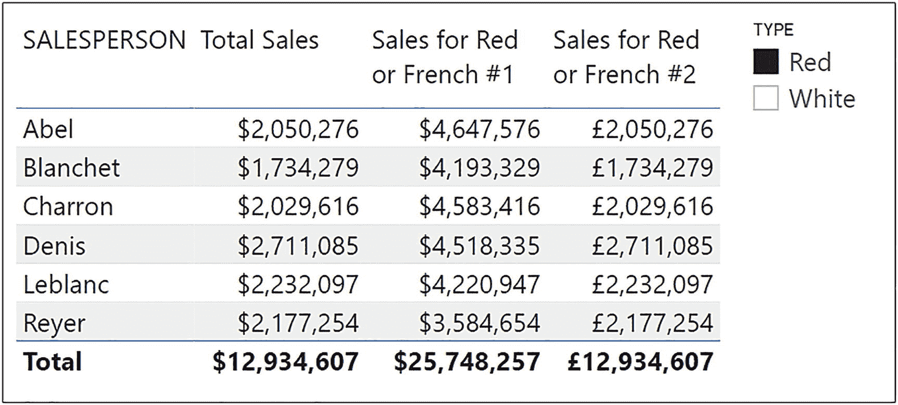

图 7-5：省略 `FILTER` 可能返回错误结果

> **注意：** 你将在本书后面学习关于当 `TYPE` 或 `WINE COUNTRY` 存在筛选器时，“#1”度量返回错误结果的确切细节。

我们确定问题的根源在于我们在筛选条件中使用了两个*不同的*列，实际上在早期，我们被禁止编写此类代码。要解决这个问题，我们需要在 `CALCULATE` 内部使用表函数 `FILTER`。那么，现在让我们来掌握如何在这种情况下使用 `FILTER`，并用它来编写度量的正确版本：“红色或法国葡萄酒销售额 #2”：

```
Sales for Red or French #2 =
CALCULATE (
    [Total Sales],
    FILTER ( Wines, Wines[TYPE] = "red"
        || Wines[WINE COUNTRY] = "France" )
)
```

在图 7-6 中，你可以看到该度量在放入表格视觉对象后的评估结果。我们还包含了“总销售额”度量，以便为评估提供上下文和清晰度。

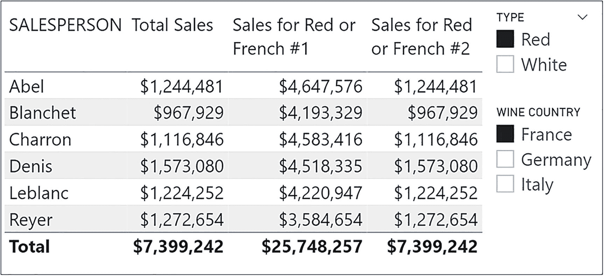

图 7-6：“红色或法国葡萄酒销售额 #2”度量的计算

请参见图 7-7 了解该度量评估的分步指南。在“红色或法国葡萄酒销售额 #2”度量中，`FILTER` 嵌套在 `CALCULATE` 内部以提供筛选参数。`FILTER` 函数是一个*迭代器*。我们在第 5 章研究 `SUMX` 函数时遇到过迭代器。这些函数会逐行扫描表，并在 `FILTER` 的情况下对每一行执行测试。如果 `FILTER` 应用的测试对于某行为真，则该行会被提取到其自身的虚拟表中。这个用作 `CALCULATE` 筛选参数的虚拟表，随后会像“真实”表一样通过模型传播筛选器。

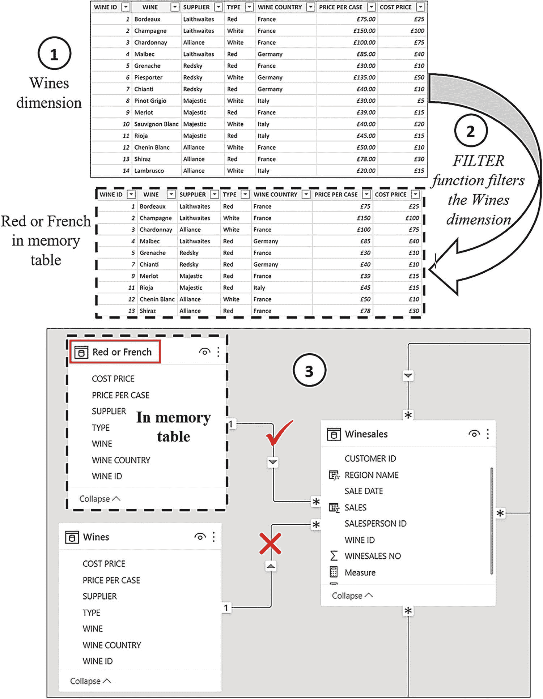

图 7-7：逐步解读“红色或法国葡萄酒销售额 #2”度量


1.  `FILTER` 函数遍历内存中的“Wines”表，并筛选出“TYPE” = “red”或“WINECOUNTRY” = “France”的任何行。

2.  `FILTER` 会生成一个仅包含测试结果为真的行的内存虚拟表。

3.  由 `FILTER` 生成的虚拟表被用作 `CALCULATE` 的筛选参数，以筛选“Winesales”表。

我们一直在研究如何使用 `FILTER` 函数对同一张表的两个不同列执行“OR”测试。让我们看另一个具有相同问题的例子。

假设您想要查找高利润葡萄酒的销售数量（即“Winesales”表中的行数）。高利润葡萄酒指的是价格是成本价三倍的葡萄酒。此测试涉及“Wines”维度中的两列：`PRICE PER CASE` 和 `COST PRICE`，因此，建议您使用 `FILTER`。以下是您可以使用的度量值：

```
No. of Sales =
COUNTROWS ( Winesales )
No. of Sales of High profit Wines =
CALCULATE (
[No. of Sales],
FILTER ( Wines, Wines[PRICE PER CASE] >= Wines[COST PRICE] * 3 )
)
```

我们包含了“No. of Sales”的表达式，该表达式将被嵌套在“No. of Sales of High profit Wines”度量值中。您可以在图 7-8 中看到此度量值的计算。

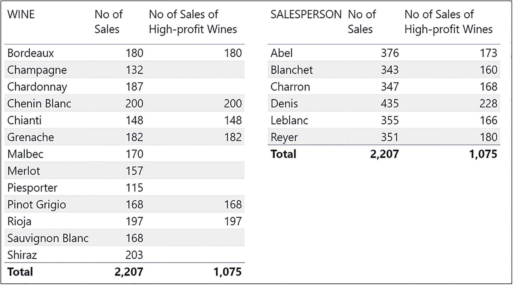

**图 7-8** 查找高利润葡萄酒

您会再次注意到，这里可以省略 `FILTER`，因为使用同一表中不同列的表达式现在是有效的。但是，请注意，如果您对 `PRICE PER CASE` 列或 `COST PRICE` 列设置了筛选器，您将无法看到返回正确的值。因此，每当引用多个列时，建议您在 `CALCULATE` 内嵌套使用 `FILTER`。

然而，当我们需要在 `CALCULATE` 的筛选参数中使用*表达式*时，我们也需要 `FILTER`。我们在此需求下举了两个例子，我们要计算以下内容：

1.  总销售额大于 20,000 的销售数量。我们在筛选器测试中使用了“Total Sales”度量值。
2.  大于平均销售额的销售数量。为了计算平均销售额，我们使用了您在第 5 章中学到的 `AVERAGEX` 表达式。

首先，我们编写了省略 `FILTER` 函数的度量值的“错误”版本。这些表达式将返回错误消息。然后，我们使用 `FILTER` 编写了正确的表达式。因此，理解这一点很重要：当您在 `CALCULATE` 的筛选器测试中使用任何*表达式*时，都需要使用 `FILTER`。我们已将 `FILTER` 表达式用灰色高亮显示，以帮助澄清所使用的代码：

```
Sales Greater than 20K Wrong =
CALCULATE ( [No. of Sales], [Total Sales] > 20000 )
Sales Greater than 20K =
CALCULATE ( [No. of Sales],
FILTER ( Winesales, [Total Sales] > 20000 ) )
Sales Greater than Avg Wrong =
CALCULATE (
[No. of Sales],
[Total Sales]
> AVERAGEX (
Winesales,
Winesales[CASES SOLD] *
RELATED ( Wines[PRICE PER CASE] )
)
)
Sales Greater than Avg =
CALCULATE (
[No. of Sales],
FILTER (
Winesales,
[Total Sales]
> AVERAGEX (
Winesales,
Winesales[CASES SOLD] *
RELATED ( Wines[PRICE PER CASE] )
)
)
)
```

但是，如果需求是计算大于平均销售箱数的销售数量，则此表达式不需要 `FILTER`，因为它使用了简单的聚合函数 `AVERAGE`。自 2021 年 9 月起，我们现在可以编写使用简单聚合函数（例如在谓词中使用 `AVERAGE` 或 `MAX`）的代码，如下所示：

```
Cases GT Avg =
CALCULATE (
[No. of Sales],
Winesales[CASES SOLD] > AVERAGE ( Winesales[CASES SOLD] )
)
```

然而，经验丰富的 DAX 用户可能更倾向于看到使用 `FILTER` 表示的此度量值：

```
Cases GT Avg =
CALCULATE (
[No. of Sales],
FILTER ( Winesales, Winesales[CASES SOLD]
> AVERAGE ( Winesales[CASES SOLD] ) )
)
```

在本节关于 `FILTER` 函数的内容中，您已经了解到 `FILTER` 会生成一个虚拟表，该表可用作 `CALCULATE` 的筛选参数。此虚拟表用于筛选数据模型，就像“真实”表一样。

这引出了 `FILTER` 函数（实际上通常也是表函数）的另一个方面，我们需要更详细地探讨，即：在 `CALCULATE` 中使用*表表达式*作为筛选器与使用简单的*列*筛选器之间的区别。

## 列筛选器与表筛选器

您已经了解到，在 `CALCULATE` 的“筛选”参数中，可以提供两种类型的筛选器：使用*列*的筛选器和/或使用*表*的筛选器。简而言之，在 `CALCULATE` 内部，有两种方法可以修改筛选上下文：使用列或使用表。您现在需要理解的是，根据您选择的筛选器类型，度量值的评估结果将存在显著差异。

在本书中，到目前为止，我们遇到的唯一表函数是 `FILTER` 函数，因此我们将使用 `FILTER` 来说明列筛选器和表筛选器之间的区别，但要认识到，这对于用作 `CALCULATE` 内筛选器的所有表表达式都是相关的。

**注意**

我们将在本书后续部分探索许多其他表函数，例如 `ALL`、`VALUES` 以及称为“时间智能”的函数。

为什么我们需要区分表筛选器和列筛选器？这种区别之所以重要，主要有两个原因：

1.  因为 DAX 引擎必须生成虚拟表，表筛选器需要更长的处理时间。
2.  根据筛选器类型，您的度量值可能会返回不同的结果。

我们现在将探讨这两种情况。在第一个例子中，我们研究表筛选器如何增加度量值的处理负担。在第二个例子中，我们将看到表筛选器可能会产生与列筛选器不同的结果。


### 表格筛选器效率较低

在此示例中，我们取两个使用 `CALCULATE` 的相似表达式。第一个使用列筛选器，第二个使用表表达式作为筛选器参数。在两个表达式中，我们都在筛选 `Winesales` 事实表中包含销量大于 300 的行。

```
Cases GT 300 #1 =
CALCULATE ([Total Sales], Winesales[CASES SOLD] > 300 )
Cases GT 300 #2 =
CALCULATE (
[Total Sales],
FILTER ( Winesales, Winesales[CASES SOLD] > 300 )
)
```

你可以在图 7-9 中看到，这两个度量值返回相同的结果，那么表格筛选器与列筛选器有何不同？要回答这个问题，我们必须更仔细地考察每个度量值的计算过程，并以“歌海娜”葡萄酒的计算结果 **$310,530** 为例。

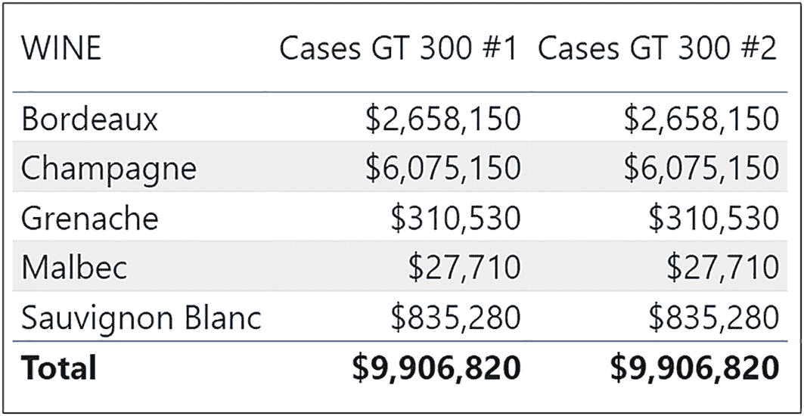

**图 7-9** 两个度量值返回相同结果

在计算度量值 `Cases GT 300 #1` 时，会对 `CASES SOLD` *列* 应用筛选器，以筛选出大于 300 的值。然后为 `Winesales` 表中筛选后的行计算“总销售额”值；见图 7-10。

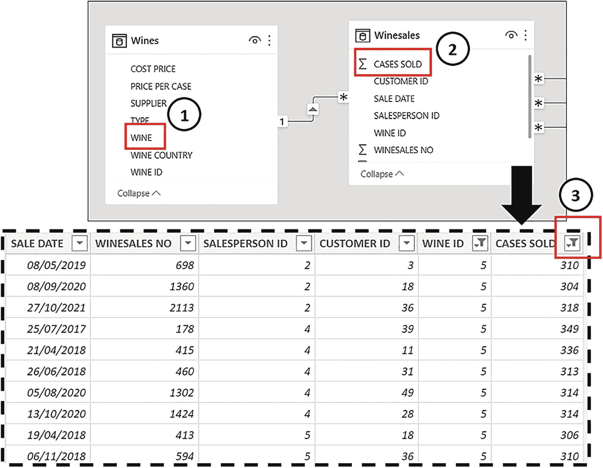

**图 7-10** 逐步计算 `Cases GT 300 #1` 度量值

1. 在 `Wines` 表的 `WINE` 列中筛选出葡萄酒“歌海娜”，并通过交叉筛选关联到 `Winesales` 表，此时该表仅包含“歌海娜”的行。
2. 在内存中进一步筛选 `Winesales` 表中的 `CASES SOLD` 列，使其只包含该葡萄酒中大于 300 的行。然后仅针对这些行计算 `Total Sales` 度量值。
3. 注意 `CASES SOLD` 列上的筛选器。

在计算度量值 `Cases GT 300 #2` 时，`FILTER` 函数会遍历 `Winesales` 表，将 `CASES SOLD` 大于 300 的行提取到一个虚拟表中（记住，`Winesales` 表已被筛选为仅包含“歌海娜”葡萄酒）。然后计算由 `FILTER` 生成的虚拟表的总销售额；见图 7-11。

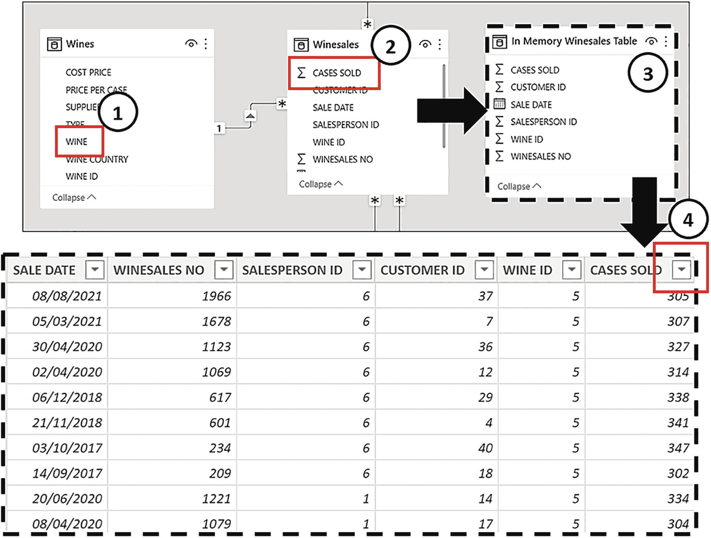

**图 7-11** 逐步计算 `Cases GT 300 #2` 度量值

1. 在 `Wines` 表的 `WINE` 列中筛选出葡萄酒“歌海娜”，并通过交叉筛选关联到 `Winesales` 表，此时该表仅包含“歌海娜”的行。
2. `FILTER` 函数遍历 `Winesales` 表以筛选 `CASES SOLD` 大于 300 的行，并生成一个虚拟表。
3. 针对内存中虚拟 `Winesales` 表中的行计算 `Total Sales` 度量值。
4. 注意 `CASES SOLD` 列上没有筛选器，因为筛选后的行是由虚拟表生成的。

**问题：** 你认为这两种计算方式哪个效率更高？

如果你的事实表包含数百万行数据，`FILTER` 函数必须遍历这些行来构建虚拟表。我们相信你能理解，使用表格筛选器而非列筛选器会付出高昂的处理代价。Marco Russo 和 Alberto Ferrari 用更技术性的语言对此进行了解释：

> *“表格筛选器的一个副作用是，它需要向存储引擎进行大量实体化操作，以使公式引擎能够计算结果。”*^(⁸)

这就是为什么使用表函数 `FILTER` 来筛选销量并非良好实践，因为你应该使用列筛选器。

为了进一步说明这一点，在以下视频中，Marco Russo 将带你了解为什么没必要地使用 `FILTER` 函数并非好主意：

[我的 Power BI 报表很慢：该怎么办？by Marco Russo](https://www.youtube.com/watch?v=B-h3Pohtn1Y)

在结束有关有问题的表格筛选器这个话题之前，还有一个 `Cases GT 300` 度量值的第三个版本，新手可能会考虑编写它。表达式 `Cases GT 300 #3` 使用了 `SUMX`，并返回与之前讨论的两个版本相同的结果：

```
Cases GT 300 #3 =
SUMX ( FILTER ( Winesales, Winesales[CASES SOLD] > 300 ),
[Total Sales] )
```

这个表达式有什么问题？你现在当然已经知道了。答案是它效率低下。首先，`FILTER` 遍历事实表以生成包含待考虑行的表。然后，`SUMX` 遍历 `FILTER` 生成的表。这涉及大量迭代！

推荐的表达式始终是在 `CALCULATE` 的筛选器参数中对 `CASES SOLD` 列使用简单的筛选器。


### 表筛选器返回不同结果

为了理解表筛选器的这方面特性，我们来看这两个度量值，第一个使用列筛选器，第二个使用表筛选器：

```
波尔多葡萄酒 #1 =
CALCULATE (
SUM ( Winesales[销售箱数] ),
Wines[葡萄酒] = "波尔多" )
波尔多葡萄酒 #2 =
CALCULATE (
SUM ( Winesales[销售箱数] ),
FILTER ( Wines, Wines[葡萄酒] = "波尔多" )
)
```

你可能会认为这两个度量值应该返回相同的结果。然而，如果我们将这些度量值放入一个包含 `Wines` 维度中 `葡萄酒` 列的表格视觉对象中（图 7-12），我们会得到不同的结果。度量值 `#1` 为每种葡萄酒都给出了“波尔多”的值，但在 `#2` 中，对于任何非波尔多葡萄酒，我们得到的是空白。

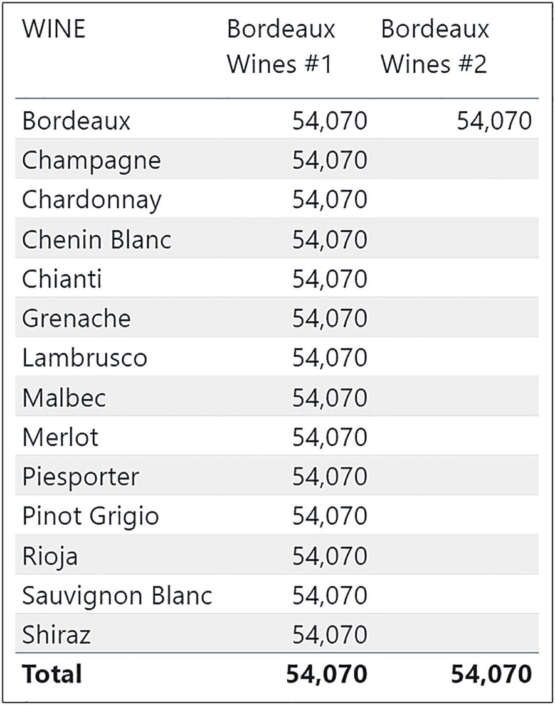

图 7-12

包含 `Wines` 维度中 `葡萄酒` 列的表格视觉对象中的“波尔多葡萄酒 #1”和“波尔多葡萄酒 #2”

那么为什么会有差异呢？让我们更仔细地看看“波尔多葡萄酒 #1”度量值。在第一次评估该度量值时，活动筛选上下文位于 `Wines` 维度的 `葡萄酒` 列上，并且在第一个实例中筛选“波尔多”。此筛选器现在交叉筛选到 `Winesales` 表，以对“波尔多”的 `销售箱数` 求和。在下次评估时，“香槟”位于筛选上下文中。但 `CALCULATE` 修改了筛选上下文，并将 `葡萄酒` 列上的筛选器从“香槟”*替换*为“波尔多”。正是这个筛选器现在被交叉筛选到 `Winesales` 表，以对“波尔多”的 `销售箱数` 求和。对于每种葡萄酒的每次评估以及总计行评估，情况都是如此；参见图 7-13。

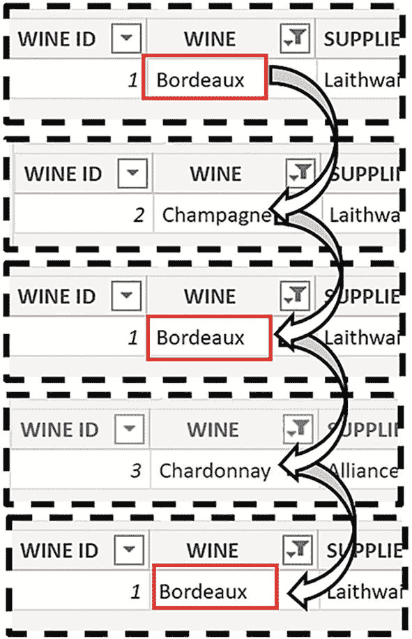

图 7-13

`CALCULATE` 替换 `葡萄酒` 列上的筛选器，因此它始终筛选“波尔多”

**注意**

如前所述，在您目前对 DAX 的了解阶段，关于筛选器如何工作的这个解释尚不完整，但暂时足以让您很好地理解。我们将在稍后的第 18 章中给出更准确的解释。

这就是为什么始终返回“波尔多”的销售箱数总计，因为对于每种葡萄酒的评估，`CALCULATE` 都会将 `葡萄酒` 列上的筛选器*替换*为“波尔多”。

现在让我们来看第二个使用 `FILTER` 的度量值，我们得到的是“波尔多”的值，但其他葡萄酒则没有返回值。这个度量值使用表筛选器：

```
波尔多葡萄酒 #2 =
CALCULATE (
SUM ( Winesales[销售箱数] ),
FILTER ( Wines, Wines[葡萄酒] = "波尔多" )
)
```

当前筛选上下文位于 `Wines` 维度的 `葡萄酒` 列上，在第一个实例中在内存中筛选“波尔多”。`CALCULATE` 内部的 `FILTER` 函数扫描此表，查找值“波尔多”，并生成一个仅包含“波尔多”行的虚拟表。正是这个表筛选器现在被交叉筛选到 `Winesales` 表，以对“波尔多”的 `销售箱数` 求和。在对“香槟”进行评估时，`Wines` 维度中的 `葡萄酒` 列会相应地被筛选。但是，`FILTER` 函数不会修改筛选上下文，因此 `CALCULATE` 内部的 `FILTER` 函数扫描这个包含“香槟”的单行表，查找值“波尔多”。它找不到，因此没有内容可筛选。现在 `FILTER` 生成了一个空筛选器，而空筛选器不返回任何值；参见图 7-14。这就是为什么除了“波尔多”之外，该度量值没有返回任何其他值。

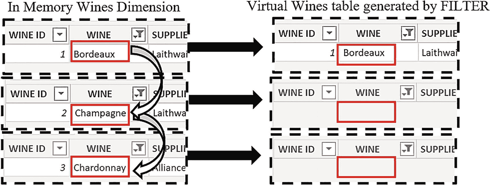

图 7-14

`FILTER` 无法将 `葡萄酒` 列上的筛选器替换为等于“波尔多”，因此除了“波尔多”之外，没有其他行被筛选

关于 `FILTER` 函数需要记住的重要一点是，它是一个弱函数。除非您使用我们将在下一章探讨的 `ALL` 函数，否则 `FILTER` 只会筛选*当前筛选上下文中的*行，因此通常会返回原始筛选器的*子集*。另一方面，在 `CALCULATE` 内部使用列筛选器，则会在需要时替换筛选器。

### 使用 KEEPFILTERS 函数

`CALCULATE` 的这种行为，即列筛选器总是被*替换*，无论从哪方面看，都相当奇怪且不直观，导致每次评估都给出相同的值。而由 `FILTER` 生成的筛选器，即使它是个表筛选器，看起来反而更“正常”。正如我们正在学习的，如果可能，最好总是使用列筛选器，因此为了使列表达式行为更直观，我们可以使用一个名为 `KEEPFILTERS` 的函数，如下例所示：

```
波尔多葡萄酒 #1 =
CALCULATE (
SUM ( Winesales[销售箱数] ),
KEEPFILTERS ( Wines[葡萄酒] = "波尔多" )
)
```

这个函数修改了 `CALCULATE` 的行为，并阻止它替换筛选器。在图 7-15 中，您可以看到，对于“波尔多葡萄酒 #1”度量值，我们现在只得到“波尔多”的返回值，而其他葡萄酒没有返回值。

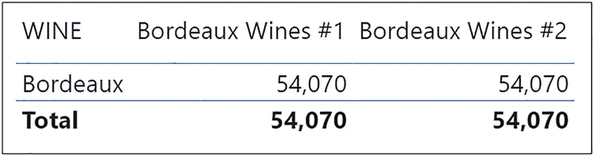

图 7-15

`KEEPFILTERS` 函数阻止 `CALCULATE` 替换筛选器

在本章中，您学习了在 DAX 表达式中生成虚拟表。这些表被度量值用于操作数据模型，既可以返回“真实”表的子集，也可以充当通过数据模型传播筛选器的内存维度。您还了解到了表筛选器和列筛选器不同行为的警告，特别是关于使用 `FILTER` 函数的情况。随着我们继续前进并处理更具挑战性的计算，这种差异将变得更加重要。然而，就目前而言，让我们只记住这一点：

*尽可能始终使用列筛选器。仅在必要时才使用表筛选器。*

脚注 1


