# 8. ALL 函数及其所有变体

在前面的章节中，我们探讨了筛选上下文，以及视觉对象、切片器和筛选器如何共同作用，在度量值评估时对数据模型进行筛选。你已经了解到，使用 `CALCULATE` 函数可以以编程方式修改这些筛选器。但你尚不了解的是如何*移除*筛选器，以便计算你自己的总计和小计。更棒的是，了解如何移除筛选器意味着你可以以编程方式重新应用与当前定义筛选上下文完全不同的筛选器。下面，我来介绍 `ALL` 函数，它让你能够掌控度量值评估的这一方面。

从表面上看，`ALL` 函数似乎是一个易于理解的函数。`ALL` 函数返回一个表的所有行，或一列中的所有非重复值，忽略任何可能已应用的筛选器。然而，你将在本章中发现，`ALL` 函数的简单性掩盖了它是最难掌握的 DAX 函数之一的事实。在本章中，我们将深入探讨这个“披着羊皮的狼”函数；目标是教你 `ALL` 函数的方方面面及其所有变体。这将使你能够继续前进并编写更复杂的度量值。

理解 `ALL` 函数之所以具有挑战性，至少有两个原因。首先，`ALL` 函数有多种变体：
- `ALLSELECTED`
- `ALLEXCEPT`
- `ALLCROSSFILTERED`
- `ALLNOBLANKROW`

你需要知道在何时使用哪一个。

> **注意：** `ALLCROSSFILTERED` 和 `ALLNOBLANKROW` 函数不在本书的讨论范围内。

其次，`ALL`（及其变体）具有双重面孔；它既可以用作表函数，也可以用作 `CALCULATE` 的修饰符，如下所述：
- **作为表函数的 ALL** – 当用作表函数时，`ALL` 的行为如前所述；即，它返回一个表的所有行或一列或多列中的所有非重复值。
- **作为修饰符的 ALL** – 当 `ALL` 在 `CALCULATE` 中用作顶级筛选器参数时，它充当 `CALCULATE` 的修饰符，并从表或列中*移除*筛选器。换句话说，它不会生成虚拟表。

事实上，`ALL` 是两个完全不同的函数。这是许多不熟悉 DAX 的用户没有意识到的一点。这主要是因为，无论你是将 `ALL` 函数用作 `CALCULATE` 中的顶级筛选器参数，还是嵌套在 `FILTER` 或 `COUNTROWS` 等其他函数内部，`ALL` 函数的行为通常都符合你的预期。无论是通过生成包含所有行的虚拟表，还是通过从表和列中移除筛选器，它都会移除筛选器。然而，我们稍后将探讨理解这种差异对于理解 `ALL` 函数为何至关重要。

虽然我在这里只提到了 `ALL` 函数，但我们还将探讨 `ALLSELECTED` 和 `ALLEXCEPT` 函数。

## ALL 函数

`ALL` 函数具有以下语法：

`= ALL ( table )`

其中：
`table` 是你要从中清除筛选器的表。

以下是一个引用表的 `ALL` 函数语法示例：

`= ALL ( Winesales )`

与其他将表作为参数的函数不同，你不能在 `ALL` 函数内部嵌套另一个表函数；你只能使用基础表。

或者，你也可以引用列。

`= ALL (column 1, column 2, etc.)`

其中：
`column(s)` 是你要从中清除筛选器的一个或多个列。

以下是一个引用列的 `ALL` 函数语法示例：

`= ALL ( Wines[TYPE] )`

根据你使用的语法不同（无论是从表中移除筛选器还是从列中移除筛选器），`ALL` 函数对数据模型筛选的影响也会不同。如果你使用 `ALL` 从事实表或维度中移除筛选器，其影响又会有所不同。因此，为了更容易理解 `ALL` 的行为，我们将 `ALL` 可以移除筛选器的这三个不同对象分别进行探讨，如下所示：
1. 事实表
2. 维度
3. 一个或多个列

### 应用于事实表

让我们再次考虑一个场景。在图 8-1 的可视化对象中，我们使用以下度量值来计算销售数量：

**图 8-1** – 使用 ALL 计算占总计百分比

```
销售数量 =
COUNTROWS ( Winesales )
```

然后，我们计算了“销售总计数量”作为分母，以计算“销售数量占总计百分比”中显示的百分比；见图 8-1。

为了得到这些计算结果，首先，我们需要编写一个忽略来自 Wines 维度筛选器的度量值，以便我们能计算出*所有葡萄酒*的销售数量，即 **2,207**。为此，我们可以使用 `ALL` 作为表函数，生成一个包含 `Winesales` 事实表所有行的虚拟表，然后使用 `COUNTROWS` 计算该表中的行数。表达式如下：

```
销售总计数量 =
COUNTROWS ( ALL ( Winesales ) )
```

最后，我们可以将总计除以每种葡萄酒的总数来得到百分比，如以下度量值所示：

```
销售数量占总计百分比 =
DIVIDE ( [销售数量] , [销售总计数量] )
```

让我们探讨一下向报表添加更多筛选器的影响。在图 8-2 中，我们使用切片器对 SalesPeople 维度应用了筛选器，但你可以看到，无论筛选器如何，使用 `ALL` 函数的度量值始终返回总计。

**图 8-2** – ALL 函数忽略来自维度的筛选器

要理解此示例中 `ALL` 的行为，我们必须再次考虑筛选上下文。在评估“Bordeaux”葡萄酒时，有两个活动筛选器：一个在 Wines 维度上筛选“Bordeaux”，另一个在 SalesPeople 维度上筛选“Abel”。然而，`ALL` 函数始终对包含 `Winesales` 事实表*所有行*的虚拟表进行计数，忽略从维度传播而来的任何筛选器；见图 8-3。

**图 8-3** – 传递给事实表的 ALL 函数会生成一个虚拟事实表，用于所有评估，并且会忽略来自维度的任何筛选器

让我们看另一个在事实表上使用 `ALL` 函数的示例，但这次是将 `ALL` 嵌套在 `CALCULATE` 内部。例如，你可能想要查找已售箱数的总计，以便将此值用作分母来计算百分比；见图 8-4。这将是度量值：

**图 8-4** – 将 ALL 函数嵌套在 CALCULATE 内部以查找已售箱数总计

```
所有葡萄酒销售总箱数 =
CALCULATE ( [总箱数], ALL( Winesales ) )
```

你可以看到，此度量值同样忽略了数据模型上的任何筛选器。

然而，现在让我们关注一个你可能需要的表达式，它计算*所有葡萄酒*的平均已售箱数，以便你可以将此平均值与*每种*葡萄酒的平均已售箱数进行比较。这将是找出此平均值的度量值：

```
所有葡萄酒销售平均箱数 =
CALCULATE( AVERAGE ( Winesales[已售箱数] ), ALL ( Winesales ) )
```

然后，你可以使用 `FILTER` 编写以下度量值，来计算已售箱数值大于所有葡萄酒平均值的销售数量：

```
已售箱数大于所有葡萄酒平均箱数的销售数量 =
CALCULATE (
    [销售数量],
    FILTER ( Winesales, Winesales[已售箱数]
        >= [所有葡萄酒销售平均箱数] )
)
```

在“No. of Sales Where Cases is GT Avg All Wines”的代码中，`FILTER`函数会迭代`Winesales`表，筛选出`CASES SOLD`列中值大于“Avg Cases All Winesales”计算所得值的所有行。然而，要完全理解此表达式的细节，你需要理解上下文转换的概念，我们将在后续章节中探讨。

你可以在图 8-5 中看到这些表达式的结果。

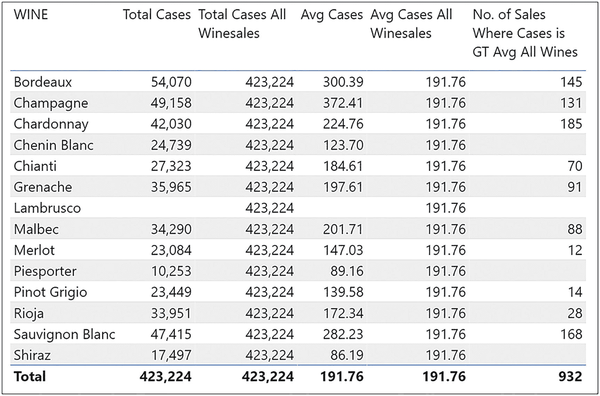

**图 8-5** 计算售出总箱数和所有葡萄酒的平均箱数

这里需要理解的是，当`ALL`嵌套在`CALCULATE`内部时，它的行为并不像一个表函数。相反，`ALL`会移除事实表上的所有交叉筛选器，因此会对事实表的所有行进行计算。我们将在本章后续内容中详细探讨这种行为。

以这种方式使用`ALL`，我们能够计算出占总计的百分比。然而，你可能会有不同的需求，那就是计算*筛选后*项目的百分比。这引出了我们可以使用`ALL`的第二个场景，即将其应用于维度。

### 在维度表上使用 ALL

例如，在图 8-2 中，我们在切片器中筛选了销售人员“Abel”，可以看到 Abel 在*所有葡萄酒*上的总销售数量为**376**。我们想知道“Abel”的每种葡萄酒销售额占*此数值*的百分比。换句话说，我们需要移除`Wines`维度上的筛选器，同时保留`SalesPeople`维度中正在筛选“Abel”的`SALESPERSON`列上的筛选器。

如果我们移除一个特定维度上的筛选器，从其他维度传播到事实表的筛选器将不受影响。因此，如果我们移除`Wines`维度上的筛选器，`SalesPeople`维度上的筛选器将被保留，从而计算出针对已筛选销售人员的*所有葡萄酒*的销售数量。

然而，下面这个在`Wines`维度上使用`ALL`的度量是不正确的：

```
No. of Sales All Wines Wrong =
COUNTROWS ( ALL ( Wines ) )
```

该度量将生成一个包含`Wines`维度中所有行的表，然后计算此表中的行数，返回**14**，因为`Wines`维度中有 14 行。请记住，我们想要统计行数的表是`Winesales`事实表，该表被筛选为显示切片器中所选销售人员销售的所有葡萄酒。因此，我们需要计算`Winesales`表中的销售数量，这个操作我们已经做过多次：

```
No. of Sales = COUNTROWS ( Winesales)
```

因为我们要修改筛选上下文以移除`Wines`维度上的筛选器，所以我们可以在`CALCULATE`内部使用“No. of Sales”度量，然后将`ALL`函数作为`CALCULATE`的筛选器参数，按如下方式修改筛选上下文：

```
No. of Sales All Wines =
CALCULATE ( [No. of Sales], ALL ( Wines ) )
```

最后，我们可以相除得到百分比：

```
No. of Sales as Percent of Filtered Value =
DIVIDE ( [No. of Sales] , [No. of Sales All Wines] )
```

让我们关注图 8-6 中所示的“No. of Sales All Wines”度量。我们可以看到，它计算出的值与“No. of Sales”度量在总计行中的数值相同，即**376**。

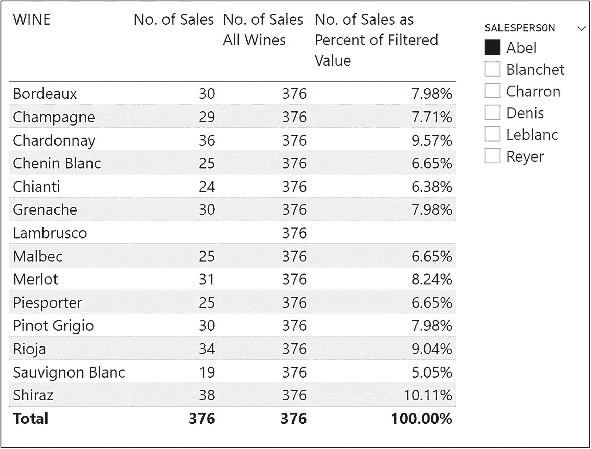

**图 8-6** 使用 ALL 从维度移除筛选器

在这个表视觉对象中，初始状态下，`Wines`维度和`SalesPeople`维度上都有筛选器。但是，当对每种葡萄酒评估“No. of Sales All Wines”度量时，所有筛选器都会从`Wines`维度上移除（因为我们使用了`CALCULATE`），因此总是返回所有葡萄酒的值。来自其他维度（例如`SalesPeople`维度）的筛选器则会被保留；见图 8-7。

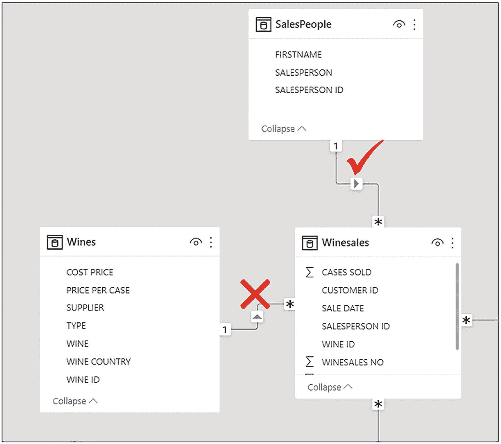

**图 8-7** `ALL`函数移除了`Wines`维度上的筛选器，但其他筛选器得以保留

或许我们开始意识到，理解`ALL`函数需要掌握很多内容！我们正在接近目标，但尚未完全掌握。例如，考虑我们刚刚使用的度量：

```
No. of Sales All Wines =
CALCULATE ( [No. of Sales], ALL ( Wines ) )
```

它可能不是你想要的运算。问题在于它移除了`Wines`维度中的所有筛选器。将来我们会遇到需要更精确地指定需要移除维度中哪些列的筛选器的情况。

### 在列上使用 `ALL`

请考虑图 8-8 中的示例。来自 `SalesPeople` 维度的 `SALESPERSON` 列以及来自 `Wines` 维度的 `SUPPLIER` 列都正在被切片器筛选。我们正在筛选销售人员“Abel”和供应商“Alliance”。请记住，来自 `Wines` 维度的 `WINE` 列上也有一个筛选器，用于筛选每种葡萄酒。然而，“No. of Sales All Wines” 显示的是 Abel 针对所有供应商的总和，即 **376**，这是因为该度量值移除了来自 `Wines` 表（包括 `SUPPLIER` 列）的所有筛选器。

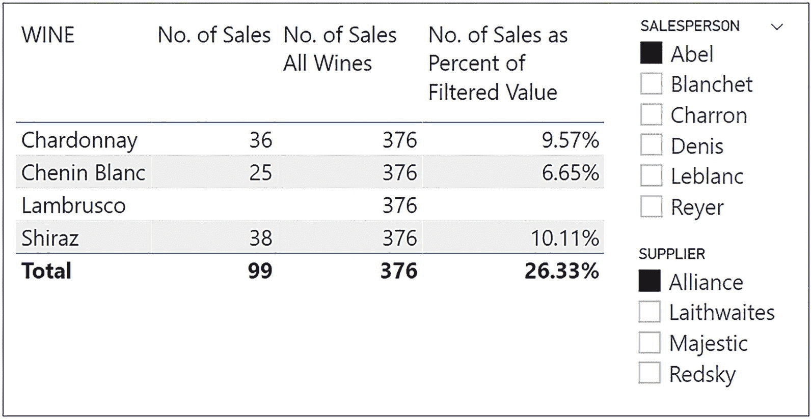

**图 8-8**

引用一个表的 `ALL` 会移除此表中所有列上的筛选器，这可能是不正确的。

因此，如果你想要显示“Abel”销售“Alliance”的数量占“Abel”对所有供应商的总销售额 (**376**) 的百分比，那么“No. of Sales as Percent of Filtered Value”中的百分比将是正确的。但是，如果你想要显示“Abel”的销售额仅占“Alliance” (**99**) 总销售额的百分比，那么这将是不正确的。如果目标是后者，我们必须计算“Abel”对由“Alliance”（或任何被筛选的供应商）供应的所有葡萄酒的总销售额，即 **99**。

让我们更仔细地审视这个问题。当前的筛选上下文对 `Wines` 维度中的两个列使用了筛选器：`WINE` 和 `SUPPLIER`。如果我们能看到用于评估“Chardonnay”的内存中 `Wines` 表，它可能看起来像图 8-9 所示。

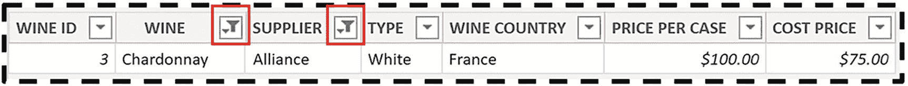

**图 8-9**

筛选器同时位于 `WINE` 列和 `SUPPLIER` 列上。

度量值“No. of Sales All Wines”移除了这两个筛选器，因此计算了 Abel 针对所有葡萄酒和所有供应商的销售数量。使用以表名作为参数的 `ALL` 函数，无论是事实表还是维度表，都将移除该表中的所有筛选器。但是，我们可以使用 `ALL` 仅移除特定列上的筛选器。

要解决图 8-8 中的问题，我们需要移除 `WINE` 列上的筛选器，但保留 `SUPPLIER` 列上的筛选器。我们可以创建以下度量值来实现这一点：

```
No. of Sales All Wines #2 =
CALCULATE ( [No. of Sales] , ALL ( Wines[WINE] ) )
```

你可以看到，在这个度量值中，我们在 `ALL` 内部引用了 `WINE` 列，因此 `ALL` 仅移除了这一列上的筛选器。图 8-10 展示了内存中发生的情况，你可以看到 `SUPPLIER` 列上的筛选器被保留了下来。

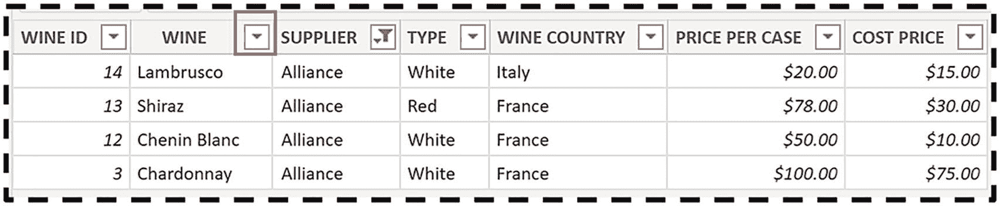

**图 8-10**

在列上使用 `ALL` 仅会移除该列上的筛选器。

我们现在可以计算正确的百分比，并在图 8-11 中看到评估结果：

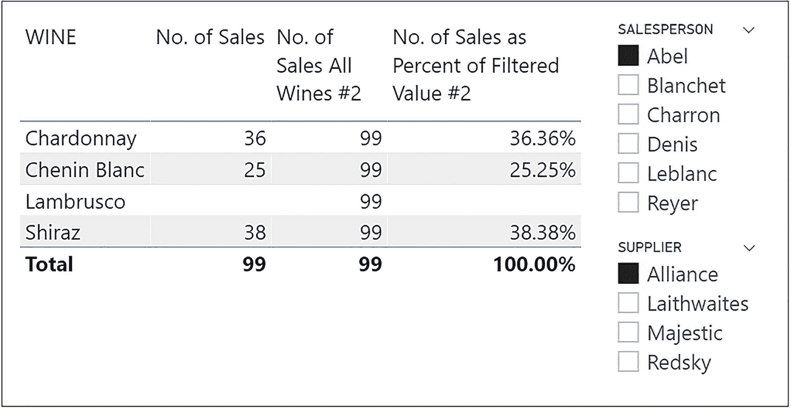

**图 8-11**

“Abel”针对“Alliance”供应商的正确销售百分比。

```
No. of Sales as Percent of Filtered Value #2 =
DIVIDE ( [No. of Sales] , [No. of Sales All Wines #2] )
```

让我们考虑另一个必须使用 `ALL` 函数来移除特定列上筛选器的示例。这个场景需要我们计算分组项之间的百分比。例如，在图 8-12 的矩阵可视化中，矩阵的行区域中有来自 `Wines` 维度的两列：`WINE COUNTRY` 和 `TYPE`。我们已经计算了每个 `TYPE` 的“Total Cases”值占每个 `WINE COUNTRY` 的“Total Cases”值的百分比，可以看到“White”葡萄酒占“French”葡萄酒的 **47.02%**。^(⁹)

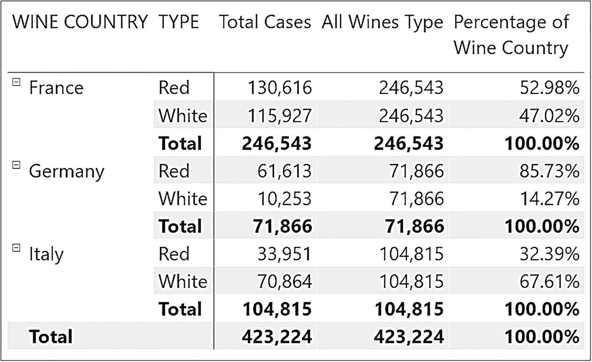

**图 8-12**

跨分组数据计算百分比。

那么，创建一个堆积柱形图来显示每个 `WINE COUNTRY` 和 `TYPE` 的总箱数将会很有见地。然后我们可以使用填充了百分比度量值的工具提示来显示跨 `TYPE` 的百分比细分，如图 8-13 所示。

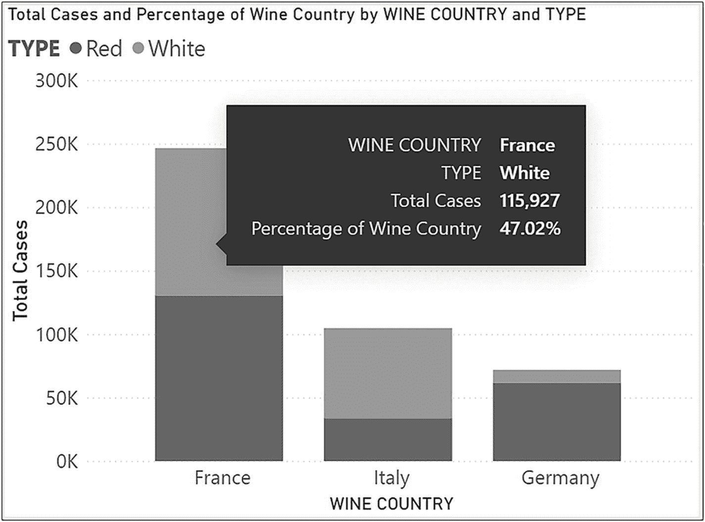

**图 8-13**

堆积柱形图，在工具提示中显示了跨 `WINE COUNTRY` 的百分比细分。

这些是在图 8-12 中计算的度量值。

```
All Wines Type =
CALCULATE ( [Total Cases], ALL ( Wines[TYPE] ) )
```

```
Percentage of Wine Country =
DIVIDE ( [Total Cases] , [All Wines Type] )
```

让我们更仔细地看看“All Wines Type”度量值在矩阵可视化中是如何被评估的。第一次评估开始时，`WINE COUNTRY` 上有一个“France”的筛选器，`TYPE` 上有一个“Red”的筛选器，并且这些筛选器被传递到事实表。然而，为了计算“France”的总箱数，必须移除 `TYPE` 上的筛选器，以便该度量值计算“France”的两种类型（“Red”和“White”）的总箱数。如果使用 `ALL` 移除了 `TYPE` 列上的筛选器，则只有“France”这个筛选器被传递到事实表；参见图 8-14。

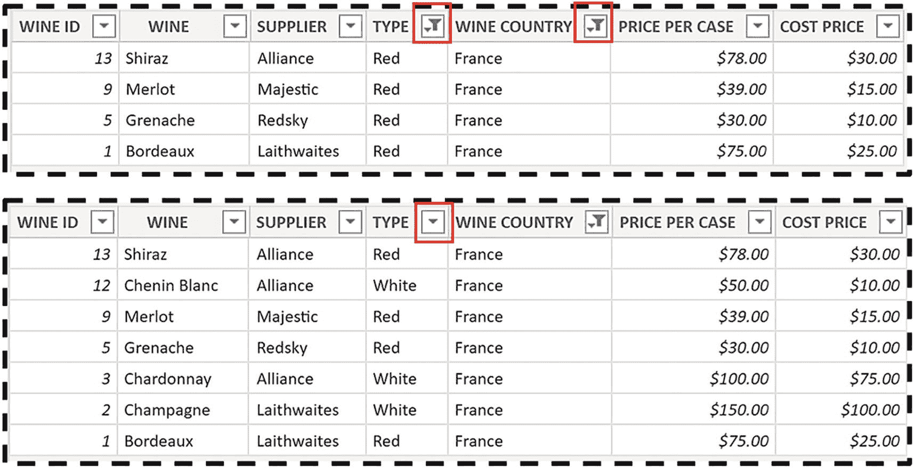

**图 8-14**

在 `TYPE` 列上使用 `ALL` 仅会移除该列上的筛选器。

能够识别你想要移除筛选器的表和/或列是成功使用 `ALL` 的关键。然而，考虑图 8-15 中的示例，其中行区域有四列。要计算每个 `WINE COUNTRY` 的百分比，我们需要移除 `Wines` 维度中三列上的筛选器，即 `TYPE`、`SUPPLIER` 和 `WINE`。

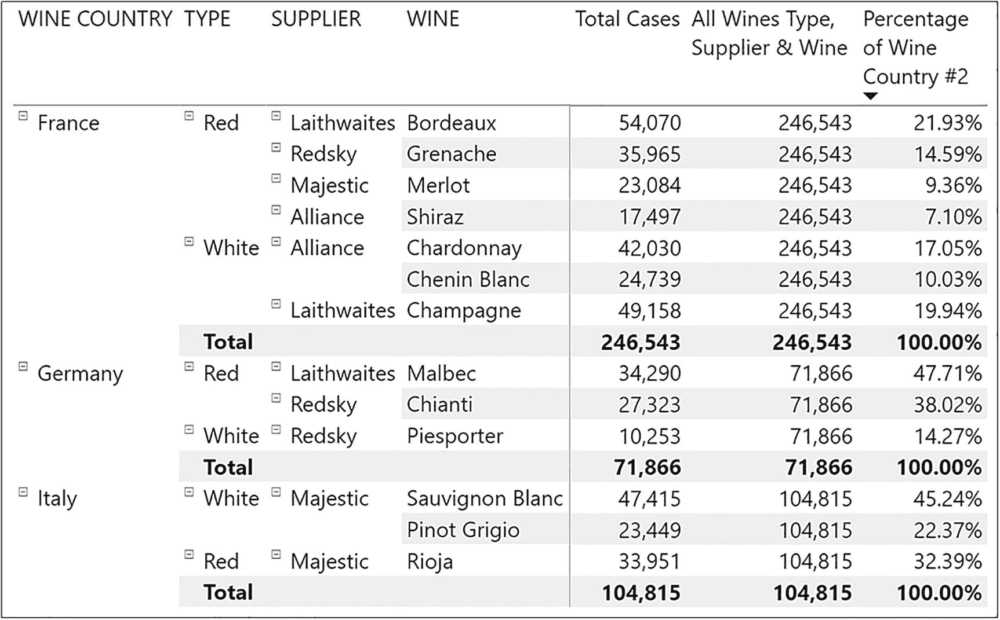

# 图 8-15

从多个列中移除筛选器。

在 `ALL` 函数内部，你可以引用多个列名，因此可以编写如下度量值：

```
All Wines Type, Supplier & Wine =
CALCULATE ( [Total Cases],
ALL ( Wines[TYPE], Wines[SUPPLIER], Wines[WINE] )
)
```

注意：因为我们移除了 `WINE` 列上的筛选器，所以没有数据的“Lambrusco”葡萄酒将出现在可视化对象中。要解决此问题，请使用可视化级别筛选器来筛选出非空项。

但是，如果有很多列都需要移除筛选器，你可以想象这会有多繁琐。这种情况下，你可以使用 `ALLEXCEPT` 函数来代替 `ALL`。

## `ALLEXCEPT` 函数

`ALLEXCEPT` 会移除表中的所有筛选器，但保留应用于指定列的筛选器。当你希望移除表中许多列（而非全部列）的筛选器时，可以使用此函数。

`ALLEXCEPT` 函数的语法如下：

`= ALLEXCEPT ( table, column1, colum2, etc. )`

其中：

- `table`：代表要清除筛选器的表，但*除*了后续参数中指定列上的筛选器。

- `column1`、`column2`：代表希望保留筛选器的列。

以下是 `ALLEXCEPT` 语法的一个示例：

`= ALLEXCEPT ( Wines, Wines[WINE COUNTRY] )`

请注意，与 `ALL` 不同，在 `ALLEXCEPT` 中，你需要先提供表名。

因此，在图 8-15 的矩阵视觉对象中，你可以编写“所有葡萄酒类型、供应商和葡萄酒”度量的替代版本，如下所示：

```
All Except Wine Country =
CALCULATE ( [Total Cases],
ALLEXCEPT ( Wines, Wines[WINE COUNTRY] )
)
```

现在我们可以计算百分比：

```
Percentage of Wine Country #2=
DIVIDE ( [Total Cases] , [All Except Wine Country] )
```

你可能会觉得我们已经穷尽了所有可能的“ALL”变体！我们探讨了从整个表（无论是事实表还是维度表）中移除筛选器。我们还了解了如何从特定列移除筛选器，以及如何移除多个列的筛选器，同时保留其他列的筛选器。然而，我们还需要探讨另一种情况。请考虑图 8-16。

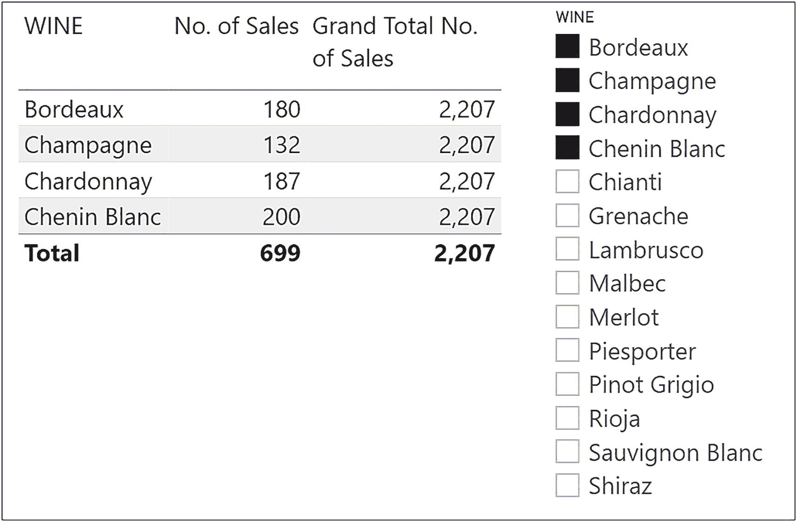

# 图 8-16

“销售总计”度量并非切片器中所选葡萄酒的总计

这里有一个表格视觉对象，其中放置了 `Wines` 维度中的 `WINE` 列。你可以看到，使用切片器筛选出了四种葡萄酒。“销售数量”度量计算所选葡萄酒的销售数量。“销售总计”度量也已包含在内，其表达式如下：

```
Grand Total No. of Sales =
COUNTROWS ( ALL ( Winesales ) )
```

此度量返回所有葡萄酒的销售总数，与切片器选择无关。如果葡萄酒筛选器来自“筛选器”窗格中设置的筛选器，情况也是如此。如果我们只想计算所选葡萄酒的总数百分比（本例中为 **699**），那么此“销售总计”度量将无法奏效。

问题在于，切片器中选定的值来自放入表格视觉对象的同一列，即 `WINE` 列。我们使用切片器来*减少*视觉对象中显示的葡萄酒。因此，我们需要找到一个能专门计算*视觉对象中已筛选项目*总计的函数。这个函数就是 `ALLSELECTED`。

## `ALLSELECTED` 函数

`ALLSELECTED` 函数的语法与 `ALL` 函数相同：

`= ALLSELECTED ( table )`

或

`= ALLSELECTED ( Column 1, Column 2, etc.)`

然而，如果你查看 DAX 函数库中的函数描述，可能会感到有些困惑：

> *“`ALLSELECTED` 会移除当前查询中列和行的上下文筛选器，同时保留所有其他上下文筛选器或显式筛选器。`ALLSELECTED` 函数获取表示查询中所有行和列的上下文，同时保留显式筛选器以及除行和列筛选器之外的上下文。此函数可用于在查询中获取视觉对象总计。”*

公平地说，解释此函数的功能非常困难。通过查看使用示例来理解会容易得多。因此，让我们回到计算切片器中所选葡萄酒总计的问题上。这是我们需要使用的 DAX 表达式：

```
Grand Total No. of Sales for Selected Wines =
CALCULATE ( [No. of Sales], ALLSELECTED ( Wines[WINE] ) )
```

你可以在图 8-17 中看到此度量及其计算出的百分比。

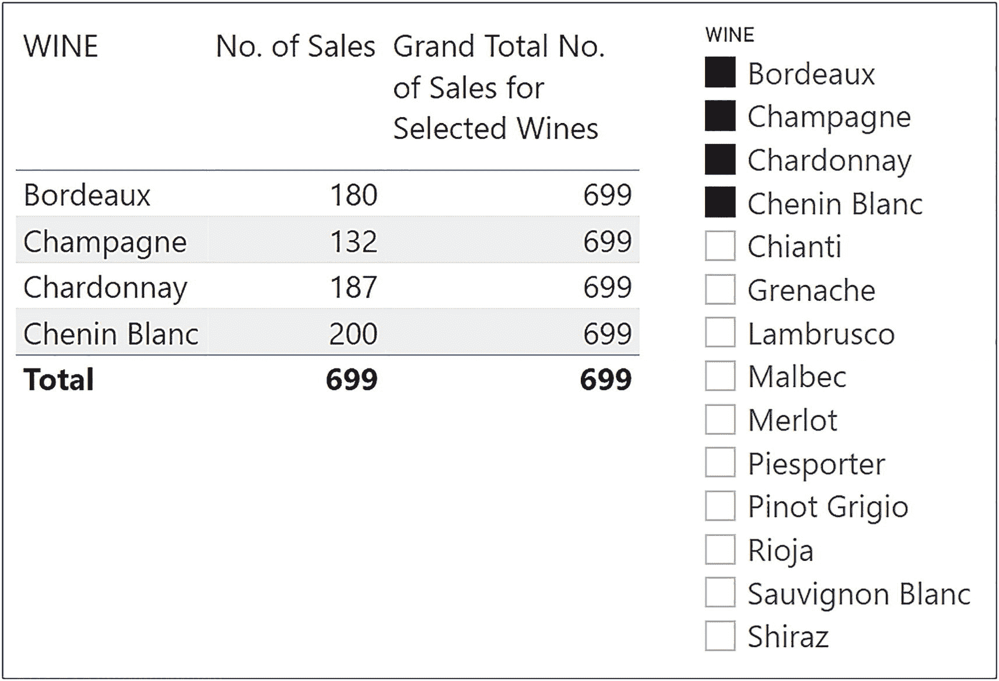

# 图 8-17

`ALLSELECTED` 函数计算出正确的总计

这个表达式是如何工作的呢？同样，让我们考虑此度量首次计算时的当前筛选上下文，即 `Wines` 维度中 `WINE` 列的“Bordeaux”。然而，`ALLSELECTED` 会用切片器中的筛选器替换 `WINES` 列上的筛选器。因此，`Wines` 维度会被筛选，以反映切片器的选择；见图 8-18。

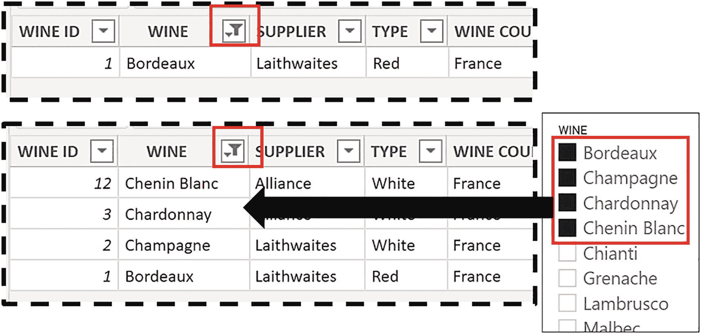

# 图 8-18

`ALLSELECTED` 函数替换筛选器以反映切片器的选择

大多数情况下，你可以用 `ALLSELECTED` 代替 `ALL`，因为你经常使用切片器或“筛选器”窗格来减少视觉对象中显示的项目。如果切片器或“筛选器”窗格没有进行任何选择，`ALLSELECTED` 将移除所有筛选器，就像 `ALL` 一样。

到目前为止，我们一直在使用 `ALL` 函数（及其变体），而没有考虑它是作为*表函数*使用，还是作为 `CALCULATE` 的*修改器*使用。这些“ALL”函数似乎都各司其职，我们对此心存感激。我们知道，`ALL` 可以通过从表和列中移除筛选器，或生成包含所有行的虚拟表来移除筛选器。然而，现在我们将重点关注 `ALL` 作为表函数与 `ALL` 作为 `CALCULATE` 修改器之间的区别。还记得我们在第 1 章中说过，使用 DAX 时，细节决定成败吗？理解 `ALL` 这两种行为之间的差异，正是关注细节的一个绝佳例子。

## ALL 作为 `CALCULATE` 的修饰符

要理解 `ALL` 的这一方面，让我们考虑之前见过的一个场景：在保留 `SUPPLIER` 列筛选条件的同时，移除 Wines 维度中 `WINE` 列的筛选条件（见图 8-11）。这是为了计算所选供应商的*销售数量*。

然而，这次我们将通过使用切片器对 `Wines` 表中相应筛选后的行进行计数，来计算"Alliance"供应的*葡萄酒种类数量*。为此，我们创建了两个相似的度量值，它们都对 Wines 维度中的 `WINE` 列使用了 `ALL` 函数：

```
No. of Wines #1 =
COUNTROWS ( ALL ( Wines[WINE] ) )
```

```
No. of Wines #2 =
CALCULATE ( COUNTROWS ( Wines ), ALL ( Wines[WINE] ) )
```

然而，只有一个度量值返回了正确的结果；见图 8-19。

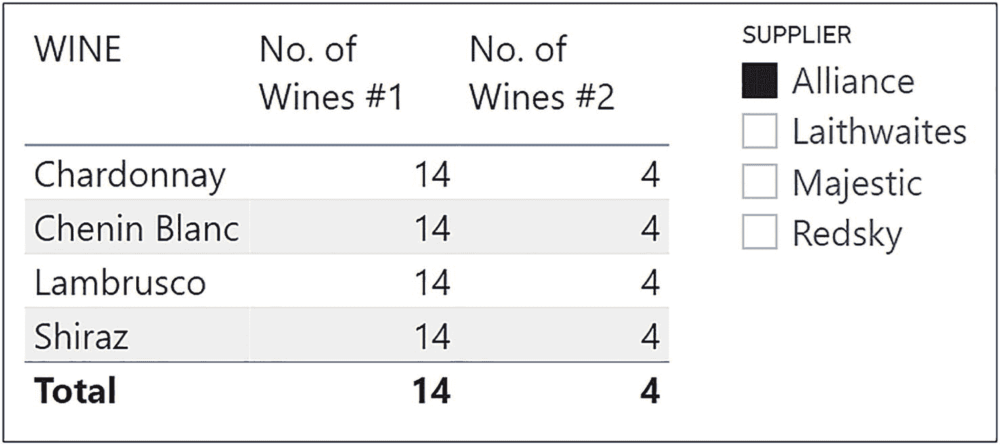

# 图 8-19 在列上使用 `ALL` 可能返回不同的结果

"No. of Wines #1"度量值将 `ALL` 作为*表函数*使用，生成了一个包含 `WINE` 列中*所有*不重复值的一列表格。然后该度量值计算这个虚拟表中的行数，返回 14 行，如图 8-20 所示。

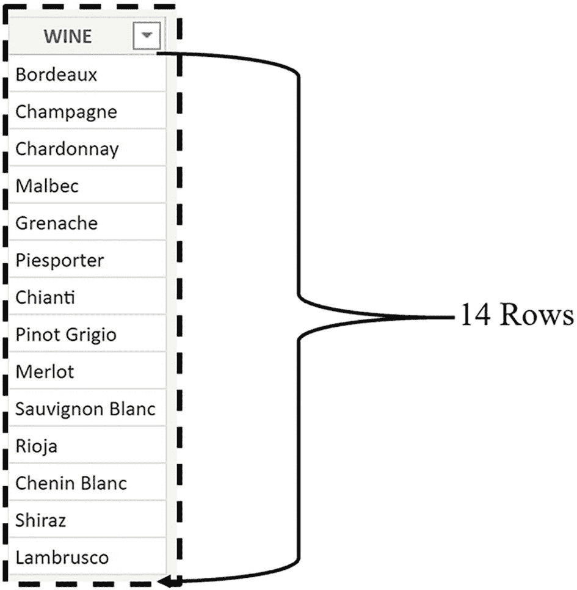

# 图 8-20 `ALL` 作为表函数生成一个包含不重复值的虚拟表

"No. of Wines #2"度量值在 `CALCULATE` 内部将 `ALL` 作为*修饰符*使用，因此*移除了* `WINES` 列的筛选条件，但保留了 `SUPPLIER` 列的筛选条件。然后该度量值计算 `Wines` 维度中的行数，返回 4 行；见图 8-21。

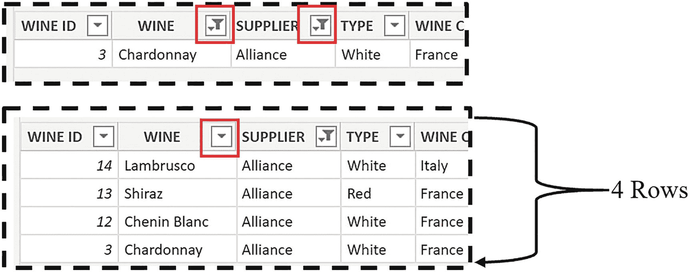

# 图 8-21 作为 `CALCULATE` 修饰符的 `ALL` 函数移除了 `WINE` 列上的筛选条件

这个例子解释起来很简单。然而，`ALL` 函数作为 `CALCULATE` 的修饰符可能更难理解，我们接下来要探讨的下一个例子正是如此。

我们构建了三个度量值，用于计算销售箱数大于 300 的销售数量。它们都使用了表达式 `ALL ( Winesales )`（灰色高亮部分），并且这些表达式看起来非常相似。因此你可能期望它们返回相同的结果：

```
No. of Sales Where Cases GT 300 #1 =
CALCULATE ( [No. of Sales],
ALL ( Winesales ),
Winesales[CASES SOLD] > 300
)
```

```
No. of Sales Where Cases GT 300 #2 =
CALCULATE (
[No. of Sales],
FILTER (
ALL ( Winesales ), Winesales[CASES SOLD] > 300 )
)
```

```
No. of Sales Where Cases GT 300 #3 =
CALCULATE (
[No. of Sales],
ALL ( Winesales ),
FILTER ( Winesales, Winesales[CASES SOLD] >300 )
)
```

然而，正如你在图 8-22 中所见，度量值#1 和#2 返回了相同的值，而度量值#3 却返回了一个不同的值。

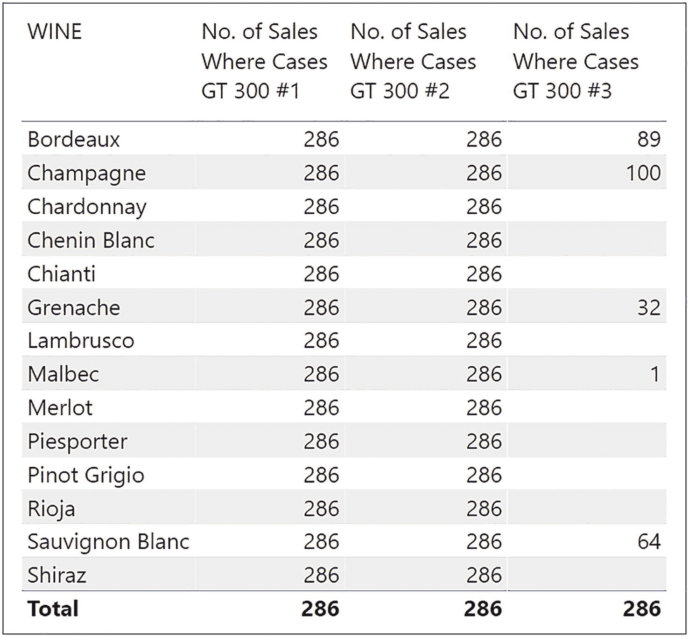

**图 8-22** 相似的表达式可能返回不同的结果

这三个度量值都在`Winesales`表上使用了`ALL`，因此它们应该忽略`Winesales`表上的任何筛选条件。这对于度量值#1 和#2 是成立的（在`Winesales`表中，`CASES SOLD`大于 300 的**有 286**行），但度量值#3 呢？在这个度量值中，`ALL`函数似乎被忽略了，而从 Wines 维度传播过来的交叉筛选得以保留。因此，这个度量值返回了*每个葡萄酒*中`CASES SOLD`大于 300 的销售数量。

**问题：** 这些度量值中哪一个与众不同？

你可能认为是度量值#3，因为它返回了不同的值。然而，你也可以认为度量值#2 与众不同，因为它是唯一一个将`ALL`用作*表函数*的度量值。在其他两个度量值中，`ALL`是作为`CALCULATE`的*修饰符*发挥作用的。

为了理解这一点，让我们更详细地看看每个度量值的计算过程。

在这个度量值中

```
No. of Sales Where Cases GT 300 #1 =
CALCULATE ( [No. of Sales],
ALL ( Winesales ), Winesales[CASES SOLD] > 350
)
```

`CALCULATE`中有两个筛选参数。第一个使用了`ALL`，它*修改*筛选条件以移除`Winesales`表上的筛选。这个首先被计算，产生一个空的筛选条件。第二个是对`CASES SOLD`列的*列筛选*，筛选出销售箱数大于 300 的行；见图 8-23。

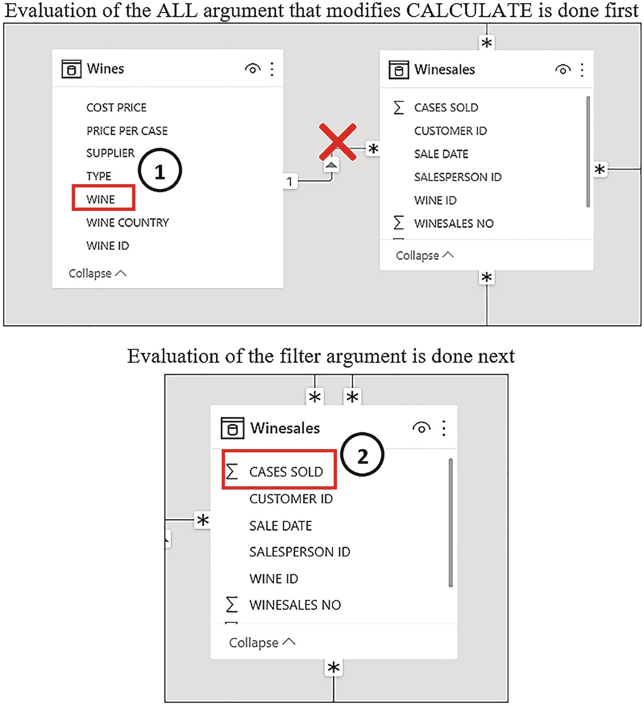

**图 8-23** "No. of Sales Where Cases GT 300 #1"的计算过程

1.  `ALL`作为`CALCULATE`的修饰符发挥作用，移除`Winesales`表上的任何筛选或交叉筛选，包括从`Wines`维度传来的筛选。这产生了一个空的筛选条件，因此，`Winesales`表现在没有任何筛选条件。

2.  然后在`Winesales`表的`CASES SOLD`列上放置一个新的筛选条件，以筛选出任何销售箱数大于 300 的销售记录。这是计算"No. of Sales"度量值的新筛选环境，并在此环境下对`Winesales`表的行进行计数。

在这个度量值中

```
No. of Sales Where Cases GT 300 #2 =
CALCULATE (
[No. of Sales],
FILTER (
ALL ( Winesales ), Winesales[CASES SOLD] >350 )
)
```

`CALCULATE`中只有一个由`FILTER`函数提供的筛选参数（灰色高亮部分）。在`FILTER`函数内部，`ALL`函数生成了一个包含`Winesales`表中所有行的虚拟表，因此移除了来自`Wines`维度的交叉筛选。`FILTER`函数遍历这个*虚拟表*，返回`CASES SOLD`大于 300 的行；见图 8-24。

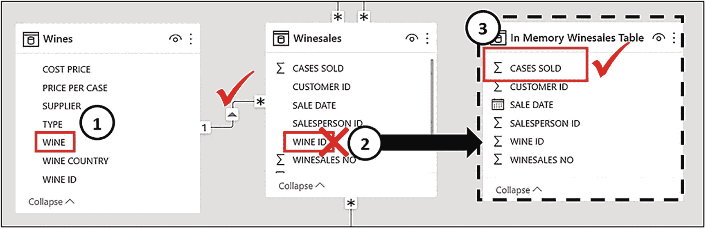

**图 8-24** "No. of Sales Where Cases GT 300 #2"的计算过程

1.  当前的筛选上下文筛选`Wines`维度中的每个`WINE`，并且这被交叉筛选到`Winesales`表。

2.  `FILTER`内部的`ALL`函数生成一个包含`Winesales`所有行的虚拟表，忽略了葡萄酒筛选条件。

3.  `FILTER`函数遍历虚拟的`Winesales`表，以筛选出`CASES SOLD`大于 300 的行。这是计算"No. of Sales"度量值的新筛选环境，并在此环境下对虚拟`Winesales`表的行进行计数。

这个度量值的结果与之前的#1 相同。然而，你可以理解，生成一个虚拟表比简单地在列上放置筛选条件效率更低。这里再次举例说明了在`CALCULATE`内部使用表筛选时需要付出高昂的处理代价（之前在学习`FILTER`函数时我们已经看过这一点）。

在这个度量值中

```
No. of Sales Where Cases GT 300 #3 =
CALCULATE (
[No. of Sales],
ALL ( Winesales ),
FILTER ( Winesales, Winesales[CASES SOLD] >300 )
)
```

`CALCULATE`内部有两个筛选参数。第一个，*`ALL ( Winesales )`*，是一个`CALCULATE`修饰符。第二个，*`FILTER ( Winesales, Winesales[CASES SOLD] > 300 )`*，是一个表筛选。我们需要理解，`CALCULATE`修饰符在任何其他筛选参数之前被计算。让我们来看第一个参数，它*修改*筛选上下文以移除`Winesales`表上的筛选。这个首先被计算，并创建一个空的筛选条件，因为`Winesales`表上的所有筛选都已被移除。

第二个筛选器使用`FILTER`函数创建一个虚拟的`Winesales`表。但`FILTER`生成的虚拟`Winesales`表中哪些行被过滤了？我们要求`FILTER`筛选出`CASES SOLD`大于 300 的行。然而，请记住我们对`FILTER`函数的了解。此函数仅筛选*当前筛选上下文*中的行。因此，`FILTER`生成的表仍然包含*每种酒*的行（例如，第一次评估中仅包含“Bordeaux”的行），然后这些行被进一步筛选，仅保留`CASES SOLD`大于 350 的行；参见图 8-25。

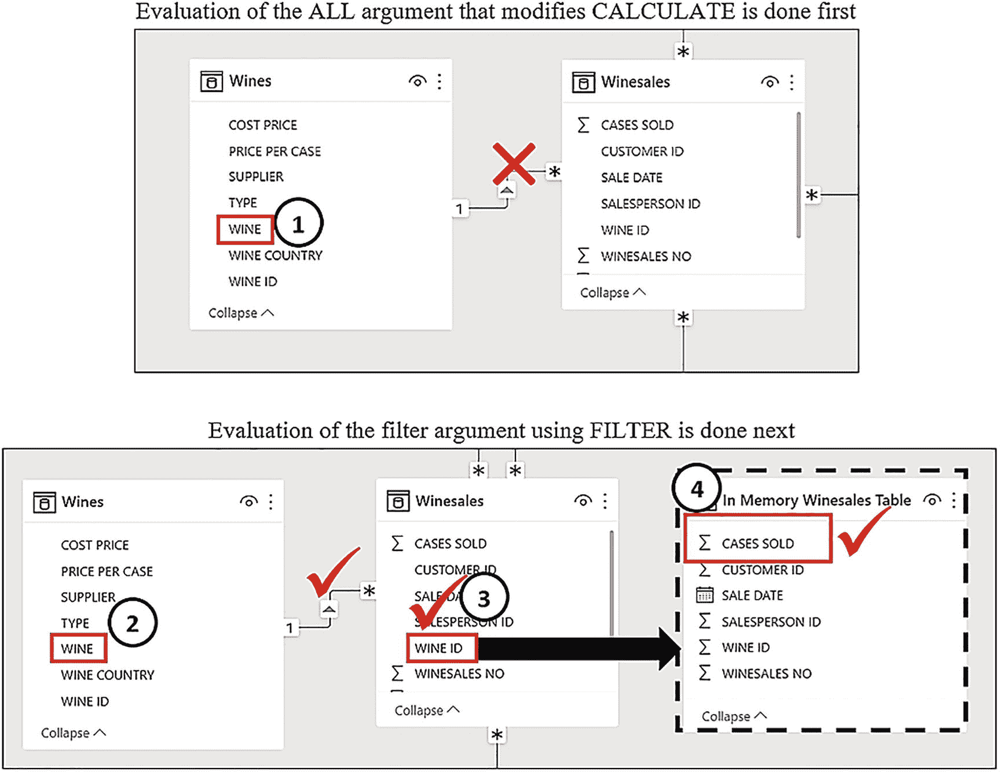

**图 8-25** “箱数大于 300 的销售数量 #3”的评估过程

1. 第一个参数使用`ALL`作为修饰符，移除`Winesales`表上的筛选器。此步骤首先被评估，现在`Winesales`表上有一个空的筛选器。

2. 使用`FILTER`的筛选参数现在被单独评估。`Wines`维度与`Winesales`事实表进行交叉筛选，从而筛选每种酒。

3. `FILTER`函数遍历当前筛选上下文中的`Winesales`表，并生成一个包含例如“Bordeaux”酒行的虚拟表。

4. 然后，它进一步筛选这些行，仅保留该酒中`CASES SOLD`大于 300 的行。由于使用`ALL`的第一个参数已生成空筛选器，这就是评估“销售数量”度量的新筛选上下文，并且虚拟`Winesales`表中的行将被计数。

现在让我们总结一下对`ALL`的了解。`ALL`函数作为*表*函数，会生成一个包含表的所有行或列（或列组）的所有非重复行的虚拟表。这个包含所有行的虚拟表可以被`FILTER`*重新筛选*，然后这将像之前的度量#2 一样，通过模型传播筛选器。

`ALL`函数作为`CALCULATE`的修饰符，在`CALCULATE`内部的任何筛选参数之前被评估。`ALL`作为修饰符会*移除*表或列上的任何筛选器，并生成一个空的筛选器。然后，`CALCULATE`的其他筛选参数被评估，并像之前的度量#1 和#3 一样生成新的筛选上下文。

由于`ALL`作为`CALCULATE`的顶级参数时行为不同，用户认为在这种情况下它应该有一个不同的名称。因此，在 2019 年，DAX 函数库中引入了新函数`REMOVEFILTERS`。此函数与`ALL`同义，但它只能用作`CALCULATE`的修饰符，而不能像`ALL`那样用作表表达式。

本章我们探讨了`ALL`、`ALLEXCEPT`和`ALLSELECTED`函数，这些函数难以掌握。无论你使用 DAX 有多久，此处描述的示例始终难以理解，但只有通过仔细思考这些度量的评估过程，密切关注细节，我们才能真正理解 DAX 的工作原理。

在介绍了`ALL`及其变体后，我们现在可以继续研究一组称为时间智能函数的函数，有趣的是，在这些函数中，`ALL`函数基本上已经变得多余。

脚注 1
