# 9. 日期计算：使用 DAX 时间智能

你是否曾想将本月的销售额与上个月的销售额进行比较？或者更复杂一些，例如累计总和，甚至滚动月平均值？如果答案是肯定的（而且你很可能需要），那么像这样使用日期数据的计算需要使用一组称为“时间智能”函数的 DAX 函数。本章的重点是探索这些函数，你将学习如何设计表达式，以便评估不同时间粒度（如财年、季度、月份，甚至日粒度）的数据。通过这样做，你将能够比较和对比这些时间段内的计算，从而深入理解对你至关重要的数据，例如随时间变化的趋势和模式。

> **注意**：术语“时间智能”有点误导性。这些不是时间智能函数，而是日期智能函数，因此这些函数不会帮助你进行关于小时、分钟或秒的计算，尽管我们可以借助时间维度来进行这些计算。

使用时间智能函数的起点是创建日期维度。这是因为大多数时间智能函数设计为与日期表一起工作，并将其作为数据模型的组成部分。你可能觉得你的数据模型不需要日期维度，但那样你将很难创建所需的基于日期的计算，并且肯定无法享受到时间智能度量的好处。

然而，DAX 新手通常没有意识到日期计算的这一方面，因此他们的模型中就没有日期维度。如果是这种情况，Power BI 将通过生成内置的日期层次结构来帮助你进行日期分析，我们将首先探讨这一点。

## Power BI 日期层次结构

如果模型中缺少日期维度，但任何表中存在日期数据类型的列，那么对于这些列中的每一列，Power BI 都会为你生成一个内存中的日期表，该表还包含一个日期层次结构。我们从数据模型中移除了`DateTable`维度，因此`SALE DATE`列现在以日期层次结构的形式表示，如图 9-1 所示。

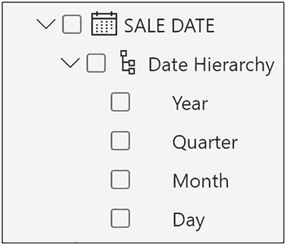

**图 9-1** 带有 Power BI 生成的日期层次结构的日期类型列

此功能称为“自动日期/时间”，但你可以在**选项**窗格（如图 9-2 所示）中全局或仅为当前文件关闭此行为。

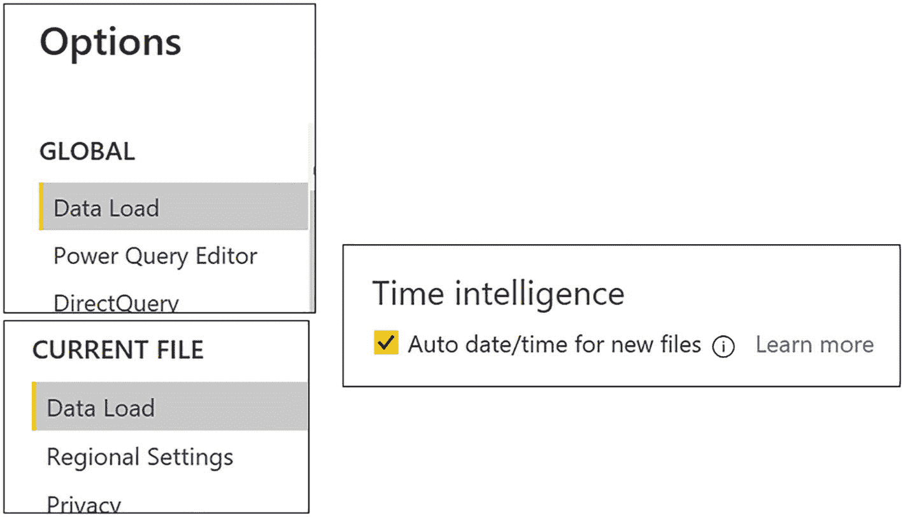

**图 9-2** 你可以使用选项窗格关闭日期层次结构的生成

如果开启了“自动日期/时间”功能且模型中缺少日期维度，任何日期数据类型的字段都将被组织到层次结构中。这些内置的日期层次结构在放入 Power BI 视觉对象时，有助于深入挖掘不同的日期粒度，并且还可以按年、季度、月和天进行切片。例如，在图 9-3 中，我们在 Power BI 折线图中使用`SALE DATE`层次结构深入查看月份粒度，并按年份进行切片。

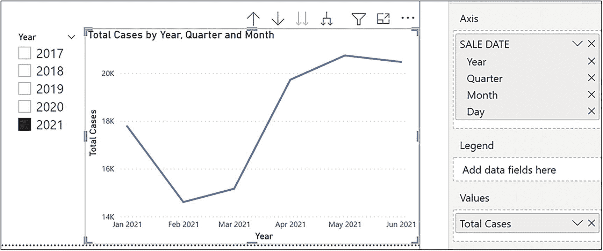

**图 9-3** 使用内置日期层次结构可视化日期数据

然而，使用这些层次结构存在许多缺点：

*   如果你的会计年度不是从一月开始怎么办？
*   如果你想按周粒度分析销售额怎么办？如何添加周数？
*   如果你想在簇状柱形图中比较 2020 年和 2021 年的销售额怎么办？

所有上述问题对于使用内置日期层次结构来说都是真正的挑战，但如果你在模型中有一个日期表维度，那么就日期计算而言，生活将变得轻松得多。因此，第一步是生成你的日期维度表并将其集成到你的数据模型中。

## 创建日期表

要生成日期表，你可以使用 DAX 或 Power Query，详情请参考以下两个链接：

[`www.sqlbi.com/articles/creating-a-simple-date-table-in-dax/`](http://www.sqlbi.com/articles/creating-a-simple-date-table-in-dax/)

[`https://exceleratorbi.com.au/build-reusable-calendar-table-power-query/`](https://exceleratorbi.com.au/build-reusable-calendar-table-power-query/)

如果上述两种方法都不适用，你也可以使用 Excel 来创建日期表。

日期表中唯一必需的列，是包含一系列连续日期的列，该序列必须涵盖数据时间范围内的*所有日期*。例如，我们的葡萄酒销售数据从 2017 年 1 月开始，到 2021 年 12 月结束；因此，我们的日期表包含一个 `DATEKEY` 列，其值从 2017 年 1 月 1 日开始，到 2021 年 12 月 31 日（我们财年的结束日期）结束。即使某些特定日期没有数据，也必须包含这些年份的所有日期。日期表中的其他列用于对这些日期进行分组和分类，这些列完全是可选的。然而，通常的做法是设置财年和季度的列，以及包含月份名称和月份编号的月份列。你也可以加入不同的财年和周数。若要按月份进行分析，则需要同时包含月份名称*和*月份编号。这样做可以正确地对月份名称进行排序，并且某些度量值会需要同时引用月份名称和编号。

现在，我们已经将 `DateTable` 重新放回数据模型中。可以看到，`DateTable` 通过 `SALE DATE` 和 `DATEKEY` 列与事实表相关联，如图 9-4 所示。

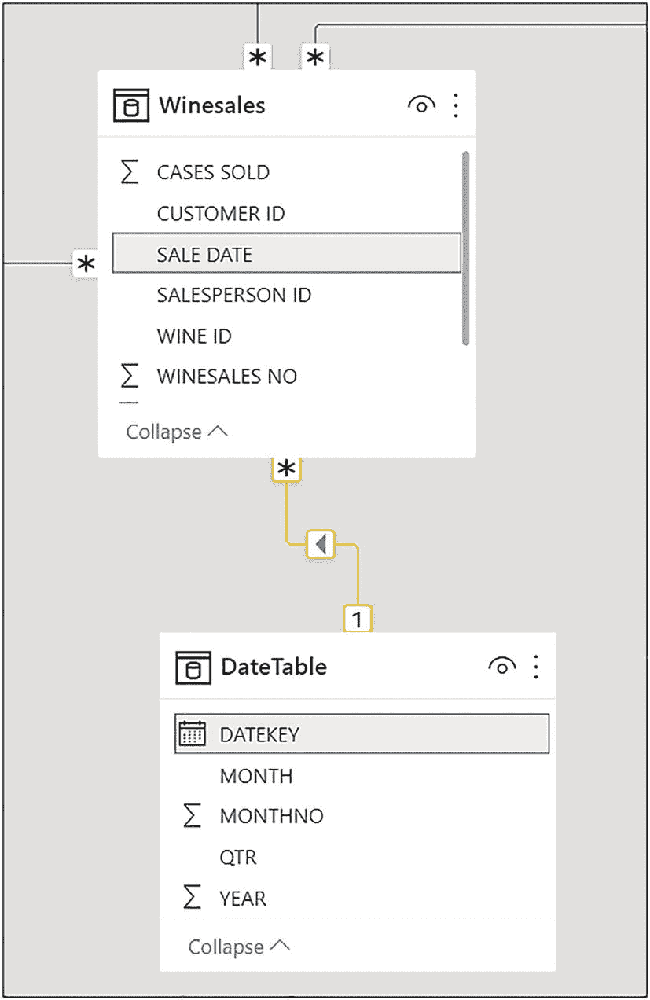

**图 9-4** `DateTable` 通过 `DATEKEY` 列与 `Winesales` 事实表相关联

> **注意**：通常，我们会使用日期表中包含唯一日期列表的列作为链接字段或主键，但如果需要，也可以使用日期表中的其他唯一字段作为链接字段。但是，无论是否使用该字段链接事实表，日期表中都必须包含一个包含连续日期列表的列。

关于日期表的下一个要求是确保模型“知道”这是你的日期维度。如果你没有使用包含唯一日期列表的字段作为日期表的主键，这一点尤其重要。通过从**表工具**选项卡中选择**标记为日期表**选项，将日期维度标记为日期表即可实现此目的。然后，在“日期列”下拉列表中，选择日期表中包含唯一日期列表的列，如图 9-5 所示。

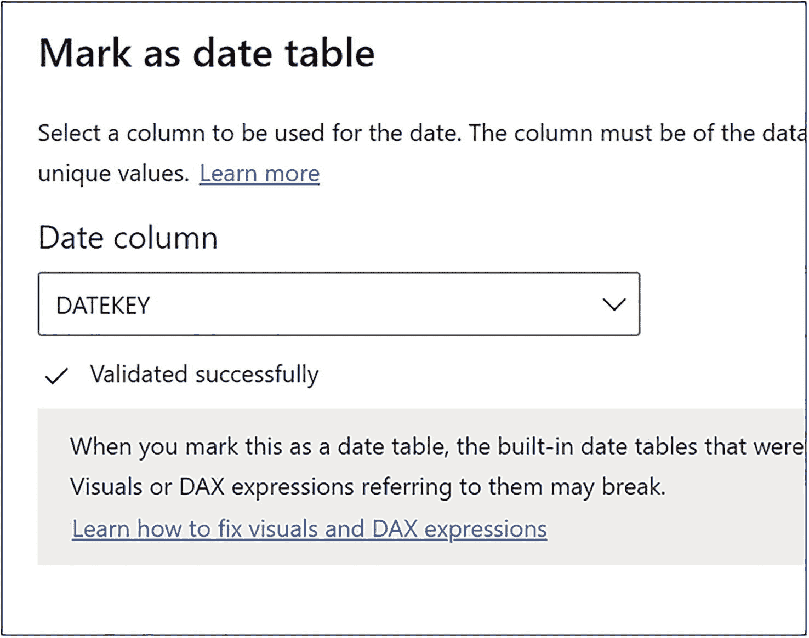

**图 9-5** 使用**标记为日期表**选项来确保日期维度的完整性

> **注意**：关于“标记为日期表”要求的更多信息，请参见此处：[`https://www.sqlbi.com/articles/mark-as-date-table/`](https://www.sqlbi.com/articles/mark-as-date-table/)

数据维度设置的最后一步是正确地对月份名称进行排序。在图 9-6 中，我们使用了**列工具**选项卡中的**按列排序**按钮，按“月份编号”对“月份”进行排序。

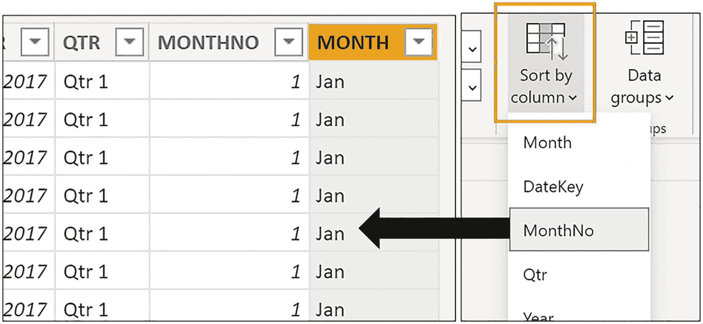

**图 9-6** 使用**按列排序**选项对月份名称进行排序

现在，我们已经生成了日期维度，就可以利用 DAX 中的时间智能函数，以多种富有洞察力的方式跨年、季度、月和日分析数据，从而受益。

## 使用时间智能函数

时间智能函数使用一个*基准日期*来执行所需的计算。这个基准日期由当前的筛选上下文提供。例如，“上个月”和“去年同期”是相对术语，即相对于当前筛选上下文中的日期而言。因此，在使用大多数这类函数时，必须通过切片器、筛选器窗格或在视觉对象中包含日期来筛选出一个特定日期（某年、某季度、某月或某天）。例如，如果你想查找上个月的销售额，则必须在视觉对象或切片器中筛选出当前月份；参见图 9-7。

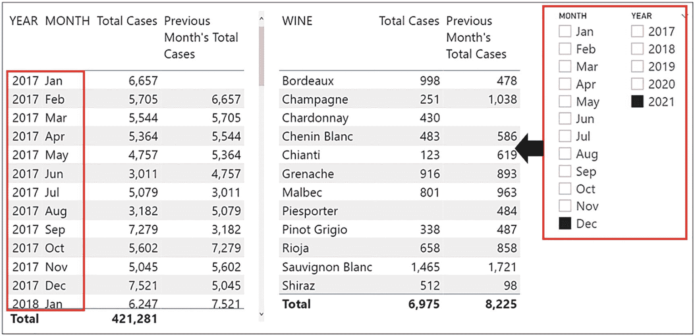

**图 9-7** “基准日期”由筛选上下文提供，该上下文可以通过视觉对象中的列或年份和月份切片器来实现

所有时间智能函数（`LASTNONBLANK` 和 `LASTNONBLANKVALUE` 除外）都有一个参数，要求指定用于计算的日期列。大多数情况下，在此参数中，你需要提供日期表中包含唯一日期列表的列的名称，例如我们数据中的 `DATEKEY` 列；参见图 9-8。

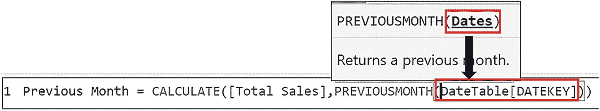

**图 9-8** “Dates”参数通常需要引用包含唯一日期列表的列

> **注意**：这里有一个例外。在 `LASTDATE` 和 `FIRSTDATE` 函数中，你可能需要引用事实表中的日期列。

对于你使用时间智能函数构建的每个 DAX 表达式，都可以使用 `CALCULATE`、`FILTER`、`MAX` 和 `MIN` 等标准 DAX 函数编写等效的表达式。但是，如果是这种情况，你还需要一个函数，那就是 `ALL` 函数。例如，在当前筛选上下文筛选的是六月的日期时，要查找五月的日期，你必须使用 `ALL` 函数移除日期表中当前对六月的筛选，以便可以重新筛选出五月的日期。通过使用时间智能函数并引用日期表的“Dates”列，`ALL` 函数的功能就被隐式地包含了。这就是为什么在使用时间智能函数时，不需要先使用 `ALL` 移除筛选，然后再重新应用特定筛选的原因。

我们将在本章中探讨的时间智能函数列于表 9-1 中。返回值通常是一个包含单列日期的虚拟表。返回到此列中的日期也显示在表 9-1 中。

**表 9-1** 时间智能函数及其返回值

| 函数 | 返回的日期 |
| --- | --- |

# DAX时间智能函数

| `PREVIOUSMONTH` | 当前筛选上下文中的月份的上一个月份。 |
| --- | --- |
| `SAMEPERIODLASTYEAR` | 当前筛选上下文中的月份的去年同期。 |
| `DATEADD` | 当前筛选上下文之前（或之后）的年份、季度、月份或天数。 |
| `DATESYTD` | 从年初到当前筛选上下文中的日期。 |
| `DATESBETWEEN` | 两个日期之间的日期。 |
| `DATESINPERIOD` | 从某个日期开始，基于当前筛选上下文向前（或向后）推移任意数量的年份、季度、月份或天数。 |
| `LASTDATE` | 当前筛选上下文中的最后一个日期。 |
| `LASTNONBLANK` | 在当前筛选上下文中，表达式非空时列中的最后一个日期。 |
| `LASTNONBLANKVALUE` | 在当前筛选上下文中，表达式非空时列中的最后一个值。 |

通常，时间智能函数会生成一个虚拟的单列表，其中包含来自日期维度中 `DATEKEY` 列（或你为该列命名的任何名称）的筛选后的日期。此虚拟表作为 `CALCULATE` 函数内的表筛选器使用，用于筛选事实表中的日期。

DAX 时间智能函数要么是作为 `CALCULATE` 内部筛选参数嵌套的*表*函数，要么返回*标量*值。原因在于，如果表函数返回一个单列单行的表，DAX 引擎会将其转换为标量值；参见表 9-2。

**表 9-2**
显示“表”或“标量”函数，或两者兼具

| 表 | 表或标量 | 标量 |
| --- | --- | --- |
| `DATEADD`<br>`DATESBETWEEN`<br>`DATESINPERIOD`<br>`DATESYTD`<br>`PREVIOUSMONTH`<br>`SAMEPERIODLASTYEAR` | `LASTDATE`<br>`LASTNONBLANK` | `LASTNONBLANKVALUE` |

例如，可以按如下方式使用`LASTDATE`：

**用作标量**
```
LastDate Example #1 =
LASTDATE(Winesales[SALE DATE])
```

**用作`CALCULATE`内部的表筛选器**
```
LastDate Example #2 =
CALCULATE([Total Sales],LASTDATE(Winesales[SALE DATE]))
```

**用于在`CALCULATE`内部返回标量**
```
LastDate Example #3 =
CALCULATE(LASTDATE(Winesales[SALE DATE]),DateTable[YEAR]=2020)
```

现在让我们分析不同时间范围内的总病例数。您可以在图 9-9 中看到以下表达式的结果。请注意使用切片器来筛选计算表达式所依据的基准日期为 **2021 年 12 月**。

### 上个月/去年 – `PREVIOUSMONTH`/`PREVIOUSYEAR`

以下是分别计算上个月或去年值的 DAX 表达式：
```
Previous Month Total Cases =
CALCULATE ( [Total Cases],
PREVIOUSMONTH ( DateTable[DATEKEY] )
)
```
```
Previous Year Total Cases =
CALCULATE ( [Total Cases],
PREVIOUSYEAR ( DateTable[DATEKEY] )
)
```

`PREVIOUSYEAR`函数假定您的财务年度结束于 12 月 31 日。如果您使用不同的财务年度，您可以使用该函数的第二个参数来定义您的年末日期。为避免任何日期区域设置问题，请使用日期格式“YYYY-MM-DD”（该函数忽略年份，因此使用任何年份值）；例如，如果您的年末日期是 3 月 31 日，则度量值如下：
```
Year To Date Cases =
CALCULATE ( [Total Cases] ,
PREVIOUSYEAR ( DateTable[DATEKEY], "2021-03-31"
)
)
```

### 去年同期 – `SAMEPERIODLASTYEAR`

这是计算去年同一时期值的 DAX 表达式：
```
Same Period Last Year Cases =
CALCULATE ( [Total Cases],
SAMEPERIODLASTYEAR ( DateTable[DATEKEY] )
)
```

### 任意时间之前的值 – `DATEADD`

以下分别是计算 6 个月前和 30 天前值的 DAX 表达式：
```
6 Months Ago Cases =
CALCULATE ( [Total Cases],
DATEADD ( DateTable[DATEKEY], -6, MONTH )
)
```
```
30 Days Ago Cases =
CALCULATE ( [Total Cases] ,
DATEADD ( DateTable[DATEKEY], -30, DAY )
)
```

### 年初至今 – `DATESYTD`

此表达式将计算当前筛选上下文中年份的年初至今值：
```
Year To Date Cases =
CALCULATE ( [Total Cases] ,
DATESYTD ( DateTable[DATEKEY] )
)
```

`DATESYTD`函数与`PREVIOUSYEAR`类似，假定您的财务年度结束于 12 月，并且与`PREVIOUSYEAR`一样，您可以使用该函数的第二个参数来定义您的年末日期，使用格式“YYYY-MM-DD”以避免日期区域设置问题，如下所示：

图 9-9
时间智能计算
```
Year To Date Cases =
CALCULATE ( [Total Cases] ,
DATESYTD ( DateTable[DATEKEY], "2021-03-31")
)
```

借助时间智能函数，这些表达式的编写都变得直接了当。现在让我们继续探索一些更复杂的计算。

### 至今累计或累积总计

计算“Total Sales”度量的至今累计或累积总计的 DAX 度量值如下（参见图 9-10）：

图 9-10
累积销售总额
```
Cumulative Total =
CALCULATE ( [Total Sales] ,
DATESBETWEEN ( DateTable[DATEKEY], 0 ,
LASTDATE ( DateTable[DATEKEY] )
)
)
```

此表达式使用`DATESBETWEEN`函数，该函数返回介于开始日期和结束日期之间的日期表。

请注意，`DATESBETWEEN`函数的开始日期为零，这意味着开始日期将是日期列中的最早值，或者您可以使用`BLANK()`函数（我们将在下一章中了解此函数）。结束日期由`LASTDATE`函数找到，该函数在当前筛选上下文中查找最后一个日期。这将是表格可视化中任何行的月份的最后一天，或切片器或筛选器窗格中筛选的月份的最后一天。

### 滚动年度总计和平均值

要计算滚动年度总计和平均值，您必须使用两个函数：`DATESINPERIOD`和`LASTDATE`。我们先计算滚动年度总计：
```
Rolling Annual Total Sales =
CALCULATE ( [Total Sales],
DATESINPERIOD ( DateTable[DATEKEY],
LASTDATE ( DateTable[DATEKEY] ) , -1 , YEAR ) )
```

此度量值中的`LASTDATE`函数在当前筛选上下文中查找最后一个日期（即表格可视化中任何行、切片器或筛选器窗格中的月份的最后一天）。`DATESINPERIOD`函数从该最后日期开始，往回推一年，计算总销售额。

现在计算滚动年度平均值：
```
Rolling Annual Average Total Sales =
CALCULATE (
[Total Sales] / COUNTROWS ( VALUES ( DateTable[MONTH] ) ),
DATESINPERIOD (
DateTable[DATEKEY],
LASTDATE ( DateTable[DATEKEY] ),  -1,  YEAR
)
)
```

滚动年度平均值的表达式与滚动年度总计的表达式大致相同。但是，我们需要找出每个滚动年度的月平均总计。如果我们将“Total Sales”度量值除以 12，这在*第一年*中是不正确的，因为在 1 月，只有一个月在滚动；在 2 月，只有两个月在滚动；在 3 月，只有三个月；等等。这就是为什么我们需要使用`COUNTROWS`和`VALUES`函数来计算分母中正确的滚动月数，而不是简单地除以 12。这些度量值的结果如图 9-11 所示。

图 9-11
滚动年度及平均销售额

我们将在本书后面介绍`VALUES`函数，因此在此阶段，只需说明该函数会生成一个虚拟表，该表仅包含日期维度中`MONTH`列中在`DATESINPERIOD`表达式生成的筛选上下文中可见的值。`COUNTROWS`函数计算该虚拟表中的行数，从而在我们的数据第一年中给出正确的累计月数。

### 计算最后交易日期与最后交易值

如果你想要查找有数据的第一个或最后一个日期，例如“总销售额”度量值有值的最后日期，你可以使用`FIRSTNONBLANK`和`LASTNONBLANK`函数，如下所示：

```
Date of Last Transaction =
LASTNONBLANK ( DateTable[DATEKEY], [Total Sales] )
```

```
Date of First Transaction =
FIRSTNONBLANK ( DateTable[DATEKEY], [Total Sales] )
```

然后，你可以通过`LASTNONBLANKVALUE`和`FIRSTNONBLANKVALUE`函数查找这些日期的总销售额值；请参见图 9-12。

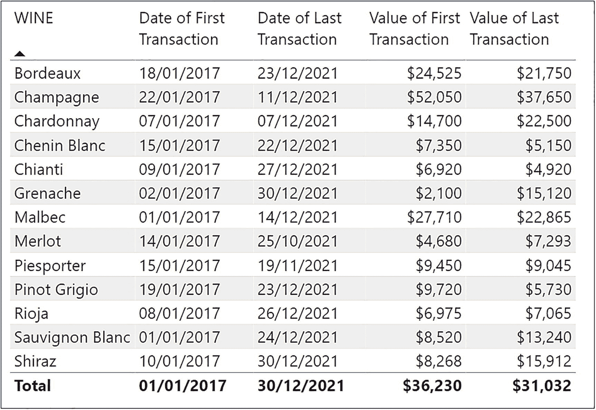

**图 9-12** - 计算首次和末次交易日期及数值

```
Value of First Transaction =
FIRSTNONBLANKVALUE ( DateTable[DATEKEY], [Total Sales] )
```

```
Value of Last Transaction =
LASTNONBLANKVALUE ( DateTable[DATEKEY], [Total Sales] )
```

`LASTNONBLANK`和`LASTNONBLANKVALUE`函数可以有更具创造性的用法。也许你需要计算上一笔交易的日期，或者希望找到连续销售之间的差额，如图 9-13 所示。

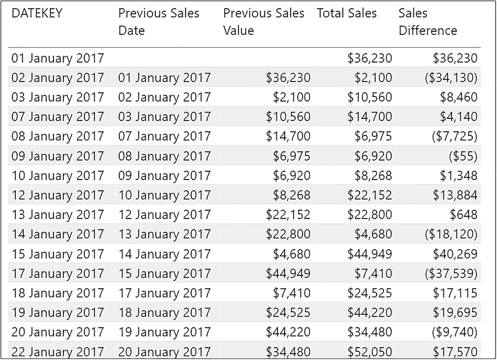

**图 9-13** - 计算连续交易之间的值差异

以下是用于完成这些任务的表达式：

```
Previous Sales Date =
CALCULATE (
LASTNONBLANK ( DateTable[DATEKEY],[Total Sales] ),
DateTable[DATEKEY] < MAX (DateTable[DATEKEY] )
)
```

```
Previous Sales Value =
CALCULATE (
LASTNONBLANKVALUE ( DateTable[DATEKEY], [Total Sales] ),
DateTable[DATEKEY] < MAX ( DateTable[DATEKEY] )
)
```

```
Sales Difference =
[Total Sales] - [Previous Sales Value]
```

由于我们在图 9-13 的表格视觉对象中使用了日期维度中的`DATEKEY`列，因此使用`LASTNONBLANK`和`LASTNONBLANKVALUE`的表达式将针对该列中的*每个*日期进行计算，无论该日期在`Winesales`表中是否有交易。然后，当你在表格视觉对象中填充“总销售额”度量值时，对于没有交易的日期，你将看到空白值。要解决此问题，请使用视觉级过滤器，并过滤“总销售额”度量值以排除空白值。

计算这些表达式的重要因素是使用`CALCULATE`来修改评估`LASTNONBLANK`和`LASTNONBLANKVALUE`的筛选上下文。表达式`MAX (DateTable[DATEKEY])`返回当前筛选上下文中的日期值，例如**2017 年 1 月 7 日**；请参见图 9-14。`MAX`函数用于返回一个标量值。由于当前筛选上下文中只有一个日期，我们同样可以使用`MIN`或`SUM`。因此，`CALCULATE`的筛选参数的含义是“查找`DateTable`表的`DATEKEY`列中，早于`MAX (DateTable[DATEKEY])`返回的日期，但前提是该日期有销售值且不为空。”`LASTNONBLANK`函数返回此日期，即**2017 年 1 月 3 日**。`LASTNONBLANKVALUE`函数返回与此日期关联的销售值，**$10,560**。

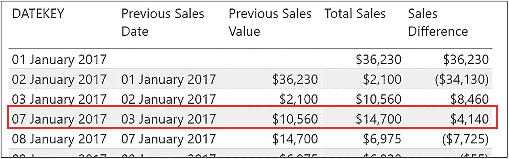

**图 9-14** - 聚焦于`LASTNONBLANK`和`LASTNONBLANKVALUE`表达式的计算

然后，我们可以简单地从“总销售额”度量值中减去“上一笔销售值”度量值。

### 查找两个日期之间的差异

在 DAX 中查找两个日期之间的天数差异，其方式与 Excel 类似；只需将一个日期减去另一个日期。但是，在 DAX 中，你必须将日期嵌套在`INT`函数中，才能返回天数值，而不是返回一个日期：

```
Days Difference =
INT ( [Date of Last Transaction] ) - INT ( [Date of First Transaction] )
```

DAX 还具有与 Excel 中相同的`DATEDIFF`函数，用于查找周、月、年等之间的差异（请参见图 9-15）。

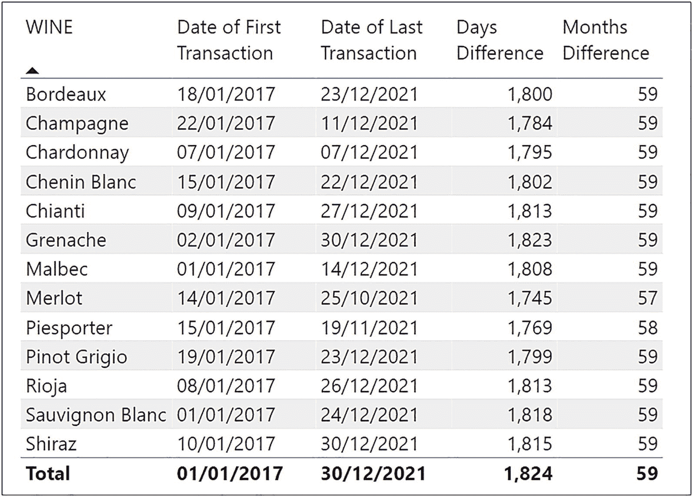

**图 9-15** - 计算两个日期之间的天数和月数

```
Months Difference =
DATEDIFF ( [Date of First Transaction], [Date of Last Transaction], MONTH )
```

希望我们对一些更常用的 DAX 时间智能函数的初步探索，能激发你对日期计算的兴趣。当然，还有许多其他时间智能函数我们在这里没有探讨，但你可能在数据分析中发现它们很有用，那么何不自己多探索一些这些有价值的 DAX 函数呢。你可以在此处找到所有函数：

[`https://docs.microsoft.com/en-us/dax/time-intelligence-functions-dax`](https://docs.microsoft.com/en-us/dax/time-intelligence-functions-dax)
