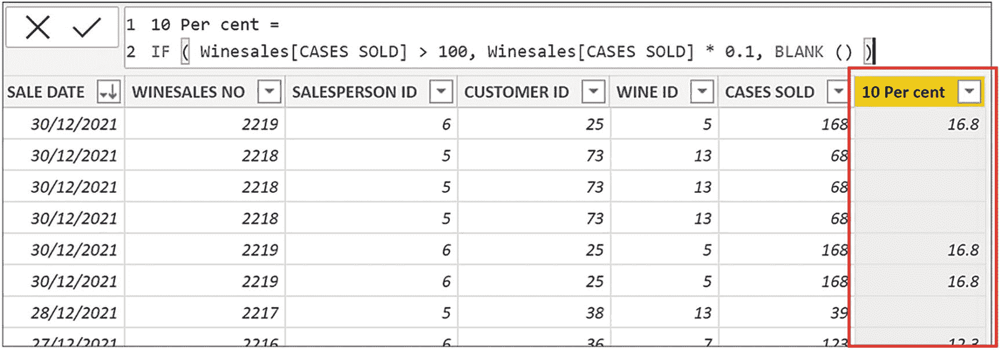
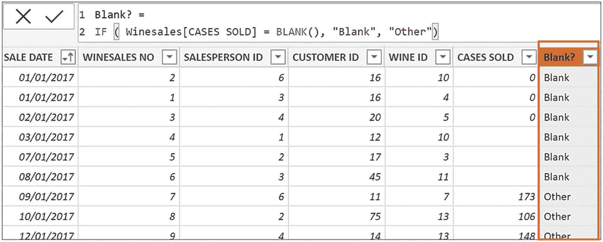
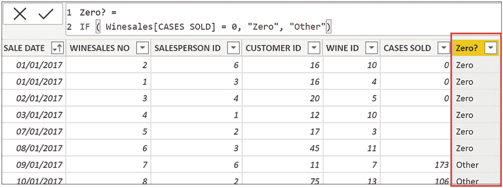
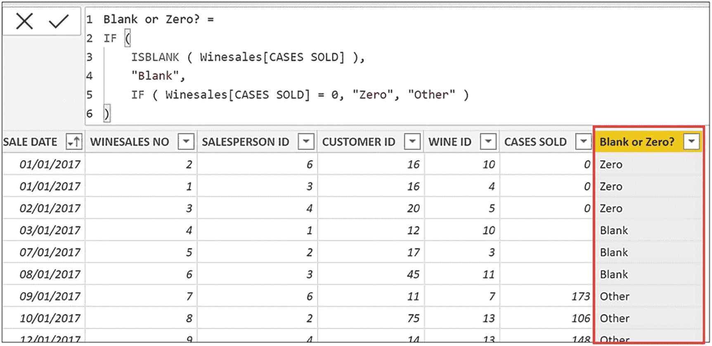
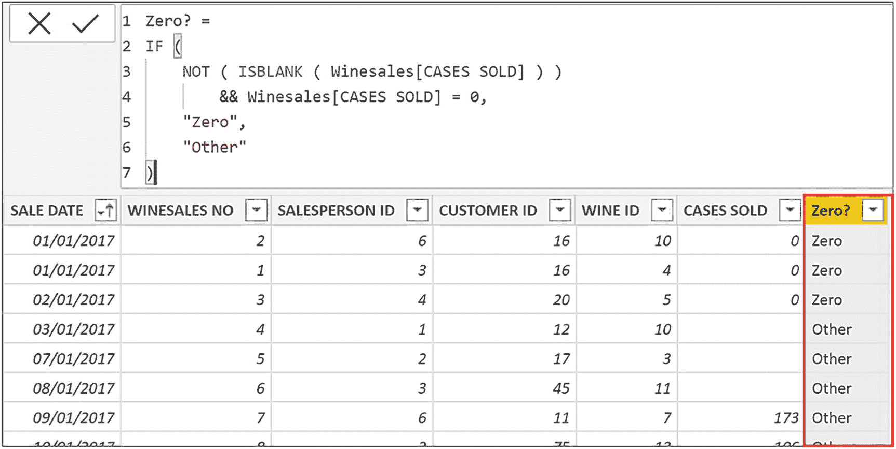
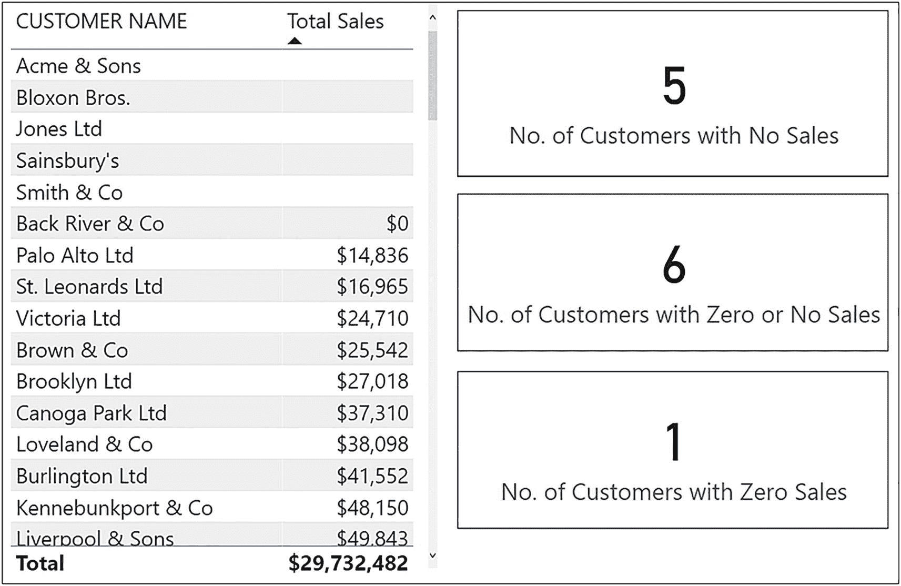
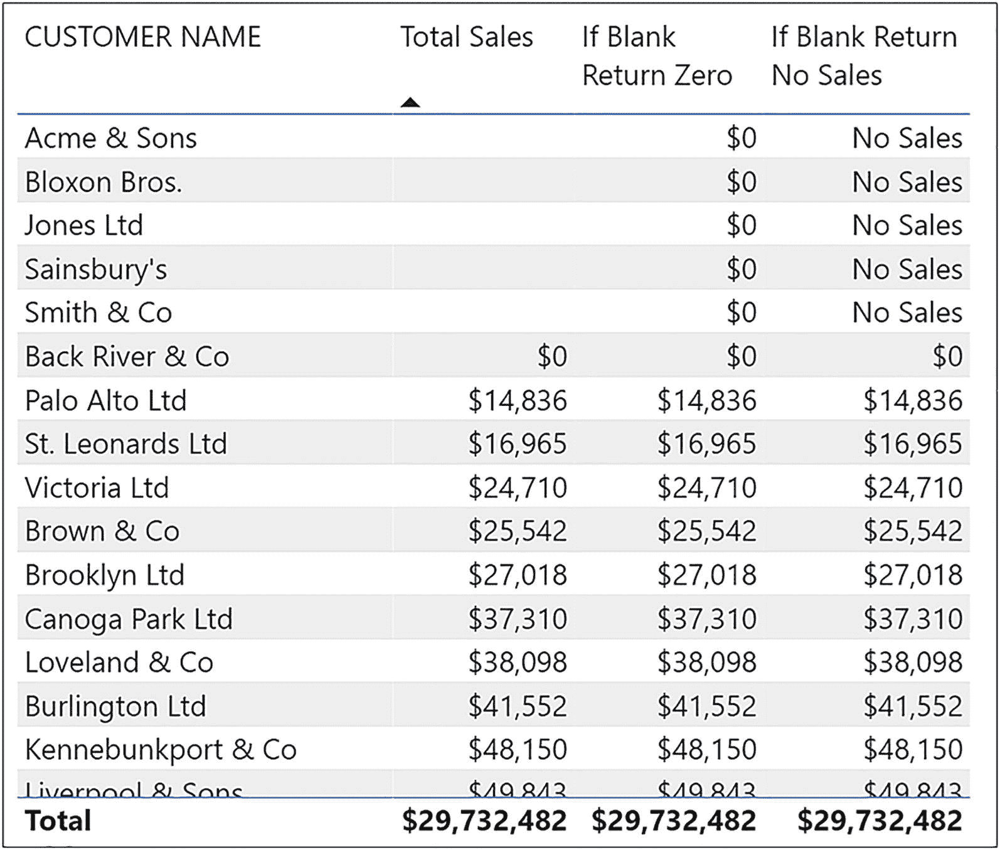

# 10. 空值与零

在本章中，我们将探讨一个非常具体的 DAX 行为，即 DAX 如何处理空值、缺失值和 null 值。^( 10  )

**注意**

我们将在*计算列*的上下文中研究此行为，并且主要创建仅在此上下文中有效的表达式。但是，你必须理解，空值、缺失值和 null 值在 DAX *度量值*上下文中的行为完全相同，本章末尾的示例将对此进行说明。

## `BLANK()` 函数

在 DAX 中，有一种特殊的方法来标识 null 或空值，那就是使用一个称为“blank”的值。要返回空白值，我们可以使用 `BLANK()` 函数，如下所示，该函数在 `Winesales` 表中创建的一个计算列中使用（图 10-1）：



**图 10-1** - 使用 `BLANK()` 函数返回空白值

```
10 Percent =
IF ( Winesales[CASES SOLD] > 100,
Winesales[CASES SOLD] * 0.1, BLANK () )
```

当使用 `IF` 构造 DAX 表达式时，如果你想要在“值为假”参数时返回 `BLANK()`，你可以直接闭合括号，因为如果参数中未提供任何值，`BLANK()` 是默认值。所以我们可以将前面的表达式重写为：

```
10 Percent =
IF ( Winesales[CASES SOLD] > 100,
Winesales[CASES SOLD] * 0.1 )
```

我们可以像下面的计算列中那样测试 null 或空白值：

**注意**

在示例 `.pbix` 文件中，按 `SALE DATE` 升序对 `Winesales` 表进行排序，以查看 `CASES SOLD` 列中的空白和零值。

```
Blank? =
IF ( Winesales[CASES SOLD] = BLANK(), "空白", "其他")
```

请注意，对 `BLANK()` 的测试包括 **0**（零），所以我们永远不会对零得到“其他”（图 10-2）。



**图 10-2** - 测试空白包括零值

然而，令人惊讶的是，反过来也是如此，因此在下面的计算列中，对 **0** 的测试包括空白值，所以我们再次不会对空白值得到“其他”（参见图 10-3）：



**图 10-3** - 测试零值包括空白

```
Zero? =
IF ( Winesales[CASES SOLD] = 0, "零", "其他")
```

因此，我们可以看到，当在 `IF` 函数的谓词中使用时，DAX 将 `BLANK()` 和 **0**（零）视为相同的值，如前两个示例所示。


## ISBLANK 函数

如果你想区分 `0` 和空值，应该怎么做？你可以使用一个 DAX 函数，它会“剔除”空值，将其与 `0` 区分开来。这个函数就是 `ISBLANK`，它在以下计算列中使用（如图 10-4 所示）：



图 10-4：使用 ISBLANK 函数检测空值，而非零值

```
是空值还是零？ =
IF (
ISBLANK ( Winesales[CASES SOLD] ),
"空值",
IF ( Winesales[CASES SOLD] = 0, "零", "其他" )
)
```

使用 `ISBLANK` 后，对于零值，我们现在会返回 `"零"`；对于空值，返回 `"空值"`；其他任何值则返回 `"其他"`。

## 检测零值

如果你只想找出 `0`，可以使用这个计算列（如图 10-5 所示）：



图 10-5：检测零值

```
是零吗？ =
IF (
NOT ( ISBLANK ( Winesales[CASES SOLD] ) )
&& Winesales[CASES SOLD] = 0,
"零",
"其他"
)
```

现在，我们仅在适当的条件下看到 `"零"`。

## 使用度量值查找空值和零值

你也可以在 `ISBLANK` 内部使用度量值。例如，要找出有多少客户*没有*销售额，而不是 `0`（零）销售额，可以使用以下 DAX 表达式：

```
无销售额的客户数 =
COUNTROWS ( FILTER ( Customers, ISBLANK ( [总销售额] ) ) )
```

而以下表达式会找出销售额为零*或*无销售额的客户数量：

```
销售额为零或无销售额的客户数 =
COUNTROWS ( FILTER ( Customers, [总销售额] = 0 ) )
```

以下表达式会找出销售额为零的客户数量：

```
销售额为零的客户数 =
COUNTROWS (
FILTER ( Customers, NOT ( ISBLANK ( [总销售额] ) )
&& [总销售额] = 0 )
)
```

你可以在图 10-6 的卡片视觉对象中看到这些度量值的应用。要在表格视觉对象中查看无销售额的客户，请使用 `"显示没有数据的项目"` 选项。



图 10-6：无销售额和销售额为零的客户

因此，我们可以得出结论，使用以下表达式时必须谨慎：

`"= IF ( [表达式] = 0 )"`

因为它会将空值和零值都包含在内。

## 使用 COALESCE 函数

通常需要将空值替换为另一个值，例如零。以下表达式可以实现此结果：

```
若为空返回零 =
If ( ISBLANK ( [总销售额] ), 0, [总销售额] )
```

然而，在 2020 年 3 月，DAX 库中引入了一个新函数，那就是 `COALESCE` 函数，它为我们提供了更简洁的表达式，如下面两个例子所示：

```
若为空返回零 =
COALESCE([总销售额],0)
```

```
若为空返回无销售额 =
COALESCE([总销售额],"无销售额")
```

该函数的第一个参数是你要查找空值的表达式，例如 `"总销售额"` 度量值。第二个参数是当表达式为空时，你希望返回的值，例如 `0` 或 `"无销售额"`，请参见图 10-7。



图 10-7：使用 COALESCE 函数将空值替换为指定值

在本章中，你已经了解到，除非你在表达式中特别使用 `ISBLANK` 函数来区分这两者，否则 DAX 将空值和零值视为相同。本章也是你在使用 DAX 中一些较难的部分（如使用 `ALL` 计算百分比和使用时间智能计算滚动平均值）学习数据分析的艰辛过程中的一次有益的“休整”。

在下一章中，我们将为接下来更复杂的表达式做好准备。你现在必须学习如何在代码中使用 DAX 变量，以便编写需要更高级 DAX 知识的度量值。

脚注 1

