# 11. 使用变量：让我们的代码更具可读性

到目前为止，我们在 DAX 代码中不使用变量也做得很好。实际上，变量在 DAX 语言中并非一直存在。它们是在 2015 年引入的，也就是 DAX 首次开发五年之后。在本章中，我们将详细阐述为什么在编写 DAX 表达式时变量如此有用，一旦你学会了如何使用它们，我们将在后续的表达式中（在适用的情况下）包含它们。^(¹¹)

在你的 DAX 表达式中使用变量，可以帮助你编写更复杂的计算，随着本书的深入，我们将开始着手处理这些计算。使用变量有三个主要优点：

1.  提高性能
2.  提高可读性
3.  降低复杂度

在本章中，我们将探讨在生成 DAX 代码时包含变量的这三个好处。我们还将研究变量的不可变性和常量的特性，以及它们何时可能是一种阻碍而非帮助。

要在代码中包含变量，请使用关键字 `VAR`，后跟变量名称，然后是变量的定义。然后在代码末尾使用关键字 `RETURN` 来返回要计算的表达式。例如：

```
示例度量值 =
VAR 我的变量 = SUM (Winesales[CASES SOLD])
RETURN
我的变量 * 1.1
```

变量声明通常在表达式的开头进行，其值在整个计算过程中保持不变。但是，你可以在表达式内部声明变量以限制其作用域。

变量既可以在度量值中使用，也可以在计算列中使用，以获取由以下各项生成的值：

-   表达式，例如 `SUM ( Winesales[CASES SOLD] )`
-   度量值，例如 `[总箱数]`
-   表，例如 `FILTER ( Winesales, Winesales[CASES SOLD] > 300 )`
-   值，例如 `0.1`、`10`、`20`

当变量在计算列中使用时，它们也可以获取列中生成的值。

变量名称不能包含空格，也不能使用保留字，例如 `"date"` 或 `"min"`。此外，合理的做法是变量名称不要与现有的表名或列名相同。有些人喜欢用下划线作为变量名的开头。

## 性能提升

为了说明变量如何提升性能，我们来看一个度量值，该度量值根据 `CASES SOLD` 的值是否大于 20000 或 15000，分别计算其 10% 或 5% 的数值。你可能编写的表达式如下：

```
10 PC or 5 PC =
IF (
SUM ( Winesales[CASES SOLD] ) > 20000,
SUM ( Winesales[CASES SOLD] ) * 0.1,
IF (
SUM ( Winesales[CASES SOLD] ) > 15000,
SUM ( Winesales[CASES SOLD] ) * 0.5,
SUM ( Winesales[CASES SOLD] )
)
)
```

这个表达式的问题在于，`SUM` 函数重复了五次，导致这些表达式被强制计算了五次。此外，使用嵌套的 `IF` 也相当笨拙。使用 `SWITCH` 函数替代嵌套的 `IF` 是一种小的改进：

```
10 PC or 5 PC #2 =
SWITCH (
TRUE (),
SUM ( Winesales[CASES SOLD] ) > 20000,
SUM ( Winesales[CASES SOLD] ) * 0.1,
SUM ( Winesales[CASES SOLD] ) > 15000,
SUM ( Winesales[CASES SOLD] ) * 0.5,
SUM ( Winesales[CASES SOLD] )
)
```

这是我们第一次遇到 `SWITCH`，它的结构如下：

`=SWITCH ( expression, value1, result1, value2, result2 etc…else )`

注意，在 `SWITCH` 内部，`TRUE()` 函数被用作待计算的表达式，然后列出布尔语句，后面跟着如果语句为真时要返回的值。最后一个参数是“否则”表达式。

然而，尽管使用 `SWITCH` 的度量值写起来更简洁，但它并未在性能上带来显著提升，因为 `SUM` 函数仍然被多次求值。

因此，现在我们通过使用关键字 `VAR` 来定义变量，并使用关键字 `RETURN` 来返回待计算的表达式，从而引入变量的使用，示例如下：

```
10 PC or 5 PC #3 =
VAR TotalCasesValue =
SUM ( Winesales[CASES SOLD] )
RETURN
SWITCH (
TRUE (),
TotalCasesValue > 20000, TotalCasesValue * 0.1,
TotalCasesValue > 15000, TotalCasesValue * 0.5,
TotalCasesValue
)
```

在这个表达式中，我们不仅避免了重复的 `SUM` 函数，而且总箱数的计算只会在变量声明时执行*一次*，而不会在每次测试中都重新计算。

## 可读性提升

变量也有助于澄清那些使用了嵌套度量值或嵌套表达式的公式，这些公式的可读性往往因嵌套而变得复杂。例如，考虑以下计算增长百分比的表达式。注意，第一个变量定义了一个*度量值*，第二个变量定义了一个*表达式*。变量和 `RETURN` 语句的使用使得表达式更容易理解：

```
Growth % =
VAR CurrentCases = [Total Cases]
VAR LastYrCases =
CALCULATE ( [Total Cases], PREVIOUSYEAR (
DateTable[DateKey] ) )
RETURN
DIVIDE ( CurrentCases - LastYrCases, LastYrCases )
```

**注意**

由于该度量值使用了 `PREVIOUSYEAR` 函数，在使用该度量值的视觉对象中，必须已筛选出年份（例如，通过使用切片器）。

变量不仅可以定义度量值和表达式，还可以定义表。在第 7 章中，我们计算了高利润葡萄酒的数量，如下所示：

```
High-profit Wines =
CALCULATE ( [No Of Sales],
FILTER ( Wines, Wines[PRICE PER CASE] >=
Wines[COST PRICE] * 3 ))
```

然而，我们可以使用一个变量来保存 `FILTER` 函数定义的表表达式，并将其用作 `CALCULATE` 内部的筛选参数。同样，使用 `RETURN` 语句极大地简化了表达式：

```
High-profit Wines #1 =
VAR TableOfWines =
FILTER ( Wines, Wines[PRICE PER CASE] >=
Wines[COST PRICE] * 3 )
RETURN
CALCULATE ( [No Of Sales], TableOfWines )
```

我们也可以在计算列中使用变量，例如，在 `IF` 的参数内部：

```
Cases Sold Increase =
VAR CasesSold = Winesales[CASES SOLD]
VAR MyValue1 = 1.1
VAR MyValue2 = 1.2
RETURN
IF(CasesSold > 100, CasesSold * MyValue1, CasesSold * MyValue2)
```

在后续章节中，当我们深入探讨更复杂的 DAX 表达式时，我们将看到更多关于变量如何在计算列上下文中发挥作用的例子。

## 降低复杂度

关于使用变量好处的下一个例子，是重温我们在第 7 章探索 `FILTER` 函数时构建的一个计算。我们计算了 `CASES SOLD` 列中的值高于所有葡萄酒平均箱数的销售笔数。度量值如下：

```
No. of Sales Where Cases is GT Avg All Wines =
CALCULATE([No. of Sales],
FILTER (Winesales,
Winesales[CASES SOLD] >= [Avg Cases All Winesales] ) )
```

这段代码的问题在于，它将 `Avg Cases All Winesales` 度量值嵌套在表达式中，因此该度量值必须已经存在于我们的模型中，我们在此上下文中使用的任何度量值也必须如此。我们可能需要不断在字段列表中定位这些度量值以编辑或调试它们，这会令人沮丧和烦恼。

更好的表达式应该使用两个变量，如下所示：

```
No. of Sales Where Cases is GT Avg All Wines #2 =
VAR AvgAllWines =
CALCULATE( AVERAGE ( Winesales[CASES SOLD] ) ,ALL ( Winesales ) )
VAR FilterAvgAll =
FILTER ( Winesales, Winesales[CASES SOLD] >= AvgAllWines )
RETURN
CALCULATE ( [No. of Sales], FilterAvgAll )
```

## 变量即常量

# 关于变量，还有最后一点非常重要

“变量”这个术语可能会产生误导。或许，如果把 DAX 变量称为“常量”，表述会更加准确，因为它们实际上就是常量。请看下面的表达式：

```
Sales for Abel =
VAR MyAmount = [Total Sales]
RETURN
CALCULATE ( MyAmount, SalesPeople[SALESPERSON] = "abel" )
```

从图 11-1 中我们可以看出，这个表达式返回的并非销售人员“Abel”的销售额，而仅仅是总销售额。

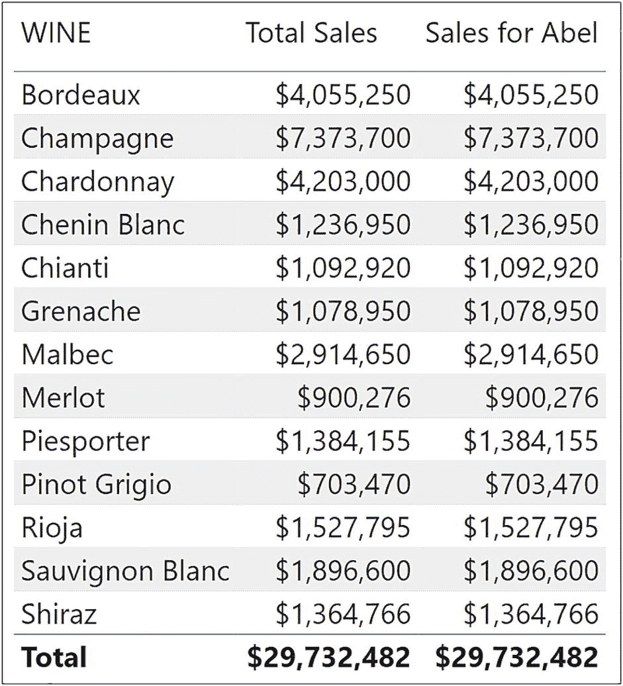

图 11-1

变量的行为类似于常量，无法通过 `CALCULATE` 修改

原因在于，变量 `MyAmount` 在其声明的位置就被计算了，在本例中就是在其他任何代码之前。它随后*不会*也*不能*通过使用 `CALCULATE` 修改筛选器来改变。这正是我们必须转而使用诸如 `CALCULATE` 内部的 `Total Sales` 这类度量值的原因。

然而，变量的不可变性也是其优点。例如，设想这样一个场景：你希望找出销售额异常高的月份。你已经将异常高销售额定义为那些销售额大于当月总销售额 5% 的交易。

你可能会编写如下代码：

```
No of Sales GT 5% Wrong =
CALCULATE (
[No of Sales],
FILTER (
Winesales,
[Total Sales] >  [Total Sales] * 0.05
)
)
```

然而，这个度量值并未返回正确的结果。当在诸如 `FILTER` 函数这样的迭代器中使用时，`Total Sales` 度量值的值会计算 `Winesales` 表中*每一行*的总销售额，而不是每个月的总销售额。因此，度量值 `No of Sales GT 5% Wrong` 计算的是销售额大于每一行（即每笔交易）销售额 5% 的销售数量，从而返回了销售笔数；详见图 11-2。

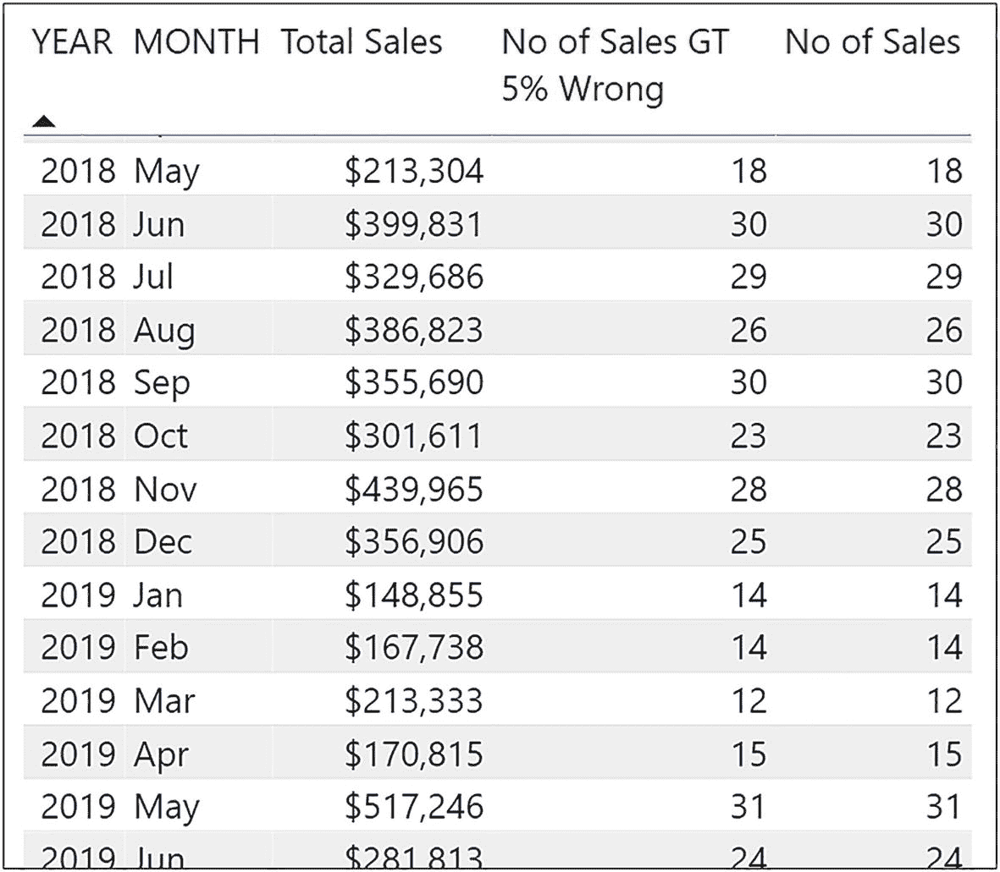

图 11-2

`No of Sales GT 5% Wrong` 度量值返回了销售笔数

这个表达式使用了我们将在后面章节中遇到的上下文转换概念，但即便如此，直观理解上，如果 `FILTER` 在迭代 `Winesales` 表，它必然是一行一行地扫描该表。

正确的表达式必须计算当前筛选上下文中的总销售额，即每个月的总销售额，这个上下文已经被 `FILTER` 的迭代所丢失。为了重新应用这个筛选器，`CALCULATE` 可以使用放置在 `Winesales` 表上的筛选器，即使对有经验的 DAX 用户来说，编写这段代码也是一个挑战：

```
No of Sales GT 5% Difficult =
CALCULATE (
[No of Sales],
FILTER (
Winesales,
[Total Sales] > CALCULATE ( [Total Sales], Winesales ) * 0.05
)
)
```

这个度量值被称为“困难”表达式，因为它使用了我们尚未遇到的两个具有挑战性的 DAX 概念：上下文转换和表扩展。然而，得知你并不需要这些高级知识就能得出正确的计算结果，或许会让你松一口气。你可以转而使用变量，这会使表达式变得非常简单：

```
No of Sales GT 5% Easy =
VAR PerCentToFind = [Total Sales] * 0.05
RETURN
CALCULATE ( [No of Sales],
FILTER ( Winesales, [Total Sales] > PerCentToFind ) )
```

这个“简单”表达式使用一个变量来计算 `Total Sales` 度量值的 5%，这个计算会首先执行并保持恒定。然后，该变量被用来计算每个月总销售额大于该变量存储值的销售笔数。

这个故事的寓意是什么？让我们对变量心存感激吧！

## 返回当前筛选中的值

在设计报表时，经常需要显示在切片器或“筛选器”窗格中选择的值。这可能是为了使用条件格式在视觉对象的标题中显示这些值，或者像图 12-1 所示，在卡片视觉对象中显示它们。

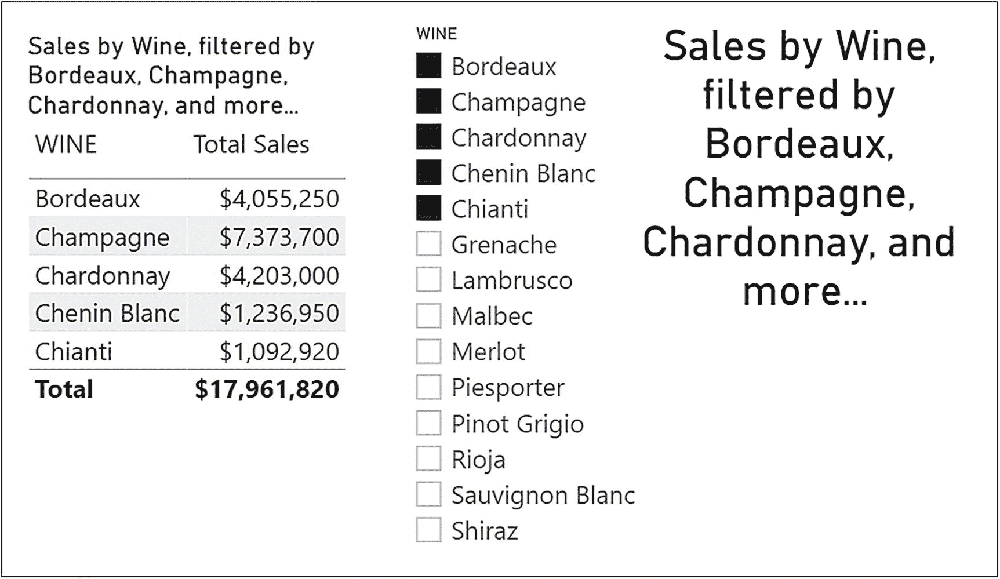

图 12-1

显示当前筛选上下文中的值

如果你有此目标，我们有三个 DAX 函数可以胜任：`SELECTEDVALUE`、`CONCATENATEX` 和 `VALUES`。在本章中，我们将探讨如何使用这些函数来返回筛选选择。你将学习如何为视觉对象生成动态标题，以标示其中筛选出的数据。然而，本章还将介绍*参数表*的概念，这是一种与模型中其他表无关联的表，用于捕获用户选择的值。然后，这些值可以在你的计算中被动态使用。

`SELECTEDVALUE` 和 `CONCATENATEX` 函数属于返回标量值的函数类别，它们可以返回数值或文本值。因此，说度量值只返回标量值并不准确，因为那会暗示它们只能返回数值。使用这两个函数中的任何一个的度量值通常会返回一个文本值。`VALUES` 函数比较特殊，因为它既可以返回标量值，也可以返回表，因此，我们将推迟到本章末尾再讨论这个函数。

你已经知道，度量值必须返回一个*单一*值，无论是数值还是文本，`SELECTEDVALUE` 和 `CONCATENATEX` 也不例外。`SELECTEDVALUE` 函数会返回当前筛选上下文中的值，但前提是只有一个值需要返回。然而，有时筛选上下文包含多个值，例如当我们在切片器中进行了多项选择时，那么在这种情况下，我们如何返回这些值呢？

如果需要返回筛选上下文中的多个值，我们必须使用另一个函数：`CONCATENATEX`。这个函数属于你在第 5 章中学过的“X”组迭代函数。为了返回单一值，使用 `CONCATENATEX` 的度量值会将当前筛选上下文中的多个值连接起来，从而返回一个单一的文本字符串。

因此，我们有两个函数 `SELECTEDVALUE` 和 `CONCATENATEX`，其中一个是迭代器，它们彼此间差异很大。然而，它们用于相同的目的，即标记已被切片器或筛选器选择过滤掉的项目。现在，让我们先看看第一个函数：`SELECTEDVALUE`。

### SELECTEDVALUE 函数

`SELECTEDVALUE` 函数在指定列中仅有一个值时返回筛选上下文中的值，否则返回替代结果。其语法如下：

`= SELECTEDVALUE(列名, 替代结果)`

其中：

- `列名` 是你要从中查找值的列。

- `替代结果`（可选）是当列被筛选为多个非重复值或没有值时返回的值。未提供时，默认值为 `BLANK()`。

以下是 `SELECTEDVALUE` 语法的示例：

`= SELECTEDVALUE(Wines[TYPE], "多种")`

在深入探讨该函数之前，我们需要先回顾一下“当前筛选上下文”的含义。请考虑以下度量值：

```
Total Cases =
SUM ( Winesales[CASES SOLD] )
```

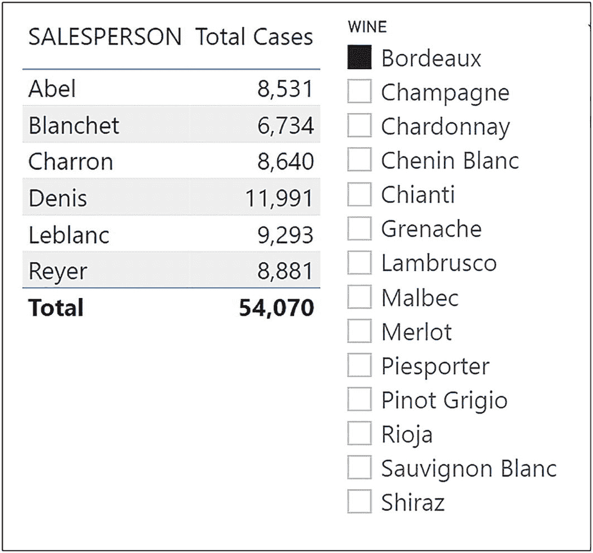

图 12-2 – 用于计算“Total Cases”度量值的筛选条件同时作用于 `SALESPERSON` 和 `WINE` 列

图 12-2 中的视觉对象包含按 `SALESPERSON` 和 `WINE` 列筛选的“Total Cases”度量值。在首次计算 **8,531** 箱时，存在对销售员“Abel”和葡萄酒“Bordeaux”的筛选。然而，我们将重点关注来自切片器的 `WINE` 列上的筛选。如果我们能看到 `Wines` 维度上的筛选，它看起来会像图 12-3 那样，即表已被筛选为仅剩一行。

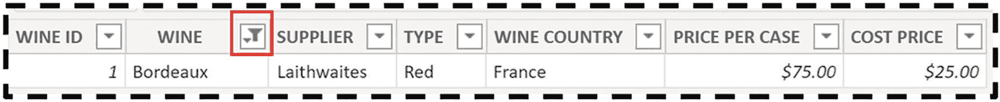

图 12-3 – 切片器将 `Wines` 维度筛选为仅剩一行

我们知道，该筛选与 `SalesPeople` 维度上的筛选一起传播到事实表，这两个筛选共同构成了当前筛选上下文。

通常，报告画布上会有许多切片器，而报告用户并不总能清楚自己点击了哪些切片器。如果我们能像图 12-4 那样向用户提供这些信息，将会很有帮助。

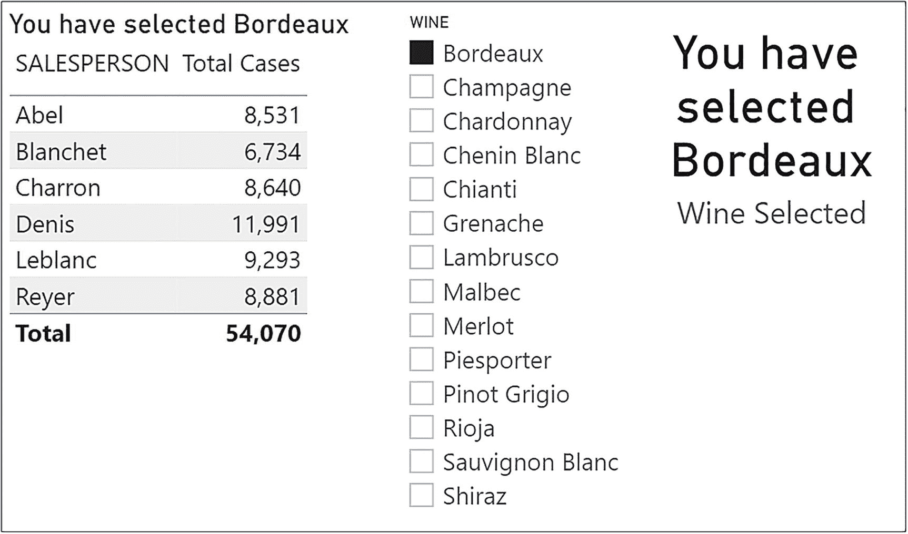

图 12-4 – 告知用户切片器选择情况

这正是 `SELECTEDVALUE` 函数能够发挥作用的地方。你可以在图 12-4 中看到，切片器中选择的葡萄酒同时显示在表格视觉对象的标题（通过条件格式）和卡片视觉对象中。这是我们在这些示例中使用的度量值：

```
Wine Selected =
"You have selected " & SELECTEDVALUE ( Wines[WINE] )
```

此示例使用 `SELECTEDVALUE` 函数返回当前筛选上下文中 `WINE` 列的值。这也是我们首次在 DAX 表达式中使用与号（`&`）。如同 Excel，与号是 DAX 的串联运算符，用于将 DAX 表达式的各部分连接成字符串。

# Power BI 中的切片器选择与文本连接

## 使用 `SELECTEDVALUE` 处理多选与空选

> **注意**：如果你需要有关在视觉对象标题中使用条件格式的帮助，请点击此链接：[`docs.microsoft.com/en-us/power-bi/create-reports/desktop-conditional-format-visual-titles`](https://docs.microsoft.com/en-us/power-bi/create-reports/desktop-conditional-format-visual-titles)

但如果切片器中选择了多个值，该怎么办？如下所示，一种方法是使用 `CONCATENATEX`，但还有另一种更简单的解决方案，因为 `SELECTEDVALUE` 函数允许你在选择了多个项目时提供替代结果，如下所示：

```
Wine Selected #2 =
"You have selected " &
SELECTEDVALUE ( Wines[WINE],"多种葡萄酒" )
```

然而，由于 `SELECTEDVALUE` 的“替代结果”参数会在有*多个*选择或*没有*选择时都生效，因此我们会遇到一个问题。你会注意到，如果切片器中未选择任何内容，表格视觉对象的标题和卡片视觉对象仍会提示你选择了多种葡萄酒（图 12-5）！

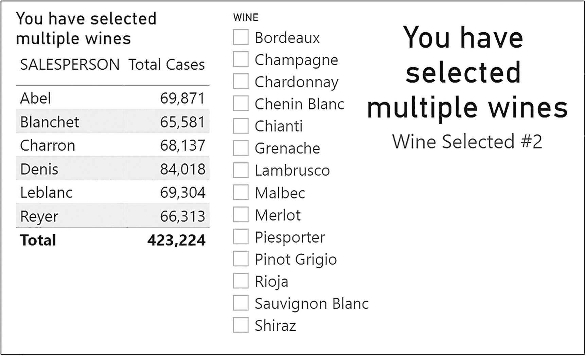

图 12-5 – “替代结果”在无选择和多选时都会显示

避免此问题的一种方法是，在切片器设置的格式卡片中启用“单选”，从而确保用户无法进行多选或留空。另一种方法是使用 `CONCATENATEX`，我们将在本章后面介绍。

`SELECTEDVALUE` 函数还允许你测试当前筛选中的特定值。在图 12-6 中，如果切片器中选择的葡萄酒的 `PRICE PER CASE` 值大于 75 美元，卡片视觉对象将显示“昂贵葡萄酒”；否则显示“便宜葡萄酒”。

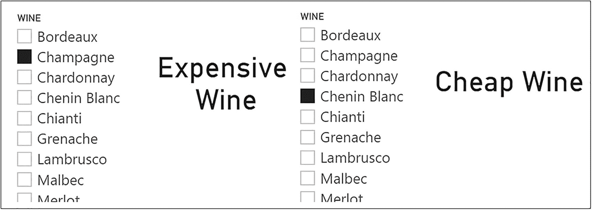

图 12-6 – 使用 `SELECTEDVALUE` 测试当前筛选中的值

这是图 12-6 中使用的表达式：

```
High Price =
IF (
SELECTEDVALUE ( Wines[PRICE PER CASE] ) > 75,
"Expensive Wine",
"Cheap Wine"
)
```

这里需要注意的是，使用 `SELECTEDVALUE` 时，你可以选择被筛选行中*任意*列的值，而不仅限于用作切片器的列。

然而，当用户在切片器中选择多个值时，我们仍然会面临问题。你可能不希望使用切片器中的“单选”，而是希望能够选择多个项目并将这些项目列在表格或卡片视觉对象中。我们还看到，当没有选择时，`SELECTEDVALUE` 的“替代结果”也会显示，与多选时一样。现在，让我们看看如何通过使用 `CONCATENATEX` 函数来解决这个问题。

## CONCATENATEX 函数

我们知道，任何以“X”结尾的函数都是迭代函数，`CONCATENATEX` 也不例外。它会迭代第一个参数中引用的表，然后连接第二个参数中引用的列的值。具体来说，`CONCATENATEX` 函数具有以下参数：

`= CONCATENATEX( table, expression, delimiter, order by, order )`

其中：

- `table` 是要迭代的表。
- `expression` 是您要为 `table` 中的每一行连接其值的列（或表达式）。
- `delimiter` 是用于分隔值的字符，例如逗号或与符号（&）。
- `order by`（可选）通常是您想要对值进行排序的列。
- `order`（可选）是 `ASC` 或 `DESC`。

现在让我们看一个使用 `CONCATENATEX` 的表达式示例：

```
Types of Wine =
CONCATENATEX ( Wines, Wines[WINE] , ", " , Wines[WINE ID], ASC )
```

在此度量值中，`CONCATENATEX` 迭代 `Wines` 表，并针对表中的每一行，返回 `WINE` 列中的值连接而成的列表，这些值以逗号分隔，并按 `WINE ID` 升序排序。在图 12-7 中，您可以看到当 `Wines` 表的 `TYPE` 列被放置在表视觉对象中时，此表达式返回的值。“Types of Wine”度量值显示其类型（即 Red 或 White）旁边的所有葡萄酒，用逗号分隔，并按 `WINE ID` 列升序排序。

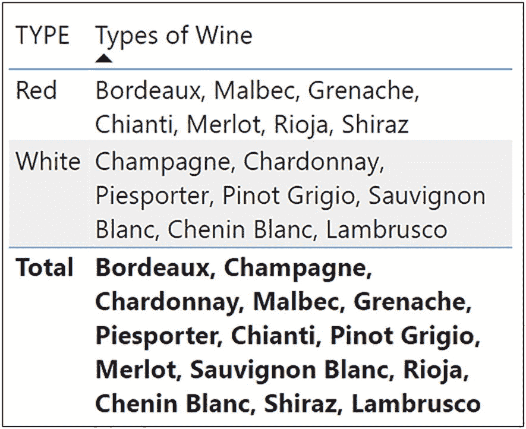

图 12-7 “Types of Wine”度量值返回的值

我们可以仅使用前三个参数，并将此度量值放置在卡片视觉对象中，使用切片器按 `WINE` 列进行筛选：

```
Types of Wine #1 =
CONCATENATEX (
Wines, Wines[WINE] ,
", " )
```

在这里，`CONCATENATEX` 将简单地返回当前筛选器中的所有葡萄酒名称；参见图 12-8。至此，我们终于解决了在选择了多个项目时显示切片器选择的问题。

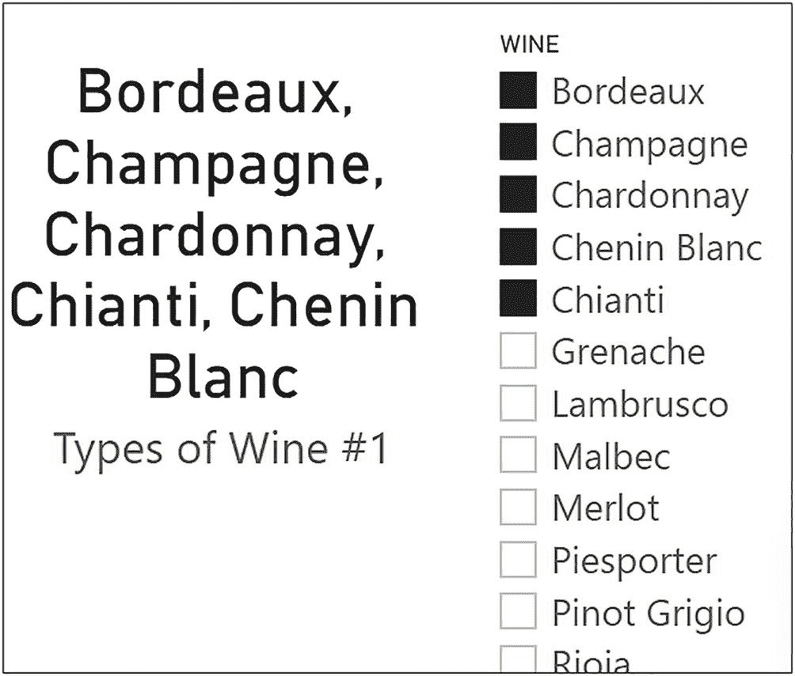

图 12-8 卡片视觉对象中按 WINE 切片后的“Types of Wine #1”度量值

然而，我们还没有完全达到目标。如果切片器中没有选择，卡片视觉对象将返回所有葡萄酒名称，这很可能不是您想要的。要解决这个问题，我们需要进一步优化我们的“Types of Wine #1”表达式。

在图 12-9 中，我们使用条件格式在表视觉对象的标题中使用了两个相似的度量值：“Types of Wine #2”和“Types of Wine #3”。这两个度量值都返回短语“Sales by Wine, filtered by”，并且葡萄酒列表会随着选择的增加而增加。为了避免视觉对象中充斥着大量葡萄酒名称，当选中超过三种葡萄酒时，“Types of Wine #3”会显示“and More”。当切片器*没有*选择时，视觉对象的标题会显示“Sales by Wine”，而不是像使用 `SELECTEDVALUE` 的度量值那样显示“you have selected multiple wines”。

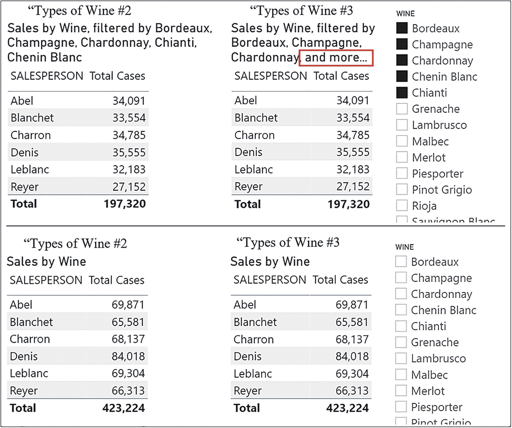

图 12-9 使用 CONCATENATEX 解决多选和未选择的问题

因此，使用 `CONCATENATEX`，我们为所有四种问题场景提供了解决方案：

1. 切片器中无选择
2. 切片器中有选择
3. 选择了三种或更少葡萄酒
4. 选择了超过三种葡萄酒

解决场景 #1 和 #2 所需的度量值相对简单。但是，我们需要扩展此表达式以适应场景 #3 和 #4，而这也正是表达式变得稍显复杂的地方。因此，让我们先处理用户在选择切片器中做出选择或没有任何选择的情况。

要解决此场景，我们构建的度量值必须返回以下两者之一：

1. 如果切片器中没有选择，则返回“Sales of Wines”
2. 返回“Sales of Wines filtered by”，后跟切片器中选择的葡萄酒列表

因此，我们需要一种方法来确定对 `WINES` 列的筛选器是否减少了 `Wines` 维度表中的行数。如果是，则切片器中必须存在选择。如果不是，则切片器中必定没有选择。我们可以在这里使用名为 `VALUES` 的函数，它会生成一个虚拟的单列表，列出当前筛选上下文中的 `WINE` 列的值。然后，我们可以使用 `ALL` 函数返回另一个包含所有葡萄酒名称的虚拟单列表。如果这两个表的行数相同，那么切片器中必定没有选择。

> **注意：** 我们将在本章后面深入探讨 `VALUES` 函数。

以下是我们构建的表达式。注意使用变量来捕获 `COUNTROWS` 返回的值：

```
Types of Wine #2 =
VAR NoFilteredWines =
COUNTROWS (  VALUES ( Wines[WINE] ) )
VAR  NoAllWines=
COUNTROWS ( ALL( Wines[WINE] ))
RETURN
IF ( NoFilteredWines = NoAllWines ,
"Sales by Wine",
"Sales by Wine, filtered by "
&
CONCATENATEX (
Wines, Wines[WINE] ,
", " ) )
```

现在让我们将注意力转向解决用户在切片器中选择超过三种葡萄酒的场景。如果用户选择三种或更少的葡萄酒，或者没有选择葡萄酒，则该度量值的返回值与“Types of Wine #2”相同。但是，如果用户选择了四种或更多种葡萄酒，我们希望度量值返回所选前三种葡萄酒的列表，后跟“and more…”。因此，我们需要生成一个列表，其中仅包含切片器中选择的前三种葡萄酒名称。我们可以使用名为 `TOPN` 的表函数来完成此任务。顾名思义，`TOPN` 将构建一个虚拟表，其中仅包含前 N 个（例如，3 个）值，如以下表达式所示：

`TOPN ( 3, VALUES ( Wines[WINE] ))`

再次注意 `VALUES` 函数是如何用于生成一个单列表，列出当前筛选上下文中的葡萄酒名称的。`TOPN` 函数将提取这些葡萄酒名称中的前三个，放入其自身的表中，然后由 `CONCATENATEX` 连接这些值。然后，我们可以使用与符号（&）连接“and more…”。

您可以看到以下表达式将解决我们的最终场景。我们需要做的就是添加 `IF` 函数来执行 `TOPN` 表达式，然后将 `TOPN` 表达式本身添加到代码的底部（以灰色高亮显示）：

```
Types of Wine #3 =
VAR NoFilteredWines =
COUNTROWS (  VALUES ( Wines[WINE] ) )
VAR  NoAllWines=
COUNTROWS (ALL ( Wines[WINE]))
RETURN
IF ( NoFilteredWines = NoAllWines ,
"Sales by Wine",
"Sales by Wine, filtered by "
&
IF ( NoFilteredWines <=3,
CONCATENATEX (
Wines ,
Wines[WINE] ,
", ") ,
CONCATENATEX (
TOPN ( 3, VALUES ( Wines[WINE] )),
Wines[WINE] ,
", ")
& " and more..."
))
```

在构建这些度量值的过程中，您学习了如何使用 `CONCATENATEX` 将切片器选择串连起来。同时，这也是一个关于使用表函数和表表达式来生成虚拟内存中表的宝贵练习，这些表随后在表达式中被使用。这个概念是 DAX 的核心，即构建包含标量函数所用值的临时表。在此也值得指出，度量值“Types of Wine #3”在复杂程度上比您迄今为止在本书中遇到的所有内容都要高出一个数量级，但您现在已具备编写此类复杂代码的技能。

我们还介绍了 `SELECTEDVALUE` 函数的细节，现在我们将重新聚焦于它。这是因为我们可以更好地利用它，而不仅仅是提醒用户在切片器中选择了什么。我们知道 `SELECTEDVALUE` 会返回单个值，通过这种方式，我们可以使用此函数来获取*无关表*中列的特殊值。这些无关表有一个名字，叫做*参数表*，我们现在就来探讨其用法。

## 使用参数表

你可以使用 `SELECTEDVALUE` 返回用户选择的参数。这个选定的参数随后可在度量值中作为数值使用。

请查看图 12-10 中的表格可视化对象。此处我们有一个切片器，允许我们为“总销售额”度量值选择一个销售预测方案，具体如下：

- “最佳情况”（增长 20%）
- “可能情况”（增长 10%）
- “最差情况”（下降 10%）

“假设情景”度量值随后会根据所选方案相应计算总销售额。

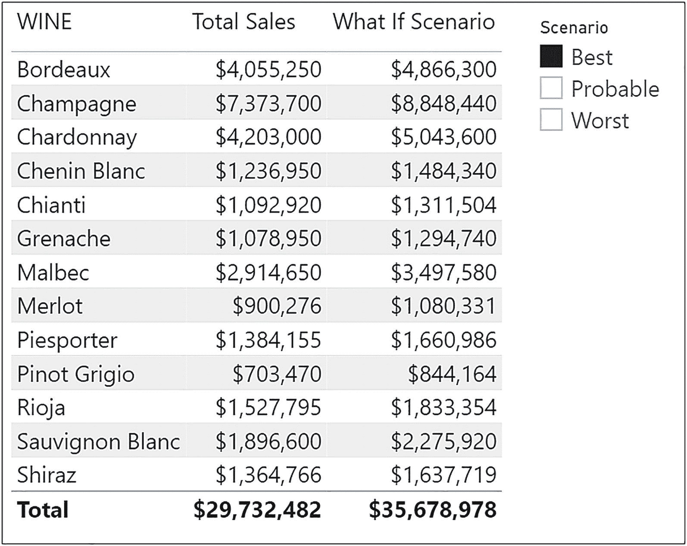
*图 12-10 – 使用参数表分析销售预测方案*

要创建这些方案，我们使用了“开始”选项卡上的“输入数据”按钮，并创建了名为“假设”的表格，如图 12-11 所示。

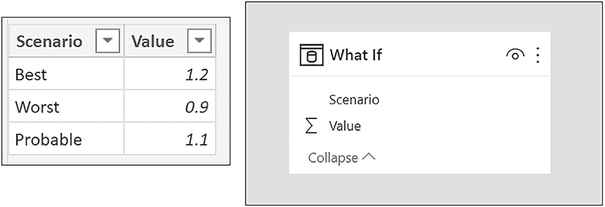
*图 12-11 – “假设”参数表*

请注意，在图 12-11 中，该表与数据模型中的任何其他表都没有关系。我们现在需要在画布上放置一个切片器，其数据源为“假设”表中的 `Scenario` 列，然后我们就可以创建如下度量值：

```
假设情景 =
[总销售额] * SELECTEDVALUE ( '假设'[Value] )
```

当我们从“情景”切片器中选择一个值，例如“可能情况”时，该值会在“假设”表中被筛选出来。“假设”表中只有一行数据，`Value` 列中的值便用于乘以“总销售额”度量值。

你已经学会了如何构建参数表，并通过使用 `SELECTEDVALUE` 来构建表达式，以测试从参数表中选定的特定值。一旦掌握这一方法，你就可以利用所选的值来驱动特定的计算。让我们看一个例子。你可能已经发现，在 Power BI 中操作的一个不便之处是，你只能将列值填充到切片器中。然而，经常出现这样的问题：我能否将度量值放入切片器？答案是：当然可以！请查看图 12-12。

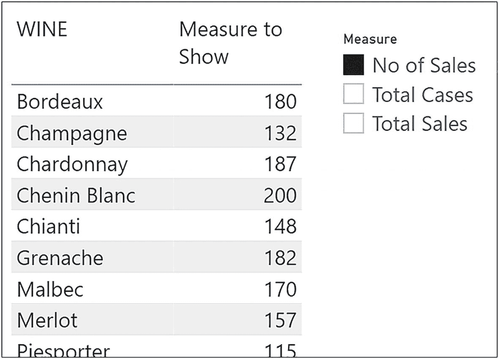
*图 12-12 – 为度量值创建切片器*

此处，我们有一个列出了三个度量值的切片器。当在切片器中选择一个度量值时，表格可视化对象中的“要显示的度量值”会计算出所选度量值。

要构建这个示例，我们同样首先创建参数表，并将其命名为“选择度量值”。该表包含两列。名为 `Measure` 的列列出了度量值，但请注意这些名称是任意的；你不必使用确切的度量值名称。第二列名为 `Value`，它为 `Measure` 名称分配了一个值。与所有参数表一样，此表与模型中的任何其他表都没有关系；请参见图 12-13。

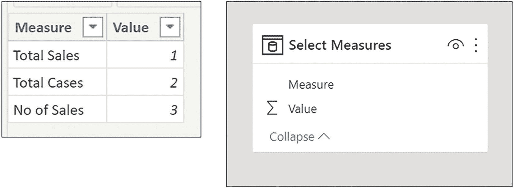
*图 12-13 – “选择度量值”参数表*

然后在画布上放置了一个切片器，其数据源为“选择度量值”表中的 `Measure` 列。

以下是“要显示的度量值”的表达式：

```
要显示的度量值 =
SWITCH (
SELECTEDVALUE ( '选择度量值'[Value] ),
1, [总销售额],
2, [总箱数],
3, [销售数量]
)
```

请注意这里使用了 `SWITCH` 函数来代替 `IF`，但两者都可以完成任务。随后，该度量值与葡萄酒表中的 `WINE` 列一同被放入表格可视化对象中。

## VALUES 函数

我一度犹豫是否要将 `VALUES` 函数收录到本书中，因为近年来，它的需求在很大程度上已被 `SELECTEDVALUE` 函数所取代。然而，我改变主意的原因是，如果你是一名 DAX 用户，即使很少用到它，也应该了解并理解 `VALUES` 函数。

在 2017 年 `SELECTEDVALUE` 函数出现之前，`VALUES` 是主要的 DAX 函数之一。正因如此，你在浏览他人编写的代码时会遇到 `VALUES` 函数，因此，了解该函数在表达式中的用途不失为一个好主意。此外，这两个函数——`SELECTEDVALUE` 和 `VALUES`——并不能互换；有时只能使用 `VALUES`。事实上，我们在探索 `CONCATENATEX` 时就已经使用过 `VALUES` 函数。

`VALUES` 在你想将*列*引用转换为*表*引用，或者想重新应用“丢失”的筛选器时尤其有用。

该函数的语法非常简单。在函数内部，你可以引用一个表或一个列：

```
= VALUES ( 表名 或 列名 )
```

以下是 `VALUES` 语法的两个示例；第一个引用表，第二个引用列：

```
= VALUES ( 葡萄酒 )
```

```
= VALUES ( 葡萄酒[WINE] )
```

该函数是一个*表函数*，并返回一个虚拟表，具体情况如下：

- 当输入参数为列名时，它返回一个单列表，该表包含指定列中*在当前筛选上下文中*的非重复值。重复值会被移除，仅返回唯一值。
- 当输入参数为表名时，它返回一个表，该表包含指定表中*在当前筛选上下文中*的行，并且重复行会被保留。

尽管 `SELECTEDVALUE` 在很大程度上取代了 `VALUES`，但它们是两个完全不同的函数。`SELECTEDVALUE` 是一个标量函数，会返回单个值。因此，在 `SELECTEDVALUE` 内部，你只能引用所需标量值所在的列名。而 `VALUES` 函数被描述为一个表函数，在 `VALUES` 内部，你可以引用列名或表名。如果在 `VALUES` 中引用列名，该列会被转换为一个表，从而允许你将列用作表表达式。由于这是使用该函数的好处之一，`VALUES` 更常用于列引用，并且这也是本节将重点介绍的 `VALUES` 的行为。

### 表函数还是标量函数？

然而，如果 `SELECTEDVALUE` 返回的是标量值，而 `VALUES` 返回的是表，那么 `VALUES` 如何能被 `SELECTEDVALUE` 替代呢？这正是 `VALUES` 函数的有趣之处，因为尽管它被描述为一个表函数，但 `VALUES` 既可以返回一个表，*也可以返回一个标量值*。

原因在于，当 DAX 表表达式返回一个*单列单行表*时，DAX 引擎会将其从表转换为标量值（回想一下，`LASTNONBLANK` 函数也表现出这种行为；请参见第 9 章）。此时 `VALUES` 就改变了其性质，从返回表切换到返回标量值。

现在我们可以探讨一个展示此行为的示例。

**注意**

以下使用 `VALUES` 和 `SELECTEDVALUE` 函数的 DAX 度量示例仅用于解释说明。我们编写的度量会返回已经放入视觉对象的葡萄酒名称，显然，这些计算没有任何实际目的。我们使用这些特定表达式的原因，是为了更直观地解释 `VALUES` 函数的工作原理。后续我们会将 `VALUES` 函数应用于更实际、更有益的场景。

# VALUES 函数详解

考虑以下表达式，它将返回一个单列表，其中包含当前筛选上下文中的葡萄酒名称。

```
Values Wine = VALUES ( Wines[Wine] )
```

在将此度量放入表视觉对象之前，我们必须先关闭视觉对象的“总计”行（原因我们稍后会解释）^(¹³)。当该度量被放入视觉对象时，它会返回当前筛选器中 `WINE` 列的值；见图 12-14。

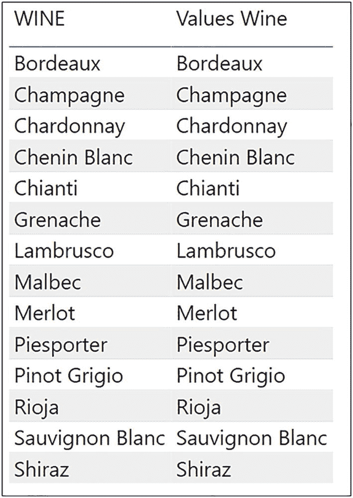

**图 12-14** `VALUES` 函数返回当前筛选上下文中的值

对“Values Wine”度量的求值没有产生错误，因此 `VALUES` 表现得就像一个标量函数（请记住，所有度量都必须返回标量）。我们可以看看这是如何实现的。在第一次对“Bordeaux”葡萄酒求值时，`VALUES` 表达式创建了一个虚拟表，其中包含当前筛选中 `WINE` 列的唯一值列表。因此，它生成了一个*包含值“Bordeaux”的单列单行表*。如果能直观地看到这个表，它很可能就像图 12-15 中所示的包含单个值的表。


**图 12-15** `VALUES` 生成的单列单行表

此表包含一个可以转换为标量的单一值，这就是它能成功用于“Values Wine”度量的原因。

然而，现在让我们恢复表视觉对象中的“总计”行。当我们这样做时，该度量将返回一个错误，如图 12-16 所示。

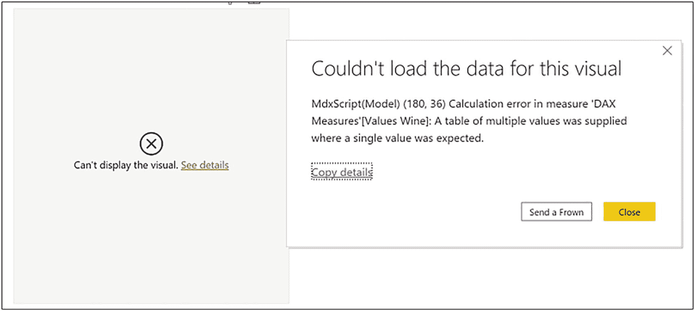

**图 12-16** 当 `VALUES` 函数对“总计”行求值时返回错误

错误消息显示：

> *“提供了一个多值表，但期望的是单个值。”*

为什么在显示“总计”行时会出现此错误，而不显示时却没有？当对“总计”行求值 DAX 表达式时，`VALUES` 返回的不再是单个值，而是*所有*葡萄酒名称都处于筛选上下文中。因此，`VALUES` 函数将返回一个包含 `WINE` 列所有值的虚拟表。这就是错误消息所指的“多值表”（图 12-17）。

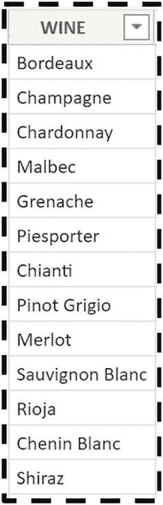

**图 12-17** `VALUES` 在对“总计”行求值时返回“多值表”

因此，我们可以推断出问题出在对“总计”行的求值上，因为你无法将多个值放入“总计”行的“单元格”中。这就是为什么在图 12-14 的表视觉对象中，我们必须移除“总计”行才能让表达式正常工作。但是，你可能会觉得这有点变通，或许希望在某个时候能显示度量的“总计”行值。

为了解决这个问题，与其从视觉对象中移除“总计”行，不如让 DAX 区分对每个葡萄酒的求值和对“总计”行的求值。为此，我们必须使用一个 DAX 函数，该函数在当前筛选上下文中只有一个值时返回 `TRUE`。它的名字毫不意外是 `HASONEVALUE`。以下是所需的表达式：

```
Values Wine =
IF ( HASONEVALUE ( Wines[WINE] ),
VALUES ( Wines[WINE] ),
"All Wines" )
```

但是，前面的表达式难道不是和下面这个返回相同的值吗？

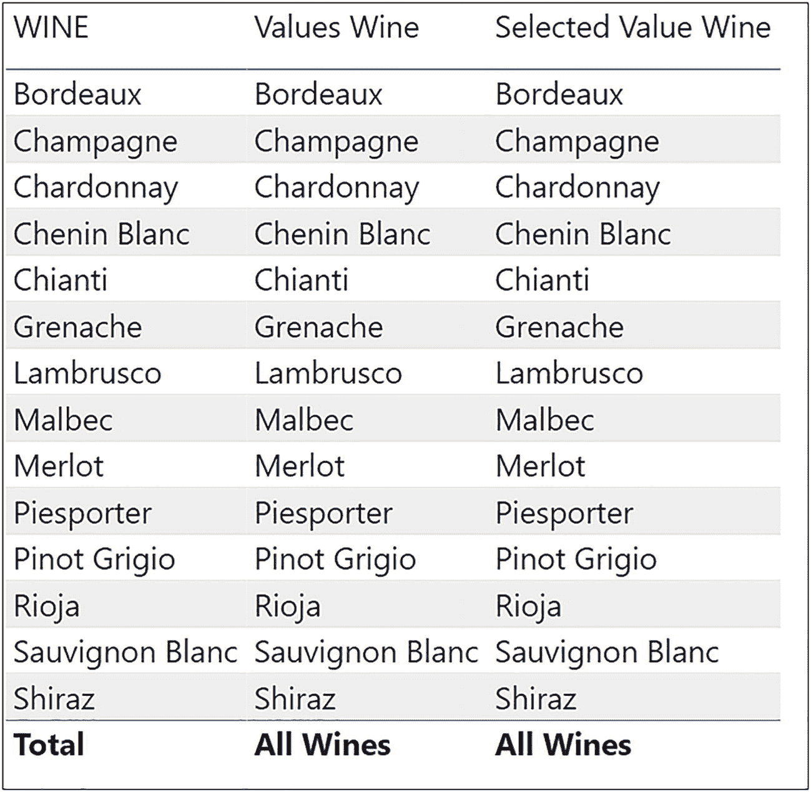

**图 12-18** `VALUES` 函数返回与 `SELECTEDVALUE` 函数相同的值

```
Selected Value Wine =
SELECTEDVALUE ( Wines[WINE], "All Wines" )
```

嗯，是的，确实如此（图 12-18），并且由于 `VALUES` 表达式更复杂，你可能会更倾向于使用 `SELECTEDVALUE`。每当你使用 `VALUES` 来返回标量值时，都可以改用 `SELECTEDVALUE`。更重要的是，使用 `SELECTEDVALUE` 时，你无需考虑筛选上下文中是否只有一个值，因为这一点已隐含在“备用结果”参数中了。

你可能会想，既然葡萄酒名称已经作为视觉对象的第一列存在了，为什么还要用 `SELECTEDVALUE` 或 `VALUES` 来返回它们呢？

## 替换“丢失的筛选器”

你可能会觉得这些示例虽然解释了 `VALUES` 的工作原理，但并非“实际”计算。不过，你现在已经了解了 `VALUES` 函数的作用，即它可以返回一个表或一个标量值。我们需要找到 `VALUES` 的更好用途，以及一个无法用 `SELECTEDVALUE` 替代的场景。`VALUES` 函数的一个更好示例是将其用作表函数，而不是返回标量值。我们来看看下一个场景。

使用切片器进行筛选的一个问题是，你会丢失原始的未筛选值。克服此问题的一种方法是使用两个视觉对象，然后使用“编辑交互”，使一个切片器仅筛选其中一个视觉对象，而另一个不受影响（图 12-19）。

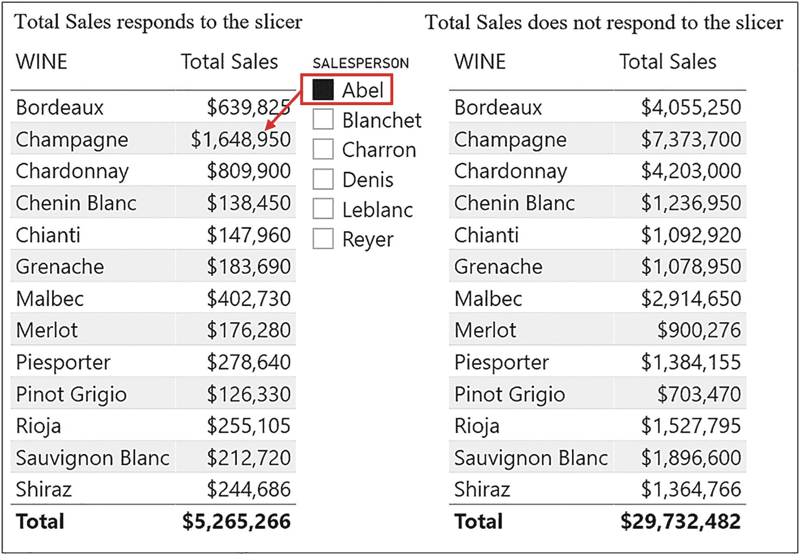

**图 12-19** 使用“编辑交互”可以防止切片器筛选某个视觉对象

然而，我们希望有一个视觉对象能同时保留未筛选的值和筛选后的值，如图 12-20 所示。以下是“总销售额（未筛选）”度量的 DAX 表达式：

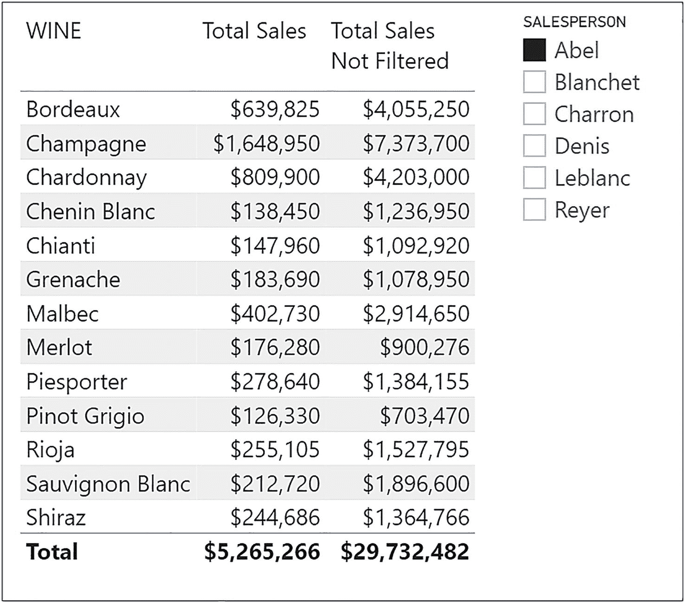

**图 12-20** 一个表视觉对象，其中“总销售额（未筛选）”度量忽略了切片器筛选器

```
总销售额（未筛选） =
CALCULATE ( [总销售额],
ALL ( Winesales ),
VALUES ( Wines[WINE] )
)
```

现在，让我们更详细地分析“总销售额（未筛选）”度量。`CALCULATE` 的第一个筛选参数是 `ALL` 函数，它作为一个修饰符，移除来自 `WINE` 列和 `SALESPERSON` 列的对 `Winesales` 事实表的任何交叉筛选。在第二个筛选参数中，`VALUES` 用于构建一个虚拟的单列单行表，该表包含当前筛选上下文中的葡萄酒名称，例如，第一次评估时为“Bordeaux”。这相当于 `Wines[WINE] = "Bordeaux"`。然后，`CALCULATE` 将此新筛选器应用于 `Winesales` 表，该表会据此重新筛选。最终结果是，`WINE` 列上有一个筛选器，但 `SALESPERSON` 列上不再有筛选器，因此，我们会看到每种葡萄酒对应所有销售人员的销售额。当度量计算总计行时，它会构建一个包含所有葡萄酒名称的虚拟单列表，用作筛选器。

然而，以下表达式是达到相同结果的另一种方式：

```
总销售额（未筛选）#2 =
CALCULATE ( [总销售额], ALL ( Winesales ), Wines )
```

在此度量中，我们引用了整个 `Wines` 表作为筛选器，而不是使用 `VALUES` 来生成虚拟的单列表。我们可以这样做，因为 `Wines` 表已被筛选为单行（或者在评估总计行时为所有行），并且整个表可以用作表表达式。

这是我们第一次在 `CALCULATE` 的筛选参数中引用一个表，而不是一个表*表达式*，稍后我们还会再次这样做。请记住，`Wines` 表将包含当前筛选上下文中的葡萄酒所在单行，或者在评估总计行时包含 `Wines` 表的所有行。这个表达式可能更好，因为我们不需要再嵌套另一个函数。

## 将列转换为表

我们已经确定 `VALUES` 函数是一个值得加入 DAX“工具箱”的有用函数，尽管你通常可以使用 `SELECTEDVALUE` 代替。在处理 DAX 时，你会发现 `VALUES` 更常用于列引用，因为它的主要用途之一是将列转换为表。例如，这个表达式：

`= Wines[WINE]` 是一个*列*，

而这个表达式：

`= VALUES ( Wines[WINE] )` 是一个*表*。

我们稍后会在本书中介绍 `TREATAS` 函数时，探讨以这种方式使用 `VALUES`。

凭借其既可返回表又可返回标量值的双重特性，特别是在将列转换为表方面的能力，`VALUES` 是一个非常值得了解的函数。

在本章中，我们探讨了三个函数：`SELECTEDVALUE`、`CONCATENATEX` 和 `VALUES`，它们允许你使用当前筛选器中的值或多个值。你了解到，通过创建参数表，你可以获取这些值并在 DAX 表达式中使用。但不仅如此，在使用 `CONCATENATEX` 时，你明白了如何通过使用变量来保存这些函数返回的值，以便稍后在表达式中引用它们。你还成功生成了多个临时内存表，以控制应用于数据模型的筛选器。所有这些技术在编写 DAX 表达式时非常普遍，将为你后续编写更复杂的代码奠定坚实的基础。

## 控制筛选器传播的方向

到目前为止，你已经了解到筛选器*仅*从关系的一端流向多端，即从维度表流向事实表，正如模型视图中连线上的箭头所示；参见图 13-1。

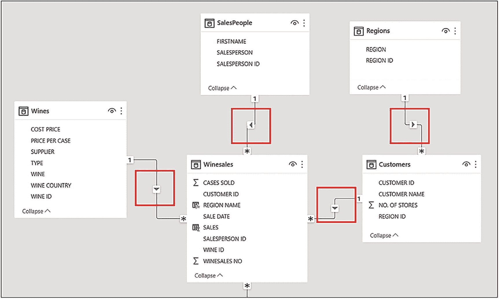

**图 13-1** 筛选器仅从维度表流向事实表

然而，在某些情况下，你可能需要编写要求筛选器向相反方向传播的度量。在本章中，我们将探讨这些情况，并学习如何使用两种方法来逆转筛选器的方向：

# 使用 `CROSSFILTER` 函数以编程方式逆转筛选器

编辑数据模型使筛选器传播既流向事实表，也来自事实表。

不过，关于方法 #2，我们将会提醒你更改数据模型结构可能带来的负面影响。事实上，理解这一点很重要：如果你希望筛选器向相反方向流动，无论你选择哪种方式，这始终会是个问题。

## 编程实现双向筛选器

例如，让我们看一个你在第四章学习筛选上下文时探讨过的问题，当时你无法解决它。在 `Customers` 维度中，有一个 `NO. OF STORES` 列，见图 13-2。


我们想要计算每种葡萄酒的销售门店数量。我们可以创建这样一个度量值：

```
Total Stores =
SUM ( Customers[ NO. OF STORES] )
```

然而，如图 13-3 所示，这个度量值并不奏效。

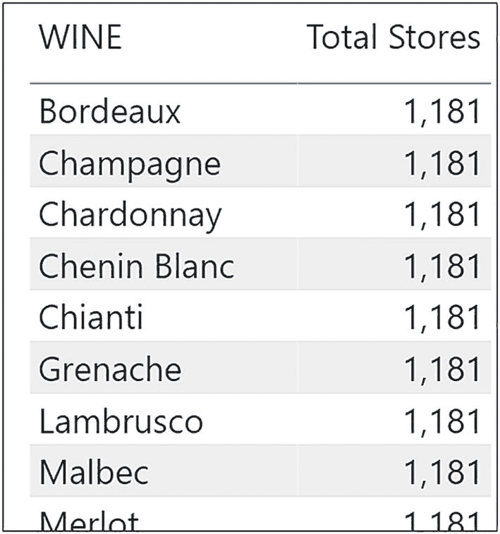

在第四章中，我们找到了数值错误的原因。作用于 `Wines` 维度的筛选器只会传播到事实表，而*不会*继续传播到 `Customers` 维度，见图 13-4。


那么，我们如何找到已售出葡萄酒的门店数量呢？答案在于使用名为 `CROSSFILTER` 的函数。

`CROSSFILTER` 函数本身不返回值，而是作为 `CALCULATE` 函数的修饰符使用。它*以编程方式*设置筛选器在其所在度量值执行过程中的传播方向。其语法如下：

```
= CROSSFILTER ( column1, column2, direction )
```

其中：

- `column1` 是表示关系中多端的列名。
- `column2` 是表示关系中一端的列名。
- `direction` 是度量值中使用的交叉筛选方向，可设置为 `"both"` 以生成双向筛选器。

以下是 `CROSSFILTER` 语法的一个示例：

```
= CROSSFILTER ( Winesales[CUSTOMERID], Customers[CUSTOMERID], both )
```

`CROSSFILTER` 函数指定了度量值要使用的交叉筛选方向，因此我们现在可以*在内存中*改变筛选器的传播方向。

我们可以像这样重写原来的 `Total Stores` 度量值：

```
Total Stores =
CALCULATE (
    SUM ( Customers[NO. OF STORES] ),
    CROSSFILTER ( Winesales[CUSTOMER ID], Customers[CUSTOMER ID], BOTH )
)
```

此度量值使用 `CROSSFILTER` 来改变 `Customers` 和 `Winesales` 之间的关系方向。当评估此度量值时，`Winesales` 表会被 `Wines` 维度交叉筛选，并且该筛选器会*继续*传播到 `Customers` 维度，见图 13-5。


因此，以“Bordeaux”葡萄酒为例，`Customers` 表会被交叉筛选，仅包含购买了此葡萄酒的客户，我们可以看到售出“Bordeaux”的门店有 **728** 家，见图 13-6。

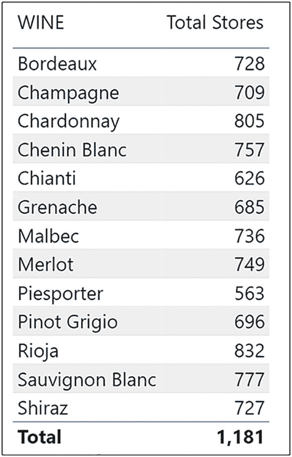

然而，请注意总计行的数值 **1,181**。它并不是表格视觉对象中所有葡萄酒数值的总和。将筛选传播改为双向会产生一个副作用。许多相同的客户购买了多种葡萄酒，因此他们的门店数量被多次计入。而总计行则对所有客户在所有葡萄酒上的门店数量进行了加总。

## 为什么你不应使用双向关系

`CROSSFILTER` 函数允许你在特定度量值的执行过程中*以编程方式*改变筛选传播的方向。但是，你可能知道还有一种更简单的方法来改变筛选方向，那就是改变数据模型的结构。为此，你可以在模型视图中双击两个表之间的连接线来编辑关系，将“交叉筛选方向”设置为“两者”，见图 13-7。

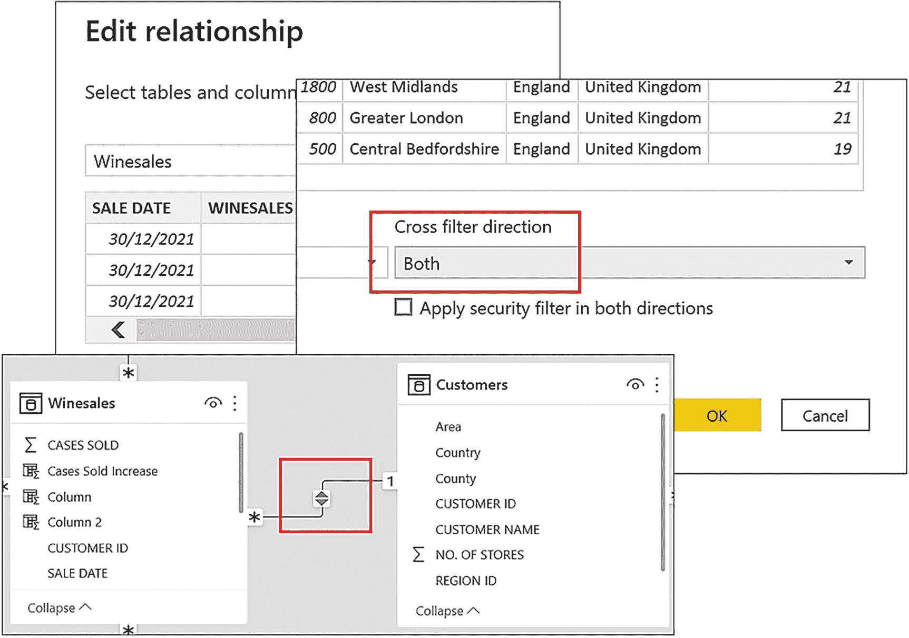

然而，尽管这是一种快速修复方法，但我们绝不建议你这样做，原因有二。首先，双向关系的效率低得多，可能会阻碍数据模型的性能；但更重要的是，它们会在数据模型中引入*歧义*。详细阐述歧义概念超出了本书的范围，但有关这些问题的更多信息，请查看此链接：

[`www.sqlbi.com/articles/bidirectional-relationships-and-ambiguity-in-dax/`](http://www.sqlbi.com/articles/bidirectional-relationships-and-ambiguity-in-dax/)

然而，即使在更基本的层面上，你也会发现，在模型中创建许多双向关系会导致筛选器传播时数据模型不可预测，你将开始失去对哪个筛选器影响什么的控制。如果你的模型遵循单向关系的规则，并且在必须改变筛选方向时使用 `CROSSFILTER`，你会发现操作起来容易得多。

人们通常因为三个原因将关系编辑为双向筛选，而所有这些原因都是不成立的：

1.  缺乏对 Power BI 数据模型和筛选器传播微妙之处的理解。
2.  人们对 DAX 了解不够，无法使用 `CROSSFILTER` 以编程方式改变筛选方向。
3.  当切片器使用来自不同维度的列时，人们希望实现交叉筛选切片器。

让我们来看最后一个原因：当使用来自不同维度的列时，希望实现交叉筛选切片器。如果这是你的目标，你无需使用双向筛选。你可以通过在想要交叉筛选的切片器上使用视觉级筛选器中的*度量值*来实现这一点。

例如，在图 13-8 中，你可以看到我们有两个切片器：一个使用 `Customers` 维度中的 `CUSTOMER NAME` 列，另一个使用 `Wines` 维度中的 `WINE` 列。如果我们在 `CUSTOMER NAME` 切片器中选择，例如“Ballard & Sons”，`WINE` 切片器不会随之改变以反映“Ballard & Sons”购买过的葡萄酒。无论我们在 `CUSTOMER NAME` 切片器中做出何种选择，我们始终会看到所有葡萄酒。

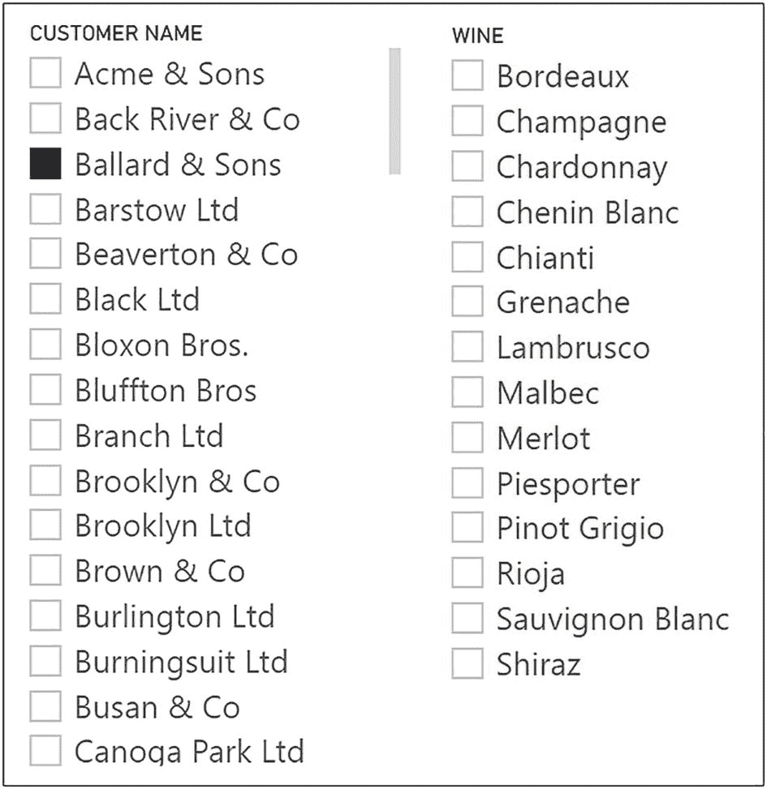

你已经知道原因了。如果 `Customers` 表被筛选，该筛选器会传播到 `Winesales` 表，但不会继续传播到 `Wines` 表，因为筛选器不会从关系中的多端流向一端。然而，我们可以强制 `Wines` 表相应地交叉筛选。我们可以在 `WINE` 切片器上使用一个*度量值*（例如 `Total Sales`）放置一个视觉筛选器，并仅筛选具有 `Total Sales` 值的 `Wines`。实际上，我们可以使用任何对 `Winesales` 表进行计算得到的度量值，然后像图 13-9 中的视觉筛选器所示，将此筛选器设置为“当值不为空时显示项目”。

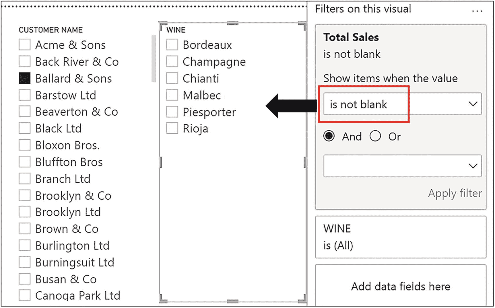

所以，真的没有理由不将关系编辑为双向！请始终使用 `CROSSFILTER` 函数来设计方案。然而，正如我们所看到的，使用双向筛选的度量值（无论是通过 `CROSSFILTER` 还是编辑关系）都存在一个问题，即“总计”行会显示一个具有误导性的值。这个问题没有真正的解决方案；总计是正确的，但可能不是你想要显示的总计。当然，你总是可以在“表”或“矩阵”视觉对象中关闭总计行的显示。