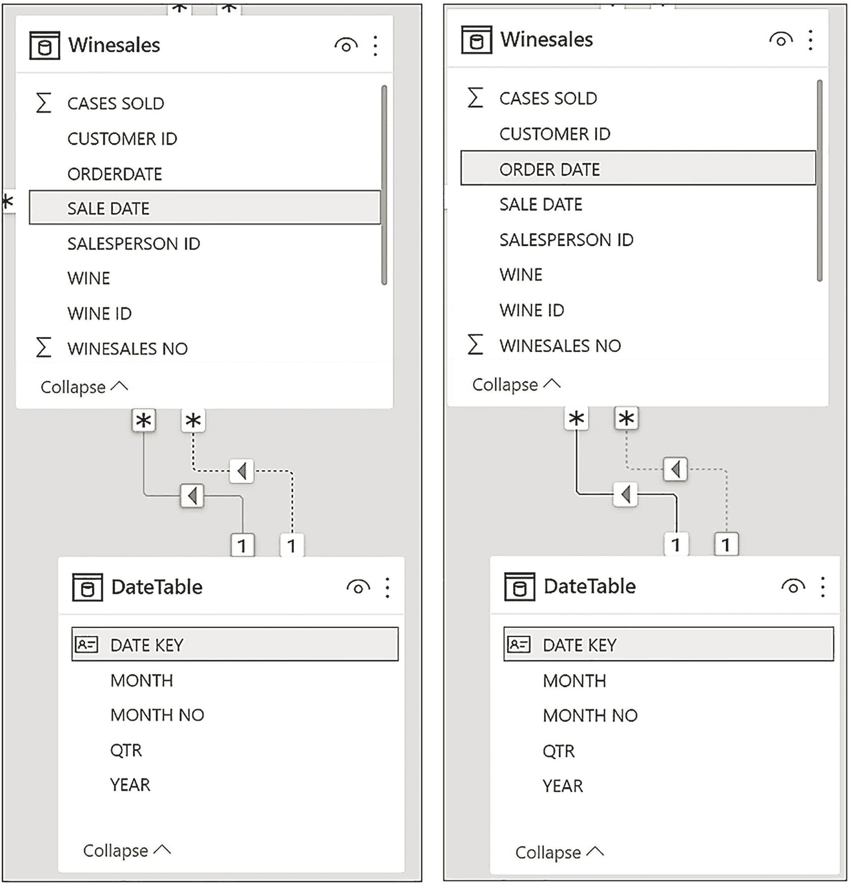
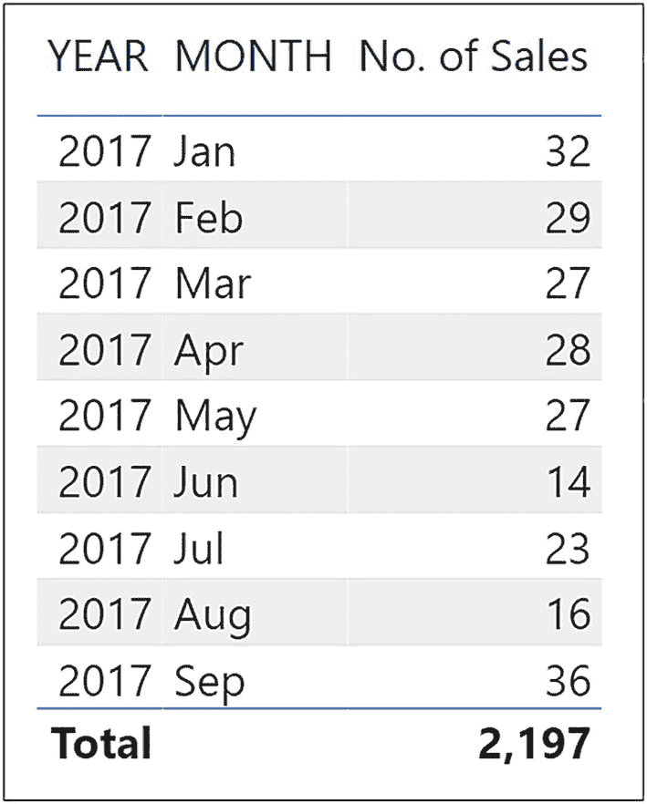
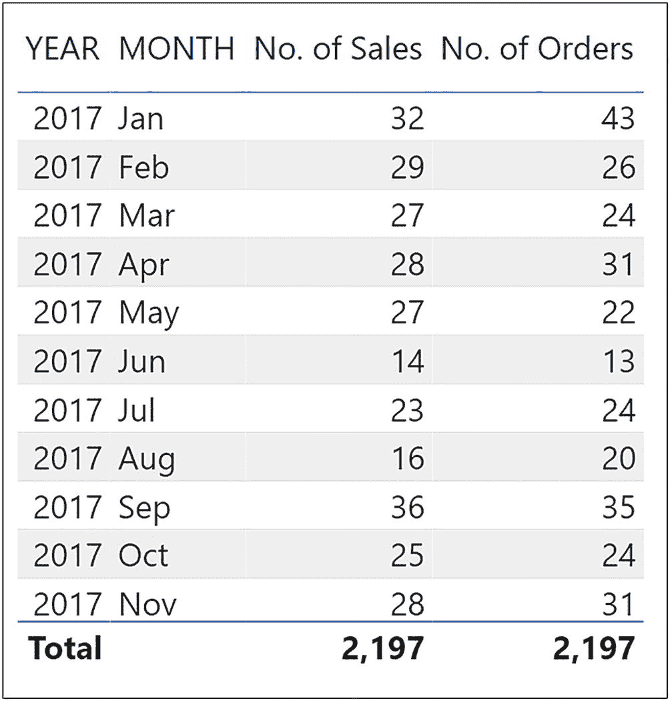
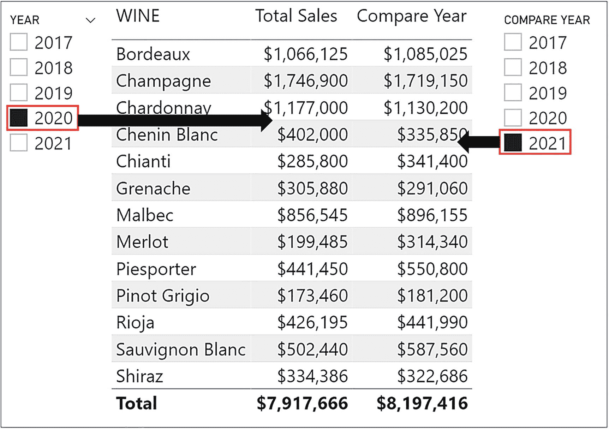
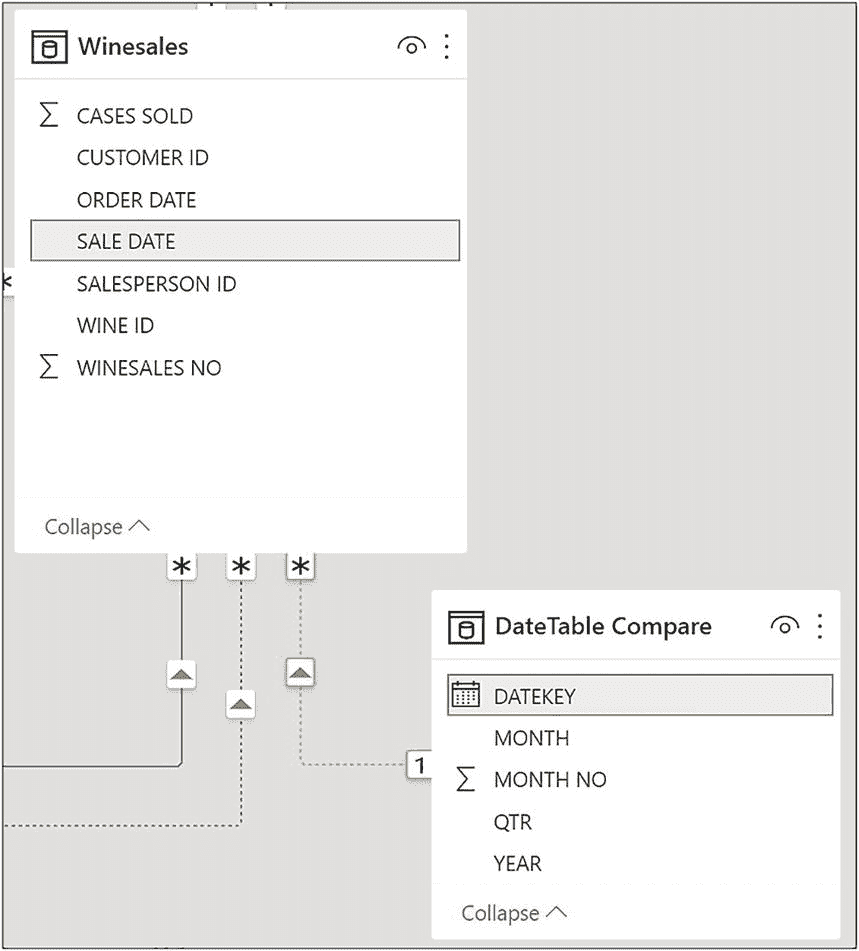
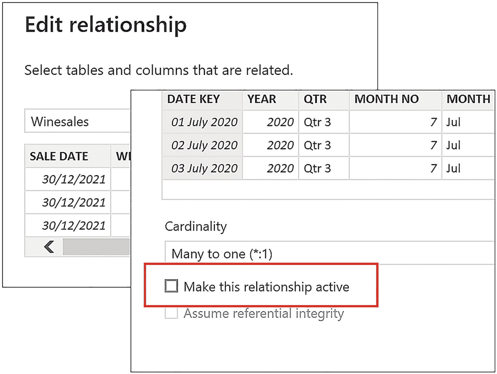
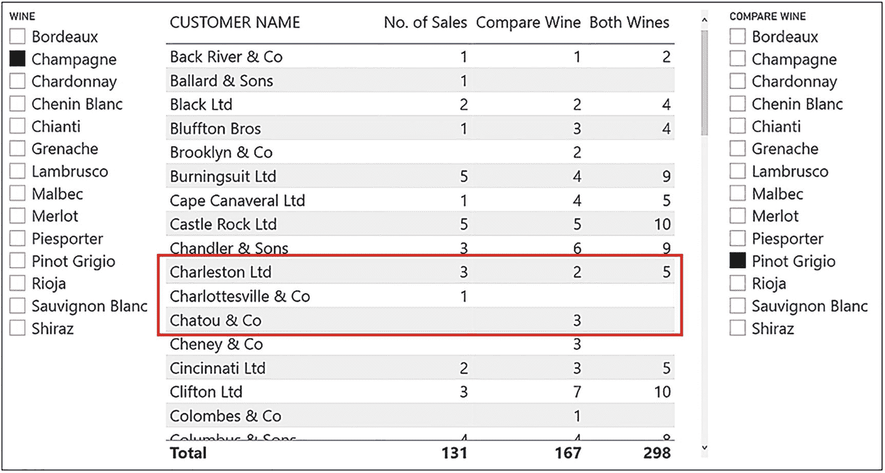
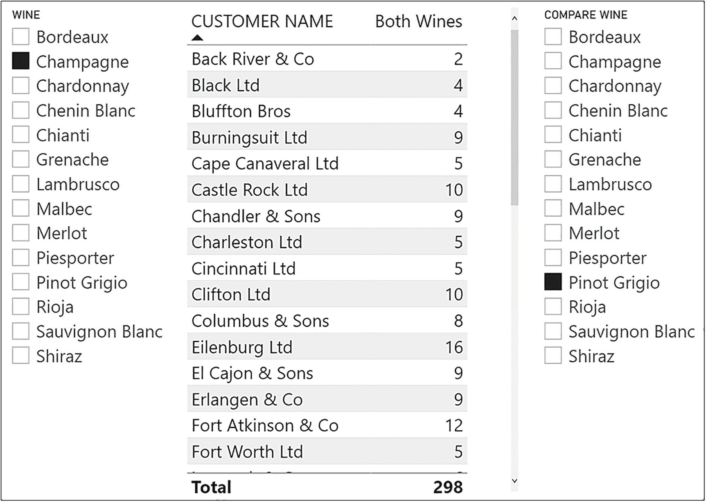

# 14. 处理表之间的多重关系

在我们的数据模型中，所有表与其他表之间都存在着*单一*关系。实际上，任何两个表之间只能有一个*活动*关系，但你可以拥有任意多个*非活动*关系。在本章中，你将学习如何使用表之间的多重关系并激活非活动关系。这可能是由于你需要从维度表到事实表建立多个链接。然而，在本章中我们还将发现非活动关系的另一个不那么明显的用途，那就是使用比较维度表。在这里，我们可以使用度量值强制通过比较维度表传播筛选，从而能够将默认维度中的列与其在比较维度中的对应列进行比较。

如果你尝试在任意两个表之间建立第二个或后续关系，除了第一个关系之外，所有关系都将处于非活动状态，并用虚线关系线表示。考虑图 14-1 中的表。现在，我们的 `Winesales` 表中有两个日期列：`SALE DATE` 和 `ORDER DATE`。^(¹⁵) 第一个关系是在 `DateTable` 表中的 `DATEKEY` 列与 `Winesales` 表中的 `SALE DATE` 列之间建立的。当我们尝试使用 `ORDER DATE` 在 `DateTable` 和 `Winesales` 表之间创建第二个关系时，我们会得到一条虚线，表示该关系是非活动的。



图 14-1

活动关系与非活动关系

默认情况下，所有度量值都将使用活动关系，那么如何使用非活动关系呢？例如，如果我们构建一个包含 `DateTable` 表中 `YEAR` 和 `MONTH` 列的表视觉对象（图 14-2），我们可以使用以下度量值来查找每个月的销售数量：



图 14-2

使用 `DateTable` 表中的 `YEAR` 和 `MONTH` 列筛选 `Winesales` 表中的 `SALE DATE` 列

```
No. of Sales =
COUNTROWS ( Winesales )
```

在此视觉对象中，`No. of Sales` 度量值筛选 `DateTable` 表中的 `YEAR` 和 `MONTH` 列，该筛选通过*活动*关系传播到 `Winesales` 表，从而筛选该年月的 `SALE DATE` 列。但是，要计算订单数量，我们需要使用*非活动*关系，以便改为筛选该年月的 `ORDER DATE` 列。为此，我们可以使用 `USERELATIONSHIP` 函数。

## 激活非活动关系

`USERELATIONSHIP` 函数与 `CROSSFILTER` 函数一样，不返回任何值，而是用作 `CALCULATE` 函数的修饰符。它通过编程方式使用非活动关系，在其所使用的度量值执行过程中传播筛选。其语法如下：

`= USERELATIONSHIP ( column1, column2 )`

其中：

**`column1`** 是代表要使用的关系中多方的列名。

**`column2`** 是代表要使用的关系中一方的列名。

以下是 `USERELATIONSHIP` 语法的一个示例：

`= USERELATIONSHIP (Winesales[SALE DATE], DateTable[ORDER DATE] )`

你必须有一个*非活动*关系才能使用 `USERELATIONSHIP` 函数。

以下是用于计算图 14-3 中每个月订单数量的度量值：



图 14-3

计算销售数量和订单数量

```
No. of Orders =
CALCULATE (
COUNTROWS ( Winesales ),
USERELATIONSHIP ( Winesales[ORDER DATE], DateTable[DATEKEY] ))
```

当此度量值被计算时，在 `DateTable` 中筛选的年份和月份会传播到 `Winesales` 表，以交叉筛选 `ORDER DATE` 列，从而找到该月的订单。


`## 比较同一列中的值`

`USERELATIONSHIP` 函数还可用于另一种目的：对维度中同一列的值进行动态比较。换句话说，能够将默认维度中的列与其在比较维度中的对应列进行比较。

思考一下图 14-4 中展示的示例。在此，我们比较 2020 年的销售额（`Total Sales` 度量值）与 2021 年的销售额（`Compare Year` 度量值），但这样做的好处是，我们是在*同一个表格视觉对象*中进行比较，而不是为每一年分别使用单独的视觉对象。



**图 14-4** 比较在切片器中选择的两个不同年份的销售额

`Compare Year` 度量值的起点是通过复制原始 `DateTable` 在数据模型中创建一个比较用的 `DateTable`。我们将复制的 `DateTable` 命名为 `DateTable Compare`。然后，使用 `DateTable Compare` 表中的 `DATEKEY` 列和 `Winesales` 表中的 `SALE DATE` 列，将该表与 `Winesales` 表建立关联；见图 14-5。



**图 14-5** 将比较表与事实表关联，但将关系设置为非活动状态

然后，您必须编辑此关系，通过在**编辑关系**对话框中取消勾选“使此关系生效”，确保将其标记为*非活动*；见图 14-6。



**图 14-6** 将关系设置为非活动状态

下一步是创建如图 14-4 所示的两个切片器。左侧的切片器名为 `YEAR`，是使用 `DateTable` 中的 `YEAR` 列创建的。从此切片器中选择年份会筛选 `Total Sales` 度量值。右侧的切片器名为 `COMPARE YEAR`，是使用 `DateTable Compare` 表中的 `YEAR` 列创建的。从此切片器中选择年份会按如下方式筛选 `Compare Year` 度量值：

```
Compare Year =
CALCULATE (
    [Total Sales],
    ALL ( DateTable ),
    USERELATIONSHIP ( Winesales[SALE DATE], 'DateTable Compare'[DATEKEY] )
)
```

注意使用了 `ALL` 函数来移除从 `YEAR` 切片器传入的、由活动关系使用的 `DateTable` 表中 `YEAR` 列上的筛选器。

使用 `USERELATIONSHIP` 进行数据比较是一种简单的策略，并且不需要复杂的 DAX，因此让我们将这个想法更进一步。让我们看看能否回答这个问题：在购买葡萄酒 X 的客户中，谁还购买了葡萄酒 Y？例如，在购买“香槟”的客户中，谁还购买了“灰皮诺”？

我们在图 14-7 中阐述了解决这个问题的方案。`No. of Sales` 度量值正被左侧的 `WINE` 切片器筛选，并显示每个客户购买“香槟”的销售数量。`Compare Wine` 度量值正被右侧的 `COMPARE WINE` 切片器筛选，并显示每个客户购买“灰皮诺”的销售数量。最后，我们创建了一个 `Both Wines` 度量值，用于显示同时购买这两种葡萄酒的客户，并显示这两种葡萄酒的总销售数量。



**图 14-7** 购买任一葡萄酒或两种葡萄酒的客户

您可以在图 14-7 中看到：

- “Charleston Ltd”同时购买了“香槟”和“灰皮诺”。
- “Charlottesville & Co”购买了“香槟”，但未购买“灰皮诺”。
- “Chatou & Co”购买了“灰皮诺”，但未购买“香槟”。

如果我们将 `Both Wines` 度量值单独放入一个表格视觉对象中，我们将只看到同时购买了两种葡萄酒的客户（图 14-8）。



**图 14-8** 同时购买两种葡萄酒的客户

图 14-7 中度量值的表达式与我们之前在图 14-4 中比较年份时使用的表达式几乎相同。首先，您需要复制 `Wines` 维度。我们将这个复制的表称为 `Wines Compare`，然后将此复制表与事实表关联，并记住将关系设置为“非活动”。

这些是我们在图 14-7 中使用的三个度量值：

```
No. of Sales =
COUNTROWS ( Winesales )
```

```
Compare Wine =
CALCULATE (
    [No. of Sales],
    ALL ( Wines ),
    USERELATIONSHIP ( Winesales[WINE ID], 'Wines Compare'[WINE ID] )
)
```

```
Both Wines =
IF (
    SELECTEDVALUE ( Wines[WINE] ) = SELECTEDVALUE ( 'Wines Compare'[WINE] ),
    [No. of Sales],
    --如果两个切片器中选择了相同的葡萄酒，则不将销售数量相加
    IF (
        [No. of Sales] && [Compare Wine],
        [No. of Sales] + [Compare Wine]
    )
    --如果客户对两种葡萄酒都有销售记录，则将销售数量相加
)
```

然而，细心的您可能会注意到，图 14-8 中 `Both Wines` 度量值的“总计”行中的值 (**298**) 是不正确的。它对所选葡萄酒的*所有行*进行汇总，而不仅仅是针对同时购买了两种葡萄酒的客户的那些行。为了在选中“香槟”和“灰皮诺”时计算出正确的总计值 (**258**)，您可以使用 `SUMX`（迭代 `Customers` 表）并按如下方式编辑 `Both Wines` 度量值：

```
Both Wines =
SUMX (
    Customers,
    IF (
        SELECTEDVALUE ( Wines[WINE] ) = SELECTEDVALUE ( 'Wines Compare'[WINE] ),
        [No. of Sales],
        IF ( [No. of Sales] && [Compare Wine], [No. of Sales] + [Compare Wine] )
    )
)
```

我们希望这些示例能激发您在自己的数据中使用 `USERELATIONSHIP` 函数进行比较。当然，您现在也知道如何激活非活动关系了。

