# 15. 理解上下文转换

> *生命中任何有价值的事情都不容易。*
> `——`巴拉克·奥巴马

您也可以说，DAX 中任何有价值的事情都不容易。当然，上下文转换的概念是 DAX 中较难掌握的理论之一。它不能用短短几段话解释清楚，因此，我们将用整章来详细讲解什么是上下文转换以及如何在 DAX 表达式中使用它。只有这样，您才能进入下一章，探索这个概念的一些实际应用。一旦您理解了代码中上下文转换的目的，一系列具有挑战性的计算都将变成可能。事实上，您遇到的大多数 DAX 表达式可能都在使用上下文转换，而且，终有一天您编写的大多数 DAX 表达式也都会用到它。

用最简单的话来说，上下文转换允许您以编程方式在维度或组粒度级别执行聚合，而不是在行粒度级别。例如，表达式 `AVERAGE ( Winesales[CASES SOLD] )` 计算的是跨事务销售的平均箱数。使用上下文转换的表达式 `AVERAGEX ( Wines, [Total Cases] )` 将计算*聚合值*的平均值，在本例中，即为 `Total Cases` 度量值返回的值的平均值。大多数情况下，上下文转换发生在表达式求值过程中的内存里，因此我们无法看到它的发生。

## DAX 求值上下文概述

要理解上下文转换，您必须扎实掌握 DAX 表达式是如何求值的。您必须清楚地区分筛选上下文和行上下文之间的区别，并能够在您的代码中正确使用这些概念。因此，我们本章的起点将是提醒自己这两种表达式求值条件之间的区别。


### 行上下文再探讨

使用行上下文时，DAX 表达式会遍历表中的每一行。表达式中使用的值是*当前行中的值*，这些值可能因行而异。例如，`Winesales` 表中每行的 `CASES SOLD` 值大多不同，因此这个计算列：

```
10 Percent of Cases Sold =  
Winesales[CASES SOLD] * 0.1  
```

会遍历 `Winesales` 表中的所有行，在每一行找到 `CASES SOLD` 的不同值，并将其乘以 `0.1`。

因此，我们可以明确地说，所有计算列都是在行上下文中进行计算的。但如果度量值*遍历了一个表*，它们也会使用行上下文。例如，这个度量值（我们在第 5 章学习 `SUMX` 函数时见过）：

```
Total Sales =  
SUMX ( Winesales,  
Winesales[CASES SOLD] * RELATED ( Wines[PRICE PER CASE] )  
)
```

首先在筛选上下文中进行计算，例如，筛选出“Bordeaux”葡萄酒，但随后 `SUMX` 函数遍历 `Winesales` 表，并使用行上下文将每一行中的 `CASES SOLD` 值与 `Wines` 表中的 `PRICE PER CASE` 值相乘。这个价格对应的是 `Winesales` 表当前行的葡萄酒价格。然后，`SUMX` 函数对所有行级计算的结果求和，例如，针对“Bordeaux”葡萄酒。

因此，我们还可以说，任何*遍历表*的 DAX 表达式，无论是在计算列中还是在度量值内部，都会使用行上下文。

### 筛选上下文再探讨

所有 DAX 度量值都是在筛选上下文中进行计算的。这个规则没有例外。我们知道，筛选上下文通常是在度量值计算时，根据 Power BI 报表的当前状态（无论是可视对象的结构、影响可视对象的切片器，还是“筛选器”窗格中的任何筛选器）生成的。但还有一种生成筛选上下文的方式，这正是我们接下来要探讨的。

## 行上下文如何变成筛选上下文

在 DAX 表达式进行计算时，有一种特定情况会将行上下文转换为筛选上下文。这就是我们所知的*上下文转换*。为了理解这种特定情况，让我们考虑以下五个 DAX 表达式：两个计算列和三个度量值（现阶段你无需知道这些表达式在计算什么）：

1.  **Column 1 =**  
    `CALCULATE ( SUM ( Winesales[CASES SOLD] ) )`

2.  **Column 2 =**  
    `[Total Cases]`

3.  **Measure 1 =**  
    `AVERAGEX ( Wines, [Total Cases] )`

4.  **Measure 2 =**  
    `AVERAGEX ( Wines, CALCULATE ( SUM ( Winesales[CASES SOLD] ) ) )`

5.  **Measure 3 =**  
    `CALCULATE ( [No. of Sales], FILTER ( Winesales, [Total Cases] > 350 ) )`

**问题：** 所有这些表达式有什么共同点？

答案是，所有五个表达式都共享以下三个属性：

1.  它们都使用了 `CALCULATE` 函数。

但 **Column 2** 和 **Measure 1** 显然没有用到？在这一点上，我们需要进一步教你关于度量值的知识。*所有度量值都会隐式调用 `CALCULATE`*，即使它们没有显式地调用该函数。因此，引用了度量值“Total Cases”的 **Column 2** 和 **Measure 1**，两者都在隐式调用 `CALCULATE`。其他表达式则显式调用了 `CALCULATE`。

2.  它们都*遍历表*，创建行上下文。

**Column 1** 和 **Column 2** 是计算列，所有计算列都会遍历表。我们知道函数 `AVERAGEX` 和 `FILTER` 也是迭代器，因此 **Measure 1**、**Measure 2** 和 **Measure 3** 都会遍历表，创建行上下文。**Measure 1** 和 **Measure 2** 遍历 `Wines` 表，**Measure 3** 遍历 `Winesales` 表。

3.  它们都触发了*上下文转换*。

这就是由计算列或度量值内部的迭代生成的行上下文被转换为筛选上下文的过程。

因此，我们提到的特定情况如下：每当出现以下情况时，就会发生上下文转换：

-   表达式显式或隐式地使用了 `CALCULATE`（因为你正在使用度量值）

并且

-   表达式（无论是在列中还是在度量值中）使用行上下文遍历了一个表

你现在明白了上下文转换*何时*发生，但“上下文转换”*到底是什么*？为了回答这个问题，我们先采用以下表达式，并将其用于计算列中：

```
Total Cases Column =  
SUM ( Winesales[CASES SOLD] )
```

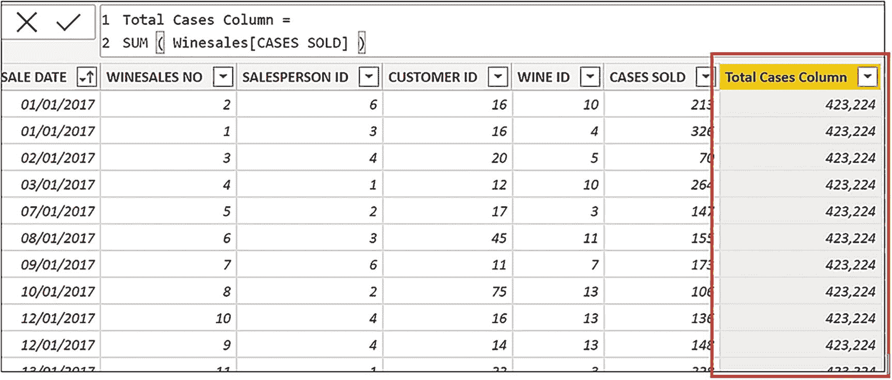

**图 15-1** – 该计算列在每一行都返回总计值

在图 15-1 中可以看到，在每一行中，该表达式都返回相同的值，即 `CASES SOLD` 的合计值。作为一个计算列，该表达式使用行上下文遍历了表，因此没有筛选条件存在。根据定义，聚合函数（如 `SUM`）要求先对要聚合的行进行筛选。由于表上没有筛选条件，该表达式只能使用整个表的值，因此对所有 `CASES SOLD` 的值进行了求和。

我们刚刚了解到，当存在迭代，*并且*我们使用了 `CALCULATE` 时，就会发生上下文转换。因此，我们现在可以首次观察上下文转换在计算列中的实际作用：通过编辑我们的表达式，并使用 `CALCULATE` 将其包裹起来：

```
Total Cases Column =  
CALCULATE (  
SUM ( Winesales[CASES SOLD] )  
)
```

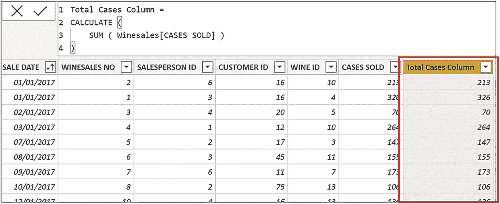

**图 15-2** – 使用 `CALCULATE` 会在计算列中触发上下文转换


图 15-2 显示该表达式的结果返回每一行的 `CASES SOLD` 值。这里发生的情况是，该表达式像所有计算列一样，通过迭代表生成行上下文。但我们在迭代中还使用了 `CALCULATE`，通过这样做，表达式忽略了行上下文，并用筛选上下文取代了它。请注意，尽管表达式使用了 `CALCULATE`，但 `CALCULATE` 内部并没有筛选参数。那么，`CALCULATE` 使用的是哪个筛选器呢？答案相当奇特（至少对于 DAX 新手来说是这样）。一个筛选器会被放置于当前行中每一列的每个值上。例如，表中计算返回 **213** 的第一行，其筛选器是这样的：

```
SALE DATE = 01/01/2017
WINESALES NO = 2
SALESPERSON ID = 6
CUSTOMER ID = 16
WINE ID = 10
CASES SOLD  = 213
```

计算列“Total Cases Column”迭代了 `Winesales` 表，并且由于存在 `CALCULATE`，上下文转换发生了。共享相同筛选集（如前所述）的所有行会被分组，并在各自组内被筛选。求和的 `CASES SOLD` 值是每个组内的已售箱数值。由于我们的行是唯一的，每个分组仅包含一行，因此表达式返回的结果与 `CASES SOLD` 相同。这就是为什么，如果在示例中第一行有重复，你会在“Total Cases Column”中看到 **426**（213 x 2），因为重复行会在 `CASES SOLD` 求和之前被分组。^(¹⁷) 然而，我们的每一行都是唯一的，因此上下文转换生成的每个筛选只返回一行，即当前行。这是在计算列中使用 `CALCULATE` 的一个示例，其中存在迭代（因此有行上下文），所以 `CALCULATE` 会触发上下文转换。

但是，当你使用存在行上下文的*度量值*时，也会发生上下文转换，例如，如果你将度量值放入计算列中。

> **注意**  
> 建议在数据视图中按以下说明创建计算列。

这是因为所有度量值都会隐式调用 `CALCULATE`，因此上下文转换也会发生。例如，我们来看这个度量值：

```
Total Cases =
SUM ( Winesales[CASES SOLD] )
```

现在让我们编辑计算列“Total Cases Column”，以执行相同的计算（即对 `CASES SOLD` 列求和），但这次用“Total Cases”度量值来表示：

```
Total Cases Column =
[Total Cases]
```

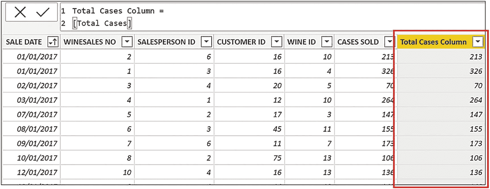

在计算列中使用度量值会触发上下文转换

你会在图 15-3 中注意到，该表达式的结果与我们显式使用 `CALCULATE` 时相同。因此，这两个表达式

```
Total Cases Column =
CALCULATE (
SUM ( Winesales[CASES SOLD] ) )
```

和

```
Total Cases Column =
[Total Cases]
```

是*相同*的表达式。

在理解上下文转换的这一阶段，我理解你可能会想：我为什么要创建一个返回与当前行值相同结果的计算列呢？再者，我们的 `Winesales` 表作为事实表，可能包含数百万行，因此计算列中的任何上下文转换都会非常慢。简而言之，上下文转换的目的是什么？

为了回答这个问题，让我们看看上下文转换在维度表中被调用时，与在事实表中相比性能如何。现在，我们重复使用前面用过的相同表达式，但这次不把它们放在事实表中，而是放入 `Wines` 维度中。

以下是我们可以在 `Wines` 维度中创建的计算列：

```
Wine Total Cases 1=
SUM ( Winesales[CASES SOLD] )
Wine Total Cases 2 =
CALCULATE (
SUM ( Winesales[CASES SOLD] ) )
Wine Total Cases 3 =
[Total Cases]
```

通过观察图 15-4 中这些计算列的行为，让我们更仔细地审视每个表达式的求值过程。

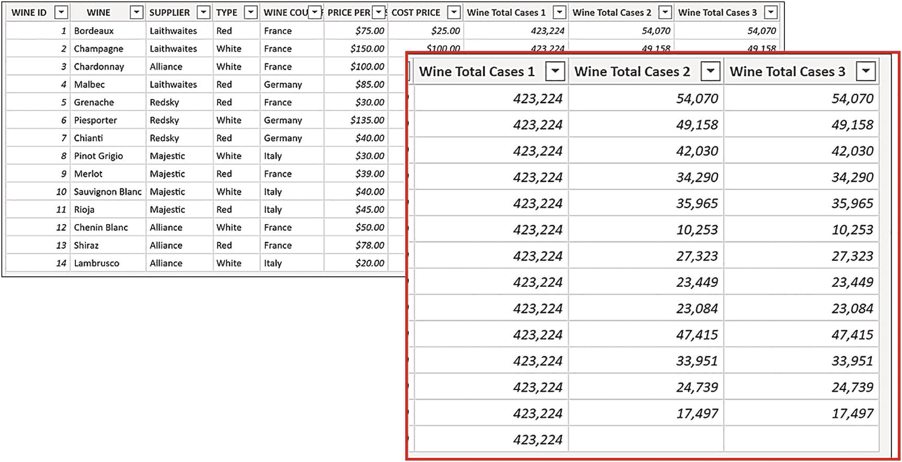

`Wines` 维度中的三个计算列

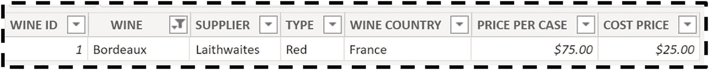

`Wines` 维度被上下文转换筛选

这些计算列中的第一个，“Wine Total Cases 1”，使用了 *“SUM ( Winesales[CASES SOLD] )”* 表达式。该表达式中没有度量值，也未隐式或显式地使用 `CALCULATE`。该表达式使用了需要筛选上下文的 `SUM` 函数。在没有任何筛选的情况下，它会对 `Winesales` 表中所有行的 `CASES SOLD` 值求和，得出 `CASES SOLD` 的总计。

第二个计算列，“Wine Total Cases 2”，使用了 `CALCULATE`，它将计算列迭代所触发的行上下文转换为筛选上下文。此时，我们需要提醒自己，筛选上下文始终会传播到整个数据模型。由上下文转换产生的筛选器，与来自报表画布上的视觉对象或切片器的筛选器行为无异。当计算列“Wine Total Cases 2”中的表达式对 `Wines` 维度的第一行进行求值时，它会将整行转化为筛选器，并筛选出“Bordeaux”葡萄酒。我们可以想象，在求值第一行时的内存中，我们的 `Wines` 维度看起来就像图 15-5 中的表格。

图 15-5 看起来眼熟吗？对 `Wines` 维度中“Bordeaux”的筛选，与我们使用切片器或任何其他方式在报表中筛选“Bordeaux”时应用的筛选是相同的。我们知道，因为 `Wines` 维度与 `Winesales` 事实表存在多对一关系，所以这个*由上下文转换生成的*筛选器会继续传播到 `Winesales` 表。因此，我们的 `Winesales` 表现在被交叉筛选为仅包含“Bordeaux”葡萄酒，并据此对 `CASES SOLD` 值进行求和。

因此，我们可以得出结论，使用 `CALCULATE` 并在其中发生上下文转换的计算列，其行为类似于报表画布上视觉对象中的度量值，它会先筛选再进行聚合。

再看第三个计算列，“Wine Total Cases 3”，这里我们使用了“Total Cases”度量值，该度量值定义了与“Wine Total Cases 2”相同的表达式。因为所有度量值都会隐式调用 `CALCULATE`，所以“Wine Total Cases 2”和“Wine Total Cases 3”是相同的表达式。每当你看到一个度量值，即使它没有显式使用 `CALCULATE`，你也应始终想象它被包裹在 `CALCULATE` 内部。

总结这三个计算列的输出结果，“Wine Total Cases 2”和“Wine Total Cases 3”在求值过程中都使用了上下文转换，但“Wine Total Cases 1”没有。


## 上下文转换如何返回“令人意外的结果”

在研究上下文转换时，我们一直使用计算列来观察其实际运作。然而，我们并不需要亲眼目睹上下文转换的发生才能理解它，而且实际上，你在实际工作中可能也不会创建这类计算列。

大多数情况下，上下文转换在你构建*引用另一个度量值*的迭代度量值时（因为所有度量值都会隐式调用 `CALCULATE`），会在内存中幕后进行。

现在，让我们回顾一下上下文转换发生的特定情况：

-   当表达式通过度量值显式或隐式使用 `CALCULATE`  
    并且  
-   当表达式使用行上下文迭代表时

通常，这发生在我们将度量值嵌套在迭代型的“X”聚合函数（如 `AVERAGEX` 或 `MAXX`）中，或者在 `FILTER` 函数中使用度量值时。由于我们看不见上下文转换的发生，对其存在浑然不知意味着我们会难以理解 `DAX` 的运行机制。Marco Russo 和 Alberto Ferrari 在他们的《DAX 权威指南》中这样解释理解上下文转换：

*“对某些行为无知可能会导致意外的结果。然而，一旦你掌握了该行为，你就能按需利用它。在 `DAX` 中，奇怪行为与有用特性之间的唯一区别——至少在这里——就是你的知识水平。”*^(¹⁸)

Marco 和 Alberto 谈到了“奇怪行为”和“意外结果”。这些行为之所以让你觉得奇怪或意外，唯一原因就是你不理解上下文转换的行为，不明白在度量值评估过程中，迭代*调用 `CALCULATE` 的度量值*与迭代*不调用 `CALCULATE` 的表达式*之间存在着天壤之别。为了说明这一点，我们将研究一些表达式编写案例，在这些案例中，关键在于正确选择，即嵌套度量值还是嵌套表达式。通过这些例子，我们将看到 `DAX` 表达式如何返回“令人意外的结果”——当然，除非你理解了上下文转换的行为。

### 使用 AVERAGE 进行筛选

在第一个例子中，我们必须在度量值中引用一个*表达式*才能获得正确的计算结果；嵌套定义相同表达式的度量值则行不通。

考虑这样一个计算：找出每种酒销量箱数大于该酒平均销量箱数的销售记录数。例如，“波尔多”的平均销量箱数是 **300**，我们想计算“波尔多”有多少笔销售的箱数大于这个值（这纯粹是智力练习，并非特别实用的计算）。

我们已经创建了这两个度量值：

```
Avg Cases =
AVERAGE ( Winesales[CASES SOLD] )
No. of Sales =
COUNTROWS ( Winesales )
```

现在，要计算 `CASES SOLD` 值大于平均箱数的销售数量，我们可以编写这个度量值：

```
No. Of Sales GT Avg #1=
VAR AvgCasesTable =
FILTER ( Winesales, Winesales[CASES SOLD] > [Avg Cases] )
RETURN
CALCULATE ( [No. Of Sales], AvgCasesTable )
```

注意在迭代 `Winesales` 表的 `FILTER` 表达式中嵌套使用了 `[Avg Cases]` *度量值*（已高亮显示）。我们知道，在迭代过程中嵌套度量值会触发上下文转换。

不幸的是，`No. Of Sales GT Avg #1` 度量值并未返回正确结果；它返回了空白。我想你会同意，这是一个令人意外的结果；见图 15-6。

图 15-6  
`No. Of Sales GT Avg #1` 未返回值

显然，我们必须更仔细地研究这里发生了什么。这个度量值 `No. Of Sales GT Avg #1` 使用了 `FILTER` 函数，该函数迭代 `Winesales` 表，筛选出 `CASES SOLD` 值大于 `[Avg Cases]` 度量值计算出的值的行。但 `[Avg Cases]` 计算的值是多少？如果我们将 `[Avg Cases]` 这个度量值作为计算列放入 `Winesales` 表，就能看到 `FILTER` 函数是在将 `CASES SOLD` 值与什么进行比较；见图 15-7。

图 15-7  
在计算列中评估的 `[Avg Cases]` 度量值将 `Winesales` 表筛选为当前正在评估的单行

> 注意：请记住，在图 15-6 的表格可视化中第一次评估时，`Winesales` 表会在内存中被交叉筛选为“波尔多”葡萄酒，即 `WINE ID 1`。

我们发现 `[Avg Cases]` 返回的值与 `CASES SOLD` 值相同。这是因为 `[Avg Cases]` 是一个度量值，因此当 `FILTER` 迭代 `Winesales` 表时，它会触发上下文转换。这会在内存中正在评估的 `Winesales` 表的每一行上创建一个筛选器。由于每一行都是唯一的，它只计算当前行的 `CASES SOLD` 平均值，结果与 `CASES SOLD` 值相同。因此，`[Avg Cases]` 的值永远不会大于 `CASES SOLD` 值。你可以通过将 `>` 改为 `>=` 来测试，此时返回的将不会是空白，而是与 `No. of Sales` 相同的值。

现在，让我们将 `FILTER` 函数中的度量值替换为一个计算平均值的*表达式*（已高亮显示）：

```
No. Of Sales GT Avg #2 =
VAR AvgCasesTable =
FILTER ( Winesales, Winesales[CASES SOLD] >
AVERAGE ( Winesales[CASES SOLD] ) )
RETURN
CALCULATE ( [No. Of Sales], AvgCasesTable )
```

这次我们得到了正确的结果；见图 15-8。

图 15-8  
在 `FILTER` 中使用嵌套表达式而非嵌套度量值返回了正确结果

要理解为什么使用表达式的第二个版本的度量值能够生效，我们可以再次将表达式 `AVERAGE ( Winesales[CASES SOLD] )` 放入 `Winesales` 表的一个计算列中，并筛选为“波尔多”葡萄酒（因为在第一次评估时，这是对 `Winesales` 表的内存交叉筛选）。

我们在图 15-9 中可以看到，该表达式返回了当前筛选上下文中该酒的平均销量箱数。

> 注意：在图 15-9 中，我们模拟了在当前筛选上下文*内存*中 `Winesales` 表中可见的行，你在数据视图中无法看到这些行。因此，当你将 `AVERAGE ( Winesales[CASES SOLD] )` 放入计算列时，你会看到所有交易的平均值 (**192**)，而不仅仅是“波尔多”酒的平均值 (**300**)。

图 15-9  
在计算列中评估的 `AVERAGE ( Winesales[CASES SOLD] )` 表达式返回了每种酒的平均箱数

我们知道“波尔多”的平均销量箱数是 **300**。因此，在第一次对“波尔多”的评估中，有 **89** 笔交易的销量箱数大于 **300**。

因此我们可以理解，尽管表达式和度量值计算的是相同的平均值，但我们必须在被评估的度量值内部嵌套平均值的*表达式*，而不是嵌套计算该平均值的*度量值*。


### 使用 `MAX` 的筛选器

在我们关于 DAX 可能返回“出人意料结果”的第二个示例中，我们将计算累计总计，如图 15-10 所示。

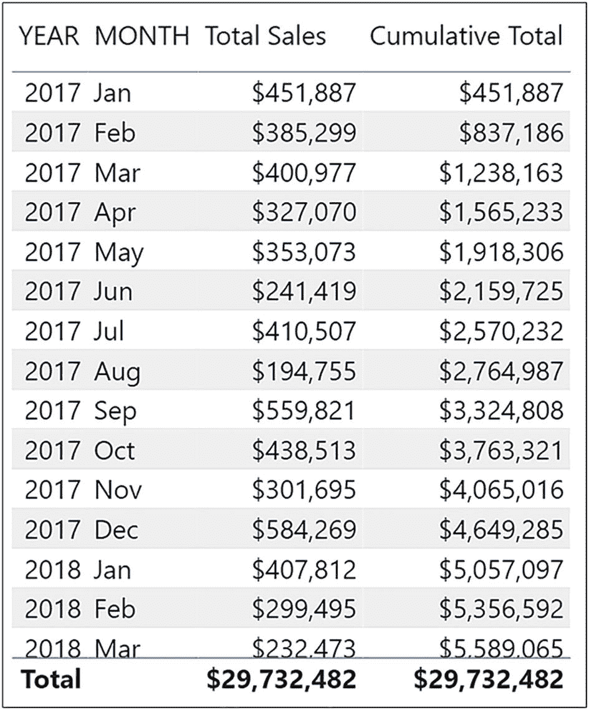

**图 15-10** – 在“累计总计”度量值中计算累计总计

要生成“累计总计”度量值，我们必须在父度量值中再次使用嵌套表达式，而不是嵌套度量值，这一次我们将使用聚合函数 `MAX`。

> **注意**  
> 我们之前已经使用时间智能函数 `DATESBETWEEN` 计算过累计总计。但是，在本节中，我们将探讨实现相同结果的另一种方法。

为了在图 15-10 的表格视觉对象中计算累计总计，对于当前筛选上下文中的任何给定日期，我们必须对值（在我们的示例中为总销售额）求和，一直累计到当前筛选上下文中的最新日期。例如，如果当前筛选条件是“2017 年 5 月”，我们必须对截至 **2017 年 5 月 31 日**（含该日）的值进行求和。因此，我们可能会认为，首先需要构建一个度量值，使用 `MAX` 函数查找当前筛选上下文中的最新日期，如下所示：

```
Max Date =
MAX ( DateTable[DATEKEY] )
```

然后，我们可以在以下表达式中使用这个“Max Date”度量值（高亮显示）（注意，这里使用了 `ALL` 来移除当前按月份进行筛选的 `DateTable` 上的筛选器）：

```
Cumulative Total Wrong =
VAR FilteredDatesTable =
FILTER (
ALL ( DateTable ),
DateTable[DATEKEY] <= [Max Date]
)
RETURN
CALCULATE ( [Total Sales], FilteredDatesTable )
```

从图 15-11 的视觉对象中查看此表达式的结果，显然，这并没有起作用。

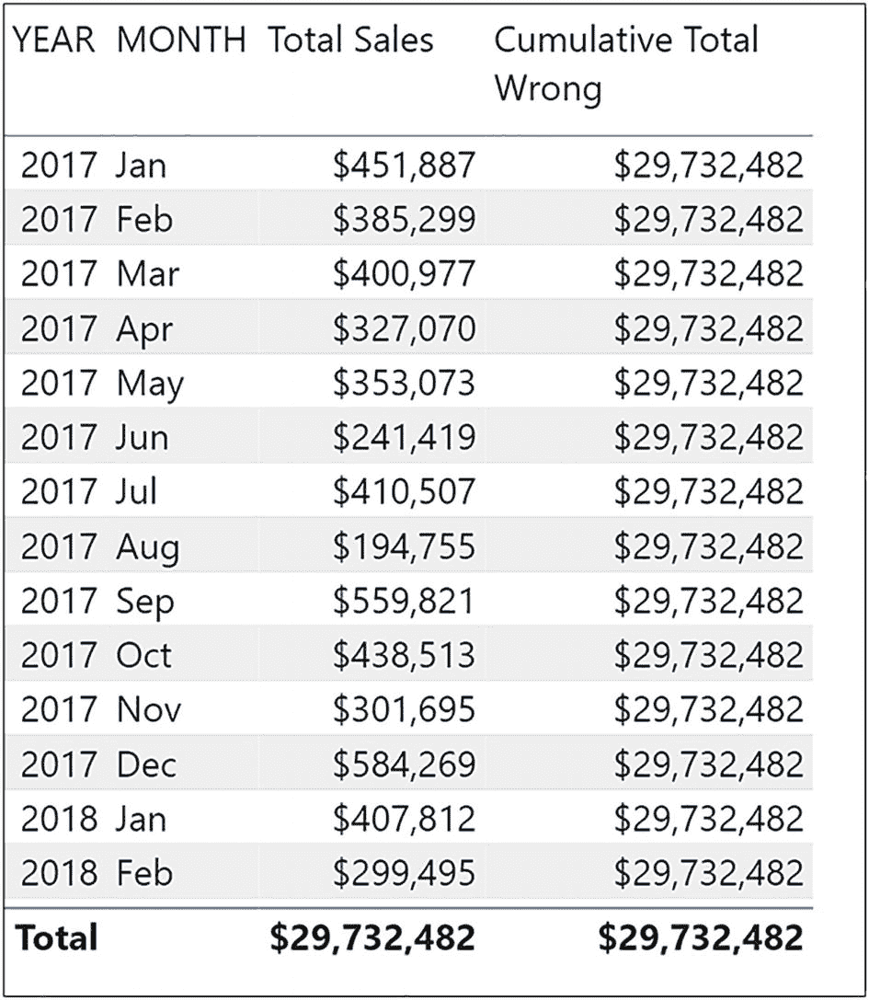

**图 15-11** – “Cumulative Total Wrong”度量值返回了错误的结果

让我们看看“Cumulative Total Wrong”哪里出了问题。这里，我们使用了定义最大日期的度量值“Max Date”。`FILTER` 函数与 `ALL` 结合使用，生成了一个包含 `DateTable` 中所有行的虚拟 `DateTable`。然后，它遍历这个虚拟表，将 `DATEKEY` 列中的每个日期与“Max Date”计算出的日期进行比较。“Max Date”的值是多少呢？“Max Date”度量值会触发上下文转换，因此会将每一行筛选为单一行。所以，在遍历 `DateTable` 时，它总是返回当前位于 `DateTable` 当前行中的那个相同日期。为了理解这一点，我们可以将“Max Date”度量值放入 `DateTable` 的一个计算列中，如图 15-12 所示。

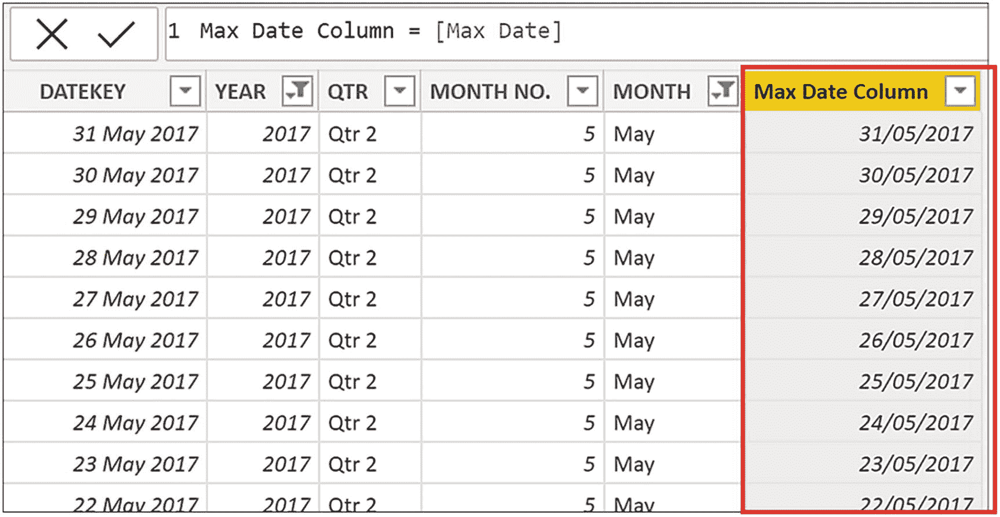

**图 15-12** – 在计算列中求值的“Max Date”度量值将 `DateTable` 筛选为仅包含正在被求值的单一行

由于 `DATEKEY` 总是 *等于* “Max Date”，所有日期都被 `FILTER` 函数筛选掉了，因此 `CALCULATE` 计算的是所有日期的总案例数（换一种方式看这个问题，可以尝试将 `<=` 替换为 `<`，此时将返回空白）。

因此，要解决此问题，我们必须使用一个表达式（高亮显示）来计算当前筛选上下文中的最新日期，这才是正确的度量值：

```
Cumulative Total =
VAR FilteredDatesTable =
FILTER (
ALL ( DateTable ),
DateTable[DATEKEY] <= MAX ( DateTable[DATEKEY] )
)
RETURN
CALCULATE ( [Total Sales], FilteredDatesTable )
```

在这个度量值中，`FILTER` 函数与 `ALL` 结合使用，遍历虚拟的 `DateTable` 表，将 `DATEKEY` 列中的每个日期与表达式 *“`MAX ( DateTable[DATEKEY] )`”* 计算出的日期进行比较。这个表达式会找到当前筛选上下文中的最新日期；例如，在求值“2017 年 5 月”时，它将返回 **2017 年 5 月 31 日**；参见图 15-13。

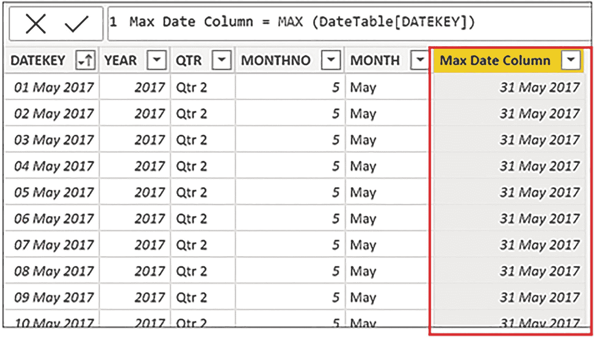

**图 15-13** – 在计算列中求值的 `MAX` 表达式返回当前筛选上下文中该月份的最大日期

> **注意**  
> 在图 15-13 中，我们再次模拟了在当前筛选上下文中，`DateTable` 中哪些行将在内存中可见。您在“数据”视图中看不到内存中的筛选器。因此，如果将 *“`MAX ( DateTable[DATEKEY] )`”* 表达式放入 `DateTable` 的一个计算列中，您将看到 *所有日期* 的最后一天，即 **2021 年 12 月 31 日**。

`FILTER` 函数会将虚拟 `DateTable` 中 `DATEKEY` 列的每一个日期与 *“`MAX ( DateTable[DATEKEY] )`”* 计算出的日期进行比较，因此它会筛选出所有早于或等于该日期的行。


### 使用度量值进行筛选

在我们最后一个“令人惊讶的结果”示例中，必须使用度量值而非表达式。例如，你可能希望计算每笔交易的“总销售额”大于 10,000 美元的交易数量。提醒一下，这是“总销售额”度量值中使用的表达式：

```
Total Sales =
SUMX ( Winesales, Winesales[CASES SOLD] *
RELATED ( Wines[PRICE PER CASE] ) )
```

你可能会尝试使用此表达式（高亮部分）来计算销售额大于 10,000 美元的交易数量：

```
No. Of Sales GT 10,000 #1=
VAR MySales =
SUMX ( Winesales, Winesales[CASES SOLD] *
RELATED ( Wines[PRICE PER CASE] ) )
VAR SalesTable =
FILTER ( Winesales, MySales > 10000 )
RETURN
CALCULATE ( [No. Of Sales], SalesTable )
```

然而，如图 15-14 所示，此度量值返回的是交易总数，而非大于 10,000 美元的交易数量。

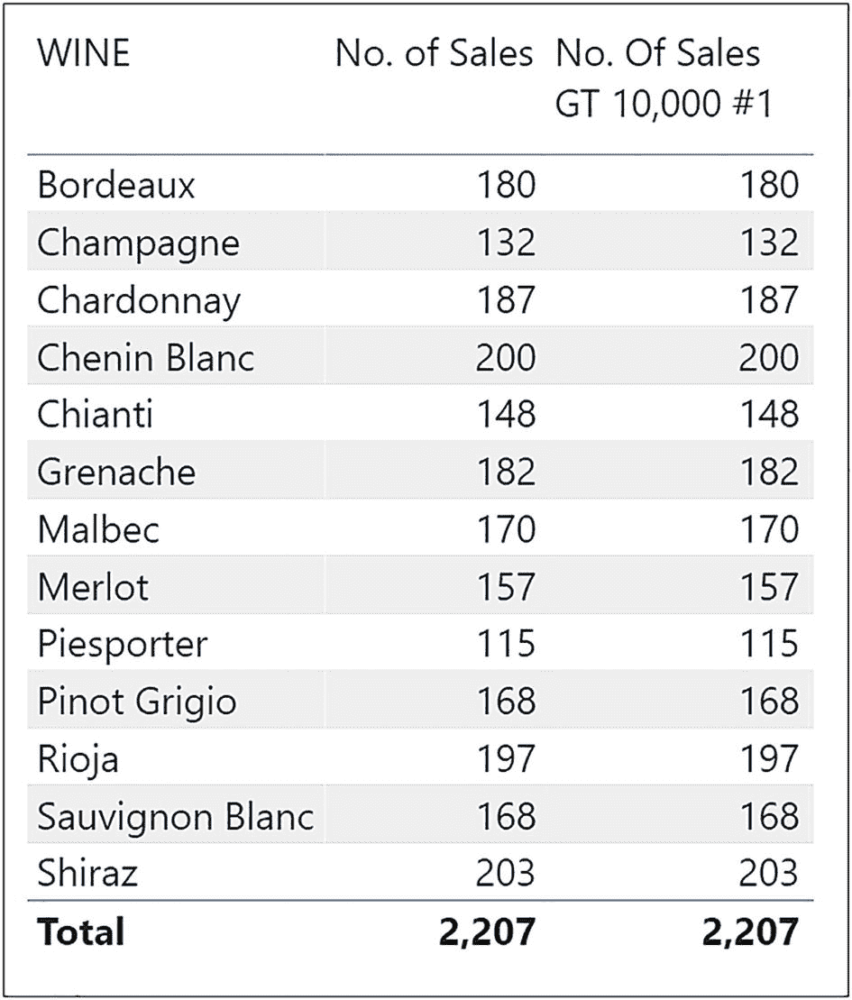

**图 15-14** – “No. Of Sales GT 10,000” 度量值并未返回正确结果

在“No. Of Sales GT $10,000 #1”度量值中，我们使用 `SUMX` 计算总销售额。然而，`SUMX` 表达式会对当前筛选上下文中 `Winesales` 表内每款葡萄酒的所有交易进行总销售额求和，从而得出每款葡萄酒的“总销售额”总计。在图 15-15 中，`SUMX` 表达式已被放入 `Winesales` 表中的计算列，以了解其在内存中的返回值（仅显示“Bordeaux”的总销售额），即该款葡萄酒的总销售额，而非每笔交易的总销售额。当 `FILTER` 迭代 `Winesales` 表时，该值将始终大于 10,000 美元。

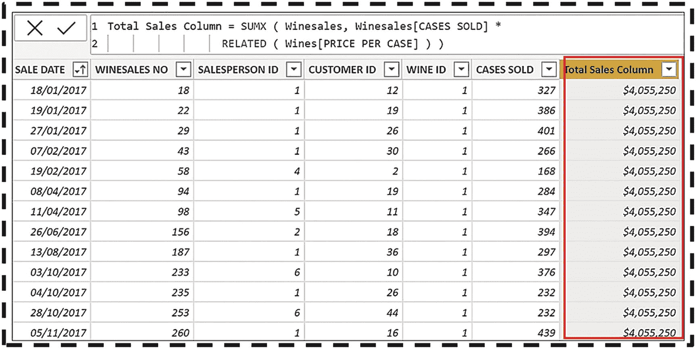

**图 15-15** – 在计算列中求值的 `SUMX` 表达式返回了当前筛选上下文中该款葡萄酒的总销售额

因此，在编写查找销售额大于 10,000 美元的交易数量的表达式时，必须在 `FILTER` 内部使用“总销售额”*度量值*（高亮部分），如下所示：

```
No. Of Sales GT 10,000 #2 =
VAR MyTable =
FILTER ( Winesales, [Total Sales] > 10000 )
RETURN
CALCULATE ( [No. Of Sales], MyTable )
```

如图 15-16 所示，使用嵌套度量值“Total Sales”的“No. Of Sales GT 10,000 #2”度量值返回了正确值。

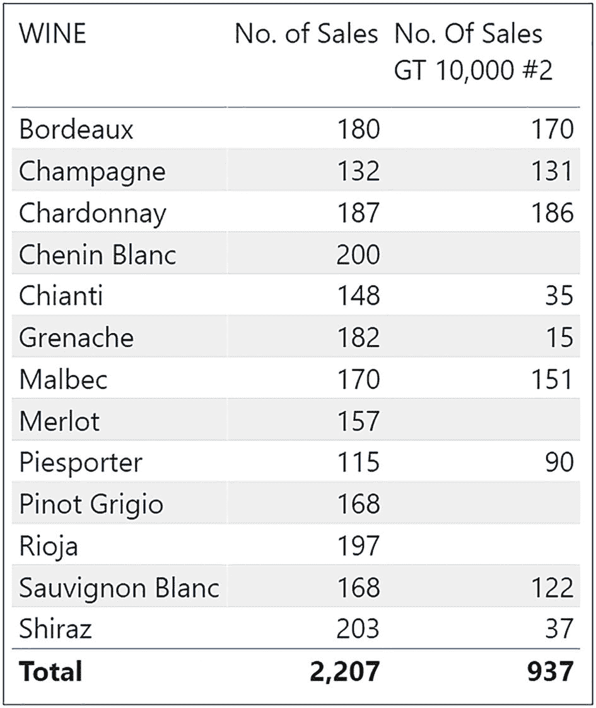

**图 15-16** – 在 `FILTER` 内使用嵌套度量值而非表达式，为销售额大于 10,000 美元的交易数量返回了正确结果

我们再次探究一下第二次尝试中使用嵌套度量值能奏效的原因。如果将“Total Sales”度量值放入计算列，就能揭示 `FILTER` 在内存中迭代 `Winesales` 表时会返回什么。我们可以看到，这是每笔交易的总销售额，因为它利用上下文转换对内存中的每一行进行了筛选；见图 15-17。

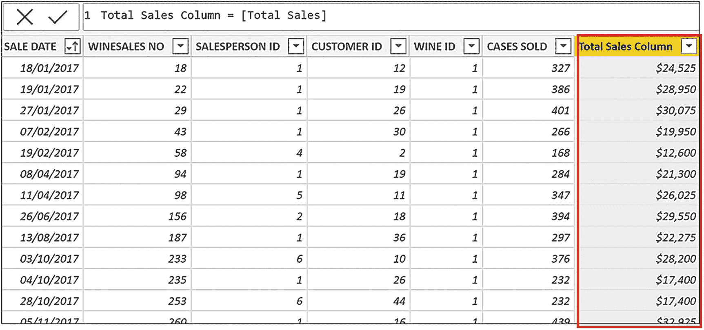

**图 15-17** – 在计算列中求值的“Total Cases”度量值将 `Winesales` 表筛选为正在求值的单一行

当 `FILTER` 迭代 `Winesales` 表时，它可以利用此值来查找大于 10,000 美元的值。

我想我们已经充分阐明了 Marco Russo 和 Alberto Ferrari 所指的“令人惊讶的结果”，在此过程中，你现在应该理解了上下文转换的概念。即由于在迭代中存在 `CALCULATE`，行上下文被转换为筛选上下文，这些筛选器会像所有筛选器一样，在数据模型中传播。无论你使用 `DAX` 多久，这些计算都是令人费解的。在接下来的章节中，我们将探讨为何接受挑战、理解上下文转换带来的奇怪行为和令人惊讶的结果如此重要，因为只有这样，你才能真正开始体验到使用 `DAX` 的益处。

## 利用上下文转换汇总总计

上下文转换的强大之处在于，当用它来计算平均值、最大值和最小值等总计值（而非行级别值）时便会显现。在本节中，我们将探究为何这是高级计算中必须掌握的知识。这也是为何清晰定义维度表尤为重要，因为为了实现这类计算，我们将在真实和虚拟的维度表之间传递上下文转换。你将在下一节中发现，上下文转换既可以同样地传递给由表表达式生成的虚拟表，也可以传递给数据模型中的实际维度。


好的，作为高级文档工程师和翻译员，我将严格遵循注意事项和示例格式，为您翻译以下内容。


### 维度中的聚合

我们将首先探讨在引用维度表的表达式中使用上下文转换时的工作原理。例如，以下这个简单的度量值：

```
Max Cases =
MAX ( Winesales[CASES SOLD] )
```

`Max Cases` 度量值可以告诉我们，在`Winesales`表中，每种葡萄酒的每笔交易中，最大箱数是多少。例如，对于“波尔多”，单笔交易中卖出的最大箱数是`500`箱。这是一个行级别的计算，但这并不是我们想要的。

我们知道，以下这个度量值将对`Winesales`表中的箱数销售值进行求和：

```
Total Cases =
SUM ( Winesales[CASES SOLD] )
```

我们此处的目标是计算这个`Total Cases`度量值的最大值，而不是单个交易的最大值，如图 15-18 所示。

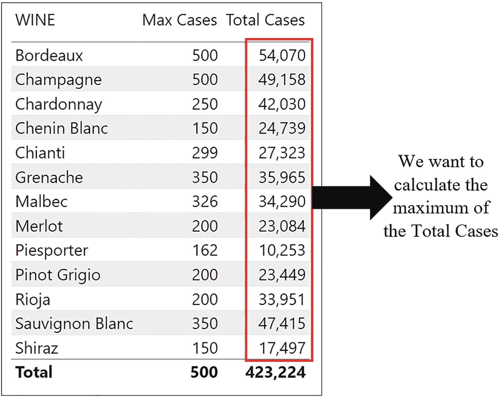

**图 15-18** `Max Cases` 度量值是一个行级别计算，但我们想要计算的是跨总计值的最大值

为此，我们需要使用上下文转换。我们知道，当一个度量值在一个表上被迭代时，就会发生上下文转换。我们之前研究了在`Wines`维度中创建一个计算列（“Wine Total Cases 3”），该列使用`Total Cases`度量值来触发上下文转换，从而为`Wines`维度中的每种葡萄酒找到售出的总箱数；参见图 15-19。

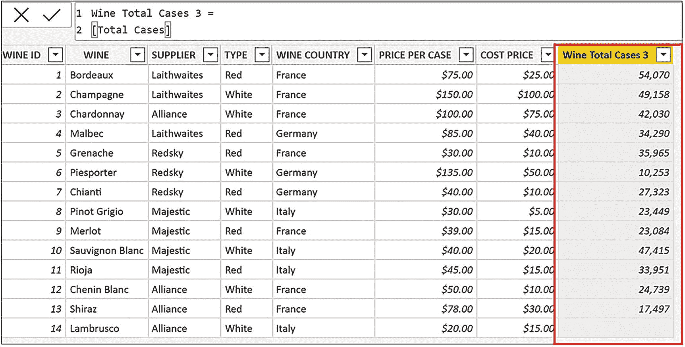

**Figure 15-19** 在`Wines`维度中使用`Total Cases`度量值创建计算列会触发上下文转换

与其将这个度量值放入计算列中来观察上下文转换，我们不如使用`MAXX`将该度量值*嵌套在另一个度量值中*，这将迭代`Wines`维度，就像计算列所做的那样。如果我们这样做，上下文转换将在内存中发生，我们就可以找到在计算列中看到的值的最大值。现在，让我们来编写这个度量值：

```
Max of Totals =
MAXX ( Wines, [Total Cases] )
```

`MAXX`函数在内存中迭代`Wines`维度，为维度中的每一行计算`Total Cases`*度量值*，就像图 15-19 中的计算列一样。然后，它找出这些值中的最大值。

**注意**：我们在这里使用`MAXX`函数，是因为更容易理解其计算过程——你可以轻松看出哪个值最大。然而，`AVERAGEX`函数可能更适用，因为你可能需要计算总计的平均值才能知道那个值是什么。

但是，当这个度量值被放入图 15-20 的表格可视化对象中时，为什么除了“总计”行（该行的值是正确的）之外，在所有其他行中都返回了与`Total Cases`度量值相同的结果？

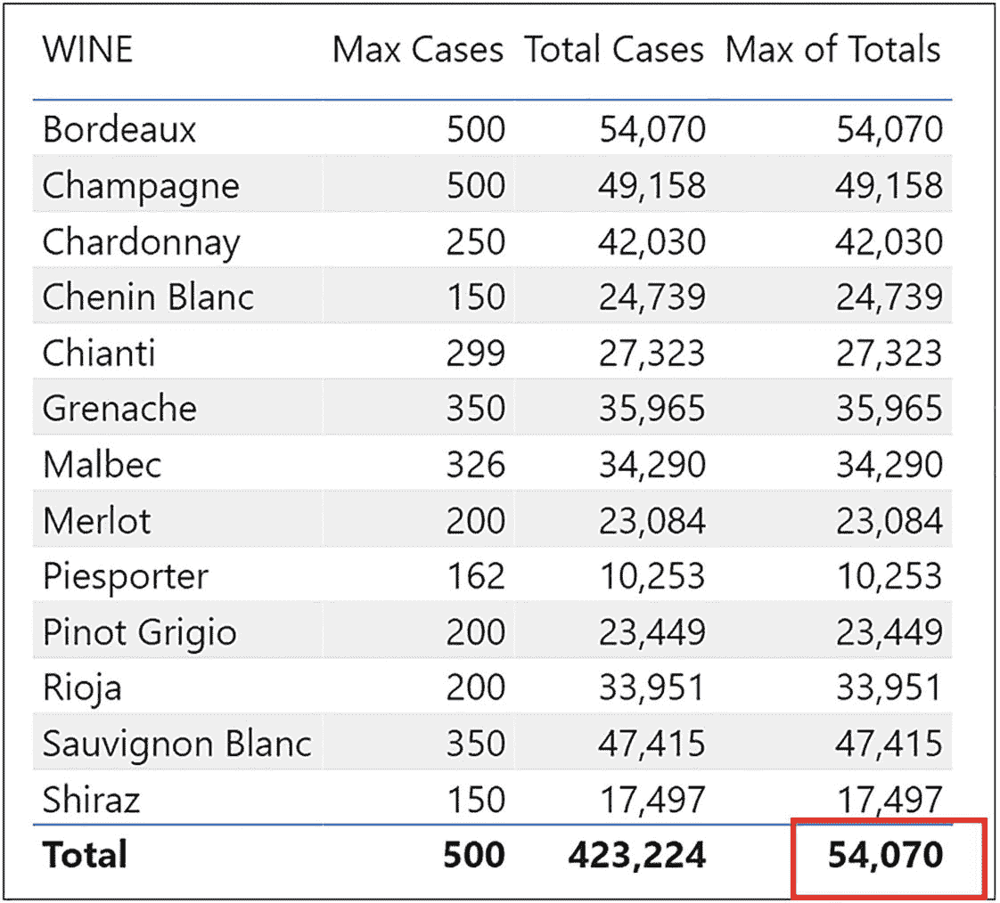

**图 15-20** `Max of Totals` 度量值在“总计”行中是正确的，值为 `54,070`，即“波尔多”的售出箱数

现在让我们来回答这个问题。在这个表格可视化对象中，首先计算的是“波尔多”葡萄酒，因此在当前筛选器中，只有一个`Total Cases`的值，那就是“波尔多”的总箱数。单个值的最大值就是该值本身，这就是为什么我们看到`Total Cases`和`Max of Totals`的值相同。只有当度量值计算到“总计”行时（此时没有对`Wines`维度进行筛选），它才能找到所有葡萄酒中的最大值，即“波尔多”的`54,070`。

这里需要强调的一点是，上下文转换总是在应用于数据模型的筛选器内工作。例如，如果我们在画布上添加一个“销售人员”切片器并筛选“Abel”，我们现在可以看到“Abel”的最大箱数（`10,993`）。因为`Winesales`事实表现在被筛选为“Abel”的销售数据，所以上下文转换现在会在新的筛选上下文中计算这些值；参见图 15-21。

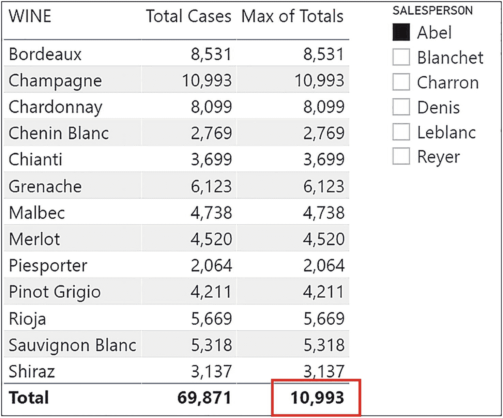

**图 15-21** 在不同筛选上下文中计算的 `Max of Totals` 度量值

然而，由于`Max of Totals`度量值为每种葡萄酒都返回与`Total Cases`相同的值，因此该度量值在筛选葡萄酒名称的可视化对象中实际上并不起作用。这个度量值更适用于被放置在筛选其他维度的可视化对象中。在图 15-22 中，我们在一个矩阵和一个表格可视化对象中使用了`Max of Totals`度量值，这些对象显示了每个销售人员的最大箱数。我们重点关注了“Abel”的最大箱数值，即“香槟”的`10,993`。我们还将此度量值放在一个卡片可视化对象中，以显示所有葡萄酒的最大箱数。

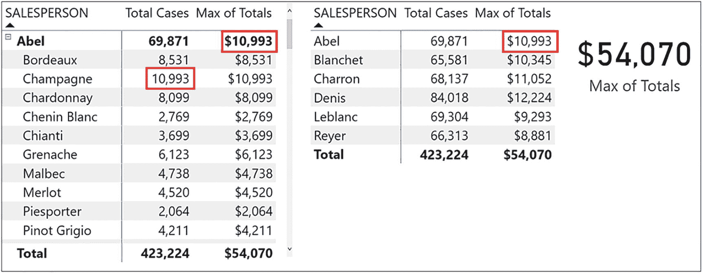

**图 15-22** 如果放置在筛选除`Wines`维度之外的其他维度的可视化对象中，`Max of Totals` 度量值效果更好

现在让我们考虑另一种场景。也许你想要通过编程方式识别哪种葡萄酒的总箱数最大（在本例中是“波尔多”），而不是计算总箱数的最大值。

在这种情况下，对于每种葡萄酒的评估，我们必须计算所有葡萄酒总箱数的最大值。然后，我们可以将此最大值与每种葡萄酒的总箱数进行比较。因此，我们必须使用`ALL`或`ALLSELECTED`来移除对`Wines`维度的筛选，如下例所示：

```
Max of Totals #2 =
MAXX (
ALL ( Wines ) , [Total Cases] )
```

在此度量值中，我们使用`ALL`生成一个包含`Wines`维度中所有行的虚拟表，因此，`MAXX`将迭代此临时表中的所有行。上下文转换为每一行计算总箱数，而`MAXX`则找到这些值中的最大值。如果你有一个筛选葡萄酒的切片器，你必须使用`ALLSELECTED`，它将输出一个包含切片器中筛选出的葡萄酒的虚拟表。

现在，我们可以编写一个度量值，使用`Max of Totals #2`度量值中的表达式作为变量，专门返回具有最大售出箱数的葡萄酒名称：

```
Wine with Max =
VAR MyMax =
MAXX ( ALL ( Wines ), [Total Cases] )
RETURN
CALCULATE ( VALUES (Wines[WINE] ),
FILTER ( Wines, [Total Cases] = MyMax ) )
```

注意，这里使用了`VALUES`函数来返回将根据筛选表达式进行筛选的葡萄酒名称。

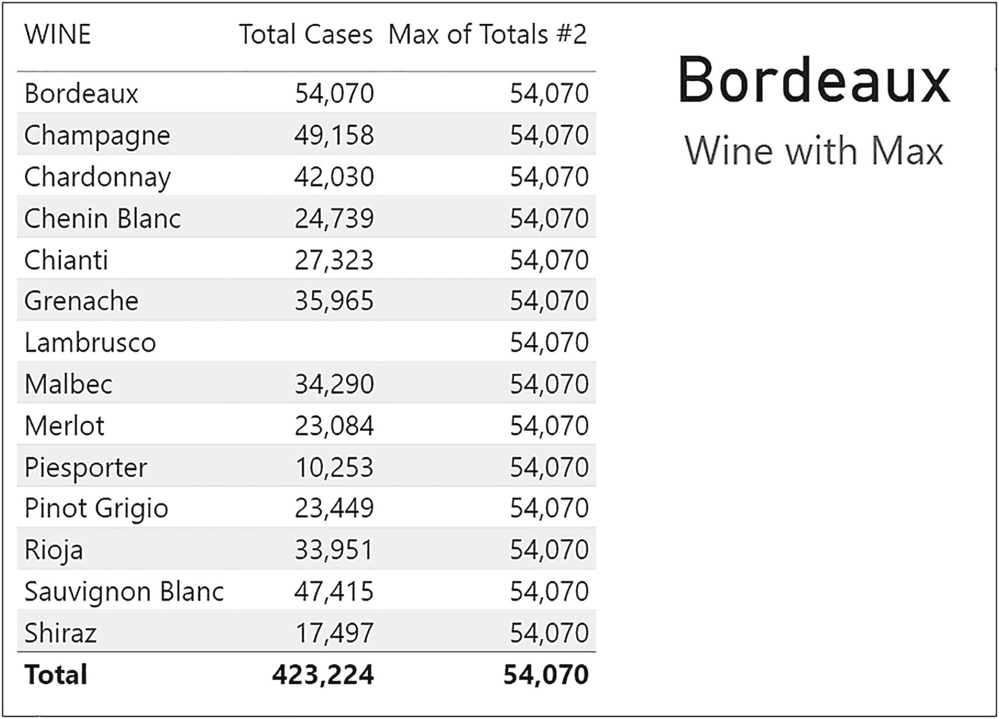

**图 15-23** `Max of Totals #2` 返回所有葡萄酒的最大值。然后我们可以使用此表达式来查找具有最大值的葡萄酒

你可以在图 15-23 中看到这些度量值的结果。请注意，我们如何在卡片可视化对象中使用`Wine with Max`度量值，以显示由`VALUES`返回的标量值。

在前面的示例中，我们使用`ALL`生成一个包含`Wines`维度中所有行和所有列的虚拟表。在下一节中，我们将看到我们同样可以使用`ALL`生成一个仅包含`WINE`列的虚拟表。

### 在虚拟表中聚合

到目前为止，我们探讨了使用维度表通过上下文转换查找总计值的最大值。然后，我们使用`ALL`生成一个虚拟的`Wines`维度来查找所有葡萄酒总计值的最大值。因此，我们知道上下文转换也可以在虚拟表中生成。现在，我们准备探讨如何使用`ALL`构建仅包含表达式所需的列（而不是表中的所有列）的虚拟表的示例。因为`ALL`将返回一个包含一列或多列非重复值的表，所以我们实际上是在使用`ALL`来对数据进行分组，以便上下文转换能够计算这些临时分组的总计值。


### 使用 `ALL` 在同一张表中对列进行分组

例如，我们需要计算每种葡萄酒的总销售额与这些总额平均值之间的差异。考虑以下度量值，它使用上下文转换来计算各葡萄酒“总销售额”的平均值。不过，这次我们在`WINE`列上使用`ALL`函数，而不是在葡萄酒表上使用`ALL`：

```
Average of Totals =
AVERAGEX ( ALL ( Wines[WINE] ), [Total Sales] )
```

如前所述，根据报表中的筛选器，你可能需要用`ALLSELECTED`来代替`ALL`。

我们来看一下该度量值求值过程中的三个步骤：

1. `ALL`函数创建一个虚拟表，其中包含单个列，该列保存`WINE`列中唯一值的列表。
2. `AVERAGEX`随后迭代该虚拟表，并使用上下文转换计算由`ALL`生成的虚拟表中每种葡萄酒的“总销售额”度量值。
3. `AVERAGEX`计算这些值的平均值。

在图 15-24 中，你可以看到由`ALL`生成的虚拟表，以及如何计算总值的平均值。

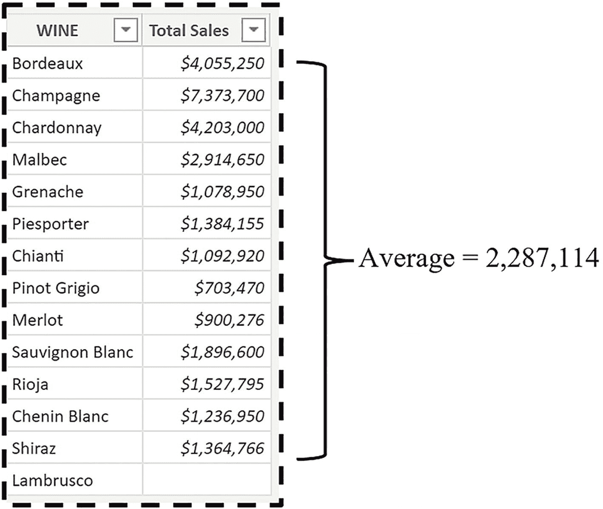

**图 15-24** – `ALL`函数创建了一张只包含`WINE`列的虚拟单列表。`AVERAGEX`迭代该表，上下文转换计算每一行的“总销售额”。`AVERAGEX`求取这些值的平均值。

现在我们可以修改这个度量值，计算每种葡萄酒的总销售额与平均值的差异，并将数据可视化；参见图 15-25。

```
Variance from Average of Totals =
VAR AvgOfTotals =
AVERAGEX ( ALL ( Wines[WINE] ), [Total Sales] )
RETURN
[Total Sales] -  AvgOfTotals
```

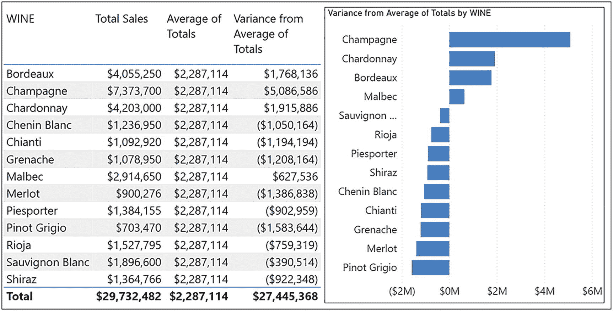

**图 15-25** – 使用上下文转换计算总值的平均值，然后我们可以找到方差。

这里，我们一直使用`ALL`按`WINE`列中的值进行分组。实际上，我们也可以使用`ALL`按销售人员、客户或地区进行分组，方法是通过生成只包含这些维度中相应实体名称列表的表。

然而，如果我们想将上下文转换传递到`DateTable`，问题就会变得稍微复杂一些。例如，表达式

```
Average Daily Sales For Dates =
AVERAGEX (DateTable, [Total Sales])
```

会将上下文转换传递到`DateTable`中的每一行，从而聚合每天的销售总额。因此，该度量值会计算日均销售额。但是，这可能并不是你感兴趣的日期粒度。也许你想计算每年平均季度销售额，如图 15-26 所示。这里，我们编写了度量值“Average Quarterly for Each Year”（每年平均季度销售额），并将其放入矩阵视觉对象中。请注意，如果视觉对象只显示`DateTable`中的`YEAR`列，该度量值效果最佳。

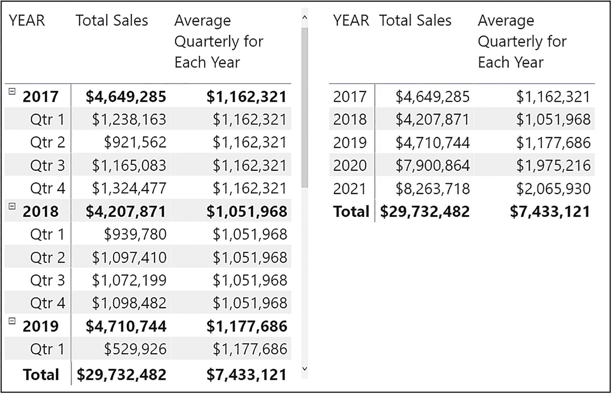

**图 15-26** – “Average Quarterly for Each Year”度量值在仅显示年份的矩阵视觉对象中效果最佳。

在图 15-26 的矩阵视觉对象中，在评估“2017”年的销售额时，`DateTable`的`YEAR`列上有一个筛选器。现在，我们必须生成一个虚拟单列表，该表保留`YEAR`列的筛选器，但列出该年份的所有四个季度，我们可以使用`ALL`函数引用`QTR`列来实现这一点。然后`AVERAGEX`可以迭代这个表，并使用上下文转换计算“2017”年每个季度的总销售额，并求出这些值的平均值。这是我们在度量值中使用的代码：

```
Average Quarterly for Each Year =
AVERAGEX ( ALL ( DateTable[QTR] ), [Total Sales] )
```

在评估“2017”年平均值时，由`ALL`生成的虚拟表将如图 15-27 所示。

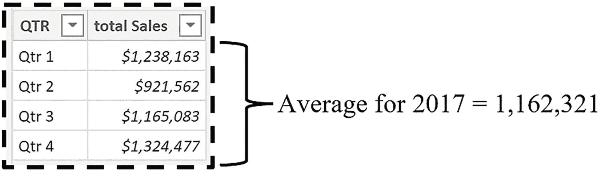

**图 15-27** – `ALL`函数构建了一个包含筛选年份中所有季度的表。

`ALL`函数还可以生成包含来自同一表的多列的唯一*组合*的虚拟表，使你能够按这些组合进行分组。例如，你可以使用以下表表达式，用`ALL`生成一个包含来自`DateTable`的年份和季度唯一列表的虚拟表：

```
ALL ( DateTable[YEAR], DateTable[QTR] )
```

由`ALL`生成的这样的虚拟表如图 15-28 所示。

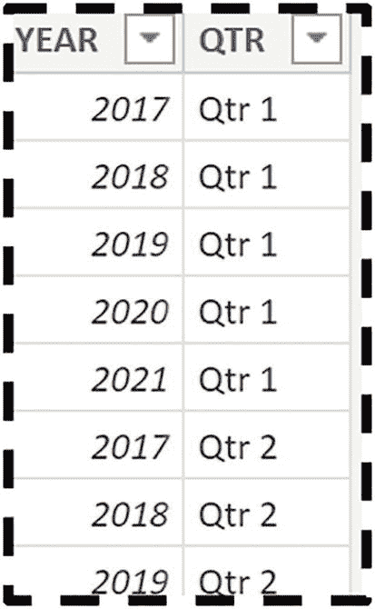

**图 15-28** – 使用`ALL`引用同一表中的多个列会生成一个包含这些值唯一组合的表。

使用上下文转换和生成图 15-28 中表的`ALL`表达式，你可以像以下度量值一样找出所有年份的平均季度总销售额：

```
Average Quarterly for All Years =
AVERAGEX (
ALL ( DateTable[YEAR], DateTable[QTR] ),
[Total Sales] )
```

这里，`ALL`函数创建了一个内存表，该表生成一个结合了`YEAR`列和`QTR`列的唯一列表，然后`AVERAGEX`使用上下文转换求出“总销售额”值的平均值；参见图 15-29。

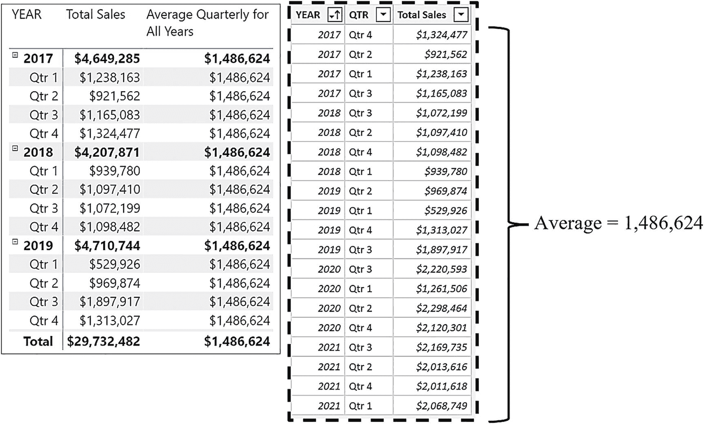

**图 15-29** – `ALL`函数生成一个虚拟表，其中包含来自同一表多个列的值唯一组合。上下文转换可以被传递到此表以计算平均值。

我们可以理解，在一个包含`YEAR`和`QTR`列的矩阵中查看该度量值，其中返回的值是重复的，这并不会给查看报表的人带来多大帮助。就像之前的“Max of Totals”度量值一样，当你在`DateTable`上没有筛选器时（如图 15-30 所示），“Average Quarterly for All Years”度量值的效果最佳。

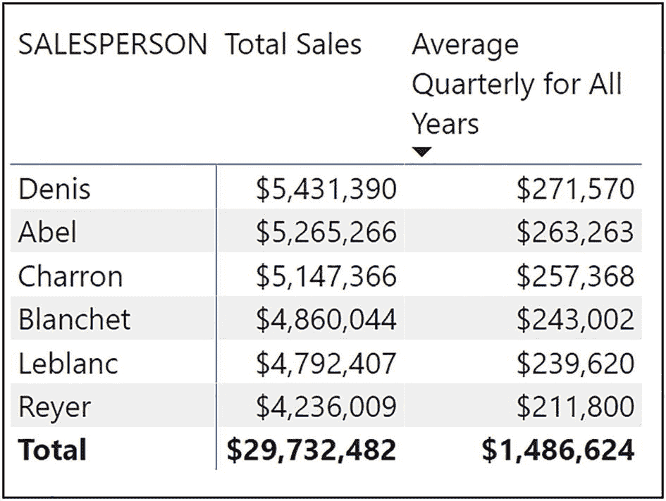

**图 15-30** – 在分析除`DateTable`之外的实体时，“Average Quarterly for All Years”度量值效果很好。

这里，我们正在通过比较销售人员的平均季度总销售额值来分析他们的销售业绩。


#### 使用 `SUMMARIZE` 对相关表中的列进行分组

通常我们可以使用 `ALL` 或 `ALLSELECTED` 将列分组到虚拟表中，以便利用上下文转换对临时分组执行计算。只有在极少数情况下，你才需要使用另一个名为 `SUMMARIZE` 的函数来完成此任务，即当你需要从*不同*表中对列进行分组时。

`SUMMARIZE` 函数允许你从同一表或*一个或多个相关表*中检索列的组合。正如我们之前所见，我们通常可以使用 `ALL` 对同一表中的列进行分组，因此 `SUMMARIZE` 通常仅在需要对来自不同相关表的列进行分组时使用。

`SUMMARIZE` 函数的语法如下：

`= SUMMARIZE ( table, group by column1, group by column2 etc., name, expression )`

其中：

- `table` 是包含你要分组的列的表或表表达式。
- `group by columns` 是你希望据此对数据进行分组的列。这些列可以来自同一表，也可以来自相关表。
- `name`（可选）是你稍后在表达式参数中希望生成的表达式的名称。这是一个非必需参数。
- `expression`（可选）是一个将对虚拟表中每一行计算的表达式。这是一个非必需参数。

大多数情况下，你只会在 `SUMMARIZE` 中使用前两个参数，即指定一个表和分组列，如下所示：

`=SUMMARIZE ( Winesales, Wines[WINE], DateTable[YEAR] )`

此表表达式构建了一个虚拟表，首先按 `WINE` 列分组，然后按 `YEAR` 列分组。之所以能做到这一点，是因为 `Wines` 表和 `DateTable` 都与 `Winesales` 表相关。

然而，使用 `ALL` 生成临时的列分组与使用 `SUMMARIZE` 之间有一个很大的区别，那就是 `SUMMARIZE` 构建的虚拟表仅包含当前筛选上下文中的值。因此，通常需要将 `ALL` 函数嵌套在 `SUMMARIZE` 内部，以移除这些筛选器。

借助 `SUMMARIZE` 内部的另外两个参数（即“name”和“expression”），你可以选择性地在虚拟表中创建计算，我们将在下一章看一个这样的示例。但是，通常为了利用上下文转换对这些分组创建计算，你可以将 `SUMMARIZE` 生成的表嵌套在 `MAXX` 和 `AVERAGEX` 等函数内部，然后由这些函数执行计算。

使用 `SUMMARIZE`，你可以对来自相关表的列进行分组。例如，如果你在 `SUMMARIZE` 内部引用的表是一个事实表，那么你可以按与该事实表相关的维度中的任何列进行分组。

如果你使用 Power BI 建模选项卡上的**新建表**按钮，你可以使用表函数创建*计算表*。这是一种查看表表达式（例如涉及 `SUMMARIZE` 的表达式）输出的便捷方法。你可以在数据视图中查看计算表，就像查看数据模型中的任何表一样。但是，当 `SUMMARIZE` 表达式嵌套在度量值内部时，其输出将根据筛选上下文在内存中被筛选，这是你在数据视图的计算表中无法看到的。

我们可以使用 `SUMMARIZE` 通过以下表表达式对来自 `Wines` 维度的 `WINE` 列和来自 `DateTable` 的 `YEAR` 列进行分组：

```
Wine and Year Table =
SUMMARIZE ( Winesales,
Wines[WINE], DateTable[YEAR] )
```

在图 15-31 中，你可以看到此表表达式在通过**新建表**按钮创建的计算表中使用时的结果。

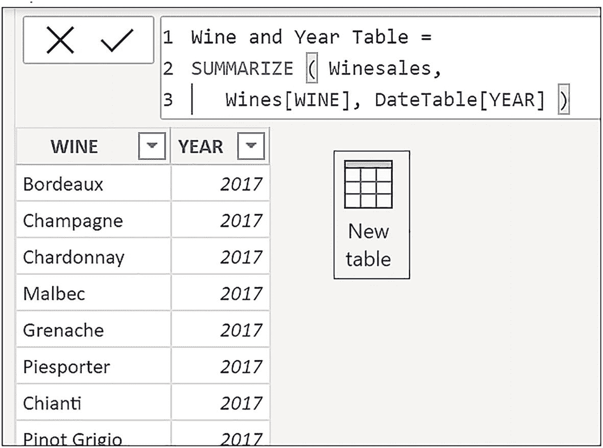
图 15-31

使用 `SUMMARIZE` 生成包含 `WINE` 和 `YEAR` 列的表

让我们看一个可能需要使用 `SUMMARIZE` 生成此虚拟表的场景，请记住，此类表将在当前筛选上下文中构建。我们想要计算所有葡萄酒的年度销售总额平均值，并将其显示在卡片视觉对象中。这是我们将使用 `SUMMARIZE` 按 `WINE` 和 `YEAR` 进行分组来编写的度量值（注意使用变量来存储虚拟表）。

```
Yearly Average =
VAR SummaryTable = SUMMARIZE ( ALL ( Winesales ), Wines[WINE], DateTable[YEAR] )
RETURN
AVERAGEX ( SummaryTable, [Total Sales] )
```

你可以在图 15-32 中看到，我们的葡萄酒年度销售额平均值为 **$457,423**。为了理解这个平均值，你可以创建一个簇状柱形图视觉对象，绘制每年葡萄酒的销售额。如果随后显示一条平均分析线，该线将显示与你在此度量值中计算的值相同的值。

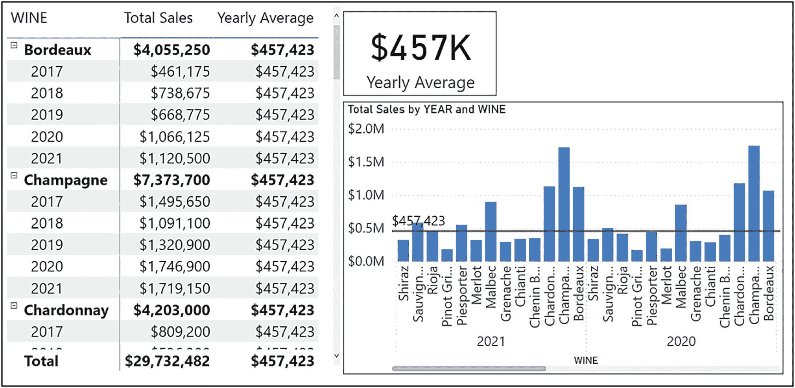
图 15-32

使用 `SUMMARIZE` 和上下文转换计算所有葡萄酒的年度平均值。这将是“分析”平均线所计算的平均值。

在“Yearly Average”度量值中，嵌套的“Total Sales”度量值使用上下文转换来计算由 `SUMMARIZE` 生成的虚拟表中每个 `WINE` 和 `YEAR` 组合的销售额。`AVERAGEX` 函数将计算由上下文转换返回的值的平均值。请注意在 `Winesales` 表上使用了 `ALL` 函数，以移除矩阵视觉对象中来自 `WINE` 列和 `YEAR` 列的筛选器。请记住，除非你使用 `ALL`，否则 `SUMMARIZE` 函数创建的汇总表仅包含*当前筛选上下文内*的值。

或者，如果我们将此度量值放入不使用 `WINE` 或 `YEAR` 列的表中，则不需要使用 `ALL` 函数，如图 15-33 所示，其中我们使用了 `REGION` 列。在这里，我们正在分析每个地区葡萄酒年度销售总额的平均值。

```
Yearly Average =
VAR SummaryTable = SUMMARIZE (  Winesales , Wines[WINE], DateTable[YEAR] )
RETURN
AVERAGEX ( SummaryTable, [Total Sales] )
```

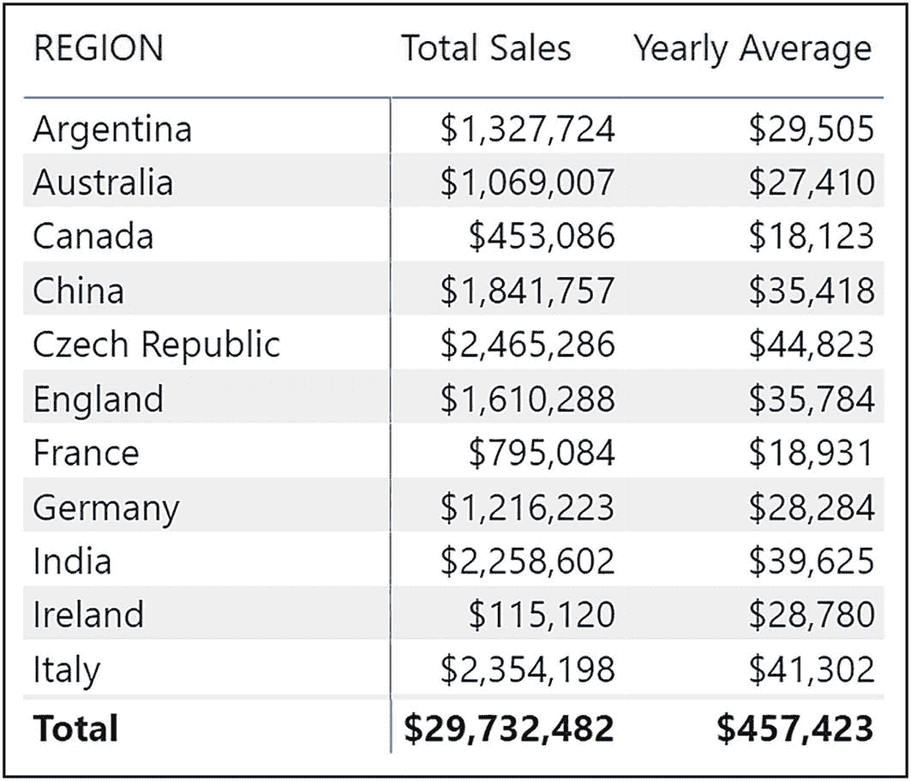
图 15-33

针对各地区计算得到的“Yearly Average”度量值

计算完所有年份所有葡萄酒的平均年度销售额后，你可能想要计算每种葡萄酒的平均年度销售额。或许再次提到，这是为了计算与平均值的偏差。如果是这种情况，这是你需要的代码：

```
Yearly Average Each Wine =
VAR Summarytable =
SUMMARIZE ( ALLEXCEPT ( Winesales, Wines[WINE] ), DateTable[YEAR] )
RETURN
AVERAGEX ( Summarytable, [Total Sales] )
```

我们在此上下文中能够使用 `ALLEXCEPT` 函数的原因将在第 18 章探讨表扩展概念时进行解释。我们在这里只需注意，通过使用 `ALLEXCEPT`，筛选器已从 `YEAR` 列中移除，而保留了 `WINE` 列上的筛选器。因此，这使我们能够传递每种葡萄酒在每一年份的销售平均值。然后，此度量值将计算偏差，但仅按 `YEAR` 粒度计算：

```
Variance from Average Each Yr =
IF (
HASONEVALUE ( DateTable[YEAR] ),
[Total Sales] - [Yearly Average Each Wine] )
```

你可以在图 15-34 中看到“Yearly Average Each Wine”和“Variance from Average Each Yr”度量值的结果。

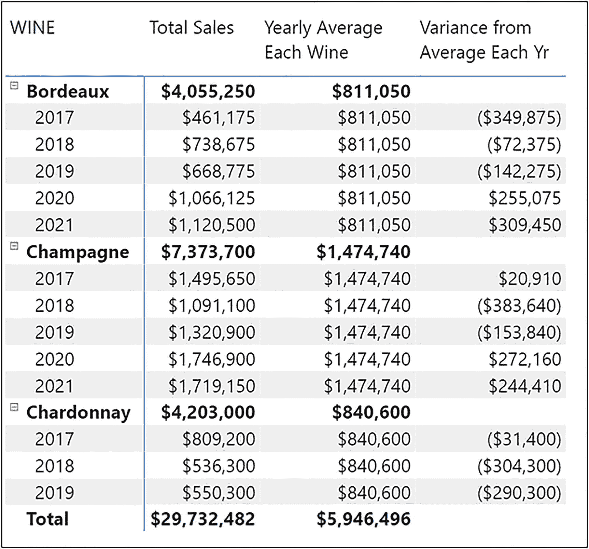
图 15-34

“Yearly Average Each Wine”和“Variance from Average Each Yr”度量值


