# 16. 善用上下文转换

在上一章中，您学习了如何利用上下文转换将数据以编程方式聚合到维度和虚拟表中。然后，您可以编写表达式，以更高的粒度对数据进行分组和聚合。一旦您掌握了以这种方式使用 DAX 的技能，DAX 的世界将为您打开一扇广阔的大门。您现在将能够编写更复杂的计算，从而获得更深入的数据洞察。在本章中，您将运用所学的上下文转换知识来解决以下数据分析问题：

我该如何

- 对实体进行排名？
- 将度量值划分到数字范围区间？
- 使用动态参数计算前 N% 或后 N%？
- 在客户群中寻找同比可比销售额？
- 使用计算列计算表中的累计总和？
- 计算计算列中前一行数值的差值？

在生成这些洞察的过程中，您将学到可迁移的技能和技巧，您可以吸收这些知识，扩展思路，并将其应用于自己的数据。

## 数据排名：认识 `RANKX`

您已经了解到，通过将迭代函数与度量值（隐式调用 `CALCULATE`）结合使用，可以享受到上下文转换带来的好处。让我们借此机会了解一下另一个迭代函数 `RANKX`。

`RANKX` 函数的语法如下：

```
= RANKX ( table, expression, value, order, ties )
```

其中：

- `table` 是您要迭代以对项目进行排名的表。此表通常由 `ALL` 函数生成，因此排名是在表的所有行上执行的，而不仅仅是在当前筛选器中的行上。
- `expression` 是用于对项目进行排名的度量值或表达式。
- `value` 是可选参数，用于比较要排名的项目（很少使用）。
- `order` 是可选参数 – `ASC`（1 为最低排名）或 `DESC`（1 为最高排名）。默认值为 `DESC`。
- `ties` 是可选参数，可以是 `Skip` 或 `Dense`，具体如下：
    - `Skip` 表示并列项之后的下一个排名值是该并列项的排名值加上并列值的数量。例如，如果有 5 个值并列排名第 11，则下一个值将获得排名 16 (11 + 5)。当省略 `ties` 参数时，此为默认值。
    - `Dense` 表示并列项之后的下一个排名值是下一个排名值。例如，如果有 5 个值并列排名第 11，则下一个值将获得排名 12。

以下是 `RANKX` 语法的一个示例：

```
= RANKX ( ALL (Wines), [Total Sales], ASC)
```

顾名思义，我们可以使用此函数按特定度量值对实体进行排名，例如，按“总销售额”度量值对我们的葡萄酒进行排名；参见图 16-1。

**图 16-1** 按“总销售额”对葡萄酒进行排名

这是“葡萄酒排名”度量值的 DAX 代码：

```
Rank Wine =
IF ( [Total Sales],
RANKX ( ALL ( Wines ), [Total Sales] ) )
```

该度量值首先检查是否存在“总销售额”值；否则，评估时将考虑值为空的项目，例如没有销售额的“兰布鲁斯科”葡萄酒。如果存在销售额值，该度量值会使用 `ALL` 构建一个包含表中所有行的虚拟葡萄酒表。然后，它利用上下文转换计算“总销售额”值，遍历每一行。最后，它将当前筛选器中的销售额值与 `ALL` 返回的表中的所有值进行比较排名，并返回其排名值。

让我们来看另一个使用 `RANKX` 的示例。例如，您可能希望按每年的销售额对财务季度进行排名，如图 16-2 所示。

**图 16-2** 使用 `RANKX` 对财务季度进行排名

在图 16-2 的矩阵视觉对象中，第一个排名评估是针对“2017”年的“Qtr 1”，相应的筛选器会应用于 `DateTable`。在这里，您必须使用 `ALL` 函数生成一个虚拟表，该表包含 `DateTable` 的 `QTR` 列中所有四个值（即“Qtr 1”、“Qtr 2”、“Qtr 3”、“Qtr 4”）的列，且仅针对“2017”年。这样，就可以利用上下文转换对该年度所有四个季度的销售额值进行排名。这是您可以在此处创建的度量值：

```
Rank by Qtr =
RANKX ( ALL ( DateTable[QTR] ), [Total Sales] )
```

但是，如果您将此度量值放入矩阵视觉对象中，您会注意到 `YEAR` 列的排名为“1”，因为只有一个小计值需要排名。为避免此无关值，您可以使用 `HASONEVALUE` 函数仅返回 `QTR` 列的一个值：

```
Rank by Qtr #2 =
IF ( HASONEVALUE(DateTable[QTR] ),
RANKX ( ALL ( DateTable[QTR] ), [Total Cases] ))
```

注意

在前面的示例中，我们在 `RANKX` 内部使用了 `ALL` 函数，但请记住，如果画布上有切片器，您可能需要改用 `ALLSELECTED` 函数。

在本章稍后部分，当我们使用 `RANKX` 对客户进行排名时，我们将再次遇到它。不过，本节最重要的收获是理解 `RANKX` 如何作为一个迭代函数与度量值一起使用，从而触发上下文转换。

## 将度量值分箱到数值范围中

在 Power BI 中分析数据时，一个常见的需求是将度量值的结果分箱到数值范围中。参考图 16-3 左侧的视觉对象。它显示我们有九位客户的“总销售额”值大于 800,000。在右侧的表格视觉对象中，我们可以看到这些客户是谁。

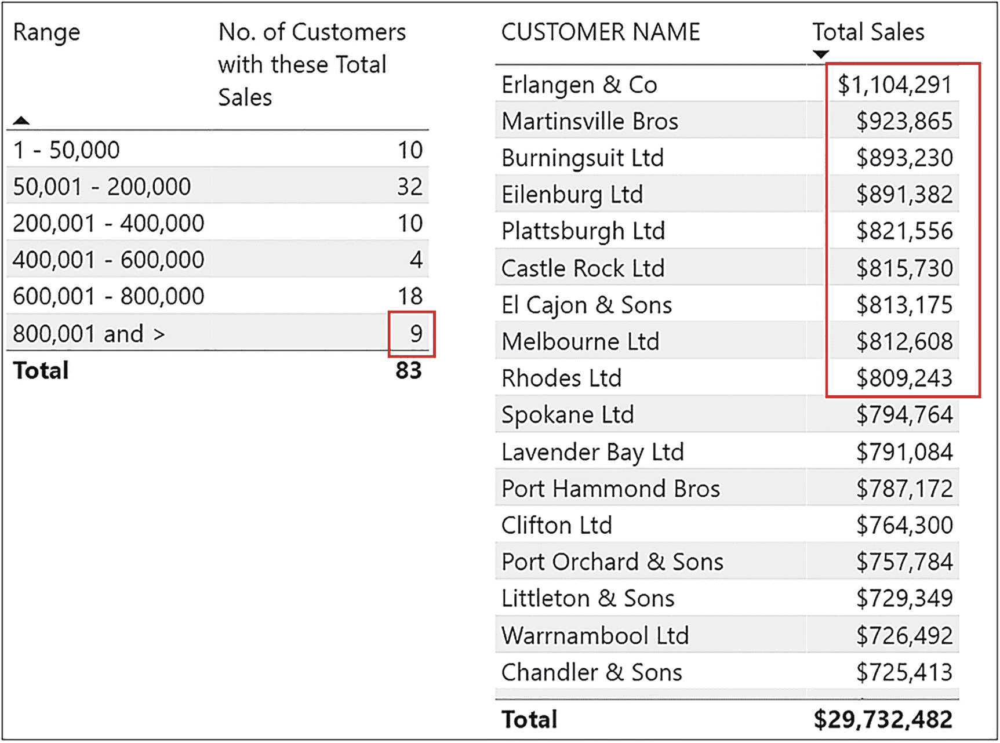

图 16-3 – 将“总销售额”分箱到数值范围

此分析的起点是生成一个定义所需范围的参数表。你在第 12 章中探索 `SELECTEDVALUE` 函数时，已经学习了如何创建参数表。要生成参数表，请使用 **主页** 选项卡上的 **输入数据** 按钮。我们将此表命名为“销售分箱”，你可以在图 16-4 中看到它。与所有参数表一样，它与数据模型中的任何其他表都没有关联。

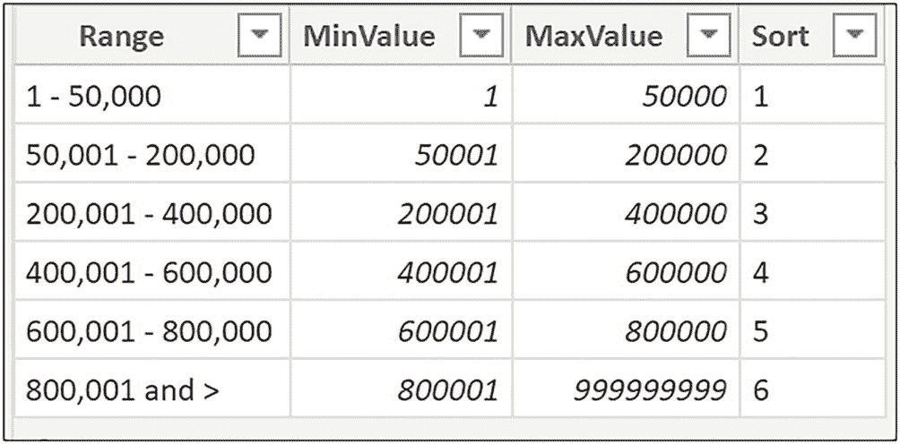

图 16-4 – “销售分箱”参数表

接下来，作为数据视图中的 *计算列*，在“销售分箱”表中，我们可以编写以下表达式，用于统计销售额落在范围值之间的客户数量：

```
客户数量列 =
COUNTROWS (
    FILTER (
        客户表,
        [总销售额] >= '销售分箱'[最小值]
            && [总销售额] <= '销售分箱'[最大值] ) )
```

你可以在图 16-5 中看到此表达式的结果。

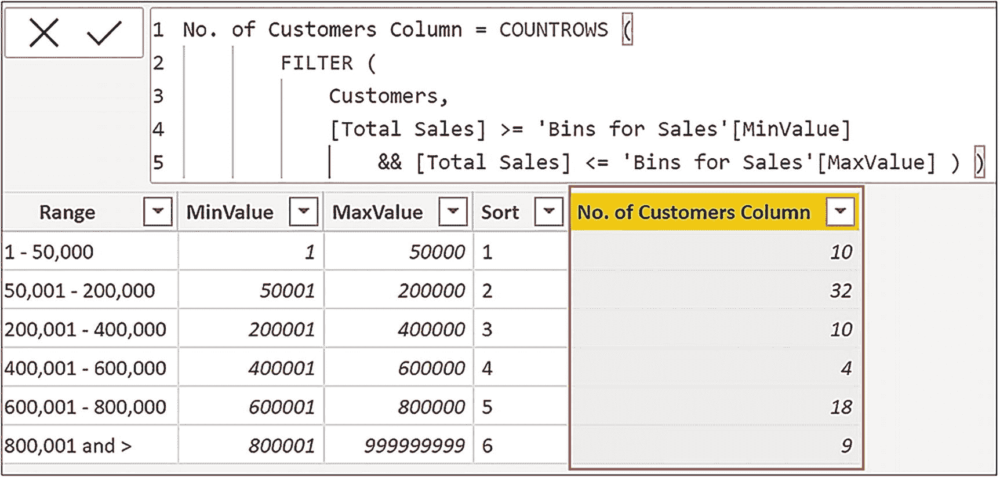

图 16-5 – 首先将客户分箱到计算列中

让我们仔细看看“客户数量列”的计算过程。因为我们使用的是计算列，所以会迭代“销售分箱”表，当前行中的 `最小值` 和 `最大值` 将用于计算。`FILTER` 函数使用的 `[总销售额]` 度量值会在 `客户表` 中触发上下文转换，从而在内存中返回每位客户的总销售额值，正是这个值被用于与“销售分箱”表当前行中的范围值进行比较。然后，`COUNTROWS` 函数对 `FILTER` 生成的虚拟 `客户表` 中的行数进行计数。在图 16-6 中，我们逐步演示了此表达式的计算过程。

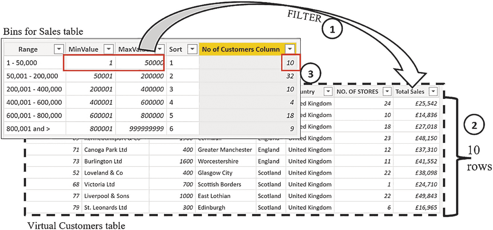

图 16-6 – 对“客户数量列”计算列的计算过程

1. 表达式迭代“销售分箱”表。`FILTER` 生成一个虚拟的 `客户表`，该表使用“销售分箱”表当前行中的范围值进行筛选。
2. `COUNTROWS` 对虚拟 `客户表` 中的行数进行计数。
3. `COUNTROWS` 返回的值在“销售分箱”表的当前行中进行计算。

然而，我们不希望这些值存在于计算列中；我们希望它们存在于度量值中，这样我们就能将其放入表格视觉对象中，从而对数据进行切片和切块。我们在第 5 章中学到，通常可以将计算列中计算的表达式转换为作为度量值计算的表达式。在那里，我们采用了表达式 `Winesales[CASESSOLD] * RELATED ( Wines[PRICEPERCASE] )`，并将其封装在 `SUMX` 内部。我们可以对计算列进行同样的操作，请记住必须由 `SUMX` 迭代的是“销售分箱”表：

```
具有这些总销售额的客户数量 =
SUMX (
    '销售分箱',
    COUNTROWS (
        FILTER (
            客户表,
            [总销售额] >= '销售分箱'[最小值]
                && [总销售额] <= '销售分箱'[最大值] ) ) )
```

然后，你可以在画布上放置一个表格视觉对象，并用“销售分箱”表中的 `范围` 列填充它。接着，将“具有这些总销售额的客户数量”度量值放入这个表格中，如图 16-3 所示。

### 计算前 N%的客户

在此示例中，你将把迄今为止学到的所有 DAX 知识付诸实践，编写一个复杂的度量值。

挑战在于找到一种方法，以动态方式浏览表现最佳和表现最差的客户。要求通过按销售额找出前 N%和后 N%的客户来实现，其中“前”和“后”以及“N”可以通过切片器动态选择。你还希望按维度表中的任何实体（例如按销售人员或按区域）浏览客户的销售额。

你可以在图 16-7 中看到我们已经解决了这个场景。在表格视觉对象中，你可以看到我们正在查看销售人员“Abel”的销售额处于后 10%的客户。

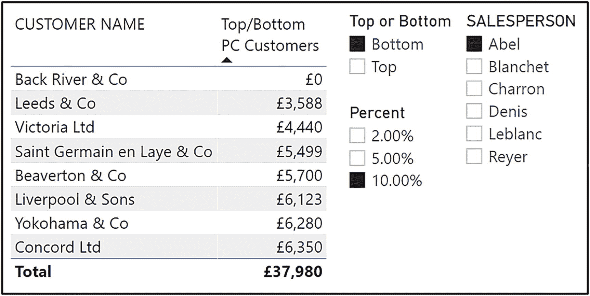

图 16-7 – 按销售额排名的前或后百分比客户

度量值“前/后百分比客户”是一个引人注目的例子，展示了在 DAX 表达式中使用上下文转换来获取数据洞察。现在你可以学习如何自己重现这个示例。

设置此分析有两个步骤：

1. 创建切片器，用于选择百分比以及选择前或后。

2. 创建度量值，用于找出切片器中选择的前或后百分比，该度量值还会响应销售人员切片器。

### 创建切片器

“前或后”和“百分比”切片器使用参数表。我们将这些表命名为“选择百分比”和“选择前或后”，两个表都只包含单个列，即 `前或后` 和 `百分比`，如图 16-8 所示。

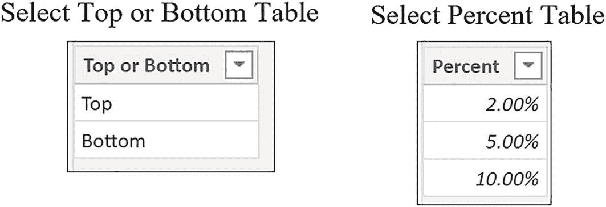

图 16-8 – 用于前/后和百分比的参数表

使用这两个表中的列来填充两个切片器。

### 创建度量值以查找切片器中选择的前后百分比

在“前/后 PC 客户”度量值中使用了本书迄今为止所学的许多技巧。让我们思考一下，为了得出此度量值的正确 DAX 代码，你需要做些什么。

- 你将在整个表达式中使用变量来分离评估的每个部分。

- 你将使用 `SELECTEDVALUE` 函数来获取切片器中选择的值，即“前（Top）”或“后（Bottom）”，以及要计算的百分比。

- 选定的百分比用于查找基础排名。例如，如果切片器中选择 10%，并且有 84 个有销售额的客户，则必须查找排名小于 8.4 的客户。对于排名靠前的客户（前 = 1），你将按降序对客户进行排名；对于排名靠后的客户（后 = 1），则按升序排名。因此，在这两种情况下，你都要查找排名小于 8.4 的客户。

- 使用上下文转换和 `RANKX` 函数，你将根据客户的“总销售额”值，对客户进行前或后的排名。

- 由于在查找后百分比时，默认情况下会对没有销售额的客户进行排名，因此必须筛选客户表，以便仅对有销售额的客户进行排名。

- 使用 `FILTER` 函数，你将筛选出排名（例如）小于 8.4（如果查找 10%）的前或后客户。

- 由于度量值必须返回一个标量值，现在必须为筛选后的客户计算“总销售额”度量值。

- 最后，你必须编写一个计算，根据切片器的选择，返回排名靠前的客户或排名靠后的客户的“总销售额”。

这是你现在可以编写的度量值（我们在表达式的每个部分下添加了注释以解释代码的目的）：

```
Top/Bottom PC Customers =
VAR PercentToFind =
    COUNTROWS ( ALL ( Customers ) ) * SELECTEDVALUE ( 'Select Percent'[Percent] )
    -- 使用切片器选择获取百分比
VAR TopOrBottom =
    SELECTEDVALUE ( 'Select Top or Bottom'[Top or Bottom] )
    -- 使用切片器选择获取是“前”还是“后”
VAR RankCustsTop =
    RANKX ( ALL ( Customers ), [Total Sales] )
    -- 按总销售额值降序排列客户（前 = 1）
VAR RankCustsBottom =
    RANKX (FILTER( ALL ( Customers ),NOT(ISBLANK([Total Sales]))), [Total Sales], ASC )
    -- 按总销售额值升序排列客户（后 = 1），但仅限于有销售额的客户
VAR FindCustsTop =
    FILTER ( Customers, RankCustsTop <= PercentToFind )
    -- 筛选排名小于或等于 PercentToFind 的靠前客户
VAR FindCustsBottom =
    FILTER ( Customers, RankCustsBottom <= PercentToFind )
    -- 筛选排名小于或等于 PercentToFind 的靠后客户
VAR CalcSalesTop =
    CALCULATE ( [Total Sales], FindCustsTop )
    -- 计算排名靠前客户的“总销售额”
VAR CalcSalesBottom =
    CALCULATE ( [Total Sales], FindCustsBottom )
    -- 计算排名靠后客户的“总销售额”
RETURN
    IF ( HASONEVALUE ( Customers[CUSTOMER NAME] ),
        -- 测试当前评估是否不是针对“总计”行。
        IF ( TopOrBottom = "top",  CalcSalesTop, CalcSalesBottom  ),
        -- 非“总计”行的计算
        CALCULATE ( [Total Sales],
            ALLSELECTED (Customers[CUSTOMER NAME] ) ) )
        --“总计”行的计算
```

请注意 `RETURN` 表达式，如果计算是针对“总计”行的，它将执行不同的代码。这是为了解决用户选择“后”百分比且在“总计”行中未显示值的问题。这是因为“总计”行的评估方式与对每个客户的评估方式相同。因此，总是大于各个销售值的“总计”行值，在向后排名中会被赋予 85（如果有 84 个有销售额的客户），因为向后排名是升序的（较大的值获得较大的排名数字）。因此，“总计”行未能通过 `FILTER` 执行的向后排名测试，所以“总计”行中没有数据可显示。

因此，你必须为“总计”行编写一个不同的表达式，以确保“总计”行对可视化对象中显示的客户的销售总额进行求和。要测试评估是否*不是*针对“总计”行，可以使用 `HASONEVALUE` 函数。然后，你可以使用 `ALLSELECTED` 函数，仅计算可视化对象中所显示客户的“总销售额”值。

然而，我们尚未解决这个问题，因为你会注意到，在此阶段，“总计”行显示的是“Abel”*所有*客户的总销售额；参见图 16-9。

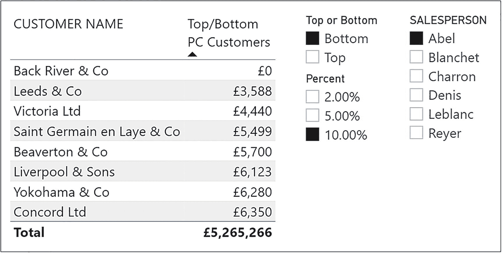

图 16-9

“总计”行不正确

这是因为 `ALLSELECTED` 表达式独立于排名计算来计算“总销售额”度量值，因此客户表上没有可供 `ALLSELECTED` 移除的筛选器。因此，要在客户表上放置一个筛选器，你可以使用视觉级筛选器，用“总销售额”度量值填充它，并将筛选器设置为“当值不为空时显示项目”；参见图 16-10。

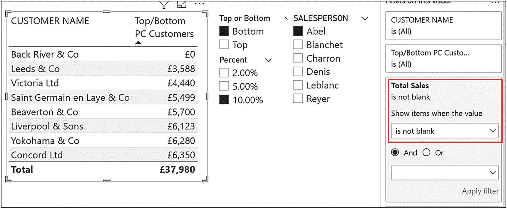

图 16-10

如果你为 `ALLSELECTED` 提供了一个视觉级筛选器以移除，则“总计”行是正确的

最后，你可以更改切片器的选择，度量值会相应重新计算，利用我们出色的 DAX 工具——上下文转换，找到你最好和最差的客户。

你可能会觉得我们在这里实现的动态客户排名是一次相当令人生畏的经历。似乎一旦你“破解”了客户排名的明显计算，就会出现意想不到的问题，例如如何评估“总计”行。我现在要告诉你，这很正常。这就是 DAX 实际应用中的真实情况，你开始意识到，你首先必须做的是*彻底思考*。为什么我的表达式大部分时间能返回正确结果，但有时却只返回奇怪的结果？始终要彻底思考你的度量值是如何被评估的，特别是它被放置的评估上下文。

## 使用 `SUMMARIZE` 计算“同比”年度销售额

在本书中，我们一直以多种方式分析客户销售额。然而，我们尚未探讨的一个更具洞察力的指标是计算同比销售额，以便在客户之间进行更准确的比较。

让我们先设置场景。我们想要分析客户在 2019、2020 和 2021 年对“基安蒂”葡萄酒的销售额。在切片器中多选年份的问题在于，我们的“总销售额”度量值会筛选出在*任意*选定年份有“基安蒂”销售额的客户，而不是在*所有*选定年份都有销售额的客户；见图 16-11。

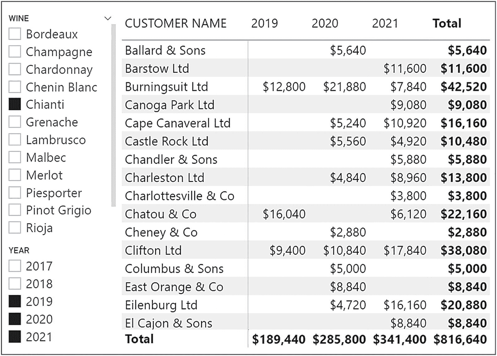

图 16-11 多选年份会返回在任意选定年份有销售额的客户，而非在所有选定年份都有销售额的客户

然而，我们希望在一个切片器中选择一个年份范围，并找出在所有选定年份都购买了“基安蒂”的客户，以便我们能够在总量上进行同比比较。例如，在图 16-11 中，我们可以看到在 2019、2020 和 2021 年，“Burningsuit Ltd”在这三年中都有“基安蒂”的销售额，但“Ballard & Sons”仅在 2020 年有销售额，“Barstow Ltd”仅在 2021 年有销售额。因此，在考虑这三个客户对“基安蒂”的销售额时，这三年的总销售额并非同比数据。

提供我们所需分析的视觉对象如图 16-12 所示。在这里，我们在切片器中选择了“基安蒂”葡萄酒以及 2019、2020 和 2021 年，表格视觉对象仅显示在所有这些年都有“基安蒂”销售额的客户数据。


**图 16-12** 计算 2019 年至 2021 年“基安蒂”葡萄酒的同比销售额

为了理解我们必须编写的用于计算此类销售额的代码，我们将把计算分解为几个步骤：

1.  识别在选定年份中有所选葡萄酒销售额的客户。
2.  计算客户在切片器选定的那些年份中有销售额的年份数量。
3.  筛选出拥有与切片器选定的年份数相同销售额年份的客户。

让我们看看第 1 步，探讨如何识别那些在选定年份有销售额的客户。为此，我们必须稍微深入一下，重新审视 `SUMMARIZE` 函数，以了解更多信息。在上一章中，您学习了如何使用 `SUMMARIZE` 生成一个虚拟表，对不同表中的列进行分组。然而，作为 `SUMMARIZE` 内部的参数之一，您可以选择包含一个表达式，用于对虚拟表中返回的行进行计算。因此，为了识别我们的客户在哪些选定年份有销售额，我们可以编写以下度量值，其中高亮显示了用于计算每个客户每年总销售额的两个参数：

```
No. of Years that Customers have Sales =
COUNTROWS (
SUMMARIZE (
Winesales,
Customers[CUSTOMER NAME],
DateTable[Year],
"Sales", [Total Sales]
)
)
```

我们现在将详细讲解“No. of Years that Customers have Sales”度量值的细节。我们使用 `SUMMARIZE` 来创建图 16-13 中所示的虚拟表。我们看不到每个客户的所有年份，因为该表是在其所在矩阵视觉对象的当前筛选上下文中计算的；例如，“Ballard & Sons”仅在 2020 年有销售额；见图 16-14。

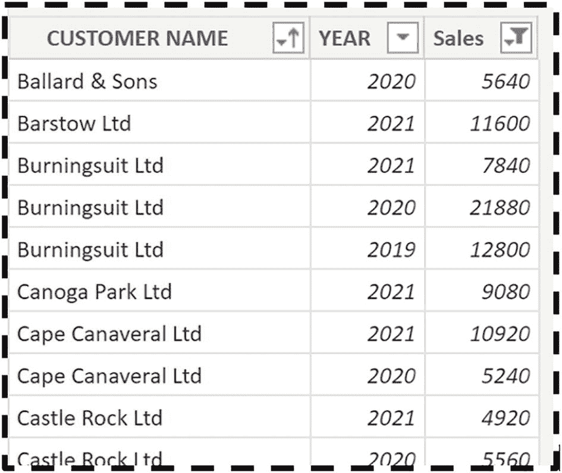

**图 16-13** 在“No. of Years that Customers have Sales”度量值中由 `SUMMARIZE` 生成的虚拟表

您可以看到 `SUMMARIZE` 函数包含一个名为“Sales”的表达式，它将返回“Total Sales”度量值。您在 `SUMMARIZE` 内部给这个列起的名称（例如“Sales”）完全是任意的。

我们现在可以将此度量值放入一个矩阵视觉对象中，其中行是 `CUSTOMER NAME`，列是 `YEAR`（图 16-14）。我们还按“基安蒂”葡萄酒以及 2019、2020 和 2021 年进行切片。您可以看到，对于每个在选定年份有“基安蒂”销售额的客户，它返回“1”。

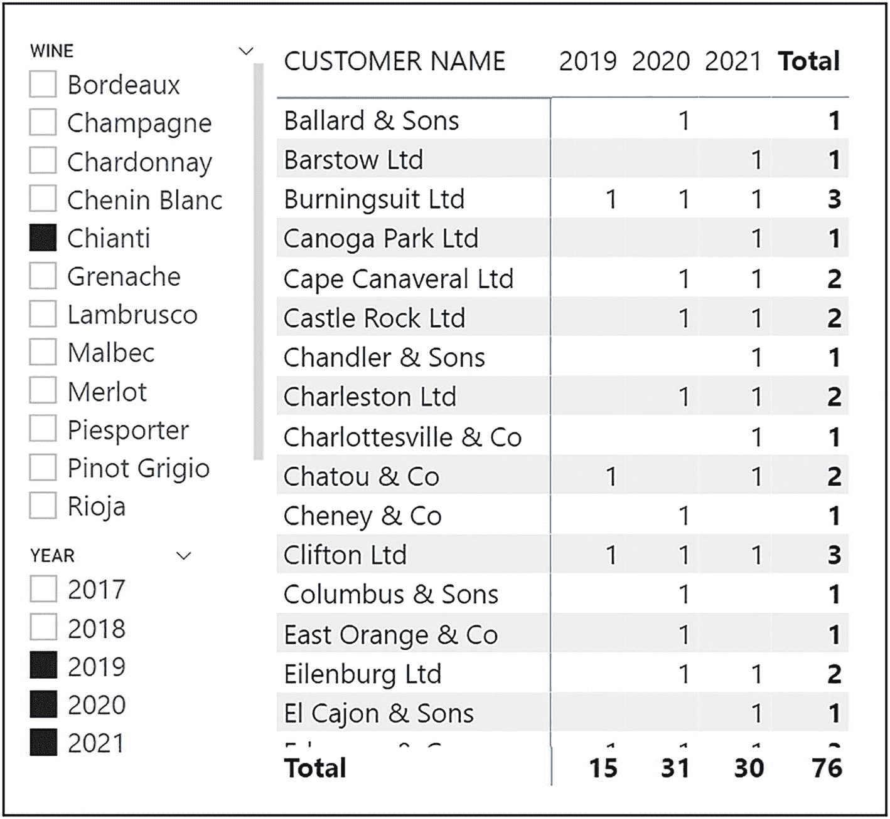

**图 16-14** 矩阵视觉对象中的“No. of Years that Customers have Sales”度量值

现在进行第 2 步，我们必须计算客户在切片器选定的那些年份中有销售额的年份数量。请记住，列 `WINE`、`CUSTOMER` 和 `YEAR` 提供了筛选上下文，我们必须移除来自 `YEAR` 的筛选，以便能够查看我们的客户在切片器中选定的所有年份中对“基安蒂”的销售额。我们可以使用 `CALCULATE` 配合 `DateTable` 上的 `ALLSELECTED` 来完成此任务，并简单地将我们的 `SUMMARIZE` 表达式嵌套在 `CALCULATE` 内部：

```
No. of Years that Customers have Sales #2=
CALCULATE (
COUNTROWS (
SUMMARIZE (
Winesales,
Customers[CUSTOMER NAME],
DateTable[Year],
"Sales", [Total Sales]
)
),
ALLSELECTED ( DateTable[Year] )
)
```

我们可以看到此度量值在图 16-15 中返回的值。

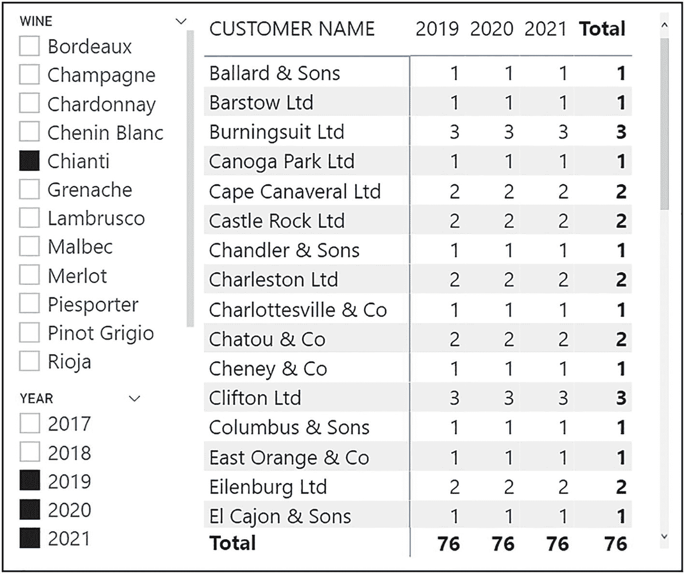

**图 16-15** 在矩阵视觉对象中计算的“No. of Years that Customers have Sales #2”度量值

我们已经从图 16-13 中知道，“Ballard & Sons”仅在 2020 年购买过“基安蒂”，因此他们只在切片器选定的年份中的一年有销售额。

为了完成第 3 步的计算，我们可以筛选 `Customers` 表，使其仅包含那些在“No. of Years that Customers have Sales #2”度量值中返回的年份数等于切片器中筛选的年份数的客户，并返回这些客户的“Total Sales”值。这就是我们在图 16-14 的视觉对象中使用的“Like for Like Sales”度量值，它返回了我们所需的结果：

```
Like for Like Sales =
CALCULATE (
[Total Sales],
FILTER (
Customers,
[No. of Years that Customers have Sales #2] =
COUNTROWS ( ALLSELECTED ( DateTable[Year] ) )
)
)
```

图 16-16 展示了此度量值在矩阵视觉对象中的计算情况。

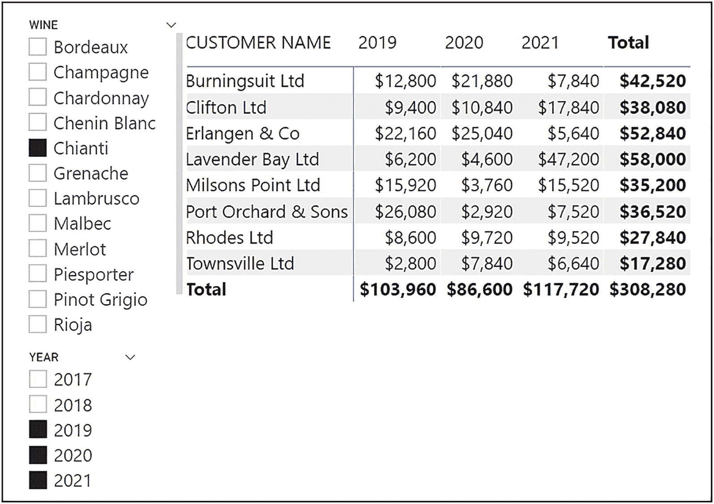

**图 16-16** 针对“基安蒂”葡萄酒计算的“Like for Like Sales”度量值

在上述我们计算同比销售额的场景中，您可能已经注意到，在逐步讲解我们使用 `SUMMARIZE` 构建的度量值的求值过程时，没有提到任何关于上下文转换的引用。实际上，这些度量值并未使用上下文转换。`SUMMARIZE` 不是一个迭代函数，在没有迭代的情况下，上下文转换不会发生。`SUMMARIZE` 计算其“expression”参数的方法很复杂，其解释超出了本书的范围。然而，对于大多数 DAX 用户来说，在使用 `SUMMARIZE` 的表达式中的“Total Sales”度量值的行为与上下文转换难以区分。也就是说，我们生成了一个汇总表，并且“Total Sales”度量值是在该粒度级别上计算的。这就是我为什么在本书中收录这个示例的原因。

## 在计算列中使用上下文转换

理解上下文转换也允许您编写更具挑战性的计算列。您将在本节中学到的是，通过在计算列中使用 `CALCULATE`，您可以从只能计算当前行值的行上下文的限制中解放出来。我们现在可以利用上下文转换的强大功能*以编程方式在表上创建筛选器*，从而在计算列中跨这些筛选后的行传递计算值。

### 计算运行总计

你已在第 9 章（见图 9-10）和第 15 章（见图 15-10）中学习了如何使用度量值计算累计总计。不过，我们现在要计算另一种累计总计，即对 `CASES SOLD` 列中的数量进行运行总计计算，如图 16-17 所示。使用变量和上下文转换可以使此计算变得直接明了。以下是你可以创建的 DAX 计算列：

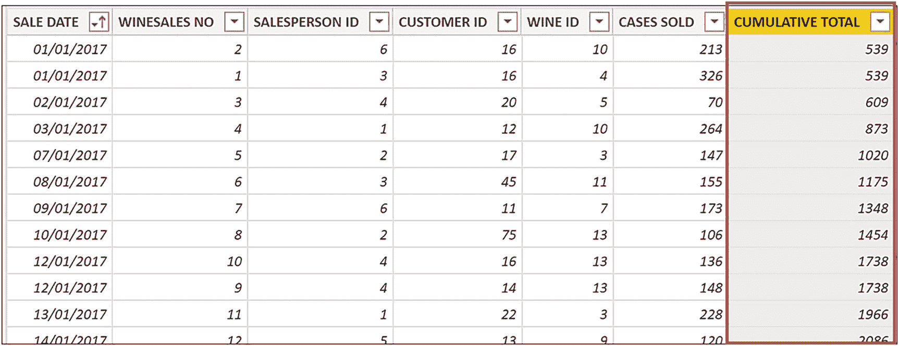

图 16-17 — 计算列中的“`CUMULATIVE TOTAL`”

```
CUMULATIVE TOTAL =
VAR MyDate = Winesales[SALE DATE]
VAR MyFilter =
FILTER ( Winesales, Winesales[SALE DATE] <= MyDate )
RETURN
CALCULATE ( SUM ( Winesales[CASES SOLD] ), MyFilter )
```

变量 `MyDate` 获取当前行中 `SALE DATE` 列的值。变量 `MyFilter` 使用 `FILTER` 函数创建一个虚拟表，筛选出 `SALE DATE` 小于或等于此日期的行。通过上下文转换，`CALCULATE` 可以使用这个由虚拟表生成的新筛选器来对这些被筛选行的 `CASES SOLD` 进行求和。

请注意，我们使用了变量 `MyDate` 来获取当前行的日期。在 2015 年 DAX 引入变量之前，我们不得不使用名为 `EARLIER` 的函数来完成这项工作，如下所示：

# 计算列与上下文转换

```
CUMULATIVE TOTAL =
CALCULATE (
SUM ( Winesales[CASES SOLD] ),
FILTER ( Winesales, Winesales[SALE DATE] <=
EARLIER ( Winesales[SALE DATE] ) )
)
```

我想你会同意，使用变量的计算列在创建和理解上都容易得多。

### 计算与上一行值的差异

你已经了解到，计算列在其求值过程中使用行上下文，表达式使用的值是当前行的值。然而，一个常见的问题是如何查找其他行中的值。例如，你可能需要计算销售交易之间的天数差，如图 16-18 中的“`DAYS DIFFERENCE`”计算列所示。

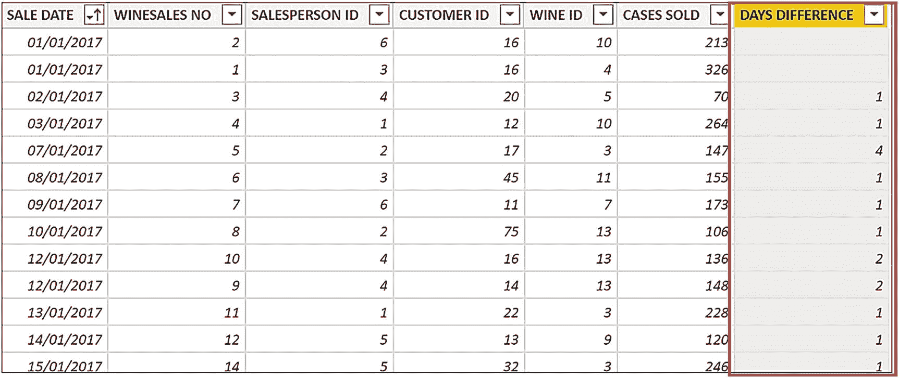

图 16-18 — “`DAYS DIFFERENCE`”计算列

要进行此计算，我们需要找到上一行中的 `SALE DATE`。

以下是该计算列的表达式：

```
DAYS DIFFERENCE =
VAR MyDate = Winesales[SALE DATE]
VAR PreviousDate =
CALCULATE (
MAX ( Winesales[SALE DATE] ),
FILTER ( WineSales, Winesales[SALE DATE] < MyDate ) )
RETURN
IF ( PreviousDate, MyDate - PreviousDate )
```

变量 `MyDate` 获取当前行中 `SALE DATE` 的值，例如，`2017 年 1 月 7 日`。变量 `PreviousDate` 使用 `CALCULATE`，从而调用上下文转换，将对行应用筛选器。使用 `FILTER` 函数，创建一个虚拟表，筛选出 `SALE DATE` 早于 `MyDate` 的行（即所有日期截止到并包括 `2017 年 1 月 6 日` 的行）。然后，`CALCULATE` 计算该虚拟表中最晚的日期（使用 `MAX` 函数），即 `2017 年 1 月 6 日`。因此，这个日期就是当前行日期之前紧邻的日期。`RETURN` 语句检查是否存在前一个日期，如果存在，则用 `PreviousDate` 生成的日期减去当前行的日期。返回的值是一个日期，所以最后一步是将其数据类型更改为整数。

通过研究本章和上一章中的示例，你已学会如何使用上下文转换来编写更复杂、更具挑战性的表达式。然而，你目前所掌握的只是利用上下文转换所能实现计算的冰山一角。你会找到自己的理由来受益于 DAX 的这一方面，并且你不再会觉得上下文转换的行为有任何“奇怪”或“令人惊讶”之处，这是因为你现在已经理解它了。