# 虚拟关系：`LOOKUPVALUE` 和 `TREATAS` 函数

我们的数据模型包含表之间定义良好的物理关系，形成了星型架构。然而，还有另一种我们可以创建的关系类型，那就是“虚拟”关系。虚拟关系是一种模拟数据模型中定义的物理关系行为的 DAX 表达式。在本章中，你将学习创建能够解决数据模型异常所产生问题的虚拟关系。此类异常可能由以下原因引起：

- 当关系不存在时，例如，当使用查找表时。
- 表之间的关系不属于星型架构或雪花型架构。
- 当因为要关联的两个列中都存在重复值而无法创建关系时。

具体来说，我们将深入探讨使用两个创建虚拟关系的函数所带来的结果：`LOOKUPVALUE` 和 `TREATAS`。实际上，这两个函数非常不同。`LOOKUPVALUE` 根据函数提供的搜索条件，从（通常是）另一个表中查找并返回一个值。而 `TREATAS` 则是一个表函数，它返回一个可用于筛选其他表的虚拟表。然而，它们都用于无法使用物理关系的情况，这就是为什么我们将它们整合到本章中。

## LOOKUPVALUE 函数

我们已经了解，可以使用 `RELATED` 函数从关系的一端将值拉取到多端，这与 Excel 中 `VLOOKUP` 函数的工作方式完全相同。然而，`RELATED` 仅在存在多对一关系时才能使用。接下来，让我们看一个无法使用 `RELATED` 的情况。

情况是这样的：目前，我们的葡萄酒每箱只有一个单价，但我们希望根据不同价格区间设定不同的葡萄酒价格。因此，我们在模型中添加了一个名为 "Prices" 的表，用于记录葡萄酒的价格区间，如图 17-1 所示。

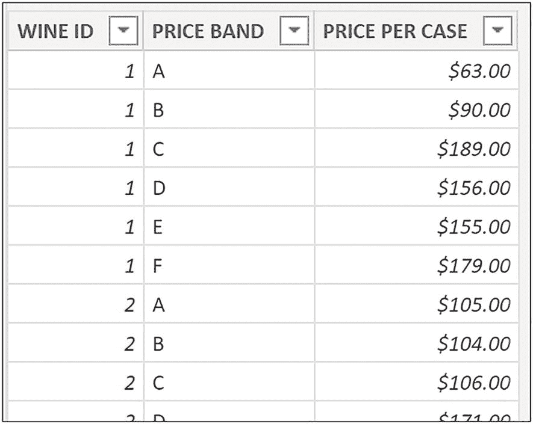

`图 17-1` — Prices 表记录了每款葡萄酒的价格区间和每箱价格

现在，当我们销售任意一款葡萄酒时，该交易也会在 `Winesales` 事实表中记录其价格区间；请参见图 17-2。

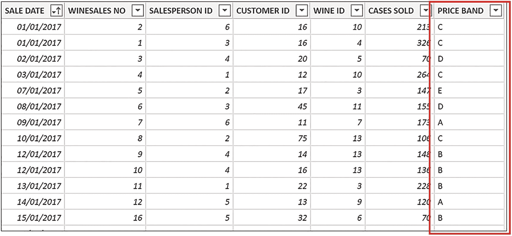

`图 17-2` — 每笔交易都记录了价格区间

在图 17-3 中，您可以看到使用 `WINE ID` 列将葡萄酒与其价格建立多对一关系是非常直接的。

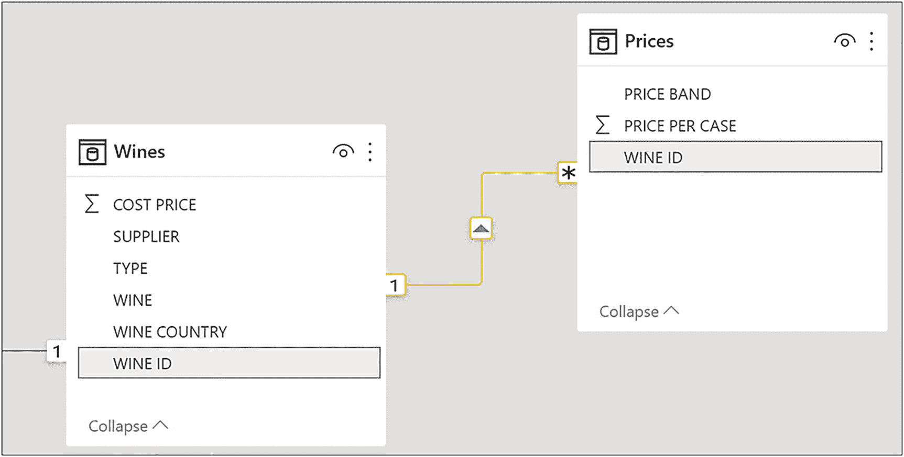

`图 17-3` — Prices 表可以通过多对一关系与 Wines 表相关联

然而，您如何找到 `Winesales` 表中每笔交易的价格呢？您不能使用 `RELATED`，因为该函数只能将值从关系的“一端”填充到“多端”，而 `Prices` 表位于“多端”。更重要的是，价格取决于*两个*条件：葡萄酒及其价格区间。在这种情况下，表之间的关系无法帮助您。实际上，您完全不需要 `Wines` 和 `Prices` 之间的关系。这里您可以通过在计算列中使用 `LOOKUPVALUE` 来创建一个“虚拟”关系。

`LOOKUPVALUE` 函数的语法如下：

```
= LOOKUPVALUE( 结果列名, 搜索列名 1, 搜索值 1, 搜索列名 2, 搜索值 2, ... )
```

- `结果列名` 是您希望返回其值的列。
- `搜索列名` 是您想要匹配第一个“搜索值”的列。通常，这是来自不同表的列，但也可以在同一张表中。
- `搜索值` 是需要在“搜索列名”中搜索的值。它可以是列中的值，也可以是任意单个值。

您可以根据需要重复“搜索列名”和“搜索值”对，从而实现多对匹配值的查找。

这是我们需要创建的计算列，您可以在图 17-4 中看到结果：

```sql
WINE PRICE =
LOOKUPVALUE (
    Prices[PRICE PER CASE],
    Prices[WINE ID], Winesales[WINE ID],
    Prices[PRICE BAND], Winesales[PRICE BAND]
)
```

这是添加了注释的同一计算列：

```sql
WINE PRICE =
LOOKUPVALUE (
    Prices[PRICE PER CASE],
    --从 Prices 表返回至 Winesales 表的单价
    Prices[WINE ID], Winesales[WINE ID],
    --在 Prices 表的 WINE ID 列中查找与 Winesales 表当前行 WINE ID 匹配的值
    Prices[PRICE BAND], Winesales[PRICE BAND]
    -- 并且在 Prices 表的 PRICE BAND 列中查找与 Winesales 表当前行 PRICE BAND 匹配的值
)
```

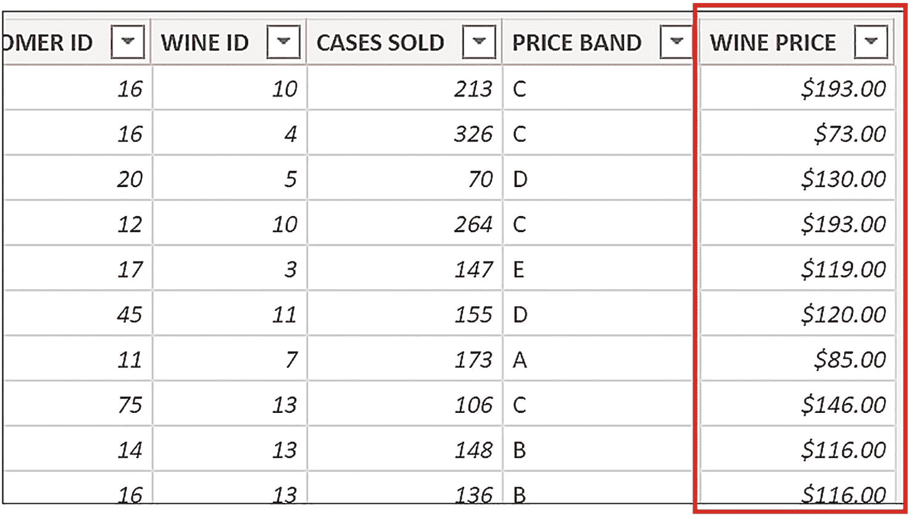

`图 17-4` — 使用 `LOOKUPVALUE` 的 WINE PRICE 计算列

请注意，在计算列中，我们需要同时匹配 `WINE ID` 和 `PRICE BAND`，这正是 `LOOKUPVALUE` 发挥作用的地方。`LOOKUPVALUE` 函数允许您通过匹配任意数量的列，在无关联的表中查找值。

在此，我们必须提醒您，刚才使用 `LOOKUPVALUE` 函数编写的代码现在已略显陈旧。在引入变量之前，它是实现此目标的最简单方式。然而，以下使用变量和 `CALCULATE` 的代码是另一种替代方法：

```sql
WINE PRICE #2 =
VAR currentwine = Winesales[WINE ID]
VAR priceband = Winesales[PRICE BAND]
RETURN
CALCULATE ( VALUES ( Prices[PRICE PER CASE] ),
    Prices[PRICE BAND] = priceband,
    Prices[WINE ID] = currentwine )
```

`WINE PRICE #2` 的性能没有明显差异，因此选择使用哪种表达式是个人偏好。

最后，让我们引用 Alberto Ferrari 在其博客中关于 `LOOKUPVALUE` 函数的总结，链接如下：[`www.sqlbi.com/articles/introducing-lookupvalue/`](http://www.sqlbi.com/articles/introducing-lookupvalue/)

> *“如果你的搜索列表仅由单列组成，那么 `LOOKUPVALUE` 几乎从来都不是最佳选择。实际上，当搜索单列时，建立关系总是更好：它速度更快，并且为模型提供了更清晰的结构。另一方面，当你需要搜索多列时，`LOOKUPVALUE` 就派上用场了。*
>
> *`LOOKUPVALUE` 比模型中的关系更优的另一种场景是，当你设置的条件不是一个单列，而是一个基于多列的更复杂条件时。在这种情况下，`LOOKUPVALUE` 提供了比关系更大的灵活性。”*

## `TREATAS` 函数

要理解 `TREATAS` 函数的需求，我们必须考虑数据模型中现在出现的一个问题。我们在模型中添加了一个“目标”表，用于记录每位销售人员的年度目标；请参见图 17-5。

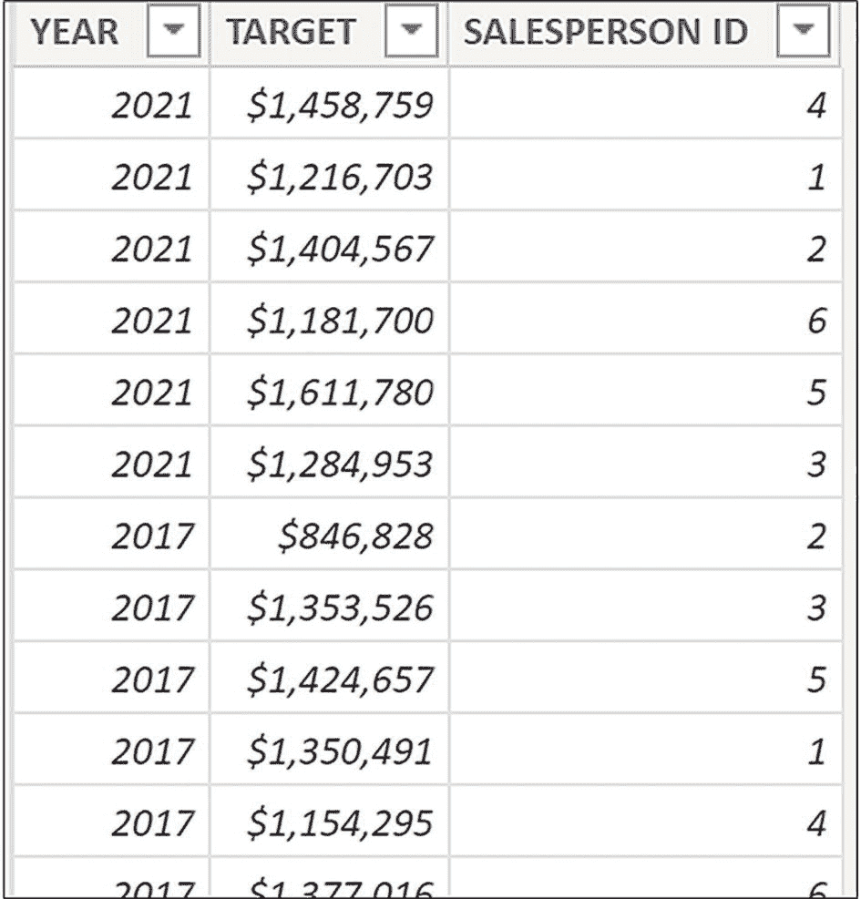

我们希望将销售人员的年销售额与其目标进行比较，如图 17-6 所示，该图展示了 2021 年的销售情况。

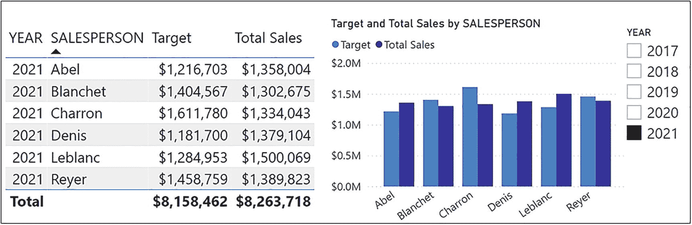

“目标”表与“销售人员”表（使用两个表中的 `SALESPERSON ID` 列）之间存在多对一的关系，如图 17-7 所示。由于我们将使用“葡萄酒销售”表和“日期表”，因此图中也展示了这些表在模型中的关联方式。

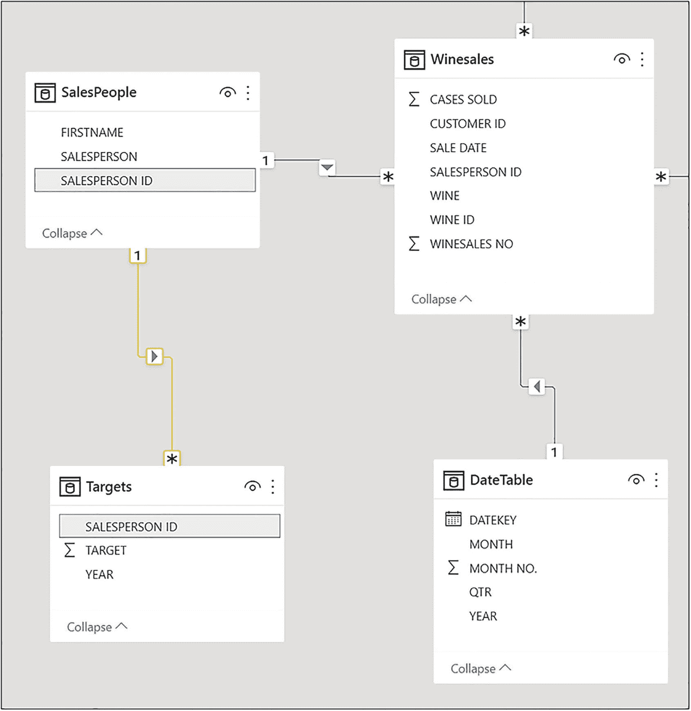

我们可以创建一个度量值来计算目标值：

```
目标 =
SUM ( 目标[TARGET] )
```

然后在包含“销售人员”表中 `SALESPERSON` 列和 `YEAR` 列的视觉对象中显示“目标”和“总销售额”度量值。然而，我们应该从哪个表中获取 `YEAR` 列呢？是从“日期表”还是从“目标”表？这里我们遇到了一个问题：如何在同一视觉对象中，针对每一年同时获取“目标”值和“总销售额”值。根据 `YEAR` 来自哪个表，我们会得到不同的计算结果，如图 17-8 所示。

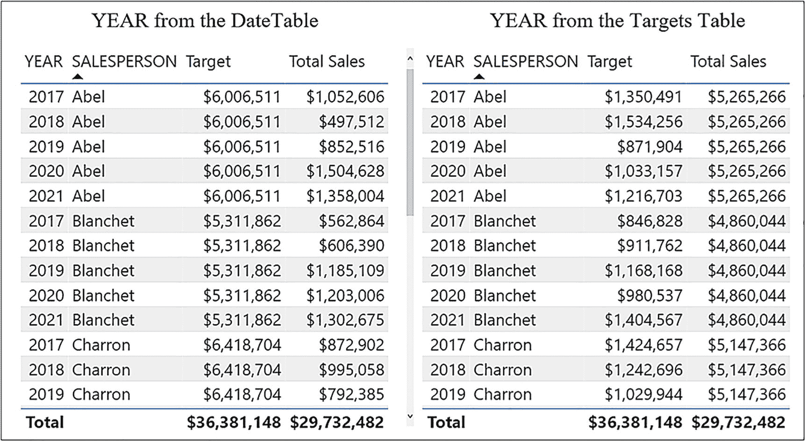

如果 `YEAR` 列来自“日期表”，则“总销售额”度量值是正确的，但“目标”度量值不正确。如果 `YEAR` 列来自“目标”表，则目标是正确的，但总销售额不正确。现在，如果我们考虑图 17-9 中的数据模型，就可以找出问题所在。

# 使用DAX虚拟关系解决数据模型异常

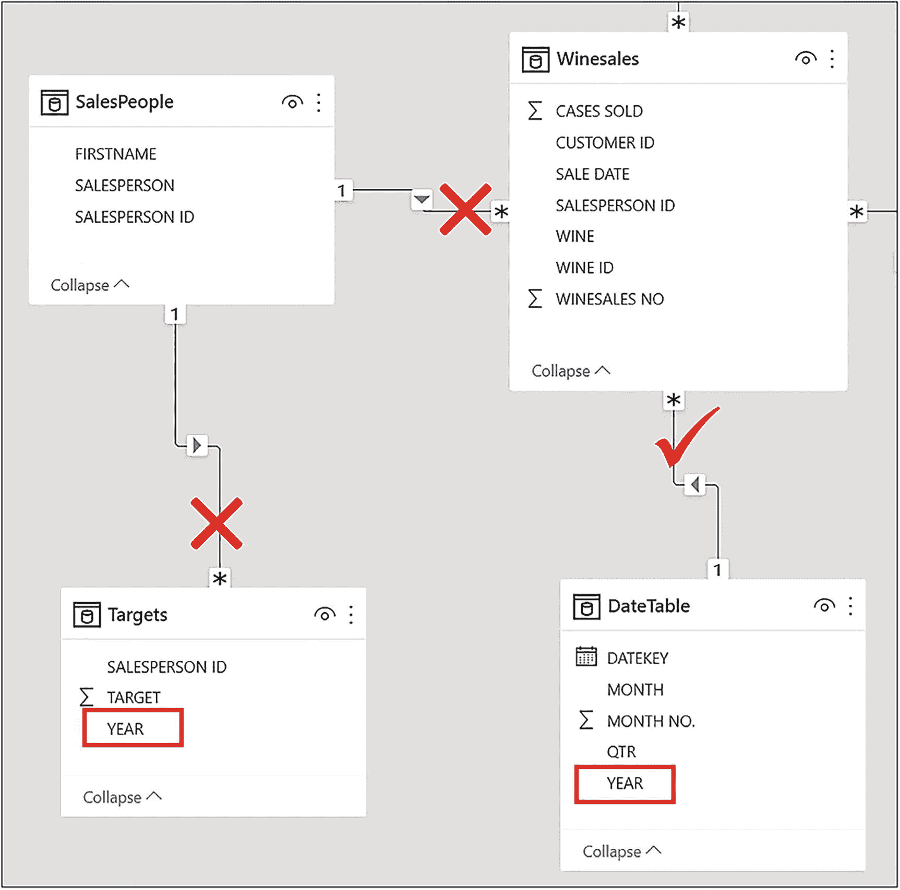

## 问题描述

如果我们从“日期表”中获取 `YEAR`，则 `YEAR` 筛选器会传播到“葡萄酒销售”事实表，以筛选每年的“总销售额”（由对勾表示），但此筛选器不会通过“销售人员”表进一步传播到“目标”表（由叉号表示），从而无法筛选每年的目标。如果我们从“目标”表中获取 `YEAR`，这会筛选“目标”表中的 `YEAR`，但不会传播到“葡萄酒销售”表以筛选销售额（由叉号表示）。

一种解决方案是在“目标”表中的 `YEAR` 字段与“日期表”中的 `YEAR` 字段之间创建关系。如果这样做，在“目标”表中筛选 `YEAR` 将筛选“日期表”中的 `YEAR`，然后这会传播到事实表。

然而，问题在于在“日期表”和“目标”表中，`YEAR` 列的值都是重复的，因此如果我们尝试建立这种关系，就会生成多对多关系，从而触发此警告消息，如图 17-10 所示。

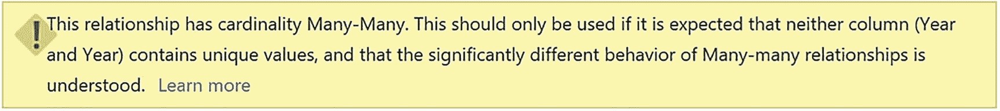

我们被告知，这种关系将产生“显著不同的行为”，除非你了解所采取措施的后果，否则不应使用。尽管如此，这确实可以解决问题，因为它会设置双向筛选器。然而，现在正是我们考虑第 13 章中关于双向筛选的结论的时候。任何导致数据模型进一步偏离星型模式结构的更改都不应被推荐。

## 使用 TREATAS 函数的解决方案

此外，还有另一种更简单的方法，那就是使用 DAX 和 `TREATAS` 函数来解决问题。该函数会接收一个表表达式的结果，并用它来筛选无关表中的一个（或多个）列，并且此筛选器表达式可用作 `CALCULATE` 的筛选器参数。

`TREATAS` 的语法如下：

```
= TREATAS ( 表表达式, 列 1, 列 2 等。 )
```

- **表表达式** 是任何返回表的表达式。

- **列 1, 列 2 等。** 是一个或多个现有列，这些列必须与将接收来自表表达式筛选器的表表达式中的列相匹配。

现在我们可以创建这个度量值：

```
目标 #2 =
CALCULATE (
    SUM ( 目标[TARGET] ),
    TREATAS ( VALUES ( 日期表[YEAR] ), 目标[YEAR] )
)
```

请注意，`VALUES` 函数被用作表表达式，用于创建一个单列表（通常只有一行），该表包含当前筛选上下文（在第一次评估中为“2017”）中来自“日期表”的 `YEAR` 值。这个单行、单列的表用于筛选“目标”表中的 `YEAR` 列，使其等于“2017”，这就是 `CALCULATE` 使用的筛选器。在图 17-11 中，你可以看到这在内存中是如何运作的。包含当前筛选上下文中来自“日期表”的 `YEAR` 的虚拟单列、单行表（或在评估总计行时的多行表）被用来筛选“目标”表中的 `YEAR` 列。因此，在视觉对象中使用来自“日期表”的 `YEAR` 列非常重要。

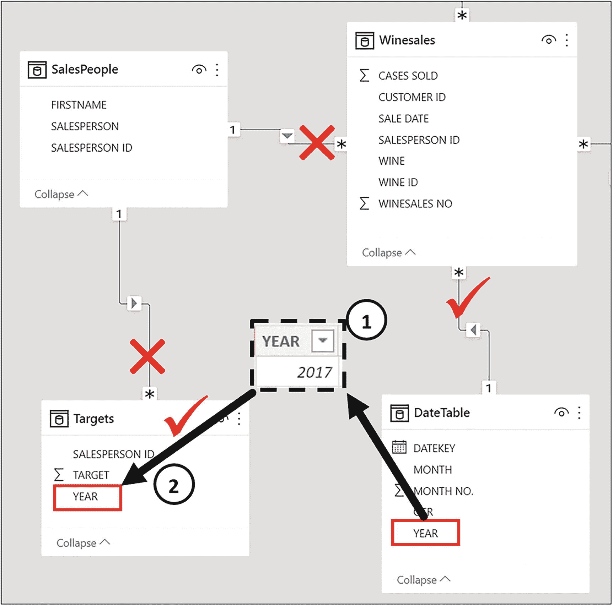

1. `TREATAS` 的第一个参数使用 `VALUES` 函数创建一个虚拟表，其中包含当前筛选上下文中来自“日期表”的 `YEAR` 列，例如“2017”。

2. `TREATAS` 的第二个参数将“目标”表中的 `YEAR` 列定义为接收来自 `VALUES` 生成的虚拟表筛选器的列。

当将“目标 #2”度量值放入表视觉对象中，并配合来自“日期表”的 `YEAR` 列时，我们得到了期待已久的结果；请参见图 17-12。

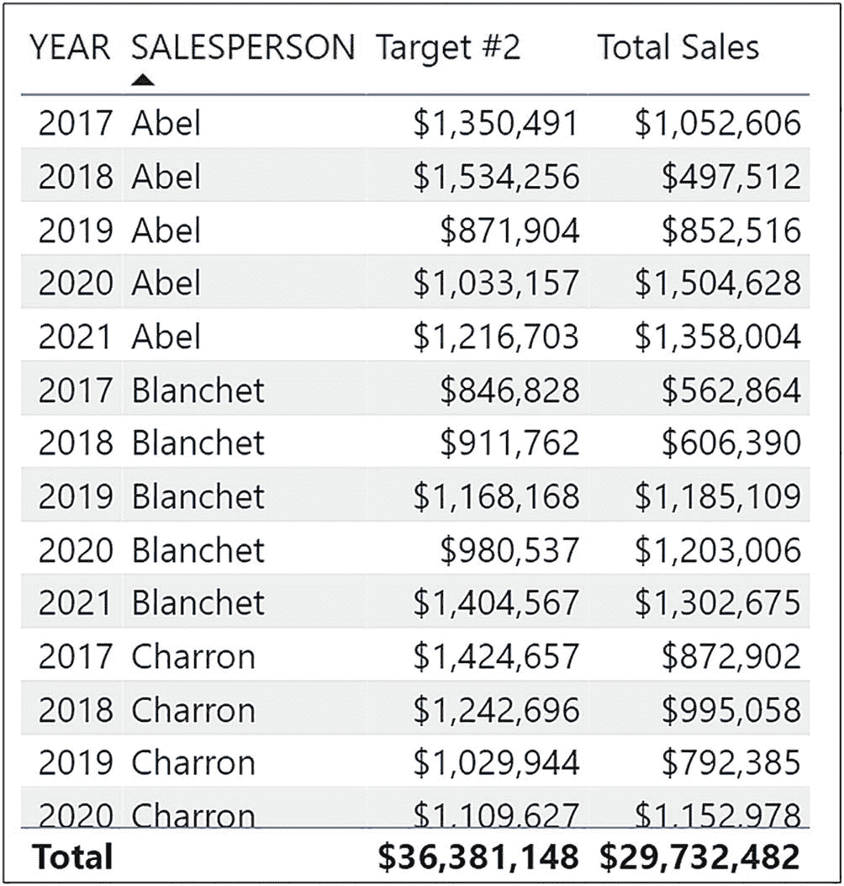

## 总结

在本章中，你学习了如何使用 DAX 实现虚拟关系来管理数据模型中的异常情况。这始终是优于使用双向筛选和多对多关系的策略。因此，你无需再因无法在模型中创建推荐的多对一关系而气馁。然而，请注意，使用 DAX 的虚拟关系绝不会优于“真正的”多对一关系，并且只应在没有其他选择的情况下使用。