# 18. 表扩展

在本章中，你将学习如何在 DAX 代码中引用扩展后的表，并探索这一知识如何帮助你处理星型模型中表的结构所施加的限制。表扩展的概念是理解 DAX 工作原理拼图中的最后一块。^( ²² ) 这意味着 DAX 概念在重要性上存在某种优先级。然而，就像拼图一样，只有当所有碎片都拼合到位，你才能看到完整的画面，我们终于可以向你揭示 DAX 工作的真相，你目前持有的任何误解现在都可以被消除。

理解表扩展的起点是提醒你 DAX 的真理：筛选器仅从关系的一端传播到多端，除非你使用 `CROSSFILTER` 函数以编程方式更改筛选方向。在这个真理范围内，你可能也默认认为（尽管从未明确说明）表之间的关系使用“主键”和“外键”从维度表到事实表执行“查找”以实现筛选。例如，对 Wines 维度的筛选将使用 Wines 表中的 `WINE ID` 列，在 Winesales 表的 `WINE ID` 列中“查找”相同的值。这大概是你认为筛选传播的工作方式。并不是说这个理论是错误的；只是它不完整，而正是这种误解，我们将在本章中加以澄清。

然而，在继续之前，我们必须仔细查看本章配套文件“6 DAX Expanded Tables.pbix”中的数据模型。你会注意到有一个与 Regions 表相关的额外表，名为 Region Group，该表将在后续章节中变得重要；见图 18-1。

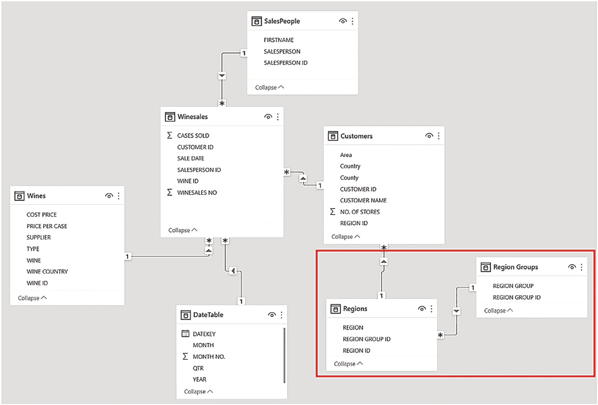

图 18-1

请注意，数据模型中有一个额外的表 Region Group，它与 Regions 表相关联

理解表扩展的重要性在于，我们终于可以向你解释数据模型中的筛选器*真正*是如何工作的，而不是近似如何工作。掌握了这一知识，你将学会如何利用表扩展来解决数据模型中的固有问题：如何“触及”维度表和雪花表以在更大的粒度上执行聚合。我们还将解释为什么使用诸如 `RELATED` 和 `CROSSFILTER` 之类的函数（它们也能完成类似的工作）并不总是适用的。

然而，在应对表扩展背后的挑战性概念之前，我们必须先回顾一下关于筛选器评估上下文方面已有的知识。如果这样做，你会发现筛选器传播背后有一些细节可能目前仍被你忽略。

## 重新审视筛选器

尽管本书中进行了严谨的解释，但 DAX 生成的筛选器在某些方面仍然令人费解。思考以下两个问题：

1.  如何可能使用事实表中不存在的维度值来筛选事实表？
2.  当 `CALCULATE` 内部的 `ALL` 函数应用于事实表时，它如何移除那些并未放置在事实表上的筛选器？

让我们从第一个矛盾开始考虑；我们在事实表中不存在的维度列上放置筛选器。为此，我们需要重新审视我们已知的关于列筛选器的知识。

### 重新审视列筛选器

在本书中，你使用类似以下的 `CALCULATE` 编写度量值：

```
Abel's Cases =
CALCULATE ( [Total Cases],  Salespeople[SALESPERSON] = "abel"
)
```

你是否曾停下来问过：这个度量值如何能够使用 SalesPeople 维度中的 `SALESPERSON` 列来交叉筛选 Winesales 表，而 Winesales 只包含 `SALESPERSON ID`？要回答这个问题，我们必须更深入地探究列筛选器的本质。

在第 7 章中，你学习了列筛选器比表筛选器更高效，并且在可能的情况下应优先使用。然而，在当时你对 DAX 的理解阶段，我们无法告诉你列筛选器的完整故事，因此只给了你一个关于列筛选器如何工作的近似描述。

现在，在本章中，我们对你毫无保留，并陈述这样一个事实：在 DAX 中，*所有筛选器都是表筛选器*。考虑到我们在前一章如此费力地区分列筛选器和表筛选器，这个说法可能会让你感到惊讶。现在我们却说列筛选器也是表筛选器！

关于为什么列筛选器比表筛选器更高效的完整解释，并不是因为你直接将筛选器放在列上，而是因为列筛选器生成的虚拟表比显式筛选表达式生成的虚拟表更高效。这是一个相当具有挑战性的概念，因此我们必须再次深入挖掘。

让我们从考虑这个度量值开始，它会在 `SalesPeople` 表的 `SALESPERSON` 列上生成一个筛选器：

```
Abel's Cases =
CALCULATE ( [Total Cases], SalesPeople[SALESPERSON] = "abel" )
```

在评估这个度量值时，DAX 引擎会在内存中将此列筛选器转换为以下表达式：

```
Abel's Cases Real =
CALCULATE (
[Total Cases],
FILTER ( ALL ( SalesPeople[SALESPERSON] ),                             SalesPeople[SALESPERSON] = "abel" )
)
```

如果我们查看这段代码，可以看到 DAX 使用 `ALL` 函数生成了一个单列表，其中包含销售员姓名的唯一列表。然后 `FILTER` 迭代此表以查找等于“Abel”的值，然后使用此筛选后的表相应地筛选 Winesales 表；见图 18-2。

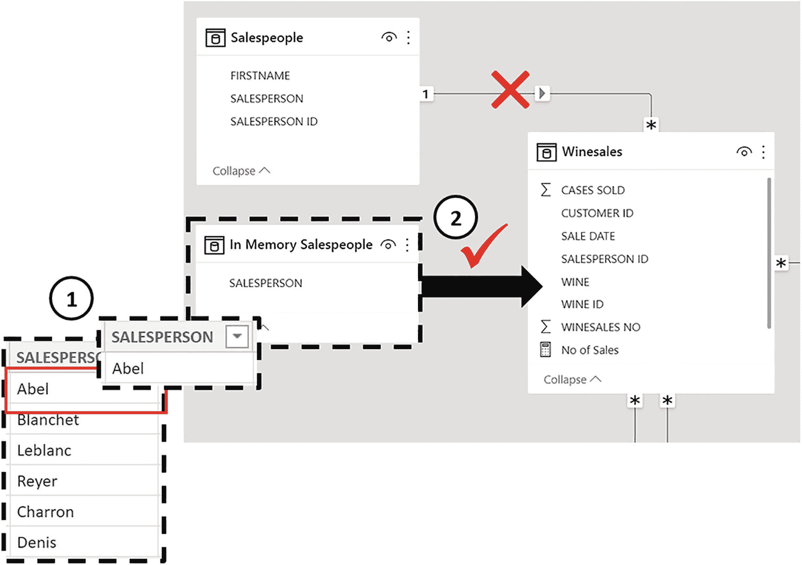

图 18-2

“Abel's Cases Real”度量值的“真实”评估

1.  DAX 引擎使用 `FILTER` 生成一个单列表，包含 `SALESPERSON` 列中的唯一值。`FILTER` 迭代此表以筛选出“Abel”。
2.  `FILTER` 生成的筛选后的虚拟表用于筛选 Winesales 表。

让我们通过探究以下度量值的评估，来看另一个列筛选器的例子：

```
Cases GT 350 =
CALCULATE ( [Total Cases],  Winesales[CASES SOLD] > 350 )
```

DAX 将此筛选器转换为以下内容：

```
Cases GT 350 Real =
CALCULATE (
[Total Cases],
FILTER ( ALL ( Winesales[CASES SOLD] ),
Winesales[CASES SOLD] > 350 )
)
```

这段代码生成一个虚拟表，包含 Winesales 表中已售箱数的唯一值列表。在我们的数据中，此表因此将包含 **409** 行供 `FILTER` 迭代。我们可以看到，与使用表筛选器相比，此表达式总是会产生更高效的评估，例如以下度量值：

```
Cases GT 350  =
CALCULATE (
[Total Cases],
FILTER ( Winesales, Winesales[CASES SOLD] > 350 )
)
```

在这里，`FILTER` 必须迭代事实表中的所有行，这将是对我们的 Winesales 事实表进行 **2,207** 次迭代（事实表通常包含数百万行）。

此时，我们还可以重新审视我们在第 6 章和第 7 章中编写的“Sales for Red or French #1”度量值：

```
Sales for Red or French #1=
CALCULATE (
[Total Sales],
Wines[TYPE] = "red"
|| Wines[WINE COUNTRY] = "France"
)
```


我们注意到，这个度量的一个问题是，如果 `TYPE` 或 `WINECOUNTRY` 列上存在筛选器，则筛选器不起作用（请参阅图 6-10）。我们终于可以解释原因了。这是因为 DAX 在内部将度量转换为以下代码：

```
红色或法国销量 #1 =
CALCULATE (
[总销售额],
ALL ( Wines[TYPE], Wines[WINE COUNTRY]),
FILTER( Wines,
Wines[TYPE] = "红色"
|| Wines[WINE COUNTRY] = "法国"
)
)
```

因此，由于 `ALL` 的存在，筛选器总是会从 `TYPE` 或 `WINECOUNTRY` 列中被移除。

现在你理解了列筛选器会被转换为表筛选器，并且所有筛选器都是表筛选器，但我们之前的提问似乎并没有得到解答。在“阿贝尔的真实案例”度量中，我们筛选了 `SalesPeople` 表中的 `SALESPERSON` 列，但 `Winesales` 表只包含 `SALESPERSON ID` 列，那么筛选器是如何从 `SalesPeople` 表传播到 `Winesales` 表的呢？我们暂时留下这个悬念，先探讨第二个关于无效筛选器的例子。应用于事实表的 `ALL` 函数，如何能够移除那些并非放置在事实表上的筛选器？

## 深入探讨 ALL 函数

在图 18-3 中，关于“总箱数”度量的计算，我们知道筛选器已经应用到了 `WINE` 和 `SALESPERSON` 列上，这些筛选器分别从 `Wines` 维度和 `SalesPeople` 维度传播到 `Winesales` 事实表。然后，我们使用“所有 Winesales”度量来移除这些筛选器：

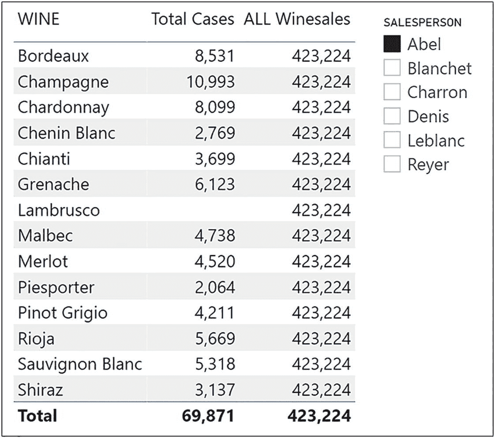

图 18-3

筛选器被放置在 `WINE` 和 `SALESPERSON` 列上，而不是事实表上。`ALL` 函数移除了事实表上的筛选器

```
所有 Winesales =
CALCULATE ( [总箱数], ALL ( Winesales ) )
```

我们在第 8 章中学到，当 `ALL` 函数嵌套在 `CALCULATE` 内部时，会*移除*筛选器。但是 `Winesales` 事实表上并没有筛选器需要移除，只有交叉筛选器。筛选器是放置在维度表中的列上的，那么当 `Winesales` 表上没有任何筛选器需要移除时，`ALL` 是如何将其移除的呢？

## 扩展表详解

为了回答这些深究性的问题并真正掌握 DAX 筛选器的行为，你必须理解表扩展。当度量被评估时，多对一关系允许进行表扩展。表扩展会导致 DAX 引擎创建虚拟表，这些虚拟表包含基表的列，然后扩展到关系位于一方的所有相关表中的所有列。然后，DAX 引擎将使用扩展表按扩展表列中的值进行分组，并据此应用筛选器。因此，每个表都有一个与其匹配的、在内存中生成的扩展版本，该版本包含其*自身的所有列以及与其相关（直接或间接位于关系的一侧）的表中的所有列*。关系存在的唯一目的就是为了生成扩展表。

因此，现在我们可以讨论数据模型中的*基*表和*扩展*表。基表就是我们的普通表。扩展表是我们的基表，它还包含了所有相关表中的列。例如，在我们的模型中，有三个表会发生扩展：`Winesales`、`Customers` 和 `Regions`。`Winesales` 的扩展表将包含模型中所有表的所有列。`Customers` 的扩展表将包含 `Regions` 维度和 `Region Groups` 维度的所有列。`Regions` 的扩展表将包含 `Region Groups` 维度的所有列。在图 18-4 中，我们重新设计了数据模型，以展示其在度量评估时在内存中可能的样子。注意表之间没有关系，因为关系存在的唯一目的就是为了生成扩展表。

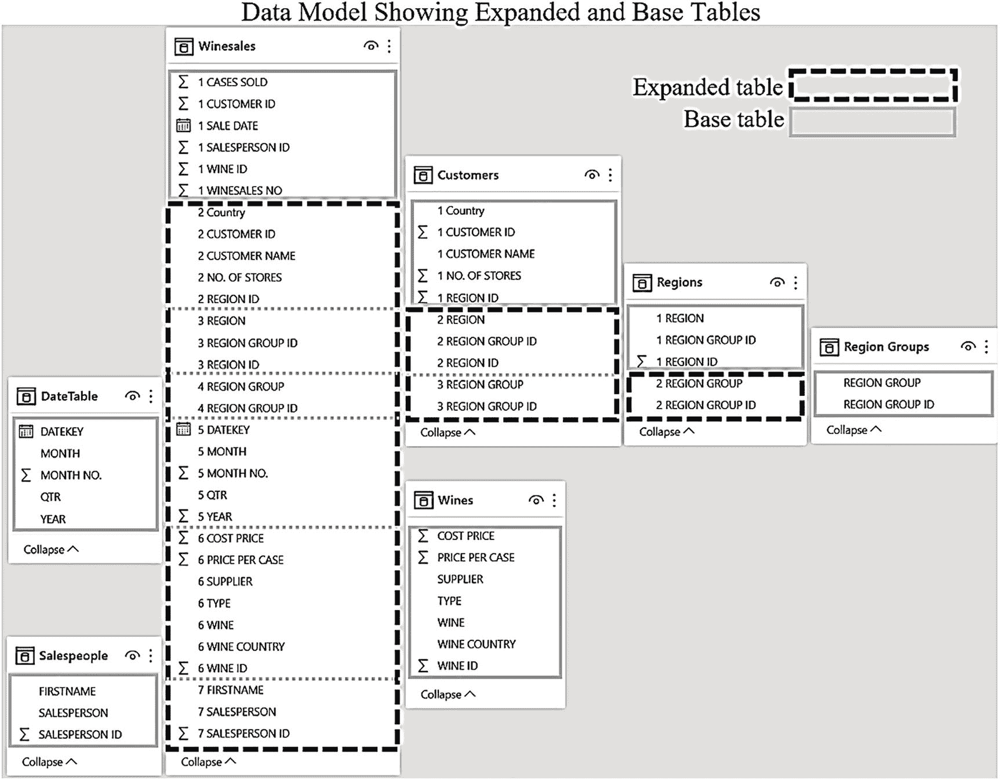

图 18-4

`Winesales`、`Customers` 和 `Regions` 表在度量评估时都会进行扩展

一旦筛选器应用于某一列，所有包含该列的扩展表也会被筛选。考虑图 18-5，该图显示了模型视图中的虚拟扩展表和基表。我们正在观察当我们筛选来自 `SalesPeople` 基表的 `SALESPERSON` 列或来自 `Region Groups` 基表的 `REGION GROUP` 列时会发生什么。

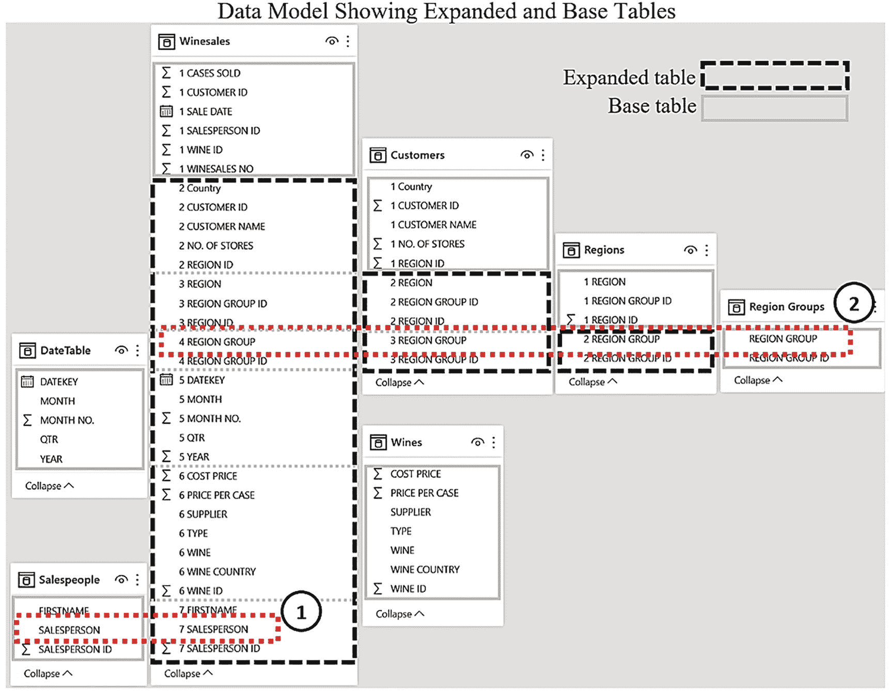

图 18-5

数据模型中表是如何扩展的

1.  筛选来自 `SalesPeople` 基表的 `SALESPERSON` 会筛选 `Winesales` 扩展表。

2.  筛选来自 `Region Groups` 基表的 `REGION GROUP` 会筛选 `Regions` 扩展表、`Customers` 扩展表以及 `Winesales` 扩展表。

所以现在我们能够回答之前提出的第一个问题。当 `Winesales` 表中不存在 `SalesPeople` 维度中 `SALESPERSON` 列的某个值时，该值是如何筛选 `Winesales` 事实表的呢？现在你明白了，这个值确实存在于 `Winesales` 表中。它存在于 `Winesales` 的*扩展*表中。当我们在 `SALESPERSON` 列上放置筛选器时，`SalesPeople` 基表和 `Winesales` 扩展表都会相应地受到筛选。另一个例子是对 `Region Groups` 基表中的 `REGION GROUP` 列进行筛选。请注意，这会筛选 `Regions`、`Customers` 和 `Winesales` 扩展表中的 `REGION GROUP` 列。

关系存在的唯一目的是为了扩展表；它们不被用于筛选表。在 DAX 表达式中对表的任何引用，在适用情况下，始终是对扩展表的引用。

现在让我们回答第二个问题。当 `Winesales` 表上没有直接筛选器时，筛选器是如何被移除的？当我们使用 `CALCULATE` 内部的 `ALL` 来移除表上的筛选器时，如果适用，它会移除*扩展表*上的筛选器。这包括来自与扩展表相关的维度表中的所有列，因此也包括最初产生筛选器的那些列。所以，表达式 `ALL ( Winesales )` 将移除来自与 `Winesales` 相关的任何基表上的筛选器，这涵盖了整个数据模型。

理解表扩展意味着我们现在可以阐明 DAX 中某些我们探讨过但当时无法完全解释的行为。例如，我们现在可以真正描述 `RELATED` 函数是如何工作的。

`RELATED` 并不会在相关表中“查找”值，而是允许你查找已存在于扩展表中的列。例如，当你在事实表上使用 `RELATED` 时，你会在智能感知列表中看到扩展事实表的所有列；参见图 18-6。

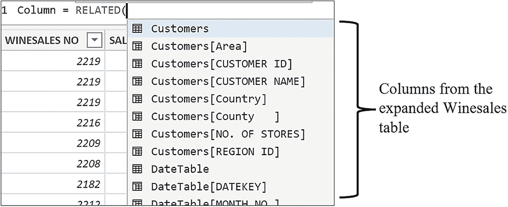

图 18-6

`RELATED` 函数允许你引用扩展表中的列

与 `RELATED` 类似，`ALLEXCEPT` 和 `SUMMARIZE` 函数也允许你使用扩展表中的列。当使用这些函数构建表达式时，如果你引用了事实表或雪花维度，你同样会在智能感知列表中看到扩展表的所有列；参见图 18-7。

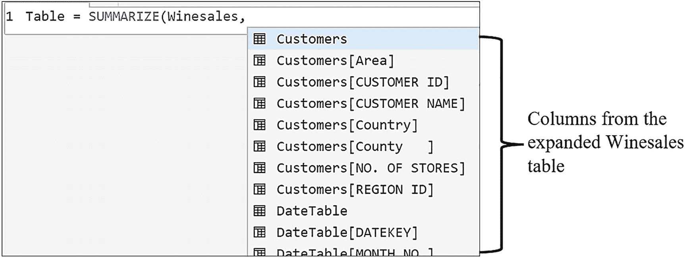

图 18-7

`SUMMARIZE` 也会引用扩展表

你可能会认为关于表扩展的知识纯粹是理论性的。它解释了关于筛选器传播的某些行为，但并不能引导你构建更复杂的 DAX 表达式。现在是时候改变对表扩展的这种看法，并学习如何将你对扩展表的知识付诸实践了。


### 利用扩展表

在表达式中使用表扩展的主要原因是为了“触及”维度，以便对其中的列执行聚合。你可能认为我们在讨论 `CROSSFILTER` 函数（该函数使您能够逆转筛选传播的方向）时已经涵盖了这种情况。`RELATED` 函数也允许您从维度和雪花表中提取值到事实表，以实现此类聚合。然而，这两种方法都不是最佳实践，原因我们将在您阅读下文时阐明。

## “触及”维度

接下来，让我们了解表扩展如何帮助您摆脱星型模式和雪花模式带来的限制。为此，我们将像之前经常做的那样，通过一个场景来展开。

您被要求计算每种葡萄酒在多少个不同的区域销售过。`Regions` 表是一个雪花维度。它与 `Customers` 表相关，而 `Customers` 表又与 `Winesales` 表相关。目前，您能推断出一笔交易发生在哪个地区的唯一途径是 `Customers` 表；见图 18-8。

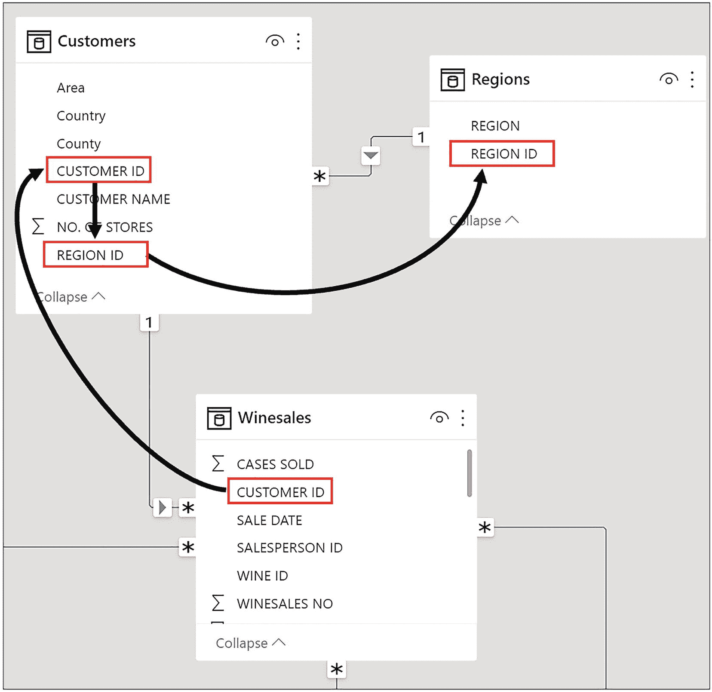

图 18-8

只能通过 `Customers` 表找出交易发生的区域

然而，您现在知道，`Regions` 表中的所有列都存在于扩展后的 `Winesales` 表中。因此，一种方法是在 `Winesales` 基表中创建一个计算列，使用 `RELATED` 从扩展后的 `Winesales` 表中找出 `REGION` 列，如图 18-9 所示。

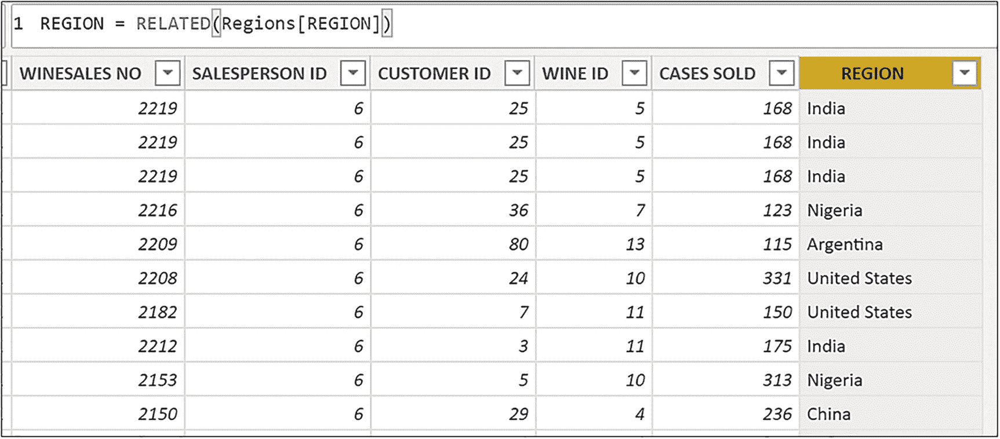

图 18-9

您可以在事实表中使用 `RELATED` 来显示区域名称

然后，您可以在这个计算列上使用 `DISTINCTCOUNT` 来编写度量值“Distinct Regions”，如下所示：

```
Distinct Regions =
DISTINCTCOUNT ( Winesales[REGION] )
```

然而，这里所做的一切仅仅是访问扩展后 `Winesales` 表中的 `REGION` 列。您也知道，应尽量避免使用计算列。有一种更好的方法来计算不重复区域的数量，那就是使用带有表筛选器的 `CALCULATE`，该筛选器将筛选 `Regions` 表。为此，我们首先需要回顾一下如何构建 `CALCULATE` 函数中的筛选参数。

您已经了解到，`CALCULATE` 内部的筛选参数可以包含一个表表达式。但筛选参数不一定非得是表表达式；它也可以只是一个对表的引用。如果您在 `CALCULATE` 的筛选参数中引用一个表，在适用的情况下，这总是 *扩展后的表*。

回到计算销售葡萄酒的不同区域数量这个问题上，您可以使用包含 `REGION` 列的扩展后 `Winesales` 表作为 `CALCULATE` 的筛选条件。如果这样做，您就可以使用一个度量值来统计通过扩展后 `Winesales` 表筛选过的 `Regions` 表中的行数。该度量值如下：

```
Distinct Regions =
CALCULATE ( COUNTROWS ( Regions ), Winesales )
```

您必须注意这个表达式的简洁性，以及其背后概念的复杂性，同时也请记住我们之前提到过的一点；对于 `DAX` 而言，细节是魔鬼。

我们可以在图 18-10 中看到此度量值的计算过程。

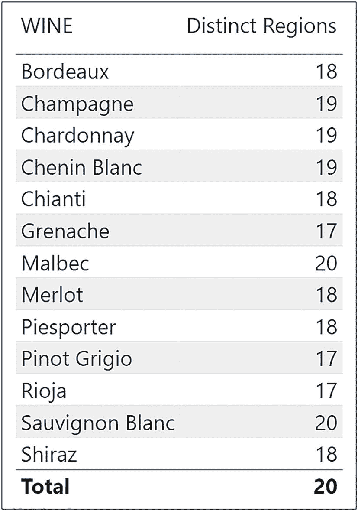

图 18-10

使用扩展后 `Winesales` 表计算“Distinct Regions”的过程

“Distinct Regions”度量值使用 `CALCULATE` 筛选参数中的扩展后 `Winesales` 表来筛选 `Regions` 基表。在此度量值的计算过程中，我们知道对 `Wines` 表中 `WINE` 列的筛选会作用于扩展后 `Winesales` 表中的 `WINE` 列。我们还知道，扩展后的 `Winesales` 表包含了 `Regions` 表中的所有列。因此，在当前筛选上下文中，每种葡萄酒销售的区域也会被筛选。在当前筛选上下文中针对每种葡萄酒筛选过的扩展后 `Winesales` 表，会被用来相应地筛选 `Regions` 表。此时 `Regions` 表仅包含在当前筛选上下文中销售了该葡萄酒的区域，然后对筛选后的 `Regions` 维度中的行进行计数；请参见图 18-11。

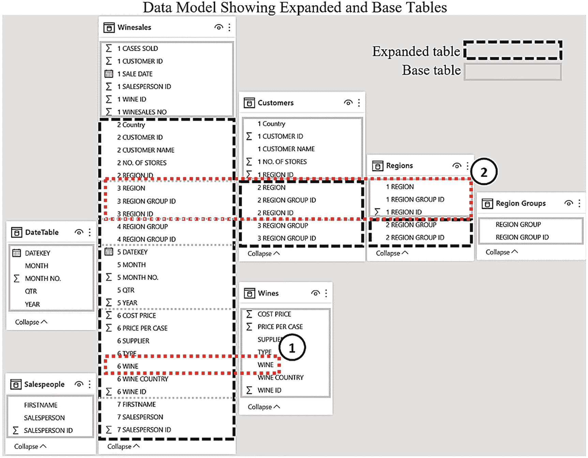

图 18-11

筛选传播中使用的基表和扩展表


```markdown
1.  `Wines`表中的`WINE`列过滤了经过扩展的`Winesales`表中的`WINE`列。

2.  经过扩展的`Winesales`表包含`Regions`表中的所有列。这个过滤条件作用于经过扩展的`Winesales`事实表，用于过滤`Regions`表，然后对`Regions`表中的行进行计数。

从这个度量值中我们可以得出的结论是，使用`CALCULATE`时，你可以利用经过扩展的表来过滤基础表。

让我们再看一个在代码中使用经过扩展的表的例子，但这次我们要编写一个更具挑战性的计算。我们将重复之前的场景：你需要找出销售过葡萄酒的不同地区的数量，但这次，你只考虑高销量地区。你已确定，高销量地区是指`CASES SOLD`（销售箱数）大于 325 的任何地区。为了进行此计算，与其像“Distinct Regions”表达式那样使用整个经过扩展的`Winesales`表，不如使用`FILTER`来过滤经过扩展的`Winesales`表（高亮部分）：

```
Distinct High Volume Regions=
CALCULATE (
COUNTROWS ( Regions ),
FILTER ( Winesales, Winesales[CASES SOLD] >325 )
)
```

当你将此度量值放入表视觉对象中时，你会发现，对于“Bordeaux”，有**18**个地区的`CASES SOLD`交易量大于 325，而在销售“Grenache”时，只有**7**个地区；参见图 18-12。

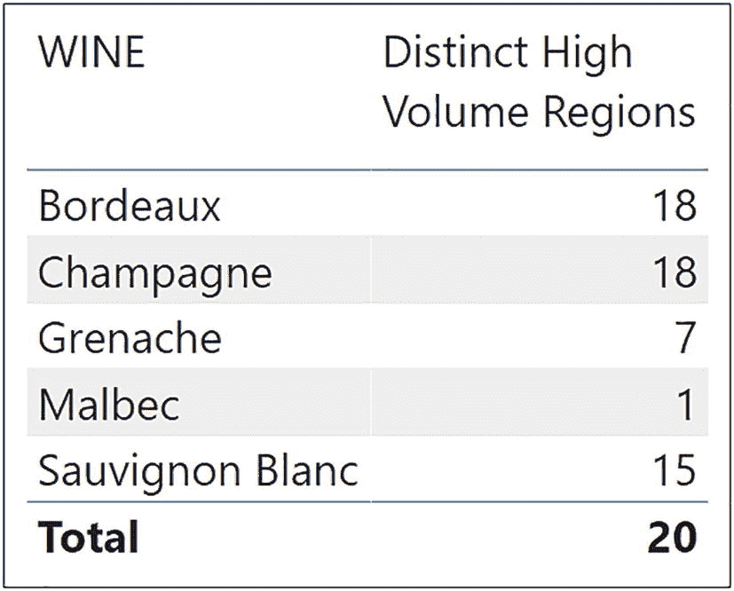

**图 18-12** 在表视觉对象中计算的“Distinct High Volume Regions”度量值

如果我们检查“Distinct High Volume Regions”度量值的计算过程，如图 18-13 所示，你会发现它与“Distinct Regions”度量值的不同之处仅在于多了一个过滤`Winesales`基础表的步骤。该度量值过滤了`Wines`维度中的`WINE`列，同时也过滤了经过扩展的`Winesales`表。`FILTER`函数进一步将`Winesales`基础表过滤为`CASES SOLD`大于 325 的行。`Regions`表中的列包含在经过扩展的`Winesales`表中，因此也受到了过滤。对`Regions`表中的行进行计数，只会反映出那些在经过扩展的`Winesales`表中被过滤后的地区。

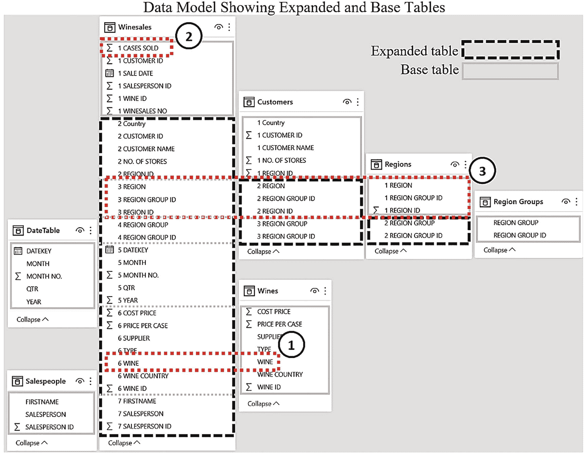

**图 18-13** 用于过滤器传播的基础表和经过扩展的表

1.  `WINE`列过滤了经过扩展的`Winesales`表中的`WINE`列。
2.  `Winesales`基础表中的`CASES SOLD`列被过滤为大于 325。
3.  经过扩展的`Winesales`表包含`Regions`表中的所有列。经过扩展的`Winesales`事实表中的过滤器用于过滤`Regions`表。

对表扩展的了解也有助于澄清我们本书中多次探讨过的一个前提，即表过滤器和列过滤器之间的区别。既然我们知道表过滤器通常会涉及经过扩展的表，那么让我们将刚刚编写的度量值与另一个看起来几乎相同的度量值进行比较。然而，一个使用了表过滤器（利用经过扩展的表），另一个则使用了列过滤器，如下所示：

```
Distinct High Volume Regions Table Filter =
CALCULATE (
COUNTROWS ( Regions ),
FILTER ( Winesales, Winesales[CASES SOLD] > 325 )
)
```

```
Distinct High Volume Regions Column Filter =
CALCULATE (
COUNTROWS ( Regions ), Winesales[CASES SOLD] > 325 )
```

你可以在图 18-14 中看到，相似的度量值返回了不同的数值。原因在于，第一个度量值过滤了经过扩展的`Winesales`表，而第二个度量值仅过滤了`Winesales`*基础*表中的`CASES SOLD`列。

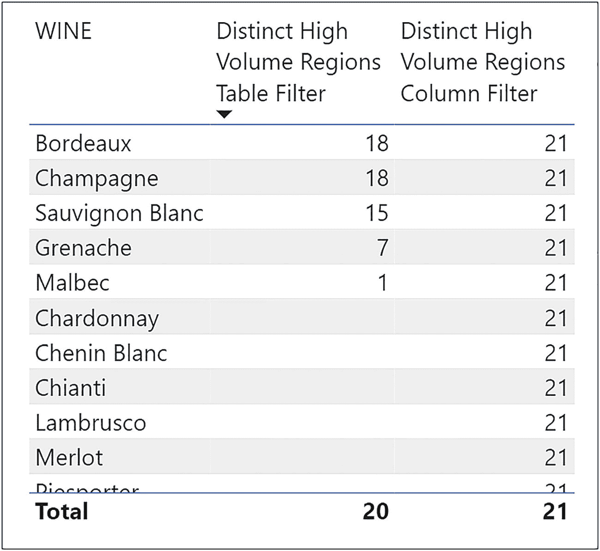

**图 18-14** 相似的度量值可能返回不同的结果

正确的计算“Distinct High Volume Regions Table Filter”使用了由`FILTER`函数生成的表过滤器，该过滤器先过滤经过扩展的`Winesales`表，进而过滤`CASES SOLD`列。这也会过滤经过扩展的表中的地区，并用于过滤`Regions`维度。然后，该度量值对经过`Winesales`扩展表过滤后的`Regions`基础表中的行进行计数；参见图 18-13。

度量值“Distinct High Volume Regions Column Filter”仅在`Winesales`*基础*表中的`CASES SOLD`列上生成一个过滤器，并且模型中不会有任何过滤器传播。因此，无论`Winesales`表中存在任何过滤器，它都会计算`Regions`表中的*所有*行；参见图 18-15。

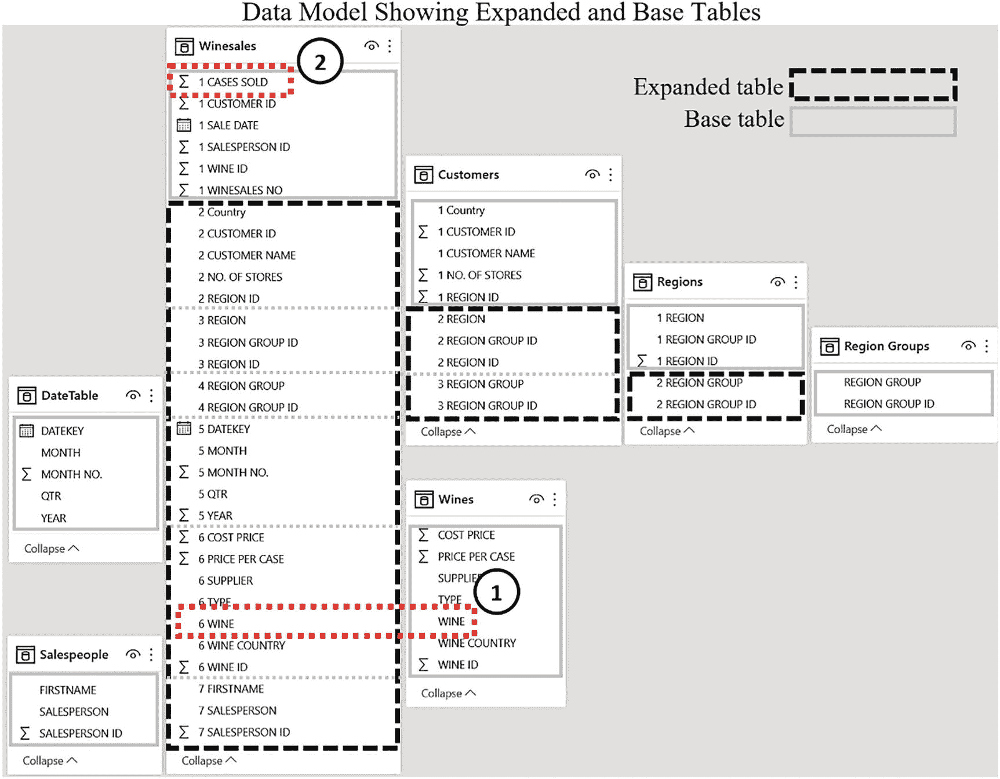

**图 18-15** 用于过滤器传播的基础表和经过扩展的表

1.  `WINE`列在经过扩展的表和基础`Wines`表中均被过滤。
2.  过滤`Winesales`基础表中的一列并不会将过滤器传播到维度表。

从这些例子中得出的关键结论是，在`CALCULATE`的过滤器参数中使用经过扩展的表，能够让你将过滤器传递到维度和雪花表中，实际上相当于逆转了过滤器传播的方向。这是因为经过扩展的表包含了这些维度的列，这些列可以被分组和过滤。然而，现在必须回答一个问题是：使用经过扩展的表和使用`CROSSFILTER`有什么区别？使用这些不同方法的最终结果不是一样的吗？例如，我们可以使用经过扩展的表编写以下表达式：

```
Distinct Regions #1 =
CALCULATE ( COUNTROWS ( Regions ), Winesales )
```

或者，我们可以使用`CROSSFILTER`编写这个我们认为会返回相同结果的度量值：

```
Distinct Regions #2 =
CALCULATE(COUNTROWS(Regions),
CROSSFILTER(Winesales[CUSTOMER ID],
Customers[CUSTOMER ID],both),
CROSSFILTER(Customers[REGION ID],
Regions[REGION ID],both))
```

这两个度量值都会“触及”`Regions`表。显然，第二个度量值比第一个笨拙得多，但在计算评估上是否存在差异？答案是肯定的，有差异，我们现在就来解释原因。
```


### 表扩展 vs. CROSSFILTER

在第[13]章(#523050_1_En_13_Chapter.xhtml)中，当我们探究`CROSSFILTER`函数时，编写了一个度量值，用于对 Customers 表中的`NO. OF STORES`列求和，以计算我们销售葡萄酒的店铺数量。提醒一下，当时的问题是筛选器无法从 Wines 维度传递到 Customers 维度，因此我们使用`CROSSFILTER`函数以编程方式将筛选传播方向更改为双向筛选：

```
Total Stores =
CALCULATE (
SUM ( Customers[NO. OF STORES] ),
CROSSFILTER ( Winesales[CUSTOMER ID],
Customers[CUSTOMER ID], BOTH )
)
```

然而，我们当时没有告诉你，你也不会注意到，但该度量值在“合计”行返回了一个错误的值；参见图 18-16。

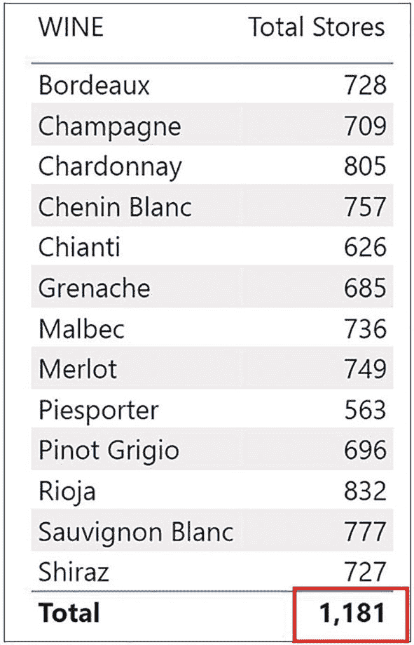

图 18-16

“Total Stores”度量值在“合计”行中不正确

许多相同的客户可能购买了各种葡萄酒，因此我们知道，**1,181** 的总和不会是每种葡萄酒各自总值的简单相加。不过，你或许会认为这个值看起来差不多，从而相信它。但“合计”行中的值应该是我们销售所有葡萄酒的店铺总数量。这个值不正确，因为在 Customers 表中，有五个客户我们从未向其销售过葡萄酒。如果我们在计算“Total Sales”度量值的表格视觉对象中“显示无数据的项目”，就能看到他们是谁；参见图 18-17。

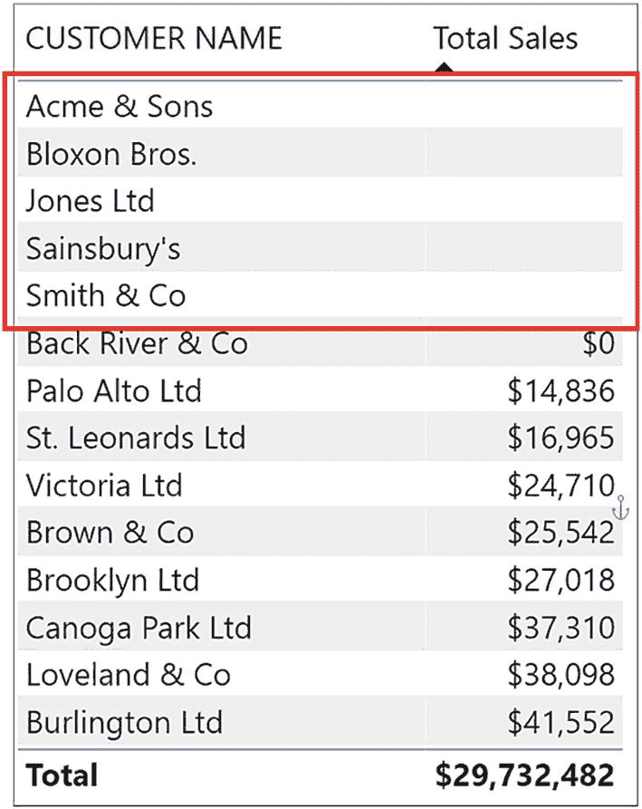

图 18-17

有五个客户没有销售记录

“合计”行中显示的 **1,181** 包含了这些客户的店铺。我们可以在 Customers 表的`NO. OF STORES`列中看到这些值；参见图 18-18。

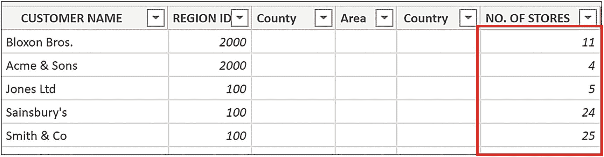

图 18-18

没有销售记录的客户在`NO. OF STORES`列中仍有值

我们未向这些客户销售任何葡萄酒，因此他们的店铺显然不应计入我们销售葡萄酒的店铺总数。我们的总和多出了 **69**。

这里发生的情况是，“Total Stores”度量值使用了双向筛选器。当它到达“合计”行的评估时，Wines 维度的`WINE`列上的筛选器被移除，因此没有筛选器可以传播到 Customers 维度。由于没有传播筛选器，它会对`NO. OF STORES`列中的所有值求和。换句话说，双向筛选器仅在存在活跃筛选器时才生效。

那么，如何在“合计”行中计算出正确的值 **1,112** 呢？

这里必须做的是，使用扩展后的 Winesales 事实表作为 Customers 表的筛选器。这是因为，与双向筛选不同，来自扩展表的筛选器始终处于活跃状态。当评估“合计”行时，扩展后的 Winesales 事实表仅包含那些购买过葡萄酒的客户，因此这将相应地筛选 Customers 维度。

以下是能给出正确总数的度量值：

```
Total Stores #2 =
CALCULATE (
SUM ( Customers[NO. OF STORES] ),
Winesales
)
```

你现在可以在图 18-19 中看到，“合计”行现在显示的是 **1,112**。

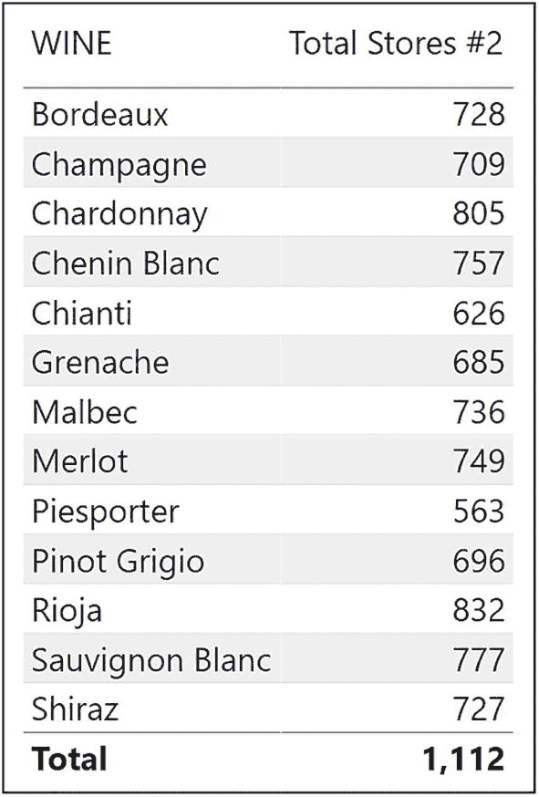

图 18-19

使用表扩展可在“合计”行中返回正确的值

在使用 DAX 时，你不仅需要关注细节并保持怀疑精神，还必须理解表扩展。

### 使用雪花架构

理解表扩展也解释了我们在处理“雪花”型架构时可能遇到的问题。即可能存在一系列表格，通过一对多关系链连接到事实表。在我们的数据模型中，我们扩展了 Regions 雪花架构，添加了另一个表 Region Groups，该表通过`REGION GROUP ID`与 Regions 表相关联。从图 18-20 中可以看到，Region Groups 表通过`REGION GROUP ID`关联到 Regions 表，Regions 表通过`REGION ID`关联到 Customers 表，Customers 表又通过`CUSTOMER ID`关联到 Winesales。

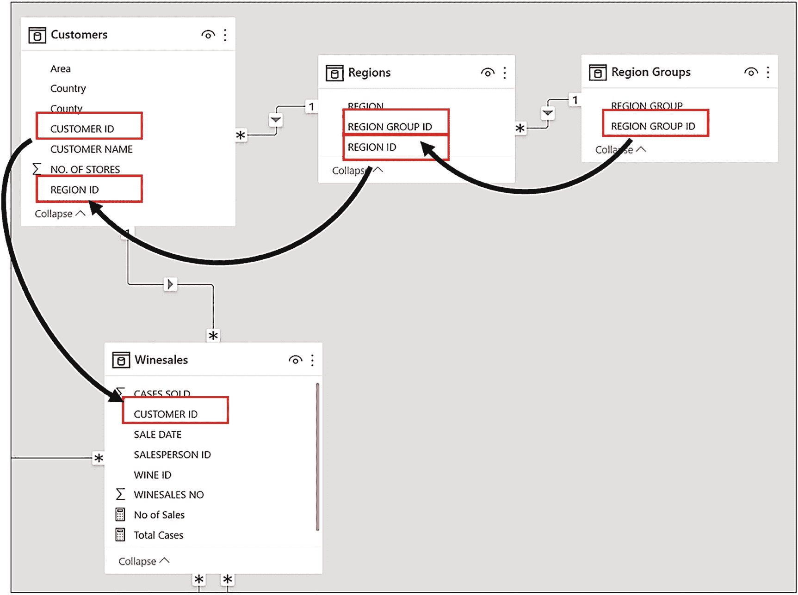

图 18-20

一个由 Region Groups、Regions 和 Customers 组成的雪花架构

在图 18-21 中，我们在切片器中筛选了“South West”地区组，并在表格视觉对象中显示了该地区组下的客户。我们尝试计算这些客户的总销售额 (**3,512,539**)，以便将这个值用作分母，来计算每个客户销售额占“South West”地区组总额的百分比。这是我们使用`ALL`函数在 Customers 表上编写的度量值：

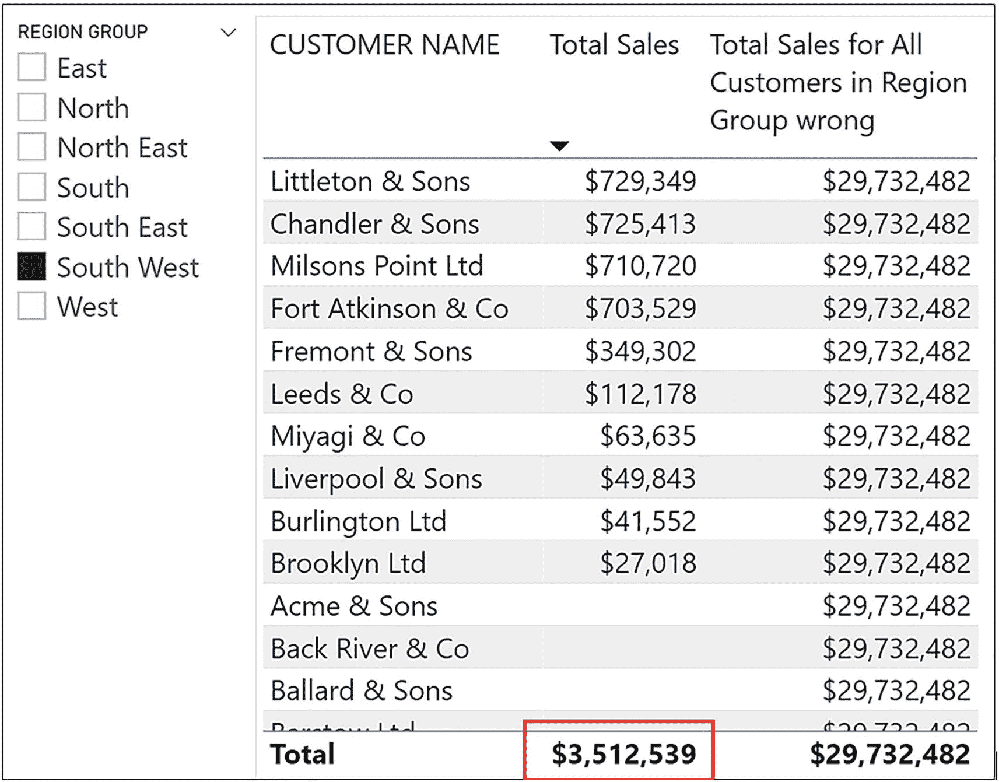

图 18-21

计算地区组中所有客户总销售额的结果不正确

```
Total Sales for All Customers in Region Group wrong =
CALCULATE ( [Total Sales], ALL ( Customers ) )
```

如图 18-21 所示，它没有返回正确的结果，正确结果应为 **$3,512,539**。你还会注意到，因为我们从 Customers 表中移除了所有筛选器，表格视觉对象现在显示了所有客户，而不仅仅是“South West”地区组中的客户。

现在让我们解释一下为什么计算错误。当我们在`CALCULATE`内部使用`ALL`从表中移除筛选器时，它也会（如果适用）从扩展表中移除筛选器。因此，该度量值会从扩展后的 Customers 表中移除筛选器，从而同时移除 Regions 表和 Region Groups 表的筛选器。因此，它计算的是*所有*地区组的总和。Region Groups 表位于雪花链的末端，所以这与总销售额的合计值相同。

图 18-22 显示了从扩展后的 Customers 表中移除筛选器是如何同时移除 Regions 和 Region Groups 的筛选器的。

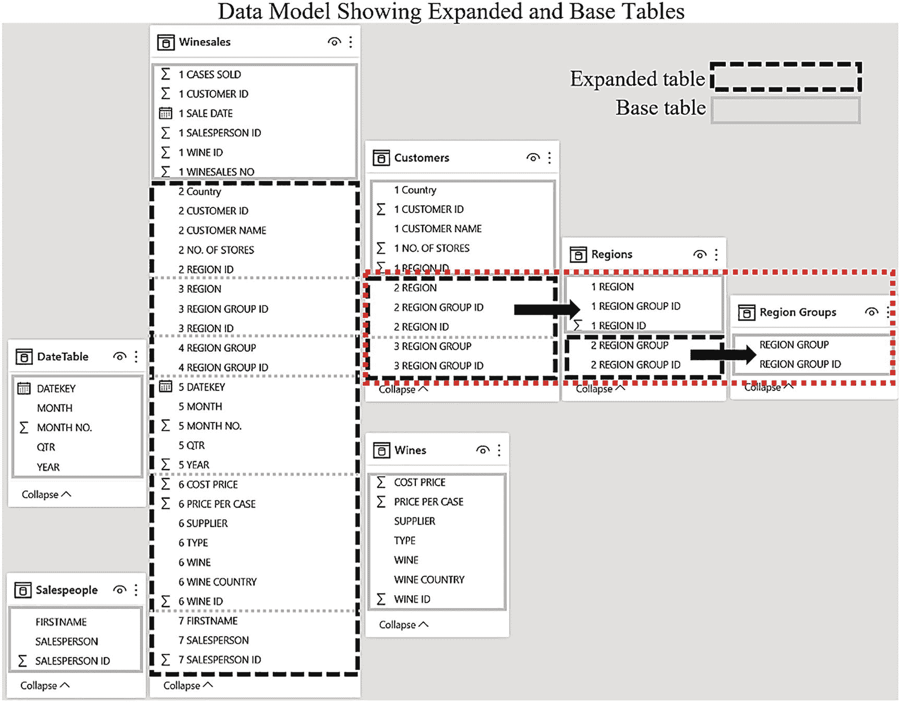

图 18-22

从扩展后的 Customers 表中移除筛选器会同时移除 Regions 和 Region Groups 的筛选器

要计算正确的分母，有几种方法可以修改原始度量值，以重新应用在 Customers 表上“丢失”的筛选器。例如，我们可以使用`ALLEXCEPT`来移除扩展后的 Customers 表上的筛选器，但保留对`REGION GROUP`列的筛选（因为`REGION GROUP`包含在扩展后的 Customers 表中）：

```
Total Sales for All Customers in Region Group #1=
CALCULATE (
[Total Sales],
ALLEXCEPT ( Customers, 'Region Groups'[REGION GROUP]))
```

另一种方法是使用当前由切片器在 Region Groups 表上生成的筛选器，即“South West”。该度量值也能给出我们所需的分母：

```
Total Sales for All Customers in Region Group #2 =
CALCULATE (
[Total Sales],
ALL ( Customers ),
'Region Groups')
```

在“Total Sales for All Customers in Region Group #2”度量值中，`ALL`函数移除了扩展后的 Customers 表上的所有筛选器，但通过在`CALCULATE`的第二个筛选参数中使用`Region Groups`作为表筛选器，这会在扩展后的 Customers 表上重新应用“South West”筛选器，因此也会筛选 Regions 表和 Region Groups 表。


