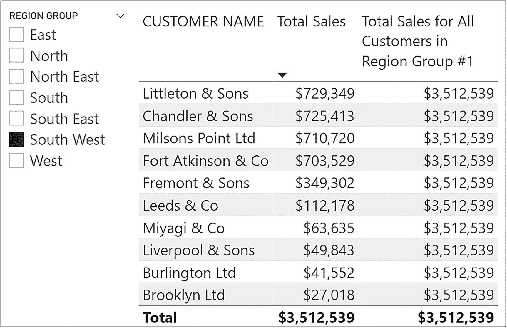

# 排版后的内容

若要移除表视觉对象中“总销售额”为空的客户，请使用视觉级筛选器，筛选“总销售额”不为空。

现在我们得到了正确的分母；见图 18-23。



图 18-23

在从扩展表中移除筛选器时，需要重新应用“丢失的”筛选器。

也可以使用 `ALLSELECTED` 编写如下更简单的度量值：

```
Total Sales for All Customers in Region Group #3 =
CALCULATE ( [Total Sales], ALLSELECTED ( Customers ) )
```

你在这些示例中看到的是“雪花”型模式中一直存在的问题。当事实表通过多对一关系向外连接一系列表时，若使用 `CALCULATE` 内部的 `ALL` 移除靠近事实表的筛选器，你也会移除该链条上所有的筛选器。

在本章中，我们深入探讨了支持 DAX 的最后一个核心概念——表扩展。你已经了解到，数据模型中的关系仅用于生成扩展表，而筛选传播是通过筛选扩展表内部的列来实现的，并非通过维度表向事实表执行查找。了解表扩展后，你就能编写利用当前置于扩展表上的筛选器的表达式，从而将筛选器传递回维度表，实际上逆转了筛选传播的方向。

现在你即将进入本书的最后一章。恭喜你走到这一步！这并非一帆风顺的旅程，我们共同探讨的一些 DAX 表达式对任何 DAX 用户来说都颇具挑战。然而，你现在已经理解了支撑 DAX 的四个核心概念：

*   计值上下文

*   迭代器

*   上下文转换

*   表扩展

根据阿尔贝托·费拉里在其博客“DAX 不简单的 7 个原因”中的说法，你现在已经是 DAX 大师了！^(²³)

然而，关于这些概念，阿尔贝托继续说道：*“关键在于：你需要掌握它们，而不仅仅是了解它们的基本含义。此外，这些是基础概念：它们与特定函数无关。”*

请将这句话视为最佳建议。完成本书的学习，并不意味着你 DAX 学习之旅的结束，而是仅仅结束了开始阶段。现在，你必须吸收所学知识，加以实践，并有信心攻克那些能为你提供真正洞见数据的挑战性计算。

不过，你还有一章要读。在下一章中，我们将把你的 DAX 专业知识提升到新高度。你将学习 `CALCULATETABLE` 函数的用途。

脚注 1   2