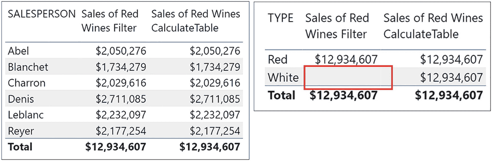
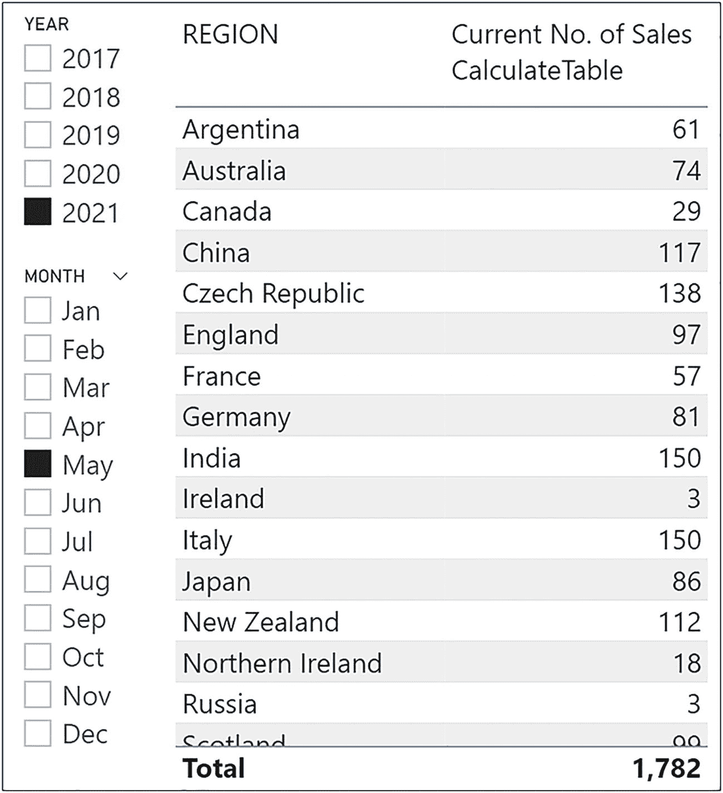
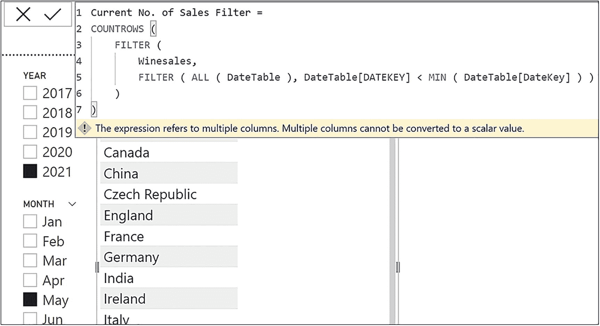
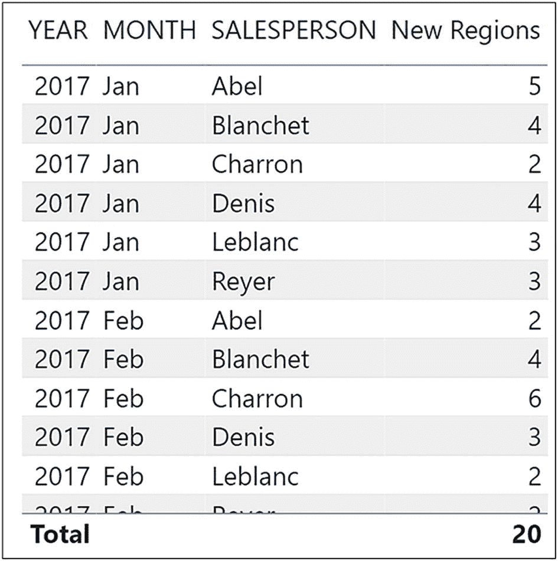
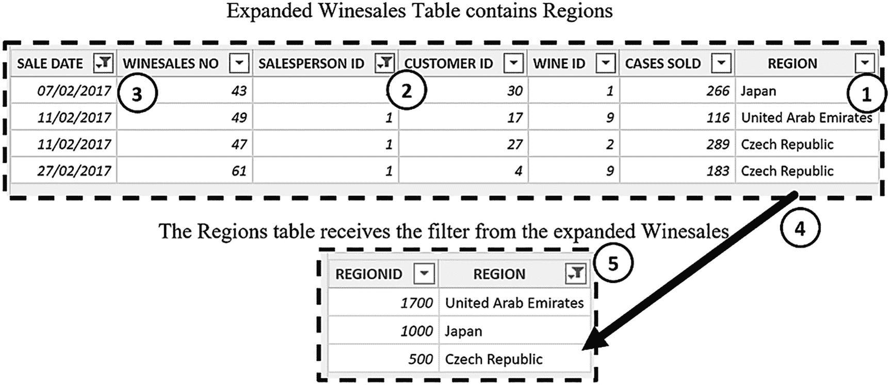
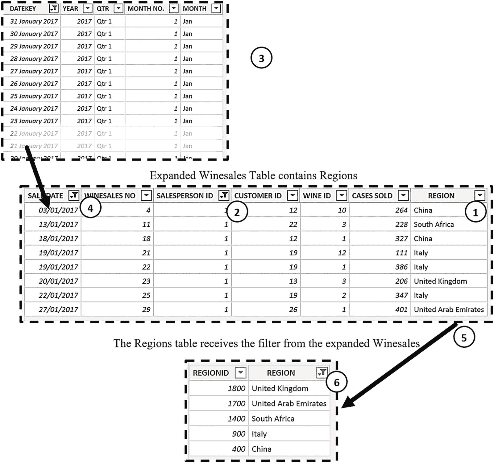
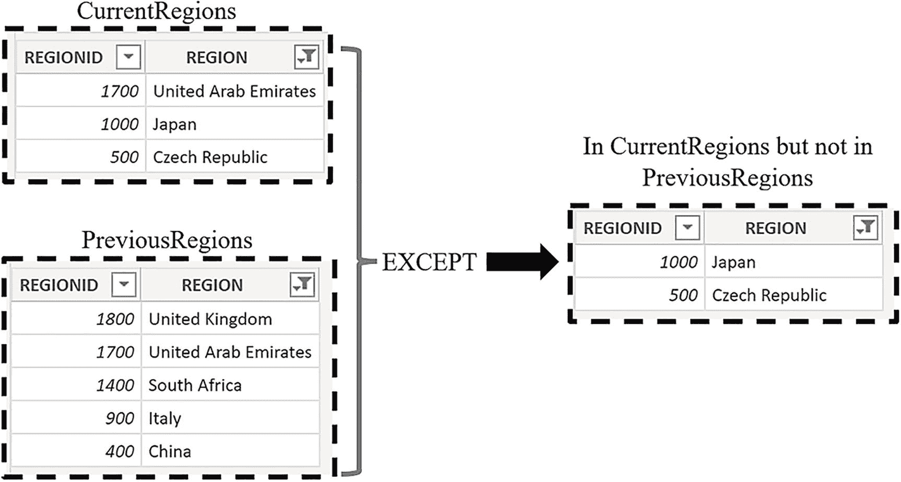
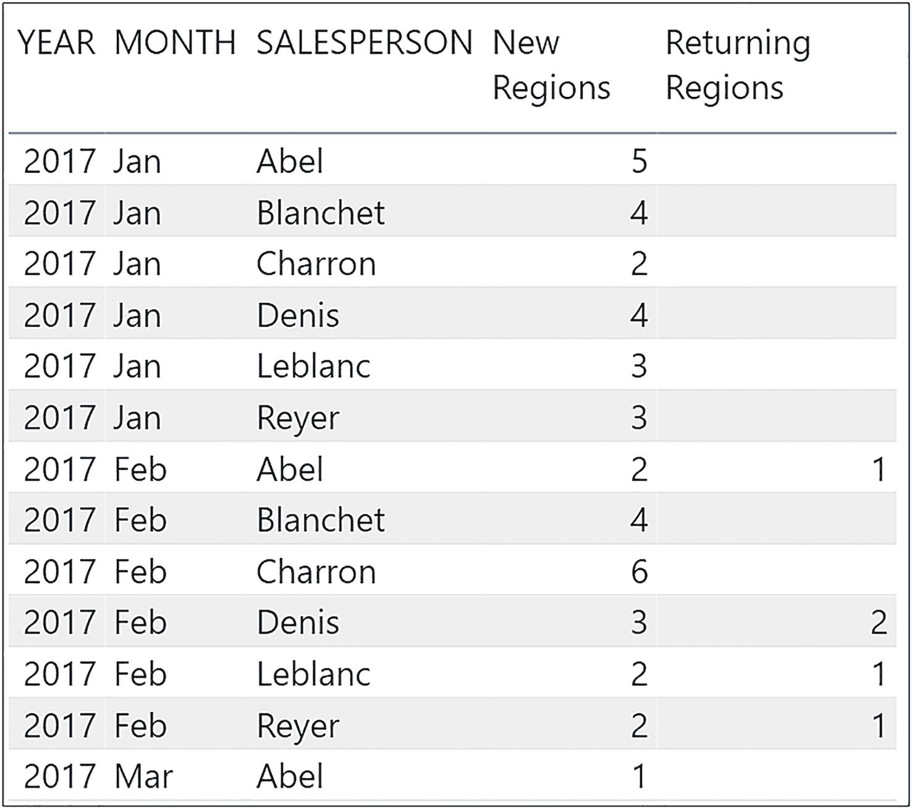
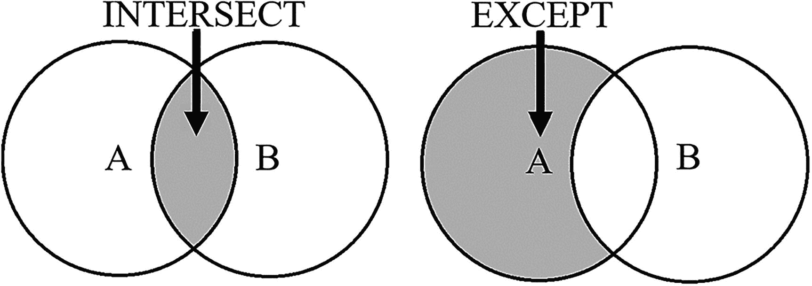
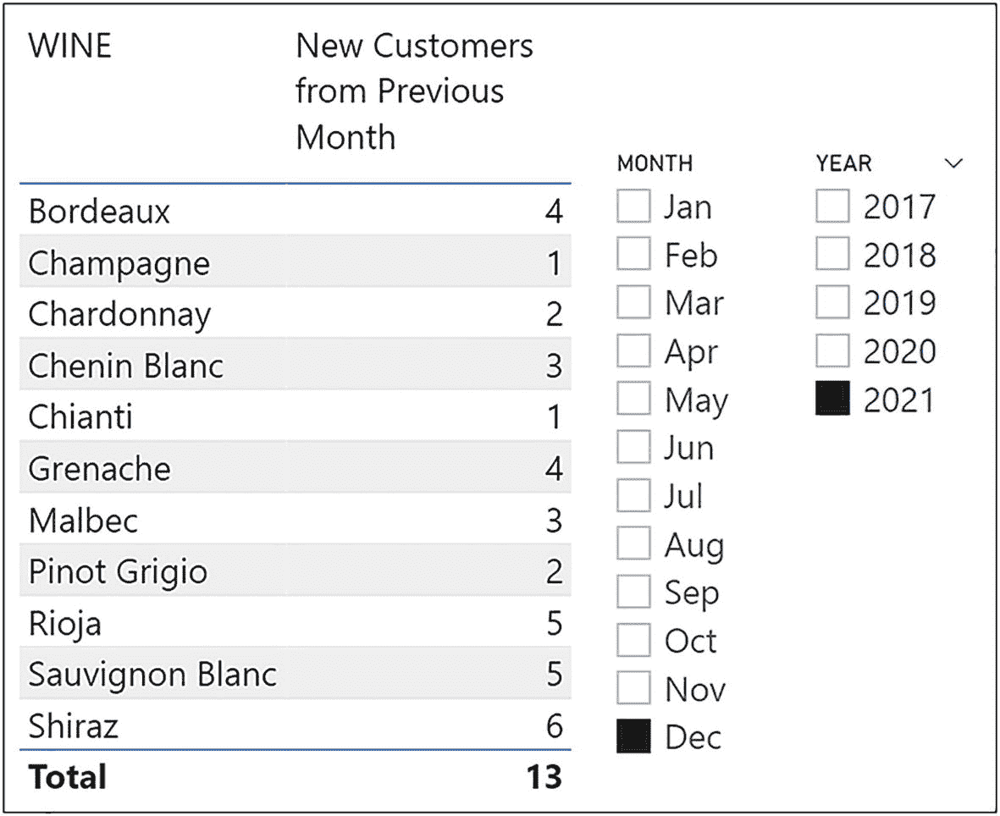

# 19. CALCULATETABLE 函数

既然你已成为公认的 DAX 专家，你已准备好直面那些能真正考验你对 DAX 知识与理解的 DAX 表达式。`CALCULATETABLE` 是只有在清晰理解 DAX 工作方式后才能掌握的函数之一，这个略显生僻的函数也是我们在本书中探讨的最后一个函数。

`CALCULATETABLE` 的所有操作方式与 `CALCULATE` 相同，区别在于它返回的是表而非标量值。换句话说，它返回一个表或表表达式，其中对该表的筛选器已以某种方式被修改。因此，从表面上看，`CALCULATETABLE` 应该不难理解。然而，由于它返回的是表，人们常问的问题是：如何在度量值中使用它？我们将此函数留到最后的原因在于，在度量值内部，当它与扩展表结合使用时尤为有用。^(²⁴)

`CALCULATETABLE` 的语法为：

`= CALCULATETABLE (<表或表表达式>, <筛选器 1>, <筛选器 2>, ...)`

其中：

`<表>` 或表表达式是希望由 `CALCULATETABLE` 返回的表。

`<筛选器 1>, <筛选器 2>` 等为 `<表>` 返回的结果提供筛选条件。

你可能会觉得这个函数与 `FILTER` 函数极为相似，确实，你通常可以用 `CALCULATETABLE` 替代 `FILTER`。

## `CALCULATETABLE` 与 `FILTER` 的对比

然而，`CALCULATETABLE` 与 `FILTER` 不同，它*会修改*筛选上下文，这是我们将要探讨的此函数的第一个行为。让我们来比较这两个度量值：

```
Sales of Red Wines Filter =
CALCULATE ( [Total Sales],
FILTER ( Wines, Wines[TYPE] = "red" )
)
Sales of Red Wines CalculateTable =
CALCULATE ( [Total Sales],
CALCULATETABLE ( Wines, Wines[TYPE] = "red" )
)
```

这两个表达式都在为 `CALCULATE` 构建一个表筛选器。第一个使用 `FILTER` 来构建包含红酒的表，第二个使用 `CALCULATETABLE` 来构建一个类似的表。这两个度量值返回相同的值。然而，`CALCULATETABLE` 会修改筛选上下文。因此，如果 `Wines` 维度的 `TYPE` 列提供了筛选上下文，它将会*替换*对 `TYPE` 的筛选。所以，如果当前筛选是 "White"，它将被替换为 "Red"。`FILTER` 只能筛选已存在于筛选上下文中的内容，因此如果当前筛选是 "White"，它将返回空值；见图 19-1。



**图 19-1** `CALCULATETABLE` 会修改筛选上下文，但 `FILTER` 只能在当前筛选上下文中进行筛选

因此，当你必须生成一个需要修改筛选上下文的内存表时，`CALCULATETABLE` 函数就变得非常有用。实际上，即使它们的输出有时相同，`FILTER` 和 `CALCULATETABLE` 也是完全不同的函数。前者通过在当前筛选上下文中迭代另一个表来创建一个虚拟表。后者也会生成一个虚拟表，但会使用一个*新的筛选上下文*来构建该虚拟表。

为了说明这一点，让我们构建一个名为 `"Current No. of Sales"` 的度量值，该度量值将计算截至上个月末每个地区产生的销售额数量，年和月则在切片器中选定；见图 19-2。



**图 19-2** 计算截至上个月末的销售额数量

此计算分为三个步骤：

1.  首先，我们必须筛选 `DateTable`，使其包含截至切片器选定月份的上个月末的所有日期，例如，截至但不包括 2021 年 5 月 1 日的日期。

2.  然后，可以使用筛选后的 `DateTable` 来筛选 `Winesales` 表，使其仅包含截至上个月末的销售记录。

3.  然后，我们可以使用 `COUNTROWS` 来计算筛选后的 `Winesales` 表中有多少笔销售。

问题将如下：对于步骤 2，我们将使用哪个筛选函数来生成 `DateTable`，以便用它来筛选 `Winesales` 表，从而得到我们需要的日期？我们将使用 `FILTER` 还是 `CALCULATETABLE`？我们构建了两个版本的度量值，第一个使用 `CALCULATETABLE`，第二个使用 `FILTER`（高亮显示），其中我们将有第二个内部的 `FILTER` 函数：

```
Current No. of Sales CalculateTable =
COUNTROWS (
CALCULATETABLE (
Winesales,
FILTER ( ALL ( DateTable ), DateTable[DATEKEY] < MIN ( DateTable[DATEKEY] ) )
)
)
Current No. of Sales Filter =
COUNTROWS (
FILTER (
Winesales,
FILTER ( ALL ( DateTable ), DateTable[DATEKEY] < MIN ( DateTable[DATEKEY] ) )
)
)
```

使用 `CALCULATETABLE` 的度量值是正确的度量值，因为如果你尝试使用 `FILTER` 的度量值，会得到一个错误，如图 19-3 所示。



**图 19-3** 使用 `FILTER` 来筛选 `DateTable` 会返回一个错误

如果我们认为这些函数可以互换，为什么 `CALCULATETABLE` 有效，而 `FILTER` 却不行？为了理解使用 `FILTER` 时的错误，我们必须更仔细地查看内部的 `FILTER` 表达式在内存中生成了什么。

1.  内部的 `FILTER` 会迭代 `DateTable` 以找到截至上个月末的所有日期。

2.  内部的 `FILTER` 会创建一个仅包含这些日期的新虚拟 `DateTable`。

3.  然后，外部的 `FILTER` 会使用该虚拟 `DateTable` 来筛选 `Winesales` 表的行，并相应地迭代 `Winesales` 表中的每一行。

在步骤 3 中，`Winesales` 表中的每一行将根据什么标准进行筛选？你不能根据整个表中的值来筛选一行，因此我们收到了这个错误：

*“表达式引用了多个列。无法将多列转换为标量值。”*

由 `FILTER` 生成的表就是错误消息中提到的“多列”，它告诉我们，如果使用 `FILTER`，我们只能为筛选行的条件返回标量值。不能在 `FILTER` 的筛选表达式中使用表表达式，只能使用谓词。

`CALCULATETABLE` 度量值有何不同？在正确的度量值中：

1.  内部的 `FILTER` 会迭代 `DateTable` 以找到截至上个月末的所有日期。

2.  内部的 `FILTER` 随后会生成一个仅包含这些日期的虚拟 `DateTable`。

3.  `CALCULATETABLE` 会生成一个虚拟的 `Winesales` 表，该表可以由 `FILTER` 生成的虚拟 `DateTable` 来筛选。这只是一个表筛选器，因此其使用方式与通常放在 `CALCULATE` 内部的任何表筛选器相同。

换句话说，由 `FILTER` 生成的虚拟表为 `CALCULATETABLE` 提供了*新的筛选上下文*，虚拟的 `Winesales` 表可以据此进行筛选。然后就可以计算虚拟 `Winesales` 表中的行数了。

在探索 `CALCULATETABLE` 的这个阶段，希望你已明白，如果你想计算 `"Current No. of Sales"`，使用 `CALCULATE` 编写以下度量值会简单得多，并且不会返回错误：

```
Current No. of Sales =
CALCULATE (
COUNTROWS ( Winesales ),
FILTER ( ALL ( DateTable ), DateTable[DATEKEY]
< MIN ( DateTable[DATEKEY] ) ) )
```

然而，我们正在探索 `CALCULATETABLE` 和 `FILTER` 之间的区别，这个度量值并不能说明这一点。但更重要的是，请在心里记下使用 `CALCULATETABLE` 的表达式，因为它将是本章后面更复杂表达式中的“构建块”。以下是再次用来计算截至上个月末每个地区销售额数量的表达式：

```
Current No. of Sales CalculateTable =
COUNTROWS (
CALCULATETABLE (
Winesales,
FILTER ( ALL ( DateTable ), DateTable[DATEKEY] < MIN ( DateTable[DATEKEY] ) )
)
)
```

具体来说，稍后我们将使用这个表达式作为“新区域”和“回头区域”计算的组成部分。

我们已经确定 `CALCULATETABLE` 在生成虚拟表时会修改筛选上下文，但我们还没有找到此函数的有用应用程序。`CALCULATETABLE` 的真正用武之地在于，你在此函数的筛选参数中引用一个扩展表，以便它随后可以被用作表筛选器。

## `CALCULATETABLE` 与表扩展

与 `CALCULATE` 一样，你可以使用扩展表作为筛选表达式来修改 `CALCULATETABLE` 内部的筛选上下文。例如，以下表表达式

```
=CALCULATETABLE ( Regions, Winesales )
```

将返回一个虚拟的 `Regions` 表，该表仅包含在当前筛选上下文中，位于扩展后的 `Winesales` 表里的那些行。如果我们对由 `CALCULATETABLE` 生成的 `Regions` 表的行数进行计数，这将是在当前筛选上下文中找出我们有多少个不同销售区域的一种替代方法。因此，以下两个度量值，都使用了扩展后的 `Winesales` 表，将返回相同的结果：

```
Distinct Regions #1 =
CALCULATE (
  COUNTROWS ( Regions ), Winesales )
Distinct Regions #2=
  COUNTROWS (
  CALCULATETABLE ( Regions, Winesales ) )
```

理解了 `CALCULATETABLE` 内部的表筛选在适用情况下会使用扩展表之后，我们现在可以利用这一知识来解决更具挑战性的计算问题。其中一个更具挑战性的计算是找出“新”和/或“回头”实体，例如新客户和回头客，或者新销售区域和回头销售区域。

### 计算“新”实体

通常，这需要发现特定月份、季度或年份中有多少新客户或新销售区域，或许还可以通过仅考虑特定销售人员的销售情况来进一步细化。

例如，你需要展示销售人员在特定月份内实际在多少个新区域产生了销售。你可以使用以下包含 `CALCULATETABLE` 的“新区域”度量值来实现：

```
New Regions =
VAR CurrentRegions =
  CALCULATETABLE ( Regions, Winesales )
VAR PreviousRegions =
  CALCULATETABLE (
      Regions,
      CALCULATETABLE ( Winesales,
          FILTER ( ALL ( DateTable ), DateTable[DATEKEY]
            < MIN ( DateTable[DATEKEY] ) ) ) )
RETURN
  COUNTROWS ( EXCEPT ( CurrentRegions, PreviousRegions ) )
```

你可以在图 19-4 的表格视觉对象中看到此度量值的结果。

**注意：** 如果你想要查找新客户，可以将“Regions”替换为“Customers”。



**图 19-4** 计算每位销售人员每个月的新区域数量

我们可以认识到，“新区域”度量值理解起来颇具挑战，因此让我们将该度量值内的三个组成部分拆解如下：

1.  `CurrentRegions` 变量

2.  `PreviousRegions` 变量

3.  `RETURN` 语句

通过像这样将度量值逐一拆解，我们现在可以解释每个组成部分。



**图 19-5** 针对“2017 年 2 月”的“Abel”评估 `CurrentRegions` 变量。

1.  扩展后的 `Winesales` 表包含来自 `Regions` 表的列。

2.  `Winesales` 表被筛选为仅包含“Abel”的数据。

3.  `Winesales` 表被筛选为仅包含“2017 年 2 月”的数据。

4.  使用扩展后的 `Winesales` 表来筛选 `Regions` 表，现在该表仅包含“Abel”在“2017 年 2 月”产生销售的区域。

5.  `CALCULATETABLE` 根据筛选后的 `Regions` 表生成一个虚拟表。

#### “CurrentRegions” 变量

此变量使用以下表达式：

`CALCULATETABLE ( Regions, Winesales )`

在这里，`CALCULATETABLE` 使用扩展后的 `Winesales` 表作为 `Regions` 的筛选条件，因此生成一个 `Regions` 表，该表仅包含销售人员（在当前筛选上下文中）*在当前月份*（当前筛选上下文中的月份）产生销售的区域。以针对销售人员“Abel”在“2017 年 2 月”的评估为例，其结果为 **2**；请参见图 19-5。

接下来，我们来看第二个组成部分。



**图 19-6** 针对“2017 年 2 月”的“Abel”评估 `PreviousRegions` 变量。

1.  扩展后的 `Winesales` 表包含来自 `Regions` 表的列。

2.  `Winesales` 表被筛选为仅包含“Abel”的数据。

3.  `CALCULATETABLE` 内部的 `FILTER` 生成了一个筛选后的 `DateTable`，其中包含截至并包括“2017 年 1 月 31 日”的日期。

4.  使用由 `FILTER` 生成的 `DateTable` 来筛选扩展后的 `Winesales` 表。

5.  使用扩展后的 `Winesales` 表来筛选 `Regions` 表，现在该表仅包含“Abel”截至“2017 年 1 月 31 日”产生过销售的区域。

6.  `CALCULATETABLE` 根据筛选后的 `Regions` 表生成一个虚拟表。

#### “PreviousRegions” 变量

此变量使用以下表达式：

```
CALCULATETABLE ( Regions,
  CALCULATETABLE ( Winesales,
    FILTER ( ALL ( DateTable ), DateTable[DATEKEY]
      < MIN ( DateTable[DATEKEY] ) ) ) )
```

回想一下，我们在计算“当前销售数量”度量值时（见图 19-2），就使用了嵌套的 `CALCULATETABLE` 表达式（高亮部分）。

在这里，`CALCULATETABLE` 也使用扩展后的 `Winesales` 表作为 `Regions` 的筛选条件，但这次扩展后的 `Winesales` 表已被筛选（使用 `FILTER`），使其仅包含截至上个月最后一天的销售记录。此筛选是在 `SalesPeople` 表的筛选基础之上应用的。`CALCULATETABLE` 使用筛选后的扩展 `Winesales` 表来生成一个 `Regions` 表，该表包含销售人员*截至上个月底*产生销售的区域；请参见图 19-6。

因此，这两个变量使用 `CALCULATETABLE` 生成了两个内存表，如下所示：

- **CurrentRegions** – 保存当前筛选上下文中，销售人员在该月份产生销售的区域

- **PreviousRegions** – 保存当前筛选上下文中，销售人员截至上个月最后一天产生销售的区域



**图 19-7** `EXCEPT` 函数返回第一个表中所有不在第二个表中的行

#### RETURN 语句

`RETURN` 语句使用 `EXCEPT` 函数返回一个表，该表仅包含第一个参数表中不在第二个参数表中的行；请参见图 19-7。

然后，`COUNTROWS` 对由 `EXCEPT` 生成的虚拟表中的行进行计数，并针对“2017 年 2 月”的“Abel”返回 **2** 行。

### 计算“回头”实体

为了找到“回头区域”，即销售人员在过去任意月份曾有过销售记录的区域，我们可以使用函数 `INTERSECT` 来替代 `EXCEPT`，具体如下：
```

# 使用CALCULATETABLE进行集合比较

```
Returning Regions =
VAR CurrentRegions =
CALCULATETABLE ( Regions, Winesales )
VAR PreviousRegions =
CALCULATETABLE (
Regions,
CALCULATETABLE ( Winesales,
FILTER ( ALL ( DateTable ), DateTable[DATEKEY]
< MIN ( DateTable[DATEKEY] ) ) ) )
RETURN
COUNTROWS ( INTERSECT ( CurrentRegions, PreviousRegions ) )
```

由 `INTERSECT` 生成的表格包含第一个表中所有同时出现在第二个表中的行。

您可以在图 19-8 中看到这两个度量的输出结果。请注意，“总计”行是如何从表格视觉对象中被移除的。计算出的“总计”值（或值的缺失）是正确的，但容易产生歧义。请记住，在评估“总计”行时，针对 `YEAR`、`MONTH` 和 `SALESPERSON` 的筛选器将被移除，因此，例如，“新区域”度量将计算所有销售人员在所有年份所有月份中的新区域数量，这与区域的总数相同。



`图 19-8` 表格视觉对象中的“新区域”和“回头区域”度量。请注意“总计”行的缺失

这些表达式的基础是使用 `CALCULATETABLE` 创建两组数据进行比较。然后，您可以使用 `EXCEPT` 和 `INTERSECT` 分别找到不同或相同的值；见图 19-9。



`图 19-9` 您可以使用 `INTERSECT` 和 `EXCEPT` 函数返回值的集合

理解这些使用 `CALCULATETABLE` 的表达式的优势在于，它们可以适用于许多不同的场景。例如，与其为每个销售人员查找当前月份的新区域，不如分析每种葡萄酒相较于上个月的新客户数量，具体如下：

```
New Customers from Previous Month =
VAR CurrentCustomers =
CALCULATETABLE ( Customers, Winesales )
VAR PreviousMthsCustomers =
CALCULATETABLE (
Customers,
CALCULATETABLE ( Winesales,
PREVIOUSMONTH(DateTable[DATEKEY])) )
RETURN
COUNTROWS ( EXCEPT ( CurrentCustomers, PreviousMthsCustomers ) )
```

该度量告诉我们，对于“Bordeaux”葡萄酒，在“2021 年 12 月”，相较于“2021 年 11 月”的客户，新增了 `4` 名新客户；见图 19-10。再次注意，“总计”行的评估结果，虽然它不是对每种葡萄酒的数值求和，但它是正确的，因为它告诉我们，相较于上个月，*所有葡萄酒*在“2021 年 12 月”共新增了 13 名新客户。将“总计”重命名可能会降低此值的歧义性。



`图 19-10` “上月新客户”度量的评估结果，该度量重用了“新区域”度量的思路

我想你会同意，本章中使用 `CALCULATETABLE` 和扩展表编写的 DAX 表达式，其复杂程度与最初使用 `SUM` 和 `AVERAGE` 编写的简单度量不可同日而语。在本书中，我们特别关注了 DAX 表达式的工作方式，理解了其底层细节，并掌握了支撑 DAX 语言的难点概念。

现在，剩下的就是让你将新学到的知识付诸实践。花点时间去寻找可以使用 DAX 分析的数据吧。如果一开始进展不顺利，不要放弃。坚持不懈，持续努力。没有捷径可走；每一个精通 DAX 的人，都是通过努力才达到现在的位置的。

但没有什么能取代解决一个最初认为不可能实现的计算时，所带来的那种成就感。

祝你 DAX 之旅愉快！

# 索引

## A

- 活动/非活动关系
- `ALL` 函数/变体
- `ALLEXCEPT` 函数
- `ALLSELECTED` 函数
- `AVERAGE` 函数

## B

- 双向关系
- `BLANK()` 函数

## C

- 计算列
  - 与 (`&&`)
  - 上下文转换
  - Excel 公式
  - 表达式字段列表
  - 或 (`||`)
  - `RELATED` 函数 (参见 `RELATED` 函数)
- `CALCULATE` 函数
  - 与/或 筛选器
  - 复杂筛选器
  - `DateTable` 维度详情
  - `DIVIDE` 函数
  - 错误消息
  - 计算表达式
  - `FILTER` 函数
  - 筛选器
  - 内存中的虚拟表
  - 度量值
  - 修改
  - 多筛选器或表达式
  - 返回不同结果
  - 相似表达式
  - 单一筛选器
  - 方括号
  - `SUPPLIER` 列语法
  - 表函数
  - 总计案例
  - 虚拟表
  - `WINE` 列
  - `Wines` 维度
- `CALCULATETABLE` 函数
  - `FILTER` 函数
  - 计算
  - `DateTable` 返回错误消息
  - 表达式
  - 筛选上下文修改
  - 虚拟表
- 比较
  - 维度数据表
  - 编辑关系对话框
  - 事实表度量值
  - 切片器
  - `USERELATIONSHIP` 函数
  - 葡萄酒维度
- `CONCATENATEX` 函数
  - 参数
  - `COUNTROWS` 函数
  - 多项选择
  - 参数表
  - 问题场景
  - `SELECTEDVALUE` 函数
  - `TOPN` 表达式
  - 返回值
  - `VALUES` 函数
  - `WINE` 列
- 常量
- 上下文转换
  - 聚合值
  - 聚合总计
  - `ALL` 函数
  - 维度矩阵视觉对象
  - 行级计算
  - `SUMMARIZE` 函数
  - 虚拟表
- `COUNTROWS` 函数
- `CROSSFILTER` 函数
  - 表扩展
- 累计总计
  - 累计总计
  - `DAYS DIFFERENCE`
  - `FILTER` 函数
  - `RETURN` 语句
  - 行上下文
  - `CALCULATE` 函数
- 当前筛选上下文

## D

- 数据分析表达式 (DAX)
  - 概念
  - 数据模型
  - 表达式公式栏
  - 函数
  - 多对一关系
  - 表工具选项卡
- `DateTable`
  - 筛选度量值表关系
  - `USERELATIONSHIP` 函数
- 反规范化

## E

- 空值 *vs.* 零
  - `BLANK()` 函数
  - `COALESCE` 函数
  - `ISBLANK` 函数
  - 度量值测试
- Excel 公式，计算列

## F, G

- `FILTER` 函数
  - `CALCULATE`
  - `AVERAGE`/`MAX` 计算
  - 错误消息
  - 不正确的结果
  - 迭代器
  - 度量值利润葡萄酒
  - 传播筛选器
  - 需求场景
  - 源码分步指南
  - `COUNTROWS`
  - 行表达式语法
- 筛选上下文
  - 评估因素
  - 事实表
  - 内存中的维度
  - 度量值
  - 多筛选器事实表
  - 内存中的表
  - 传播角色
  - 切片器/页面级筛选器传播
  - 总计行
  - `WINE` 列
- 筛选器传播
  - 双向筛选器
  - 交叉筛选器
  - `CROSSFILTER` 函数
  - 客户表
  - 事实表模型视图
- 格式化/取消格式化表达式

## H

- `HASONEVALUE` 函数

## I, J

- 隐式度量值
- `ISBLANK` 函数
- 迭代器
  - 聚合迭代器
  - `SUMX` 函数 (参见 `SUMX` 函数)
  - 总计行组成表达式评估
  - 不正确的结果
  - `SUM` 函数

## K

- `KEEPFILTERS` 函数

## L

- `LOOKUPVALUE` 函数
  - 方法
  - 计算列定义
  - 多对一关系
  - 语法表记录
  - 交易记录

## M

- 度量值
  - 优点
  - `CALCULATE` 函数
  - `COUNTROWS` 函数
  - 定义
  - 维度
  - `DISTINCTCOUNT` 函数
  - 编辑器错误消息
  - Excel 数据透视表
  - 显式度量值
  - 筛选数据
  - 格式设置
  - 组
  - 隐式度量值
  - 报表工具
  - 返回标量值
  - 表创建
  - 视觉对象表

## N, O

- 不匹配的值
  - 空白条目
  - 链接列
  - 场景
  - 可视化窗格
  - `Wines` 维度

## P, Q

- Power BI Desktop

## R

- `RANKX` 函数
- `RELATED` 函数
  - 优势
  - `CUSTOMER ID`
  - 反规范化
  - 描述
  - 隐藏表
  - 区域表
  - `Sales revenue` 值
  - `VLOOKUP` 函数
  - `Winesales` 表
- 行上下文

## S

- `SELECTEDVALUE` 函数
  - 当前筛选评估表达式
  - 多个项目
  - 参数表结果
  - 切片器筛选器语法
  - 用户选择
  - `VALUES` 函数
- 星型/雪花型数据模型
  - 维度
  - 事实表
  - 非活动关系
  - 星型架构
- `SUMMARIZE` 函数
  - 计算步骤
  - 上下文转换
  - `ALLEXCEPT` 函数
  - 分析
  - 计算列
  - 计算表
  - `DateTable` 描述
  - 度量值语法
  - 创建类似/类似的销售计算表
  - 矩阵视觉对象度量值返回
  - 多选虚拟表
- `SUMX` 函数
  - 平均价格计算列
  - 隐式度量值
  - 最大/平均销售额
  - `RELATED` 函数
  - 行级计算
  - `SUMX`, `AVERAGEX`, 和 `MAXX` 语法
- 语法
  - 与/或 表达式
  - 列名
  - Excel 公式
  - Excel 公式/DAX 表达式
  - 公式栏 IntelliSense 列表

## T

- 表扩展
  - `ALLEXCEPT`/`SUMMARIZE` 函数
  - `ALL` 函数
  - `ALLSELECTED`
  - 基表
  - `CROSSFILTER` 函数
  - 数据模型描述
  - 扩展表
  - 扩展结果筛选器代码生成
  - 列信息描述
  - 实际评估
  - `WINECOUNTRY` 列
  - 利用表方法
  - 基表/扩展表
  - `CALCULATE`
  - `CROSSFILTER` 函数
  - 客户表
  - 不同区域
  - 度量值
  - `RELATED` 函数
  - 雪花维度表视觉对象
  - `RELATED` 函数移除筛选器
  - 雪花架构
- 表函数
  - 列筛选器
  - `Bordeaux`
  - `CALCULATE` 描述
  - 差异结果
  - 效率较低
  - 度量值返回表筛选器
  - 技术术语
    - `FILTER` (参见 `FILTER` 函数)
    - `KEEPFILTERS`
  - 标量函数
  - 表表达式
    - `CALCULATE`
    - 计算表
    - 筛选参数
    - `VALUES` 类型
- 表 (参见 活动/非活动关系)
- 时间智能函数
  - 年度总计和平均值
  - 基准日期
  - 连续交易
  - 累计总计
  - `DATEADD`
  - 日期维度内置选项列选项
  - `DATEKEY` 列
  - 层次结构选项窗格
  - 表创建表工具选项卡
  - `DATESINPERIOD` 函数
  - `DATESYTD` 函数
  - 描述差异（日期）
  - `FIRSTNONBLANK`/`LASTNONBLANK` 函数
  - `LASTDATE` 选项
  - `LASTNONBLANK`/`LASTNONBLANKVALUE` 表达式
  - `PREVIOUSMONTH`/`YEAR`
  - 返回值
  - `SAMEPERIODLASTYEAR`
  - 标量值
  - 唯一日期
  - `VALUES` 函数
- `TREATAS` 函数
  - `DateTable`/`Targets` 表
  - 评估
  - 事实表
  - 多对多关系
  - 报告目标结果
  - `SalesPeople` 表
  - 语法
  - 目标表
  - `VALUES` 函数

## U

- `USERELATIONSHIP` 函数
  - `ALLEXCEPT` 函数
  - `ALL` 函数
  - 聚合总计
  - 表扩展
  - `ALL` 函数/变体
  - `ALLEXCEPT` 函数
  - `ALLSELECTED` 函数
  - `CALCULATE`
  - 计算百分比
  - 数据修改器描述
  - 维度
  - 维度表
  - 事实表
  - 总计案例
  - 多列
  - `SUPPLIER` 列语法
  - 表/移除筛选器
  - `TYPE` 列
  - `ALLSELECTED` 函数

## V, W, X, Y, Z

- `VALUES` 函数
  - 转换列
  - 编辑交互
  - 错误消息
  - 丢失的筛选器引用
  - 要求
  - 标量函数
  - 表函数/虚拟表
  - 表/标量函数
  - 总计行选择
- 变量
  - 优点
  - 计算列
  - 常量
  - 声明
  - 嵌套度量值/表达式
  - 性能
  - 可读性
  - 降低复杂性
  - `VAR`/`RETURN` 关键字
- 虚拟关系
- `VLOOKUP` 函数